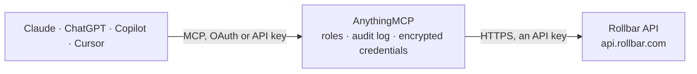

<!-- Generated by scripts/export-github-catalog.mjs in the anythingmcp-website repository. Do not edit by hand. -->

# Rollbar MCP connector

Rollbar error monitoring: items with their history and occurrences, top active items and occurrence reports, the Metrics API, deploys, environments and code versions, RQL queries, and the account's … The AnythingMCP connector gives Claude, ChatGPT, Microsoft Copilot, Cursor and Gemini 34 MCP tools for Rollbar: 28 read and 6 can change data.

**Category:** [Monitoring](../monitoring.md) · **Tools:** 34 · **Setup guide:** [anythingmcp.com](https://anythingmcp.com/guides/rollbar-to-mcp) · [Deutsch](https://anythingmcp.com/de/guides/rollbar-to-mcp) · [Italiano](https://anythingmcp.com/it/guides/rollbar-to-mcp) · [Español](https://anythingmcp.com/es/guides/rollbar-to-mcp) · [日本語](https://anythingmcp.com/ja/guides/rollbar-to-mcp) · [Русский](https://anythingmcp.com/ru/guides/rollbar-to-mcp) · [中文](https://anythingmcp.com/zh/guides/rollbar-to-mcp)

## Start without code

No installation and no terminal: AnythingMCP Cloud runs the Rollbar connector for you, operated by helpcode.ai in Frankfurt, Germany.

1. **Click the button above** and create an account or sign in. The Rollbar connector opens, ready to install.
2. **Paste the API key or token from your Rollbar account.** Every click is in the [step-by-step guide](https://anythingmcp.com/guides/rollbar-to-mcp).
3. **Click Install.** AnythingMCP shows the address of your MCP server.
4. **Add that address to your assistant:** [Claude](https://anythingmcp.com/guides/connect-rollbar-to-claude) · [ChatGPT](https://anythingmcp.com/guides/connect-rollbar-to-chatgpt) · [Microsoft Copilot](https://anythingmcp.com/guides/connect-rollbar-to-copilot) · [Cursor](https://anythingmcp.com/guides/connect-rollbar-to-cursor) · [Gemini CLI](https://anythingmcp.com/guides/connect-rollbar-to-gemini) · [Meta Muse](https://anythingmcp.com/guides/connect-rollbar-to-muse).
5. **Ask your first question**, for example: *Show item #214 from project 78 — need its current status, assignee and total occurrences.*

Prefer help with the setup? [Talk to us](https://anythingmcp.com/contact).

## How it works

- **The AI client** speaks MCP (Streamable HTTP) to AnythingMCP and only sees tool names, descriptions and results. It never gets the Rollbar credentials.
- **AnythingMCP** checks the client's role, builds the call from the tool definition, adds the credentials (an API key), calls Rollbar, logs the call and returns the result.
- **Rollbar** sees an ordinary API client with the rights of the account the credentials belong to.

## Tools

| Tool | What it does | Access |
|---|---|---|
| [`rollbar_list_items`](#rollbar_list_items) | List or search items (grouped errors and messages), 100 per page: id, counter, title, level, status, environment, framework, total occurrences, first and… | read |
| [`rollbar_get_item`](#rollbar_get_item) | Get one item by its id: title, level, status, environment, platform, framework, counter, total occurrences, first and last occurrence (with ids), assignee,… | read |
| [`rollbar_get_item_by_counter`](#rollbar_get_item_by_counter) | Find an item by the project counter shown in Rollbar URLs and the UI (#123), or by the UUID of one of its occurrences. | read |
| [`rollbar_update_item`](#rollbar_update_item) | Change an item: resolve it (optionally with the version it was fixed in), mute it or reactivate it, change its level or title, assign it to a user or team,… | write |
| [`rollbar_list_item_events`](#rollbar_list_item_events) | List the history of an item, oldest first: comments, status, level, title and assignment changes, snoozes and merges, each with user and Unix timestamp. | read |
| [`rollbar_add_item_comment`](#rollbar_add_item_comment) | Add a comment to an item's timeline, attributed to the token's user. | write |
| [`rollbar_list_occurrences`](#rollbar_list_occurrences) | List the project's latest occurrences (single error events), newest first: occurrence id, item id, timestamp, code version and the payload (exception, stack… | read |
| [`rollbar_list_item_occurrences`](#rollbar_list_item_occurrences) | List the occurrences of one item, newest first, with timestamp, code version and payload (exception, stack trace, request, person). | read |
| [`rollbar_get_occurrence`](#rollbar_get_occurrence) | Get one occurrence with its full payload, as the Raw JSON view in Rollbar: exception class and message, stack trace frames, request, person, server, client,… | read |
| [`rollbar_get_top_active_items`](#rollbar_get_top_active_items) | Get the items with the most occurrences in the last hours (like the Top 10 on the project dashboard), each with its hourly occurrence counts. | read |
| [`rollbar_get_occurrence_counts`](#rollbar_get_occurrence_counts) | Get the recent number of occurrences per minute, hour or day as [timestamp, count] pairs (the Hourly and Daily Error/Critical Occurrences graphs), filtered… | read |
| [`rollbar_get_activated_item_counts`](#rollbar_get_activated_item_counts) | Get the number of new and reactivated items per day as [timestamp, count] pairs (the Daily New/Reactivated Items graph), in the project time zone. | read |
| [`rollbar_get_item_metrics`](#rollbar_get_item_metrics) | Get metrics for a list of items of one project: occurrence counts and the time of the first and last occurrence of each. | read |
| [`rollbar_query_occurrence_metrics`](#rollbar_query_occurrence_metrics) | Query occurrence metrics over time with filters, grouping and aggregates (count_all, count_distinct, topk and more), e.g. occurrences per environment per… | read |
| [`rollbar_get_resolution_time_metrics`](#rollbar_get_resolution_time_metrics) | Get the time to resolve items over a window (median by default, or mean, min, max), per period, filtered by environments, levels and frameworks. | read |
| [`rollbar_list_deploys`](#rollbar_list_deploys) | List the project's deploys, most recent first: id, environment, revision, status, user, comment and start and finish times. | read |
| [`rollbar_get_deploy`](#rollbar_get_deploy) | Get one deploy: environment, revision, status, user, comment and start and finish times. | read |
| [`rollbar_report_deploy`](#rollbar_report_deploy) | Record a deploy of a revision to an environment, so new errors can be linked to it. | write |
| [`rollbar_update_deploy`](#rollbar_update_deploy) | Finish a deploy reported as started: set its status to succeeded, failed or timed_out, with an optional comment. | write |
| [`rollbar_list_environments`](#rollbar_list_environments) | List the environments of the project (production, staging and so on) with their ids, 20 per page. | read |
| [`rollbar_get_version`](#rollbar_get_version) | Get what happened in one code version in one environment: when it was first and last seen, and the number of new, reactivated, repeated and resolved items. | read |
| [`rollbar_list_version_items`](#rollbar_list_version_items) | List the items of one code version in one environment by what happened in it: new (first seen in this version), repeated, reactivated or resolved. | read |
| [`rollbar_create_rql_job`](#rollbar_create_rql_job) | Start an RQL query (Rollbar's SQL-like query language over items and occurrences), e.g. `SELECT item.counter, count(*) FROM item_occurrence WHERE timestamp… | read |
| [`rollbar_get_rql_job`](#rollbar_get_rql_job) | Check an RQL job: status (new, running, success, failed, cancelled, timed_out), query and times. | read |
| [`rollbar_get_rql_job_result`](#rollbar_get_rql_job_result) | Get the result of a finished RQL job: column names (`selectionColumns`) and `rows`, plus any errors and warnings. | read |
| [`rollbar_list_rql_jobs`](#rollbar_list_rql_jobs) | List earlier RQL jobs with their query, status and times, newest first. | read |
| [`rollbar_cancel_rql_job`](#rollbar_cancel_rql_job) | Cancel an RQL job that is still new or running, e.g. a slow query that was started by mistake. | write |
| [`rollbar_list_projects`](#rollbar_list_projects) | List the projects of the account: id, name, status and creation date. | read |
| [`rollbar_get_project`](#rollbar_get_project) | Get one project: id, name, account, status, time zone and grouping settings, and creation date (integration settings are left out). | read |
| [`rollbar_list_users`](#rollbar_list_users) | List the users of the account (id, username, email), optionally only the one with an email address. | read |
| [`rollbar_get_user`](#rollbar_get_user) | Get one user of the account: id, username, email and whether email notifications are on. | read |
| [`rollbar_list_teams`](#rollbar_list_teams) | List the teams of the account with id, name and access level (owner, standard, light, view). | read |
| [`rollbar_request_person_deletion`](#rollbar_request_person_deletion) | Erase a tracked person (the end user attached to occurrences) from every project of the account, by exactly one of email, username or id, e.g. for a GDPR… | write |
| [`rollbar_get_person_deletion_status`](#rollbar_get_person_deletion_status) | Check a person deletion job: state (new, running, paused, success, cancelled or failed). | read |

## Tool reference

Every parameter as the AI client sees it in `tools/list`. Source: [`packages/backend/src/adapters/intl/rollbar.json`](../../../packages/backend/src/adapters/intl/rollbar.json).

### `rollbar_list_items`

List or search items (grouped errors and messages), 100 per page: id, counter, title, level, status, environment, framework, total occurrences, first and last occurrence time, assignee and resolved version. Filter by status, level, environment, assignee or the same search text as the Items page.

**Access:** read · **Call:** `GET /api/1/items`

| Parameter | Type | Required | Description |
|---|---|---|---|
| `status` | `active` \| `resolved` \| `muted` \| `archived`[] | no | Only items with these statuses. |
| `level` | `debug` \| `info` \| `warning` \| `error` \| `critical`[] | no | Only items with these levels. |
| `environment` | string[] | no | Only items in these environments, e.g. ["production"]. Names from `rollbar_list_environments`. |
| `framework` | string[] | no | Only items of these frameworks, e.g. ["rails", "browser-js"]. |
| `assigned_user` | string | no | Only items assigned to this Rollbar username, or `assigned` / `unassigned`. |
| `assigned_team` | string[] | no | Only items assigned to these team names. Not together with assigned_user. |
| `ids` | integer[] | no | Return only these item ids. |
| `query` | string | no | Search text, in the syntax of the Items page search box (e.g. `title:timeout` or plain words). |
| `is_snoozed` | boolean | no | true for only snoozed items, false to leave snoozed items out. |
| `project_ids` | integer[] | no | Only with an account access token: the projects to search (default every project the token can read). |
| `page` | integer | no | Page number, starting at 1. |

### `rollbar_get_item`

Get one item by its id: title, level, status, environment, platform, framework, counter, total occurrences, first and last occurrence (with ids), assignee, resolved version and snooze state.

**Access:** read · **Call:** `GET /api/1/item/{item_id}`

| Parameter | Type | Required | Description |
|---|---|---|---|
| `item_id` | integer | yes | Item id (the system-wide `id` from `rollbar_list_items`, not the project counter shown in the Rollbar URL; use `rollbar_get_item_by_counter` for that). |
| `project_id` | integer | no | Only with an account access token: the project to act on, from `rollbar_list_projects`. Leave empty with a project access token (it always uses its own project). |

### `rollbar_get_item_by_counter`

Find an item by the project counter shown in Rollbar URLs and the UI (#123), or by the UUID of one of its occurrences. Returns the item with its system-wide id for the other tools. Give exactly one of counter or uuid.

**Access:** read · **Call:** `GET /api/1/item/`

| Parameter | Type | Required | Description |
|---|---|---|---|
| `counter` | integer | no | Project counter of the item, the number in https://rollbar.com/<account>/<project>/items/<counter>/. |
| `uuid` | string | no | UUID of an occurrence of the item (sent back by the SDK when it reports an error). |
| `project_id` | integer | no | Only with an account access token: the project to act on, from `rollbar_list_projects`. Leave empty with a project access token (it always uses its own project). |

### `rollbar_update_item`

Change an item: resolve it (optionally with the version it was fixed in), mute it or reactivate it, change its level or title, assign it to a user or team, or snooze it for a number of seconds. Needs a token with write scope.

**Access:** write · **Call:** `PATCH /api/1/item/{item_id}`

| Parameter | Type | Required | Description |
|---|---|---|---|
| `item_id` | integer | yes | Item id (the system-wide `id` from `rollbar_list_items`, not the project counter shown in the Rollbar URL; use `rollbar_get_item_by_counter` for that). |
| `status` | `active` \| `resolved` \| `muted` | no | New status. |
| `resolved_in_version` | string | no | With status resolved: the code version that fixes it, up to 40 characters (e.g. a git SHA). |
| `level` | `debug` \| `info` \| `warning` \| `error` \| `critical` | no | New level. |
| `title` | string | no | New title, 1 to 255 characters. |
| `assigned_user_id` | integer | no | Id of the user to assign the item to, from `rollbar_list_users`. |
| `assigned_team_id` | integer | no | Id of the team to assign the item to, from `rollbar_list_teams`. |
| `snooze_enabled` | boolean | no | true to snooze the item (paid plans), false to unsnooze it. |
| `snooze_expiration_in_seconds` | integer | no | With snooze_enabled true: how long to snooze, in seconds (3600 = one hour). |
| `project_id` | integer | no | Only with an account access token: the project to act on, from `rollbar_list_projects`. Leave empty with a project access token (it always uses its own project). |

### `rollbar_list_item_events`

List the history of an item, oldest first: comments, status, level, title and assignment changes, snoozes and merges, each with user and Unix timestamp. Filter by event type.

**Access:** read · **Call:** `GET /api/1/item/{item_id}/events`

| Parameter | Type | Required | Description |
|---|---|---|---|
| `item_id` | integer | yes | Item id (the system-wide `id` from `rollbar_list_items`, not the project counter shown in the Rollbar URL; use `rollbar_get_item_by_counter` for that). |
| `type` | `item_comment` \| `item_level_history` \| `item_status_history` \| `item_snooze_history` \| `item_assigned_user_history` \| `item_assigned_team_history` \| `item_title_history` \| `item_group_history` \| `item_merge_history`[] | no | Only these event types. |
| `page` | integer | no | Page number, starting at 1. |
| `limit` | integer | no | Results per page (default 20, at most 5000). |
| `project_id` | integer | no | Only with an account access token: the project to act on, from `rollbar_list_projects`. Leave empty with a project access token (it always uses its own project). |

### `rollbar_add_item_comment`

Add a comment to an item's timeline, attributed to the token's user. Works only with a personal access token with write scope (not a project token or service token).

**Access:** write · **Call:** `POST /api/1/item/{item_id}/comments`

| Parameter | Type | Required | Description |
|---|---|---|---|
| `item_id` | integer | yes | Item id (the system-wide `id` from `rollbar_list_items`, not the project counter shown in the Rollbar URL; use `rollbar_get_item_by_counter` for that). |
| `comment` | string | yes | Comment text (Markdown as in the Rollbar UI). |
| `project_id` | integer | yes | Id of the project that contains the item, from `rollbar_list_projects` or the item's `project_id`. |

### `rollbar_list_occurrences`

List the project's latest occurrences (single error events), newest first: occurrence id, item id, timestamp, code version and the payload (exception, stack trace, request, person, server). Request headers, cookies and notifier details are left out.

**Access:** read · **Call:** `GET /api/1/instances`

| Parameter | Type | Required | Description |
|---|---|---|---|
| `last_id` | integer | no | Id of the last occurrence of the previous page: returns the next 20 after it (instead of page). |
| `page` | integer | no | Page number, starting at 1. |
| `limit` | integer | no | Results per page (default 20, at most 5000). |
| `project_id` | integer | no | Only with an account access token: the project to act on, from `rollbar_list_projects`. Leave empty with a project access token (it always uses its own project). |

### `rollbar_list_item_occurrences`

List the occurrences of one item, newest first, with timestamp, code version and payload (exception, stack trace, request, person). Request headers, cookies and notifier details are left out.

**Access:** read · **Call:** `GET /api/1/item/{item_id}/instances`

| Parameter | Type | Required | Description |
|---|---|---|---|
| `item_id` | integer | yes | Item id (the system-wide `id` from `rollbar_list_items`, not the project counter shown in the Rollbar URL; use `rollbar_get_item_by_counter` for that). |
| `last_id` | integer | no | Id of the last occurrence of the previous page: returns the next 20 after it (instead of page). |
| `page` | integer | no | Page number, starting at 1. |
| `limit` | integer | no | Results per page (default 20, at most 5000). |
| `project_id` | integer | no | Only with an account access token: the project to act on, from `rollbar_list_projects`. Leave empty with a project access token (it always uses its own project). |

### `rollbar_get_occurrence`

Get one occurrence with its full payload, as the Raw JSON view in Rollbar: exception class and message, stack trace frames, request, person, server, client, custom data and telemetry.

**Access:** read · **Call:** `GET /api/1/instance/{occurrence_id}`

| Parameter | Type | Required | Description |
|---|---|---|---|
| `occurrence_id` | integer | yes | Occurrence id, from `rollbar_list_occurrences`, `rollbar_list_item_occurrences` or an item's `last_occurrence_id`. |
| `project_id` | integer | no | Only with an account access token: the project to act on, from `rollbar_list_projects`. Leave empty with a project access token (it always uses its own project). |

### `rollbar_get_top_active_items`

Get the items with the most occurrences in the last hours (like the Top 10 on the project dashboard), each with its hourly occurrence counts. By default sorted by level, then occurrences.

**Access:** read · **Call:** `GET /api/1/reports/top_active_items`

| Parameter | Type | Required | Description |
|---|---|---|---|
| `hours` | integer | no | Number of recent hours to look at, 1 to 168 (default 24). |
| `environments` | string | no | Comma-separated environments to include, e.g. `production,staging`. Empty means every environment. |
| `sort` | `occurrences` | no | `occurrences` sorts by occurrence count only instead of level first. |
| `project_id` | integer | no | Only with an account access token: the project to act on, from `rollbar_list_projects`. Leave empty with a project access token (it always uses its own project). |

### `rollbar_get_occurrence_counts`

Get the recent number of occurrences per minute, hour or day as [timestamp, count] pairs (the Hourly and Daily Error/Critical Occurrences graphs), filtered by environments, level range or one item.

**Access:** read · **Call:** `GET /api/1/reports/occurrence_counts`

| Parameter | Type | Required | Description |
|---|---|---|---|
| `bucket_size` | `60` \| `3600` \| `86400` | no | Bucket size in seconds: 60, 3600 or 86400 (default 86400). Buckets are in GMT. |
| `environments` | string | no | Comma-separated environments to include, e.g. `production,staging`. Empty means every environment. |
| `min_level` | `debug` \| `info` \| `warning` \| `error` \| `critical` | no | Lowest level to count. |
| `max_level` | `debug` \| `info` \| `warning` \| `error` \| `critical` | no | Highest level to count. |
| `item_id` | integer | no | Count only the occurrences of this item. |
| `project_id` | integer | no | Only with an account access token: the project to act on, from `rollbar_list_projects`. Leave empty with a project access token (it always uses its own project). |

### `rollbar_get_activated_item_counts`

Get the number of new and reactivated items per day as [timestamp, count] pairs (the Daily New/Reactivated Items graph), in the project time zone.

**Access:** read · **Call:** `GET /api/1/reports/activated_counts`

| Parameter | Type | Required | Description |
|---|---|---|---|
| `buckets` | integer | no | Number of days to return, 2 to 366. |
| `bucket_size` | `86400` | no | Bucket size in seconds; only 86400 (a day) is accepted. |
| `environments` | string | no | Comma-separated environments to include, e.g. `production,staging`. Empty means every environment. |
| `project_id` | integer | no | Only with an account access token: the project to act on, from `rollbar_list_projects`. Leave empty with a project access token (it always uses its own project). |

### `rollbar_get_item_metrics`

Get metrics for a list of items of one project: occurrence counts and the time of the first and last occurrence of each. Runs as a query (POST) and changes nothing.

**Access:** read · **Call:** `POST /api/1/metrics/items`

| Parameter | Type | Required | Description |
|---|---|---|---|
| `item_counters` | integer[] | yes | Item counters of the project (the `counter` field of an item, shown as #277 in Rollbar, not its id), e.g. [277, 278]. |
| `project_id` | integer | no | Only with an account access token: the project to act on, from `rollbar_list_projects`. Leave empty with a project access token (it always uses its own project). |

### `rollbar_query_occurrence_metrics`

Query occurrence metrics over time with filters, grouping and aggregates (count_all, count_distinct, topk and more), e.g. occurrences per environment per day or the top browsers of an item. Needs the Metrics API of the Advanced plan. Runs as a query and changes nothing.

**Access:** read · **Call:** `POST /api/1/metrics/occurrences`

| Parameter | Type | Required | Description |
|---|---|---|---|
| `start_time` | integer | no | Start of the window, Unix seconds. Default: the start of the data retention. |
| `end_time` | integer | no | End of the window (inclusive), Unix seconds. Default: open-ended. |
| `filters` | object[] | no | Filters that must all match, each {"field": "environment", "operator": "eq", "values": ["production"]}. Operators: eq, ne (several values), gt, gte, lt, lte (one value), like, ilike (one SQL pattern), is_null, not_null. Fields include project_id, item_id, item_counter, environment, item_level, item_status, code_version, browser_family, os_family, platform, framework, exception_class, request_url, person_id, server_host. |
| `group_by` | string[] | no | Columns to group by, e.g. ["environment"] or ["item_id"]. |
| `aggregates` | object[] | no | Aggregates per group, each {"field": "occurrence_id", "function": "count_all", "alias": "occurrences"}. Functions: count_all, count_distinct, max, min, sum, topk (parameters ["5"]), quantiles, array, json_array_length. |
| `sort` | object | no | Sort order, e.g. {"field": "occurrences", "order": "desc"}. Default timestamp ascending. |
| `granularity` | `second` \| `minute` \| `hour` \| `day` \| `week` \| `month` \| `year` | no | Bucket results per period; without it everything is one timepoint. |
| `timezone` | string | no | Time zone for the buckets, e.g. Europe/Berlin (default UTC). |
| `limit` | integer | no | Maximum rows or groups to return. |
| `offset` | integer | no | Rows or groups to skip (for paging). |

### `rollbar_get_resolution_time_metrics`

Get the time to resolve items over a window (median by default, or mean, min, max), per period, filtered by environments, levels and frameworks. With an account token, for a list of projects. Runs as a query and changes nothing.

**Access:** read · **Call:** `POST /api/1/metrics/ttr`

| Parameter | Type | Required | Description |
|---|---|---|---|
| `start_time` | integer | yes | Start of the window, Unix seconds. |
| `end_time` | integer | no | End of the window (inclusive), Unix seconds. Default now. |
| `granularity` | `second` \| `minute` \| `hour` \| `day` \| `week` \| `month` \| `year` | no | Period of each value. |
| `function` | `mean` \| `median` \| `min` \| `max` | no | Aggregate of the resolution times (default median). |
| `project_ids` | integer[] | no | Only with an account access token: the projects to include. |
| `environments` | string[] | no | Only these environments. |
| `levels` | `debug` \| `info` \| `warning` \| `error` \| `critical`[] | no | Only these levels. |
| `frameworks` | string[] | no | Only these frameworks. |
| `timezone` | string | no | Time zone for the periods (default US/Pacific), e.g. Europe/London. |

### `rollbar_list_deploys`

List the project's deploys, most recent first: id, environment, revision, status, user, comment and start and finish times.

**Access:** read · **Call:** `GET /api/1/deploys`

| Parameter | Type | Required | Description |
|---|---|---|---|
| `page` | integer | no | Page number, starting at 1. |
| `limit` | integer | no | Results per page (default 20, at most 5000). |
| `project_id` | integer | no | Only with an account access token: the project to act on, from `rollbar_list_projects`. Leave empty with a project access token (it always uses its own project). |

### `rollbar_get_deploy`

Get one deploy: environment, revision, status, user, comment and start and finish times.

**Access:** read · **Call:** `GET /api/1/deploy/{deploy_id}`

| Parameter | Type | Required | Description |
|---|---|---|---|
| `deploy_id` | integer | yes | Deploy id, from `rollbar_list_deploys`. |
| `project_id` | integer | no | Only with an account access token: the project to act on, from `rollbar_list_projects`. Leave empty with a project access token (it always uses its own project). |

### `rollbar_report_deploy`

Record a deploy of a revision to an environment, so new errors can be linked to it. Needs a project access token with the post_server_item scope.

**Access:** write · **Call:** `POST /api/1/deploy`

| Parameter | Type | Required | Description |
|---|---|---|---|
| `environment` | string | yes | Environment deployed to, e.g. production. |
| `revision` | string | yes | Revision deployed, usually the git SHA. |
| `status` | `started` \| `succeeded` \| `failed` \| `timed_out` | no | Deploy status (default succeeded); report started first and finish with `rollbar_update_deploy`. |
| `rollbar_username` | string | no | Rollbar username of the person who deployed. |
| `local_username` | string | no | Local user name of the deployer, shown when no rollbar_username is given. |
| `comment` | string | no | Text to store with the deploy, e.g. the release notes. |

### `rollbar_update_deploy`

Finish a deploy reported as started: set its status to succeeded, failed or timed_out, with an optional comment. Needs a project access token with post_server_item scope.

**Access:** write · **Call:** `PATCH /api/1/deploy/{deploy_id}`

| Parameter | Type | Required | Description |
|---|---|---|---|
| `deploy_id` | integer | yes | Deploy id, from `rollbar_list_deploys`. |
| `status` | `started` \| `succeeded` \| `failed` \| `timed_out` | yes | New status; only a deploy that is still started can change. |
| `comment` | string | no | Comment describing the deploy. |

### `rollbar_list_environments`

List the environments of the project (production, staging and so on) with their ids, 20 per page.

**Access:** read · **Call:** `GET /api/1/environments`

| Parameter | Type | Required | Description |
|---|---|---|---|
| `page` | integer | no | Page number, starting at 1. |
| `limit` | integer | no | Results per page (default 20, at most 5000). |
| `project_id` | integer | no | Only with an account access token: the project to act on, from `rollbar_list_projects`. Leave empty with a project access token (it always uses its own project). |

### `rollbar_get_version`

Get what happened in one code version in one environment: when it was first and last seen, and the number of new, reactivated, repeated and resolved items.

**Access:** read · **Call:** `GET /api/1/versions/{version}`

| Parameter | Type | Required | Description |
|---|---|---|---|
| `version` | string | yes | Code version as sent in the occurrence payload (`code_version`), e.g. a git SHA or 1.4.2. |
| `environment` | string | yes | Environment the version runs in, e.g. production. |
| `project_id` | integer | no | Only with an account access token: the project to act on, from `rollbar_list_projects`. Leave empty with a project access token (it always uses its own project). |

### `rollbar_list_version_items`

List the items of one code version in one environment by what happened in it: new (first seen in this version), repeated, reactivated or resolved. Useful to check a release.

**Access:** read · **Call:** `GET /api/1/versions/{version}/items`

| Parameter | Type | Required | Description |
|---|---|---|---|
| `version` | string | yes | Code version as sent in the occurrence payload (`code_version`), e.g. a git SHA or 1.4.2. |
| `environment` | string | yes | Environment the version runs in, e.g. production. |
| `event` | `new` \| `repeated` \| `reactivated` \| `resolved` | yes | Which items: new, repeated, reactivated or resolved in this version. |
| `level` | `debug` \| `info` \| `warning` \| `error` \| `critical`[] | no | Only items of these levels. |
| `page` | integer | no | Page number, starting at 1. |
| `project_id` | integer | no | Only with an account access token: the project to act on, from `rollbar_list_projects`. Leave empty with a project access token (it always uses its own project). |

### `rollbar_create_rql_job`

Start an RQL query (Rollbar's SQL-like query language over items and occurrences), e.g. `SELECT item.counter, count(*) FROM item_occurrence WHERE timestamp > unix_timestamp() - 86400 GROUP BY 1 ORDER BY 2 DESC LIMIT 10`. Returns a job id; then poll `rollbar_get_rql_job`. Changes no data.

**Access:** read · **Call:** `POST /api/1/rql/jobs/`

| Parameter | Type | Required | Description |
|---|---|---|---|
| `query_string` | string | yes | The RQL query. Tables: item_occurrence and deploy; `show tables` and `describe item_occurrence` list them. |
| `force_refresh` | boolean | no | Run again even when the same query was run recently (default reuses the earlier result). |
| `project_id` | integer | no | Only with an account access token: the project to act on, from `rollbar_list_projects`. Leave empty with a project access token (it always uses its own project). |

### `rollbar_get_rql_job`

Check an RQL job: status (new, running, success, failed, cancelled, timed_out), query and times. With expand `result` it also returns the rows once it has succeeded.

**Access:** read · **Call:** `GET /api/1/rql/job/{job_id}`

| Parameter | Type | Required | Description |
|---|---|---|---|
| `job_id` | integer | yes | RQL job id, from `rollbar_create_rql_job` or `rollbar_list_rql_jobs`. |
| `expand` | `result` | no | `result` to include the result rows. |
| `project_id` | integer | no | Only with an account access token: the project to act on, from `rollbar_list_projects`. Leave empty with a project access token (it always uses its own project). |

### `rollbar_get_rql_job_result`

Get the result of a finished RQL job: column names (`selectionColumns`) and `rows`, plus any errors and warnings.

**Access:** read · **Call:** `GET /api/1/rql/job/{job_id}/result`

| Parameter | Type | Required | Description |
|---|---|---|---|
| `job_id` | integer | yes | RQL job id, from `rollbar_create_rql_job` or `rollbar_list_rql_jobs`. |
| `expand` | `job` | no | `job` to include the job itself. |
| `project_id` | integer | no | Only with an account access token: the project to act on, from `rollbar_list_projects`. Leave empty with a project access token (it always uses its own project). |

### `rollbar_list_rql_jobs`

List earlier RQL jobs with their query, status and times, newest first.

**Access:** read · **Call:** `GET /api/1/rql/jobs/`

| Parameter | Type | Required | Description |
|---|---|---|---|
| `page` | integer | no | Page number, starting at 1. |
| `project_id` | integer | no | Only with an account access token: the project to act on, from `rollbar_list_projects`. Leave empty with a project access token (it always uses its own project). |

### `rollbar_cancel_rql_job`

Cancel an RQL job that is still new or running, e.g. a slow query that was started by mistake.

**Access:** write · **Call:** `POST /api/1/rql/job/{job_id}/cancel`

| Parameter | Type | Required | Description |
|---|---|---|---|
| `job_id` | integer | yes | RQL job id, from `rollbar_create_rql_job` or `rollbar_list_rql_jobs`. |
| `project_id` | integer | no | Only with an account access token: the project the job ran against. |

### `rollbar_list_projects`

List the projects of the account: id, name, status and creation date. Needs an account access token (a project token is refused). A personal access token lists only the projects its user can see.

**Access:** read · **Call:** `GET /api/1/projects`

No parameters.

### `rollbar_get_project`

Get one project: id, name, account, status, time zone and grouping settings, and creation date (integration settings are left out). Needs an account access token (a project token is refused).

**Access:** read · **Call:** `GET /api/1/project/{project_id}`

| Parameter | Type | Required | Description |
|---|---|---|---|
| `project_id` | integer | yes | Project id, from `rollbar_list_projects`. |

### `rollbar_list_users`

List the users of the account (id, username, email), optionally only the one with an email address. Needs an account access token (a project token is refused).

**Access:** read · **Call:** `GET /api/1/users`

| Parameter | Type | Required | Description |
|---|---|---|---|
| `email` | string | no | Only the user with this email address. |

### `rollbar_get_user`

Get one user of the account: id, username, email and whether email notifications are on. Needs an account access token (a project token is refused).

**Access:** read · **Call:** `GET /api/1/user/{user_id}`

| Parameter | Type | Required | Description |
|---|---|---|---|
| `user_id` | integer | yes | User id, from `rollbar_list_users`. |

### `rollbar_list_teams`

List the teams of the account with id, name and access level (owner, standard, light, view). Team ids are used to assign items. Needs an account access token (a project token is refused).

**Access:** read · **Call:** `GET /api/1/teams`

No parameters.

### `rollbar_request_person_deletion`

Erase a tracked person (the end user attached to occurrences) from every project of the account, by exactly one of email, username or id, e.g. for a GDPR request. Runs as a job; check it with `rollbar_get_person_deletion_status`. Cannot be undone. Needs an account token with write scope. Switched off by default.

**Access:** write · **Call:** `POST /api/1/people/delete_jobs/`

| Parameter | Type | Required | Description |
|---|---|---|---|
| `email` | string | no | Email of the person to delete, as sent in the occurrence payload. |
| `username` | string | no | Username of the person to delete, as sent in the payload. |
| `id` | string | no | Id of the person to delete, as sent in the payload (`person.id`). |

### `rollbar_get_person_deletion_status`

Check a person deletion job: state (new, running, paused, success, cancelled or failed). Needs an account access token.

**Access:** read · **Call:** `GET /api/1/people/delete_jobs/{job_id}`

| Parameter | Type | Required | Description |
|---|---|---|---|
| `job_id` | integer | yes | Deletion job id, from `rollbar_request_person_deletion`. |

## Run it yourself

AnythingMCP is open source (AGPL-3.0). [Run it with Docker](../../../README.md#run-it-yourself), open **Connectors → Store**, pick **Rollbar** and enter `ROLLBAR_ACCESS_TOKEN`, then add your MCP server URL to the AI client.

[← Monitoring connectors](../monitoring.md) · [All categories](../README.md)
