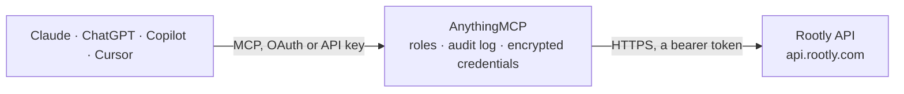

<!-- Generated by scripts/export-github-catalog.mjs in the anythingmcp-website repository. Do not edit by hand. -->

# Rootly MCP connector

Rootly incident management: incidents with timeline, action items and status page updates, alerts, services, functionalities, teams, severities and incident types, on-call (who is on call, schedules, … The AnythingMCP connector gives Claude, ChatGPT, Microsoft Copilot, Cursor and Gemini 40 MCP tools for Rootly: 30 read and 10 can change data.

**Category:** [Monitoring](../monitoring.md) · **Tools:** 40 · **Setup guide:** [anythingmcp.com](https://anythingmcp.com/guides/rootly-to-mcp) · [Deutsch](https://anythingmcp.com/de/guides/rootly-to-mcp) · [Italiano](https://anythingmcp.com/it/guides/rootly-to-mcp) · [Español](https://anythingmcp.com/es/guides/rootly-to-mcp) · [日本語](https://anythingmcp.com/ja/guides/rootly-to-mcp) · [Русский](https://anythingmcp.com/ru/guides/rootly-to-mcp) · [中文](https://anythingmcp.com/zh/guides/rootly-to-mcp)

## Start without code

No installation and no terminal: AnythingMCP Cloud runs the Rootly connector for you, operated by helpcode.ai in Frankfurt, Germany.

1. **Click the button above** and create an account or sign in. The Rootly connector opens, ready to install.
2. **Paste the API key or token from your Rootly account.** Every click is in the [step-by-step guide](https://anythingmcp.com/guides/rootly-to-mcp).
3. **Click Install.** AnythingMCP shows the address of your MCP server.
4. **Add that address to your assistant:** [Claude](https://anythingmcp.com/guides/connect-rootly-to-claude) · [ChatGPT](https://anythingmcp.com/guides/connect-rootly-to-chatgpt) · [Microsoft Copilot](https://anythingmcp.com/guides/connect-rootly-to-copilot) · [Cursor](https://anythingmcp.com/guides/connect-rootly-to-cursor) · [Gemini CLI](https://anythingmcp.com/guides/connect-rootly-to-gemini) · [Meta Muse](https://anythingmcp.com/guides/connect-rootly-to-muse).
5. **Ask your first question**, for example: *Show incident INC-142: current status, severity, affected services and when it started*

Prefer help with the setup? [Talk to us](https://anythingmcp.com/contact).

## How it works

- **The AI client** speaks MCP (Streamable HTTP) to AnythingMCP and only sees tool names, descriptions and results. It never gets the Rootly credentials.
- **AnythingMCP** checks the client's role, builds the call from the tool definition, adds the credentials (a bearer token), calls Rootly, logs the call and returns the result.
- **Rootly** sees an ordinary API client with the rights of the account the credentials belong to.

## Tools

| Tool | What it does | Access |
|---|---|---|
| [`rootly_get_current_user`](#rootly_get_current_user) | Show the user the API key acts as: id, name, email, time zone and role. | read |
| [`rootly_list_incidents`](#rootly_list_incidents) | List incidents, newest first by default: sequential id (the 123 in INC-123), title, status, kind, severity, services, teams, environments, incident types,… | read |
| [`rootly_get_incident`](#rootly_get_incident) | Get one incident with all its attributes: title, summary, status, severity, services, teams, environments, types, labels, Slack channel, linked tickets,… | read |
| [`rootly_create_incident`](#rootly_create_incident) | Declare an incident. | write |
| [`rootly_update_incident`](#rootly_update_incident) | Change an incident: title, summary, status, severity, affected services, functionalities, environments, types, teams, causes or labels. | write |
| [`rootly_mitigate_incident`](#rootly_mitigate_incident) | Mark an incident as mitigated (the impact is under control) with a short note on how. | write |
| [`rootly_resolve_incident`](#rootly_resolve_incident) | Mark an incident as resolved with a short note on how. | write |
| [`rootly_list_incident_events`](#rootly_list_incident_events) | List the timeline of an incident: the events (notes, status changes, updates) with their text, visibility (internal or external) and when they occurred. | read |
| [`rootly_add_incident_event`](#rootly_add_incident_event) | Add a note to the timeline of an incident. | write |
| [`rootly_list_action_items`](#rootly_list_action_items) | List action items across all incidents: summary, kind (task during the incident, follow_up after it), priority, status, assignee, due date and the incident. | read |
| [`rootly_list_incident_action_items`](#rootly_list_incident_action_items) | List the action items of one incident: summary, kind, priority, status, assignee and due date. | read |
| [`rootly_get_action_item`](#rootly_get_action_item) | Get one action item with its description, assignee, teams, due date and linked Jira issue. | read |
| [`rootly_create_action_item`](#rootly_create_action_item) | Add an action item to an incident: a task to do now or a follow-up for after the incident, with priority, assignee and due date. | write |
| [`rootly_update_action_item`](#rootly_update_action_item) | Change an action item: summary, description, status (e.g. done), priority, assignee or due date. | write |
| [`rootly_list_alerts`](#rootly_list_alerts) | List alerts, newest first: short id, summary, status (open, triggered, acknowledged, resolved, deferred), source (datadog, grafana, email and so on), noise… | read |
| [`rootly_get_alert`](#rootly_get_alert) | Get one alert with its full details, including the raw payload the source sent (`data`), labels, responders and linked incidents. | read |
| [`rootly_acknowledge_alert`](#rootly_acknowledge_alert) | Acknowledge an alert: someone is looking at it, so its escalation stops paging the next level. | write |
| [`rootly_resolve_alert`](#rootly_resolve_alert) | Resolve an alert, optionally with a note and also resolving the incidents it is attached to. | write |
| [`rootly_list_services`](#rootly_list_services) | List the services in the catalog: name, slug, description, owners, linked repositories and external ids (Backstage, Cortex, OpsLevel, PagerDuty). | read |
| [`rootly_get_service`](#rootly_get_service) | Get one service with its description, owner teams and users, escalation policy, alert and incident broadcast settings and external links. | read |
| [`rootly_list_functionalities`](#rootly_list_functionalities) | List the functionalities (user-facing capabilities such as Checkout or Login) with name, slug, description and owners. | read |
| [`rootly_get_functionality`](#rootly_get_functionality) | Get one functionality with its description, owners, linked services and status page components. | read |
| [`rootly_list_teams`](#rootly_list_teams) | List the teams (groups) with name, slug, description, members and their on-call and escalation settings. | read |
| [`rootly_get_team`](#rootly_get_team) | Get one team with its description and members; add `include` for its schedules and escalation policies. | read |
| [`rootly_list_environments`](#rootly_list_environments) | List the environments (production, staging and so on) with name, slug and colour. | read |
| [`rootly_list_severities`](#rootly_list_severities) | List the severity levels (e.g. SEV0 to SEV3) with id, name, slug, level (`severity`: critical, high, medium, low), description and colour. | read |
| [`rootly_list_incident_types`](#rootly_list_incident_types) | List the incident types (e.g. Security, Customer facing) with id, name, slug and description. | read |
| [`rootly_list_users`](#rootly_list_users) | List the users of the organization: id, name, email, time zone; add `include` for role, teams or schedules. | read |
| [`rootly_list_oncalls`](#rootly_list_oncalls) | Who is on call: the on-call entries of every escalation policy, schedule and level for now or a time window, with the user, schedule, escalation policy and… | read |
| [`rootly_list_schedules`](#rootly_list_schedules) | List the on-call schedules with name, description, owning teams and time zone. | read |
| [`rootly_get_schedule`](#rootly_get_schedule) | Get one on-call schedule with its owners, time zone and settings. | read |
| [`rootly_get_schedule_shifts`](#rootly_get_schedule_shifts) | List the shifts of one schedule in a time window: who is on call from when to when, including overrides. | read |
| [`rootly_list_shifts`](#rootly_list_shifts) | List on-call shifts across schedules in a time window (default: the shifts running now): schedule, rotation, user, start and end, override and shadow flags. | read |
| [`rootly_list_escalation_policies`](#rootly_list_escalation_policies) | List the escalation policies with name, description, repeat settings and owning teams; add `include` for their levels and paths. | read |
| [`rootly_list_status_pages`](#rootly_list_status_pages) | List the status pages with title, public URL, whether they are public, and their settings. | read |
| [`rootly_get_status_page`](#rootly_get_status_page) | Get one status page with its title, description, public URL, components and settings. | read |
| [`rootly_list_incident_status_page_events`](#rootly_list_incident_status_page_events) | List the updates an incident published to status pages: text, status (investigating, identified, monitoring, resolved), status page and time. | read |
| [`rootly_create_status_page_event`](#rootly_create_status_page_event) | Publish an incident update on a status page, e.g. Investigating, then Identified, Monitoring and Resolved. | write |
| [`rootly_list_retrospectives`](#rootly_list_retrospectives) | List incident retrospectives (post-mortems): title, status (draft, published), the incident, URL and dates. | read |
| [`rootly_get_retrospective`](#rootly_get_retrospective) | Get one retrospective with its title, status, content, URL and the incident it belongs to. | read |

## Tool reference

Every parameter as the AI client sees it in `tools/list`. Source: [`packages/backend/src/adapters/intl/rootly.json`](../../../packages/backend/src/adapters/intl/rootly.json).

### `rootly_get_current_user`

Show the user the API key acts as: id, name, email, time zone and role. Use it to check the key; a Global or Team key answers with the user that created it.

**Access:** read · **Call:** `GET /v1/users/me`

No parameters.

### `rootly_list_incidents`

List incidents, newest first by default: sequential id (the 123 in INC-123), title, status, kind, severity, services, teams, environments, incident types, URL and the lifecycle timestamps (started, detected, acknowledged, mitigated, resolved, closed). Filter by status, severity, service, team, environment, type, text and dates.

**Access:** read · **Call:** `GET /v1/incidents`

| Parameter | Type | Required | Description |
|---|---|---|---|
| `search` | string | no | Free-text search in the title and summary. |
| `status` | string | no | Only incidents with this status. Several are comma-separated, e.g. `started,mitigated`. Values: in_triage, started, detected, acknowledged, mitigated, resolved, closed, cancelled; scheduled maintenance uses scheduled, in_progress, completed. |
| `kind` | string | no | Only this kind: normal, test, example, backfilled, scheduled (and their `_sub` forms for sub-incidents). Comma-separate several. |
| `severity` | string | no | Only this severity slug (e.g. `sev0`, `sev1`), from `rootly_list_severities`. Comma-separate several. |
| `private` | `true` \| `false` | no | `true` for private incidents only, `false` for public only. |
| `sequential_id` | string | no | Only the incident with this number (the 123 in INC-123). |
| `service_ids` | string | no | Only incidents on these service ids (comma-separated), from `rootly_list_services`. |
| `team_ids` | string | no | Only incidents of these team ids (comma-separated), from `rootly_list_teams`. |
| `environment_ids` | string | no | Only incidents in these environment ids (comma-separated), from `rootly_list_environments`. |
| `functionality_ids` | string | no | Only incidents on these functionality ids (comma-separated), from `rootly_list_functionalities`. |
| `type_ids` | string | no | Only incidents of these incident type ids (comma-separated), from `rootly_list_incident_types`. |
| `created_at_gte` | string | no | Created at or after this ISO 8601 time, e.g. 2026-10-01T00:00:00Z. |
| `created_at_lte` | string | no | Created at or before this ISO 8601 time. |
| `started_at_gte` | string | no | Started at or after this ISO 8601 time. |
| `started_at_lte` | string | no | Started at or before this ISO 8601 time. |
| `resolved_at_gte` | string | no | Resolved at or after this ISO 8601 time. |
| `updated_at_gte` | string | no | Updated at or after this ISO 8601 time; use it to poll for changes. |
| `sort` | `created_at` \| `-created_at` \| `updated_at` \| `-updated_at` \| `started_at` \| `-started_at` \| `in_triage_at` \| `-in_triage_at` \| `mitigated_at` \| `-mitigated_at` \| `resolved_at` \| `-resolved_at` | no | Order: `-created_at` (newest first), `created_at`, `-started_at`, `-updated_at`, `-resolved_at`, and so on. |
| `include` | string | no | Related records to embed in `included`, comma-separated, e.g. `roles,subscribers,action_items,events,custom_field_selections`. Leave empty for a compact answer. |
| `fields` | string | no | Incident attributes to return, comma-separated (JSON:API sparse fieldset). The default keeps the useful ones; pass an empty string to get every attribute. |
| `page_number` | integer | no | Page number, starting at 1 (default 1). `meta.next_page` of the previous answer gives the next one; it is null on the last page. |
| `page_size` | integer | no | Results per page (Rootly default 20). Keep it small (10 to 50): Rootly records are large. |
| `page_after` | string | no | Cursor for cursor paging: `meta.next_cursor` of the previous answer. Use either this or page_number. |

### `rootly_get_incident`

Get one incident with all its attributes: title, summary, status, severity, services, teams, environments, types, labels, Slack channel, linked tickets, mitigation and resolution messages and every timestamp. Add `include` for roles, subscribers, action items, events or custom fields.

**Access:** read · **Call:** `GET /v1/incidents/{incident_id}`

| Parameter | Type | Required | Description |
|---|---|---|---|
| `incident_id` | string | yes | Incident id (UUID) or slug, from `rootly_list_incidents` (`data[].id`). |
| `include` | string | no | Related records to embed in `included`, comma-separated: sub_statuses, causes, subscribers, roles, environments, incident_types, services, functionalities, groups, events, action_items, custom_field_selections, feedbacks, incident_post_mortem. |

### `rootly_create_incident`

Declare an incident. Without `kind` it is a normal incident: Rootly runs the workflows, creates the Slack channel and pages or notifies people as configured. Use kind `test` for a try. Set `idempotency_key` so a retry within 24 hours returns the same incident instead of opening a second one.

**Access:** write · **Call:** `POST /v1/incidents`

| Parameter | Type | Required | Description |
|---|---|---|---|
| `idempotency_key` | string | no | A unique string for this request (e.g. a UUID). Repeating the call with the same key within 24 hours returns the incident already created. |
| `title` | string | no | Incident title. Rootly generates one when it is left empty on create. |
| `summary` | string | no | Summary of what is happening (markdown). |
| `severity_id` | string | no | Severity id, from `rootly_list_severities`. |
| `service_ids` | string[] | no | Affected service ids, from `rootly_list_services`. |
| `functionality_ids` | string[] | no | Affected functionality ids, from `rootly_list_functionalities`. |
| `environment_ids` | string[] | no | Environment ids, from `rootly_list_environments`. |
| `incident_type_ids` | string[] | no | Incident type ids, from `rootly_list_incident_types`. |
| `group_ids` | string[] | no | Team ids, from `rootly_list_teams`. |
| `labels` | object | no | Labels as key and value pairs, e.g. {"region": "eu-west-1"}. |
| `kind` | `normal` \| `normal_sub` \| `test` \| `test_sub` \| `example` \| `example_sub` \| `backfilled` \| `scheduled` \| `scheduled_sub` | no | normal (default), test, example, backfilled or scheduled (a maintenance window). |
| `status` | `in_triage` \| `started` \| `detected` \| `acknowledged` \| `mitigated` \| `resolved` \| `closed` \| `cancelled` \| `scheduled` \| `in_progress` \| `completed` | no | Starting status (default started). `in_triage` opens it in triage first. |
| `private` | boolean | no | Create a private incident, visible only to its members. A private incident cannot be made public again. |
| `alert_ids` | string[] | no | Alert ids to attach, from `rootly_list_alerts`. |
| `notify_emails` | string[] | no | E-mail addresses to notify. |

### `rootly_update_incident`

Change an incident: title, summary, status, severity, affected services, functionalities, environments, types, teams, causes or labels. Only the fields you pass change; a list replaces the whole list (pass the current ids too when adding one). For mitigating and resolving with a message prefer `rootly_mitigate_incident` and `rootly_resolve_incident`.

**Access:** write · **Call:** `PUT /v1/incidents/{incident_id}`

| Parameter | Type | Required | Description |
|---|---|---|---|
| `incident_id` | string | yes | Incident id, from `rootly_list_incidents`. |
| `title` | string | no | Incident title. Rootly generates one when it is left empty on create. |
| `summary` | string | no | Summary of what is happening (markdown). |
| `severity_id` | string | no | Severity id, from `rootly_list_severities`. |
| `service_ids` | string[] | no | Affected service ids, from `rootly_list_services`. |
| `functionality_ids` | string[] | no | Affected functionality ids, from `rootly_list_functionalities`. |
| `environment_ids` | string[] | no | Environment ids, from `rootly_list_environments`. |
| `incident_type_ids` | string[] | no | Incident type ids, from `rootly_list_incident_types`. |
| `group_ids` | string[] | no | Team ids, from `rootly_list_teams`. |
| `labels` | object | no | Labels as key and value pairs, e.g. {"region": "eu-west-1"}. |
| `status` | `in_triage` \| `started` \| `detected` \| `acknowledged` \| `mitigated` \| `resolved` \| `closed` \| `cancelled` \| `scheduled` \| `in_progress` \| `completed` | no | New status. Moving it on runs the workflows tied to that status. |
| `cause_ids` | string[] | no | Cause ids. |
| `public_title` | string | no | Title shown on public status pages. |

### `rootly_mitigate_incident`

Mark an incident as mitigated (the impact is under control) with a short note on how. Sets `mitigated_at` and runs the mitigation workflows.

**Access:** write · **Call:** `PUT /v1/incidents/{incident_id}/mitigate`

| Parameter | Type | Required | Description |
|---|---|---|---|
| `incident_id` | string | yes | Incident id, from `rootly_list_incidents`. |
| `mitigation_message` | string | no | How the incident was mitigated. |

### `rootly_resolve_incident`

Mark an incident as resolved with a short note on how. Sets `resolved_at`, runs the resolution workflows and usually starts the retrospective.

**Access:** write · **Call:** `PUT /v1/incidents/{incident_id}/resolve`

| Parameter | Type | Required | Description |
|---|---|---|---|
| `incident_id` | string | yes | Incident id, from `rootly_list_incidents`. |
| `resolution_message` | string | no | How the incident was resolved. |

### `rootly_list_incident_events`

List the timeline of an incident: the events (notes, status changes, updates) with their text, visibility (internal or external) and when they occurred.

**Access:** read · **Call:** `GET /v1/incidents/{incident_id}/events`

| Parameter | Type | Required | Description |
|---|---|---|---|
| `incident_id` | string | yes | Incident id, from `rootly_list_incidents`. |
| `page_number` | integer | no | Page number, starting at 1 (default 1). `meta.next_page` of the previous answer gives the next one; it is null on the last page. |
| `page_size` | integer | no | Results per page (Rootly default 20). Keep it small (10 to 50): Rootly records are large. |

### `rootly_add_incident_event`

Add a note to the timeline of an incident. Internal notes stay with the responders; external ones can be shared.

**Access:** write · **Call:** `POST /v1/incidents/{incident_id}/events`

| Parameter | Type | Required | Description |
|---|---|---|---|
| `incident_id` | string | yes | Incident id, from `rootly_list_incidents`. |
| `event` | string | yes | The text of the timeline entry. |
| `visibility` | `internal` \| `external` | no | internal (default) or external. |

### `rootly_list_action_items`

List action items across all incidents: summary, kind (task during the incident, follow_up after it), priority, status, assignee, due date and the incident. Filter by status, priority, kind, incident status and due date.

**Access:** read · **Call:** `GET /v1/action_items`

| Parameter | Type | Required | Description |
|---|---|---|---|
| `status` | string | no | Only this status: open, in_progress, cancelled, done. Comma-separate several. |
| `priority` | string | no | Only this priority: high, medium, low. |
| `kind` | `task` \| `follow_up` | no | task or follow_up. |
| `incident_status` | string | no | Only items of incidents in this status, e.g. resolved. |
| `due_date_gte` | string | no | Due on or after this date (YYYY-MM-DD or ISO 8601). |
| `due_date_lte` | string | no | Due on or before this date (YYYY-MM-DD or ISO 8601). |
| `sort` | string | no | Sort field, `-` for descending, e.g. `-created_at` or `due_date`. |
| `include` | string | no | Related records to embed, comma-separated, e.g. `incident`. |
| `page_number` | integer | no | Page number, starting at 1 (default 1). `meta.next_page` of the previous answer gives the next one; it is null on the last page. |
| `page_size` | integer | no | Results per page (Rootly default 20). Keep it small (10 to 50): Rootly records are large. |

### `rootly_list_incident_action_items`

List the action items of one incident: summary, kind, priority, status, assignee and due date.

**Access:** read · **Call:** `GET /v1/incidents/{incident_id}/action_items`

| Parameter | Type | Required | Description |
|---|---|---|---|
| `incident_id` | string | yes | Incident id, from `rootly_list_incidents`. |
| `page_number` | integer | no | Page number, starting at 1 (default 1). `meta.next_page` of the previous answer gives the next one; it is null on the last page. |
| `page_size` | integer | no | Results per page (Rootly default 20). Keep it small (10 to 50): Rootly records are large. |

### `rootly_get_action_item`

Get one action item with its description, assignee, teams, due date and linked Jira issue.

**Access:** read · **Call:** `GET /v1/action_items/{action_item_id}`

| Parameter | Type | Required | Description |
|---|---|---|---|
| `action_item_id` | string | yes | Action item id, from `rootly_list_action_items`. |

### `rootly_create_action_item`

Add an action item to an incident: a task to do now or a follow-up for after the incident, with priority, assignee and due date.

**Access:** write · **Call:** `POST /v1/incidents/{incident_id}/action_items`

| Parameter | Type | Required | Description |
|---|---|---|---|
| `incident_id` | string | yes | Incident id, from `rootly_list_incidents`. |
| `summary` | string | yes | Short summary of what to do. |
| `description` | string | no | Longer description (markdown). |
| `kind` | `task` \| `follow_up` | no | task (default, during the incident) or follow_up (after it). |
| `priority` | `high` \| `medium` \| `low` | no | high, medium (default) or low. |
| `status` | `open` \| `in_progress` \| `cancelled` \| `done` | no | open (default), in_progress, cancelled or done. |
| `assigned_to_user_id` | integer | no | Id of the user to assign, from `rootly_list_users` (a number). |
| `assigned_to_group_ids` | string[] | no | Team ids to assign, from `rootly_list_teams`. |
| `due_date` | string | no | Due date, YYYY-MM-DD. |

### `rootly_update_action_item`

Change an action item: summary, description, status (e.g. done), priority, assignee or due date. Only the fields you pass change.

**Access:** write · **Call:** `PUT /v1/action_items/{action_item_id}`

| Parameter | Type | Required | Description |
|---|---|---|---|
| `action_item_id` | string | yes | Action item id, from `rootly_list_action_items`. |
| `summary` | string | no | New summary. |
| `description` | string | no | Longer description (markdown). |
| `kind` | `task` \| `follow_up` | no | task (default, during the incident) or follow_up (after it). |
| `priority` | `high` \| `medium` \| `low` | no | high, medium (default) or low. |
| `status` | `open` \| `in_progress` \| `cancelled` \| `done` | no | open (default), in_progress, cancelled or done. |
| `assigned_to_user_id` | integer | no | Id of the user to assign, from `rootly_list_users` (a number). |
| `assigned_to_group_ids` | string[] | no | Team ids to assign, from `rootly_list_teams`. |
| `due_date` | string | no | Due date, YYYY-MM-DD. |

### `rootly_list_alerts`

List alerts, newest first: short id, summary, status (open, triggered, acknowledged, resolved, deferred), source (datadog, grafana, email and so on), noise flag, services, teams, environments, urgency and timestamps. Filter by status, source, service, team, environment, labels and dates.

**Access:** read · **Call:** `GET /v1/alerts`

| Parameter | Type | Required | Description |
|---|---|---|---|
| `status` | string | no | Only this status: open, triggered, acknowledged, resolved, deferred. Comma-separate several. |
| `source` | string | no | Only alerts from this source, e.g. datadog, grafana, prometheus, email, api. |
| `services` | string | no | Only alerts on these service ids (comma-separated). |
| `groups` | string | no | Only alerts of these team ids (comma-separated). |
| `environments` | string | no | Only alerts in these environment ids (comma-separated). |
| `labels` | string | no | Only alerts with these labels, `key:value`, comma-separated. |
| `started_at_gte` | string | no | Started at or after this ISO 8601 time. |
| `started_at_lte` | string | no | Started at or before this ISO 8601 time. |
| `created_at_gte` | string | no | Created at or after this ISO 8601 time. |
| `include` | string | no | Related records to embed, comma-separated, e.g. `incidents,services,responders`. |
| `fields` | string | no | Alert attributes to return, comma-separated. The default leaves out the raw payload (`data`); pass an empty string for every attribute. |
| `page_number` | integer | no | Page number, starting at 1 (default 1). `meta.next_page` of the previous answer gives the next one; it is null on the last page. |
| `page_size` | integer | no | Results per page (Rootly default 20). Keep it small (10 to 50): Rootly records are large. |
| `page_after` | string | no | Cursor for cursor paging: `meta.next_cursor` of the previous answer. Use either this or page_number. |

### `rootly_get_alert`

Get one alert with its full details, including the raw payload the source sent (`data`), labels, responders and linked incidents.

**Access:** read · **Call:** `GET /v1/alerts/{alert_id}`

| Parameter | Type | Required | Description |
|---|---|---|---|
| `alert_id` | string | yes | Alert id, from `rootly_list_alerts`. |
| `include` | string | no | Related records to embed, comma-separated, e.g. `incidents,events,responders`. |

### `rootly_acknowledge_alert`

Acknowledge an alert: someone is looking at it, so its escalation stops paging the next level. Recorded as done by the API key.

**Access:** write · **Call:** `POST /v1/alerts/{alert_id}/acknowledge`

| Parameter | Type | Required | Description |
|---|---|---|---|
| `alert_id` | string | yes | Alert id, from `rootly_list_alerts`. |

### `rootly_resolve_alert`

Resolve an alert, optionally with a note and also resolving the incidents it is attached to.

**Access:** write · **Call:** `POST /v1/alerts/{alert_id}/resolve`

| Parameter | Type | Required | Description |
|---|---|---|---|
| `alert_id` | string | yes | Alert id, from `rootly_list_alerts`. |
| `resolution_message` | string | no | How the alert was resolved. |
| `resolve_related_incidents` | boolean | no | Also resolve the incidents this alert is attached to. |

### `rootly_list_services`

List the services in the catalog: name, slug, description, owners, linked repositories and external ids (Backstage, Cortex, OpsLevel, PagerDuty).

**Access:** read · **Call:** `GET /v1/services`

| Parameter | Type | Required | Description |
|---|---|---|---|
| `search` | string | no | Free-text search in the name. |
| `name` | string | no | Exact name. |
| `slug` | string | no | Exact slug. |
| `sort` | string | no | Sort field, `-` for descending, e.g. `name`. |
| `page_number` | integer | no | Page number, starting at 1 (default 1). `meta.next_page` of the previous answer gives the next one; it is null on the last page. |
| `page_size` | integer | no | Results per page (Rootly default 20). Keep it small (10 to 50): Rootly records are large. |

### `rootly_get_service`

Get one service with its description, owner teams and users, escalation policy, alert and incident broadcast settings and external links.

**Access:** read · **Call:** `GET /v1/services/{service_id}`

| Parameter | Type | Required | Description |
|---|---|---|---|
| `service_id` | string | yes | Service id or slug, from `rootly_list_services`. |

### `rootly_list_functionalities`

List the functionalities (user-facing capabilities such as Checkout or Login) with name, slug, description and owners.

**Access:** read · **Call:** `GET /v1/functionalities`

| Parameter | Type | Required | Description |
|---|---|---|---|
| `search` | string | no | Free-text search in the name. |
| `name` | string | no | Exact name. |
| `sort` | string | no | Sort field, `-` for descending. |
| `page_number` | integer | no | Page number, starting at 1 (default 1). `meta.next_page` of the previous answer gives the next one; it is null on the last page. |
| `page_size` | integer | no | Results per page (Rootly default 20). Keep it small (10 to 50): Rootly records are large. |

### `rootly_get_functionality`

Get one functionality with its description, owners, linked services and status page components.

**Access:** read · **Call:** `GET /v1/functionalities/{functionality_id}`

| Parameter | Type | Required | Description |
|---|---|---|---|
| `functionality_id` | string | yes | Functionality id or slug, from `rootly_list_functionalities`. |

### `rootly_list_teams`

List the teams (groups) with name, slug, description, members and their on-call and escalation settings.

**Access:** read · **Call:** `GET /v1/teams`

| Parameter | Type | Required | Description |
|---|---|---|---|
| `search` | string | no | Free-text search in the name. |
| `name` | string | no | Exact name. |
| `include` | string | no | Embed `users`, `schedules` or `escalation_policies` (comma-separated). |
| `page_number` | integer | no | Page number, starting at 1 (default 1). `meta.next_page` of the previous answer gives the next one; it is null on the last page. |
| `page_size` | integer | no | Results per page (Rootly default 20). Keep it small (10 to 50): Rootly records are large. |

### `rootly_get_team`

Get one team with its description and members; add `include` for its schedules and escalation policies.

**Access:** read · **Call:** `GET /v1/teams/{team_id}`

| Parameter | Type | Required | Description |
|---|---|---|---|
| `team_id` | string | yes | Team id or slug, from `rootly_list_teams`. |
| `include` | string | no | Embed `users`, `schedules` or `escalation_policies` (comma-separated). |

### `rootly_list_environments`

List the environments (production, staging and so on) with name, slug and colour.

**Access:** read · **Call:** `GET /v1/environments`

| Parameter | Type | Required | Description |
|---|---|---|---|
| `search` | string | no | Free-text search in the name. |
| `page_number` | integer | no | Page number, starting at 1 (default 1). `meta.next_page` of the previous answer gives the next one; it is null on the last page. |
| `page_size` | integer | no | Results per page (Rootly default 20). Keep it small (10 to 50): Rootly records are large. |

### `rootly_list_severities`

List the severity levels (e.g. SEV0 to SEV3) with id, name, slug, level (`severity`: critical, high, medium, low), description and colour. Use the id when creating or updating incidents.

**Access:** read · **Call:** `GET /v1/severities`

| Parameter | Type | Required | Description |
|---|---|---|---|
| `search` | string | no | Free-text search in the name. |
| `page_number` | integer | no | Page number, starting at 1 (default 1). `meta.next_page` of the previous answer gives the next one; it is null on the last page. |
| `page_size` | integer | no | Results per page (Rootly default 20). Keep it small (10 to 50): Rootly records are large. |

### `rootly_list_incident_types`

List the incident types (e.g. Security, Customer facing) with id, name, slug and description.

**Access:** read · **Call:** `GET /v1/incident_types`

| Parameter | Type | Required | Description |
|---|---|---|---|
| `name` | string | no | Exact name. |
| `page_number` | integer | no | Page number, starting at 1 (default 1). `meta.next_page` of the previous answer gives the next one; it is null on the last page. |
| `page_size` | integer | no | Results per page (Rootly default 20). Keep it small (10 to 50): Rootly records are large. |

### `rootly_list_users`

List the users of the organization: id, name, email, time zone; add `include` for role, teams or schedules.

**Access:** read · **Call:** `GET /v1/users`

| Parameter | Type | Required | Description |
|---|---|---|---|
| `search` | string | no | Free-text search in name and email. |
| `email` | string | no | Exact email address. |
| `include` | string | no | Embed `role`, `teams`, `schedules`, `email_addresses` or `phone_numbers` (comma-separated). |
| `page_number` | integer | no | Page number, starting at 1 (default 1). `meta.next_page` of the previous answer gives the next one; it is null on the last page. |
| `page_size` | integer | no | Results per page (Rootly default 20). Keep it small (10 to 50): Rootly records are large. |

### `rootly_list_oncalls`

Who is on call: the on-call entries of every escalation policy, schedule and level for now or a time window, with the user, schedule, escalation policy and level. Filter by schedule, escalation policy, user, service or team.

**Access:** read · **Call:** `GET /v1/oncalls`

| Parameter | Type | Required | Description |
|---|---|---|---|
| `since` | string | no | Start of the window, ISO 8601 (default now). |
| `until` | string | no | End of the window, ISO 8601 (default the same as since). |
| `earliest` | boolean | no | Only the first on-call entry per escalation policy path and level. |
| `time_zone` | string | no | Time zone for the times in the answer, e.g. Europe/Berlin (default UTC). |
| `schedule_ids` | string | no | Schedule ids, comma-separated. |
| `escalation_policy_ids` | string | no | Escalation policy ids, comma-separated. |
| `user_ids` | string | no | User ids, comma-separated. |
| `service_ids` | string | no | Service ids, comma-separated. |
| `group_ids` | string | no | Team ids, comma-separated. |
| `include` | string | no | Embed `user`, `schedule` or `escalation_policy` (comma-separated). |

### `rootly_list_schedules`

List the on-call schedules with name, description, owning teams and time zone.

**Access:** read · **Call:** `GET /v1/schedules`

| Parameter | Type | Required | Description |
|---|---|---|---|
| `search` | string | no | Free-text search in the name. |
| `team_ids` | string | no | Only schedules of these team ids, comma-separated. |
| `page_number` | integer | no | Page number, starting at 1 (default 1). `meta.next_page` of the previous answer gives the next one; it is null on the last page. |
| `page_size` | integer | no | Results per page (Rootly default 20). Keep it small (10 to 50): Rootly records are large. |

### `rootly_get_schedule`

Get one on-call schedule with its owners, time zone and settings.

**Access:** read · **Call:** `GET /v1/schedules/{schedule_id}`

| Parameter | Type | Required | Description |
|---|---|---|---|
| `schedule_id` | string | yes | Schedule id, from `rootly_list_schedules`. |

### `rootly_get_schedule_shifts`

List the shifts of one schedule in a time window: who is on call from when to when, including overrides.

**Access:** read · **Call:** `GET /v1/schedules/{schedule_id}/shifts`

| Parameter | Type | Required | Description |
|---|---|---|---|
| `schedule_id` | string | yes | Schedule id, from `rootly_list_schedules`. |
| `from` | string | no | Start of the window, ISO 8601. |
| `to` | string | no | End of the window, ISO 8601. |

### `rootly_list_shifts`

List on-call shifts across schedules in a time window (default: the shifts running now): schedule, rotation, user, start and end, override and shadow flags. Filter by schedule and user.

**Access:** read · **Call:** `GET /v1/shifts`

| Parameter | Type | Required | Description |
|---|---|---|---|
| `from` | string | no | Start of the window, ISO 8601 (default now). |
| `to` | string | no | End of the window, ISO 8601. |
| `schedule_ids` | string[] | no | Only these schedule ids. |
| `user_ids` | string[] | no | Only these user ids (numbers as text). |
| `include` | string | no | Embed `assignee`, `shift_override` or `shift_shadow` (comma-separated). |
| `page_number` | integer | no | Page number, starting at 1 (default 1). `meta.next_page` of the previous answer gives the next one; it is null on the last page. |
| `page_size` | integer | no | Shifts per page (default 50, up to 1000). |

### `rootly_list_escalation_policies`

List the escalation policies with name, description, repeat settings and owning teams; add `include` for their levels and paths.

**Access:** read · **Call:** `GET /v1/escalation_policies`

| Parameter | Type | Required | Description |
|---|---|---|---|
| `search` | string | no | Free-text search in the name. |
| `team_ids` | string | no | Only policies of these team ids, comma-separated. |
| `include` | string | no | Embed `escalation_policy_levels`, `escalation_policy_paths`, `groups` or `services` (comma-separated). |
| `page_number` | integer | no | Page number, starting at 1 (default 1). `meta.next_page` of the previous answer gives the next one; it is null on the last page. |
| `page_size` | integer | no | Results per page (Rootly default 20). Keep it small (10 to 50): Rootly records are large. |

### `rootly_list_status_pages`

List the status pages with title, public URL, whether they are public, and their settings.

**Access:** read · **Call:** `GET /v1/status-pages`

| Parameter | Type | Required | Description |
|---|---|---|---|
| `search` | string | no | Free-text search in the title. |
| `page_number` | integer | no | Page number, starting at 1 (default 1). `meta.next_page` of the previous answer gives the next one; it is null on the last page. |
| `page_size` | integer | no | Results per page (Rootly default 20). Keep it small (10 to 50): Rootly records are large. |

### `rootly_get_status_page`

Get one status page with its title, description, public URL, components and settings.

**Access:** read · **Call:** `GET /v1/status-pages/{status_page_id}`

| Parameter | Type | Required | Description |
|---|---|---|---|
| `status_page_id` | string | yes | Status page id, from `rootly_list_status_pages`. |

### `rootly_list_incident_status_page_events`

List the updates an incident published to status pages: text, status (investigating, identified, monitoring, resolved), status page and time.

**Access:** read · **Call:** `GET /v1/incidents/{incident_id}/status-page-events`

| Parameter | Type | Required | Description |
|---|---|---|---|
| `incident_id` | string | yes | Incident id, from `rootly_list_incidents`. |
| `page_number` | integer | no | Page number, starting at 1 (default 1). `meta.next_page` of the previous answer gives the next one; it is null on the last page. |
| `page_size` | integer | no | Results per page (Rootly default 20). Keep it small (10 to 50): Rootly records are large. |

### `rootly_create_status_page_event`

Publish an incident update on a status page, e.g. Investigating, then Identified, Monitoring and Resolved. It is public and can notify the page subscribers.

**Access:** write · **Call:** `POST /v1/incidents/{incident_id}/status-page-events`

| Parameter | Type | Required | Description |
|---|---|---|---|
| `incident_id` | string | yes | Incident id, from `rootly_list_incidents`. |
| `status_page_id` | string | yes | Status page id, from `rootly_list_status_pages`. |
| `event` | string | yes | The update text shown on the page. |
| `status` | `investigating` \| `identified` \| `monitoring` \| `resolved` \| `scheduled` \| `in_progress` \| `completed` | no | investigating (default), identified, monitoring or resolved; scheduled maintenance uses scheduled, in_progress or completed. |
| `notify_subscribers` | boolean | no | Notify the subscribers of the status page (default false). |

### `rootly_list_retrospectives`

List incident retrospectives (post-mortems): title, status (draft, published), the incident, URL and dates. Filter by status, severity, team, service and dates.

**Access:** read · **Call:** `GET /v1/post_mortems`

| Parameter | Type | Required | Description |
|---|---|---|---|
| `search` | string | no | Free-text search. |
| `status` | `draft` \| `published` | no | draft or published. |
| `severity` | string | no | Only retrospectives of incidents with this severity slug. |
| `team_ids` | string | no | Team ids, comma-separated. |
| `service_ids` | string | no | Service ids, comma-separated. |
| `created_at_gte` | string | no | Created at or after this ISO 8601 time. |
| `created_at_lte` | string | no | Created at or before this ISO 8601 time. |
| `sort` | string | no | Sort field, `-` for descending, e.g. `-created_at`. |
| `page_number` | integer | no | Page number, starting at 1 (default 1). `meta.next_page` of the previous answer gives the next one; it is null on the last page. |
| `page_size` | integer | no | Results per page (Rootly default 20). Keep it small (10 to 50): Rootly records are large. |

### `rootly_get_retrospective`

Get one retrospective with its title, status, content, URL and the incident it belongs to.

**Access:** read · **Call:** `GET /v1/post_mortems/{retrospective_id}`

| Parameter | Type | Required | Description |
|---|---|---|---|
| `retrospective_id` | string | yes | Retrospective id, from `rootly_list_retrospectives`. |

## Run it yourself

AnythingMCP is open source (AGPL-3.0). [Run it with Docker](../../../README.md#run-it-yourself), open **Connectors → Store**, pick **Rootly** and enter `ROOTLY_API_KEY`, then add your MCP server URL to the AI client.

[← Monitoring connectors](../monitoring.md) · [All categories](../README.md)
