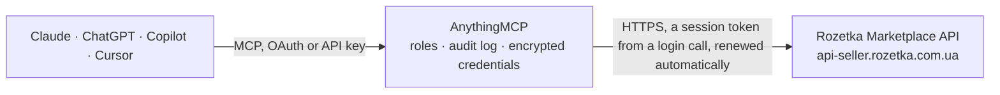

<!-- Generated by scripts/export-github-catalog.mjs in the anythingmcp-website repository. Do not edit by hand. -->

# Rozetka Marketplace MCP connector

Rozetka Marketplace seller API for Ukraine's largest marketplace: search and read orders with items, delivery and buyer, order statuses, and the seller's goods. The AnythingMCP connector gives Claude, ChatGPT, Microsoft Copilot, Cursor and Gemini 5 MCP tools for Rozetka Marketplace, all read-only.

**Category:** [E-commerce](../e-commerce.md) · **Tools:** 5 · **Setup guide:** [anythingmcp.com](https://anythingmcp.com/guides/rozetka-to-mcp) · [Deutsch](https://anythingmcp.com/de/guides/rozetka-to-mcp) · [Italiano](https://anythingmcp.com/it/guides/rozetka-to-mcp) · [Español](https://anythingmcp.com/es/guides/rozetka-to-mcp) · [日本語](https://anythingmcp.com/ja/guides/rozetka-to-mcp) · [Русский](https://anythingmcp.com/ru/guides/rozetka-to-mcp) · [中文](https://anythingmcp.com/zh/guides/rozetka-to-mcp)

## Start without code

No installation and no terminal: AnythingMCP Cloud runs the Rozetka Marketplace connector for you, operated by helpcode.ai in Frankfurt, Germany.

1. **Click the button above** and create an account or sign in. The Rozetka Marketplace connector opens, ready to install.
2. **Paste the API key or token from your Rozetka Marketplace account.** Every click is in the [step-by-step guide](https://anythingmcp.com/guides/rozetka-to-mcp).
3. **Click Install.** AnythingMCP shows the address of your MCP server.
4. **Add that address to your assistant:** [Claude](https://anythingmcp.com/guides/connect-rozetka-to-claude) · [ChatGPT](https://anythingmcp.com/guides/connect-rozetka-to-chatgpt) · [Microsoft Copilot](https://anythingmcp.com/guides/connect-rozetka-to-copilot) · [Cursor](https://anythingmcp.com/guides/connect-rozetka-to-cursor) · [Gemini CLI](https://anythingmcp.com/guides/connect-rozetka-to-gemini) · [Meta Muse](https://anythingmcp.com/guides/connect-rozetka-to-muse).
5. **Ask your first question**, for example: *Show me Rozetka order id 98765 with buyer and delivery details, include items (expand purchases,delivery,user).*

Prefer help with the setup? [Talk to us](https://anythingmcp.com/contact).

## How it works

- **The AI client** speaks MCP (Streamable HTTP) to AnythingMCP and only sees tool names, descriptions and results. It never gets the Rozetka Marketplace credentials.
- **AnythingMCP** checks the client's role, builds the call from the tool definition, adds the credentials (a session token from a login call, renewed automatically), calls Rozetka Marketplace, logs the call and returns the result.
- **Rozetka Marketplace** sees an ordinary API client with the rights of the account the credentials belong to.

## Tools

| Tool | What it does | Access |
|---|---|---|
| [`rozetka_list_orders`](#rozetka_list_orders) | Search the seller's Rozetka orders, 20 per page, by status group, status, creation or change date, order id, buyer phone or waybill (TTN). | read |
| [`rozetka_get_order`](#rozetka_get_order) | Get one Rozetka order by id with amounts, status and comments. | read |
| [`rozetka_list_order_statuses`](#rozetka_list_order_statuses) | List Rozetka order statuses with id, Ukrainian, Russian and English name and status group, to read the numeric status of an order. | read |
| [`rozetka_list_goods`](#rozetka_list_goods) | Search the seller's goods on Rozetka (all tabs) by name, text, article, price-list id or Rozetka id, availability or category. | read |
| [`rozetka_get_goods`](#rozetka_get_goods) | Get the details of one of the seller's goods on Rozetka (prices, category, description, stock state) by the internal item_id or by rz_item_id. | read |

## Tool reference

Every parameter as the AI client sees it in `tools/list`. Source: [`packages/backend/src/adapters/intl/rozetka.json`](../../../packages/backend/src/adapters/intl/rozetka.json).

### `rozetka_list_orders`

Search the seller's Rozetka orders, 20 per page, by status group, status, creation or change date, order id, buyer phone or waybill (TTN). Use expand to include purchased items, delivery and buyer.

**Access:** read · **Call:** `GET /orders/search`

| Parameter | Type | Required | Description |
|---|---|---|---|
| `types` | `1` \| `2` \| `3` \| `4` \| `5` \| `6` | no | Status group: 1 all, 2 in processing, 3 completed, 4 new, 5 being delivered, 6 failed. |
| `status` | integer | no | Exact status id from rozetka_list_order_statuses. |
| `id` | integer | no | Order id. |
| `created_from` | string | no | Created on or after. Date YYYY-MM-DD, e.g. 2026-10-01. |
| `created_to` | string | no | Created on or before. Date YYYY-MM-DD, e.g. 2026-10-01. |
| `changed_from` | string | no | Changed on or after. Date YYYY-MM-DD, e.g. 2026-10-01. |
| `changed_to` | string | no | Changed on or before. Date YYYY-MM-DD, e.g. 2026-10-01. |
| `user_phone` | string | no | Buyer phone, e.g. 380501234567. |
| `ttn` | string | no | Waybill number, at least 4 characters; 1 = orders with a waybill, 0 = orders without. |
| `sort` | string | no | Sort column, prefix - for descending: id, created, changed, amount, status. E.g. -created. |
| `expand` | string | no | Extra fields, comma-separated, e.g. purchases,delivery,user,status_data. |
| `page` | integer | no | Page number, starting at 1. |

### `rozetka_get_order`

Get one Rozetka order by id with amounts, status and comments. Use expand for items (purchases), delivery, buyer (user), status history (order_status_history) or payment details.

**Access:** read · **Call:** `GET /orders/{id}`

| Parameter | Type | Required | Description |
|---|---|---|---|
| `id` | integer | yes | Order id from rozetka_list_orders. |
| `expand` | string | no | Extra fields, comma-separated, e.g. purchases,delivery,user,order_status_history. |

### `rozetka_list_order_statuses`

List Rozetka order statuses with id, Ukrainian, Russian and English name and status group, to read the numeric status of an order.

**Access:** read · **Call:** `GET /order-statuses/search`

| Parameter | Type | Required | Description |
|---|---|---|---|
| `id` | integer | no | Only this status id. |
| `name` | string | no | Status name to search for. |
| `status_group` | `1` \| `2` \| `3` | no | Status group id (1, 2 or 3), the same value as status_group on an order. |

### `rozetka_list_goods`

Search the seller's goods on Rozetka (all tabs) by name, text, article, price-list id or Rozetka id, availability or category. Returns ids, names, prices, stock state and Rozetka links.

**Access:** read · **Call:** `GET /goods/all`

| Parameter | Type | Required | Description |
|---|---|---|---|
| `find_by_text` | string | no | Goods name or id. |
| `name` | string | no | Goods name, partial match. |
| `article` | string | no | Article (SKU) of the goods. |
| `price_offer_id` | string | no | Id of the goods in the seller's price list. |
| `rz_item_id` | integer | no | Id of the goods on Rozetka. |
| `available` | `0` \| `1` \| `2` | no | 0 out of stock, 1 in stock, 2 removed from the price list. |
| `item_active` | `0` \| `1` | no | 1 active goods, 0 inactive. |
| `category_id` | integer | no | Rozetka category id. |
| `sort` | string | no | Sort: price_offer_id, rz_item_id, price, price_old or price_promo, prefix - for descending. |
| `expand` | string | no | Extra fields: description_ua, description. |
| `pageSize` | integer | no | Goods per page (default 20). |
| `page` | integer | no | Page number, starting at 1. |

### `rozetka_get_goods`

Get the details of one of the seller's goods on Rozetka (prices, category, description, stock state) by the internal item_id or by rz_item_id. Pass one of the two.

**Access:** read · **Call:** `GET /goods/details`

| Parameter | Type | Required | Description |
|---|---|---|---|
| `item_id` | integer | no | Internal id of the goods (item_id in rozetka_list_goods). |
| `rz_item_id` | integer | no | Id of the goods on Rozetka. |

## Run it yourself

AnythingMCP is open source (AGPL-3.0). [Run it with Docker](../../../README.md#run-it-yourself), open **Connectors → Store**, pick **Rozetka Marketplace** and enter `ROZETKA_USERNAME`, `ROZETKA_PASSWORD_BASE64`, then add your MCP server URL to the AI client.

[← E-commerce connectors](../e-commerce.md) · [All categories](../README.md)
