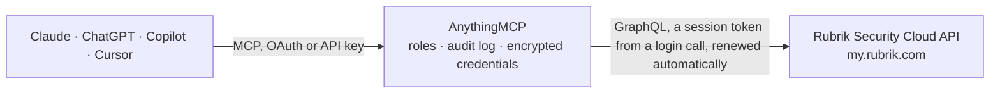

<!-- Generated by scripts/export-github-catalog.mjs in the anythingmcp-website repository. Do not edit by hand. -->

# Rubrik Security Cloud MCP connector

Let your AI check your Rubrik backups: cluster health and capacity, SLA Domains, protected objects and SLA compliance, snapshots, failed jobs and task reports, anomaly detection and threat hunt results. The AnythingMCP connector gives Claude, ChatGPT, Microsoft Copilot, Cursor and Gemini 14 MCP tools for Rubrik Security Cloud, all read-only.

**Category:** [Infrastructure](../infrastructure.md) · **Tools:** 14 · **Setup guide:** [anythingmcp.com](https://anythingmcp.com/guides/rubrik-to-mcp) · [Deutsch](https://anythingmcp.com/de/guides/rubrik-to-mcp) · [Italiano](https://anythingmcp.com/it/guides/rubrik-to-mcp) · [Español](https://anythingmcp.com/es/guides/rubrik-to-mcp) · [日本語](https://anythingmcp.com/ja/guides/rubrik-to-mcp) · [Русский](https://anythingmcp.com/ru/guides/rubrik-to-mcp) · [中文](https://anythingmcp.com/zh/guides/rubrik-to-mcp)

## Start without code

No installation and no terminal: AnythingMCP Cloud runs the Rubrik Security Cloud connector for you, operated by helpcode.ai in Frankfurt, Germany.

1. **Click the button above** and create an account or sign in. The Rubrik Security Cloud connector opens, ready to install.
2. **Paste the API key or token from your Rubrik Security Cloud account.** Every click is in the [step-by-step guide](https://anythingmcp.com/guides/rubrik-to-mcp).
3. **Click Install.** AnythingMCP shows the address of your MCP server.
4. **Add that address to your assistant:** [Claude](https://anythingmcp.com/guides/connect-rubrik-to-claude) · [ChatGPT](https://anythingmcp.com/guides/connect-rubrik-to-chatgpt) · [Microsoft Copilot](https://anythingmcp.com/guides/connect-rubrik-to-copilot) · [Cursor](https://anythingmcp.com/guides/connect-rubrik-to-cursor) · [Gemini CLI](https://anythingmcp.com/guides/connect-rubrik-to-gemini) · [Meta Muse](https://anythingmcp.com/guides/connect-rubrik-to-muse).
5. **Ask your first question.**

Prefer help with the setup? [Talk to us](https://anythingmcp.com/contact).

## How it works

- **The AI client** speaks MCP (Streamable HTTP) to AnythingMCP and only sees tool names, descriptions and results. It never gets the Rubrik Security Cloud credentials.
- **AnythingMCP** checks the client's role, builds the call from the tool definition, adds the credentials (a session token from a login call, renewed automatically), calls Rubrik Security Cloud, logs the call and returns the result.
- **Rubrik Security Cloud** sees an ordinary API client with the rights of the account the credentials belong to.

## Tools

| Tool | What it does | Access |
|---|---|---|
| [`rubrik_get_account`](#rubrik_get_account) | Read the Rubrik Security Cloud account behind the service account: the account id and the RSC deployment version. | read |
| [`rubrik_list_clusters`](#rubrik_list_clusters) | List the Rubrik clusters (CDM appliances, Cloud Clusters) registered in the account, sorted by name: id (cluster UUID), name, type, connection status,… | read |
| [`rubrik_get_cluster`](#rubrik_get_cluster) | Read one Rubrik cluster by its UUID: name, type, status, version, health and system status message, time zone, address, encryption, snapshot count,… | read |
| [`rubrik_list_sla_domains`](#rubrik_list_sla_domains) | List SLA Domains (backup policies) sorted by name, with the number of protected objects: id, name, description, whether it is the default, object types it… | read |
| [`rubrik_get_sla_domain`](#rubrik_get_sla_domain) | Read one SLA Domain by id with its full snapshot schedule (minute, hourly, daily, weekly, monthly, quarterly and yearly frequency and retention), base… | read |
| [`rubrik_list_protected_objects`](#rubrik_list_protected_objects) | List workloads (protected objects such as VMs, databases, filesets, cloud and SaaS objects) with their protection and SLA compliance: id, fid, name, object… | read |
| [`rubrik_get_compliance_summary`](#rubrik_get_compliance_summary) | Count protected objects per group, for a compliance overview: group_by ComplianceStatus (default) answers how many objects are in or out of compliance,… | read |
| [`rubrik_list_snapshots`](#rubrik_list_snapshots) | List the snapshots (recovery points) of one protected object, newest first by default: id, date, expiration date, on-demand or SLA, expired, anomaly,… | read |
| [`rubrik_list_events`](#rubrik_list_events) | List recent activity (event series: backups, archival, replication, recoveries, anomalies, threat hunts and other jobs), newest update first: series id,… | read |
| [`rubrik_get_event_series`](#rubrik_get_event_series) | Read one activity series with its individual activities (time, type, status, severity, message, progress and error info), to see why a backup or recovery… | read |
| [`rubrik_list_task_details`](#rubrik_list_task_details) | List finished backup, archival, replication and recovery tasks (the Task Details report), newest end time first: object, type, location, cluster, SLA… | read |
| [`rubrik_list_anomalies`](#rubrik_list_anomalies) | List anomaly detection results (ransomware and unusual change analysis per snapshot), newest snapshot first: whether it is an anomaly, probability,… | read |
| [`rubrik_list_threat_hunts`](#rubrik_list_threat_hunts) | List threat hunts (scans of backups for indicators of compromise): hunt id, name, type, status, start time, creator, cluster and the scan totals (objects… | read |
| [`rubrik_get_threat_hunt_summary`](#rubrik_get_threat_hunt_summary) | Read the result of one threat hunt per scanned object: status, totals, and for each object its location, scan status, matched snapshots and paths, whether… | read |

## Tool reference

Every parameter as the AI client sees it in `tools/list`. Source: [`packages/backend/src/adapters/intl/rubrik.json`](../../../packages/backend/src/adapters/intl/rubrik.json).

### `rubrik_get_account`

Read the Rubrik Security Cloud account behind the service account: the account id and the RSC deployment version. Cheap and needs no arguments, so it is the connection check. Read-only.

**Access:** read · **Call:** `query query RubrikAccount { accountId deploymentVersion }`

No parameters.

### `rubrik_list_clusters`

List the Rubrik clusters (CDM appliances, Cloud Clusters) registered in the account, sorted by name: id (cluster UUID), name, type, connection status, version, health, system status message, pause status, last connection, registration time, estimated runway in days and capacity in bytes (total, used, available). Filter by exact names or connection state. Use the id as cluster_id elsewhere. Read-only.

**Access:** read · **Call:** `query query RubrikClusters($first: Int, $after: String, $names: [String!], $connectionState: [ClusterStatus!]) { clusterConnection(first: $first, after: $after, filter: { name: $names, connectionState: $connectionState }, sortBy: ClusterName, sortOrder: ASC) { count nodes { id name type status version isHealthy systemStatus systemStatusMessage pauseStatus lastConnectionTime registrationTime estimatedRunway metric { totalCapacity usedCapacity availableCapacity lastUpdateTime } } pageInfo { hasNextPage endCursor } } }`

| Parameter | Type | Required | Description |
|---|---|---|---|
| `first` | integer | no | Items per page (default 25, at most 200). |
| `after` | string | no | Cursor for the next page: pageInfo.endCursor of the previous answer, while pageInfo.hasNextPage is true. |
| `names` | string[] | no | Only clusters with these names (exact match). |
| `connection_state` | `Connected` \| `Disconnected` \| `Initializing`[] | no | Only clusters in these connection states. |

### `rubrik_get_cluster`

Read one Rubrik cluster by its UUID: name, type, status, version, health and system status message, time zone, address, encryption, snapshot count, estimated runway, end-of-support date and status, pause status and capacity figures in bytes. Read-only.

**Access:** read · **Call:** `query query RubrikCluster($clusterUuid: UUID!) { cluster(clusterUuid: $clusterUuid) { id name type status version isHealthy systemStatus systemStatusMessage pauseStatus lastConnectionTime registrationTime estimatedRunway metric { totalCapacity usedCapacity availableCapacity lastUpdateTime } timezone defaultAddress encryptionEnabled snapshotCount eosDate eosStatus } }`

| Parameter | Type | Required | Description |
|---|---|---|---|
| `cluster_id` | string | yes | Cluster UUID, the id from rubrik_list_clusters. |

### `rubrik_list_sla_domains`

List SLA Domains (backup policies) sorted by name, with the number of protected objects: id, name, description, whether it is the default, object types it applies to, owner organization, base snapshot frequency, local retention and retention lock. Narrow with filter, for example [{"field": "NAME", "text": "Gold"}] or [{"field": "CLUSTER_UUID", "text": "<cluster id>"}]. Read-only.

**Access:** read · **Call:** `query query RubrikSlaDomains($first: Int, $after: String, $filter: [GlobalSlaFilterInput!]) { slaDomains(first: $first, after: $after, filter: $filter, sortBy: NAME, sortOrder: ASC, shouldShowProtectedObjectCount: true) { count nodes { id name ... on GlobalSlaReply { description isDefault objectTypes protectedObjectCount ownerOrgName isRetentionLockedSla retentionLockMode baseFrequency { duration unit } localRetentionLimit { duration unit } } ... on ClusterSlaDomain { protectedObjectCount cluster { id name } baseFrequency { duration unit } } } pageInfo { hasNextPage endCursor } } }`

| Parameter | Type | Required | Description |
|---|---|---|---|
| `first` | integer | no | Items per page (default 25, at most 200). |
| `after` | string | no | Cursor for the next page: pageInfo.endCursor of the previous answer, while pageInfo.hasNextPage is true. |
| `filter` | object[] | no | Optional SLA filters, each {field, text} or {field, textList}. Useful fields: NAME (contains), NAME_EXACT_MATCH, CLUSTER_UUID, OBJECT_TYPE, SHOW_PAUSED_SLAS_ONLY. |

### `rubrik_get_sla_domain`

Read one SLA Domain by id with its full snapshot schedule (minute, hourly, daily, weekly, monthly, quarterly and yearly frequency and retention), base frequency, local retention, retention lock and protected object count. Read-only.

**Access:** read · **Call:** `query query RubrikSlaDomain($id: UUID!) { slaDomain(id: $id) { id name ... on GlobalSlaReply { description isDefault objectTypes protectedObjectCount ownerOrgName isRetentionLockedSla retentionLockMode baseFrequency { duration unit } localRetentionLimit { duration unit } } ... on ClusterSlaDomain { protectedObjectCount cluster { id name } baseFrequency { duration unit } } ... on GlobalSlaReply { snapshotSchedule { minute { basicSchedule { frequency retention retentionUnit } } hourly { basicSchedule { frequency retention retentionUnit } } daily { basicSchedule { frequency retention retentionUnit } } weekly { basicSchedule { frequency retention retentionUnit } } monthly { basicSchedule { frequency retention retentionUnit } } quarterly { basicSchedule { frequency retention retentionUnit } } yearly { basicSchedule { frequency retention retentionUnit } } } } ... on ClusterSlaDomain { snapshotSchedule { minute { basicSchedule { frequency retention retentionUnit } } hourly { basicSchedule { frequency retention retentionUnit } } daily { basicSchedule { frequency retention retentionUnit } } weekly { basicSchedule { frequency retention retentionUnit } } monthly { basicSchedule { frequency retention retentionUnit } } quarterly { basicSchedule { frequency retention retentionUnit } } yearly { basicSchedule { frequency retention retentionUnit } } } } } }`

| Parameter | Type | Required | Description |
|---|---|---|---|
| `sla_domain_id` | string | yes | SLA Domain id from rubrik_list_sla_domains or from a protected object's slaDomain.id. |

### `rubrik_list_protected_objects`

List workloads (protected objects such as VMs, databases, filesets, cloud and SaaS objects) with their protection and SLA compliance: id, fid, name, object type, location, protection status, compliance status (local, archival, replication), whether it waits for its first full backup, last snapshot time, missed and total snapshots, logical and physical bytes, SLA Domain and cluster. Filter by name search, object type, compliance or protection status, cluster or SLA Domain. The answer also carries the total count. Read-only.

**Access:** read · **Call:** `query query RubrikProtectedObjects($first: Int, $after: String, $searchTerm: String, $objectType: [ObjectTypeEnum!], $complianceStatus: [ComplianceStatusEnum!], $protectionStatus: [ProtectionStatusEnum!], $clusterIds: [UUID!], $slaDomainIds: [String!], $sortBy: SnappableSortByEnum, $sortOrder: SortOrder) { snappableConnection(first: $first, after: $after, filter: { searchTerm: $searchTerm, objectType: $objectType, complianceStatus: $complianceStatus, protectionStatus: $protectionStatus, cluster: { id: $clusterIds }, slaDomain: { id: $slaDomainIds } }, sortBy: $sortBy, sortOrder: $sortOrder) { count nodes { id fid name objectType location objectState protectionStatus complianceStatus archivalComplianceStatus replicationComplianceStatus awaitingFirstFull protectedOn lastSnapshot latestArchivalSnapshot latestReplicationSnapshot missedSnapshots totalSnapshots localSnapshots archiveSnapshots replicaSnapshots logicalBytes physicalBytes slaDomain { id name } cluster { id name } } pageInfo { hasNextPage endCursor } } }`

| Parameter | Type | Required | Description |
|---|---|---|---|
| `first` | integer | no | Items per page (default 25, at most 200). |
| `after` | string | no | Cursor for the next page: pageInfo.endCursor of the previous answer, while pageInfo.hasNextPage is true. |
| `search_term` | string | no | Text the object name contains. |
| `object_types` | string[] | no | Only these object types, for example VmwareVirtualMachine, Mssql, LinuxFileset, O365Mailbox, AwsNativeEc2Instance (ObjectTypeEnum values). |
| `compliance_status` | `IN_COMPLIANCE` \| `OUT_OF_COMPLIANCE` \| `UNPROTECTED` \| `NOT_AVAILABLE` \| `NOT_APPLICABLE` \| `EMPTY` \| `NULL`[] | no | Only objects with these SLA compliance states. |
| `protection_status` | `Protected` \| `NoSla` \| `DoNotProtect`[] | no | Only objects with these protection states. |
| `cluster_ids` | string[] | no | Only objects on these clusters (cluster UUIDs). |
| `sla_domain_ids` | string[] | no | Only objects assigned to these SLA Domains (ids). |
| `sort_by` | `Name` \| `ComplianceStatus` \| `LastSnapshot` \| `MissedSnapshots` \| `ObjectType` \| `ClusterName` \| `SlaDomainName` \| `ProtectionStatus` \| `LogicalBytes` | no | Sort field (default Name). |
| `sort_order` | `ASC` \| `DESC` | no | Sort direction, ASC or DESC. |

### `rubrik_get_compliance_summary`

Count protected objects per group, for a compliance overview: group_by ComplianceStatus (default) answers how many objects are in or out of compliance, ProtectionStatus how many are protected, ObjectType, Cluster or SlaDomain how they spread. Each group comes with its object count and total and missed snapshots. Narrow with object types, clusters or an SLA compliance window. Read-only.

**Access:** read · **Call:** `query query RubrikComplianceSummary($groupBy: SnappableGroupByEnum!, $first: Int, $objectType: [ObjectTypeEnum!], $clusterIds: [UUID!], $slaTimeRange: SlaComplianceTimeRange) { snappableGroupByConnection(groupBy: $groupBy, first: $first, filter: { objectType: $objectType, cluster: { id: $clusterIds }, slaTimeRange: $slaTimeRange }) { count nodes { groupByInfo { __typename ... on ComplianceStatus { complianceStatus: enumValue } ... on ProtectionStatus { protectionStatus: enumValue } ... on ObjectType { objectType: enumValue } ... on Cluster { clusterId: id clusterName: name } ... on ClusterSlaDomain { slaDomainId: id slaDomainName: name } } snappableConnection { count aggregation { totalSnapshots missedSnapshots logicalBytes physicalBytes } } } } }`

| Parameter | Type | Required | Description |
|---|---|---|---|
| `group_by` | `ComplianceStatus` \| `ProtectionStatus` \| `ObjectType` \| `Cluster` \| `SlaDomain` | no | How to group the objects (default ComplianceStatus). |
| `object_types` | string[] | no | Only these object types (ObjectTypeEnum values, as in rubrik_list_protected_objects). |
| `cluster_ids` | string[] | no | Only objects on these clusters (cluster UUIDs). |
| `sla_time_range` | `LAST_SNAPSHOT` \| `LAST_2_SNAPSHOTS` \| `LAST_3_SNAPSHOTS` \| `LAST_24_HOURS` \| `PAST_7_DAYS` \| `PAST_30_DAYS` \| `PAST_90_DAYS` \| `PAST_365_DAYS` \| `SINCE_PROTECTION` | no | Window the compliance status is computed over. |
| `first` | integer | no | Groups per page (default 50). |

### `rubrik_list_snapshots`

List the snapshots (recovery points) of one protected object, newest first by default: id, date, expiration date, on-demand or SLA, expired, anomaly, quarantined, corrupted and indexed flags, plus cluster and retention lock for appliance snapshots. Optionally restrict to a time range. Read-only.

**Access:** read · **Call:** `query query RubrikSnapshots($workloadId: String!, $first: Int, $after: String, $sortOrder: SortOrder, $timeRange: TimeRangeInput) { snapshotOfASnappableConnection(workloadId: $workloadId, first: $first, after: $after, sortBy: CREATION_TIME, sortOrder: $sortOrder, timeRange: $timeRange) { count nodes { __typename id date expirationDate isOnDemandSnapshot isExpired isAnomaly isQuarantined isCorrupted isIndexed snappableId ... on CdmSnapshot { cdmId isRetentionLocked cluster { id name } } ... on PolarisSnapshot { isArchived isReplica isRetentionLocked } } pageInfo { hasNextPage endCursor } } }`

| Parameter | Type | Required | Description |
|---|---|---|---|
| `first` | integer | no | Items per page (default 25, at most 200). |
| `after` | string | no | Cursor for the next page: pageInfo.endCursor of the previous answer, while pageInfo.hasNextPage is true. |
| `workload_id` | string | yes | The protected object's id (the id field from rubrik_list_protected_objects). |
| `time_range` | object | no | Optional window: {"start": "2026-10-01T00:00:00Z", "end": "2026-10-31T23:59:59Z"} (ISO 8601, both required when set). |
| `sort_order` | `ASC` \| `DESC` | no | Sort direction, ASC or DESC. |

### `rubrik_list_events`

List recent activity (event series: backups, archival, replication, recoveries, anomalies, threat hunts and other jobs), newest update first: series id, cluster, object, type, last status and message, severity, progress, start and last update, SLA Domain, failure reason with cause, error remedy and user. Filter by status (for example FAILURE), type (for example BACKUP), severity, object name, cluster, object fid or time. Use activitySeriesId and clusterUuid with rubrik_get_event_series for the full timeline. Read-only.

**Access:** read · **Call:** `query query RubrikEvents($first: Int, $after: String, $sortOrder: SortOrder, $lastActivityStatus: [EventStatus!], $lastActivityType: [EventType!], $severity: [EventSeverity!], $objectName: String, $clusterIds: [UUID!], $objectFids: [UUID!], $lastUpdatedTimeGt: DateTime, $lastUpdatedTimeLt: DateTime) { activitySeriesConnection(first: $first, after: $after, sortBy: LAST_UPDATED, sortOrder: $sortOrder, filters: { lastActivityStatus: $lastActivityStatus, lastActivityType: $lastActivityType, severity: $severity, objectName: $objectName, clusterId: $clusterIds, objectFid: $objectFids, lastUpdatedTimeGt: $lastUpdatedTimeGt, lastUpdatedTimeLt: $lastUpdatedTimeLt }) { count nodes { id fid activitySeriesId clusterUuid clusterName objectId objectName objectType location slaDomainName lastActivityType lastActivityStatus lastActivityMessage severity progress startTime lastUpdated isOnDemand failureReason causeErrorMessage causeErrorReason causeErrorRemedy username } pageInfo { hasNextPage endCursor } } }`

| Parameter | Type | Required | Description |
|---|---|---|---|
| `first` | integer | no | Items per page (default 25, at most 200). |
| `after` | string | no | Cursor for the next page: pageInfo.endCursor of the previous answer, while pageInfo.hasNextPage is true. |
| `last_activity_status` | `FAILURE` \| `SUCCESS` \| `RUNNING` \| `QUEUED` \| `CANCELED` \| `CANCELING` \| `PARTIAL_SUCCESS` \| `WARNING` \| `INFO` \| `TASK_FAILURE` \| `TASK_SUCCESS`[] | no | Only series whose last status is one of these. |
| `last_activity_type` | string[] | no | Only series of these types (EventType values), for example BACKUP, ARCHIVE, REPLICATION, RECOVERY, ANOMALY, THREAT_HUNT, LOG_BACKUP, CONFIGURATION. |
| `severity` | `SEVERITY_CRITICAL` \| `SEVERITY_WARNING` \| `SEVERITY_INFO`[] | no | Only series with these severities. |
| `object_name` | string | no | Text the object name contains. |
| `cluster_ids` | string[] | no | Only events of these clusters (cluster UUIDs). |
| `object_fids` | string[] | no | Only events of these objects (the fid field from rubrik_list_protected_objects). |
| `last_updated_after` | string | no | Only series updated after this time, ISO 8601, for example 2026-11-04T00:00:00Z. |
| `last_updated_before` | string | no | Only series updated before this time, ISO 8601. |
| `sort_order` | `ASC` \| `DESC` | no | Sort direction, ASC or DESC. |

### `rubrik_get_event_series`

Read one activity series with its individual activities (time, type, status, severity, message, progress and error info), to see why a backup or recovery failed or how far a running job is. Read-only.

**Access:** read · **Call:** `query query RubrikEventSeries($activitySeriesId: UUID!, $clusterUuid: UUID, $first: Int) { activitySeries(input: { activitySeriesId: $activitySeriesId, clusterUuid: $clusterUuid }) { id fid activitySeriesId clusterUuid clusterName objectId objectName objectType location slaDomainName lastActivityType lastActivityStatus lastActivityMessage severity progress startTime lastUpdated isOnDemand failureReason causeErrorMessage causeErrorReason causeErrorRemedy username dataTransferred logicalSize effectiveThroughput activityConnection(first: $first) { count nodes { id time type status severity message progress errorInfo } } } }`

| Parameter | Type | Required | Description |
|---|---|---|---|
| `activity_series_id` | string | yes | activitySeriesId from rubrik_list_events (UUID). |
| `cluster_uuid` | string | no | clusterUuid from the same event. |
| `first` | integer | no | How many activities to return (default 50). |

### `rubrik_list_task_details`

List finished backup, archival, replication and recovery tasks (the Task Details report), newest end time first: object, type, location, cluster, SLA Domain, task type and category, status, start and end time, duration, data transferred, logical and physical bytes, failure reason and user. Filter by time window, task status, task type or category, cluster or object name. Status and type strings are the values the report shows (read them from an unfiltered call). Read-only.

**Access:** read · **Call:** `query query RubrikTaskDetails($first: Int, $after: String, $sortOrder: SortOrder, $timeGt: DateTime, $timeLt: DateTime, $taskStatus: [String!], $taskType: [String!], $taskCategory: [String!], $clusterIds: [UUID!], $searchTerm: String) { taskDetailConnection(first: $first, after: $after, sortBy: EndTime, sortOrder: $sortOrder, filter: { time_gt: $timeGt, time_lt: $timeLt, taskStatus: $taskStatus, taskType: $taskType, taskCategory: $taskCategory, clusterUuid: $clusterIds, searchTerm: $searchTerm }) { count nodes { id objectName objectType objectFid location clusterName clusterUuid slaDomainName taskType taskCategory status startTime endTime duration dataTransferred logicalBytes physicalBytes failureReason userName } pageInfo { hasNextPage endCursor } } }`

| Parameter | Type | Required | Description |
|---|---|---|---|
| `first` | integer | no | Items per page (default 25, at most 200). |
| `after` | string | no | Cursor for the next page: pageInfo.endCursor of the previous answer, while pageInfo.hasNextPage is true. |
| `time_after` | string | no | Only tasks after this time, ISO 8601. |
| `time_before` | string | no | Only tasks before this time, ISO 8601. |
| `task_status` | string[] | no | Only tasks with these status values, as shown in the status field. |
| `task_type` | string[] | no | Only tasks with these taskType values. |
| `task_category` | string[] | no | Only tasks with these taskCategory values. |
| `cluster_ids` | string[] | no | Only tasks of these clusters (cluster UUIDs). |
| `search_term` | string | no | Text the object name contains. |
| `sort_order` | `ASC` \| `DESC` | no | Sort direction, ASC or DESC. |

### `rubrik_list_anomalies`

List anomaly detection results (ransomware and unusual change analysis per snapshot), newest snapshot first: whether it is an anomaly, probability, severity, detection and snapshot time, workload name, id and fid, object type, location, encryption flag, files created, modified, deleted and suspicious, net bytes changed and cluster. Set is_anomaly true to see only flagged snapshots. Read-only.

**Access:** read · **Call:** `query query RubrikAnomalies($first: Int, $after: String, $sortOrder: SortOrder, $isAnomaly: Boolean, $startTime: DateTime, $endTime: DateTime, $clusterIds: [UUID!], $workloadFids: [UUID!]) { anomalyResults(first: $first, after: $after, sortBy: SNAPSHOT_DATE, sortOrder: $sortOrder, filter: { isAnomaly: $isAnomaly, startTime: $startTime, endTime: $endTime, clusterUuid: $clusterIds, workloadFid: $workloadFids }) { count nodes { id isAnomaly anomalyProbability severity detectionTime snapshotDate snapshotFid previousSnapshotDate workloadName workloadId workloadFid objectType location isEncrypted filesCreatedCount filesModifiedCount filesDeletedCount suspiciousFilesCount bytesNetChangedCount cluster { id name } } pageInfo { hasNextPage endCursor } } }`

| Parameter | Type | Required | Description |
|---|---|---|---|
| `first` | integer | no | Items per page (default 25, at most 200). |
| `after` | string | no | Cursor for the next page: pageInfo.endCursor of the previous answer, while pageInfo.hasNextPage is true. |
| `is_anomaly` | boolean | no | true: only snapshots flagged as anomalous. |
| `start_time` | string | no | Only results from this time on, ISO 8601. |
| `end_time` | string | no | Only results up to this time, ISO 8601. |
| `cluster_ids` | string[] | no | Only these clusters (cluster UUIDs). |
| `workload_fids` | string[] | no | Only these objects (fid from rubrik_list_protected_objects). |
| `sort_order` | `ASC` \| `DESC` | no | Sort direction, ASC or DESC. |

### `rubrik_list_threat_hunts`

List threat hunts (scans of backups for indicators of compromise): hunt id, name, type, status, start time, creator, cluster and the scan totals (objects scanned, objects with matches, affected snapshots, unique matched paths). Filter by time window or status. Read-only.

**Access:** read · **Call:** `query query RubrikThreatHunts($first: Int, $after: String, $beginTime: DateTime, $endTime: DateTime, $statusFilter: [ThreatHuntStatus!]) { threatHunts(first: $first, after: $after, beginTime: $beginTime, endTime: $endTime, statusFilter: $statusFilter) { count nodes { huntId name huntType status startTime createdBy { email } huntDetails { startTime endTime cluster { id name } } stats { totalObjectsScanned totalObjectsWithMatches totalAffectedSnapshots totalUniqueMatchedPaths totalIocs } } pageInfo { hasNextPage endCursor } } }`

| Parameter | Type | Required | Description |
|---|---|---|---|
| `first` | integer | no | Items per page (default 25, at most 200). |
| `after` | string | no | Cursor for the next page: pageInfo.endCursor of the previous answer, while pageInfo.hasNextPage is true. |
| `begin_time` | string | no | Only hunts from this time on, ISO 8601. |
| `end_time` | string | no | Only hunts up to this time, ISO 8601. |
| `status` | `PENDING` \| `IN_PROGRESS` \| `SUCCEEDED` \| `PARTIALLY_SUCCEEDED` \| `FAILED` \| `CANCELED` \| `CANCELING` \| `ABORTED`[] | no | Only hunts in these states. |

### `rubrik_get_threat_hunt_summary`

Read the result of one threat hunt per scanned object: status, totals, and for each object its location, scan status, matched snapshots and paths, whether matches were quarantined, the earliest and latest matched snapshot dates and the latest clean snapshot date. Use it to pick a clean recovery point. Read-only.

**Access:** read · **Call:** `query query RubrikThreatHuntSummary($huntId: String!) { threatHuntSummary(huntId: $huntId) { huntId status stats { totalObjectsScanned totalObjectsWithMatches totalAffectedSnapshots totalUniqueMatchedPaths totalIocs } objectsSummary { location objectScanStatus totalMatchedSnapshots totalUniqueMatchedPaths totalMatchedPaths hasQuarantinedMatches earliestMatchedSnapshotDate latestMatchedSnapshotDate latestSnapshotWithoutMatchDate clusterInfo { id name } } } }`

| Parameter | Type | Required | Description |
|---|---|---|---|
| `hunt_id` | string | yes | huntId from rubrik_list_threat_hunts. |

## Run it yourself

AnythingMCP is open source (AGPL-3.0). [Run it with Docker](../../../README.md#run-it-yourself), open **Connectors → Store**, pick **Rubrik Security Cloud** and enter `RUBRIK_ACCOUNT`, `RUBRIK_CLIENT_ID`, `RUBRIK_CLIENT_SECRET`, then add your MCP server URL to the AI client.

[← Infrastructure connectors](../infrastructure.md) · [All categories](../README.md)
