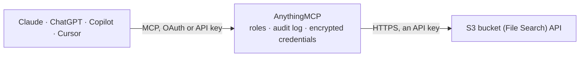

<!-- Generated by scripts/export-github-catalog.mjs in the anythingmcp-website repository. Do not edit by hand. -->

# S3 bucket (File Search) MCP connector

Search inside the documents of an S3 bucket from your AI client: Amazon S3, DigitalOcean Spaces, MinIO, Wasabi, Hetzner Object Storage, Backblaze B2. The AnythingMCP connector gives Claude, ChatGPT, Microsoft Copilot, Cursor and Gemini 10 MCP tools for S3 bucket (File Search).

**Category:** [File Storage](../storage.md) · **Tools:** 10 · **Setup guide:** [anythingmcp.com](https://anythingmcp.com/marketplace/s3-file-search)

## Start without code

No installation and no terminal: AnythingMCP Cloud runs the S3 bucket (File Search) connector for you, operated by helpcode.ai in Frankfurt, Germany.

1. **Click the button above** and create an account or sign in. The S3 bucket (File Search) connector opens, ready to install.
2. **Paste the API key or token from your S3 bucket (File Search) account.** Every click is in the [step-by-step guide](https://anythingmcp.com/marketplace/s3-file-search).
3. **Click Install.** AnythingMCP shows the address of your MCP server.
4. **Add that address to your assistant:** [Claude](https://anythingmcp.com/guides/connect-s3-file-search-to-claude) · [ChatGPT](https://anythingmcp.com/guides/connect-s3-file-search-to-chatgpt) · [Microsoft Copilot](https://anythingmcp.com/guides/connect-s3-file-search-to-copilot) · [Cursor](https://anythingmcp.com/guides/connect-s3-file-search-to-cursor) · [Gemini CLI](https://anythingmcp.com/guides/connect-s3-file-search-to-gemini) · [Meta Muse](https://anythingmcp.com/guides/connect-s3-file-search-to-muse).
5. **Ask your first question**, for example: *What is invoice 2026-INV-078 for customer Nordica Elektrik GmbH? I need date and total amount.*

Prefer help with the setup? [Talk to us](https://anythingmcp.com/contact).

## How it works

- **The AI client** speaks MCP (Streamable HTTP) to AnythingMCP and only sees tool names, descriptions and results. It never gets the S3 bucket (File Search) credentials.
- **AnythingMCP** checks the client's role, builds the call from the tool definition, adds the credentials (an API key), calls S3 bucket (File Search), logs the call and returns the result.
- **S3 bucket (File Search)** sees an ordinary API client with the rights of the account the credentials belong to.

## Run it yourself

AnythingMCP is open source (AGPL-3.0). [Run it with Docker](../../../README.md#run-it-yourself), open **Connectors → Store**, pick **S3 bucket (File Search)**, then add your MCP server URL to the AI client.

[← File Storage connectors](../storage.md) · [All categories](../README.md)
