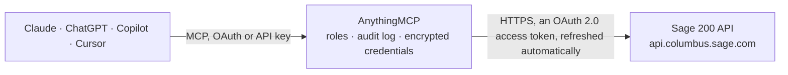

<!-- Generated by scripts/export-github-catalog.mjs in the anythingmcp-website repository. Do not edit by hand. -->

# Sage 200 MCP connector

Read Sage 200 Standard and Professional through the Sage 200 API: customers, suppliers, sales and purchase orders, posted invoices, credit notes and payments, stock items and stock levels, nominal codes. The AnythingMCP connector gives Claude, ChatGPT, Microsoft Copilot, Cursor and Gemini 15 MCP tools for Sage 200, all read-only.

**Category:** [Accounting](../accounting.md) · **Tools:** 15 · **Setup guide:** [anythingmcp.com](https://anythingmcp.com/guides/sage-200-to-mcp) · [Deutsch](https://anythingmcp.com/de/guides/sage-200-to-mcp) · [Italiano](https://anythingmcp.com/it/guides/sage-200-to-mcp) · [Español](https://anythingmcp.com/es/guides/sage-200-to-mcp) · [日本語](https://anythingmcp.com/ja/guides/sage-200-to-mcp) · [Русский](https://anythingmcp.com/ru/guides/sage-200-to-mcp) · [中文](https://anythingmcp.com/zh/guides/sage-200-to-mcp)

## Start without code

No installation and no terminal: AnythingMCP Cloud runs the Sage 200 connector for you, operated by helpcode.ai in Frankfurt, Germany.

1. **Click the button above** and create an account or sign in. The Sage 200 connector opens, ready to install.
2. **Sign in with your Sage 200 account** when AnythingMCP asks. The first time, an admin creates a small app in the Sage 200 developer console. Every click is in the [step-by-step guide](https://anythingmcp.com/guides/sage-200-to-mcp).
3. **Click Install.** AnythingMCP shows the address of your MCP server.
4. **Add that address to your assistant:** [Claude](https://anythingmcp.com/guides/connect-sage-200-to-claude) · [ChatGPT](https://anythingmcp.com/guides/connect-sage-200-to-chatgpt) · [Microsoft Copilot](https://anythingmcp.com/guides/connect-sage-200-to-copilot) · [Cursor](https://anythingmcp.com/guides/connect-sage-200-to-cursor) · [Gemini CLI](https://anythingmcp.com/guides/connect-sage-200-to-gemini) · [Meta Muse](https://anythingmcp.com/guides/connect-sage-200-to-muse).
5. **Ask your first question**, for example: *Show me Holloway Kitchens Ltd current balance and any open sales invoices overdue past 30 days*

Prefer help with the setup? [Talk to us](https://anythingmcp.com/contact).

## How it works

- **The AI client** speaks MCP (Streamable HTTP) to AnythingMCP and only sees tool names, descriptions and results. It never gets the Sage 200 credentials.
- **AnythingMCP** checks the client's role, builds the call from the tool definition, adds the credentials (an OAuth 2.0 access token, refreshed automatically), calls Sage 200, logs the call and returns the result.
- **Sage 200** sees an ordinary API client with the rights of the account the credentials belong to.

## Tools

| Tool | What it does | Access |
|---|---|---|
| [`sage_200_list_sites`](#sage_200_list_sites) | The Sage 200 sites and companies the signed-in Sage ID user can reach through the API, with site_id, site name, company_id and company name. | read |
| [`sage_200_list_customers`](#sage_200_list_customers) | Customer accounts with id, reference, name, balance, credit limit, on-hold flag, account status, currency and contact details. | read |
| [`sage_200_get_customer`](#sage_200_get_customer) | One customer account by id with addresses, contacts, credit terms, balance, analysis codes and default tax code. | read |
| [`sage_200_list_suppliers`](#sage_200_list_suppliers) | Supplier accounts with id, reference, name, balance, credit limit, on-hold flag, currency and contact details. | read |
| [`sage_200_get_supplier`](#sage_200_get_supplier) | One supplier account by id with addresses, contacts, payment terms, balance, bank details and default tax code. | read |
| [`sage_200_list_sales_orders`](#sage_200_list_sales_orders) | Sales orders (SOP) with id, document number, customer, document date, requested delivery date, status, totals and currency. | read |
| [`sage_200_get_sales_order`](#sage_200_get_sales_order) | One sales order by id with header, delivery address and, with expand lines, every order line (product, quantity, price, discount, despatched and invoiced… | read |
| [`sage_200_list_purchase_orders`](#sage_200_list_purchase_orders) | Purchase orders (POP) with id, document number, supplier, document date, status, totals and currency. | read |
| [`sage_200_get_purchase_order`](#sage_200_get_purchase_order) | One purchase order by id with header and, with expand lines, every line (product, quantity, cost, received and invoiced quantities). | read |
| [`sage_200_list_sales_transactions`](#sage_200_list_sales_transactions) | Posted sales ledger transactions: invoices, credit notes, receipts and adjustments with customer, reference, date, due date, goods, tax and outstanding value. | read |
| [`sage_200_list_purchase_transactions`](#sage_200_list_purchase_transactions) | Posted purchase ledger transactions: supplier invoices, credit notes, payments and adjustments with supplier, reference, date, due date, goods, tax and… | read |
| [`sage_200_list_products`](#sage_200_list_products) | Stock items (products) with id, code, name, product group, unit of sale, prices, cost and stock settings. | read |
| [`sage_200_get_product`](#sage_200_get_product) | One stock item by id with descriptions, units, prices, cost, analysis codes, suppliers and warehouses. | read |
| [`sage_200_list_stock_levels`](#sage_200_list_stock_levels) | Stock holdings per product and warehouse: quantity in stock, allocated, free, on order and reorder levels. | read |
| [`sage_200_list_nominal_codes`](#sage_200_list_nominal_codes) | Nominal (general ledger) accounts with id, reference, cost centre, department, name, account type and balances. | read |

## Tool reference

Every parameter as the AI client sees it in `tools/list`. Source: [`packages/backend/src/adapters/gb/sage-200.json`](../../../packages/backend/src/adapters/gb/sage-200.json).

### `sage_200_list_sites`

The Sage 200 sites and companies the signed-in Sage ID user can reach through the API, with site_id, site name, company_id and company name. Start here: every other tool needs a site id and a company id.

**Access:** read · **Call:** `GET /sites`

No parameters.

### `sage_200_list_customers`

Customer accounts with id, reference, name, balance, credit limit, on-hold flag, account status, currency and contact details. Filter by reference or name; use the id for get_customer or to filter orders and transactions.

**Access:** read · **Call:** `GET /customers`

| Parameter | Type | Required | Description |
|---|---|---|---|
| `site_id` | string | yes | Site id from sage_200_list_sites (site_id). Sent as the X-Site header. |
| `company_id` | integer | yes | Company id from sage_200_list_sites (company_id within the site). Sent as the X-Company header. |
| `filter` | string | no | OData $filter on the resource's fields, e.g. reference eq 'ABC001' or date ge 2026-01-01. Strings in single quotes. |
| `select` | string | no | Comma-separated fields to return, e.g. id,reference,name,balance. |
| `orderby` | string | no | OData $orderby, e.g. reference asc or date desc. |
| `top` | integer | no | Maximum number of records to return; use with skip to page. |
| `skip` | integer | no | Number of records to skip, for the next page. |

### `sage_200_get_customer`

One customer account by id with addresses, contacts, credit terms, balance, analysis codes and default tax code.

**Access:** read · **Call:** `GET /customers/{customer_id}`

| Parameter | Type | Required | Description |
|---|---|---|---|
| `site_id` | string | yes | Site id from sage_200_list_sites (site_id). Sent as the X-Site header. |
| `company_id` | integer | yes | Company id from sage_200_list_sites (company_id within the site). Sent as the X-Company header. |
| `customer_id` | integer | yes | Customer id (not the reference) from list_customers. |

### `sage_200_list_suppliers`

Supplier accounts with id, reference, name, balance, credit limit, on-hold flag, currency and contact details. Filter by reference or name; use the id for get_supplier or to filter purchase orders.

**Access:** read · **Call:** `GET /suppliers`

| Parameter | Type | Required | Description |
|---|---|---|---|
| `site_id` | string | yes | Site id from sage_200_list_sites (site_id). Sent as the X-Site header. |
| `company_id` | integer | yes | Company id from sage_200_list_sites (company_id within the site). Sent as the X-Company header. |
| `filter` | string | no | OData $filter on the resource's fields, e.g. reference eq 'ABC001' or date ge 2026-01-01. Strings in single quotes. |
| `select` | string | no | Comma-separated fields to return, e.g. id,reference,name,balance. |
| `orderby` | string | no | OData $orderby, e.g. reference asc or date desc. |
| `top` | integer | no | Maximum number of records to return; use with skip to page. |
| `skip` | integer | no | Number of records to skip, for the next page. |

### `sage_200_get_supplier`

One supplier account by id with addresses, contacts, payment terms, balance, bank details and default tax code.

**Access:** read · **Call:** `GET /suppliers/{supplier_id}`

| Parameter | Type | Required | Description |
|---|---|---|---|
| `site_id` | string | yes | Site id from sage_200_list_sites (site_id). Sent as the X-Site header. |
| `company_id` | integer | yes | Company id from sage_200_list_sites (company_id within the site). Sent as the X-Company header. |
| `supplier_id` | integer | yes | Supplier id (not the reference) from list_suppliers. |

### `sage_200_list_sales_orders`

Sales orders (SOP) with id, document number, customer, document date, requested delivery date, status, totals and currency. Filter by customer_id, document_status or a date range; expand lines for the order lines.

**Access:** read · **Call:** `GET /sop_orders`

| Parameter | Type | Required | Description |
|---|---|---|---|
| `site_id` | string | yes | Site id from sage_200_list_sites (site_id). Sent as the X-Site header. |
| `company_id` | integer | yes | Company id from sage_200_list_sites (company_id within the site). Sent as the X-Company header. |
| `filter` | string | no | OData $filter on the resource's fields, e.g. reference eq 'ABC001' or date ge 2026-01-01. Strings in single quotes. |
| `select` | string | no | Comma-separated fields to return, e.g. id,reference,name,balance. |
| `orderby` | string | no | OData $orderby, e.g. reference asc or date desc. |
| `top` | integer | no | Maximum number of records to return; use with skip to page. |
| `skip` | integer | no | Number of records to skip, for the next page. |
| `expand` | string | no | Related records to include, e.g. lines for order lines. |

### `sage_200_get_sales_order`

One sales order by id with header, delivery address and, with expand lines, every order line (product, quantity, price, discount, despatched and invoiced quantities).

**Access:** read · **Call:** `GET /sop_orders/{sales_order_id}`

| Parameter | Type | Required | Description |
|---|---|---|---|
| `site_id` | string | yes | Site id from sage_200_list_sites (site_id). Sent as the X-Site header. |
| `company_id` | integer | yes | Company id from sage_200_list_sites (company_id within the site). Sent as the X-Company header. |
| `sales_order_id` | integer | yes | Sales order id from list_sales_orders. |
| `expand` | string | no | Related records to include, e.g. lines. |

### `sage_200_list_purchase_orders`

Purchase orders (POP) with id, document number, supplier, document date, status, totals and currency. Filter by supplier_id or a date range; expand lines for the order lines.

**Access:** read · **Call:** `GET /pop_orders`

| Parameter | Type | Required | Description |
|---|---|---|---|
| `site_id` | string | yes | Site id from sage_200_list_sites (site_id). Sent as the X-Site header. |
| `company_id` | integer | yes | Company id from sage_200_list_sites (company_id within the site). Sent as the X-Company header. |
| `filter` | string | no | OData $filter on the resource's fields, e.g. reference eq 'ABC001' or date ge 2026-01-01. Strings in single quotes. |
| `select` | string | no | Comma-separated fields to return, e.g. id,reference,name,balance. |
| `orderby` | string | no | OData $orderby, e.g. reference asc or date desc. |
| `top` | integer | no | Maximum number of records to return; use with skip to page. |
| `skip` | integer | no | Number of records to skip, for the next page. |
| `expand` | string | no | Related records to include, e.g. lines for order lines. |

### `sage_200_get_purchase_order`

One purchase order by id with header and, with expand lines, every line (product, quantity, cost, received and invoiced quantities).

**Access:** read · **Call:** `GET /pop_orders/{purchase_order_id}`

| Parameter | Type | Required | Description |
|---|---|---|---|
| `site_id` | string | yes | Site id from sage_200_list_sites (site_id). Sent as the X-Site header. |
| `company_id` | integer | yes | Company id from sage_200_list_sites (company_id within the site). Sent as the X-Company header. |
| `purchase_order_id` | integer | yes | Purchase order id from list_purchase_orders. |
| `expand` | string | no | Related records to include, e.g. lines. |

### `sage_200_list_sales_transactions`

Posted sales ledger transactions: invoices, credit notes, receipts and adjustments with customer, reference, date, due date, goods, tax and outstanding value. Filter by trader_transaction_type and customer_id to list open invoices.

**Access:** read · **Call:** `GET /sales_posted_transactions`

| Parameter | Type | Required | Description |
|---|---|---|---|
| `site_id` | string | yes | Site id from sage_200_list_sites (site_id). Sent as the X-Site header. |
| `company_id` | integer | yes | Company id from sage_200_list_sites (company_id within the site). Sent as the X-Company header. |
| `filter` | string | no | OData $filter on the resource's fields, e.g. reference eq 'ABC001' or date ge 2026-01-01. Strings in single quotes. |
| `select` | string | no | Comma-separated fields to return, e.g. id,reference,name,balance. |
| `orderby` | string | no | OData $orderby, e.g. reference asc or date desc. |
| `top` | integer | no | Maximum number of records to return; use with skip to page. |
| `skip` | integer | no | Number of records to skip, for the next page. |

### `sage_200_list_purchase_transactions`

Posted purchase ledger transactions: supplier invoices, credit notes, payments and adjustments with supplier, reference, date, due date, goods, tax and outstanding value. Filter by supplier_id to see what is owed.

**Access:** read · **Call:** `GET /purchase_posted_transactions`

| Parameter | Type | Required | Description |
|---|---|---|---|
| `site_id` | string | yes | Site id from sage_200_list_sites (site_id). Sent as the X-Site header. |
| `company_id` | integer | yes | Company id from sage_200_list_sites (company_id within the site). Sent as the X-Company header. |
| `filter` | string | no | OData $filter on the resource's fields, e.g. reference eq 'ABC001' or date ge 2026-01-01. Strings in single quotes. |
| `select` | string | no | Comma-separated fields to return, e.g. id,reference,name,balance. |
| `orderby` | string | no | OData $orderby, e.g. reference asc or date desc. |
| `top` | integer | no | Maximum number of records to return; use with skip to page. |
| `skip` | integer | no | Number of records to skip, for the next page. |

### `sage_200_list_products`

Stock items (products) with id, code, name, product group, unit of sale, prices, cost and stock settings. Filter by code or name; use the id with list_stock_levels.

**Access:** read · **Call:** `GET /products`

| Parameter | Type | Required | Description |
|---|---|---|---|
| `site_id` | string | yes | Site id from sage_200_list_sites (site_id). Sent as the X-Site header. |
| `company_id` | integer | yes | Company id from sage_200_list_sites (company_id within the site). Sent as the X-Company header. |
| `filter` | string | no | OData $filter on the resource's fields, e.g. reference eq 'ABC001' or date ge 2026-01-01. Strings in single quotes. |
| `select` | string | no | Comma-separated fields to return, e.g. id,reference,name,balance. |
| `orderby` | string | no | OData $orderby, e.g. reference asc or date desc. |
| `top` | integer | no | Maximum number of records to return; use with skip to page. |
| `skip` | integer | no | Number of records to skip, for the next page. |

### `sage_200_get_product`

One stock item by id with descriptions, units, prices, cost, analysis codes, suppliers and warehouses.

**Access:** read · **Call:** `GET /products/{product_id}`

| Parameter | Type | Required | Description |
|---|---|---|---|
| `site_id` | string | yes | Site id from sage_200_list_sites (site_id). Sent as the X-Site header. |
| `company_id` | integer | yes | Company id from sage_200_list_sites (company_id within the site). Sent as the X-Company header. |
| `product_id` | integer | yes | Product id (not the code) from list_products. |

### `sage_200_list_stock_levels`

Stock holdings per product and warehouse: quantity in stock, allocated, free, on order and reorder levels. Filter by product_id or warehouse_id to check availability.

**Access:** read · **Call:** `GET /warehouse_holdings`

| Parameter | Type | Required | Description |
|---|---|---|---|
| `site_id` | string | yes | Site id from sage_200_list_sites (site_id). Sent as the X-Site header. |
| `company_id` | integer | yes | Company id from sage_200_list_sites (company_id within the site). Sent as the X-Company header. |
| `filter` | string | no | OData $filter on the resource's fields, e.g. reference eq 'ABC001' or date ge 2026-01-01. Strings in single quotes. |
| `select` | string | no | Comma-separated fields to return, e.g. id,reference,name,balance. |
| `orderby` | string | no | OData $orderby, e.g. reference asc or date desc. |
| `top` | integer | no | Maximum number of records to return; use with skip to page. |
| `skip` | integer | no | Number of records to skip, for the next page. |

### `sage_200_list_nominal_codes`

Nominal (general ledger) accounts with id, reference, cost centre, department, name, account type and balances. Use them to read the chart of accounts and account balances.

**Access:** read · **Call:** `GET /nominal_codes`

| Parameter | Type | Required | Description |
|---|---|---|---|
| `site_id` | string | yes | Site id from sage_200_list_sites (site_id). Sent as the X-Site header. |
| `company_id` | integer | yes | Company id from sage_200_list_sites (company_id within the site). Sent as the X-Company header. |
| `filter` | string | no | OData $filter on the resource's fields, e.g. reference eq 'ABC001' or date ge 2026-01-01. Strings in single quotes. |
| `select` | string | no | Comma-separated fields to return, e.g. id,reference,name,balance. |
| `orderby` | string | no | OData $orderby, e.g. reference asc or date desc. |
| `top` | integer | no | Maximum number of records to return; use with skip to page. |
| `skip` | integer | no | Number of records to skip, for the next page. |

## Run it yourself

AnythingMCP is open source (AGPL-3.0). [Run it with Docker](../../../README.md#run-it-yourself), open **Connectors → Store**, pick **Sage 200** and enter `SAGE200_PRODUCT`, `SAGE200_CLIENT_ID`, `SAGE200_CLIENT_SECRET`, `SAGE200_SUBSCRIPTION_KEY`, then add your MCP server URL to the AI client.

[← Accounting connectors](../accounting.md) · [All categories](../README.md)
