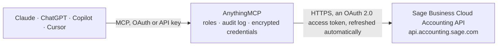

<!-- Generated by scripts/export-github-catalog.mjs in the anythingmcp-website repository. Do not edit by hand. -->

# Sage Business Cloud Accounting MCP connector

Manage Sage Business Cloud Accounting (contacts, products, invoices, bank accounts, transactions) from any AI agent. 9 tools, OAuth2 auth. The AnythingMCP connector gives Claude, ChatGPT, Microsoft Copilot, Cursor and Gemini 9 MCP tools for Sage Business Cloud Accounting: 8 read and 1 can change data.

**Category:** [Accounting](../accounting.md) · **Tools:** 9 · **Setup guide:** [anythingmcp.com](https://anythingmcp.com/guides/sage-business-cloud-to-mcp) · [Deutsch](https://anythingmcp.com/de/guides/sage-business-cloud-to-mcp) · [Italiano](https://anythingmcp.com/it/guides/sage-business-cloud-to-mcp) · [Español](https://anythingmcp.com/es/guides/sage-business-cloud-to-mcp) · [日本語](https://anythingmcp.com/ja/guides/sage-business-cloud-to-mcp) · [Русский](https://anythingmcp.com/ru/guides/sage-business-cloud-to-mcp) · [中文](https://anythingmcp.com/zh/guides/sage-business-cloud-to-mcp)

## Start without code

No installation and no terminal: AnythingMCP Cloud runs the Sage Business Cloud Accounting connector for you, operated by helpcode.ai in Frankfurt, Germany.

1. **Click the button above** and create an account or sign in. The Sage Business Cloud Accounting connector opens, ready to install.
2. **Sign in with your Sage Business Cloud Accounting account** when AnythingMCP asks. The first time, an admin creates a small app in the Sage Business Cloud Accounting developer console. Every click is in the [step-by-step guide](https://anythingmcp.com/guides/sage-business-cloud-to-mcp).
3. **Click Install.** AnythingMCP shows the address of your MCP server.
4. **Add that address to your assistant:** [Claude](https://anythingmcp.com/guides/connect-sage-business-cloud-to-claude) · [ChatGPT](https://anythingmcp.com/guides/connect-sage-business-cloud-to-chatgpt) · [Microsoft Copilot](https://anythingmcp.com/guides/connect-sage-business-cloud-to-copilot) · [Cursor](https://anythingmcp.com/guides/connect-sage-business-cloud-to-cursor) · [Gemini CLI](https://anythingmcp.com/guides/connect-sage-business-cloud-to-gemini) · [Meta Muse](https://anythingmcp.com/guides/connect-sage-business-cloud-to-muse).
5. **Ask your first question**, for example: *Show me invoice INV-2026-045 for customer Nordic Furnishings Ltd and its payment status*

Prefer help with the setup? [Talk to us](https://anythingmcp.com/contact).

## How it works

- **The AI client** speaks MCP (Streamable HTTP) to AnythingMCP and only sees tool names, descriptions and results. It never gets the Sage Business Cloud Accounting credentials.
- **AnythingMCP** checks the client's role, builds the call from the tool definition, adds the credentials (an OAuth 2.0 access token, refreshed automatically), calls Sage Business Cloud Accounting, logs the call and returns the result.
- **Sage Business Cloud Accounting** sees an ordinary API client with the rights of the account the credentials belong to.

## Tools

| Tool | What it does | Access |
|---|---|---|
| [`sage_list_businesses`](#sage_list_businesses) | List all businesses the authenticated user can access. | read |
| [`sage_list_contacts`](#sage_list_contacts) | List contacts (customers + vendors). | read |
| [`sage_get_contact`](#sage_get_contact) | Get one contact by ID with full address + tax info. | read |
| [`sage_create_contact`](#sage_create_contact) | Create a contact. | write |
| [`sage_list_sales_invoices`](#sage_list_sales_invoices) | List sales (customer) invoices. | read |
| [`sage_get_sales_invoice`](#sage_get_sales_invoice) | Get one sales invoice with lines + applied payments. | read |
| [`sage_list_products`](#sage_list_products) | List products and services. | read |
| [`sage_list_bank_accounts`](#sage_list_bank_accounts) | List bank accounts. | read |
| [`sage_list_transactions`](#sage_list_transactions) | List bank transactions on an account. | read |

## Tool reference

Every parameter as the AI client sees it in `tools/list`. Source: [`packages/backend/src/adapters/intl/sage-business-cloud.json`](../../../packages/backend/src/adapters/intl/sage-business-cloud.json).

### `sage_list_businesses`

List all businesses the authenticated user can access. Use this first to discover business IDs.

**Access:** read · **Call:** `GET /businesses`

No parameters.

### `sage_list_contacts`

List contacts (customers + vendors).

**Access:** read · **Call:** `GET /contacts`

| Parameter | Type | Required | Description |
|---|---|---|---|
| `search` | string | no | Name/email substring search. |
| `contact_type_id` | string | no | Filter: CUSTOMER, VENDOR. |
| `page` | integer | no | 1-based. |
| `items_per_page` | integer | no | Max 200. |

### `sage_get_contact`

Get one contact by ID with full address + tax info.

**Access:** read · **Call:** `GET /contacts/{id}`

| Parameter | Type | Required | Description |
|---|---|---|---|
| `id` | string | yes | Contact ID. |

### `sage_create_contact`

Create a contact. `contact_type_ids` is an array of contact types.

**Access:** write · **Call:** `POST /contacts`

| Parameter | Type | Required | Description |
|---|---|---|---|
| `name` | string | yes | Contact name. |
| `contact_type_ids` | any[] | yes | Array of 'CUSTOMER' / 'VENDOR'. |
| `email` | string | no | Email. |
| `main_address` | object | no | {address_type_id, address_line_1, city, postal_code, country_id}. |

### `sage_list_sales_invoices`

List sales (customer) invoices.

**Access:** read · **Call:** `GET /sales_invoices`

| Parameter | Type | Required | Description |
|---|---|---|---|
| `contact_id` | string | no | Filter by customer. |
| `from_date` | string | no | YYYY-MM-DD. |
| `to_date` | string | no | YYYY-MM-DD. |
| `status_id` | string | no | DRAFT, COMPLETE, VOIDED. |
| `page` | integer | no | 1-based. |
| `items_per_page` | integer | no | Max 200. |

### `sage_get_sales_invoice`

Get one sales invoice with lines + applied payments.

**Access:** read · **Call:** `GET /sales_invoices/{id}`

| Parameter | Type | Required | Description |
|---|---|---|---|
| `id` | string | yes | Invoice ID. |

### `sage_list_products`

List products and services.

**Access:** read · **Call:** `GET /products`

| Parameter | Type | Required | Description |
|---|---|---|---|
| `search` | string | no | Name search. |
| `page` | integer | no | 1-based. |
| `items_per_page` | integer | no | Max 200. |

### `sage_list_bank_accounts`

List bank accounts.

**Access:** read · **Call:** `GET /bank_accounts`

No parameters.

### `sage_list_transactions`

List bank transactions on an account.

**Access:** read · **Call:** `GET /bank_transactions`

| Parameter | Type | Required | Description |
|---|---|---|---|
| `bank_account_id` | string | yes | Bank account ID. |
| `from_date` | string | no | YYYY-MM-DD. |
| `to_date` | string | no | YYYY-MM-DD. |
| `page` | integer | no | 1-based. |

## Run it yourself

AnythingMCP is open source (AGPL-3.0). [Run it with Docker](../../../README.md#run-it-yourself), open **Connectors → Store**, pick **Sage Business Cloud Accounting** and enter `SAGE_CLIENT_ID`, `SAGE_CLIENT_SECRET`, then add your MCP server URL to the AI client.

[← Accounting connectors](../accounting.md) · [All categories](../README.md)
