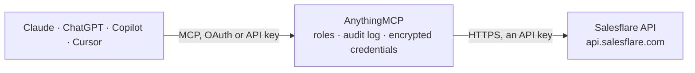

<!-- Generated by scripts/export-github-catalog.mjs in the anythingmcp-website repository. Do not edit by hand. -->

# Salesflare MCP connector

Manage Salesflare CRM (contacts, accounts, opportunities, tasks, custom fields, tags) from any AI agent. 9 tools, API key header auth. The AnythingMCP connector gives Claude, ChatGPT, Microsoft Copilot, Cursor and Gemini 9 MCP tools for Salesflare: 5 read and 4 can change data.

**Category:** [CRM](../crm.md) · **Tools:** 9 · **Setup guide:** [anythingmcp.com](https://anythingmcp.com/guides/salesflare-to-mcp) · [Deutsch](https://anythingmcp.com/de/guides/salesflare-to-mcp) · [Italiano](https://anythingmcp.com/it/guides/salesflare-to-mcp) · [Español](https://anythingmcp.com/es/guides/salesflare-to-mcp) · [日本語](https://anythingmcp.com/ja/guides/salesflare-to-mcp) · [Русский](https://anythingmcp.com/ru/guides/salesflare-to-mcp) · [中文](https://anythingmcp.com/zh/guides/salesflare-to-mcp)

## Start without code

No installation and no terminal: AnythingMCP Cloud runs the Salesflare connector for you, operated by helpcode.ai in Frankfurt, Germany.

1. **Click the button above** and create an account or sign in. The Salesflare connector opens, ready to install.
2. **Paste the API key or token from your Salesflare account.** Every click is in the [step-by-step guide](https://anythingmcp.com/guides/salesflare-to-mcp).
3. **Click Install.** AnythingMCP shows the address of your MCP server.
4. **Add that address to your assistant:** [Claude](https://anythingmcp.com/guides/connect-salesflare-to-claude) · [ChatGPT](https://anythingmcp.com/guides/connect-salesflare-to-chatgpt) · [Microsoft Copilot](https://anythingmcp.com/guides/connect-salesflare-to-copilot) · [Cursor](https://anythingmcp.com/guides/connect-salesflare-to-cursor) · [Gemini CLI](https://anythingmcp.com/guides/connect-salesflare-to-gemini) · [Meta Muse](https://anythingmcp.com/guides/connect-salesflare-to-muse).
5. **Ask your first question**, for example: *Find the contact record for Marta Ruiz at Verdeva S.L., email marta.ruiz@verdeva.es*

Prefer help with the setup? [Talk to us](https://anythingmcp.com/contact).

## How it works

- **The AI client** speaks MCP (Streamable HTTP) to AnythingMCP and only sees tool names, descriptions and results. It never gets the Salesflare credentials.
- **AnythingMCP** checks the client's role, builds the call from the tool definition, adds the credentials (an API key), calls Salesflare, logs the call and returns the result.
- **Salesflare** sees an ordinary API client with the rights of the account the credentials belong to.

## Tools

| Tool | What it does | Access |
|---|---|---|
| [`salesflare_list_contacts`](#salesflare_list_contacts) | List contacts. | read |
| [`salesflare_get_contact`](#salesflare_get_contact) | Get one contact with full custom fields + accounts. | read |
| [`salesflare_create_contact`](#salesflare_create_contact) | Create a contact. | write |
| [`salesflare_list_accounts`](#salesflare_list_accounts) | List accounts (companies). | read |
| [`salesflare_create_account`](#salesflare_create_account) | Create an account (company). | write |
| [`salesflare_list_opportunities`](#salesflare_list_opportunities) | List opportunities (deals). | read |
| [`salesflare_create_opportunity`](#salesflare_create_opportunity) | Create a deal/opportunity. | write |
| [`salesflare_list_tasks`](#salesflare_list_tasks) | List tasks. | read |
| [`salesflare_create_task`](#salesflare_create_task) | Create a task. | write |

## Tool reference

Every parameter as the AI client sees it in `tools/list`. Source: [`packages/backend/src/adapters/intl/salesflare.json`](../../../packages/backend/src/adapters/intl/salesflare.json).

### `salesflare_list_contacts`

List contacts.

**Access:** read · **Call:** `GET /contacts`

| Parameter | Type | Required | Description |
|---|---|---|---|
| `limit` | integer | no | Max 200. |
| `offset` | integer | no | 0-based. |
| `search` | string | no | Free-text search. |
| `account_id` | integer | no | Filter by account. |

### `salesflare_get_contact`

Get one contact with full custom fields + accounts.

**Access:** read · **Call:** `GET /contacts/{contact_id}`

| Parameter | Type | Required | Description |
|---|---|---|---|
| `contact_id` | integer | yes | Contact ID. |

### `salesflare_create_contact`

Create a contact.

**Access:** write · **Call:** `POST /contacts`

| Parameter | Type | Required | Description |
|---|---|---|---|
| `firstname` | string | no | First name. |
| `lastname` | string | no | Last name. |
| `email` | string | yes | Primary email. |
| `phone_numbers` | any[] | no | Array of {type, number} objects. |
| `accounts` | any[] | no | Array of {id} account refs to link. |
| `tags` | any[] | no | Array of tag name strings. |
| `custom` | object | no | Custom field map. |

### `salesflare_list_accounts`

List accounts (companies).

**Access:** read · **Call:** `GET /accounts`

| Parameter | Type | Required | Description |
|---|---|---|---|
| `limit` | integer | no | Max 200. |
| `offset` | integer | no | 0-based. |
| `search` | string | no | Name search. |

### `salesflare_create_account`

Create an account (company).

**Access:** write · **Call:** `POST /accounts`

| Parameter | Type | Required | Description |
|---|---|---|---|
| `name` | string | yes | Company name. |
| `website` | string | no | Website. |
| `phone_number` | string | no | Phone. |
| `addresses` | any[] | no | Array of address objects. |
| `tags` | any[] | no | Array of tag names. |
| `industry_id` | integer | no | Industry ID. |

### `salesflare_list_opportunities`

List opportunities (deals).

**Access:** read · **Call:** `GET /opportunities`

| Parameter | Type | Required | Description |
|---|---|---|---|
| `limit` | integer | no | Max 200. |
| `offset` | integer | no | 0-based. |
| `stage_id` | integer | no | Filter by stage. |
| `account_id` | integer | no | Filter by account. |

### `salesflare_create_opportunity`

Create a deal/opportunity.

**Access:** write · **Call:** `POST /opportunities`

| Parameter | Type | Required | Description |
|---|---|---|---|
| `name` | string | yes | Deal name. |
| `account` | object | no | {id} account ref. |
| `value` | number | no | Deal value. |
| `currency` | string | no | ISO 4217. |
| `probability` | integer | no | 0-100. |
| `expected_close_date` | string | no | ISO 8601. |
| `stage_id` | integer | no | Pipeline stage ID. |
| `owner_id` | integer | no | Salesflare user ID. |

### `salesflare_list_tasks`

List tasks. Filter by status, owner, due date.

**Access:** read · **Call:** `GET /tasks`

| Parameter | Type | Required | Description |
|---|---|---|---|
| `limit` | integer | no | Max 200. |
| `offset` | integer | no | 0-based. |
| `status` | string | no | open, done. |
| `owner_id` | integer | no | Filter by owner. |

### `salesflare_create_task`

Create a task.

**Access:** write · **Call:** `POST /tasks`

| Parameter | Type | Required | Description |
|---|---|---|---|
| `name` | string | yes | Task title. |
| `description` | string | no | Description. |
| `remind_date` | string | no | ISO 8601 due date. |
| `owner_id` | integer | no | Assignee user ID. |
| `contact_id` | integer | no | Linked contact. |
| `account_id` | integer | no | Linked account. |
| `opportunity_id` | integer | no | Linked opportunity. |

## Run it yourself

AnythingMCP is open source (AGPL-3.0). [Run it with Docker](../../../README.md#run-it-yourself), open **Connectors → Store**, pick **Salesflare** and enter `SALESFLARE_API_KEY`, then add your MCP server URL to the AI client.

[← CRM connectors](../crm.md) · [All categories](../README.md)
