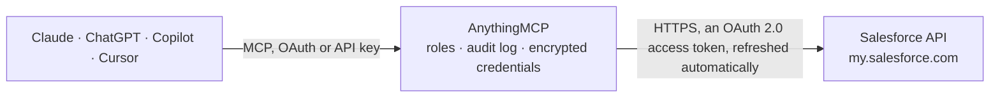

<!-- Generated by scripts/export-github-catalog.mjs in the anythingmcp-website repository. Do not edit by hand. -->

# Salesforce MCP connector

Let your AI work in Salesforce: find accounts, contacts, leads, opportunities and cases, answer questions with SOQL queries, search across all records, open list views and recently viewed records, … The AnythingMCP connector gives Claude, ChatGPT, Microsoft Copilot, Cursor and Gemini 15 MCP tools for Salesforce: 12 read and 3 can change data.

**Category:** [CRM](../crm.md) · **Tools:** 15 · **Setup guide:** [anythingmcp.com](https://anythingmcp.com/guides/salesforce-to-mcp) · [Deutsch](https://anythingmcp.com/de/guides/salesforce-to-mcp) · [Italiano](https://anythingmcp.com/it/guides/salesforce-to-mcp) · [Español](https://anythingmcp.com/es/guides/salesforce-to-mcp) · [日本語](https://anythingmcp.com/ja/guides/salesforce-to-mcp) · [Русский](https://anythingmcp.com/ru/guides/salesforce-to-mcp) · [中文](https://anythingmcp.com/zh/guides/salesforce-to-mcp)

## Start without code

No installation and no terminal: AnythingMCP Cloud runs the Salesforce connector for you, operated by helpcode.ai in Frankfurt, Germany.

1. **Click the button above** and create an account or sign in. The Salesforce connector opens, ready to install.
2. **Sign in with your Salesforce account** when AnythingMCP asks. The first time, an admin creates a small app in the Salesforce developer console. Every click is in the [step-by-step guide](https://anythingmcp.com/guides/salesforce-to-mcp).
3. **Click Install.** AnythingMCP shows the address of your MCP server.
4. **Add that address to your assistant:** [Claude](https://anythingmcp.com/guides/connect-salesforce-to-claude) · [ChatGPT](https://anythingmcp.com/guides/connect-salesforce-to-chatgpt) · [Microsoft Copilot](https://anythingmcp.com/guides/connect-salesforce-to-copilot) · [Cursor](https://anythingmcp.com/guides/connect-salesforce-to-cursor) · [Gemini CLI](https://anythingmcp.com/guides/connect-salesforce-to-gemini) · [Meta Muse](https://anythingmcp.com/guides/connect-salesforce-to-muse).
5. **Ask your first question**, for example: *Find the Opportunity ID and Amount for Nordic Solar GmbH closed Won with CloseDate in August 2026.*

Prefer help with the setup? [Talk to us](https://anythingmcp.com/contact).

## How it works

- **The AI client** speaks MCP (Streamable HTTP) to AnythingMCP and only sees tool names, descriptions and results. It never gets the Salesforce credentials.
- **AnythingMCP** checks the client's role, builds the call from the tool definition, adds the credentials (an OAuth 2.0 access token, refreshed automatically), calls Salesforce, logs the call and returns the result.
- **Salesforce** sees an ordinary API client with the rights of the account the credentials belong to.

## Tools

| Tool | What it does | Access |
|---|---|---|
| [`salesforce_get_api_resources`](#salesforce_get_api_resources) | List the REST API resources available to the signed-in user in API version 67.0 (sobjects, query, search, recent, limits and others). | read |
| [`salesforce_get_org_limits`](#salesforce_get_org_limits) | Return the org's limits with the maximum and the remaining amount of each: DailyApiRequests (API calls left in the rolling 24 hours), DataStorageMB,… | read |
| [`salesforce_list_objects`](#salesforce_list_objects) | List the objects (sObjects) of the org that the user can query, standard and custom, with API name, label, custom flag, createable and updateable flags and… | read |
| [`salesforce_describe_object`](#salesforce_describe_object) | Describe one object: its fields with API name, label, type, length, whether a value is required on create, whether it can be set on create or update,… | read |
| [`salesforce_query`](#salesforce_query) | Run a SOQL query and return the matching records with totalSize and done. | read |
| [`salesforce_query_more`](#salesforce_query_more) | Fetch the next page of a SOQL query result from its query locator. | read |
| [`salesforce_search_text`](#salesforce_search_text) | Search the org's search index for a word, name, email or phone number across objects without writing SOSL, optionally limited to some objects and returning… | read |
| [`salesforce_search_sosl`](#salesforce_search_sosl) | Run a SOSL search statement across several objects at once and return the matching records (searchRecords) with the fields listed in its RETURNING clause. | read |
| [`salesforce_get_record`](#salesforce_get_record) | Get one record by object and record ID with all fields the user can read, or only the listed fields. | read |
| [`salesforce_create_record`](#salesforce_create_record) | Create one record of the given object with the given field values. | write |
| [`salesforce_update_record`](#salesforce_update_record) | Update fields of one existing record. | write |
| [`salesforce_create_record_tree`](#salesforce_create_record_tree) | Create up to 200 records in one all-or-nothing call: several records of one object, or a root record with nested child records (e.g. an Account with its… | write |
| [`salesforce_list_recently_viewed`](#salesforce_list_recently_viewed) | List the records the signed-in user most recently viewed or referenced in Salesforce, newest first, with object type, ID and name. | read |
| [`salesforce_list_list_views`](#salesforce_list_list_views) | List the list views of one object that the user can see (e.g. My Opportunities, All Open Leads) with ID, label and developer name. | read |
| [`salesforce_get_list_view_results`](#salesforce_get_list_view_results) | Run a list view as the user sees it in Salesforce and return its columns and records. | read |

## Tool reference

Every parameter as the AI client sees it in `tools/list`. Source: [`packages/backend/src/adapters/intl/salesforce.json`](../../../packages/backend/src/adapters/intl/salesforce.json).

### `salesforce_get_api_resources`

List the REST API resources available to the signed-in user in API version 67.0 (sobjects, query, search, recent, limits and others). The identity entry is the user's identity URL, ending in the org ID and the user ID (e.g. .../id/00D.../005...). Confirms that the connection and the authorization work.

**Access:** read · **Call:** `GET /`

No parameters.

### `salesforce_get_org_limits`

Return the org's limits with the maximum and the remaining amount of each: DailyApiRequests (API calls left in the rolling 24 hours), DataStorageMB, FileStorageMB, DailyBulkApiBatches, SingleEmail and others. Requires the View Setup and Configuration permission.

**Access:** read · **Call:** `GET /limits`

No parameters.

### `salesforce_list_objects`

List the objects (sObjects) of the org that the user can query, standard and custom, with API name, label, custom flag, createable and updateable flags and the 3-character key prefix of their record IDs. The automatic companion objects (names ending in Share, History, Feed or ChangeEvent) are left out; they can still be queried by name.

**Access:** read · **Call:** `GET /sobjects`

No parameters.

### `salesforce_describe_object`

Describe one object: its fields with API name, label, type, length, whether a value is required on create, whether it can be set on create or update, picklist values (active ones), lookup targets (referenceTo) and relationship names, plus its child relationships (for subqueries) and record types. Use the API names it returns in SOQL queries and writes.

**Access:** read · **Call:** `GET /sobjects/{sobject}/describe`

| Parameter | Type | Required | Description |
|---|---|---|---|
| `sobject` | string | yes | API name of the object, e.g. Account, Contact, Opportunity, Case, or a custom object such as Invoice__c. |

### `salesforce_query`

Run a SOQL query and return the matching records with totalSize and done. Queries the Salesforce REST API, see https://developer.salesforce.com/docs/atlas.en-us.api_rest.meta/api_rest/resources_query.htm. Returns up to 2,000 records per page; when done is false the response has nextRecordsUrl, whose last path segment is the locator for salesforce_query_more. Excludes deleted and archived records.

**Access:** read · **Call:** `GET /query`

| Parameter | Type | Required | Description |
|---|---|---|---|
| `q` | string | yes | A SOQL statement with API names, e.g. SELECT Id, Name, StageName, Amount, CloseDate FROM Opportunity WHERE IsClosed = false AND CloseDate = THIS_QUARTER ORDER BY Amount DESC LIMIT 50. Strings in single quotes, dates unquoted. |
| `batch_size` | integer | no | Records per page, 200 to 2000 (default 2000). Salesforce may return fewer. |

### `salesforce_query_more`

Fetch the next page of a SOQL query result from its query locator. Returns records, totalSize, done and, while more pages remain, a new nextRecordsUrl.

**Access:** read · **Call:** `GET /query/{locator}`

| Parameter | Type | Required | Description |
|---|---|---|---|
| `locator` | string | yes | The last path segment of nextRecordsUrl, e.g. 01gRO0000016PIAYA2-500 from /services/data/v67.0/query/01gRO0000016PIAYA2-500. |

### `salesforce_search_text`

Search the org's search index for a word, name, email or phone number across objects without writing SOSL, optionally limited to some objects and returning chosen fields. Returns searchRecords, each with its object type and ID plus the requested fields.

**Access:** read · **Call:** `GET /parameterizedSearch`

| Parameter | Type | Required | Description |
|---|---|---|---|
| `q` | string | yes | Text to search for, e.g. Acme or ana@example.com. * matches the end of a word (Acm*). At least two characters besides the wildcards: a* or ? alone is refused (INVALID_SEARCH). |
| `sobject` | string[] | no | Objects to search, e.g. ["Account", "Contact", "Lead"]. Without it all searchable objects are searched and only IDs come back. |
| `fields` | string | no | Comma-separated API names returned for every object in sobject, e.g. Id,Name. Needs sobject. |
| `in` | `ALL` \| `NAME` \| `EMAIL` \| `PHONE` \| `SIDEBAR` | no | Which fields are searched (default ALL). |
| `overall_limit` | integer | no | Maximum number of results across all objects. |

### `salesforce_search_sosl`

Run a SOSL search statement across several objects at once and return the matching records (searchRecords) with the fields listed in its RETURNING clause. Queries the Salesforce REST API, see https://developer.salesforce.com/docs/atlas.en-us.api_rest.meta/api_rest/resources_search.htm.

**Access:** read · **Call:** `GET /search`

| Parameter | Type | Required | Description |
|---|---|---|---|
| `q` | string | yes | A SOSL statement, e.g. FIND {Acme*} IN NAME FIELDS RETURNING Account(Id, Name, Phone), Contact(Id, Name, Email WHERE MailingCountry = 'Germany') LIMIT 20. The search term goes in braces. |

### `salesforce_get_record`

Get one record by object and record ID with all fields the user can read, or only the listed fields.

**Access:** read · **Call:** `GET /sobjects/{sobject}/{record_id}`

| Parameter | Type | Required | Description |
|---|---|---|---|
| `sobject` | string | yes | API name of the object, e.g. Account or Invoice__c. |
| `record_id` | string | yes | 15- or 18-character record ID, e.g. 001RO000002ab3XYAQ. |
| `fields` | string | no | Comma-separated API names to return, e.g. Name,Industry,AnnualRevenue,OwnerId. Without it every readable field is returned. |

### `salesforce_create_record`

Create one record of the given object with the given field values. Returns the new record's id and success, or the errors (missing required field, validation rule, duplicate rule) that stopped it.

**Access:** write · **Call:** `POST /sobjects/{sobject}`

| Parameter | Type | Required | Description |
|---|---|---|---|
| `sobject` | string | yes | API name of the object, e.g. Lead, Contact, Task or Invoice__c. |
| `fields` | object | yes | Field values by API name, e.g. {"LastName": "Rossi", "Company": "Acme", "Email": "ana@example.com"}. Lookups take a record ID, dates YYYY-MM-DD, date-times ISO 8601 UTC. Must not contain Id. |

### `salesforce_update_record`

Update fields of one existing record. Only the fields sent change; a field set to null is cleared. Returns no content (HTTP 204) when the update worked, or the errors that stopped it.

**Access:** write · **Call:** `PATCH /sobjects/{sobject}/{record_id}`

| Parameter | Type | Required | Description |
|---|---|---|---|
| `sobject` | string | yes | API name of the object, e.g. Opportunity. |
| `record_id` | string | yes | 15- or 18-character ID of the record to update. |
| `fields` | object | yes | Field values to change by API name, e.g. {"StageName": "Closed Won", "Amount": 12000}. Must not contain Id. |

### `salesforce_create_record_tree`

Create up to 200 records in one all-or-nothing call: several records of one object, or a root record with nested child records (e.g. an Account with its Contacts and Opportunities), up to five levels and five object types. Returns the ID of every record created under its referenceId, or the error of the record that failed (then nothing is created).

**Access:** write · **Call:** `POST /composite/tree/{sobject}`

| Parameter | Type | Required | Description |
|---|---|---|---|
| `sobject` | string | yes | API name of the root records' object, e.g. Account. |
| `records` | object[] | yes | Root records. Each has attributes with type and a unique referenceId, its fields by API name, and child records under the child relationship name, e.g. [{"attributes": {"type": "Account", "referenceId": "acc1"}, "Name": "Acme", "Contacts": {"records": [{"attributes": {"type": "Contact", "referenceId": "con1"}, "LastName": "Rossi"}]}}]. |

### `salesforce_list_recently_viewed`

List the records the signed-in user most recently viewed or referenced in Salesforce, newest first, with object type, ID and name.

**Access:** read · **Call:** `GET /recent`

| Parameter | Type | Required | Description |
|---|---|---|---|
| `limit` | integer | no | Maximum number of records (Salesforce keeps up to 200). |

### `salesforce_list_list_views`

List the list views of one object that the user can see (e.g. My Opportunities, All Open Leads) with ID, label and developer name. The ID is needed for salesforce_get_list_view_results.

**Access:** read · **Call:** `GET /sobjects/{sobject}/listviews`

| Parameter | Type | Required | Description |
|---|---|---|---|
| `sobject` | string | yes | API name of the object, e.g. Opportunity. |

### `salesforce_get_list_view_results`

Run a list view as the user sees it in Salesforce and return its columns and records. Pages with limit and offset.

**Access:** read · **Call:** `GET /sobjects/{sobject}/listviews/{list_view_id}/results`

| Parameter | Type | Required | Description |
|---|---|---|---|
| `sobject` | string | yes | API name of the object the list view belongs to, e.g. Lead. |
| `list_view_id` | string | yes | List view ID from salesforce_list_list_views (starts with 00B). |
| `limit` | integer | no | Records to return, 1 to 2000 (default 25). |
| `offset` | integer | no | Index of the first record to return (default 0). |

## Run it yourself

AnythingMCP is open source (AGPL-3.0). [Run it with Docker](../../../README.md#run-it-yourself), open **Connectors → Store**, pick **Salesforce** and enter `SALESFORCE_MY_DOMAIN`, `SALESFORCE_CLIENT_ID`, `SALESFORCE_CLIENT_SECRET`, then add your MCP server URL to the AI client.

[← CRM connectors](../crm.md) · [All categories](../README.md)
