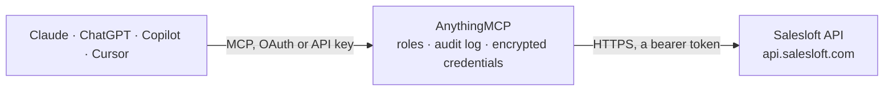

<!-- Generated by scripts/export-github-catalog.mjs in the anythingmcp-website repository. Do not edit by hand. -->

# Salesloft MCP connector

Drive Salesloft (sales engagement platform) from any AI agent: people, accounts, cadences, sequence enrollment, activities, custom fields. 11 tools, OAuth2 Bearer auth. The AnythingMCP connector gives Claude, ChatGPT, Microsoft Copilot, Cursor and Gemini 11 MCP tools for Salesloft: 7 read and 4 can change data.

**Category:** [CRM](../crm.md) · **Tools:** 11 · **Setup guide:** [anythingmcp.com](https://anythingmcp.com/guides/salesloft-to-mcp) · [Deutsch](https://anythingmcp.com/de/guides/salesloft-to-mcp) · [Italiano](https://anythingmcp.com/it/guides/salesloft-to-mcp) · [Español](https://anythingmcp.com/es/guides/salesloft-to-mcp) · [日本語](https://anythingmcp.com/ja/guides/salesloft-to-mcp) · [Русский](https://anythingmcp.com/ru/guides/salesloft-to-mcp) · [中文](https://anythingmcp.com/zh/guides/salesloft-to-mcp)

## Start without code

No installation and no terminal: AnythingMCP Cloud runs the Salesloft connector for you, operated by helpcode.ai in Frankfurt, Germany.

1. **Click the button above** and create an account or sign in. The Salesloft connector opens, ready to install.
2. **Paste the API key or token from your Salesloft account.** Every click is in the [step-by-step guide](https://anythingmcp.com/guides/salesloft-to-mcp).
3. **Click Install.** AnythingMCP shows the address of your MCP server.
4. **Add that address to your assistant:** [Claude](https://anythingmcp.com/guides/connect-salesloft-to-claude) · [ChatGPT](https://anythingmcp.com/guides/connect-salesloft-to-chatgpt) · [Microsoft Copilot](https://anythingmcp.com/guides/connect-salesloft-to-copilot) · [Cursor](https://anythingmcp.com/guides/connect-salesloft-to-cursor) · [Gemini CLI](https://anythingmcp.com/guides/connect-salesloft-to-gemini) · [Meta Muse](https://anythingmcp.com/guides/connect-salesloft-to-muse).
5. **Ask your first question**, for example: *Show me the Salesloft person record for lucia.monteiro@orionapps.pt and her owner.*

Prefer help with the setup? [Talk to us](https://anythingmcp.com/contact).

## How it works

- **The AI client** speaks MCP (Streamable HTTP) to AnythingMCP and only sees tool names, descriptions and results. It never gets the Salesloft credentials.
- **AnythingMCP** checks the client's role, builds the call from the tool definition, adds the credentials (a bearer token), calls Salesloft, logs the call and returns the result.
- **Salesloft** sees an ordinary API client with the rights of the account the credentials belong to.

## Tools

| Tool | What it does | Access |
|---|---|---|
| [`salesloft_me`](#salesloft_me) | Return the authenticated user info: id, name, email, guid, team_id, role. | read |
| [`salesloft_list_people`](#salesloft_list_people) | List people (prospects). | read |
| [`salesloft_get_person`](#salesloft_get_person) | Fetch a person by ID. | read |
| [`salesloft_create_person`](#salesloft_create_person) | Create a person. | write |
| [`salesloft_update_person`](#salesloft_update_person) | Update a person. | write |
| [`salesloft_list_accounts`](#salesloft_list_accounts) | List accounts (companies). | read |
| [`salesloft_list_cadences`](#salesloft_list_cadences) | List cadences (multi-step sequences). | read |
| [`salesloft_enroll_person_in_cadence`](#salesloft_enroll_person_in_cadence) | Add a person to a cadence (create a cadence_membership). | write |
| [`salesloft_list_users`](#salesloft_list_users) | List Salesloft users in your team. | read |
| [`salesloft_create_activity_call`](#salesloft_create_activity_call) | Log a call activity on a person. | write |
| [`salesloft_list_custom_fields`](#salesloft_list_custom_fields) | List custom fields defined for people / accounts. | read |

## Tool reference

Every parameter as the AI client sees it in `tools/list`. Source: [`packages/backend/src/adapters/intl/salesloft.json`](../../../packages/backend/src/adapters/intl/salesloft.json).

### `salesloft_me`

Return the authenticated user info: id, name, email, guid, team_id, role. Health check + whoami.

**Access:** read · **Call:** `GET /me.json`

No parameters.

### `salesloft_list_people`

List people (prospects). Supports filtering by email, account_id, owned_by_id, custom_field_ids, last_contacted_date.

**Access:** read · **Call:** `GET /people.json`

| Parameter | Type | Required | Description |
|---|---|---|---|
| `ids` | any[] | no | Filter to specific person IDs. |
| `email_addresses` | any[] | no | Filter by email addresses. |
| `account_id` | any[] | no | Filter by account ID(s). |
| `owned_by_id` | any[] | no | Filter by owner user ID(s). |
| `person_stage_id` | any[] | no | Filter by stage ID(s). |
| `updated_at` | object | no | {gt?, lt?} ISO 8601 datetime range. |
| `page` | integer | no | 1-based page. |
| `per_page` | integer | no | Per page (default 25, max 100). |
| `include_paging_counts` | boolean | no | Include total count in metadata (expensive). |

### `salesloft_get_person`

Fetch a person by ID. Full details including emails, phones, account, owner, custom_fields, last_contacted_at, last_replied_at.

**Access:** read · **Call:** `GET /people/{personId}.json`

| Parameter | Type | Required | Description |
|---|---|---|---|
| `personId` | integer | yes | Person ID. |

### `salesloft_create_person`

Create a person. Required: email_address (or first_name + last_name + account_id).

**Access:** write · **Call:** `POST /people.json`

| Parameter | Type | Required | Description |
|---|---|---|---|
| `email_address` | string | no | Primary email. |
| `first_name` | string | no | First name. |
| `last_name` | string | no | Last name. |
| `title` | string | no | Job title. |
| `phone` | string | no | Primary phone. |
| `mobile_phone` | string | no | Mobile phone. |
| `linkedin_url` | string | no | LinkedIn URL. |
| `account_id` | integer | no | Linked account ID. |
| `owner_id` | integer | no | User ID of owner. |
| `person_stage_id` | integer | no | Stage ID. |
| `tags` | any[] | no | Tag name strings. |
| `custom_fields` | object | no | Custom field map (use salesloft_list_custom_fields to discover keys). |

### `salesloft_update_person`

Update a person. Partial.

**Access:** write · **Call:** `PUT /people/{personId}.json`

| Parameter | Type | Required | Description |
|---|---|---|---|
| `personId` | integer | yes | Person ID. |
| `email_address` | string | no | New email. |
| `first_name` | string | no | New first name. |
| `last_name` | string | no | New last name. |
| `title` | string | no | New title. |
| `phone` | string | no | New phone. |
| `owner_id` | integer | no | Reassign. |
| `person_stage_id` | integer | no | Change stage. |
| `tags` | any[] | no | Replace tags. |

### `salesloft_list_accounts`

List accounts (companies). Filter by name, domain, account_tier_id, owner_id.

**Access:** read · **Call:** `GET /accounts.json`

| Parameter | Type | Required | Description |
|---|---|---|---|
| `name` | string | no | Substring match on name. |
| `domain` | string | no | Exact domain. |
| `owned_by_id` | any[] | no | Owner user IDs. |
| `per_page` | integer | no | Per page. |
| `page` | integer | no | Page. |

### `salesloft_list_cadences`

List cadences (multi-step sequences). Each has id, name, current_state, draft, type, shared, team_cadence.

**Access:** read · **Call:** `GET /cadences.json`

| Parameter | Type | Required | Description |
|---|---|---|---|
| `owned_by_id` | any[] | no | Owner filter. |
| `shared` | boolean | no | Only shared cadences. |
| `per_page` | integer | no | Per page. |
| `page` | integer | no | Page. |

### `salesloft_enroll_person_in_cadence`

Add a person to a cadence (create a cadence_membership). Required: person_id + cadence_id + user_id (the user who 'sends' from this enrollment).

**Access:** write · **Call:** `POST /cadence_memberships.json`

| Parameter | Type | Required | Description |
|---|---|---|---|
| `person_id` | integer | yes | Person to enroll. |
| `cadence_id` | integer | yes | Cadence to enroll into. |
| `user_id` | integer | yes | User who owns this enrollment (their email is the From address for cadence emails). |

### `salesloft_list_users`

List Salesloft users in your team. Returns id, name, email, role, time_zone, locale.

**Access:** read · **Call:** `GET /users.json`

| Parameter | Type | Required | Description |
|---|---|---|---|
| `ids` | any[] | no | Filter to specific user IDs. |
| `guid` | string | no | Filter by guid. |
| `email` | string | no | Email filter. |
| `active` | boolean | no | Active flag filter. |
| `per_page` | integer | no | Per page. |

### `salesloft_create_activity_call`

Log a call activity on a person. Use for after-call dispositions.

**Access:** write · **Call:** `POST /activities/calls.json`

| Parameter | Type | Required | Description |
|---|---|---|---|
| `person_id` | integer | yes | Person ID. |
| `to` | string | no | Phone number called (E.164). |
| `duration` | integer | no | Call duration in seconds. |
| `sentiment` | string | no | Call sentiment label (configured in Salesloft). |
| `disposition` | string | no | Call disposition label. |
| `notes` | string | no | Free-text notes. |

### `salesloft_list_custom_fields`

List custom fields defined for people / accounts. Returns id, name, field_type, accessibility, value_type.

**Access:** read · **Call:** `GET /custom_fields.json`

| Parameter | Type | Required | Description |
|---|---|---|---|
| `field_type` | string | no | person, account, opportunity. |

## Run it yourself

AnythingMCP is open source (AGPL-3.0). [Run it with Docker](../../../README.md#run-it-yourself), open **Connectors → Store**, pick **Salesloft** and enter `SALESLOFT_ACCESS_TOKEN`, then add your MCP server URL to the AI client.

[← CRM connectors](../crm.md) · [All categories](../README.md)
