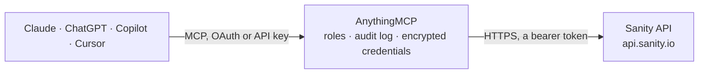

<!-- Generated by scripts/export-github-catalog.mjs in the anythingmcp-website repository. Do not edit by hand. -->

# Sanity MCP connector

Let your AI work with your Sanity content: run GROQ queries, read documents, their revisions and change history, list document types, datasets and projects, and create, change and publish drafts after you confirm. The AnythingMCP connector gives Claude, ChatGPT, Microsoft Copilot, Cursor and Gemini 11 MCP tools for Sanity: 7 read and 4 can change data.

**Category:** [CMS](../cms.md) · **Tools:** 11 · **Setup guide:** [anythingmcp.com](https://anythingmcp.com/guides/sanity-to-mcp) · [Deutsch](https://anythingmcp.com/de/guides/sanity-to-mcp) · [Italiano](https://anythingmcp.com/it/guides/sanity-to-mcp) · [Español](https://anythingmcp.com/es/guides/sanity-to-mcp) · [日本語](https://anythingmcp.com/ja/guides/sanity-to-mcp) · [Русский](https://anythingmcp.com/ru/guides/sanity-to-mcp) · [中文](https://anythingmcp.com/zh/guides/sanity-to-mcp)

## Start without code

No installation and no terminal: AnythingMCP Cloud runs the Sanity connector for you, operated by helpcode.ai in Frankfurt, Germany.

1. **Click the button above** and create an account or sign in. The Sanity connector opens, ready to install.
2. **Paste the API key or token from your Sanity account.** Every click is in the [step-by-step guide](https://anythingmcp.com/guides/sanity-to-mcp).
3. **Click Install.** AnythingMCP shows the address of your MCP server.
4. **Add that address to your assistant:** [Claude](https://anythingmcp.com/guides/connect-sanity-to-claude) · [ChatGPT](https://anythingmcp.com/guides/connect-sanity-to-chatgpt) · [Microsoft Copilot](https://anythingmcp.com/guides/connect-sanity-to-copilot) · [Cursor](https://anythingmcp.com/guides/connect-sanity-to-cursor) · [Gemini CLI](https://anythingmcp.com/guides/connect-sanity-to-gemini) · [Meta Muse](https://anythingmcp.com/guides/connect-sanity-to-muse).
5. **Ask your first question**, for example: *Show me invoices for customer GreenLeaf GmbH in dataset production, last 12 months*

Prefer help with the setup? [Talk to us](https://anythingmcp.com/contact).

## How it works

- **The AI client** speaks MCP (Streamable HTTP) to AnythingMCP and only sees tool names, descriptions and results. It never gets the Sanity credentials.
- **AnythingMCP** checks the client's role, builds the call from the tool definition, adds the credentials (a bearer token), calls Sanity, logs the call and returns the result.
- **Sanity** sees an ordinary API client with the rights of the account the credentials belong to.

## Tools

| Tool | What it does | Access |
|---|---|---|
| [`sanity_query`](#sanity_query) | Run a GROQ query against the dataset and return its result. | read |
| [`sanity_list_document_types`](#sanity_list_document_types) | List the document types that exist in the dataset (from _type), drafts included, e.g. post, author, sanity.imageAsset. | read |
| [`sanity_get_document`](#sanity_get_document) | Read documents by id, published (post-123) or draft (drafts.post-123), with all their fields; several ids separated by commas. | read |
| [`sanity_get_document_revision`](#sanity_get_document_revision) | Read a document as it was in the past: at a revision id (_rev, from sanity_list_document_transactions), at a point in time, or its last state before it was… | read |
| [`sanity_list_document_transactions`](#sanity_list_document_transactions) | List the changes (transactions) of a document: transaction id, time, author id and the kind of change (create, patch, publish, delete), newest first,… | read |
| [`sanity_create_draft`](#sanity_create_draft) | Create a new document as a draft (not published). | write |
| [`sanity_patch_draft`](#sanity_patch_draft) | Change fields of a document's draft with a patch, e.g. {"set": {"title": "New"}}, {"unset": ["subtitle"]}, {"setIfMissing": {"tags": []}}, {"inc": {"views":… | write |
| [`sanity_publish_draft`](#sanity_publish_draft) | Publish a document's draft: the draft replaces the published version and goes live on every site that reads this dataset, and the draft is removed. | write |
| [`sanity_delete_document`](#sanity_delete_document) | Delete a published document and the drafts you list. | write |
| [`sanity_list_datasets`](#sanity_list_datasets) | List the datasets of the project: name and whether each is public or private. | read |
| [`sanity_list_projects`](#sanity_list_projects) | List the Sanity projects the token can see: id, name, studio host and creation date. | read |

## Tool reference

Every parameter as the AI client sees it in `tools/list`. Source: [`packages/backend/src/adapters/intl/sanity.json`](../../../packages/backend/src/adapters/intl/sanity.json).

### `sanity_query`

Run a GROQ query against the dataset and return its result. Always project the fields you need and slice the list, e.g. *[_type == "post"] | order(_updatedAt desc) [0...20] {_id, title}; pass values as params. Answers over about 60 KB are cut off. See the connector instructions for GROQ tips.

**Access:** read · **Call:** `POST /data/query/{{SANITY_DATASET}}`

| Parameter | Type | Required | Description |
|---|---|---|---|
| `query` | string | yes | The GROQ query, e.g. *[_type == $type][0...10]{_id, title}. |
| `params` | object | no | Values for $parameters in the query, without the $, e.g. {"type": "post"}. |
| `perspective` | `published` \| `drafts` \| `raw` | no | published (default) ignores drafts, drafts shows drafts as if published, raw returns both. |

### `sanity_list_document_types`

List the document types that exist in the dataset (from _type), drafts included, e.g. post, author, sanity.imageAsset. Use it before writing queries for an unknown project.

**Access:** read · **Call:** `POST /data/query/{{SANITY_DATASET}}`

No parameters.

### `sanity_get_document`

Read documents by id, published (post-123) or draft (drafts.post-123), with all their fields; several ids separated by commas. A document that does not exist or that the token may not read is listed in omitted with the reason.

**Access:** read · **Call:** `GET /data/doc/{{SANITY_DATASET}}/{document_ids}`

| Parameter | Type | Required | Description |
|---|---|---|---|
| `document_ids` | string | yes | One id or several separated by commas, e.g. post-123,drafts.post-123. |

### `sanity_get_document_revision`

Read a document as it was in the past: at a revision id (_rev, from sanity_list_document_transactions), at a point in time, or its last state before it was deleted. Give exactly one of revision, time or last_revision.

**Access:** read · **Call:** `GET /data/history/{{SANITY_DATASET}}/documents/{document_id}`

| Parameter | Type | Required | Description |
|---|---|---|---|
| `document_id` | string | yes | The document id, e.g. post-123, or drafts.post-123 for the draft. |
| `revision` | string | no | The revision id (_rev) to read. |
| `time` | string | no | Read the document as it was at this time, ISO 8601, e.g. 2026-09-01T12:00:00Z. |
| `last_revision` | boolean | no | true returns the last revision, also of a deleted document. |

### `sanity_list_document_transactions`

List the changes (transactions) of a document: transaction id, time, author id and the kind of change (create, patch, publish, delete), newest first, without the content. Pass the id with and without drafts. to see draft edits too, e.g. post-123,drafts.post-123. The answer is one JSON object per line.

**Access:** read · **Call:** `GET /data/history/{{SANITY_DATASET}}/transactions/{document_ids}`

| Parameter | Type | Required | Description |
|---|---|---|---|
| `document_ids` | string | yes | One id or several separated by commas, e.g. post-123,drafts.post-123. |
| `limit` | integer | no | How many transactions, 1 to 100. Default 20. |
| `reverse` | boolean | no | true (default) lists the newest first. |
| `from_time` | string | no | Only changes from this time on, ISO 8601. |
| `to_time` | string | no | Only changes up to this time, ISO 8601. |

### `sanity_create_draft`

Create a new document as a draft (not published). document must contain _type and _id = "drafts." + document_id, plus its fields. Fails if the draft already exists. Show the user the document and confirm before calling; publish later with sanity_publish_draft.

**Access:** write · **Call:** `POST /data/actions/{{SANITY_DATASET}}`

| Parameter | Type | Required | Description |
|---|---|---|---|
| `document_id` | string | yes | The document id without the drafts. prefix, e.g. post-123 or a UUID. |
| `document` | object | yes | The document, e.g. {"_id": "drafts.post-123", "_type": "post", "title": "Hello"}. _id must be drafts. followed by document_id. |
| `dry_run` | boolean | no | true checks the action without saving anything. Default false. |

### `sanity_patch_draft`

Change fields of a document's draft with a patch, e.g. {"set": {"title": "New"}}, {"unset": ["subtitle"]}, {"setIfMissing": {"tags": []}}, {"inc": {"views": 1}} or {"insert": {...}}. When there is no draft yet, it starts one from the published version. Nothing goes live until published. Show the user the change and confirm before calling.

**Access:** write · **Call:** `POST /data/actions/{{SANITY_DATASET}}`

| Parameter | Type | Required | Description |
|---|---|---|---|
| `document_id` | string | yes | The document id without the drafts. prefix, e.g. post-123 or a UUID. |
| `patch` | object | yes | Patch operations: set, unset, setIfMissing, inc, dec, insert, diffMatchPatch. Paths use dots and brackets, e.g. "slug.current" or "body[0].children[0].text". |
| `dry_run` | boolean | no | true checks the action without saving anything. Default false. |

### `sanity_publish_draft`

Publish a document's draft: the draft replaces the published version and goes live on every site that reads this dataset, and the draft is removed. Show the user what will go live and confirm before calling.

**Access:** write · **Call:** `POST /data/actions/{{SANITY_DATASET}}`

| Parameter | Type | Required | Description |
|---|---|---|---|
| `document_id` | string | yes | The document id without the drafts. prefix, e.g. post-123 or a UUID. |
| `dry_run` | boolean | no | true checks the action without saving anything. Default false. |

### `sanity_delete_document`

Delete a published document and the drafts you list. Live sites lose it at once. Installed switched off. Only when the user explicitly asks; confirm the document first.

**Access:** write · **Call:** `POST /data/actions/{{SANITY_DATASET}}`

| Parameter | Type | Required | Description |
|---|---|---|---|
| `document_id` | string | yes | The document id without the drafts. prefix, e.g. post-123 or a UUID. |
| `include_drafts` | string[] | no | Draft ids to delete with it, e.g. ["drafts.post-123"]. A draft that exists but is not listed makes the delete fail. |
| `dry_run` | boolean | no | true checks the action without saving anything. Default false. |

### `sanity_list_datasets`

List the datasets of the project: name and whether each is public or private.

**Access:** read · **Call:** `GET https://{{SANITY_PROJECT_ID}}.api.sanity.io/v2021-06-07/datasets`

No parameters.

### `sanity_list_projects`

List the Sanity projects the token can see: id, name, studio host and creation date. A project token usually sees only its own project; a personal token sees all of yours.

**Access:** read · **Call:** `GET https://api.sanity.io/v2021-06-07/projects`

No parameters.

## Run it yourself

AnythingMCP is open source (AGPL-3.0). [Run it with Docker](../../../README.md#run-it-yourself), open **Connectors → Store**, pick **Sanity** and enter `SANITY_PROJECT_ID`, `SANITY_DATASET`, `SANITY_API_TOKEN`, then add your MCP server URL to the AI client.

[← CMS connectors](../cms.md) · [All categories](../README.md)
