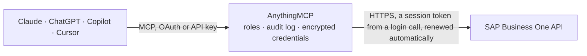

<!-- Generated by scripts/export-github-catalog.mjs in the anythingmcp-website repository. Do not edit by hand. -->

# SAP Business One MCP connector

Drive SAP Business One ERP from any AI agent: business partners, items, sales orders and invoices, plus finance (A/P invoices, payments, journal entries, chart of accounts, bank statements). The AnythingMCP connector gives Claude, ChatGPT, Microsoft Copilot, Cursor and Gemini 24 MCP tools for SAP Business One: 23 read and 1 can change data.

**Category:** [ERP](../erp.md) · **Tools:** 24 · **Setup guide:** [anythingmcp.com](https://anythingmcp.com/guides/sap-business-one-to-mcp) · [Deutsch](https://anythingmcp.com/de/guides/sap-business-one-to-mcp) · [Italiano](https://anythingmcp.com/it/guides/sap-business-one-to-mcp) · [Español](https://anythingmcp.com/es/guides/sap-business-one-to-mcp) · [日本語](https://anythingmcp.com/ja/guides/sap-business-one-to-mcp) · [Русский](https://anythingmcp.com/ru/guides/sap-business-one-to-mcp) · [中文](https://anythingmcp.com/zh/guides/sap-business-one-to-mcp)

## Start without code

No installation and no terminal: AnythingMCP Cloud runs the SAP Business One connector for you, operated by helpcode.ai in Frankfurt, Germany.

1. **Click the button above** and create an account or sign in. The SAP Business One connector opens, ready to install.
2. **Paste the API key or token from your SAP Business One account.** Every click is in the [step-by-step guide](https://anythingmcp.com/guides/sap-business-one-to-mcp).
3. **Click Install.** AnythingMCP shows the address of your MCP server.
4. **Add that address to your assistant:** [Claude](https://anythingmcp.com/guides/connect-sap-business-one-to-claude) · [ChatGPT](https://anythingmcp.com/guides/connect-sap-business-one-to-chatgpt) · [Microsoft Copilot](https://anythingmcp.com/guides/connect-sap-business-one-to-copilot) · [Cursor](https://anythingmcp.com/guides/connect-sap-business-one-to-cursor) · [Gemini CLI](https://anythingmcp.com/guides/connect-sap-business-one-to-gemini) · [Meta Muse](https://anythingmcp.com/guides/connect-sap-business-one-to-muse).
5. **Ask your first question**, for example: *Show AR invoices for CardCode C30001 (KRAFTGMBH) between 2026-03-01 and 2026-03-31, open only*

Prefer help with the setup? [Talk to us](https://anythingmcp.com/contact).

## How it works

- **The AI client** speaks MCP (Streamable HTTP) to AnythingMCP and only sees tool names, descriptions and results. It never gets the SAP Business One credentials.
- **AnythingMCP** checks the client's role, builds the call from the tool definition, adds the credentials (a session token from a login call, renewed automatically), calls SAP Business One, logs the call and returns the result.
- **SAP Business One** sees an ordinary API client with the rights of the account the credentials belong to.

## Tools

| Tool | What it does | Access |
|---|---|---|
| [`b1_list_business_partners`](#b1_list_business_partners) | List business partners (customers, suppliers, leads) with their code, name, type and balance. | read |
| [`b1_get_business_partner`](#b1_get_business_partner) | Read one business partner by CardCode: addresses, contacts, payment terms and balance. | read |
| [`b1_list_items`](#b1_list_items) | List inventory items with their code, name, prices and stock per warehouse (ItemWarehouseInfoCollection). | read |
| [`b1_get_item`](#b1_get_item) | Read one item by ItemCode: prices, units, groups and stock in each warehouse. | read |
| [`b1_list_orders`](#b1_list_orders) | List sales orders with their customer, dates, totals and status (bost_Open / bost_Close). | read |
| [`b1_get_order`](#b1_get_order) | Read one sales order by DocEntry (integer key, not DocNum), with all its lines. | read |
| [`b1_create_order`](#b1_create_order) | Create a new sales order. | write |
| [`b1_list_invoices`](#b1_list_invoices) | List A/R invoices (sales invoices to customers). | read |
| [`b1_get_invoice`](#b1_get_invoice) | Read one A/R invoice by DocEntry (integer key, not DocNum), with lines and taxes. | read |
| [`b1_list_quotations`](#b1_list_quotations) | List sales quotations with their customer, validity date, totals and status. | read |
| [`b1_list_delivery_notes`](#b1_list_delivery_notes) | List delivery notes (goods shipped to customers) with their customer, date and lines. | read |
| [`b1_list_credit_notes`](#b1_list_credit_notes) | List A/R credit memos (credit notes issued to customers) with their totals and status. | read |
| [`b1_list_purchase_invoices`](#b1_list_purchase_invoices) | List A/P invoices (supplier invoices). | read |
| [`b1_get_purchase_invoice`](#b1_get_purchase_invoice) | Read one A/P invoice in full, with its lines, taxes and withholding tax. | read |
| [`b1_list_purchase_credit_notes`](#b1_list_purchase_credit_notes) | List A/P credit memos (credit notes received from suppliers). | read |
| [`b1_list_vendor_payments`](#b1_list_vendor_payments) | List outgoing payments to suppliers, with the invoices each one settles (PaymentInvoices). | read |
| [`b1_list_incoming_payments`](#b1_list_incoming_payments) | List incoming payments from customers, with the invoices each one settles (PaymentInvoices). | read |
| [`b1_list_journal_entries`](#b1_list_journal_entries) | List journal entries with their lines (JournalEntryLines: account, debit, credit). | read |
| [`b1_get_journal_entry`](#b1_get_journal_entry) | Read one journal entry by JdtNum (TransId) with all its lines: account, debit and credit. | read |
| [`b1_list_chart_of_accounts`](#b1_list_chart_of_accounts) | List G/L accounts of the chart of accounts with their code, name, type and balance. | read |
| [`b1_list_bank_statements`](#b1_list_bank_statements) | List imported bank statements with their account, date and balances. | read |
| [`b1_list_external_reconciliations`](#b1_list_external_reconciliations) | List external (bank) reconciliations of G/L or business partner accounts in a date or number range. | read |
| [`b1_get_external_reconciliation`](#b1_get_external_reconciliation) | Read one external (bank) reconciliation: amount, date, type and the journal entry and bank statement lines it matched. | read |
| [`b1_get_company_info`](#b1_get_company_info) | Sanity check: returns company metadata (admin info). | read |

## Tool reference

Every parameter as the AI client sees it in `tools/list`. Source: [`packages/backend/src/adapters/de/sap-business-one.json`](../../../packages/backend/src/adapters/de/sap-business-one.json).

### `b1_list_business_partners`

List business partners (customers, suppliers, leads) with their code, name, type and balance.

**Access:** read · **Call:** `GET /BusinessPartners`

| Parameter | Type | Required | Description |
|---|---|---|---|
| `top` | number | no | Rows to return, at most 100 per call. Use skip for the next page. |
| `skip` | number | no | Rows to skip, for paging (e.g. 100 for the second page). |
| `filter` | string | no | OData $filter, e.g. CardType eq 'cSupplier' |
| `select` | string | no | OData $select, e.g. CardCode,CardName,CurrentAccountBalance |
| `orderby` | string | no | OData $orderby, e.g. CardName asc |

### `b1_get_business_partner`

Read one business partner by CardCode: addresses, contacts, payment terms and balance.

**Access:** read · **Call:** `GET /BusinessPartners('{cardCode}')`

| Parameter | Type | Required | Description |
|---|---|---|---|
| `cardCode` | string | yes | BP CardCode, e.g. C20000 |

### `b1_list_items`

List inventory items with their code, name, prices and stock per warehouse (ItemWarehouseInfoCollection).

**Access:** read · **Call:** `GET /Items`

| Parameter | Type | Required | Description |
|---|---|---|---|
| `top` | number | no | Rows to return, at most 100 per call. Use skip for the next page. |
| `skip` | number | no | Rows to skip, for paging (e.g. 100 for the second page). |
| `filter` | string | no | OData $filter, e.g. QuantityOnStock gt 0 |
| `select` | string | no | OData $select, e.g. ItemCode,ItemName,QuantityOnStock |
| `orderby` | string | no | OData $orderby, e.g. ItemCode asc |

### `b1_get_item`

Read one item by ItemCode: prices, units, groups and stock in each warehouse.

**Access:** read · **Call:** `GET /Items('{itemCode}')`

| Parameter | Type | Required | Description |
|---|---|---|---|
| `itemCode` | string | yes | Item code |

### `b1_list_orders`

List sales orders with their customer, dates, totals and status (bost_Open / bost_Close).

**Access:** read · **Call:** `GET /Orders`

| Parameter | Type | Required | Description |
|---|---|---|---|
| `top` | number | no | Rows to return, at most 100 per call. Use skip for the next page. |
| `skip` | number | no | Rows to skip, for paging (e.g. 100 for the second page). |
| `filter` | string | no | OData $filter, e.g. DocumentStatus eq 'bost_Open' |
| `select` | string | no | OData $select, e.g. DocEntry,DocNum,CardCode,DocDate,DocTotal |
| `orderby` | string | no | OData $orderby, e.g. DocDate desc |

### `b1_get_order`

Read one sales order by DocEntry (integer key, not DocNum), with all its lines.

**Access:** read · **Call:** `GET /Orders({docEntry})`

| Parameter | Type | Required | Description |
|---|---|---|---|
| `docEntry` | number | yes | Order DocEntry |

### `b1_create_order`

Create a new sales order. Provide CardCode (the customer BP) and DocumentLines (array of {ItemCode, Quantity}).

**Access:** write · **Call:** `POST /Orders`

| Parameter | Type | Required | Description |
|---|---|---|---|
| `cardCode` | string | yes | Customer CardCode |
| `documentLines` | object[] | yes | Array of {ItemCode, Quantity, Price?} line objects |
| `comments` | string | no | Free-text comments printed on the order |

### `b1_list_invoices`

List A/R invoices (sales invoices to customers). PaidToDate against DocTotal shows what is still open.

**Access:** read · **Call:** `GET /Invoices`

| Parameter | Type | Required | Description |
|---|---|---|---|
| `top` | number | no | Rows to return, at most 100 per call. Use skip for the next page. |
| `skip` | number | no | Rows to skip, for paging (e.g. 100 for the second page). |
| `filter` | string | no | OData $filter, e.g. DocDate ge '2026-01-01' and DocumentStatus eq 'bost_Open' |
| `select` | string | no | OData $select, e.g. DocEntry,DocNum,CardCode,DocDate,DocTotal,PaidToDate |
| `orderby` | string | no | OData $orderby, e.g. DocDate desc |

### `b1_get_invoice`

Read one A/R invoice by DocEntry (integer key, not DocNum), with lines and taxes.

**Access:** read · **Call:** `GET /Invoices({docEntry})`

| Parameter | Type | Required | Description |
|---|---|---|---|
| `docEntry` | number | yes | Invoice DocEntry |

### `b1_list_quotations`

List sales quotations with their customer, validity date, totals and status.

**Access:** read · **Call:** `GET /Quotations`

| Parameter | Type | Required | Description |
|---|---|---|---|
| `top` | number | no | Rows to return, at most 100 per call. Use skip for the next page. |
| `skip` | number | no | Rows to skip, for paging (e.g. 100 for the second page). |
| `filter` | string | no | OData $filter, e.g. DocDate ge '2026-01-01' |
| `select` | string | no | OData $select, e.g. DocEntry,DocNum,CardCode,DocTotal |
| `orderby` | string | no | OData $orderby, e.g. DocDate desc |

### `b1_list_delivery_notes`

List delivery notes (goods shipped to customers) with their customer, date and lines.

**Access:** read · **Call:** `GET /DeliveryNotes`

| Parameter | Type | Required | Description |
|---|---|---|---|
| `top` | number | no | Rows to return, at most 100 per call. Use skip for the next page. |
| `skip` | number | no | Rows to skip, for paging (e.g. 100 for the second page). |
| `filter` | string | no | OData $filter, e.g. DocDate ge '2026-01-01' |
| `select` | string | no | OData $select, e.g. DocEntry,DocNum,CardCode,DocDate |
| `orderby` | string | no | OData $orderby, e.g. DocDate desc |

### `b1_list_credit_notes`

List A/R credit memos (credit notes issued to customers) with their totals and status.

**Access:** read · **Call:** `GET /CreditNotes`

| Parameter | Type | Required | Description |
|---|---|---|---|
| `top` | number | no | Rows to return, at most 100 per call. Use skip for the next page. |
| `skip` | number | no | Rows to skip, for paging (e.g. 100 for the second page). |
| `filter` | string | no | OData $filter, e.g. DocDate ge '2026-01-01' |
| `select` | string | no | OData $select, e.g. DocEntry,DocNum,CardCode,DocDate,DocTotal |
| `orderby` | string | no | OData $orderby, e.g. DocDate desc |

### `b1_list_purchase_invoices`

List A/P invoices (supplier invoices). PaidToDate against DocTotal shows what is still open.

**Access:** read · **Call:** `GET /PurchaseInvoices`

| Parameter | Type | Required | Description |
|---|---|---|---|
| `top` | number | no | Rows to return, at most 100 per call. Use skip for the next page. |
| `skip` | number | no | Rows to skip, for paging (e.g. 100 for the second page). |
| `filter` | string | no | OData $filter, e.g. DocumentStatus eq 'bost_Open' or DocDate ge '2026-09-01' |
| `select` | string | no | OData $select, e.g. DocEntry,DocNum,CardCode,CardName,DocDate,DocDueDate,DocTotal,PaidToDate,DocCurrency |
| `orderby` | string | no | OData $orderby, e.g. DocDate desc |

### `b1_get_purchase_invoice`

Read one A/P invoice in full, with its lines, taxes and withholding tax.

**Access:** read · **Call:** `GET /PurchaseInvoices({docEntry})`

| Parameter | Type | Required | Description |
|---|---|---|---|
| `docEntry` | number | yes | DocEntry of the A/P invoice (not DocNum). |

### `b1_list_purchase_credit_notes`

List A/P credit memos (credit notes received from suppliers).

**Access:** read · **Call:** `GET /PurchaseCreditNotes`

| Parameter | Type | Required | Description |
|---|---|---|---|
| `top` | number | no | Rows to return, at most 100 per call. Use skip for the next page. |
| `skip` | number | no | Rows to skip, for paging (e.g. 100 for the second page). |
| `filter` | string | no | OData $filter, e.g. DocDate ge '2026-01-01' |
| `select` | string | no | OData $select, e.g. DocEntry,DocNum,CardCode,DocDate,DocTotal |
| `orderby` | string | no | OData $orderby, e.g. DocDate desc |

### `b1_list_vendor_payments`

List outgoing payments to suppliers, with the invoices each one settles (PaymentInvoices). Amount paid = CashSum + TransferSum + PaymentChecks + PaymentCreditCards. To match many amounts, read the whole date window once and compare locally.

**Access:** read · **Call:** `GET /VendorPayments`

| Parameter | Type | Required | Description |
|---|---|---|---|
| `top` | number | no | Rows to return, at most 100 per call. Use skip for the next page. |
| `skip` | number | no | Rows to skip, for paging (e.g. 100 for the second page). |
| `filter` | string | no | OData $filter, e.g. DocDate ge '2026-09-01' and Cancelled eq 'tNO' |
| `select` | string | no | OData $select, e.g. DocEntry,DocNum,CardCode,CardName,DocDate,CashSum,TransferSum,TransferReference,PaymentChecks,DocCurrency,PaymentInvoices. There is no DocTotal or header CheckSum: cheque amounts are in PaymentChecks. |
| `orderby` | string | no | OData $orderby, e.g. DocDate desc |

### `b1_list_incoming_payments`

List incoming payments from customers, with the invoices each one settles (PaymentInvoices). Amount received = CashSum + TransferSum + PaymentChecks + PaymentCreditCards. To match many amounts, read the whole date window once and compare locally.

**Access:** read · **Call:** `GET /IncomingPayments`

| Parameter | Type | Required | Description |
|---|---|---|---|
| `top` | number | no | Rows to return, at most 100 per call. Use skip for the next page. |
| `skip` | number | no | Rows to skip, for paging (e.g. 100 for the second page). |
| `filter` | string | no | OData $filter, e.g. DocDate ge '2026-09-01' and Cancelled eq 'tNO' |
| `select` | string | no | OData $select, e.g. DocEntry,DocNum,CardCode,CardName,DocDate,CashSum,TransferSum,TransferReference,PaymentChecks,DocCurrency,PaymentInvoices. There is no DocTotal or header CheckSum: cheque amounts are in PaymentChecks. |
| `orderby` | string | no | OData $orderby, e.g. DocDate desc |

### `b1_list_journal_entries`

List journal entries with their lines (JournalEntryLines: account, debit, credit). Filter on header fields only: lambda filters on JournalEntryLines are not supported, and JournalEntryLines is selected as a whole.

**Access:** read · **Call:** `GET /JournalEntries`

| Parameter | Type | Required | Description |
|---|---|---|---|
| `top` | number | no | Rows to return, at most 100 per call. Use skip for the next page. |
| `skip` | number | no | Rows to skip, for paging (e.g. 100 for the second page). |
| `filter` | string | no | OData $filter, e.g. ReferenceDate ge '2026-09-01' and ReferenceDate le '2026-09-30' and OriginalJournal eq 'ttJournalEntry' (manual entries only) |
| `select` | string | no | OData $select, e.g. JdtNum,ReferenceDate,Memo,Reference,OriginalJournal,TransactionCode,JournalEntryLines (the whole collection; JournalEntryLines/AccountCode is rejected) |
| `orderby` | string | no | OData $orderby, e.g. JdtNum desc |

### `b1_get_journal_entry`

Read one journal entry by JdtNum (TransId) with all its lines: account, debit and credit.

**Access:** read · **Call:** `GET /JournalEntries({jdtNum})`

| Parameter | Type | Required | Description |
|---|---|---|---|
| `jdtNum` | number | yes | Journal entry number (JdtNum, also called TransId). |

### `b1_list_chart_of_accounts`

List G/L accounts of the chart of accounts with their code, name, type and balance.

**Access:** read · **Call:** `GET /ChartOfAccounts`

| Parameter | Type | Required | Description |
|---|---|---|---|
| `top` | number | no | Rows to return, at most 100 per call. Use skip for the next page. |
| `skip` | number | no | Rows to skip, for paging (e.g. 100 for the second page). |
| `filter` | string | no | OData $filter, e.g. ActiveAccount eq 'tYES' and AccountType eq 'at_Revenues' (ActiveAccount tYES = postable account, tNO = title account; there is no Postable field) |
| `select` | string | no | OData $select, e.g. Code,Name,AccountLevel,FatherAccountKey,AccountType,ActiveAccount,Balance |
| `orderby` | string | no | OData $orderby, e.g. Code asc |

### `b1_list_bank_statements`

List imported bank statements with their account, date and balances.

**Access:** read · **Call:** `GET /BankStatements`

| Parameter | Type | Required | Description |
|---|---|---|---|
| `top` | number | no | Rows to return, at most 100 per call. Use skip for the next page. |
| `skip` | number | no | Rows to skip, for paging (e.g. 100 for the second page). |
| `filter` | string | no | OData $filter, e.g. StatementDate ge '2026-09-01' |
| `select` | string | no | OData $select, e.g. BankAccountKey,StatementNumber,StatementDate |
| `orderby` | string | no | OData $orderby, e.g. StatementDate desc |

### `b1_list_external_reconciliations`

List external (bank) reconciliations of G/L or business partner accounts in a date or number range. Returns the account and reconciliation number of each; read one with b1_get_external_reconciliation.

**Access:** read · **Call:** `POST /ExternalReconciliationsService_GetReconciliationList`

| Parameter | Type | Required | Description |
|---|---|---|---|
| `accountType` | `rat_GLAccount` \| `rat_BusinessPartner` | no | rat_GLAccount (default) for G/L accounts such as a bank account, rat_BusinessPartner for customer or supplier accounts. |
| `accountCodeFrom` | string | no | First account code of the range (G/L account code or CardCode). |
| `accountCodeTo` | string | no | Last account code of the range. |
| `dateFrom` | string | no | Earliest reconciliation date, YYYY-MM-DD. |
| `dateTo` | string | no | Latest reconciliation date, YYYY-MM-DD. |
| `numberFrom` | number | no | First reconciliation number. |
| `numberTo` | number | no | Last reconciliation number. |

### `b1_get_external_reconciliation`

Read one external (bank) reconciliation: amount, date, type and the journal entry and bank statement lines it matched.

**Access:** read · **Call:** `POST /ExternalReconciliationsService_GetReconciliation`

| Parameter | Type | Required | Description |
|---|---|---|---|
| `accountCode` | string | yes | Account code from b1_list_external_reconciliations. |
| `reconciliationNo` | number | yes | Reconciliation number from b1_list_external_reconciliations. |

### `b1_get_company_info`

Sanity check: returns company metadata (admin info). Fast call; use it to verify credentials.

**Access:** read · **Call:** `GET /CompanyService_GetAdminInfo`

No parameters.

## Run it yourself

AnythingMCP is open source (AGPL-3.0). [Run it with Docker](../../../README.md#run-it-yourself), open **Connectors → Store**, pick **SAP Business One** and enter `SAP_B1_HOST`, `SAP_B1_PORT`, `SAP_B1_COMPANY_DB`, `SAP_B1_USERNAME`, `SAP_B1_PASSWORD`, then add your MCP server URL to the AI client.

[← ERP connectors](../erp.md) · [All categories](../README.md)
