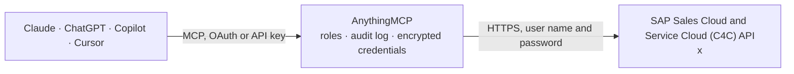

<!-- Generated by scripts/export-github-catalog.mjs in the anythingmcp-website repository. Do not edit by hand. -->

# SAP Sales Cloud and Service Cloud (C4C) MCP connector

Read SAP Sales Cloud and Service Cloud (Cloud for Customer, C4C) through its OData API: accounts, contacts, leads, opportunities, sales quotes, service requests, products and employees, plus generic … The AnythingMCP connector gives Claude, ChatGPT, Microsoft Copilot, Cursor and Gemini 14 MCP tools for SAP Sales Cloud and Service Cloud (C4C), all read-only.

**Category:** [CRM](../crm.md) · **Tools:** 14 · **Setup guide:** [anythingmcp.com](https://anythingmcp.com/guides/sap-c4c-to-mcp) · [Deutsch](https://anythingmcp.com/de/guides/sap-c4c-to-mcp) · [Italiano](https://anythingmcp.com/it/guides/sap-c4c-to-mcp) · [Español](https://anythingmcp.com/es/guides/sap-c4c-to-mcp) · [日本語](https://anythingmcp.com/ja/guides/sap-c4c-to-mcp) · [Русский](https://anythingmcp.com/ru/guides/sap-c4c-to-mcp) · [中文](https://anythingmcp.com/zh/guides/sap-c4c-to-mcp)

## Start without code

No installation and no terminal: AnythingMCP Cloud runs the SAP Sales Cloud and Service Cloud (C4C) connector for you, operated by helpcode.ai in Frankfurt, Germany.

1. **Click the button above** and create an account or sign in. The SAP Sales Cloud and Service Cloud (C4C) connector opens, ready to install.
2. **Paste the API key or token from your SAP Sales Cloud and Service Cloud (C4C) account.** Every click is in the [step-by-step guide](https://anythingmcp.com/guides/sap-c4c-to-mcp).
3. **Click Install.** AnythingMCP shows the address of your MCP server.
4. **Add that address to your assistant:** [Claude](https://anythingmcp.com/guides/connect-sap-c4c-to-claude) · [ChatGPT](https://anythingmcp.com/guides/connect-sap-c4c-to-chatgpt) · [Microsoft Copilot](https://anythingmcp.com/guides/connect-sap-c4c-to-copilot) · [Cursor](https://anythingmcp.com/guides/connect-sap-c4c-to-cursor) · [Gemini CLI](https://anythingmcp.com/guides/connect-sap-c4c-to-gemini) · [Meta Muse](https://anythingmcp.com/guides/connect-sap-c4c-to-muse).
5. **Ask your first question**, for example: *Show sales quote Q-2026-047 for customer 'Nordic Solar GmbH' with net, gross, currency, status and valid-to date.*

Prefer help with the setup? [Talk to us](https://anythingmcp.com/contact).

## How it works

- **The AI client** speaks MCP (Streamable HTTP) to AnythingMCP and only sees tool names, descriptions and results. It never gets the SAP Sales Cloud and Service Cloud (C4C) credentials.
- **AnythingMCP** checks the client's role, builds the call from the tool definition, adds the credentials (user name and password), calls SAP Sales Cloud and Service Cloud (C4C), logs the call and returns the result.
- **SAP Sales Cloud and Service Cloud (C4C)** sees an ordinary API client with the rights of the account the credentials belong to.

## Tools

| Tool | What it does | Access |
|---|---|---|
| [`sap_c4c_list_services`](#sap_c4c_list_services) | Where the OData service lives. | read |
| [`sap_c4c_describe_service`](#sap_c4c_describe_service) | The entity sets of an OData service with their business labels, keys and whether they are analytical or parameterised. | read |
| [`sap_c4c_describe_entity`](#sap_c4c_describe_entity) | The fields of one entity set: labels, types, keys, the currency or unit field of each amount, dimensions and measures, and required filters. | read |
| [`sap_c4c_query`](#sap_c4c_query) | Read rows from an entity set, with field names checked against the service model and server paging followed. | read |
| [`sap_c4c_get_entity`](#sap_c4c_get_entity) | Read one entity by its key, optionally with related entities. | read |
| [`sap_c4c_guide`](#sap_c4c_guide) | How to read SAP Sales Cloud and Service Cloud (C4C) through its OData API: the workflow, filter syntax, keys and ids, paging and known limitations. | read |
| [`sap_c4c_list_accounts`](#sap_c4c_list_accounts) | Corporate accounts (customers and prospects) from CorporateAccountCollection: ObjectID, AccountID, name, role (CRM000 customer, BUP002 prospect), status,… | read |
| [`sap_c4c_list_contacts`](#sap_c4c_list_contacts) | Contact persons from ContactCollection: ObjectID, ContactID, first and last name, job title and function, the account they belong to, e-mail and phones, status. | read |
| [`sap_c4c_list_leads`](#sap_c4c_list_leads) | Leads from LeadCollection: ObjectID, ID, name, life cycle status, qualification level, source, owner, account or company and contact, start and end date,… | read |
| [`sap_c4c_list_opportunities`](#sap_c4c_list_opportunities) | Opportunities from OpportunityCollection: ObjectID, ID, name, account, owner, sales phase, status, probability, expected value and currency, expected close… | read |
| [`sap_c4c_list_sales_quotes`](#sap_c4c_list_sales_quotes) | Sales quotes from SalesQuoteCollection: ObjectID, ID, name, account, status, net and gross amount with currency, valid-to date, owner and the opportunity it… | read |
| [`sap_c4c_list_service_requests`](#sap_c4c_list_service_requests) | Service requests (tickets) from ServiceRequestCollection: ObjectID, ID, subject, customer (BuyerPartyID) and contact, status, priority, processor, service… | read |
| [`sap_c4c_list_products`](#sap_c4c_list_products) | Products from ProductCollection: ObjectID, ProductID, description, status, product category, base unit of measure, usage and division. | read |
| [`sap_c4c_list_employees`](#sap_c4c_list_employees) | Employees from EmployeeCollection: ObjectID, EmployeeID, name, job, e-mail, phone, organizational unit and user. | read |

## Tool reference

Every parameter as the AI client sees it in `tools/list`. Source: [`packages/backend/src/adapters/intl/sap-c4c.json`](../../../packages/backend/src/adapters/intl/sap-c4c.json).

### `sap_c4c_list_services`

Where the OData service lives.

**Access:** read

No parameters.

### `sap_c4c_describe_service`

The entity sets of an OData service with their business labels, keys and whether they are analytical or parameterised.

**Access:** read

No parameters.

### `sap_c4c_describe_entity`

The fields of one entity set: labels, types, keys, the currency or unit field of each amount, dimensions and measures, and required filters.

**Access:** read

No parameters.

### `sap_c4c_query`

Read rows from an entity set, with field names checked against the service model and server paging followed.

**Access:** read

No parameters.

### `sap_c4c_get_entity`

Read one entity by its key, optionally with related entities.

**Access:** read

No parameters.

### `sap_c4c_guide`

How to read SAP Sales Cloud and Service Cloud (C4C) through its OData API: the workflow, filter syntax, keys and ids, paging and known limitations. Static text, costs no API call.

**Access:** read

| Parameter | Type | Required | Description |
|---|---|---|---|
| `topic` | `filters` \| `keys` \| `pitfalls` | no | Chapter to read. Omit for the overview. |

### `sap_c4c_list_accounts`

Corporate accounts (customers and prospects) from CorporateAccountCollection: ObjectID, AccountID, name, role (CRM000 customer, BUP002 prospect), status, ABC classification, industry, owner, main address, phone and e-mail. Filter or search to find an account and its ObjectID.

**Access:** read · **Call:** `GET /CorporateAccountCollection`

| Parameter | Type | Required | Description |
|---|---|---|---|
| `filter` | string | no | OData $filter. Strings in single quotes, dates as datetimeoffset, e.g. RoleCode eq 'CRM000' and CountryCode eq 'DE'. Only eq, ne, ge, le, gt, lt, and, startswith and endswith; or only on the same field. |
| `search` | string | no | Free-text search over the search-enabled fields, e.g. 'Porter' or Port* (exact words, * as wildcard, several words are ANDed). |
| `select` | string | no | Comma-separated fields to return, e.g. ObjectID,AccountID,Name,RoleCodeText,City,CountryCode,OwnerID. Keeps answers small; names are case-sensitive. |
| `orderby` | string | no | OData $orderby, e.g. EntityLastChangedOn desc. |
| `expand` | string | no | Navigation properties to include, comma-separated (describe_entity lists them). Slows the call down. |
| `top` | integer | no | Rows to return (default 100, at most 1000). |
| `skip` | integer | no | Rows to skip, for the next page. |

### `sap_c4c_list_contacts`

Contact persons from ContactCollection: ObjectID, ContactID, first and last name, job title and function, the account they belong to, e-mail and phones, status.

**Access:** read · **Call:** `GET /ContactCollection`

| Parameter | Type | Required | Description |
|---|---|---|---|
| `filter` | string | no | OData $filter. Strings in single quotes, dates as datetimeoffset, e.g. AccountID eq '1001234'. Only eq, ne, ge, le, gt, lt, and, startswith and endswith; or only on the same field. |
| `search` | string | no | Free-text search over the search-enabled fields, e.g. 'Porter' or Port* (exact words, * as wildcard, several words are ANDed). |
| `select` | string | no | Comma-separated fields to return, e.g. ObjectID,ContactID,FirstName,LastName,AccountID,Email,Phone. Keeps answers small; names are case-sensitive. |
| `orderby` | string | no | OData $orderby, e.g. EntityLastChangedOn desc. |
| `expand` | string | no | Navigation properties to include, comma-separated (describe_entity lists them). Slows the call down. |
| `top` | integer | no | Rows to return (default 100, at most 1000). |
| `skip` | integer | no | Rows to skip, for the next page. |

### `sap_c4c_list_leads`

Leads from LeadCollection: ObjectID, ID, name, life cycle status, qualification level, source, owner, account or company and contact, start and end date, creation and change times.

**Access:** read · **Call:** `GET /LeadCollection`

| Parameter | Type | Required | Description |
|---|---|---|---|
| `filter` | string | no | OData $filter. Strings in single quotes, dates as datetimeoffset, e.g. LifeCycleStatusCode eq '2' and OwnerPartyID eq '8000000123'. Only eq, ne, ge, le, gt, lt, and, startswith and endswith; or only on the same field. |
| `search` | string | no | Free-text search over the search-enabled fields, e.g. 'Porter' or Port* (exact words, * as wildcard, several words are ANDed). |
| `select` | string | no | Comma-separated fields to return, e.g. ObjectID,ID,Name,LifeCycleStatusCode,QualificationLevelCode,OwnerPartyID,AccountPartyID,Company. Keeps answers small; names are case-sensitive. |
| `orderby` | string | no | OData $orderby, e.g. EntityLastChangedOn desc. |
| `expand` | string | no | Navigation properties to include, comma-separated (describe_entity lists them). Slows the call down. |
| `top` | integer | no | Rows to return (default 100, at most 1000). |
| `skip` | integer | no | Rows to skip, for the next page. |

### `sap_c4c_list_opportunities`

Opportunities from OpportunityCollection: ObjectID, ID, name, account, owner, sales phase, status, probability, expected value and currency, expected close date. Use it for the sales pipeline.

**Access:** read · **Call:** `GET /OpportunityCollection`

| Parameter | Type | Required | Description |
|---|---|---|---|
| `filter` | string | no | OData $filter. Strings in single quotes, dates as datetimeoffset, e.g. LifeCycleStatusCode eq '2' and ExpectedRevenueEndDate le datetimeoffset'2026-12-31T00:00:00Z'. Only eq, ne, ge, le, gt, lt, and, startswith and endswith; or only on the same field. |
| `search` | string | no | Free-text search over the search-enabled fields, e.g. 'Porter' or Port* (exact words, * as wildcard, several words are ANDed). |
| `select` | string | no | Comma-separated fields to return, e.g. ObjectID,ID,Name,ProspectPartyID,SalesCyclePhaseCode,ProbabilityPercent,ExpectedRevenueAmount,ExpectedRevenueAmountCurrencyCode,ExpectedRevenueEndDate. Keeps answers small; names are case-sensitive. |
| `orderby` | string | no | OData $orderby, e.g. EntityLastChangedOn desc. |
| `expand` | string | no | Navigation properties to include, comma-separated (describe_entity lists them). Slows the call down. |
| `top` | integer | no | Rows to return (default 100, at most 1000). |
| `skip` | integer | no | Rows to skip, for the next page. |

### `sap_c4c_list_sales_quotes`

Sales quotes from SalesQuoteCollection: ObjectID, ID, name, account, status, net and gross amount with currency, valid-to date, owner and the opportunity it belongs to.

**Access:** read · **Call:** `GET /SalesQuoteCollection`

| Parameter | Type | Required | Description |
|---|---|---|---|
| `filter` | string | no | OData $filter. Strings in single quotes, dates as datetimeoffset, e.g. BuyerPartyID eq '1001234'. Only eq, ne, ge, le, gt, lt, and, startswith and endswith; or only on the same field. |
| `search` | string | no | Free-text search over the search-enabled fields, e.g. 'Porter' or Port* (exact words, * as wildcard, several words are ANDed). |
| `select` | string | no | Comma-separated fields to return, e.g. ObjectID,ID,Name,BuyerPartyID,LifeCycleStatusCodeText,NetAmount,NetAmountCurrencyCode. Keeps answers small; names are case-sensitive. |
| `orderby` | string | no | OData $orderby, e.g. EntityLastChangedOn desc. |
| `expand` | string | no | Navigation properties to include, comma-separated (describe_entity lists them). Slows the call down. |
| `top` | integer | no | Rows to return (default 100, at most 1000). |
| `skip` | integer | no | Rows to skip, for the next page. |

### `sap_c4c_list_service_requests`

Service requests (tickets) from ServiceRequestCollection: ObjectID, ID, subject, customer (BuyerPartyID) and contact, status, priority, processor, service category, due dates and SLA times. Use it for the service backlog.

**Access:** read · **Call:** `GET /ServiceRequestCollection`

| Parameter | Type | Required | Description |
|---|---|---|---|
| `filter` | string | no | OData $filter. Strings in single quotes, dates as datetimeoffset, e.g. ServiceRequestLifeCycleStatusCode eq '1' and ServicePriorityCode eq '1'. Only eq, ne, ge, le, gt, lt, and, startswith and endswith; or only on the same field. |
| `search` | string | no | Free-text search over the search-enabled fields, e.g. 'Porter' or Port* (exact words, * as wildcard, several words are ANDed). |
| `select` | string | no | Comma-separated fields to return, e.g. ObjectID,ID,Name,BuyerPartyID,ServiceRequestUserLifeCycleStatusCode,ServicePriorityCode,ProcessorPartyID,ResolutionDueDateTime. Keeps answers small; names are case-sensitive. |
| `orderby` | string | no | OData $orderby, e.g. EntityLastChangedOn desc. |
| `expand` | string | no | Navigation properties to include, comma-separated (describe_entity lists them). Slows the call down. |
| `top` | integer | no | Rows to return (default 100, at most 1000). |
| `skip` | integer | no | Rows to skip, for the next page. |

### `sap_c4c_list_products`

Products from ProductCollection: ObjectID, ProductID, description, status, product category, base unit of measure, usage and division.

**Access:** read · **Call:** `GET /ProductCollection`

| Parameter | Type | Required | Description |
|---|---|---|---|
| `filter` | string | no | OData $filter. Strings in single quotes, dates as datetimeoffset, e.g. ProductCategoryID eq 'BIKES'. Only eq, ne, ge, le, gt, lt, and, startswith and endswith; or only on the same field. |
| `search` | string | no | Free-text search over the search-enabled fields, e.g. 'Porter' or Port* (exact words, * as wildcard, several words are ANDed). |
| `select` | string | no | Comma-separated fields to return, e.g. ObjectID,ProductID,Description,Status,ProductCategoryID,BaseUOM. Keeps answers small; names are case-sensitive. |
| `orderby` | string | no | OData $orderby, e.g. EntityLastChangedOn desc. |
| `expand` | string | no | Navigation properties to include, comma-separated (describe_entity lists them). Slows the call down. |
| `top` | integer | no | Rows to return (default 100, at most 1000). |
| `skip` | integer | no | Rows to skip, for the next page. |

### `sap_c4c_list_employees`

Employees from EmployeeCollection: ObjectID, EmployeeID, name, job, e-mail, phone, organizational unit and user. Use it to resolve owner and processor ids to names.

**Access:** read · **Call:** `GET /EmployeeCollection`

| Parameter | Type | Required | Description |
|---|---|---|---|
| `filter` | string | no | OData $filter. Strings in single quotes, dates as datetimeoffset, e.g. LastName eq 'Smith'. Only eq, ne, ge, le, gt, lt, and, startswith and endswith; or only on the same field. |
| `search` | string | no | Free-text search over the search-enabled fields, e.g. 'Porter' or Port* (exact words, * as wildcard, several words are ANDed). |
| `select` | string | no | Comma-separated fields to return, e.g. ObjectID,EmployeeID,FirstName,LastName,Email,UserID. Keeps answers small; names are case-sensitive. |
| `orderby` | string | no | OData $orderby, e.g. EntityLastChangedOn desc. |
| `expand` | string | no | Navigation properties to include, comma-separated (describe_entity lists them). Slows the call down. |
| `top` | integer | no | Rows to return (default 100, at most 1000). |
| `skip` | integer | no | Rows to skip, for the next page. |

## Run it yourself

AnythingMCP is open source (AGPL-3.0). [Run it with Docker](../../../README.md#run-it-yourself), open **Connectors → Store**, pick **SAP Sales Cloud and Service Cloud (C4C)** and enter `SAP_C4C_HOST`, `SAP_C4C_USER`, `SAP_C4C_PASSWORD`, then add your MCP server URL to the AI client.

[← CRM connectors](../crm.md) · [All categories](../README.md)
