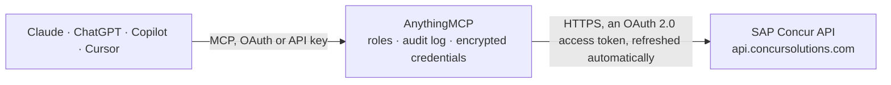

<!-- Generated by scripts/export-github-catalog.mjs in the anythingmcp-website repository. Do not edit by hand. -->

# SAP Concur MCP connector

Manage Concur expense reports, approvals, attendees, locations, users and travel itineraries from any AI agent. The AnythingMCP connector gives Claude, ChatGPT, Microsoft Copilot, Cursor and Gemini 10 MCP tools for SAP Concur: 8 read and 2 can change data.

**Category:** [Finance](../finance.md) · **Tools:** 10 · **Setup guide:** [anythingmcp.com](https://anythingmcp.com/guides/sap-concur-to-mcp) · [Deutsch](https://anythingmcp.com/de/guides/sap-concur-to-mcp) · [Italiano](https://anythingmcp.com/it/guides/sap-concur-to-mcp) · [Español](https://anythingmcp.com/es/guides/sap-concur-to-mcp) · [日本語](https://anythingmcp.com/ja/guides/sap-concur-to-mcp) · [Русский](https://anythingmcp.com/ru/guides/sap-concur-to-mcp) · [中文](https://anythingmcp.com/zh/guides/sap-concur-to-mcp)

## Start without code

No installation and no terminal: AnythingMCP Cloud runs the SAP Concur connector for you, operated by helpcode.ai in Frankfurt, Germany.

1. **Click the button above** and create an account or sign in. The SAP Concur connector opens, ready to install.
2. **Sign in with your SAP Concur account** when AnythingMCP asks. The first time, an admin creates a small app in the SAP Concur developer console. Every click is in the [step-by-step guide](https://anythingmcp.com/guides/sap-concur-to-mcp).
3. **Click Install.** AnythingMCP shows the address of your MCP server.
4. **Add that address to your assistant:** [Claude](https://anythingmcp.com/guides/connect-sap-concur-to-claude) · [ChatGPT](https://anythingmcp.com/guides/connect-sap-concur-to-chatgpt) · [Microsoft Copilot](https://anythingmcp.com/guides/connect-sap-concur-to-copilot) · [Cursor](https://anythingmcp.com/guides/connect-sap-concur-to-cursor) · [Gemini CLI](https://anythingmcp.com/guides/connect-sap-concur-to-gemini) · [Meta Muse](https://anythingmcp.com/guides/connect-sap-concur-to-muse).
5. **Ask your first question**, for example: *Show me expense report 78934 for Solvix Europe GmbH submitted by maria.lopez@solvix.com*

Prefer help with the setup? [Talk to us](https://anythingmcp.com/contact).

## How it works

- **The AI client** speaks MCP (Streamable HTTP) to AnythingMCP and only sees tool names, descriptions and results. It never gets the SAP Concur credentials.
- **AnythingMCP** checks the client's role, builds the call from the tool definition, adds the credentials (an OAuth 2.0 access token, refreshed automatically), calls SAP Concur, logs the call and returns the result.
- **SAP Concur** sees an ordinary API client with the rights of the account the credentials belong to.

## Tools

| Tool | What it does | Access |
|---|---|---|
| [`concur_list_reports`](#concur_list_reports) | List expense reports for the connected company. | read |
| [`concur_get_report`](#concur_get_report) | Get the full detail of one expense report by its ID. | read |
| [`concur_list_report_entries`](#concur_list_report_entries) | List the individual expense entries (line items) inside a given report. | read |
| [`concur_submit_report`](#concur_submit_report) | Submit an expense report for approval. | write |
| [`concur_workflow_action`](#concur_workflow_action) | Approve, send-back or reject a submitted expense report. | write |
| [`concur_list_attendees`](#concur_list_attendees) | List meeting/expense attendees registered in the company directory. | read |
| [`concur_list_locations`](#concur_list_locations) | List travel/expense locations (cities, regions) available to your tenant. | read |
| [`concur_list_users`](#concur_list_users) | List user accounts in the connected Concur tenant. | read |
| [`concur_get_user`](#concur_get_user) | Get one user profile by its Concur user ID. | read |
| [`concur_list_itineraries`](#concur_list_itineraries) | List travel itineraries (Concur Travel). | read |

## Tool reference

Every parameter as the AI client sees it in `tools/list`. Source: [`packages/backend/src/adapters/intl/sap-concur.json`](../../../packages/backend/src/adapters/intl/sap-concur.json).

### `concur_list_reports`

List expense reports for the connected company. Use `user=ALL` (default) for org-wide view or a specific login ID for a single user.

**Access:** read · **Call:** `GET /api/v3.0/expense/reports`

| Parameter | Type | Required | Description |
|---|---|---|---|
| `limit` | number | no | Page size (default 25, max 100) |
| `user` | string | no | Login ID of the user to filter, or `ALL` for all users (default) |
| `approvalStatusCode` | string | no | Approval status filter, e.g. A_PEND, A_APPR, A_REJC |

### `concur_get_report`

Get the full detail of one expense report by its ID.

**Access:** read · **Call:** `GET /api/v3.0/expense/reports/{reportId}`

| Parameter | Type | Required | Description |
|---|---|---|---|
| `reportId` | string | yes | The Concur Report ID |

### `concur_list_report_entries`

List the individual expense entries (line items) inside a given report.

**Access:** read · **Call:** `GET /api/v3.0/expense/entries`

| Parameter | Type | Required | Description |
|---|---|---|---|
| `reportId` | string | yes | The Concur Report ID |
| `limit` | number | no | Page size |

### `concur_submit_report`

Submit an expense report for approval. The report must be in a non-submitted state.

**Access:** write · **Call:** `POST /api/v3.0/expense/reports/{reportId}/submit`

| Parameter | Type | Required | Description |
|---|---|---|---|
| `reportId` | string | yes | The Concur Report ID |

### `concur_workflow_action`

Approve, send-back or reject a submitted expense report. Action ∈ Approve, Send Back, Reject.

**Access:** write · **Call:** `POST /api/v3.0/expense/reports/{reportId}/workflowaction`

| Parameter | Type | Required | Description |
|---|---|---|---|
| `reportId` | string | yes | The Concur Report ID |
| `action` | string | yes | Approve \| Send Back \| Reject |
| `comment` | string | no | Optional comment shown in the workflow |

### `concur_list_attendees`

List meeting/expense attendees registered in the company directory.

**Access:** read · **Call:** `GET /api/v3.0/common/attendees`

| Parameter | Type | Required | Description |
|---|---|---|---|
| `limit` | number | no | Page size |

### `concur_list_locations`

List travel/expense locations (cities, regions) available to your tenant.

**Access:** read · **Call:** `GET /api/v3.0/common/locations`

| Parameter | Type | Required | Description |
|---|---|---|---|
| `limit` | number | no | Page size |

### `concur_list_users`

List user accounts in the connected Concur tenant.

**Access:** read · **Call:** `GET /api/v3.0/common/users`

| Parameter | Type | Required | Description |
|---|---|---|---|
| `limit` | number | no | Page size |

### `concur_get_user`

Get one user profile by its Concur user ID.

**Access:** read · **Call:** `GET /api/v3.0/common/users/{userId}`

| Parameter | Type | Required | Description |
|---|---|---|---|
| `userId` | string | yes | Concur user ID |

### `concur_list_itineraries`

List travel itineraries (Concur Travel). Requires TRVPRO scope on the OAuth client.

**Access:** read · **Call:** `GET /api/v3.0/travel/itineraries`

| Parameter | Type | Required | Description |
|---|---|---|---|
| `limit` | number | no | Page size |

## Run it yourself

AnythingMCP is open source (AGPL-3.0). [Run it with Docker](../../../README.md#run-it-yourself), open **Connectors → Store**, pick **SAP Concur** and enter `CONCUR_REGION`, `CONCUR_CLIENT_ID`, `CONCUR_CLIENT_SECRET`, `CONCUR_REFRESH_TOKEN`, then add your MCP server URL to the AI client.

[← Finance connectors](../finance.md) · [All categories](../README.md)
