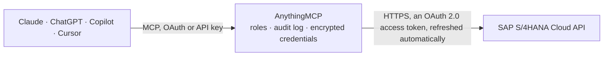

<!-- Generated by scripts/export-github-catalog.mjs in the anythingmcp-website repository. Do not edit by hand. -->

# SAP S/4HANA Cloud MCP connector

Drive SAP S/4HANA Cloud Public Edition from any AI agent: business partners, customers, suppliers, sales orders, purchase orders, billing documents, products, journal entries. The AnythingMCP connector gives Claude, ChatGPT, Microsoft Copilot, Cursor and Gemini 20 MCP tools for SAP S/4HANA Cloud, all read-only.

**Category:** [ERP](../erp.md) · **Tools:** 20 · **Setup guide:** [anythingmcp.com](https://anythingmcp.com/guides/sap-s4hana-cloud-to-mcp) · [Deutsch](https://anythingmcp.com/de/guides/sap-s4hana-cloud-to-mcp) · [Italiano](https://anythingmcp.com/it/guides/sap-s4hana-cloud-to-mcp) · [Español](https://anythingmcp.com/es/guides/sap-s4hana-cloud-to-mcp) · [日本語](https://anythingmcp.com/ja/guides/sap-s4hana-cloud-to-mcp) · [Русский](https://anythingmcp.com/ru/guides/sap-s4hana-cloud-to-mcp) · [中文](https://anythingmcp.com/zh/guides/sap-s4hana-cloud-to-mcp)

## Start without code

No installation and no terminal: AnythingMCP Cloud runs the SAP S/4HANA Cloud connector for you, operated by helpcode.ai in Frankfurt, Germany.

1. **Click the button above** and create an account or sign in. The SAP S/4HANA Cloud connector opens, ready to install.
2. **Sign in with your SAP S/4HANA Cloud account** when AnythingMCP asks. The first time, an admin creates a small app in the SAP S/4HANA Cloud developer console. Every click is in the [step-by-step guide](https://anythingmcp.com/guides/sap-s4hana-cloud-to-mcp).
3. **Click Install.** AnythingMCP shows the address of your MCP server.
4. **Add that address to your assistant:** [Claude](https://anythingmcp.com/guides/connect-sap-s4hana-cloud-to-claude) · [ChatGPT](https://anythingmcp.com/guides/connect-sap-s4hana-cloud-to-chatgpt) · [Microsoft Copilot](https://anythingmcp.com/guides/connect-sap-s4hana-cloud-to-copilot) · [Cursor](https://anythingmcp.com/guides/connect-sap-s4hana-cloud-to-cursor) · [Gemini CLI](https://anythingmcp.com/guides/connect-sap-s4hana-cloud-to-gemini) · [Meta Muse](https://anythingmcp.com/guides/connect-sap-s4hana-cloud-to-muse).
5. **Ask your first question**, for example: *Show business partner record for Nordic Solar AS and any open sales orders for that BP*

Prefer help with the setup? [Talk to us](https://anythingmcp.com/contact).

## How it works

- **The AI client** speaks MCP (Streamable HTTP) to AnythingMCP and only sees tool names, descriptions and results. It never gets the SAP S/4HANA Cloud credentials.
- **AnythingMCP** checks the client's role, builds the call from the tool definition, adds the credentials (an OAuth 2.0 access token, refreshed automatically), calls SAP S/4HANA Cloud, logs the call and returns the result.
- **SAP S/4HANA Cloud** sees an ordinary API client with the rights of the account the credentials belong to.

## Tools

| Tool | What it does | Access |
|---|---|---|
| [`s4_cloud_list_services`](#s4_cloud_list_services) | List the OData services this connector reaches. | read |
| [`s4_cloud_describe_service`](#s4_cloud_describe_service) | The entity sets of an OData service with their business labels, keys and whether they are analytical or parameterised. | read |
| [`s4_cloud_describe_entity`](#s4_cloud_describe_entity) | The fields of one entity set: labels, types, keys, the currency or unit field of each amount, dimensions and measures, and required filters. | read |
| [`s4_cloud_query`](#s4_cloud_query) | Read rows from an entity set, with field names checked against the service model and server paging followed. | read |
| [`s4_cloud_get_entity`](#s4_cloud_get_entity) | Read one entity by its key, optionally with related entities. | read |
| [`s4_list_business_partners`](#s4_list_business_partners) | List business partners (combined customers + suppliers) from API_BUSINESS_PARTNER. | read |
| [`s4_get_business_partner`](#s4_get_business_partner) | Get one business partner by its 10-character ID. | read |
| [`s4_list_customers`](#s4_list_customers) | List customer master records (subset of business partners). | read |
| [`s4_list_suppliers`](#s4_list_suppliers) | List supplier master records (subset of business partners). | read |
| [`s4_list_sales_orders`](#s4_list_sales_orders) | List sales orders (headers). | read |
| [`s4_get_sales_order`](#s4_get_sales_order) | Get one sales order by its 10-char number. | read |
| [`s4_list_sales_order_items`](#s4_list_sales_order_items) | List the items (line entries) of a given sales order. | read |
| [`s4_list_purchase_orders`](#s4_list_purchase_orders) | List purchase orders (headers). | read |
| [`s4_get_purchase_order`](#s4_get_purchase_order) | Get one purchase order by its 10-char number. | read |
| [`s4_list_billing_documents`](#s4_list_billing_documents) | List billing documents (customer invoices, credit memos). | read |
| [`s4_list_outbound_deliveries`](#s4_list_outbound_deliveries) | List outbound delivery headers (goods leaving the warehouse). | read |
| [`s4_list_journal_entries`](#s4_list_journal_entries) | List journal entry items (general ledger postings). | read |
| [`s4_list_products`](#s4_list_products) | List materials / products (item master). | read |
| [`s4_get_product`](#s4_get_product) | Get one product/material by its ID. | read |
| [`s4_list_purchase_requisitions`](#s4_list_purchase_requisitions) | List purchase requisition items (pre-PO demand requests). | read |

## Tool reference

Every parameter as the AI client sees it in `tools/list`. Source: [`packages/backend/src/adapters/intl/sap-s4hana-cloud.json`](../../../packages/backend/src/adapters/intl/sap-s4hana-cloud.json).

### `s4_cloud_list_services`

List the OData services this connector reaches.

**Access:** read

No parameters.

### `s4_cloud_describe_service`

The entity sets of an OData service with their business labels, keys and whether they are analytical or parameterised.

**Access:** read

No parameters.

### `s4_cloud_describe_entity`

The fields of one entity set: labels, types, keys, the currency or unit field of each amount, dimensions and measures, and required filters.

**Access:** read

No parameters.

### `s4_cloud_query`

Read rows from an entity set, with field names checked against the service model and server paging followed.

**Access:** read

No parameters.

### `s4_cloud_get_entity`

Read one entity by its key, optionally with related entities.

**Access:** read

No parameters.

### `s4_list_business_partners`

List business partners (combined customers + suppliers) from API_BUSINESS_PARTNER.

**Access:** read · **Call:** `GET /sap/API_BUSINESS_PARTNER/A_BusinessPartner`

| Parameter | Type | Required | Description |
|---|---|---|---|
| `top` | number | no | Max rows |
| `filter` | string | no | OData $filter, e.g. BusinessPartnerCategory eq '1' |

### `s4_get_business_partner`

Get one business partner by its 10-character ID.

**Access:** read · **Call:** `GET /sap/API_BUSINESS_PARTNER/A_BusinessPartner('{businessPartner}')`

| Parameter | Type | Required | Description |
|---|---|---|---|
| `businessPartner` | string | yes | 10-char Business Partner ID, e.g. 1000050 |

### `s4_list_customers`

List customer master records (subset of business partners).

**Access:** read · **Call:** `GET /sap/API_BUSINESS_PARTNER/A_Customer`

| Parameter | Type | Required | Description |
|---|---|---|---|
| `top` | number | no | Max rows |

### `s4_list_suppliers`

List supplier master records (subset of business partners).

**Access:** read · **Call:** `GET /sap/API_BUSINESS_PARTNER/A_Supplier`

| Parameter | Type | Required | Description |
|---|---|---|---|
| `top` | number | no | Max rows |

### `s4_list_sales_orders`

List sales orders (headers).

**Access:** read · **Call:** `GET /sap/API_SALES_ORDER_SRV/A_SalesOrder`

| Parameter | Type | Required | Description |
|---|---|---|---|
| `top` | number | no | Max rows |
| `filter` | string | no | OData $filter, e.g. SalesOrganization eq '1710' |

### `s4_get_sales_order`

Get one sales order by its 10-char number.

**Access:** read · **Call:** `GET /sap/API_SALES_ORDER_SRV/A_SalesOrder('{salesOrder}')`

| Parameter | Type | Required | Description |
|---|---|---|---|
| `salesOrder` | string | yes | Sales Order number, e.g. 0000000001 |

### `s4_list_sales_order_items`

List the items (line entries) of a given sales order.

**Access:** read · **Call:** `GET /sap/API_SALES_ORDER_SRV/A_SalesOrderItem`

| Parameter | Type | Required | Description |
|---|---|---|---|
| `salesOrder` | string | yes | Parent Sales Order number |

### `s4_list_purchase_orders`

List purchase orders (headers).

**Access:** read · **Call:** `GET /sap/API_PURCHASEORDER_PROCESS_SRV/A_PurchaseOrder`

| Parameter | Type | Required | Description |
|---|---|---|---|
| `top` | number | no | Max rows |
| `filter` | string | no | OData $filter expression |

### `s4_get_purchase_order`

Get one purchase order by its 10-char number.

**Access:** read · **Call:** `GET /sap/API_PURCHASEORDER_PROCESS_SRV/A_PurchaseOrder('{purchaseOrder}')`

| Parameter | Type | Required | Description |
|---|---|---|---|
| `purchaseOrder` | string | yes | Purchase Order number |

### `s4_list_billing_documents`

List billing documents (customer invoices, credit memos).

**Access:** read · **Call:** `GET /sap/API_BILLING_DOCUMENT_SRV/A_BillingDocument`

| Parameter | Type | Required | Description |
|---|---|---|---|
| `top` | number | no | Max rows |
| `filter` | string | no | OData $filter expression |

### `s4_list_outbound_deliveries`

List outbound delivery headers (goods leaving the warehouse).

**Access:** read · **Call:** `GET /sap/API_OUTBOUND_DELIVERY_SRV/A_OutbDeliveryHeader`

| Parameter | Type | Required | Description |
|---|---|---|---|
| `top` | number | no | Max rows |

### `s4_list_journal_entries`

List journal entry items (general ledger postings).

**Access:** read · **Call:** `GET /sap/API_JOURNALENTRYITEMBASIC_SRV/A_JournalEntryItemBasic`

| Parameter | Type | Required | Description |
|---|---|---|---|
| `top` | number | no | Max rows |

### `s4_list_products`

List materials / products (item master).

**Access:** read · **Call:** `GET /sap/API_PRODUCT_SRV/A_Product`

| Parameter | Type | Required | Description |
|---|---|---|---|
| `top` | number | no | Max rows |

### `s4_get_product`

Get one product/material by its ID.

**Access:** read · **Call:** `GET /sap/API_PRODUCT_SRV/A_Product('{product}')`

| Parameter | Type | Required | Description |
|---|---|---|---|
| `product` | string | yes | Product ID |

### `s4_list_purchase_requisitions`

List purchase requisition items (pre-PO demand requests).

**Access:** read · **Call:** `GET /sap/API_PURCHASEREQ_PROCESS_SRV/A_PurchaseRequisitionItem`

| Parameter | Type | Required | Description |
|---|---|---|---|
| `top` | number | no | Max rows |

## Run it yourself

AnythingMCP is open source (AGPL-3.0). [Run it with Docker](../../../README.md#run-it-yourself), open **Connectors → Store**, pick **SAP S/4HANA Cloud** and enter `S4_BASE_URL`, `S4_TOKEN_URL`, `S4_CLIENT_ID`, `S4_CLIENT_SECRET`, then add your MCP server URL to the AI client.

[← ERP connectors](../erp.md) · [All categories](../README.md)
