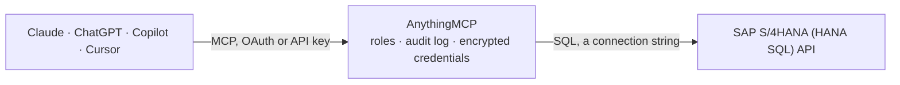

<!-- Generated by scripts/export-github-catalog.mjs in the anythingmcp-website repository. Do not edit by hand. -->

# SAP S/4HANA (HANA SQL) MCP connector

Read SAP S/4HANA straight from its HANA database with SQL, with SAP's own data dictionary turned into tools: table and field labels, code values, join paths, released CDS views and a guide to the … The AnythingMCP connector gives Claude, ChatGPT, Microsoft Copilot, Cursor and Gemini 10 MCP tools for SAP S/4HANA (HANA SQL), all read-only.

**Category:** [ERP](../erp.md) · **Tools:** 10 · **Setup guide:** [anythingmcp.com](https://anythingmcp.com/marketplace/sap-s4hana-hana)

## Start without code

No installation and no terminal: AnythingMCP Cloud runs the SAP S/4HANA (HANA SQL) connector for you, operated by helpcode.ai in Frankfurt, Germany.

1. **Click the button above** and create an account or sign in. The SAP S/4HANA (HANA SQL) connector opens, ready to install.
2. **Paste the API key or token from your SAP S/4HANA (HANA SQL) account.** Every click is in the [step-by-step guide](https://anythingmcp.com/marketplace/sap-s4hana-hana).
3. **Click Install.** AnythingMCP shows the address of your MCP server.
4. **Add that address to your assistant:** see the [guide](https://anythingmcp.com/marketplace/sap-s4hana-hana).
5. **Ask your first question**, for example: *Show customer master for KUNNR 100200 (Brenner Energie GmbH) in client 200, include company code sales area.*

Prefer help with the setup? [Talk to us](https://anythingmcp.com/contact).

## How it works

- **The AI client** speaks MCP (Streamable HTTP) to AnythingMCP and only sees tool names, descriptions and results. It never gets the SAP S/4HANA (HANA SQL) credentials.
- **AnythingMCP** checks the client's role, builds the call from the tool definition, adds the credentials (a connection string), calls SAP S/4HANA (HANA SQL), logs the call and returns the result.
- **SAP S/4HANA (HANA SQL)** sees an ordinary API client with the rights of the account the credentials belong to.

## Tools

| Tool | What it does | Access |
|---|---|---|
| [`sap_guide`](#sap_guide) | The SAP data model explained for SQL: how to work (overview), client and data types (basics), finance, sales, inventory, procurement, operations, pitfalls… | read |
| [`sap_org_structure`](#sap_org_structure) | Company codes (with currency, chart of accounts and fiscal year variant), controlling areas, plants, sales organizations and purchasing organizations of… | read |
| [`sap_search_tables`](#sap_search_tables) | Find SAP tables and database views by name pattern or by words in their description (e.g. "billing document", "VBRK", "ZSD%"). | read |
| [`sap_describe_table`](#sap_describe_table) | Every field of an SAP table with its business label, key flag, type, the currency or unit field that goes with each amount or quantity, and the check table… | read |
| [`sap_find_fields`](#sap_find_fields) | Find which tables hold a business field, by words in its label (e.g. "payment terms", "net due date") or by data element name. | read |
| [`sap_field_values`](#sap_field_values) | What the codes in a field mean: the fixed values of its domain with their descriptions (e.g. VBRK VBTYP, ACDOCA KOART). | read |
| [`sap_table_relations`](#sap_table_relations) | How a table joins to others: its foreign keys with the check table and the join condition, and the text table that holds its descriptions. | read |
| [`sap_search_cds_views`](#sap_search_cds_views) | Search SAP's CDS views (the S/4HANA virtual data model) by name or label, e.g. "journal entry", "billing", "stock". | read |
| [`sap_describe_cds_view`](#sap_describe_cds_view) | Columns of a CDS view with their labels, default aggregation (SUM marks a measure), currency and unit fields, text fields and foreign-key associations. | read |
| [`sap_query`](#sap_query) | Run one read-only SQL SELECT against the SAP HANA database and return up to 1000 rows. | read |

## Tool reference

Every parameter as the AI client sees it in `tools/list`. Source: [`packages/backend/src/adapters/intl/sap-s4hana-hana.json`](../../../packages/backend/src/adapters/intl/sap-s4hana-hana.json).

### `sap_guide`

The SAP data model explained for SQL: how to work (overview), client and data types (basics), finance, sales, inventory, procurement, operations, pitfalls and ready query recipes. Call it first; it costs nothing and touches no data.

**Access:** read

| Parameter | Type | Required | Description |
|---|---|---|---|
| `topic` | `basics` \| `finance` \| `sales` \| `inventory` \| `procurement` \| `operations` \| `pitfalls` \| `recipes` | no | Chapter to read. Omit for the overview and the list of chapters. |

### `sap_org_structure`

Company codes (with currency, chart of accounts and fiscal year variant), controlling areas, plants, sales organizations and purchasing organizations of this SAP client, with the company code each belongs to. Nearly every SAP query is scoped by one of these.

**Access:** read · **Call:** `query SELECT 'company code' AS KIND, t.BUKRS AS ID, t.BUTXT AS NAME, t.WAERS AS CURRENCY, t.LAND1 AS COUNTRY, t.KTOPL AS CHART_OF_ACCOUNTS, t.PERIV AS FISCAL_YEAR_VARIANT, '' AS BELONGS_TO FROM T001 t WHERE t.MANDT = ${SAP_CLIENT} UNION ALL SELECT 'controlling area', a.KOKRS, a.BEZEI, a.WAERS, '', a.KTOPL, a.LMONA, '' FROM TKA01 a WHERE a.MANDT = ${SAP_CLIENT} UNION ALL SELECT 'plant', w.WERKS, w.NAME1, '', w.LAND1, '', '', COALESCE(k.BUKRS, '') FROM T001W w LEFT JOIN T001K k ON k.MANDT = w.MANDT AND k.BWKEY = w.BWKEY WHERE w.MANDT = ${SAP_CLIENT} UNION ALL SELECT 'sales organization', o.VKORG, COALESCE(ot.VTEXT, ''), o.WAERS, '', '', '', o.BUKRS FROM TVKO o LEFT JOIN TVKOT ot ON ot.MANDT = o.MANDT AND ot.VKORG = o.VKORG AND ot.SPRAS = ${SAP_LANGUAGE} WHERE o.MANDT = ${SAP_CLIENT} UNION ALL SELECT 'purchasing organization', e.EKORG, e.EKOTX, '', '', '', '', e.BUKRS FROM T024E e WHERE e.MANDT = ${SAP_CLIENT}`

No parameters.

### `sap_search_tables`

Find SAP tables and database views by name pattern or by words in their description (e.g. "billing document", "VBRK", "ZSD%"). Returns the description, whether the table is client-dependent and REPLACED_BY when S/4HANA serves it through a compatibility view (then read the replacement instead). Top 50.

**Access:** read · **Call:** `query SELECT TOP 50 * FROM ( SELECT t.TABNAME AS TABLE_NAME, tt.DDTEXT AS DESCRIPTION, t.TABCLASS AS KIND, CASE WHEN t.CLIDEP = 'X' THEN 'yes' ELSE 'no' END AS CLIENT_DEPENDENT, t.CONTFLAG AS DELIVERY_CLASS, NULLIF(t.VIEWREF, '') AS REPLACED_BY, m.RECORD_COUNT AS ROWS_ALL_CLIENTS, CASE WHEN t.TABNAME = UPPER(${query}) THEN 0 WHEN COALESCE(m.RECORD_COUNT, 0) > 0 THEN 1 WHEN t.TABNAME LIKE 'Z%' OR t.TABNAME LIKE 'Y%' THEN 3 ELSE 2 END AS RANK_GROUP FROM DD02L t LEFT JOIN DD02T tt ON tt.TABNAME = t.TABNAME AND tt.DDLANGUAGE = ${SAP_LANGUAGE} AND tt.AS4LOCAL = 'A' AND tt.AS4VERS = '0000' LEFT JOIN SYS.M_TABLES m ON m.SCHEMA_NAME = CURRENT_SCHEMA AND m.TABLE_NAME = t.TABNAME WHERE t.AS4LOCAL = 'A' AND t.AS4VERS = '0000' AND t.TABCLASS IN ('TRANSP', 'VIEW', 'CLUSTER', 'POOL') AND (t.TABNAME LIKE UPPER(${query}) OR UPPER(tt.DDTEXT) LIKE '%' || UPPER(${query}) || '%') ) x ORDER BY RANK_GROUP, COALESCE(ROWS_ALL_CLIENTS, 0) DESC, LENGTH(TABLE_NAME), TABLE_NAME`

| Parameter | Type | Required | Description |
|---|---|---|---|
| `query` | string | yes | A word from the description or a table name; SQL LIKE wildcards % and _ work on the name. |

### `sap_describe_table`

Every field of an SAP table with its business label, key flag, type, the currency or unit field that goes with each amount or quantity, and the check table that holds its valid values. Read it before querying a table you have not seen.

**Access:** read · **Call:** `query SELECT f.POSITION, f.FIELDNAME AS FIELD, CASE WHEN f.KEYFLAG = 'X' THEN 'yes' ELSE '' END AS IS_KEY, COALESCE(NULLIF(d.SCRTEXT_L, ''), d.DDTEXT, ft.DDTEXT) AS LABEL, d.DDTEXT AS DESCRIPTION, f.DATATYPE AS TYPE, f.LENG AS LENGTH, f.DECIMALS, NULLIF(f.REFTABLE || '.' || f.REFFIELD, '.') AS CURRENCY_OR_UNIT_FIELD, NULLIF(f.CHECKTABLE, '') AS CHECK_TABLE, f.ROLLNAME AS DATA_ELEMENT, f.DOMNAME AS DOMAIN FROM DD03L f LEFT JOIN DD04T d ON d.ROLLNAME = f.ROLLNAME AND d.DDLANGUAGE = ${SAP_LANGUAGE} AND d.AS4LOCAL = 'A' AND d.AS4VERS = '0000' LEFT JOIN DD03T ft ON ft.TABNAME = f.TABNAME AND ft.FIELDNAME = f.FIELDNAME AND ft.DDLANGUAGE = ${SAP_LANGUAGE} AND ft.AS4LOCAL = 'A' WHERE f.TABNAME = UPPER(${table}) AND f.AS4LOCAL = 'A' AND f.AS4VERS = '0000' AND f.FIELDNAME NOT LIKE '.%' ORDER BY f.POSITION`

| Parameter | Type | Required | Description |
|---|---|---|---|
| `table` | string | yes | Table name, e.g. ACDOCA, VBRK, MARA. |

### `sap_find_fields`

Find which tables hold a business field, by words in its label (e.g. "payment terms", "net due date") or by data element name. Standard application tables rank first. Top 100.

**Access:** read · **Call:** `query SELECT TOP 100 * FROM ( SELECT f.TABNAME AS TABLE_NAME, f.FIELDNAME AS FIELD, COALESCE(NULLIF(d.SCRTEXT_L, ''), d.DDTEXT) AS LABEL, tt.DDTEXT AS TABLE_DESCRIPTION, f.ROLLNAME AS DATA_ELEMENT, CASE WHEN f.KEYFLAG = 'X' THEN 'yes' ELSE '' END AS IS_KEY, NULLIF(t.VIEWREF, '') AS TABLE_REPLACED_BY, m.RECORD_COUNT AS ROWS_ALL_CLIENTS, CASE WHEN COALESCE(m.RECORD_COUNT, 0) = 0 THEN 2 WHEN t.TABNAME LIKE 'Z%' OR t.TABNAME LIKE 'Y%' OR t.TABNAME LIKE '/%' THEN 1 ELSE 0 END AS RANK_GROUP FROM DD04T d JOIN DD03L f ON f.ROLLNAME = d.ROLLNAME AND f.AS4LOCAL = 'A' AND f.AS4VERS = '0000' JOIN DD02L t ON t.TABNAME = f.TABNAME AND t.AS4LOCAL = 'A' AND t.AS4VERS = '0000' AND t.TABCLASS = 'TRANSP' LEFT JOIN DD02T tt ON tt.TABNAME = t.TABNAME AND tt.DDLANGUAGE = ${SAP_LANGUAGE} AND tt.AS4LOCAL = 'A' AND tt.AS4VERS = '0000' LEFT JOIN SYS.M_TABLES m ON m.SCHEMA_NAME = CURRENT_SCHEMA AND m.TABLE_NAME = t.TABNAME WHERE d.DDLANGUAGE = ${SAP_LANGUAGE} AND d.AS4LOCAL = 'A' AND d.AS4VERS = '0000' AND f.TABNAME LIKE UPPER(${table_pattern}) AND (UPPER(d.DDTEXT) LIKE '%' || UPPER(${query}) || '%' OR UPPER(d.SCRTEXT_L) LIKE '%' || UPPER(${query}) || '%' OR d.ROLLNAME = UPPER(${query})) ) x ORDER BY RANK_GROUP, COALESCE(ROWS_ALL_CLIENTS, 0) DESC, TABLE_NAME, FIELD`

| Parameter | Type | Required | Description |
|---|---|---|---|
| `query` | string | yes | Words from the field label, or a data element name. |
| `table_pattern` | string | no | Optional SQL LIKE pattern to restrict the tables, e.g. VB% for sales documents. |

### `sap_field_values`

What the codes in a field mean: the fixed values of its domain with their descriptions (e.g. VBRK VBTYP, ACDOCA KOART). When the field takes its values from a check table instead, says which one.

**Access:** read · **Call:** `query SELECT v.DOMVALUE_L AS VALUE, v.DDTEXT AS MEANING, f.DOMNAME AS DOMAIN, NULLIF(f.CHECKTABLE, '') AS CHECK_TABLE FROM DD03L f JOIN DD07T v ON v.DOMNAME = f.DOMNAME AND v.DDLANGUAGE = ${SAP_LANGUAGE} AND v.AS4LOCAL = 'A' AND v.AS4VERS = '0000' WHERE f.TABNAME = UPPER(${table}) AND f.FIELDNAME = UPPER(${field}) AND f.AS4LOCAL = 'A' AND f.AS4VERS = '0000' UNION ALL SELECT NULL, 'No fixed values in the dictionary. Valid values are the keys of the check table ' || f.CHECKTABLE || '; its descriptions are in the text table listed by sap_table_relations.', f.DOMNAME, f.CHECKTABLE FROM DD03L f WHERE f.TABNAME = UPPER(${table}) AND f.FIELDNAME = UPPER(${field}) AND f.AS4LOCAL = 'A' AND f.AS4VERS = '0000' AND f.CHECKTABLE <> '' AND f.CHECKTABLE <> '*' AND NOT EXISTS (SELECT 1 FROM DD07T x WHERE x.DOMNAME = f.DOMNAME AND x.DDLANGUAGE = ${SAP_LANGUAGE} AND x.AS4LOCAL = 'A')`

| Parameter | Type | Required | Description |
|---|---|---|---|
| `table` | string | yes | Table name. |
| `field` | string | yes | Field name. |

### `sap_table_relations`

How a table joins to others: its foreign keys with the check table and the join condition, and the text table that holds its descriptions.

**Access:** read · **Call:** `query WITH ck AS ( SELECT k.TABNAME, k.FIELDNAME, ROW_NUMBER() OVER (PARTITION BY k.TABNAME ORDER BY k.POSITION) AS PRIMPOS FROM DD03L k WHERE k.KEYFLAG = 'X' AND k.AS4LOCAL = 'A' AND k.AS4VERS = '0000' AND k.FIELDNAME NOT LIKE '.%' AND k.TABNAME IN (SELECT CHECKTABLE FROM DD08L WHERE TABNAME = UPPER(${table}) AND AS4LOCAL = 'A') ), jc AS ( SELECT s.FIELDNAME, STRING_AGG(r.CHECKTABLE || '.' || c.FIELDNAME || ' = ' || CASE WHEN s.FORTABLE = '*' THEN s.FORKEY ELSE s.FORTABLE || '.' || s.FORKEY END, ' AND ') AS JOIN_CONDITION FROM DD05S s JOIN DD08L r ON r.TABNAME = s.TABNAME AND r.FIELDNAME = s.FIELDNAME AND r.AS4LOCAL = 'A' AND r.AS4VERS = '0000' JOIN ck c ON c.TABNAME = r.CHECKTABLE AND c.PRIMPOS = CAST(s.PRIMPOS AS INTEGER) WHERE s.TABNAME = UPPER(${table}) AND s.AS4LOCAL = 'A' AND s.AS4VERS = '0000' GROUP BY s.FIELDNAME ) SELECT 'foreign key' AS RELATION, r.FIELDNAME AS FIELD, r.CHECKTABLE AS OTHER_TABLE, ot.DDTEXT AS OTHER_TABLE_DESCRIPTION, NULLIF(r.FRKART, '') AS KIND, jc.JOIN_CONDITION FROM DD08L r LEFT JOIN jc ON jc.FIELDNAME = r.FIELDNAME LEFT JOIN DD02T ot ON ot.TABNAME = r.CHECKTABLE AND ot.DDLANGUAGE = ${SAP_LANGUAGE} AND ot.AS4LOCAL = 'A' AND ot.AS4VERS = '0000' WHERE r.TABNAME = UPPER(${table}) AND r.AS4LOCAL = 'A' AND r.AS4VERS = '0000' AND r.CHECKTABLE <> '*' AND r.CHECKTABLE <> '' UNION ALL SELECT 'text table', r.FIELDNAME, r.TABNAME, ot.DDTEXT, 'TEXT', NULL FROM DD08L r LEFT JOIN DD02T ot ON ot.TABNAME = r.TABNAME AND ot.DDLANGUAGE = ${SAP_LANGUAGE} AND ot.AS4LOCAL = 'A' AND ot.AS4VERS = '0000' WHERE r.CHECKTABLE = UPPER(${table}) AND r.FRKART = 'TEXT' AND r.AS4LOCAL = 'A' AND r.AS4VERS = '0000'`

| Parameter | Type | Required | Description |
|---|---|---|---|
| `table` | string | yes | Table name. |

### `sap_search_cds_views`

Search SAP's CDS views (the S/4HANA virtual data model) by name or label, e.g. "journal entry", "billing", "stock". RELEASED_C1 marks views SAP releases as stable APIs; ANALYTICS #CUBE and #QUERY mark analytical views whose measures are ready to aggregate. SQL_NAME is the name to query. Top 50.

**Access:** read · **Call:** `query SELECT TOP 50 CDS_VIEW, LABEL, VDM_TYPE, ANALYTICS, RELEASED_C1, SQL_NAME FROM ( SELECT h.STRUCOBJN AS CDS_VIEW, REPLACE(h.VALUE, '''', '') AS LABEL, (SELECT MAX(REPLACE(a.VALUE, '''', '')) FROM DDHEADANNO a WHERE a.STRUCOBJN = h.STRUCOBJN AND a.NAME = 'VDM.VIEWTYPE') AS VDM_TYPE, COALESCE((SELECT MAX(REPLACE(a.VALUE, '''', '')) FROM DDHEADANNO a WHERE a.STRUCOBJN = h.STRUCOBJN AND a.NAME = 'ANALYTICS.DATACATEGORY'), CASE WHEN (SELECT MAX(REPLACE(a.VALUE, '''', '')) FROM DDHEADANNO a WHERE a.STRUCOBJN = h.STRUCOBJN AND a.NAME = 'ANALYTICS.QUERY') = 'true' THEN '#QUERY' END) AS ANALYTICS, (SELECT MAX(s.RELEASE_STATE) FROM ARS_W_API_STATE s WHERE s.OBJECT_ID = h.STRUCOBJN AND s.OBJECT_TYPE = 'DDLS' AND s.COMPATIBILITY_CONTRACT = 'C1') AS RELEASED_C1, COALESCE((SELECT MAX(REPLACE(a.VALUE, '''', '')) FROM DDHEADANNO a WHERE a.STRUCOBJN = h.STRUCOBJN AND a.NAME = 'ABAPCATALOG.SQLVIEWNAME'), h.STRUCOBJN) AS SQL_NAME FROM DDHEADANNO h WHERE h.NAME = 'ENDUSERTEXT.LABEL' AND (h.STRUCOBJN LIKE UPPER(${query}) OR UPPER(h.VALUE) LIKE '%' || UPPER(${query}) || '%') ) x ORDER BY CASE WHEN RELEASED_C1 IS NOT NULL THEN 0 ELSE 1 END, CASE WHEN CDS_VIEW LIKE 'I!_%' ESCAPE '!' OR CDS_VIEW LIKE 'C!_%' ESCAPE '!' THEN 0 ELSE 1 END, LENGTH(CDS_VIEW), CDS_VIEW`

| Parameter | Type | Required | Description |
|---|---|---|---|
| `query` | string | yes | Words from the label, or a view name pattern such as I_JOURNALENTRY%. |

### `sap_describe_cds_view`

Columns of a CDS view with their labels, default aggregation (SUM marks a measure), currency and unit fields, text fields and foreign-key associations. QUERY_AS is the database name to use in sap_query.

**Access:** read · **Call:** `query WITH n AS ( SELECT COALESCE((SELECT MAX(REPLACE(a.VALUE, '''', '')) FROM DDHEADANNO a WHERE a.STRUCOBJN = UPPER(${view}) AND a.NAME = 'ABAPCATALOG.SQLVIEWNAME'), UPPER(${view})) AS SQL_NAME, UPPER(${view}) AS ENTITY FROM DUMMY ), fa AS ( SELECT x.LFIELDNAME, MAX(CASE WHEN x.NAME = 'ENDUSERTEXT.LABEL' THEN REPLACE(REPLACE(x.VALUE, '''', ''), '#', '') END) AS LABEL, MAX(CASE WHEN x.NAME = 'SEMANTICS.AMOUNT.CURRENCYCODE' THEN REPLACE(REPLACE(x.VALUE, '''', ''), '#', '') END) AS CURRENCY_FIELD, MAX(CASE WHEN x.NAME = 'SEMANTICS.QUANTITY.UNITOFMEASURE' THEN REPLACE(REPLACE(x.VALUE, '''', ''), '#', '') END) AS UNIT_FIELD, MAX(CASE WHEN x.NAME IN ('DEFAULTAGGREGATION', 'AGGREGATION.DEFAULT') THEN REPLACE(REPLACE(x.VALUE, '''', ''), '#', '') END) AS AGGREGATION, MAX(CASE WHEN x.NAME = 'OBJECTMODEL.TEXT.ELEMENT' THEN REPLACE(REPLACE(x.VALUE, '''', ''), '#', '') END) AS TEXT_FIELD, MAX(CASE WHEN x.NAME = 'OBJECTMODEL.FOREIGNKEY.ASSOCIATION' THEN REPLACE(REPLACE(x.VALUE, '''', ''), '#', '') END) AS FOREIGN_KEY_ASSOCIATION FROM DDFIELDANNO x, n WHERE x.STRUCOBJN = n.ENTITY GROUP BY x.LFIELDNAME ) SELECT c.POSITION, c.COLUMN_NAME AS FIELD, COALESCE(fa.LABEL, NULLIF(d.SCRTEXT_L, ''), d.DDTEXT) AS LABEL, c.DATA_TYPE_NAME AS TYPE, c.LENGTH, c.SCALE, fa.AGGREGATION, fa.CURRENCY_FIELD, fa.UNIT_FIELD, fa.TEXT_FIELD, fa.FOREIGN_KEY_ASSOCIATION, n.SQL_NAME AS QUERY_AS FROM n JOIN SYS.VIEW_COLUMNS c ON c.SCHEMA_NAME = CURRENT_SCHEMA AND c.VIEW_NAME = n.SQL_NAME LEFT JOIN fa ON UPPER(fa.LFIELDNAME) = c.COLUMN_NAME LEFT JOIN DD03ND nd ON nd.STRUCOBJN = n.ENTITY AND UPPER(nd.LFIELDNAME) = c.COLUMN_NAME AND nd.AS4LOCAL = 'A' LEFT JOIN DD04T d ON d.ROLLNAME = nd.ROLLNAME AND d.DDLANGUAGE = ${SAP_LANGUAGE} AND d.AS4LOCAL = 'A' AND d.AS4VERS = '0000' ORDER BY c.POSITION`

| Parameter | Type | Required | Description |
|---|---|---|---|
| `view` | string | yes | CDS view name, e.g. I_JournalEntryItemCube. |

### `sap_query`

Run one read-only SQL SELECT against the SAP HANA database and return up to 1000 rows. Filter the client (MANDT / RCLNT) on tables, scope by organization unit and period, and aggregate in SQL. Read sap_guide and the describe tools first.

**Access:** read · **Call:** `query ${query}`

| Parameter | Type | Required | Description |
|---|---|---|---|
| `query` | string | yes | A single SELECT (or WITH ... SELECT) in SAP HANA SQL. |

## Run it yourself

AnythingMCP is open source (AGPL-3.0). [Run it with Docker](../../../README.md#run-it-yourself), open **Connectors → Store**, pick **SAP S/4HANA (HANA SQL)** and enter `SAP_HANA_HOST`, `SAP_HANA_PORT`, `SAP_HANA_TENANT`, `SAP_HANA_SCHEMA`, `SAP_CLIENT`, `SAP_LANGUAGE`, `SAP_HANA_TLS`, `SAP_HANA_USER`, `SAP_HANA_PASSWORD`, then add your MCP server URL to the AI client.

[← ERP connectors](../erp.md) · [All categories](../README.md)
