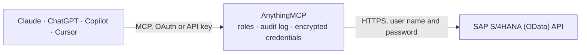

<!-- Generated by scripts/export-github-catalog.mjs in the anythingmcp-website repository. Do not edit by hand. -->

# SAP S/4HANA (OData) MCP connector

Read SAP S/4HANA on-premise and Private Cloud through its OData services: find services in SAP's catalog, read their fields with SAP's labels, query released APIs and analytical views for finance, … The AnythingMCP connector gives Claude, ChatGPT, Microsoft Copilot, Cursor and Gemini 12 MCP tools for SAP S/4HANA (OData), all read-only.

**Category:** [ERP](../erp.md) · **Tools:** 12 · **Setup guide:** [anythingmcp.com](https://anythingmcp.com/guides/sap-s4hana-odata-to-mcp) · [Deutsch](https://anythingmcp.com/de/guides/sap-s4hana-odata-to-mcp) · [Italiano](https://anythingmcp.com/it/guides/sap-s4hana-odata-to-mcp) · [Español](https://anythingmcp.com/es/guides/sap-s4hana-odata-to-mcp) · [日本語](https://anythingmcp.com/ja/guides/sap-s4hana-odata-to-mcp) · [Русский](https://anythingmcp.com/ru/guides/sap-s4hana-odata-to-mcp) · [中文](https://anythingmcp.com/zh/guides/sap-s4hana-odata-to-mcp)

## Start without code

No installation and no terminal: AnythingMCP Cloud runs the SAP S/4HANA (OData) connector for you, operated by helpcode.ai in Frankfurt, Germany.

1. **Click the button above** and create an account or sign in. The SAP S/4HANA (OData) connector opens, ready to install.
2. **Paste the API key or token from your SAP S/4HANA (OData) account.** Every click is in the [step-by-step guide](https://anythingmcp.com/guides/sap-s4hana-odata-to-mcp).
3. **Click Install.** AnythingMCP shows the address of your MCP server.
4. **Add that address to your assistant:** [Claude](https://anythingmcp.com/guides/connect-sap-s4hana-odata-to-claude) · [ChatGPT](https://anythingmcp.com/guides/connect-sap-s4hana-odata-to-chatgpt) · [Microsoft Copilot](https://anythingmcp.com/guides/connect-sap-s4hana-odata-to-copilot) · [Cursor](https://anythingmcp.com/guides/connect-sap-s4hana-odata-to-cursor) · [Gemini CLI](https://anythingmcp.com/guides/connect-sap-s4hana-odata-to-gemini) · [Meta Muse](https://anythingmcp.com/guides/connect-sap-s4hana-odata-to-muse).
5. **Ask your first question**, for example: *Show billing document INV-2026-0412: date, sold-to party, net amount and currency.*

Prefer help with the setup? [Talk to us](https://anythingmcp.com/contact).

## How it works

- **The AI client** speaks MCP (Streamable HTTP) to AnythingMCP and only sees tool names, descriptions and results. It never gets the SAP S/4HANA (OData) credentials.
- **AnythingMCP** checks the client's role, builds the call from the tool definition, adds the credentials (user name and password), calls SAP S/4HANA (OData), logs the call and returns the result.
- **SAP S/4HANA (OData)** sees an ordinary API client with the rights of the account the credentials belong to.

## Tools

| Tool | What it does | Access |
|---|---|---|
| [`s4_list_services`](#s4_list_services) | List the OData services published by the SAP Gateway (V2 and V4 catalog), filtered by words in their name, title or description. | read |
| [`s4_describe_service`](#s4_describe_service) | The entity sets of an OData service with their business labels, keys and whether they are analytical or parameterised. | read |
| [`s4_describe_entity`](#s4_describe_entity) | The fields of one entity set: labels, types, keys, the currency or unit field of each amount, dimensions and measures, and required filters. | read |
| [`s4_query`](#s4_query) | Read rows from an entity set, with field names checked against the service model and server paging followed. | read |
| [`s4_get_entity`](#s4_get_entity) | Read one entity by its key, optionally with related entities. | read |
| [`s4_guide`](#s4_guide) | How to read SAP S/4HANA through OData: the workflow (overview), filter syntax, analytical services and KPIs, finance, sales, inventory and pitfalls. | read |
| [`s4_journal_entry_items`](#s4_journal_entry_items) | Journal entry line items from the general ledger (API_JOURNALENTRYITEMBASIC_SRV / A_JournalEntryItemBasic): company code, fiscal year, G/L account, posting… | read |
| [`s4_billing_documents`](#s4_billing_documents) | Billing documents (API_BILLING_DOCUMENT_SRV / A_BillingDocument): invoices, credit memos and cancellations with date, sales organization, sold-to party, net… | read |
| [`s4_sales_orders`](#s4_sales_orders) | Sales orders (API_SALES_ORDER_SRV / A_SalesOrder) with type, sales organization, sold-to party, creation date, net amount, currency and processing status. | read |
| [`s4_business_partners`](#s4_business_partners) | Business partners (API_BUSINESS_PARTNER / A_BusinessPartner): customers, suppliers and contacts with name, category and grouping. | read |
| [`s4_material_stock`](#s4_material_stock) | Material stock (API_MATERIAL_STOCK_SRV / A_MatlStkInAcctMod) per material, plant, storage location, batch and stock type, in the material's base unit. | read |
| [`s4_products`](#s4_products) | Products (API_PRODUCT_SRV / A_Product) with type, group and base unit. | read |

## Tool reference

Every parameter as the AI client sees it in `tools/list`. Source: [`packages/backend/src/adapters/intl/sap-s4hana-odata.json`](../../../packages/backend/src/adapters/intl/sap-s4hana-odata.json).

### `s4_list_services`

List the OData services published by the SAP Gateway (V2 and V4 catalog), filtered by words in their name, title or description.

**Access:** read

No parameters.

### `s4_describe_service`

The entity sets of an OData service with their business labels, keys and whether they are analytical or parameterised.

**Access:** read

No parameters.

### `s4_describe_entity`

The fields of one entity set: labels, types, keys, the currency or unit field of each amount, dimensions and measures, and required filters.

**Access:** read

No parameters.

### `s4_query`

Read rows from an entity set, with field names checked against the service model and server paging followed.

**Access:** read

No parameters.

### `s4_get_entity`

Read one entity by its key, optionally with related entities.

**Access:** read

No parameters.

### `s4_guide`

How to read SAP S/4HANA through OData: the workflow (overview), filter syntax, analytical services and KPIs, finance, sales, inventory and pitfalls. Costs nothing.

**Access:** read

| Parameter | Type | Required | Description |
|---|---|---|---|
| `topic` | `filters` \| `analytics` \| `finance` \| `sales` \| `inventory` \| `pitfalls` | no | Chapter to read. Omit for the overview. |

### `s4_journal_entry_items`

Journal entry line items from the general ledger (API_JOURNALENTRYITEMBASIC_SRV / A_JournalEntryItemBasic): company code, fiscal year, G/L account, posting date, amount in company code currency, debit/credit, customer, supplier, cost and profit center. Filter by CompanyCode and a PostingDate range.

**Access:** read · **Call:** `GET /sap/opu/odata/sap/API_JOURNALENTRYITEMBASIC_SRV/A_JournalEntryItemBasic`

| Parameter | Type | Required | Description |
|---|---|---|---|
| `filter` | string | no | OData $filter, e.g. CompanyCode eq '1000' and PostingDate ge datetime'2026-01-01T00:00:00'. |
| `select` | string | no | Comma-separated fields to return. |
| `orderby` | string | no | OData $orderby, e.g. PostingDate desc. |
| `top` | number | no | Rows to return (default 100). |
| `skip` | number | no | Rows to skip, for paging. |

### `s4_billing_documents`

Billing documents (API_BILLING_DOCUMENT_SRV / A_BillingDocument): invoices, credit memos and cancellations with date, sales organization, sold-to party, net amount and currency.

**Access:** read · **Call:** `GET /sap/opu/odata/sap/API_BILLING_DOCUMENT_SRV/A_BillingDocument`

| Parameter | Type | Required | Description |
|---|---|---|---|
| `filter` | string | no | OData $filter, e.g. CompanyCode eq '1000' and PostingDate ge datetime'2026-01-01T00:00:00'. |
| `select` | string | no | Comma-separated fields to return. |
| `orderby` | string | no | OData $orderby, e.g. PostingDate desc. |
| `top` | number | no | Rows to return (default 100). |
| `skip` | number | no | Rows to skip, for paging. |

### `s4_sales_orders`

Sales orders (API_SALES_ORDER_SRV / A_SalesOrder) with type, sales organization, sold-to party, creation date, net amount, currency and processing status.

**Access:** read · **Call:** `GET /sap/opu/odata/sap/API_SALES_ORDER_SRV/A_SalesOrder`

| Parameter | Type | Required | Description |
|---|---|---|---|
| `filter` | string | no | OData $filter, e.g. CompanyCode eq '1000' and PostingDate ge datetime'2026-01-01T00:00:00'. |
| `select` | string | no | Comma-separated fields to return. |
| `orderby` | string | no | OData $orderby, e.g. PostingDate desc. |
| `top` | number | no | Rows to return (default 100). |
| `skip` | number | no | Rows to skip, for paging. |

### `s4_business_partners`

Business partners (API_BUSINESS_PARTNER / A_BusinessPartner): customers, suppliers and contacts with name, category and grouping.

**Access:** read · **Call:** `GET /sap/opu/odata/sap/API_BUSINESS_PARTNER/A_BusinessPartner`

| Parameter | Type | Required | Description |
|---|---|---|---|
| `filter` | string | no | OData $filter, e.g. CompanyCode eq '1000' and PostingDate ge datetime'2026-01-01T00:00:00'. |
| `select` | string | no | Comma-separated fields to return. |
| `orderby` | string | no | OData $orderby, e.g. PostingDate desc. |
| `top` | number | no | Rows to return (default 100). |
| `skip` | number | no | Rows to skip, for paging. |

### `s4_material_stock`

Material stock (API_MATERIAL_STOCK_SRV / A_MatlStkInAcctMod) per material, plant, storage location, batch and stock type, in the material's base unit. Filter by Plant.

**Access:** read · **Call:** `GET /sap/opu/odata/sap/API_MATERIAL_STOCK_SRV/A_MatlStkInAcctMod`

| Parameter | Type | Required | Description |
|---|---|---|---|
| `filter` | string | no | OData $filter, e.g. CompanyCode eq '1000' and PostingDate ge datetime'2026-01-01T00:00:00'. |
| `select` | string | no | Comma-separated fields to return. |
| `orderby` | string | no | OData $orderby, e.g. PostingDate desc. |
| `top` | number | no | Rows to return (default 100). |
| `skip` | number | no | Rows to skip, for paging. |

### `s4_products`

Products (API_PRODUCT_SRV / A_Product) with type, group and base unit.

**Access:** read · **Call:** `GET /sap/opu/odata/sap/API_PRODUCT_SRV/A_Product`

| Parameter | Type | Required | Description |
|---|---|---|---|
| `filter` | string | no | OData $filter, e.g. CompanyCode eq '1000' and PostingDate ge datetime'2026-01-01T00:00:00'. |
| `select` | string | no | Comma-separated fields to return. |
| `orderby` | string | no | OData $orderby, e.g. PostingDate desc. |
| `top` | number | no | Rows to return (default 100). |
| `skip` | number | no | Rows to skip, for paging. |

## Run it yourself

AnythingMCP is open source (AGPL-3.0). [Run it with Docker](../../../README.md#run-it-yourself), open **Connectors → Store**, pick **SAP S/4HANA (OData)** and enter `SAP_ODATA_BASE_URL`, `SAP_CLIENT`, `SAP_LANGUAGE`, `SAP_ODATA_USER`, `SAP_ODATA_PASSWORD`, then add your MCP server URL to the AI client.

[← ERP connectors](../erp.md) · [All categories](../README.md)
