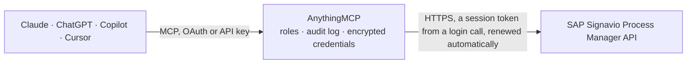

<!-- Generated by scripts/export-github-catalog.mjs in the anythingmcp-website repository. Do not edit by hand. -->

# SAP Signavio Process Manager MCP connector

Read the SAP Signavio Process Manager workspace: folders, process models and revisions, exports as Signavio JSON or BPMN 2.0 XML, full-text search and the process dictionary. The AnythingMCP connector gives Claude, ChatGPT, Microsoft Copilot, Cursor and Gemini 13 MCP tools for SAP Signavio Process Manager, all read-only.

**Category:** [Knowledge Base](../knowledge.md) · **Tools:** 13 · **Setup guide:** [anythingmcp.com](https://anythingmcp.com/guides/sap-signavio-to-mcp) · [Deutsch](https://anythingmcp.com/de/guides/sap-signavio-to-mcp) · [Italiano](https://anythingmcp.com/it/guides/sap-signavio-to-mcp) · [Español](https://anythingmcp.com/es/guides/sap-signavio-to-mcp) · [日本語](https://anythingmcp.com/ja/guides/sap-signavio-to-mcp) · [Русский](https://anythingmcp.com/ru/guides/sap-signavio-to-mcp) · [中文](https://anythingmcp.com/zh/guides/sap-signavio-to-mcp)

## Start without code

No installation and no terminal: AnythingMCP Cloud runs the SAP Signavio Process Manager connector for you, operated by helpcode.ai in Frankfurt, Germany.

1. **Click the button above** and create an account or sign in. The SAP Signavio Process Manager connector opens, ready to install.
2. **Paste the API key or token from your SAP Signavio Process Manager account.** Every click is in the [step-by-step guide](https://anythingmcp.com/guides/sap-signavio-to-mcp).
3. **Click Install.** AnythingMCP shows the address of your MCP server.
4. **Add that address to your assistant:** [Claude](https://anythingmcp.com/guides/connect-sap-signavio-to-claude) · [ChatGPT](https://anythingmcp.com/guides/connect-sap-signavio-to-chatgpt) · [Microsoft Copilot](https://anythingmcp.com/guides/connect-sap-signavio-to-copilot) · [Cursor](https://anythingmcp.com/guides/connect-sap-signavio-to-cursor) · [Gemini CLI](https://anythingmcp.com/guides/connect-sap-signavio-to-gemini) · [Meta Muse](https://anythingmcp.com/guides/connect-sap-signavio-to-muse).
5. **Ask your first question**, for example: *Find the model named 'AR-Invoice Processing v2' in Shared documents and give its model id and last change date.*

Prefer help with the setup? [Talk to us](https://anythingmcp.com/contact).

## How it works

- **The AI client** speaks MCP (Streamable HTTP) to AnythingMCP and only sees tool names, descriptions and results. It never gets the SAP Signavio Process Manager credentials.
- **AnythingMCP** checks the client's role, builds the call from the tool definition, adds the credentials (a session token from a login call, renewed automatically), calls SAP Signavio Process Manager, logs the call and returns the result.
- **SAP Signavio Process Manager** sees an ordinary API client with the rights of the account the credentials belong to.

## Tools

| Tool | What it does | Access |
|---|---|---|
| [`sap_signavio_list_root_directories`](#sap_signavio_list_root_directories) | The root folders of the workspace (e.g. Shared documents, My documents) with their names and hrefs. | read |
| [`sap_signavio_get_directory`](#sap_signavio_get_directory) | The contents of one folder: its info, parent folders, subfolders (rel dir) and process models (rel mod) with name, type, last change and the href that holds… | read |
| [`sap_signavio_get_model`](#sap_signavio_get_model) | Overview of one process model as a list of links: its info, parent folder, revisions and available export formats. | read |
| [`sap_signavio_get_model_info`](#sap_signavio_get_model_info) | Metadata of one process model: name, description, type (BPMN, EPC, value chain...), parent folder, latest revision, author and last change. | read |
| [`sap_signavio_list_model_revisions`](#sap_signavio_list_model_revisions) | The revisions of one process model, newest first, with revision number, author, creation date and comment. | read |
| [`sap_signavio_export_model_json`](#sap_signavio_export_model_json) | The latest revision of a process model as Signavio JSON: every shape (tasks, events, gateways, lanes) with its properties and the connections between them. | read |
| [`sap_signavio_export_model_bpmn`](#sap_signavio_export_model_bpmn) | The latest revision of a process model as BPMN 2.0 XML, returned as text. | read |
| [`sap_signavio_get_revision_json`](#sap_signavio_get_revision_json) | One specific revision of a process model as Signavio JSON (shapes, properties, connections). | read |
| [`sap_signavio_get_revision_bpmn`](#sap_signavio_get_revision_bpmn) | One specific revision of a process model as BPMN 2.0 XML, returned as text. | read |
| [`sap_signavio_search`](#sap_signavio_search) | Full-text search across the workspace: process models, folders, shapes inside models, files and comments that match a term. | read |
| [`sap_signavio_list_dictionary_entries`](#sap_signavio_list_dictionary_entries) | Entries of the Process Manager dictionary (glossary): organizational units, documents, activities, events and IT systems with title, category and description. | read |
| [`sap_signavio_get_dictionary_entry`](#sap_signavio_get_dictionary_entry) | One dictionary entry with its metadata: title, category, description, attachments, custom attributes and last change. | read |
| [`sap_signavio_list_dictionary_categories`](#sap_signavio_list_dictionary_categories) | The dictionary categories of the workspace (the five built-in ones and custom categories) with their ids, names, parent and number of entries. | read |

## Tool reference

Every parameter as the AI client sees it in `tools/list`. Source: [`packages/backend/src/adapters/intl/sap-signavio.json`](../../../packages/backend/src/adapters/intl/sap-signavio.json).

### `sap_signavio_list_root_directories`

The root folders of the workspace (e.g. Shared documents, My documents) with their names and hrefs. Start here: pass the id at the end of a folder's href to get_directory to walk the folder tree.

**Access:** read · **Call:** `GET /directory`

No parameters.

### `sap_signavio_get_directory`

The contents of one folder: its info, parent folders, subfolders (rel dir) and process models (rel mod) with name, type, last change and the href that holds the model id. Use it to browse the process landscape.

**Access:** read · **Call:** `GET /directory/{directory_id}`

| Parameter | Type | Required | Description |
|---|---|---|---|
| `directory_id` | string | yes | Folder id: the last segment of a folder's href from list_root_directories or a parent get_directory call (href /directory/<id>). |

### `sap_signavio_get_model`

Overview of one process model as a list of links: its info, parent folder, revisions and available export formats. Use get_model_info for the metadata itself.

**Access:** read · **Call:** `GET /model/{model_id}`

| Parameter | Type | Required | Description |
|---|---|---|---|
| `model_id` | string | yes | Model id: the last segment of a `mod` item's href in get_directory or search results (href /model/<id>). |

### `sap_signavio_get_model_info`

Metadata of one process model: name, description, type (BPMN, EPC, value chain...), parent folder, latest revision, author and last change. Use it before exporting the model.

**Access:** read · **Call:** `GET /model/{model_id}/info`

| Parameter | Type | Required | Description |
|---|---|---|---|
| `model_id` | string | yes | Model id: the last segment of a `mod` item's href in get_directory or search results (href /model/<id>). |

### `sap_signavio_list_model_revisions`

The revisions of one process model, newest first, with revision number, author, creation date and comment. Use the revision href id with get_revision_json or get_revision_bpmn to read an older version.

**Access:** read · **Call:** `GET /model/{model_id}/revisions`

| Parameter | Type | Required | Description |
|---|---|---|---|
| `model_id` | string | yes | Model id: the last segment of a `mod` item's href in get_directory or search results (href /model/<id>). |
| `limit` | integer | no | Maximum number of revisions to return. |
| `offset` | integer | no | Number of revisions to skip, for paging. |

### `sap_signavio_export_model_json`

The latest revision of a process model as Signavio JSON: every shape (tasks, events, gateways, lanes) with its properties and the connections between them. Use it to describe or analyse a process step by step.

**Access:** read · **Call:** `GET /model/{model_id}/json`

| Parameter | Type | Required | Description |
|---|---|---|---|
| `model_id` | string | yes | Model id: the last segment of a `mod` item's href in get_directory or search results (href /model/<id>). |

### `sap_signavio_export_model_bpmn`

The latest revision of a process model as BPMN 2.0 XML, returned as text. Use it when a standard BPMN document is needed, e.g. to compare with another tool or to keep a copy.

**Access:** read · **Call:** `GET /model/{model_id}/bpmn2_0_xml`

| Parameter | Type | Required | Description |
|---|---|---|---|
| `model_id` | string | yes | Model id: the last segment of a `mod` item's href in get_directory or search results (href /model/<id>). |
| `export_subprocesses` | boolean | no | Also export linked subprocesses (default false). |

### `sap_signavio_get_revision_json`

One specific revision of a process model as Signavio JSON (shapes, properties, connections). Use it with list_model_revisions to see how a process looked at an earlier point.

**Access:** read · **Call:** `GET /revision/{revision_id}/json`

| Parameter | Type | Required | Description |
|---|---|---|---|
| `revision_id` | string | yes | Revision id: from list_model_revisions (href /revision/<id>) or the `rev` field of get_model_info. |

### `sap_signavio_get_revision_bpmn`

One specific revision of a process model as BPMN 2.0 XML, returned as text. Use it to export or compare an older version of a process.

**Access:** read · **Call:** `GET /revision/{revision_id}/bpmn2_0_xml`

| Parameter | Type | Required | Description |
|---|---|---|---|
| `revision_id` | string | yes | Revision id: from list_model_revisions (href /revision/<id>) or the `rev` field of get_model_info. |
| `export_subprocesses` | boolean | no | Also export linked subprocesses (default false). |

### `sap_signavio_search`

Full-text search across the workspace: process models, folders, shapes inside models, files and comments that match a term. Returns hrefs with the ids for get_model_info or get_directory.

**Access:** read · **Call:** `GET /search`

| Parameter | Type | Required | Description |
|---|---|---|---|
| `q` | string | yes | The search term. |
| `types` | string | no | Comma-separated content types to include: MODEL, MODEL_REVISION, SHAPE, FILE, FILE_REVISION, DIR, COMMENT. Default: all. |
| `limit` | integer | no | Maximum number of results, up to 250. |
| `offset` | integer | no | Index of the first result, for paging. |

### `sap_signavio_list_dictionary_entries`

Entries of the Process Manager dictionary (glossary): organizational units, documents, activities, events and IT systems with title, category and description. Filter by search term, first letter or category.

**Access:** read · **Call:** `GET /glossary`

| Parameter | Type | Required | Description |
|---|---|---|---|
| `q` | string | no | Full-text search term (ignored when letter is set). |
| `letter` | string | no | Only entries whose title starts with this letter. |
| `category` | string | no | Category: ORG_UNIT, DOCUMENT, ACTIVITY, STATE (events) or IT_SYSTEM, or the id of a custom category from list_dictionary_categories. |
| `include` | `all` | no | all: also list entries of the category's subcategories. |
| `sort` | `title` | no | title: sort by title. Default: by relevance. |
| `limit` | integer | no | Maximum number of entries to return, up to 1000. |
| `offset` | integer | no | Number of entries to skip, for paging. |

### `sap_signavio_get_dictionary_entry`

One dictionary entry with its metadata: title, category, description, attachments, custom attributes and last change. Use the entry id from list_dictionary_entries (href /glossary/<id>).

**Access:** read · **Call:** `GET /glossary/{entry_id}/info`

| Parameter | Type | Required | Description |
|---|---|---|---|
| `entry_id` | string | yes | Dictionary entry id: the last segment of an entry's href from list_dictionary_entries. |

### `sap_signavio_list_dictionary_categories`

The dictionary categories of the workspace (the five built-in ones and custom categories) with their ids, names, parent and number of entries. Use a category id to filter list_dictionary_entries.

**Access:** read · **Call:** `GET /glossarycategory`

| Parameter | Type | Required | Description |
|---|---|---|---|
| `all_categories` | boolean | no | true: return every category, including subcategories, in one call. |
| `show_hidden` | boolean | no | true: include hidden categories. |

## Run it yourself

AnythingMCP is open source (AGPL-3.0). [Run it with Docker](../../../README.md#run-it-yourself), open **Connectors → Store**, pick **SAP Signavio Process Manager** and enter `SIGNAVIO_URL`, `SIGNAVIO_EMAIL`, `SIGNAVIO_PASSWORD`, `SIGNAVIO_WORKSPACE_ID`, then add your MCP server URL to the AI client.

[← Knowledge Base connectors](../knowledge.md) · [All categories](../README.md)
