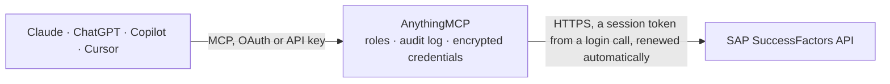

<!-- Generated by scripts/export-github-catalog.mjs in the anythingmcp-website repository. Do not edit by hand. -->

# SAP SuccessFactors MCP connector

Read SAP SuccessFactors Employee Central through its OData API: employees, job information, persons, companies, departments, positions and time off, plus generic OData tools for any other entity. The AnythingMCP connector gives Claude, ChatGPT, Microsoft Copilot, Cursor and Gemini 15 MCP tools for SAP SuccessFactors, all read-only.

**Category:** [HR](../hr.md) · **Tools:** 15 · **Setup guide:** [anythingmcp.com](https://anythingmcp.com/guides/sap-successfactors-to-mcp) · [Deutsch](https://anythingmcp.com/de/guides/sap-successfactors-to-mcp) · [Italiano](https://anythingmcp.com/it/guides/sap-successfactors-to-mcp) · [Español](https://anythingmcp.com/es/guides/sap-successfactors-to-mcp) · [日本語](https://anythingmcp.com/ja/guides/sap-successfactors-to-mcp) · [Русский](https://anythingmcp.com/ru/guides/sap-successfactors-to-mcp) · [中文](https://anythingmcp.com/zh/guides/sap-successfactors-to-mcp)

## Start without code

No installation and no terminal: AnythingMCP Cloud runs the SAP SuccessFactors connector for you, operated by helpcode.ai in Frankfurt, Germany.

1. **Click the button above** and create an account or sign in. The SAP SuccessFactors connector opens, ready to install.
2. **Paste the API key or token from your SAP SuccessFactors account.** Every click is in the [step-by-step guide](https://anythingmcp.com/guides/sap-successfactors-to-mcp).
3. **Click Install.** AnythingMCP shows the address of your MCP server.
4. **Add that address to your assistant:** [Claude](https://anythingmcp.com/guides/connect-sap-successfactors-to-claude) · [ChatGPT](https://anythingmcp.com/guides/connect-sap-successfactors-to-chatgpt) · [Microsoft Copilot](https://anythingmcp.com/guides/connect-sap-successfactors-to-copilot) · [Cursor](https://anythingmcp.com/guides/connect-sap-successfactors-to-cursor) · [Gemini CLI](https://anythingmcp.com/guides/connect-sap-successfactors-to-gemini) · [Meta Muse](https://anythingmcp.com/guides/connect-sap-successfactors-to-muse).
5. **Ask your first question**, for example: *Find user profile for emma.berg@novacare.hr and return her userId, full name and status.*

Prefer help with the setup? [Talk to us](https://anythingmcp.com/contact).

## How it works

- **The AI client** speaks MCP (Streamable HTTP) to AnythingMCP and only sees tool names, descriptions and results. It never gets the SAP SuccessFactors credentials.
- **AnythingMCP** checks the client's role, builds the call from the tool definition, adds the credentials (a session token from a login call, renewed automatically), calls SAP SuccessFactors, logs the call and returns the result.
- **SAP SuccessFactors** sees an ordinary API client with the rights of the account the credentials belong to.

## Tools

| Tool | What it does | Access |
|---|---|---|
| [`sap_successfactors_list_services`](#sap_successfactors_list_services) | Where the OData service lives. | read |
| [`sap_successfactors_describe_service`](#sap_successfactors_describe_service) | The entity sets of an OData service with their business labels, keys and whether they are analytical or parameterised. | read |
| [`sap_successfactors_describe_entity`](#sap_successfactors_describe_entity) | The fields of one entity set: labels, types, keys, the currency or unit field of each amount, dimensions and measures, and required filters. | read |
| [`sap_successfactors_query`](#sap_successfactors_query) | Read rows from an entity set, with field names checked against the service model and server paging followed. | read |
| [`sap_successfactors_get_entity`](#sap_successfactors_get_entity) | Read one entity by its key, optionally with related entities. | read |
| [`sap_successfactors_guide`](#sap_successfactors_guide) | How to read SAP SuccessFactors through its OData API: the workflow, filter syntax, effective dating (asOfDate, fromDate, toDate), the common entities and… | read |
| [`sap_successfactors_list_users`](#sap_successfactors_list_users) | Employee profiles from the User entity: userId, username, name, email, department, division, location, title and status. | read |
| [`sap_successfactors_get_user`](#sap_successfactors_get_user) | One employee profile from the User entity by userId, with optional select and expand (e.g. manager, hr, empInfo/jobInfoNav). | read |
| [`sap_successfactors_list_employee_jobs`](#sap_successfactors_list_employee_jobs) | Job information (EmpJob, effective-dated): userId, startDate, company, business unit, division, department, location, position, job code, managerId,… | read |
| [`sap_successfactors_list_persons`](#sap_successfactors_list_persons) | Person records (PerPerson): personIdExternal, date and place of birth, with navigations to personal info (personalInfoNav), emails (emailNav), phones… | read |
| [`sap_successfactors_list_companies`](#sap_successfactors_list_companies) | Legal entities (FOCompany, effective-dated): externalCode, name, country, currency, status and default location. | read |
| [`sap_successfactors_list_departments`](#sap_successfactors_list_departments) | Departments (FODepartment, effective-dated): externalCode, name, description, parent department, head of unit and cost center. | read |
| [`sap_successfactors_list_positions`](#sap_successfactors_list_positions) | Positions from Position Management (Position, effective-dated): code, externalName_defaultValue, company, department, job code, vacant flag, FTE and parent… | read |
| [`sap_successfactors_list_time_off`](#sap_successfactors_list_time_off) | Time off and absence requests (EmployeeTime from Time Off): userId, timeType, startDate, endDate, quantityInDays or quantityInHours and approvalStatus. | read |
| [`sap_successfactors_get_entity_metadata`](#sap_successfactors_get_entity_metadata) | The metadata of one entity (e.g. EmpEmployment, PerPersonal, TimeAccount, FOLocation) as JSON: its fields with types, labels, required, filterable and… | read |

## Tool reference

Every parameter as the AI client sees it in `tools/list`. Source: [`packages/backend/src/adapters/intl/sap-successfactors.json`](../../../packages/backend/src/adapters/intl/sap-successfactors.json).

### `sap_successfactors_list_services`

Where the OData service lives.

**Access:** read

No parameters.

### `sap_successfactors_describe_service`

The entity sets of an OData service with their business labels, keys and whether they are analytical or parameterised.

**Access:** read

No parameters.

### `sap_successfactors_describe_entity`

The fields of one entity set: labels, types, keys, the currency or unit field of each amount, dimensions and measures, and required filters.

**Access:** read

No parameters.

### `sap_successfactors_query`

Read rows from an entity set, with field names checked against the service model and server paging followed.

**Access:** read

No parameters.

### `sap_successfactors_get_entity`

Read one entity by its key, optionally with related entities.

**Access:** read

No parameters.

### `sap_successfactors_guide`

How to read SAP SuccessFactors through its OData API: the workflow, filter syntax, effective dating (asOfDate, fromDate, toDate), the common entities and pitfalls. Static text, costs no API call.

**Access:** read

| Parameter | Type | Required | Description |
|---|---|---|---|
| `topic` | `filters` \| `effective_dating` \| `entities` \| `pitfalls` | no | Chapter to read. Omit for the overview. |

### `sap_successfactors_list_users`

Employee profiles from the User entity: userId, username, name, email, department, division, location, title and status. Filter by department, status or lastModifiedDateTime; expand manager or empInfo for related records. Use it to find a userId.

**Access:** read · **Call:** `GET /User`

| Parameter | Type | Required | Description |
|---|---|---|---|
| `filter` | string | no | OData $filter. Strings in single quotes, e.g. status eq 'active' or lastModifiedDateTime ge datetime'2026-01-01T00:00:00'. |
| `select` | string | no | Comma-separated fields to return. Keeps answers small; field names are case-sensitive. |
| `orderby` | string | no | OData $orderby, e.g. lastName asc. |
| `expand` | string | no | Navigation properties to include, comma-separated (see describe_entity or get_entity_metadata for the names). |
| `top` | integer | no | Rows to return (default 100, SuccessFactors caps a page at 1000). |
| `skip` | integer | no | Rows to skip, for the next page. |

### `sap_successfactors_get_user`

One employee profile from the User entity by userId, with optional select and expand (e.g. manager, hr, empInfo/jobInfoNav). Use after list_users when you need one person's details.

**Access:** read · **Call:** `GET /User('{user_id}')`

| Parameter | Type | Required | Description |
|---|---|---|---|
| `user_id` | string | yes | The userId, as returned by list_users or list_employee_jobs. |
| `select` | string | no | Comma-separated fields to return. |
| `expand` | string | no | Navigation properties to include, e.g. manager,empInfo. |

### `sap_successfactors_list_employee_jobs`

Job information (EmpJob, effective-dated): userId, startDate, company, business unit, division, department, location, position, job code, managerId, employment status and event reason. Returns the record valid today unless as_of_date or from_date/to_date is given.

**Access:** read · **Call:** `GET /EmpJob`

| Parameter | Type | Required | Description |
|---|---|---|---|
| `filter` | string | no | OData $filter. Strings in single quotes, e.g. status eq 'active' or lastModifiedDateTime ge datetime'2026-01-01T00:00:00'. |
| `select` | string | no | Comma-separated fields to return. Keeps answers small; field names are case-sensitive. |
| `orderby` | string | no | OData $orderby, e.g. lastName asc. |
| `expand` | string | no | Navigation properties to include, comma-separated (see describe_entity or get_entity_metadata for the names). |
| `top` | integer | no | Rows to return (default 100, SuccessFactors caps a page at 1000). |
| `skip` | integer | no | Rows to skip, for the next page. |
| `as_of_date` | string | no | Effective date YYYY-MM-DD: return the record valid on that day. Default is today. |
| `from_date` | string | no | Start of a period YYYY-MM-DD: return every record valid at some point between from_date and to_date (history). |
| `to_date` | string | no | End of the period YYYY-MM-DD, used with from_date. |

### `sap_successfactors_list_persons`

Person records (PerPerson): personIdExternal, date and place of birth, with navigations to personal info (personalInfoNav), emails (emailNav), phones (phoneNav) and employments (employmentNav). Use expand to pull them in one call.

**Access:** read · **Call:** `GET /PerPerson`

| Parameter | Type | Required | Description |
|---|---|---|---|
| `filter` | string | no | OData $filter. Strings in single quotes, e.g. status eq 'active' or lastModifiedDateTime ge datetime'2026-01-01T00:00:00'. |
| `select` | string | no | Comma-separated fields to return. Keeps answers small; field names are case-sensitive. |
| `orderby` | string | no | OData $orderby, e.g. lastName asc. |
| `expand` | string | no | Navigation properties to include, comma-separated (see describe_entity or get_entity_metadata for the names). |
| `top` | integer | no | Rows to return (default 100, SuccessFactors caps a page at 1000). |
| `skip` | integer | no | Rows to skip, for the next page. |
| `as_of_date` | string | no | Effective date YYYY-MM-DD: return the record valid on that day. Default is today. |
| `from_date` | string | no | Start of a period YYYY-MM-DD: return every record valid at some point between from_date and to_date (history). |
| `to_date` | string | no | End of the period YYYY-MM-DD, used with from_date. |

### `sap_successfactors_list_companies`

Legal entities (FOCompany, effective-dated): externalCode, name, country, currency, status and default location. Use the externalCode to filter EmpJob by company.

**Access:** read · **Call:** `GET /FOCompany`

| Parameter | Type | Required | Description |
|---|---|---|---|
| `filter` | string | no | OData $filter. Strings in single quotes, e.g. status eq 'active' or lastModifiedDateTime ge datetime'2026-01-01T00:00:00'. |
| `select` | string | no | Comma-separated fields to return. Keeps answers small; field names are case-sensitive. |
| `orderby` | string | no | OData $orderby, e.g. lastName asc. |
| `expand` | string | no | Navigation properties to include, comma-separated (see describe_entity or get_entity_metadata for the names). |
| `top` | integer | no | Rows to return (default 100, SuccessFactors caps a page at 1000). |
| `skip` | integer | no | Rows to skip, for the next page. |
| `as_of_date` | string | no | Effective date YYYY-MM-DD: return the record valid on that day. Default is today. |
| `from_date` | string | no | Start of a period YYYY-MM-DD: return every record valid at some point between from_date and to_date (history). |
| `to_date` | string | no | End of the period YYYY-MM-DD, used with from_date. |

### `sap_successfactors_list_departments`

Departments (FODepartment, effective-dated): externalCode, name, description, parent department, head of unit and cost center. Use the externalCode to filter EmpJob or User by department.

**Access:** read · **Call:** `GET /FODepartment`

| Parameter | Type | Required | Description |
|---|---|---|---|
| `filter` | string | no | OData $filter. Strings in single quotes, e.g. status eq 'active' or lastModifiedDateTime ge datetime'2026-01-01T00:00:00'. |
| `select` | string | no | Comma-separated fields to return. Keeps answers small; field names are case-sensitive. |
| `orderby` | string | no | OData $orderby, e.g. lastName asc. |
| `expand` | string | no | Navigation properties to include, comma-separated (see describe_entity or get_entity_metadata for the names). |
| `top` | integer | no | Rows to return (default 100, SuccessFactors caps a page at 1000). |
| `skip` | integer | no | Rows to skip, for the next page. |
| `as_of_date` | string | no | Effective date YYYY-MM-DD: return the record valid on that day. Default is today. |
| `from_date` | string | no | Start of a period YYYY-MM-DD: return every record valid at some point between from_date and to_date (history). |
| `to_date` | string | no | End of the period YYYY-MM-DD, used with from_date. |

### `sap_successfactors_list_positions`

Positions from Position Management (Position, effective-dated): code, externalName_defaultValue, company, department, job code, vacant flag, FTE and parent position. Use it for org charts and open positions.

**Access:** read · **Call:** `GET /Position`

| Parameter | Type | Required | Description |
|---|---|---|---|
| `filter` | string | no | OData $filter. Strings in single quotes, e.g. status eq 'active' or lastModifiedDateTime ge datetime'2026-01-01T00:00:00'. |
| `select` | string | no | Comma-separated fields to return. Keeps answers small; field names are case-sensitive. |
| `orderby` | string | no | OData $orderby, e.g. lastName asc. |
| `expand` | string | no | Navigation properties to include, comma-separated (see describe_entity or get_entity_metadata for the names). |
| `top` | integer | no | Rows to return (default 100, SuccessFactors caps a page at 1000). |
| `skip` | integer | no | Rows to skip, for the next page. |
| `as_of_date` | string | no | Effective date YYYY-MM-DD: return the record valid on that day. Default is today. |
| `from_date` | string | no | Start of a period YYYY-MM-DD: return every record valid at some point between from_date and to_date (history). |
| `to_date` | string | no | End of the period YYYY-MM-DD, used with from_date. |

### `sap_successfactors_list_time_off`

Time off and absence requests (EmployeeTime from Time Off): userId, timeType, startDate, endDate, quantityInDays or quantityInHours and approvalStatus. Filter by userId and a startDate range to see who is absent when.

**Access:** read · **Call:** `GET /EmployeeTime`

| Parameter | Type | Required | Description |
|---|---|---|---|
| `filter` | string | no | OData $filter. Strings in single quotes, e.g. status eq 'active' or lastModifiedDateTime ge datetime'2026-01-01T00:00:00'. |
| `select` | string | no | Comma-separated fields to return. Keeps answers small; field names are case-sensitive. |
| `orderby` | string | no | OData $orderby, e.g. lastName asc. |
| `expand` | string | no | Navigation properties to include, comma-separated (see describe_entity or get_entity_metadata for the names). |
| `top` | integer | no | Rows to return (default 100, SuccessFactors caps a page at 1000). |
| `skip` | integer | no | Rows to skip, for the next page. |

### `sap_successfactors_get_entity_metadata`

The metadata of one entity (e.g. EmpEmployment, PerPersonal, TimeAccount, FOLocation) as JSON: its fields with types, labels, required, filterable and sortable flags, plus its navigation properties. Much lighter than describe_service, which loads the whole tenant model.

**Access:** read · **Call:** `GET /Entity('{entity}')`

| Parameter | Type | Required | Description |
|---|---|---|---|
| `entity` | string | yes | Entity name, case-sensitive, e.g. EmpEmployment or PerPersonal. |

## Run it yourself

AnythingMCP is open source (AGPL-3.0). [Run it with Docker](../../../README.md#run-it-yourself), open **Connectors → Store**, pick **SAP SuccessFactors** and enter `SF_API_URL`, `SF_COMPANY_ID`, `SF_CLIENT_ID`, `SF_SAML_ASSERTION`, then add your MCP server URL to the AI client.

[← HR connectors](../hr.md) · [All categories](../README.md)
