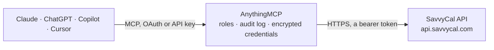

<!-- Generated by scripts/export-github-catalog.mjs in the anythingmcp-website repository. Do not edit by hand. -->

# SavvyCal MCP connector

Drive SavvyCal (modern team scheduling) from any AI agent: scheduling links, meetings, availability. 6 tools, API-key Bearer auth. The AnythingMCP connector gives Claude, ChatGPT, Microsoft Copilot, Cursor and Gemini 6 MCP tools for SavvyCal: 5 read and 1 can change data.

**Category:** [Scheduling](../scheduling.md) · **Tools:** 6 · **Setup guide:** [anythingmcp.com](https://anythingmcp.com/guides/savvycal-to-mcp) · [Deutsch](https://anythingmcp.com/de/guides/savvycal-to-mcp) · [Italiano](https://anythingmcp.com/it/guides/savvycal-to-mcp) · [Español](https://anythingmcp.com/es/guides/savvycal-to-mcp) · [日本語](https://anythingmcp.com/ja/guides/savvycal-to-mcp) · [Русский](https://anythingmcp.com/ru/guides/savvycal-to-mcp) · [中文](https://anythingmcp.com/zh/guides/savvycal-to-mcp)

## Start without code

No installation and no terminal: AnythingMCP Cloud runs the SavvyCal connector for you, operated by helpcode.ai in Frankfurt, Germany.

1. **Click the button above** and create an account or sign in. The SavvyCal connector opens, ready to install.
2. **Paste the API key or token from your SavvyCal account.** Every click is in the [step-by-step guide](https://anythingmcp.com/guides/savvycal-to-mcp).
3. **Click Install.** AnythingMCP shows the address of your MCP server.
4. **Add that address to your assistant:** [Claude](https://anythingmcp.com/guides/connect-savvycal-to-claude) · [ChatGPT](https://anythingmcp.com/guides/connect-savvycal-to-chatgpt) · [Microsoft Copilot](https://anythingmcp.com/guides/connect-savvycal-to-copilot) · [Cursor](https://anythingmcp.com/guides/connect-savvycal-to-cursor) · [Gemini CLI](https://anythingmcp.com/guides/connect-savvycal-to-gemini) · [Meta Muse](https://anythingmcp.com/guides/connect-savvycal-to-muse).
5. **Ask your first question**, for example: *Do we have a public scheduling link named "Intro Sales" owned by Marta Alvarez and is it single-use?*

Prefer help with the setup? [Talk to us](https://anythingmcp.com/contact).

## How it works

- **The AI client** speaks MCP (Streamable HTTP) to AnythingMCP and only sees tool names, descriptions and results. It never gets the SavvyCal credentials.
- **AnythingMCP** checks the client's role, builds the call from the tool definition, adds the credentials (a bearer token), calls SavvyCal, logs the call and returns the result.
- **SavvyCal** sees an ordinary API client with the rights of the account the credentials belong to.

## Tools

| Tool | What it does | Access |
|---|---|---|
| [`savvycal_me`](#savvycal_me) | Return the user the token belongs to. | read |
| [`savvycal_list_links`](#savvycal_list_links) | List scheduling links. | read |
| [`savvycal_get_link`](#savvycal_get_link) | Fetch a scheduling link by ID with full details. | read |
| [`savvycal_list_meetings`](#savvycal_list_meetings) | List meetings (bookings). | read |
| [`savvycal_get_meeting`](#savvycal_get_meeting) | Fetch a meeting by ID with invitee details, cancellation URL, reschedule URL. | read |
| [`savvycal_cancel_meeting`](#savvycal_cancel_meeting) | Cancel a scheduled meeting. | write |

## Tool reference

Every parameter as the AI client sees it in `tools/list`. Source: [`packages/backend/src/adapters/intl/savvycal.json`](../../../packages/backend/src/adapters/intl/savvycal.json).

### `savvycal_me`

Return the user the token belongs to.

**Access:** read · **Call:** `GET /me`

No parameters.

### `savvycal_list_links`

List scheduling links. Each has id, slug, name, public, single_use, link_url, durations[], owner.

**Access:** read · **Call:** `GET /links`

| Parameter | Type | Required | Description |
|---|---|---|---|
| `limit` | integer | no | Per page (max 100). |
| `after` | string | no | Cursor. |

### `savvycal_get_link`

Fetch a scheduling link by ID with full details.

**Access:** read · **Call:** `GET /links/{linkId}`

| Parameter | Type | Required | Description |
|---|---|---|---|
| `linkId` | string | yes | Link ID. |

### `savvycal_list_meetings`

List meetings (bookings).

**Access:** read · **Call:** `GET /events`

| Parameter | Type | Required | Description |
|---|---|---|---|
| `after` | string | no | Cursor from the previous page's metadata: returns entries after it. |
| `limit` | integer | no | Per page (1-100, default 20). |
| `period` | `upcoming` \| `past` \| `fixed` \| `all` | no | Which events: upcoming (default), past, all, or fixed (between from and to). |
| `from` | string | no | Lower bound for the start date, YYYY-MM-DD. Only applies when period is fixed. |
| `to` | string | no | Upper bound for the start date, YYYY-MM-DD. Only applies when period is fixed. |
| `state` | `all` \| `confirmed` \| `canceled` \| `awaiting_reschedule` \| `awaiting_checkout` \| `checkout_expired` \| `awaiting_approval` \| `declined` \| `tentative` | no | Filter by event state (default confirmed). |

### `savvycal_get_meeting`

Fetch a meeting by ID with invitee details, cancellation URL, reschedule URL.

**Access:** read · **Call:** `GET /events/{meetingId}`

| Parameter | Type | Required | Description |
|---|---|---|---|
| `meetingId` | string | yes | Event ID or UUID from savvycal_list_meetings (e.g. event_01KKGY70MFPCECSQ6KM6FMDPC3). |

### `savvycal_cancel_meeting`

Cancel a scheduled meeting. The invitee receives a cancellation email.

**Access:** write · **Call:** `POST /events/{meetingId}/cancel`

| Parameter | Type | Required | Description |
|---|---|---|---|
| `meetingId` | string | yes | Event ID or UUID from savvycal_list_meetings (e.g. event_01KKGY70MFPCECSQ6KM6FMDPC3). |
| `reason` | string | no | Cancellation reason (shown in email). |

## Run it yourself

AnythingMCP is open source (AGPL-3.0). [Run it with Docker](../../../README.md#run-it-yourself), open **Connectors → Store**, pick **SavvyCal** and enter `SAVVYCAL_API_KEY`, then add your MCP server URL to the AI client.

[← Scheduling connectors](../scheduling.md) · [All categories](../README.md)
