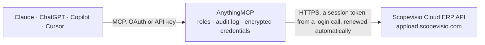

<!-- Generated by scripts/export-github-catalog.mjs in the anythingmcp-website repository. Do not edit by hand. -->

# Scopevisio Cloud ERP MCP connector

Read Scopevisio cloud ERP data: search contacts, outgoing and incoming invoices, projects and tasks, and open single records and invoice positions. The AnythingMCP connector gives Claude, ChatGPT, Microsoft Copilot, Cursor and Gemini 12 MCP tools for Scopevisio Cloud ERP, all read-only.

**Category:** [ERP](../erp.md) · **Tools:** 12 · **Setup guide:** [anythingmcp.com](https://anythingmcp.com/guides/scopevisio-to-mcp) · [Deutsch](https://anythingmcp.com/de/guides/scopevisio-to-mcp) · [Italiano](https://anythingmcp.com/it/guides/scopevisio-to-mcp) · [Español](https://anythingmcp.com/es/guides/scopevisio-to-mcp) · [日本語](https://anythingmcp.com/ja/guides/scopevisio-to-mcp) · [Русский](https://anythingmcp.com/ru/guides/scopevisio-to-mcp) · [中文](https://anythingmcp.com/zh/guides/scopevisio-to-mcp)

## Start without code

No installation and no terminal: AnythingMCP Cloud runs the Scopevisio Cloud ERP connector for you, operated by helpcode.ai in Frankfurt, Germany.

1. **Click the button above** and create an account or sign in. The Scopevisio Cloud ERP connector opens, ready to install.
2. **Paste the API key or token from your Scopevisio Cloud ERP account.** Every click is in the [step-by-step guide](https://anythingmcp.com/guides/scopevisio-to-mcp).
3. **Click Install.** AnythingMCP shows the address of your MCP server.
4. **Add that address to your assistant:** [Claude](https://anythingmcp.com/guides/connect-scopevisio-to-claude) · [ChatGPT](https://anythingmcp.com/guides/connect-scopevisio-to-chatgpt) · [Microsoft Copilot](https://anythingmcp.com/guides/connect-scopevisio-to-copilot) · [Cursor](https://anythingmcp.com/guides/connect-scopevisio-to-cursor) · [Gemini CLI](https://anythingmcp.com/guides/connect-scopevisio-to-gemini) · [Meta Muse](https://anythingmcp.com/guides/connect-scopevisio-to-muse).
5. **Ask your first question**, for example: *Show outgoing invoice AR-2026-089 and its line items*

Prefer help with the setup? [Talk to us](https://anythingmcp.com/contact).

## How it works

- **The AI client** speaks MCP (Streamable HTTP) to AnythingMCP and only sees tool names, descriptions and results. It never gets the Scopevisio Cloud ERP credentials.
- **AnythingMCP** checks the client's role, builds the call from the tool definition, adds the credentials (a session token from a login call, renewed automatically), calls Scopevisio Cloud ERP, logs the call and returns the result.
- **Scopevisio Cloud ERP** sees an ordinary API client with the rights of the account the credentials belong to.

## Tools

| Tool | What it does | Access |
|---|---|---|
| [`scopevisio_get_account`](#scopevisio_get_account) | Show the signed-in Scopevisio user and customer account. | read |
| [`scopevisio_list_organisations`](#scopevisio_list_organisations) | List the Scopevisio organisations (companies) of this customer that the user can access, with id and name. | read |
| [`scopevisio_list_contacts`](#scopevisio_list_contacts) | Search Scopevisio contacts (customers, suppliers, people and companies). | read |
| [`scopevisio_get_contact`](#scopevisio_get_contact) | Get one Scopevisio contact by its numeric id, with all default fields or only the fields you name. | read |
| [`scopevisio_list_outgoing_invoices`](#scopevisio_list_outgoing_invoices) | Search Scopevisio outgoing invoices (Ausgangsrechnungen). | read |
| [`scopevisio_get_outgoing_invoice`](#scopevisio_get_outgoing_invoice) | Get one Scopevisio outgoing invoice by its internal number (interne Nummer). | read |
| [`scopevisio_get_outgoing_invoice_positions`](#scopevisio_get_outgoing_invoice_positions) | List the line items (positions) of one Scopevisio outgoing invoice by its internal number. | read |
| [`scopevisio_list_incoming_invoices`](#scopevisio_list_incoming_invoices) | Search Scopevisio incoming invoices (Eingangsrechnungen, Rechnungseingangsbuch). | read |
| [`scopevisio_list_projects`](#scopevisio_list_projects) | Search Scopevisio projects. | read |
| [`scopevisio_get_project`](#scopevisio_get_project) | Get one Scopevisio project by its numeric id. | read |
| [`scopevisio_list_tasks`](#scopevisio_list_tasks) | Search Scopevisio tasks (Aufgaben). | read |
| [`scopevisio_get_task`](#scopevisio_get_task) | Get one Scopevisio task by its numeric id, with topic, status, priority, linked contact and project. | read |

## Tool reference

Every parameter as the AI client sees it in `tools/list`. Source: [`packages/backend/src/adapters/de/scopevisio.json`](../../../packages/backend/src/adapters/de/scopevisio.json).

### `scopevisio_get_account`

Show the signed-in Scopevisio user and customer account. No parameters and no profile needed; use it to check the sign-in.

**Access:** read · **Call:** `GET /myaccount`

No parameters.

### `scopevisio_list_organisations`

List the Scopevisio organisations (companies) of this customer that the user can access, with id and name. Use it to find the exact organisation name for SCOPEVISIO_ORGANISATION.

**Access:** read · **Call:** `GET /organisations`

No parameters.

### `scopevisio_list_contacts`

Search Scopevisio contacts (customers, suppliers, people and companies). Filter with search criteria, e.g. lastname icontains Muster, or isAccount equal true for companies only. Needs the profile Kontakte (Anzeigen).

**Access:** read · **Call:** `POST /contacts`

| Parameter | Type | Required | Description |
|---|---|---|---|
| `search` | object[] | no | Search criteria, combined with AND. Each item is {field, value, operator}; several comma-separated values in one item are combined with OR. Example: [{"field": "lastname", "value": "Muster", "operator": "icontains"}]. |
| `fields` | string[] | no | Fields to return, e.g. ["id", "name"]. Leave out to get the default set and learn the field names. |
| `order` | string[] | no | Sort order as "field=asc" or "field=desc", e.g. ["lastname=asc"]. |
| `page` | integer | no | Page number, starting at 0. |
| `pageSize` | integer | no | Rows per page, default 100, maximum 1000. Use 25 to 100 with fields to keep answers small. |

### `scopevisio_get_contact`

Get one Scopevisio contact by its numeric id, with all default fields or only the fields you name. Needs the profile Kontakte (Anzeigen).

**Access:** read · **Call:** `GET /contact/{contactId}`

| Parameter | Type | Required | Description |
|---|---|---|---|
| `contactId` | integer | yes | Numeric contact id from scopevisio_list_contacts. |
| `fields` | string | no | Comma-separated fields to return, e.g. id,name. Leave out for the default set. |

### `scopevisio_list_outgoing_invoices`

Search Scopevisio outgoing invoices (Ausgangsrechnungen). Filter with search criteria, e.g. on documentNumber or the customer. Needs the profile Rechnungen (Anzeigen).

**Access:** read · **Call:** `POST /outgoinginvoices`

| Parameter | Type | Required | Description |
|---|---|---|---|
| `search` | object[] | no | Search criteria, combined with AND. Each item is {field, value, operator}; several comma-separated values in one item are combined with OR. Example: [{"field": "lastname", "value": "Muster", "operator": "icontains"}]. |
| `includeIndividualNumberRanges` | boolean | no | Also return invoices with individual number ranges. Default false. |
| `fields` | string[] | no | Fields to return, e.g. ["id", "name"]. Leave out to get the default set and learn the field names. |
| `order` | string[] | no | Sort order as "field=asc" or "field=desc", e.g. ["lastname=asc"]. |
| `page` | integer | no | Page number, starting at 0. |
| `pageSize` | integer | no | Rows per page, default 100, maximum 1000. Use 25 to 100 with fields to keep answers small. |

### `scopevisio_get_outgoing_invoice`

Get one Scopevisio outgoing invoice by its internal number (interne Nummer). Needs the profile Rechnungen (Anzeigen).

**Access:** read · **Call:** `GET /outgoinginvoice/{number}`

| Parameter | Type | Required | Description |
|---|---|---|---|
| `number` | string | yes | Internal number (interne Nummer) of the outgoing invoice. |
| `fields` | string | no | Comma-separated fields to return, e.g. id,name. Leave out for the default set. |

### `scopevisio_get_outgoing_invoice_positions`

List the line items (positions) of one Scopevisio outgoing invoice by its internal number. Paginated: page from 0, pageSize up to 5000. Needs the profile Rechnungen (Anzeigen).

**Access:** read · **Call:** `GET /outgoinginvoice/{number}/positions`

| Parameter | Type | Required | Description |
|---|---|---|---|
| `number` | string | yes | Internal number (interne Nummer) of the outgoing invoice. |
| `page` | integer | no | Page number, starting at 0. |
| `pageSize` | integer | no | Rows per page, at most 5000. |
| `fields` | string | no | Comma-separated fields to return, e.g. id,name. Leave out for the default set. |

### `scopevisio_list_incoming_invoices`

Search Scopevisio incoming invoices (Eingangsrechnungen, Rechnungseingangsbuch). Filter with search criteria, e.g. on the vendor or the invoice number. Needs the profile Rechnungseingangsbuch (Anzeigen).

**Access:** read · **Call:** `POST /incominginvoices`

| Parameter | Type | Required | Description |
|---|---|---|---|
| `search` | object[] | no | Search criteria, combined with AND. Each item is {field, value, operator}; several comma-separated values in one item are combined with OR. Example: [{"field": "lastname", "value": "Muster", "operator": "icontains"}]. |
| `fields` | string[] | no | Fields to return, e.g. ["id", "name"]. Leave out to get the default set and learn the field names. |
| `order` | string[] | no | Sort order as "field=asc" or "field=desc", e.g. ["lastname=asc"]. |
| `page` | integer | no | Page number, starting at 0. |
| `pageSize` | integer | no | Rows per page, default 100, maximum 1000. Use 25 to 100 with fields to keep answers small. |

### `scopevisio_list_projects`

Search Scopevisio projects. Filter with search criteria, e.g. name icontains Website. Needs the profile Projekte (Anzeigen).

**Access:** read · **Call:** `POST /projects`

| Parameter | Type | Required | Description |
|---|---|---|---|
| `search` | object[] | no | Search criteria, combined with AND. Each item is {field, value, operator}; several comma-separated values in one item are combined with OR. Example: [{"field": "lastname", "value": "Muster", "operator": "icontains"}]. |
| `fields` | string[] | no | Fields to return, e.g. ["id", "name"]. Leave out to get the default set and learn the field names. |
| `order` | string[] | no | Sort order as "field=asc" or "field=desc", e.g. ["lastname=asc"]. |
| `page` | integer | no | Page number, starting at 0. |
| `pageSize` | integer | no | Rows per page, default 100, maximum 1000. Use 25 to 100 with fields to keep answers small. |

### `scopevisio_get_project`

Get one Scopevisio project by its numeric id. Needs the profile Projekte (Anzeigen).

**Access:** read · **Call:** `GET /project/{projectId}`

| Parameter | Type | Required | Description |
|---|---|---|---|
| `projectId` | integer | yes | Numeric project id from scopevisio_list_projects. |
| `fields` | string | no | Comma-separated fields to return, e.g. id,name. Leave out for the default set. |

### `scopevisio_list_tasks`

Search Scopevisio tasks (Aufgaben). Filter with search criteria, e.g. on status, priority, projectId or responsibleContactId. Needs the profile Aufgabe (Anzeigen).

**Access:** read · **Call:** `POST /tasks`

| Parameter | Type | Required | Description |
|---|---|---|---|
| `search` | object[] | no | Search criteria, combined with AND. Each item is {field, value, operator}; several comma-separated values in one item are combined with OR. Example: [{"field": "lastname", "value": "Muster", "operator": "icontains"}]. |
| `fields` | string[] | no | Fields to return, e.g. ["id", "name"]. Leave out to get the default set and learn the field names. |
| `order` | string[] | no | Sort order as "field=asc" or "field=desc", e.g. ["lastname=asc"]. |
| `page` | integer | no | Page number, starting at 0. |
| `pageSize` | integer | no | Rows per page, default 100, maximum 1000. Use 25 to 100 with fields to keep answers small. |

### `scopevisio_get_task`

Get one Scopevisio task by its numeric id, with topic, status, priority, linked contact and project. Needs the profile Aufgabe (Anzeigen).

**Access:** read · **Call:** `GET /task/{taskId}`

| Parameter | Type | Required | Description |
|---|---|---|---|
| `taskId` | integer | yes | Numeric task id from scopevisio_list_tasks. |
| `fields` | string | no | Comma-separated fields to return, e.g. id,name. Leave out for the default set. |

## Run it yourself

AnythingMCP is open source (AGPL-3.0). [Run it with Docker](../../../README.md#run-it-yourself), open **Connectors → Store**, pick **Scopevisio Cloud ERP** and enter `SCOPEVISIO_CUSTOMER`, `SCOPEVISIO_USERNAME`, `SCOPEVISIO_PASSWORD`, `SCOPEVISIO_ORGANISATION`, then add your MCP server URL to the AI client.

[← ERP connectors](../erp.md) · [All categories](../README.md)
