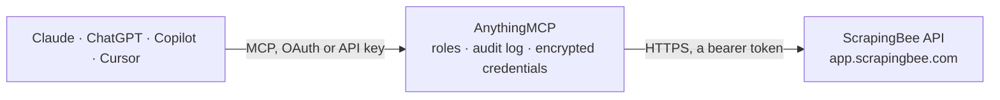

<!-- Generated by scripts/export-github-catalog.mjs in the anythingmcp-website repository. Do not edit by hand. -->

# ScrapingBee MCP connector

Scrape any web page through ScrapingBee from your AI: rendered HTML, markdown or text, structured data with CSS or AI extraction rules, screenshots, Google and Amazon results, and the credits left on the plan. The AnythingMCP connector gives Claude, ChatGPT, Microsoft Copilot, Cursor and Gemini 8 MCP tools for ScrapingBee, all read-only.

**Category:** [Public Data](../data.md) · **Tools:** 8 · **Setup guide:** [anythingmcp.com](https://anythingmcp.com/guides/scrapingbee-to-mcp) · [Deutsch](https://anythingmcp.com/de/guides/scrapingbee-to-mcp) · [Italiano](https://anythingmcp.com/it/guides/scrapingbee-to-mcp) · [Español](https://anythingmcp.com/es/guides/scrapingbee-to-mcp) · [日本語](https://anythingmcp.com/ja/guides/scrapingbee-to-mcp) · [Русский](https://anythingmcp.com/ru/guides/scrapingbee-to-mcp) · [中文](https://anythingmcp.com/zh/guides/scrapingbee-to-mcp)

## Start without code

No installation and no terminal: AnythingMCP Cloud runs the ScrapingBee connector for you, operated by helpcode.ai in Frankfurt, Germany.

1. **Click the button above** and create an account or sign in. The ScrapingBee connector opens, ready to install.
2. **Paste the API key or token from your ScrapingBee account.** Every click is in the [step-by-step guide](https://anythingmcp.com/guides/scrapingbee-to-mcp).
3. **Click Install.** AnythingMCP shows the address of your MCP server.
4. **Add that address to your assistant:** [Claude](https://anythingmcp.com/guides/connect-scrapingbee-to-claude) · [ChatGPT](https://anythingmcp.com/guides/connect-scrapingbee-to-chatgpt) · [Microsoft Copilot](https://anythingmcp.com/guides/connect-scrapingbee-to-copilot) · [Cursor](https://anythingmcp.com/guides/connect-scrapingbee-to-cursor) · [Gemini CLI](https://anythingmcp.com/guides/connect-scrapingbee-to-gemini) · [Meta Muse](https://anythingmcp.com/guides/connect-scrapingbee-to-muse).
5. **Ask your first question**, for example: *Show the Amazon product details for ASIN B09V3K7L2M — price, seller, rating, reviews, delivery estimate.*

Prefer help with the setup? [Talk to us](https://anythingmcp.com/contact).

## How it works

- **The AI client** speaks MCP (Streamable HTTP) to AnythingMCP and only sees tool names, descriptions and results. It never gets the ScrapingBee credentials.
- **AnythingMCP** checks the client's role, builds the call from the tool definition, adds the credentials (a bearer token), calls ScrapingBee, logs the call and returns the result.
- **ScrapingBee** sees an ordinary API client with the rights of the account the credentials belong to.

## Tools

| Tool | What it does | Access |
|---|---|---|
| [`scrapingbee_get_usage`](#scrapingbee_get_usage) | Read the ScrapingBee plan usage: credits used and included this period, current and maximum concurrency, and the renewal date. | read |
| [`scrapingbee_scrape_page`](#scrapingbee_scrape_page) | PAID: fetch one web page through ScrapingBee and return its HTML, markdown (return_page_markdown) or text (return_page_text). | read |
| [`scrapingbee_extract_data`](#scrapingbee_extract_data) | PAID: extract structured JSON from one web page instead of returning the page. | read |
| [`scrapingbee_take_screenshot`](#scrapingbee_take_screenshot) | PAID: take a PNG screenshot of a web page: the viewport (default), the full page or one element. | read |
| [`scrapingbee_google_search`](#scrapingbee_google_search) | PAID: run a Google search and get the parsed result page: organic results, ads, knowledge graph, local and map results, top stories, related questions and… | read |
| [`scrapingbee_fast_search`](#scrapingbee_fast_search) | PAID: quick Google search returning a light list of organic results (rank, title, link, description) and top stories, usually in under a second. | read |
| [`scrapingbee_amazon_search`](#scrapingbee_amazon_search) | PAID: search Amazon and get structured products (ASIN, title, price, currency, rating, sponsored flag, position) for a query on a chosen marketplace. | read |
| [`scrapingbee_amazon_product`](#scrapingbee_amazon_product) | PAID: read one Amazon product by ASIN: title, price, buy box, rating and reviews count, brand, bullet points, images, variations, product details, delivery,… | read |

## Tool reference

Every parameter as the AI client sees it in `tools/list`. Source: [`packages/backend/src/adapters/intl/scrapingbee.json`](../../../packages/backend/src/adapters/intl/scrapingbee.json).

### `scrapingbee_get_usage`

Read the ScrapingBee plan usage: credits used and included this period, current and maximum concurrency, and the renewal date. Free, limited to 6 calls a minute.

**Access:** read · **Call:** `GET /usage`

No parameters.

### `scrapingbee_scrape_page`

PAID: fetch one web page through ScrapingBee and return its HTML, markdown (return_page_markdown) or text (return_page_text). JavaScript rendering is on by default (5 credits; render_js false costs 1); premium_proxy costs 10 or 25, stealth_proxy 75. mode auto picks the cheapest configuration that works. Ask the user before many pages. Capped at about 100 KB.

**Access:** read · **Call:** `GET /`

| Parameter | Type | Required | Description |
|---|---|---|---|
| `url` | string | yes | Full page URL with http or https, e.g. 'https://example.com/pricing'. |
| `return_page_markdown` | boolean | no | Return the main content as markdown (best for reading). |
| `return_page_text` | boolean | no | Return the main content as plain text. |
| `render_js` | boolean | no | Render JavaScript in a headless browser. Default true; false is cheaper for static pages and files. |
| `mode` | `auto` | no | auto escalates from the cheapest to the most expensive configuration and bills only the one that worked. Do not combine with render_js, premium_proxy or stealth_proxy. |
| `max_cost` | integer | no | With mode auto: the most credits one attempt may cost, e.g. 25 to never use the stealth proxy. |
| `premium_proxy` | boolean | no | Use residential proxies for hard-to-scrape sites (10 credits, 25 with JavaScript). |
| `stealth_proxy` | boolean | no | Use stealth proxies for the hardest sites (75 credits, needs JavaScript). |
| `country_code` | string | no | Proxy country, lower-case ISO 3166-1 code, e.g. 'de'. Best with premium_proxy. |
| `wait` | integer | no | Milliseconds to wait after loading before capturing (0 to 35000). |
| `wait_for` | string | no | CSS selector (or XPath starting with /) to wait for before capturing. |
| `wait_browser` | `domcontentloaded` \| `load` \| `networkidle0` \| `networkidle2` | no | Browser event to wait for. Default domcontentloaded. |
| `block_ads` | boolean | no | Block ads (JavaScript requests only). |
| `block_resources` | boolean | no | Block images and CSS. Default true; set false when they matter. |
| `js_scenario` | string | no | Browser actions as JSON text, run after the waits, e.g. '{"instructions": [{"click": "#accept"}, {"wait": 1000}, {"scroll_y": 1000}]}'. |
| `json_response` | boolean | no | Wrap the answer in JSON with body, headers, cookies, cost and resolved URL. |
| `device` | `desktop` \| `mobile` | no | Browser device type. Default desktop. |
| `session_id` | integer | no | Reuse the same IP for 5 minutes across calls with the same number (0 to 10000000). |
| `cookies` | string | no | Cookies to send, 'name=value' pairs separated by ';', e.g. 'lang=en;currency=EUR'. |
| `timeout` | integer | no | Overall timeout in milliseconds (1000 to 140000, default 140000). |
| `transparent_status_code` | boolean | no | Return the target's own status code and body, even for errors (every call is billed). |

### `scrapingbee_extract_data`

PAID: extract structured JSON from one web page instead of returning the page. Use extract_rules (CSS or XPath selectors as JSON text) when the structure is known, or ai_query / ai_extract_rules (plain-language description of the fields, +5 credits) when it is not. Costs like scrapingbee_scrape_page (5 credits with JavaScript). Ask the user before many pages.

**Access:** read · **Call:** `GET /`

| Parameter | Type | Required | Description |
|---|---|---|---|
| `url` | string | yes | Full page URL with http or https. |
| `extract_rules` | string | no | Selectors as JSON text, e.g. '{"title": "h1", "price": ".price", "links": {"selector": "a", "type": "list", "output": "@href"}}'. Outputs: text (default), html, @attribute, markdown_relevant, table_json, table_array. |
| `ai_query` | string | no | A question about the page in plain language, e.g. 'What is the price of the main product?'. +5 credits. |
| `ai_extract_rules` | string | no | Fields to extract described in plain language, as JSON text, e.g. '{"price": "product price with currency", "in_stock": "is it available"}'. +5 credits. |
| `ai_selector` | string | no | CSS selector that limits AI extraction to one part of the page, e.g. '#product'. |
| `render_js` | boolean | no | Render JavaScript. Default true; false costs 1 credit instead of 5. |
| `premium_proxy` | boolean | no | Use residential proxies (10 credits, 25 with JavaScript). |
| `stealth_proxy` | boolean | no | Use stealth proxies (75 credits). |
| `country_code` | string | no | Proxy country, lower-case ISO 3166-1 code. |
| `wait` | integer | no | Milliseconds to wait after loading (0 to 35000). |
| `wait_for` | string | no | CSS selector to wait for before extracting. |
| `js_scenario` | string | no | Browser actions as JSON text, run before extracting, e.g. '{"instructions": [{"click": "#load-more"}, {"wait": 1000}]}'. |

### `scrapingbee_take_screenshot`

PAID: take a PNG screenshot of a web page: the viewport (default), the full page or one element. Needs JavaScript rendering, so it costs 5 credits (more with premium or stealth proxies). Ask the user before many screenshots.

**Access:** read · **Call:** `GET /`

| Parameter | Type | Required | Description |
|---|---|---|---|
| `url` | string | yes | Full page URL with http or https. |
| `screenshot_full_page` | boolean | no | Capture the whole scrollable page instead of the viewport. |
| `screenshot_selector` | string | no | CSS selector of the one element to capture, e.g. '#chart'. |
| `window_width` | integer | no | Viewport width in pixels. Default 1920. |
| `window_height` | integer | no | Viewport height in pixels. Default 1080. |
| `wait` | integer | no | Milliseconds to wait before the screenshot (0 to 35000). |
| `wait_for` | string | no | CSS selector to wait for before the screenshot. |
| `block_ads` | boolean | no | Block ads before capturing. |
| `device` | `desktop` \| `mobile` | no | Browser device type. Default desktop. |
| `premium_proxy` | boolean | no | Use residential proxies (25 credits). |
| `stealth_proxy` | boolean | no | Use stealth proxies (75 credits). |
| `country_code` | string | no | Proxy country, lower-case ISO 3166-1 code. |

### `scrapingbee_google_search`

PAID: run a Google search and get the parsed result page: organic results, ads, knowledge graph, local and map results, top stories, related questions and searches, AI overviews (with light_request false). search_type selects news, maps, images, shopping, lens or ai_mode. 10 credits, 15 with light_request false. Capped at about 100 KB.

**Access:** read · **Call:** `GET /google`

| Parameter | Type | Required | Description |
|---|---|---|---|
| `search` | string | yes | The query; Google operators such as site: and intitle: work. For search_type lens, an image URL. |
| `search_type` | `classic` \| `news` \| `maps` \| `lens` \| `shopping` \| `images` \| `ai_mode` \| `ads` | no | Kind of results. Default classic. |
| `country_code` | string | no | Country of the search, ISO code, e.g. 'de'. Default us. |
| `language` | string | no | Interface and results language, e.g. 'de'. Default en. |
| `device` | `desktop` \| `mobile` | no | Default desktop (news is desktop only). |
| `page` | integer | no | Result page to start from. Default 1. |
| `pages` | integer | no | How many result pages to combine, starting at page (1 to 10, 3 or fewer recommended). |
| `light_request` | boolean | no | Default true (fast, 10 credits). false uses a browser (15 credits) and is needed for AI overviews. |
| `nfpr` | boolean | no | true turns off Google's spelling auto-correction. |
| `date_range` | `past_hour` \| `past_day` \| `past_week` \| `past_month` \| `past_year` | no | Only results from this period (classic, news and images). |
| `sort_by` | `relevance` \| `reviews` \| `price_asc` \| `price_desc` | no | Shopping only: result order. |
| `min_price` | number | no | Shopping only: lowest price, in the currency of country_code. |
| `max_price` | number | no | Shopping only: highest price, in the currency of country_code. |
| `extra_params` | string | no | Extra Google URL parameters, URL-encoded, e.g. 'tbs%3Dqdr%3Aw'. |

### `scrapingbee_fast_search`

PAID: quick Google search returning a light list of organic results (rank, title, link, description) and top stories, usually in under a second. 10 credits. Use scrapingbee_google_search for ads, knowledge graph, news or shopping.

**Access:** read · **Call:** `GET /fast_search`

| Parameter | Type | Required | Description |
|---|---|---|---|
| `search` | string | yes | The query, e.g. 'best espresso machine 2026'. |
| `page` | integer | no | Result page. Default 1. |
| `country_code` | string | no | Country of the search, ISO 3166-1 alpha-2, e.g. 'gb'. Default us. |
| `language` | string | no | Results language, e.g. 'fr'. Default en. |

### `scrapingbee_amazon_search`

PAID: search Amazon and get structured products (ASIN, title, price, currency, rating, sponsored flag, position) for a query on a chosen marketplace. 5 credits per light page, 15 per rendered page; pages multiplies the cost. Capped at about 100 KB.

**Access:** read · **Call:** `GET /amazon/search`

| Parameter | Type | Required | Description |
|---|---|---|---|
| `query` | string | yes | Product search text, e.g. 'usb c charger 65w'. |
| `domain` | string | no | Amazon marketplace: com (default), de, co.uk, fr, it, es, nl, ca, com.au, co.jp, in, com.mx, com.br, se, pl, com.be, com.tr, ae, sa, sg, eg or cn. |
| `start_page` | integer | no | First result page. Default 1. |
| `pages` | integer | no | How many consecutive pages to fetch (each is billed). Default 1. |
| `sort_by` | `most_recent` \| `price_low_to_high` \| `price_high_to_low` \| `average_review` \| `bestsellers` \| `featured` | no | Result order (availability depends on the category). |
| `category_id` | string | no | Restrict to this Amazon category id. |
| `merchant_id` | string | no | Restrict to this seller id. |
| `country` | string | no | Delivery country, ISO code. Do not send the marketplace's own country; use zip_code then. |
| `zip_code` | string | no | Delivery postal code, for local prices and availability. |
| `language` | string | no | Page language, e.g. 'en'. |
| `currency` | string | no | Display currency, ISO 4217, e.g. 'EUR'. |
| `device` | `desktop` \| `mobile` \| `tablet` | no | Default desktop. |
| `light_request` | boolean | no | Default true (5 credits). false renders the page (15 credits) and can return more data. |

### `scrapingbee_amazon_product`

PAID: read one Amazon product by ASIN: title, price, buy box, rating and reviews count, brand, bullet points, images, variations, product details, delivery, stock and sales rank. 5 credits for a light request, 15 rendered.

**Access:** read · **Call:** `GET /amazon/product`

| Parameter | Type | Required | Description |
|---|---|---|---|
| `query` | string | yes | The 10-character ASIN, as in an Amazon /dp/ASIN URL, e.g. 'B08N5WRWNW'. |
| `domain` | string | no | Amazon marketplace, e.g. com (default), de, co.uk, fr, it, es. |
| `country` | string | no | Delivery country, ISO code. Do not send the marketplace's own country; use zip_code then. |
| `zip_code` | string | no | Delivery postal code, for local price and delivery. |
| `language` | string | no | Page language, e.g. 'de'. |
| `currency` | string | no | Display currency, ISO 4217. |
| `device` | `desktop` \| `mobile` \| `tablet` | no | Default desktop. |
| `light_request` | boolean | no | Default true (5 credits). false renders the page (15 credits), e.g. for reviews. |

## Run it yourself

AnythingMCP is open source (AGPL-3.0). [Run it with Docker](../../../README.md#run-it-yourself), open **Connectors → Store**, pick **ScrapingBee** and enter `SCRAPINGBEE_API_KEY`, then add your MCP server URL to the AI client.

[← Public Data connectors](../data.md) · [All categories](../README.md)
