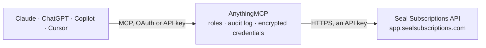

<!-- Generated by scripts/export-github-catalog.mjs in the anythingmcp-website repository. Do not edit by hand. -->

# Seal Subscriptions MCP connector

Run Shopify subscriptions in Seal Subscriptions from your AI: find subscribers, read upcoming and failed charges, skip or reschedule a delivery, pause or resume, change items, address and discounts, … The AnythingMCP connector gives Claude, ChatGPT, Microsoft Copilot, Cursor and Gemini 26 MCP tools for Seal Subscriptions: 8 read and 18 can change data.

**Category:** [E-commerce](../e-commerce.md) · **Tools:** 26 · **Setup guide:** [anythingmcp.com](https://anythingmcp.com/guides/seal-subscriptions-to-mcp) · [Deutsch](https://anythingmcp.com/de/guides/seal-subscriptions-to-mcp) · [Italiano](https://anythingmcp.com/it/guides/seal-subscriptions-to-mcp) · [Español](https://anythingmcp.com/es/guides/seal-subscriptions-to-mcp) · [日本語](https://anythingmcp.com/ja/guides/seal-subscriptions-to-mcp) · [Русский](https://anythingmcp.com/ru/guides/seal-subscriptions-to-mcp) · [中文](https://anythingmcp.com/zh/guides/seal-subscriptions-to-mcp)

## Start without code

No installation and no terminal: AnythingMCP Cloud runs the Seal Subscriptions connector for you, operated by helpcode.ai in Frankfurt, Germany.

1. **Click the button above** and create an account or sign in. The Seal Subscriptions connector opens, ready to install.
2. **Paste the API key or token from your Seal Subscriptions account.** Every click is in the [step-by-step guide](https://anythingmcp.com/guides/seal-subscriptions-to-mcp).
3. **Click Install.** AnythingMCP shows the address of your MCP server.
4. **Add that address to your assistant:** [Claude](https://anythingmcp.com/guides/connect-seal-subscriptions-to-claude) · [ChatGPT](https://anythingmcp.com/guides/connect-seal-subscriptions-to-chatgpt) · [Microsoft Copilot](https://anythingmcp.com/guides/connect-seal-subscriptions-to-copilot) · [Cursor](https://anythingmcp.com/guides/connect-seal-subscriptions-to-cursor) · [Gemini CLI](https://anythingmcp.com/guides/connect-seal-subscriptions-to-gemini) · [Meta Muse](https://anythingmcp.com/guides/connect-seal-subscriptions-to-muse).
5. **Ask your first question**, for example: *Show me Lina Krämer's subscription by e-mail lina.kraemer@roastery-gmbh.de, I need next billing date and items.*

Prefer help with the setup? [Talk to us](https://anythingmcp.com/contact).

## How it works

- **The AI client** speaks MCP (Streamable HTTP) to AnythingMCP and only sees tool names, descriptions and results. It never gets the Seal Subscriptions credentials.
- **AnythingMCP** checks the client's role, builds the call from the tool definition, adds the credentials (an API key), calls Seal Subscriptions, logs the call and returns the result.
- **Seal Subscriptions** sees an ordinary API client with the rights of the account the credentials belong to.

## Tools

| Tool | What it does | Access |
|---|---|---|
| [`seal_subscriptions_list_subscriptions`](#seal_subscriptions_list_subscriptions) | List the shop's Seal subscriptions, 50 per page, newest first. | read |
| [`seal_subscriptions_list_by_billing_date`](#seal_subscriptions_list_by_billing_date) | List subscriptions that have at least one charge scheduled between two UTC date-times, e.g. everything renewing next week. | read |
| [`seal_subscriptions_get_subscription`](#seal_subscriptions_get_subscription) | Get one subscription with everything Seal knows about it: status (ACTIVE, PAUSED, CANCELLED, EXPIRED), customer and shipping address, delivery and billing… | read |
| [`seal_subscriptions_pause_subscription`](#seal_subscriptions_pause_subscription) | Pause an active subscription: no charges or deliveries until it is resumed. | write |
| [`seal_subscriptions_resume_subscription`](#seal_subscriptions_resume_subscription) | Resume a paused subscription or reactivate a cancelled one, so charges and deliveries start again. | write |
| [`seal_subscriptions_cancel_subscription`](#seal_subscriptions_cancel_subscription) | Cancel a subscription at once: no further charges or deliveries. | write |
| [`seal_subscriptions_schedule_cancellation`](#seal_subscriptions_schedule_cancellation) | Schedule a subscription to be cancelled at a future date and time; it keeps renewing until then. | write |
| [`seal_subscriptions_update_subscription`](#seal_subscriptions_update_subscription) | Change a subscription's schedule, delivery method or shipping address: delivery and billing interval (a billing interval longer than the delivery interval… | write |
| [`seal_subscriptions_add_items`](#seal_subscriptions_add_items) | Add one or more products to a subscription, as recurring items or as one-off add-ons for the next renewal only (one_time 1). | write |
| [`seal_subscriptions_edit_items`](#seal_subscriptions_edit_items) | Change items already on a subscription: swap the variant, change quantity or price, or turn an item into a one-off. | write |
| [`seal_subscriptions_remove_items`](#seal_subscriptions_remove_items) | Remove items from a subscription by their item ids. | write |
| [`seal_subscriptions_skip_billing_attempt`](#seal_subscriptions_skip_billing_attempt) | Skip one upcoming charge (and its delivery) of a subscription, e.g. when the customer is away. | write |
| [`seal_subscriptions_unskip_billing_attempt`](#seal_subscriptions_unskip_billing_attempt) | Undo a skip, so a previously skipped upcoming charge is made again on its date. | write |
| [`seal_subscriptions_reschedule_billing_attempt`](#seal_subscriptions_reschedule_billing_attempt) | Move one upcoming charge of a subscription to another date and time. | write |
| [`seal_subscriptions_charge_now`](#seal_subscriptions_charge_now) | Charge the subscription immediately instead of waiting for the next scheduled date; the customer's saved payment method is billed and an order is created. | write |
| [`seal_subscriptions_process_billing_attempt`](#seal_subscriptions_process_billing_attempt) | Process one specific billing attempt now, for example to retry a failed charge after the customer updated the card. | write |
| [`seal_subscriptions_apply_discount_code`](#seal_subscriptions_apply_discount_code) | Apply a Shopify discount code to an auto-charging subscription; it counts from the next charge. | write |
| [`seal_subscriptions_remove_discount_code`](#seal_subscriptions_remove_discount_code) | Remove a discount code from a subscription. | write |
| [`seal_subscriptions_get_payment_update_url`](#seal_subscriptions_get_payment_update_url) | Get a secure Shopify link where the customer can replace the payment method of a subscription (Shop Pay subscriptions only). | read |
| [`seal_subscriptions_send_payment_update_email`](#seal_subscriptions_send_payment_update_email) | E-mail the customer Seal's message with a link to update the payment method of a subscription, e.g. after a failed charge or an expiring card. | write |
| [`seal_subscriptions_get_customer_magic_link`](#seal_subscriptions_get_customer_magic_link) | Get the magic link that signs a customer into Seal's portal, where they can see and change all their subscriptions. | read |
| [`seal_subscriptions_list_rules`](#seal_subscriptions_list_rules) | List the shop's subscription rules (the selling plans offered on product pages): name, plan selector label, payment type, intervals, discounts and the… | read |
| [`seal_subscriptions_get_rule`](#seal_subscriptions_get_rule) | Get one subscription rule with its selling plans (intervals, pricing policy, minimum and maximum cycles, selling plan ids) and the products and variants it… | read |
| [`seal_subscriptions_list_webhooks`](#seal_subscriptions_list_webhooks) | List the webhooks registered on the Seal account, with id, topic and target address. | read |
| [`seal_subscriptions_create_webhook`](#seal_subscriptions_create_webhook) | Register a webhook so Seal sends a signed POST (header X-Seal-Hmac-Sha256) to an https address whenever a subscription, rule or billing attempt event happens. | write |
| [`seal_subscriptions_delete_webhook`](#seal_subscriptions_delete_webhook) | Delete a webhook by id. | write |

## Tool reference

Every parameter as the AI client sees it in `tools/list`. Source: [`packages/backend/src/adapters/intl/seal-subscriptions.json`](../../../packages/backend/src/adapters/intl/seal-subscriptions.json).

### `seal_subscriptions_list_subscriptions`

List the shop's Seal subscriptions, 50 per page, newest first. Search by the customer's e-mail, first or last name with `query`; filter to active, paused or cancelled ones. Set with_billing_attempts to see each subscription's scheduled and past charges (their ids are needed to skip or reschedule one). Read-only.

**Access:** read · **Call:** `GET /subscriptions`

| Parameter | Type | Required | Description |
|---|---|---|---|
| `query` | string | no | Text matched against the customer's e-mail, first name or last name. |
| `page` | integer | no | Page number, starting at 1. Each page holds 50 subscriptions. |
| `active_only` | boolean | no | Only active subscriptions. |
| `paused_only` | boolean | no | Only paused subscriptions. |
| `cancelled_only` | boolean | no | Only cancelled subscriptions. |
| `with_items` | boolean | no | Include the products on each subscription. |
| `with_billing_attempts` | boolean | no | Include each subscription's billing attempts (scheduled and past charges with their ids and status). |

### `seal_subscriptions_list_by_billing_date`

List subscriptions that have at least one charge scheduled between two UTC date-times, e.g. everything renewing next week. Each subscription carries a `cursor`; pass the cursor of the last one to get the next page, until a page comes back empty. Read-only.

**Access:** read · **Call:** `GET /subscriptions-by-billing-date`

| Parameter | Type | Required | Description |
|---|---|---|---|
| `from_datetime` | string | yes | Start of the window in UTC, written YYYY-MM-DDTHH:MM:SS without a zone suffix, e.g. 2026-10-19T00:00:00. |
| `to_datetime` | string | yes | End of the window in UTC, same format, e.g. 2026-10-25T23:59:59. |
| `cursor` | string | no | The `cursor` of the last subscription on the previous page. Leave out for the first page. |

### `seal_subscriptions_get_subscription`

Get one subscription with everything Seal knows about it: status (ACTIVE, PAUSED, CANCELLED, EXPIRED), customer and shipping address, delivery and billing interval, items with prices and discounts, billing attempts (scheduled, completed, failed with error message), fulfillment orders, card brand and expiry, and the activity log. Read-only.

**Access:** read · **Call:** `GET /subscription`

| Parameter | Type | Required | Description |
|---|---|---|---|
| `id` | integer | yes | The subscription's id from the list or get tools (the `id` field, not `internal_id`). |

### `seal_subscriptions_pause_subscription`

Pause an active subscription: no charges or deliveries until it is resumed. Changes the live subscription in Seal: describe the change and get the user's confirmation before calling.

**Access:** write · **Call:** `PUT /subscription`

| Parameter | Type | Required | Description |
|---|---|---|---|
| `id` | integer | yes | The subscription's id from the list or get tools (the `id` field, not `internal_id`). |

### `seal_subscriptions_resume_subscription`

Resume a paused subscription or reactivate a cancelled one, so charges and deliveries start again. Seal treats both actions the same; use resume for paused and reactivate for cancelled subscriptions. Changes the live subscription in Seal: describe the change and get the user's confirmation before calling.

**Access:** write · **Call:** `PUT /subscription`

| Parameter | Type | Required | Description |
|---|---|---|---|
| `id` | integer | yes | The subscription's id from the list or get tools (the `id` field, not `internal_id`). |
| `action` | `resume` \| `reactivate` | no | resume for a paused subscription, reactivate for a cancelled one. |

### `seal_subscriptions_cancel_subscription`

Cancel a subscription at once: no further charges or deliveries. It can be reactivated later with seal_subscriptions_resume_subscription. Installed switched off; turn it on deliberately. Changes the live subscription in Seal: describe the change and get the user's confirmation before calling.

**Access:** write · **Call:** `PUT /subscription`

| Parameter | Type | Required | Description |
|---|---|---|---|
| `id` | integer | yes | The subscription's id from the list or get tools (the `id` field, not `internal_id`). |

### `seal_subscriptions_schedule_cancellation`

Schedule a subscription to be cancelled at a future date and time; it keeps renewing until then. Installed switched off; turn it on deliberately. Changes the live subscription in Seal: describe the change and get the user's confirmation before calling.

**Access:** write · **Call:** `PUT /subscription-schedule-cancellation`

| Parameter | Type | Required | Description |
|---|---|---|---|
| `id` | integer | yes | The subscription's id from the list or get tools (the `id` field, not `internal_id`). |
| `date` | string | yes | Cancellation date, YYYY-MM-DD. |
| `time` | string | no | Cancellation time, HH:MM (24 hours). |
| `timezone` | string | no | UTC offset the date and time are written in, e.g. +00:00 or +02:00. |

### `seal_subscriptions_update_subscription`

Change a subscription's schedule, delivery method or shipping address: delivery and billing interval (a billing interval longer than the delivery interval makes it prepaid), minimum and maximum number of charges, anchor day, order note attributes, delivery method and price, and the shipping address fields. Only the fields given are sent. Items are changed with the item tools. Changes the live subscription in Seal: describe the change and get the user's confirmation before calling.

**Access:** write · **Call:** `PUT /subscription`

| Parameter | Type | Required | Description |
|---|---|---|---|
| `id` | integer | yes | The subscription's id from the list or get tools (the `id` field, not `internal_id`). |
| `delivery_interval` | string | no | Delivery interval as number and unit, e.g. 2 week, 1 month. |
| `billing_interval` | string | no | Billing interval, same format. Different from delivery_interval turns the subscription into a prepaid one. |
| `automatically_update_product_prices` | `true` \| `false` | no | "true" to let Seal adjust item prices when the subscription switches between prepaid and pay-per-delivery. |
| `billing_min_cycles` | integer | no | Minimum number of charges before the customer may cancel. |
| `billing_max_cycles` | integer | no | Maximum number of charges, after which the subscription expires. |
| `anchor_day` | integer | no | Day the charges are anchored to: for weekly subscriptions 1 = Monday to 7 = Sunday, for monthly ones the day of the month. |
| `note_attributes` | object[] | no | Order note attributes; replaces the existing list, an empty list removes them. |
| `delivery_method_title` | string | no | Internal title of the delivery method. |
| `delivery_method_presentment_title` | string | no | Delivery method title shown to the customer. |
| `delivery_method_code` | string | no | Delivery method code. |
| `delivery_price` | number | no | Delivery price per shipment, in the subscription's currency. |
| `s_first_name` | string | no | Shipping address: first name. |
| `s_last_name` | string | no | Shipping address: last name. |
| `s_company` | string | no | Shipping address: company. |
| `s_address1` | string | no | Shipping address: street and number. |
| `s_address2` | string | no | Shipping address: second address line. |
| `s_zip` | string | no | Shipping address: postal code. |
| `s_city` | string | no | Shipping address: city. |
| `s_province` | string | no | Shipping address: province or state. |
| `s_province_code` | string | no | Shipping address: province or state code, e.g. NY. |
| `s_country` | string | no | Shipping address: country name. |
| `s_country_code` | string | no | Shipping address: two-letter country code, e.g. DE. |
| `s_phone` | string | no | Shipping address: phone number. |

### `seal_subscriptions_add_items`

Add one or more products to a subscription, as recurring items or as one-off add-ons for the next renewal only (one_time 1). Changes the live subscription in Seal: describe the change and get the user's confirmation before calling.

**Access:** write · **Call:** `PUT /subscription`

| Parameter | Type | Required | Description |
|---|---|---|---|
| `id` | integer | yes | The subscription's id from the list or get tools (the `id` field, not `internal_id`). |
| `items` | object[] | yes | The items to add. |

### `seal_subscriptions_edit_items`

Change items already on a subscription: swap the variant, change quantity or price, or turn an item into a one-off. Item ids come from seal_subscriptions_get_subscription. Changes the live subscription in Seal: describe the change and get the user's confirmation before calling.

**Access:** write · **Call:** `PUT /subscription`

| Parameter | Type | Required | Description |
|---|---|---|---|
| `id` | integer | yes | The subscription's id from the list or get tools (the `id` field, not `internal_id`). |
| `items` | object[] | yes | The items to change; each needs its item id. |

### `seal_subscriptions_remove_items`

Remove items from a subscription by their item ids. Installed switched off; turn it on deliberately. Changes the live subscription in Seal: describe the change and get the user's confirmation before calling.

**Access:** write · **Call:** `PUT /subscription`

| Parameter | Type | Required | Description |
|---|---|---|---|
| `id` | integer | yes | The subscription's id from the list or get tools (the `id` field, not `internal_id`). |
| `item_ids` | integer[] | yes | Item ids to remove (items[].id from seal_subscriptions_get_subscription). |

### `seal_subscriptions_skip_billing_attempt`

Skip one upcoming charge (and its delivery) of a subscription, e.g. when the customer is away. The billing attempt id comes from billing_attempts of seal_subscriptions_get_subscription; only attempts not yet processed can be skipped. Changes the live subscription in Seal: describe the change and get the user's confirmation before calling.

**Access:** write · **Call:** `PUT /subscription-billing-attempt`

| Parameter | Type | Required | Description |
|---|---|---|---|
| `id` | integer | yes | The billing attempt id. |
| `subscription_id` | integer | yes | The subscription's id from the list or get tools (the `id` field, not `internal_id`). |

### `seal_subscriptions_unskip_billing_attempt`

Undo a skip, so a previously skipped upcoming charge is made again on its date. Changes the live subscription in Seal: describe the change and get the user's confirmation before calling.

**Access:** write · **Call:** `PUT /subscription-billing-attempt`

| Parameter | Type | Required | Description |
|---|---|---|---|
| `id` | integer | yes | The billing attempt id. |
| `subscription_id` | integer | yes | The subscription's id from the list or get tools (the `id` field, not `internal_id`). |

### `seal_subscriptions_reschedule_billing_attempt`

Move one upcoming charge of a subscription to another date and time. With reset_schedule "true" the charges after it are rescheduled from the new date. Only attempts not yet processed can be moved. Changes the live subscription in Seal: describe the change and get the user's confirmation before calling.

**Access:** write · **Call:** `PUT /subscription-billing-attempt`

| Parameter | Type | Required | Description |
|---|---|---|---|
| `id` | integer | yes | The billing attempt id. |
| `subscription_id` | integer | yes | The subscription's id from the list or get tools (the `id` field, not `internal_id`). |
| `date` | string | yes | New date, YYYY-MM-DD. |
| `time` | string | no | New time, HH:MM (24 hours). |
| `timezone` | string | no | UTC offset of date and time, e.g. +00:00 or -04:00. |
| `reset_schedule` | `true` \| `false` | no | "true" to rebuild the rest of the schedule from this charge. |

### `seal_subscriptions_charge_now`

Charge the subscription immediately instead of waiting for the next scheduled date; the customer's saved payment method is billed and an order is created. With reset_schedule "true" the following charges are rescheduled from now. Installed switched off because it takes money; turn it on deliberately. Changes the live subscription in Seal: describe the change and get the user's confirmation before calling.

**Access:** write · **Call:** `PUT /subscription-create-charge-now`

| Parameter | Type | Required | Description |
|---|---|---|---|
| `id` | integer | yes | The subscription's id from the list or get tools (the `id` field, not `internal_id`). |
| `reset_schedule` | `true` \| `false` | no | "true" to rebuild the schedule from this charge. |

### `seal_subscriptions_process_billing_attempt`

Process one specific billing attempt now, for example to retry a failed charge after the customer updated the card. The customer's payment method is billed. Installed switched off because it takes money; turn it on deliberately. Changes the live subscription in Seal: describe the change and get the user's confirmation before calling.

**Access:** write · **Call:** `PUT /subscription-process-charge`

| Parameter | Type | Required | Description |
|---|---|---|---|
| `subscription_id` | integer | yes | The subscription's id from the list or get tools (the `id` field, not `internal_id`). |
| `billing_attempt_id` | integer | yes | The billing attempt id to process. |

### `seal_subscriptions_apply_discount_code`

Apply a Shopify discount code to an auto-charging subscription; it counts from the next charge. Not available for recurring-invoice subscriptions. Changes the live subscription in Seal: describe the change and get the user's confirmation before calling.

**Access:** write · **Call:** `PUT /subscription-discount-code`

| Parameter | Type | Required | Description |
|---|---|---|---|
| `subscription_id` | integer | yes | The subscription's id from the list or get tools (the `id` field, not `internal_id`). |
| `discount_code` | string | yes | The discount code as created in Shopify, e.g. LOYAL10. |

### `seal_subscriptions_remove_discount_code`

Remove a discount code from a subscription. The discount code id is in items[].discount_codes[].id of seal_subscriptions_get_subscription. Installed switched off; turn it on deliberately. Changes the live subscription in Seal: describe the change and get the user's confirmation before calling.

**Access:** write · **Call:** `DELETE /subscription-discount-code`

| Parameter | Type | Required | Description |
|---|---|---|---|
| `subscription_id` | integer | yes | The subscription's id from the list or get tools (the `id` field, not `internal_id`). |
| `discount_code_id` | string | yes | Id of the applied discount (a UUID), not the code text. |

### `seal_subscriptions_get_payment_update_url`

Get a secure Shopify link where the customer can replace the payment method of a subscription (Shop Pay subscriptions only). The link is personal to the customer: give it only to them. Read-only.

**Access:** read · **Call:** `GET /subscription-payment-method-update-url`

| Parameter | Type | Required | Description |
|---|---|---|---|
| `id` | integer | yes | The subscription's id from the list or get tools (the `id` field, not `internal_id`). |

### `seal_subscriptions_send_payment_update_email`

E-mail the customer Seal's message with a link to update the payment method of a subscription, e.g. after a failed charge or an expiring card. Sends an e-mail to the customer: confirm with the user before calling.

**Access:** write · **Call:** `PUT /subscription`

| Parameter | Type | Required | Description |
|---|---|---|---|
| `id` | integer | yes | The subscription's id from the list or get tools (the `id` field, not `internal_id`). |

### `seal_subscriptions_get_customer_magic_link`

Get the magic link that signs a customer into Seal's portal, where they can see and change all their subscriptions. Works only for customers with at least one subscription. Anyone holding the link can change the customer's subscriptions, so it is installed switched off: turn it on deliberately and give the link only to that customer.

**Access:** read · **Call:** `GET /customer-magic-link`

| Parameter | Type | Required | Description |
|---|---|---|---|
| `email` | string | yes | The customer's e-mail address. |

### `seal_subscriptions_list_rules`

List the shop's subscription rules (the selling plans offered on product pages): name, plan selector label, payment type, intervals, discounts and the products and variants each rule covers. Read-only.

**Access:** read · **Call:** `GET /subscription-rules`

| Parameter | Type | Required | Description |
|---|---|---|---|
| `page` | integer | no | Page number, starting at 1. |

### `seal_subscriptions_get_rule`

Get one subscription rule with its selling plans (intervals, pricing policy, minimum and maximum cycles, selling plan ids) and the products and variants it applies to. Read-only.

**Access:** read · **Call:** `GET /subscription-rule`

| Parameter | Type | Required | Description |
|---|---|---|---|
| `id` | integer | yes | The subscription rule id from seal_subscriptions_list_rules. |

### `seal_subscriptions_list_webhooks`

List the webhooks registered on the Seal account, with id, topic and target address. Read-only.

**Access:** read · **Call:** `GET /webhooks`

No parameters.

### `seal_subscriptions_create_webhook`

Register a webhook so Seal sends a signed POST (header X-Seal-Hmac-Sha256) to an https address whenever a subscription, rule or billing attempt event happens. Seal deletes a webhook that fails 20 deliveries in a row. Changes the Seal account: confirm with the user before calling.

**Access:** write · **Call:** `POST /webhooks`

| Parameter | Type | Required | Description |
|---|---|---|---|
| `topic` | `subscription/created` \| `subscription/updated` \| `subscription/paused` \| `subscription/resumed` \| `subscription/reactivated` \| `subscription/expired` \| `subscription/payment_method_updated` \| `subscription/shipping_address_updated` \| `subscription/cancelled` \| `subscription_rule/created` \| `subscription_rule/updated` \| `billing_attempt/succeeded` \| `billing_attempt/failed` \| `billing_attempt/upcoming_email_sent` | yes | The event. |
| `address` | string | yes | The https URL that receives the event. |

### `seal_subscriptions_delete_webhook`

Delete a webhook by id. Installed switched off; turn it on deliberately. Confirm with the user before calling.

**Access:** write · **Call:** `DELETE /webhooks`

| Parameter | Type | Required | Description |
|---|---|---|---|
| `id` | integer | yes | The webhook id from seal_subscriptions_list_webhooks. |

## Run it yourself

AnythingMCP is open source (AGPL-3.0). [Run it with Docker](../../../README.md#run-it-yourself), open **Connectors → Store**, pick **Seal Subscriptions** and enter `SEAL_SUBSCRIPTIONS_API_TOKEN`, then add your MCP server URL to the AI client.

[← E-commerce connectors](../e-commerce.md) · [All categories](../README.md)
