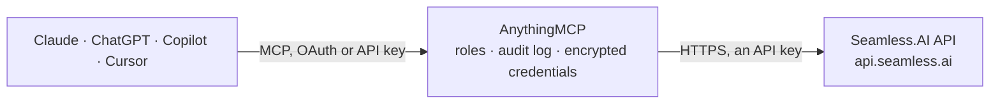

<!-- Generated by scripts/export-github-catalog.mjs in the anythingmcp-website repository. Do not edit by hand. -->

# Seamless.AI MCP connector

Find and enrich B2B contacts and companies with Seamless.AI: search people by title, seniority, company, industry and location, search companies, research records for verified emails and phone … The AnythingMCP connector gives Claude, ChatGPT, Microsoft Copilot, Cursor and Gemini 10 MCP tools for Seamless.AI: 8 read and 2 can change data.

**Category:** [Data Enrichment](../enrichment.md) · **Tools:** 10 · **Setup guide:** [anythingmcp.com](https://anythingmcp.com/guides/seamless-ai-to-mcp) · [Deutsch](https://anythingmcp.com/de/guides/seamless-ai-to-mcp) · [Italiano](https://anythingmcp.com/it/guides/seamless-ai-to-mcp) · [Español](https://anythingmcp.com/es/guides/seamless-ai-to-mcp) · [日本語](https://anythingmcp.com/ja/guides/seamless-ai-to-mcp) · [Русский](https://anythingmcp.com/ru/guides/seamless-ai-to-mcp) · [中文](https://anythingmcp.com/zh/guides/seamless-ai-to-mcp)

## Start without code

No installation and no terminal: AnythingMCP Cloud runs the Seamless.AI connector for you, operated by helpcode.ai in Frankfurt, Germany.

1. **Click the button above** and create an account or sign in. The Seamless.AI connector opens, ready to install.
2. **Paste the API key or token from your Seamless.AI account.** Every click is in the [step-by-step guide](https://anythingmcp.com/guides/seamless-ai-to-mcp).
3. **Click Install.** AnythingMCP shows the address of your MCP server.
4. **Add that address to your assistant:** [Claude](https://anythingmcp.com/guides/connect-seamless-ai-to-claude) · [ChatGPT](https://anythingmcp.com/guides/connect-seamless-ai-to-chatgpt) · [Microsoft Copilot](https://anythingmcp.com/guides/connect-seamless-ai-to-copilot) · [Cursor](https://anythingmcp.com/guides/connect-seamless-ai-to-cursor) · [Gemini CLI](https://anythingmcp.com/guides/connect-seamless-ai-to-gemini) · [Meta Muse](https://anythingmcp.com/guides/connect-seamless-ai-to-muse).
5. **Ask your first question**, for example: *Find the contact record for 'Eleni Markos' at 'BlueWave Energy Oy' in Espoo, Finland.*

Prefer help with the setup? [Talk to us](https://anythingmcp.com/contact).

## How it works

- **The AI client** speaks MCP (Streamable HTTP) to AnythingMCP and only sees tool names, descriptions and results. It never gets the Seamless.AI credentials.
- **AnythingMCP** checks the client's role, builds the call from the tool definition, adds the credentials (an API key), calls Seamless.AI, logs the call and returns the result.
- **Seamless.AI** sees an ordinary API client with the rights of the account the credentials belong to.

## Tools

| Tool | What it does | Access |
|---|---|---|
| [`seamless_ai_get_me`](#seamless_ai_get_me) | Return the Seamless.AI user the API key belongs to (email, first and last name). | read |
| [`seamless_ai_lookup_locations`](#seamless_ai_lookup_locations) | Look up the exact location spelling Seamless.AI matches for contact and company location filters (cities, states, countries, postcodes), ordered by contact… | read |
| [`seamless_ai_search_contacts`](#seamless_ai_search_contacts) | Search Seamless.AI's B2B database for people by job title, seniority, department, company, domain, industry, size, revenue, location, technologies or keywords. | read |
| [`seamless_ai_search_companies`](#seamless_ai_search_companies) | Search Seamless.AI's database for companies by name, domain, location, industry, keywords, size, revenue, technologies, founding date or funding. | read |
| [`seamless_ai_research_contacts`](#seamless_ai_research_contacts) | Start enrichment (research) of contacts to get verified emails, phone numbers and full profiles, either from searchResultIds of seamless_ai_search_contacts… | write |
| [`seamless_ai_research_companies`](#seamless_ai_research_companies) | Start enrichment (research) of companies to get their full profile, either from searchResultIds of seamless_ai_search_companies or directly by domain or… | write |
| [`seamless_ai_poll_contact_research`](#seamless_ai_poll_contact_research) | Get the status and results of contact research requests. | read |
| [`seamless_ai_poll_company_research`](#seamless_ai_poll_company_research) | Get the status and results of company research requests. | read |
| [`seamless_ai_list_org_contacts`](#seamless_ai_list_org_contacts) | List contacts already researched into your Seamless.AI org within a date range, with their enriched data. | read |
| [`seamless_ai_list_org_companies`](#seamless_ai_list_org_companies) | List companies already researched into your Seamless.AI org within a date range, with their enriched data. | read |

## Tool reference

Every parameter as the AI client sees it in `tools/list`. Source: [`packages/backend/src/adapters/intl/seamless-ai.json`](../../../packages/backend/src/adapters/intl/seamless-ai.json).

### `seamless_ai_get_me`

Return the Seamless.AI user the API key belongs to (email, first and last name). Use it to check that the connector works; it costs no credits.

**Access:** read · **Call:** `GET /oauth/me`

No parameters.

### `seamless_ai_lookup_locations`

Look up the exact location spelling Seamless.AI matches for contact and company location filters (cities, states, countries, postcodes), ordered by contact volume. Use it before filtering by location: a misspelt value silently returns nothing. Costs no credits.

**Access:** read · **Call:** `GET /search/locations`

| Parameter | Type | Required | Description |
|---|---|---|---|
| `q` | string | yes | Partial place name, matched at the start of any word, e.g. munich or bavaria. One place per call. |
| `limit` | integer | no | Results to return, 1 to 100 (default 10). |
| `types` | string | no | Optional comma-separated tiers: city-state-country, state-country, city-country, country, postcode. |

### `seamless_ai_search_contacts`

Search Seamless.AI's B2B database for people by job title, seniority, department, company, domain, industry, size, revenue, location, technologies or keywords. Returns name, title, company, location and a searchResultId per contact (no email or phone: research those). Costs 1 credit per 10 results returned.

**Access:** read · **Call:** `POST /search/contacts`

| Parameter | Type | Required | Description |
|---|---|---|---|
| `job_title` | string[] | no | Job titles, matched by relevance, up to 10, e.g. ["Head of Procurement"]. |
| `seniority` | `C-Level` \| `VP` \| `Director` \| `Manager` \| `Senior` \| `Entry Level` \| `Mid-Level` \| `Other`[] | no | Seniority levels, up to 5. |
| `department` | `Sales` \| `Marketing` \| `Engineering` \| `Human Resources` \| `Finance` \| `IT` \| `Operations` \| `Support` \| `Legal` \| `Project Management` \| `Other`[] | no | Departments, up to 5. |
| `company_name` | string[] | no | Company names, up to 100. |
| `company_name_search_type` | `default` \| `related` \| `exact` | no | How company_name matches: default relevance, related (also aliases and related names) or exact. |
| `company_domain` | string[] | no | Company website domains, up to 100, e.g. ["example.com"]. |
| `contact_country` | string[] | no | Countries, spelled as seamless_ai_lookup_locations returns them. |
| `contact_state` | string[] | no | States or regions, spelled as seamless_ai_lookup_locations returns them. |
| `contact_zip_code` | string[] | no | Postal codes. |
| `location_type` | `contact` \| `company` \| `bothOR` \| `bothAND` | no | Whether location filters apply to the contact's own location, the company's, either (bothOR) or both (bothAND). |
| `industry` | string[] | no | Industries, up to 5, from Seamless' fixed list, either a parent category (e.g. "Software & Information Technology") or a sub-industry (e.g. "Computer Software"). |
| `company_size` | `0 - 1 (Self-employed)` \| `2 - 10` \| `11 - 50` \| `51 - 200` \| `201 - 500` \| `501 - 1,000` \| `1,001 - 5,000` \| `5,001 - 10,000` \| `10,001+`[] | no | Employee count bands. |
| `company_revenue` | `$0 - $100K` \| `$100K - $1M` \| `$1M - $5M` \| `$5M - $20M` \| `$20M - $50M` \| `$50M - $100M` \| `$100M - $500M` \| `$500M - $1B` \| `$1B+`[] | no | Estimated annual revenue bands. |
| `contact_keyword` | string[] | no | Keywords matched against the contact profile (skills, bio, specialties), up to 10. |
| `full_name` | string[] | no | Full names of specific people, up to 10. |
| `technologies` | string[] | no | Technologies used by the company, e.g. ["Salesforce", "HubSpot"], up to 10. |
| `technologies_is_or` | boolean | no | true (default) matches companies using any of the technologies, false only those using all. |
| `company_type` | `Public` \| `Private` | no | Public (listed) or private companies. |
| `limit` | integer | no | Results per page (default 50, max 500). Each started block of 10 results costs 1 credit, so ask only for what you need. |
| `next_token` | string | no | supplementalData.nextToken from the previous answer, to read the next page. |
| `extra_filters` | object | no | Optional further filters passed as they are, using the API's own field names, e.g. {"newsTypes": ["Funding"], "newsTypeDates": ["90"]} or {"jobChanges": {"changeType": "New Hire"}}. |

### `seamless_ai_search_companies`

Search Seamless.AI's database for companies by name, domain, location, industry, keywords, size, revenue, technologies, founding date or funding. Returns company name, domain, industry, size, location and a searchResultId per company. Costs 1 credit per 10 results returned.

**Access:** read · **Call:** `POST /search/companies`

| Parameter | Type | Required | Description |
|---|---|---|---|
| `company_name` | string[] | no | Company names or name fragments. |
| `company_name_search_type` | `default` \| `related` \| `exact` | no | How company_name matches: default relevance, related (also aliases and related names) or exact. |
| `company_domain` | string[] | no | Website domains, e.g. ["example.com"]. |
| `company_country` | string[] | no | Countries, spelled as seamless_ai_lookup_locations returns them. |
| `company_state` | string[] | no | States or regions. |
| `company_zip_code` | string[] | no | Postal codes. |
| `industry` | string[] | no | Industries, up to 5, from Seamless' fixed list, either a parent category (e.g. "Software & Information Technology") or a sub-industry (e.g. "Computer Software"). |
| `company_keyword` | string[] | no | Free-text keywords matched against the company profile. |
| `company_size` | `0 - 1 (Self-employed)` \| `2 - 10` \| `11 - 50` \| `51 - 200` \| `201 - 500` \| `501 - 1,000` \| `1,001 - 5,000` \| `5,001 - 10,000` \| `10,001+`[] | no | Employee count bands. |
| `company_revenue` | `$0 - $100K` \| `$100K - $1M` \| `$1M - $5M` \| `$5M - $20M` \| `$20M - $50M` \| `$50M - $100M` \| `$100M - $500M` \| `$500M - $1B` \| `$1B+`[] | no | Estimated annual revenue bands. |
| `technologies` | string[] | no | Technologies used by the company, e.g. ["Salesforce", "HubSpot"], up to 10. |
| `technologies_is_or` | boolean | no | true matches companies using any of the technologies, false only those using all. |
| `company_type` | `Public` \| `Private` | no | Public (listed) or private companies. |
| `founded_on` | string[] | no | Company age buckets based on the founding date, as listed in the Seamless.AI docs. |
| `limit` | integer | no | Results per page (default 50, max 500). Each started block of 10 results costs 1 credit, so ask only for what you need. |
| `next_token` | string | no | supplementalData.nextToken from the previous answer, to read the next page. |
| `extra_filters` | object | no | Optional further filters passed as they are, using the API's own field names, e.g. {"newsTypes": ["Funding"], "newsTypeDates": ["90"]} or {"jobChanges": {"changeType": "New Hire"}}. |

### `seamless_ai_research_contacts`

Start enrichment (research) of contacts to get verified emails, phone numbers and full profiles, either from searchResultIds of seamless_ai_search_contacts or by identity (name plus company or domain, email, or LinkedIn URL). Returns requestIds to poll. Costs 1 credit per contact and saves the contacts to your Seamless.AI org.

**Access:** write · **Call:** `POST /contacts/research`

| Parameter | Type | Required | Description |
|---|---|---|---|
| `search_result_ids` | string[] | no | searchResultId values from seamless_ai_search_contacts, up to 500. |
| `contacts` | object[] | no | Contacts to research by identity, each with one of: contactName + companyName, contactName + domain, email, liProfileUrl, liSalesNavUrl or liRecruiterUrl. Example: [{"contactName": "Jane Doe", "domain": "example.com"}]. |
| `is_job_change` | boolean | no | true to research job changes of the given contacts (only with contacts, not search_result_ids). |
| `skip_deduplication_check` | boolean | no | true researches again even if the record was researched recently, which spends credits again. Leave unset normally. |

### `seamless_ai_research_companies`

Start enrichment (research) of companies to get their full profile, either from searchResultIds of seamless_ai_search_companies or directly by domain or company name. Returns requestIds to poll. Costs 1 credit per company and saves the companies to your Seamless.AI org.

**Access:** write · **Call:** `POST /companies/research`

| Parameter | Type | Required | Description |
|---|---|---|---|
| `search_result_ids` | string[] | no | searchResultId values from seamless_ai_search_companies, up to 500. |
| `companies` | object[] | no | Companies by identity, each with domain and/or companyName, e.g. [{"domain": "example.com"}]. |
| `skip_deduplication_check` | boolean | no | true researches again even if the company was researched recently, which spends credits again. Leave unset normally. |

### `seamless_ai_poll_contact_research`

Get the status and results of contact research requests. Each item has a status (queued, researching, done, error, missing, duplicate, not found...) and, when done, the full contact with emails, phones and company. Costs no credits; poll every few seconds until done.

**Access:** read · **Call:** `GET /contacts/research/poll`

| Parameter | Type | Required | Description |
|---|---|---|---|
| `request_ids` | string | yes | Comma-separated requestIds returned by seamless_ai_research_contacts. |

### `seamless_ai_poll_company_research`

Get the status and results of company research requests. Each item has a status (queued, researching, done, error...) and, when done, the full company profile. Costs no credits; poll every few seconds until done.

**Access:** read · **Call:** `GET /companies/research/poll`

| Parameter | Type | Required | Description |
|---|---|---|---|
| `request_ids` | string | yes | Comma-separated requestIds returned by seamless_ai_research_companies. |

### `seamless_ai_list_org_contacts`

List contacts already researched into your Seamless.AI org within a date range, with their enriched data. Use it to export or sync records you have already paid for; it costs no credits. Page with page.

**Access:** read · **Call:** `GET /contacts`

| Parameter | Type | Required | Description |
|---|---|---|---|
| `start_date` | string | yes | Start of the period, ISO 8601, e.g. 2026-09-01T00:00:00Z. |
| `end_date` | string | yes | End of the period, ISO 8601. |
| `page` | integer | no | Page number, from 1. |
| `limit` | integer | no | Results per page, up to 500. |

### `seamless_ai_list_org_companies`

List companies already researched into your Seamless.AI org within a date range, with their enriched data. Use it to export or sync records you have already paid for; it costs no credits. Page with page.

**Access:** read · **Call:** `GET /companies`

| Parameter | Type | Required | Description |
|---|---|---|---|
| `start_date` | string | yes | Start of the period, ISO 8601, e.g. 2026-09-01T00:00:00Z. |
| `end_date` | string | yes | End of the period, ISO 8601. |
| `page` | integer | no | Page number, from 1. |
| `limit` | integer | no | Results per page, up to 500. |

## Run it yourself

AnythingMCP is open source (AGPL-3.0). [Run it with Docker](../../../README.md#run-it-yourself), open **Connectors → Store**, pick **Seamless.AI** and enter `SEAMLESS_AI_API_KEY`, then add your MCP server URL to the AI client.

[← Data Enrichment connectors](../enrichment.md) · [All categories](../README.md)
