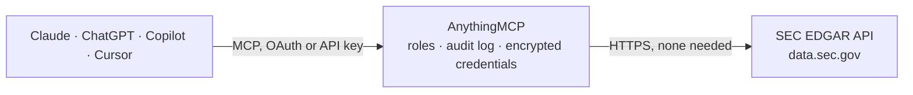

<!-- Generated by scripts/export-github-catalog.mjs in the anythingmcp-website repository. Do not edit by hand. -->

# SEC EDGAR MCP connector

Read U.S. The AnythingMCP connector gives Claude, ChatGPT, Microsoft Copilot, Cursor and Gemini 8 MCP tools for SEC EDGAR, all read-only.

**Category:** [Finance](../finance.md) · **Tools:** 8 · **Setup guide:** [anythingmcp.com](https://anythingmcp.com/guides/sec-edgar-to-mcp) · [Deutsch](https://anythingmcp.com/de/guides/sec-edgar-to-mcp) · [Italiano](https://anythingmcp.com/it/guides/sec-edgar-to-mcp) · [Español](https://anythingmcp.com/es/guides/sec-edgar-to-mcp) · [日本語](https://anythingmcp.com/ja/guides/sec-edgar-to-mcp) · [Русский](https://anythingmcp.com/ru/guides/sec-edgar-to-mcp) · [中文](https://anythingmcp.com/zh/guides/sec-edgar-to-mcp)

## Start without code

No installation and no terminal: AnythingMCP Cloud runs the SEC EDGAR connector for you, operated by helpcode.ai in Frankfurt, Germany.

1. **Click the button above** and create an account or sign in. The SEC EDGAR connector opens, ready to install.
2. **Nothing to enter:** this connector needs no credentials. Every click is in the [step-by-step guide](https://anythingmcp.com/guides/sec-edgar-to-mcp).
3. **Click Install.** AnythingMCP shows the address of your MCP server.
4. **Add that address to your assistant:** [Claude](https://anythingmcp.com/guides/connect-sec-edgar-to-claude) · [ChatGPT](https://anythingmcp.com/guides/connect-sec-edgar-to-chatgpt) · [Microsoft Copilot](https://anythingmcp.com/guides/connect-sec-edgar-to-copilot) · [Cursor](https://anythingmcp.com/guides/connect-sec-edgar-to-cursor) · [Gemini CLI](https://anythingmcp.com/guides/connect-sec-edgar-to-gemini) · [Meta Muse](https://anythingmcp.com/guides/connect-sec-edgar-to-muse).
5. **Ask your first question**, for example: *Find the CIK for Bluewater Energy Inc. (I need the SEC filer ID to pull filings).*

Prefer help with the setup? [Talk to us](https://anythingmcp.com/contact).

## How it works

- **The AI client** speaks MCP (Streamable HTTP) to AnythingMCP and only sees tool names, descriptions and results. It never gets the SEC EDGAR credentials.
- **AnythingMCP** checks the client's role, builds the call from the tool definition, adds the credentials (none needed), calls SEC EDGAR, logs the call and returns the result.
- **SEC EDGAR** sees an ordinary API client with the rights of the account the credentials belong to.

## Tools

| Tool | What it does | Access |
|---|---|---|
| [`sec_edgar_search_companies`](#sec_edgar_search_companies) | Find SEC filers (companies, funds, individuals) by name or ticker and get their CIK, the key every other EDGAR tool needs. | read |
| [`sec_edgar_get_submissions`](#sec_edgar_get_submissions) | Get a filer's EDGAR profile and its 100 most recent filings: name, tickers, exchanges, SIC industry, fiscal year end, state of incorporation, addresses,… | read |
| [`sec_edgar_get_older_filings`](#sec_edgar_get_older_filings) | Get the older part of a filer's filing history: one of the files listed in olderFilingFiles of sec_edgar_get_submissions (each holds up to a few thousand… | read |
| [`sec_edgar_get_company_facts`](#sec_edgar_get_company_facts) | List every XBRL concept a company has reported to the SEC (Company Facts API), per taxonomy: the names of its us-gaap, ifrs-full, dei and srt concepts. | read |
| [`sec_edgar_get_company_concept`](#sec_edgar_get_company_concept) | Get every value a company reported for one XBRL concept (Company Concept API), e.g. Revenues or NetIncomeLoss: per unit (USD, shares, USD-per-shares) the… | read |
| [`sec_edgar_get_frames`](#sec_edgar_get_frames) | Compare all companies on one XBRL concept for one calendar period (Frames API), e.g. Revenues for CY2024 or Assets at CY2025Q4I. | read |
| [`sec_edgar_full_text_search`](#sec_edgar_full_text_search) | Full-text search of EDGAR filings since 2001 (EDGAR Full-Text Search): find filings that mention words or an exact "phrase", filtered by form type, date… | read |
| [`sec_edgar_get_filing_index`](#sec_edgar_get_filing_index) | List the documents of one EDGAR filing (the filing folder in the EDGAR archive): file names, types and sizes of the main document, exhibits, XBRL files and… | read |

## Tool reference

Every parameter as the AI client sees it in `tools/list`. Source: [`packages/backend/src/adapters/intl/sec-edgar.json`](../../../packages/backend/src/adapters/intl/sec-edgar.json).

### `sec_edgar_search_companies`

Find SEC filers (companies, funds, individuals) by name or ticker and get their CIK, the key every other EDGAR tool needs. Returns up to 10 matches with CIK, name and tickers, best first.

**Access:** read · **Call:** `GET https://efts.sec.gov/LATEST/search-index`

| Parameter | Type | Required | Description |
|---|---|---|---|
| `keysTyped` | string | yes | Company name, part of it, or ticker, e.g. nvidia, NVDA, berkshire. |

### `sec_edgar_get_submissions`

Get a filer's EDGAR profile and its 100 most recent filings: name, tickers, exchanges, SIC industry, fiscal year end, state of incorporation, addresses, former names, and per filing the accession number, form type (10-K, 10-Q, 8-K, 4, DEF 14A...), filing and report date and primary document.

**Access:** read · **Call:** `GET /submissions/CIK{cik}.json`

| Parameter | Type | Required | Description |
|---|---|---|---|
| `cik` | string | yes | Central Index Key padded with leading zeros to 10 digits, e.g. 0000320193 for Apple. Get it from sec_edgar_search_companies. |

### `sec_edgar_get_older_filings`

Get the older part of a filer's filing history: one of the files listed in olderFilingFiles of sec_edgar_get_submissions (each holds up to a few thousand filings). Returns parallel lists of accession number, form, filing date, report date and primary document, newest first.

**Access:** read · **Call:** `GET /submissions/{file_name}`

| Parameter | Type | Required | Description |
|---|---|---|---|
| `file_name` | string | yes | File name from olderFilingFiles, e.g. CIK0000320193-submissions-001.json. |

### `sec_edgar_get_company_facts`

List every XBRL concept a company has reported to the SEC (Company Facts API), per taxonomy: the names of its us-gaap, ifrs-full, dei and srt concepts. The full facts file is several megabytes, so this returns the concept names only; read the values of one concept with sec_edgar_get_company_concept.

**Access:** read · **Call:** `GET /api/xbrl/companyfacts/CIK{cik}.json`

| Parameter | Type | Required | Description |
|---|---|---|---|
| `cik` | string | yes | Central Index Key padded with leading zeros to 10 digits, e.g. 0000320193 for Apple. Get it from sec_edgar_search_companies. |

### `sec_edgar_get_company_concept`

Get every value a company reported for one XBRL concept (Company Concept API), e.g. Revenues or NetIncomeLoss: per unit (USD, shares, USD-per-shares) the period start and end, value, fiscal year and period (FY, Q1-Q4), form, filing date, accession number and calendar frame.

**Access:** read · **Call:** `GET /api/xbrl/companyconcept/CIK{cik}/{taxonomy}/{tag}.json`

| Parameter | Type | Required | Description |
|---|---|---|---|
| `cik` | string | yes | Central Index Key padded with leading zeros to 10 digits, e.g. 0000320193 for Apple. Get it from sec_edgar_search_companies. |
| `taxonomy` | `us-gaap` \| `ifrs-full` \| `dei` \| `srt` \| `invest` | yes | XBRL taxonomy: us-gaap (US companies), ifrs-full (foreign filers reporting under IFRS), dei (cover page data such as shares outstanding), srt, invest. |
| `tag` | string | yes | XBRL concept name, case-sensitive, e.g. Revenues, RevenueFromContractWithCustomerExcludingAssessedTax, NetIncomeLoss, EarningsPerShareDiluted, Assets, Liabilities, StockholdersEquity, CashAndCashEquivalentsAtCarryingValue, AccountsPayableCurrent, or dei EntityCommonStockSharesOutstanding. List a company's concepts with sec_edgar_get_company_facts. |

### `sec_edgar_get_frames`

Compare all companies on one XBRL concept for one calendar period (Frames API), e.g. Revenues for CY2024 or Assets at CY2025Q4I. Returns the concept label, the number of reporting companies and the 250 largest values with CIK, company name, location, period end and accession number.

**Access:** read · **Call:** `GET /api/xbrl/frames/{taxonomy}/{tag}/{unit}/{period}.json`

| Parameter | Type | Required | Description |
|---|---|---|---|
| `taxonomy` | `us-gaap` \| `ifrs-full` \| `dei` \| `srt` \| `invest` | yes | XBRL taxonomy: us-gaap (US companies), ifrs-full (foreign filers reporting under IFRS), dei (cover page data such as shares outstanding), srt, invest. |
| `tag` | string | yes | XBRL concept name, case-sensitive, e.g. Revenues, RevenueFromContractWithCustomerExcludingAssessedTax, NetIncomeLoss, EarningsPerShareDiluted, Assets, Liabilities, StockholdersEquity, CashAndCashEquivalentsAtCarryingValue, AccountsPayableCurrent, or dei EntityCommonStockSharesOutstanding. List a company's concepts with sec_edgar_get_company_facts. |
| `unit` | string | yes | Unit of measure: USD, shares, USD-per-shares (per-share amounts), pure (ratios) or another currency such as EUR. |
| `period` | string | yes | Calendar period: CY2024 (annual, about 365 days), CY2024Q2 (quarter, about 91 days) or CY2024Q4I (instant at quarter end, for balance sheet items such as Assets). |

### `sec_edgar_full_text_search`

Full-text search of EDGAR filings since 2001 (EDGAR Full-Text Search): find filings that mention words or an exact "phrase", filtered by form type, date range, company (CIK or name) and business location; without words it lists the latest filings of a form. Returns the total and up to 100 hits per page with form, filing date, period, company, CIK, accession number and document file name, plus counts per form type.

**Access:** read · **Call:** `GET https://efts.sec.gov/LATEST/search-index`

| Parameter | Type | Required | Description |
|---|---|---|---|
| `q` | string | no | Words to find; wrap a phrase in double quotes, e.g. "supply chain disruption". Leave empty to list filings by the other filters. |
| `forms` | string | no | Comma-separated form types, e.g. 10-K,10-Q or 8-K or S-1 or 4 or DEF 14A. Amendments are included. |
| `startdt` | string | no | First filing date, YYYY-MM-DD; use together with enddt. |
| `enddt` | string | no | Last filing date, YYYY-MM-DD. |
| `ciks` | string | no | Comma-separated CIKs, 10 digits each, e.g. 0000320193. |
| `entityName` | string | no | Company or person name to match in the filer names, when the CIK is not known. |
| `locationCodes` | string | no | Business location: a two-letter US state code (CA, NY, TX) or an EDGAR country code. |
| `from` | integer | no | Offset of the first hit, in steps of 100 (0, 100, 200...). |

### `sec_edgar_get_filing_index`

List the documents of one EDGAR filing (the filing folder in the EDGAR archive): file names, types and sizes of the main document, exhibits, XBRL files and the full submission text. Build a document URL as https://www.sec.gov/Archives/edgar/data/<cik>/<accession without dashes>/<file name>.

**Access:** read · **Call:** `GET https://www.sec.gov/Archives/edgar/data/{cik}/{accession}/index.json`

| Parameter | Type | Required | Description |
|---|---|---|---|
| `cik` | string | yes | CIK of the filer, with or without leading zeros, e.g. 320193. |
| `accession` | string | yes | Accession number without dashes, 18 digits, e.g. 000032019325000079 for 0000320193-25-000079. |

## Run it yourself

AnythingMCP is open source (AGPL-3.0). [Run it with Docker](../../../README.md#run-it-yourself), open **Connectors → Store**, pick **SEC EDGAR** and enter `SEC_EDGAR_USER_AGENT`, then add your MCP server URL to the AI client.

[← Finance connectors](../finance.md) · [All categories](../README.md)
