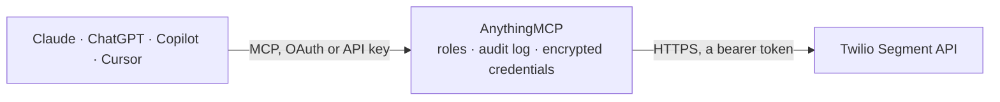

<!-- Generated by scripts/export-github-catalog.mjs in the anythingmcp-website repository. Do not edit by hand. -->

# Twilio Segment MCP connector

Let your AI work with your Twilio Segment workspace: list sources, destinations and warehouses, check event volume, delivery and warehouse syncs, read tracking plans, Functions, usage and the audit trail. The AnythingMCP connector gives Claude, ChatGPT, Microsoft Copilot, Cursor and Gemini 29 MCP tools for Twilio Segment: 25 read and 4 can change data.

**Category:** [Public Data](../data.md) · **Tools:** 29 · **Setup guide:** [anythingmcp.com](https://anythingmcp.com/guides/segment-to-mcp) · [Deutsch](https://anythingmcp.com/de/guides/segment-to-mcp) · [Italiano](https://anythingmcp.com/it/guides/segment-to-mcp) · [Español](https://anythingmcp.com/es/guides/segment-to-mcp) · [日本語](https://anythingmcp.com/ja/guides/segment-to-mcp) · [Русский](https://anythingmcp.com/ru/guides/segment-to-mcp) · [中文](https://anythingmcp.com/zh/guides/segment-to-mcp)

## Start without code

No installation and no terminal: AnythingMCP Cloud runs the Twilio Segment connector for you, operated by helpcode.ai in Frankfurt, Germany.

1. **Click the button above** and create an account or sign in. The Twilio Segment connector opens, ready to install.
2. **Paste the API key or token from your Twilio Segment account.** Every click is in the [step-by-step guide](https://anythingmcp.com/guides/segment-to-mcp).
3. **Click Install.** AnythingMCP shows the address of your MCP server.
4. **Add that address to your assistant:** [Claude](https://anythingmcp.com/guides/connect-segment-to-claude) · [ChatGPT](https://anythingmcp.com/guides/connect-segment-to-chatgpt) · [Microsoft Copilot](https://anythingmcp.com/guides/connect-segment-to-copilot) · [Cursor](https://anythingmcp.com/guides/connect-segment-to-cursor) · [Gemini CLI](https://anythingmcp.com/guides/connect-segment-to-gemini) · [Meta Muse](https://anythingmcp.com/guides/connect-segment-to-muse).
5. **Ask your first question**, for example: *What's the enabled status and tracking plan id for source 'web-shop' (slug web-shop)?*

Prefer help with the setup? [Talk to us](https://anythingmcp.com/contact).

## How it works

- **The AI client** speaks MCP (Streamable HTTP) to AnythingMCP and only sees tool names, descriptions and results. It never gets the Twilio Segment credentials.
- **AnythingMCP** checks the client's role, builds the call from the tool definition, adds the credentials (a bearer token), calls Twilio Segment, logs the call and returns the result.
- **Twilio Segment** sees an ordinary API client with the rights of the account the credentials belong to.

## Tools

| Tool | What it does | Access |
|---|---|---|
| [`segment_get_workspace`](#segment_get_workspace) | Get the Segment workspace the token belongs to (id, slug, name). | read |
| [`segment_list_sources`](#segment_list_sources) | List the workspace's sources (websites, apps, servers and cloud apps that send data) with id, name, slug, enabled flag, source type, categories and labels. | read |
| [`segment_get_source`](#segment_get_source) | Get one source by id: name, slug, enabled flag, source type, labels, write keys, settings and the id of the tracking plan connected to it. | read |
| [`segment_list_source_destinations`](#segment_list_source_destinations) | List the destinations connected to one source (id, name, enabled flag, destination type). | read |
| [`segment_list_source_warehouses`](#segment_list_source_warehouses) | List the warehouses connected to one source (id, name, enabled flag, warehouse type). | read |
| [`segment_get_source_schema_settings`](#segment_get_source_schema_settings) | Get a source's schema settings: whether unplanned track events, properties and traits are allowed or blocked, what happens on tracking plan violations, and… | read |
| [`segment_list_destinations`](#segment_list_destinations) | List the workspace's destinations (tools Segment sends data to) with id, name, enabled flag, destination type, catalog metadata id and the source each one… | read |
| [`segment_get_destination`](#segment_get_destination) | Get one destination by id: name, enabled flag, destination type, source id and its settings. | read |
| [`segment_list_destination_subscriptions`](#segment_list_destination_subscriptions) | List the mappings (subscriptions) of an Actions destination: id, name, action, trigger (which events it fires on) and enabled flag. | read |
| [`segment_get_destination_delivery_metrics`](#segment_get_destination_delivery_metrics) | Delivery metrics summary of one destination for one source: totals per metric (delivered, discarded, retried and so on) with breakdowns. | read |
| [`segment_list_warehouses`](#segment_list_warehouses) | List the workspace's warehouses (id, name, enabled flag, warehouse type such as Snowflake, BigQuery, Redshift, Postgres). | read |
| [`segment_get_warehouse`](#segment_get_warehouse) | Get one warehouse by id: name, enabled flag, warehouse type and its connection settings without passwords, keys and other secrets. | read |
| [`segment_get_warehouse_connection_state`](#segment_get_warehouse_connection_state) | Check whether Segment can currently connect to a warehouse with its saved settings (e.g. CONNECTED). | read |
| [`segment_list_warehouse_syncs`](#segment_list_warehouse_syncs) | Recent sync reports of a warehouse for every connected source: source id, start and end, status, duration, rows synced and notices. | read |
| [`segment_list_tracking_plans`](#segment_list_tracking_plans) | List the tracking plans (id, name, slug, description, type, created and updated). | read |
| [`segment_get_tracking_plan`](#segment_get_tracking_plan) | Get one tracking plan by id (name, slug, description, type, created and updated). | read |
| [`segment_list_tracking_plan_rules`](#segment_list_tracking_plan_rules) | List the rules of a tracking plan: per event or trait the rule type, key, JSON Schema of the allowed properties, version and dates. | read |
| [`segment_list_tracking_plan_sources`](#segment_list_tracking_plan_sources) | List the sources connected to a tracking plan (id, name, slug, enabled flag, source type). | read |
| [`segment_list_functions`](#segment_list_functions) | List the workspace's Functions of one type (id, name, description, type, created). | read |
| [`segment_get_function`](#segment_get_function) | Get one Function by id, including its JavaScript code, declared settings (names and types, not values) and type. | read |
| [`segment_get_event_volume`](#segment_get_event_volume) | Event volume of the workspace over time: totals and series per bucket, optionally grouped by event name, event type or source and filtered to one source,… | read |
| [`segment_get_delivery_overview`](#segment_get_delivery_overview) | Delivery Overview counts for one step of a source's pipeline: successfully-received and failed-on-ingest (events reaching Segment), filtered-at-source… | read |
| [`segment_get_daily_api_calls_usage`](#segment_get_daily_api_calls_usage) | Daily cumulative API call counts of the workspace for one usage month (the volume Segment bills on for API-based plans). | read |
| [`segment_get_daily_mtu_usage`](#segment_get_daily_mtu_usage) | Daily cumulative monthly tracked users (MTU) of the workspace for one usage month: anonymous, identified, anonymous then identified and never identified. | read |
| [`segment_list_audit_events`](#segment_list_audit_events) | List Audit Trail events (who changed what and when): id, timestamp, type (e.g. Source Disabled), actor and actor email, resource id, type and name. | read |
| [`segment_update_source`](#segment_update_source) | Rename a source or switch it on or off. | write |
| [`segment_update_destination`](#segment_update_destination) | Rename a destination or switch it on or off. | write |
| [`segment_delete_source`](#segment_delete_source) | Delete a source for good, with its settings and connections; data sent with its write key is no longer accepted. | write |
| [`segment_delete_destination`](#segment_delete_destination) | Delete a destination for good, with its settings and mappings. | write |

## Tool reference

Every parameter as the AI client sees it in `tools/list`. Source: [`packages/backend/src/adapters/intl/segment.json`](../../../packages/backend/src/adapters/intl/segment.json).

### `segment_get_workspace`

Get the Segment workspace the token belongs to (id, slug, name). A cheap first call to check the connection. Read-only.

**Access:** read · **Call:** `GET /`

No parameters.

### `segment_list_sources`

List the workspace's sources (websites, apps, servers and cloud apps that send data) with id, name, slug, enabled flag, source type, categories and labels. Write keys and settings are left out; segment_get_source has them. Pages with count and cursor: call again with cursor = pagination.next until it is missing. Read-only.

**Access:** read · **Call:** `GET /sources`

| Parameter | Type | Required | Description |
|---|---|---|---|
| `count` | integer | no | Items per page (default 50, at most 1000). |
| `cursor` | string | no | pagination.next from the previous answer, for the next page. Missing when there is no further page. |

### `segment_get_source`

Get one source by id: name, slug, enabled flag, source type, labels, write keys, settings and the id of the tracking plan connected to it. Read-only.

**Access:** read · **Call:** `GET /sources/{source_id}`

| Parameter | Type | Required | Description |
|---|---|---|---|
| `source_id` | string | yes | Source id from segment_list_sources. |

### `segment_list_source_destinations`

List the destinations connected to one source (id, name, enabled flag, destination type). Pages with count and cursor: call again with cursor = pagination.next until it is missing. Read-only.

**Access:** read · **Call:** `GET /sources/{source_id}/connected-destinations`

| Parameter | Type | Required | Description |
|---|---|---|---|
| `source_id` | string | yes | Source id from segment_list_sources. |
| `count` | integer | no | Items per page (default 50, at most 1000). |
| `cursor` | string | no | pagination.next from the previous answer, for the next page. Missing when there is no further page. |

### `segment_list_source_warehouses`

List the warehouses connected to one source (id, name, enabled flag, warehouse type). Pages with count and cursor: call again with cursor = pagination.next until it is missing. Read-only.

**Access:** read · **Call:** `GET /sources/{source_id}/connected-warehouses`

| Parameter | Type | Required | Description |
|---|---|---|---|
| `source_id` | string | yes | Source id from segment_list_sources. |
| `count` | integer | no | Items per page (default 50, at most 1000). |
| `cursor` | string | no | pagination.next from the previous answer, for the next page. Missing when there is no further page. |

### `segment_get_source_schema_settings`

Get a source's schema settings: whether unplanned track events, properties and traits are allowed or blocked, what happens on tracking plan violations, and where blocked events and violations are forwarded. Protocols settings show defaults when Protocols is off. Read-only.

**Access:** read · **Call:** `GET /sources/{source_id}/settings`

| Parameter | Type | Required | Description |
|---|---|---|---|
| `source_id` | string | yes | Source id from segment_list_sources. |

### `segment_list_destinations`

List the workspace's destinations (tools Segment sends data to) with id, name, enabled flag, destination type, catalog metadata id and the source each one reads from. Settings are left out; segment_get_destination has them. Pages with count and cursor: call again with cursor = pagination.next until it is missing. Read-only.

**Access:** read · **Call:** `GET /destinations`

| Parameter | Type | Required | Description |
|---|---|---|---|
| `count` | integer | no | Items per page (default 50, at most 1000). |
| `cursor` | string | no | pagination.next from the previous answer, for the next page. Missing when there is no further page. |

### `segment_get_destination`

Get one destination by id: name, enabled flag, destination type, source id and its settings. Settings that usually hold the destination's own credentials (API keys, secrets, tokens, passwords) are left out. Read-only.

**Access:** read · **Call:** `GET /destinations/{destination_id}`

| Parameter | Type | Required | Description |
|---|---|---|---|
| `destination_id` | string | yes | Destination id from segment_list_destinations. |

### `segment_list_destination_subscriptions`

List the mappings (subscriptions) of an Actions destination: id, name, action, trigger (which events it fires on) and enabled flag. Needs the Destination Subscriptions feature in the workspace; this endpoint is in alpha. Pages with count and cursor: call again with cursor = pagination.next until it is missing. Read-only.

**Access:** read · **Call:** `GET /destinations/{destination_id}/subscriptions`

| Parameter | Type | Required | Description |
|---|---|---|---|
| `destination_id` | string | yes | Destination id from segment_list_destinations. |
| `count` | integer | no | Items per page (default 50, at most 1000). |
| `cursor` | string | no | pagination.next from the previous answer, for the next page. Missing when there is no further page. |

### `segment_get_destination_delivery_metrics`

Delivery metrics summary of one destination for one source: totals per metric (delivered, discarded, retried and so on) with breakdowns. Time limits by granularity: MINUTE up to 4 hours within the last 48 hours (default last hour), HOUR up to 7 days within the last 7 days, DAY up to 14 days within the last 14 days. Beta endpoint. Read-only.

**Access:** read · **Call:** `GET /destinations/{destination_id}/delivery-metrics`

| Parameter | Type | Required | Description |
|---|---|---|---|
| `destination_id` | string | yes | Destination id from segment_list_destinations. |
| `source_id` | string | yes | Id of the source connected to this destination (sourceId in segment_list_destinations). |
| `start_time` | string | no | Start, ISO 8601, e.g. 2026-10-13T00:00:00Z. Defaults depend on granularity. |
| `end_time` | string | no | End, ISO 8601. Defaults to now. |
| `granularity` | `MINUTE` \| `HOUR` \| `DAY` | no | MINUTE (default), HOUR or DAY. |

### `segment_list_warehouses`

List the workspace's warehouses (id, name, enabled flag, warehouse type such as Snowflake, BigQuery, Redshift, Postgres). Connection settings are left out. Pages with count and cursor: call again with cursor = pagination.next until it is missing. Read-only.

**Access:** read · **Call:** `GET /warehouses`

| Parameter | Type | Required | Description |
|---|---|---|---|
| `count` | integer | no | Items per page (default 50, at most 1000). |
| `cursor` | string | no | pagination.next from the previous answer, for the next page. Missing when there is no further page. |

### `segment_get_warehouse`

Get one warehouse by id: name, enabled flag, warehouse type and its connection settings without passwords, keys and other secrets. Read-only.

**Access:** read · **Call:** `GET /warehouses/{warehouse_id}`

| Parameter | Type | Required | Description |
|---|---|---|---|
| `warehouse_id` | string | yes | Warehouse id from segment_list_warehouses. |

### `segment_get_warehouse_connection_state`

Check whether Segment can currently connect to a warehouse with its saved settings (e.g. CONNECTED). Limited to 200 requests per minute. Read-only.

**Access:** read · **Call:** `GET /warehouses/{warehouse_id}/connection-state`

| Parameter | Type | Required | Description |
|---|---|---|---|
| `warehouse_id` | string | yes | Warehouse id from segment_list_warehouses. |

### `segment_list_warehouse_syncs`

Recent sync reports of a warehouse for every connected source: source id, start and end, status, duration, rows synced and notices. Segment allows only 2 calls a minute to this endpoint, so call it once and read the answer. Pages with count and cursor: call again with cursor = pagination.next until it is missing. Read-only.

**Access:** read · **Call:** `GET /warehouses/{warehouse_id}/syncs`

| Parameter | Type | Required | Description |
|---|---|---|---|
| `warehouse_id` | string | yes | Warehouse id from segment_list_warehouses. |
| `count` | integer | no | Items per page (default 20, at most 1000). |
| `cursor` | string | no | pagination.next from the previous answer, for the next page. Missing when there is no further page. |

### `segment_list_tracking_plans`

List the tracking plans (id, name, slug, description, type, created and updated). Needs Segment Protocols in the workspace. Pages with count and cursor: call again with cursor = pagination.next until it is missing. Read-only.

**Access:** read · **Call:** `GET /tracking-plans`

| Parameter | Type | Required | Description |
|---|---|---|---|
| `type` | `LIVE` \| `PROPERTY_LIBRARY` \| `RULE_LIBRARY` \| `TEMPLATE` \| `ENGAGE` | no | Only tracking plans of this type; all types when left out. |
| `count` | integer | no | Items per page (default 50, at most 1000). |
| `cursor` | string | no | pagination.next from the previous answer, for the next page. Missing when there is no further page. |

### `segment_get_tracking_plan`

Get one tracking plan by id (name, slug, description, type, created and updated). Needs Segment Protocols in the workspace. Read-only.

**Access:** read · **Call:** `GET /tracking-plans/{tracking_plan_id}`

| Parameter | Type | Required | Description |
|---|---|---|---|
| `tracking_plan_id` | string | yes | Tracking plan id, e.g. tp_sprout_rVGCC6WdrNxjCf6JpCHP, from segment_list_tracking_plans. |

### `segment_list_tracking_plan_rules`

List the rules of a tracking plan: per event or trait the rule type, key, JSON Schema of the allowed properties, version and dates. Limited to 200 requests per minute. Needs Segment Protocols in the workspace. Pages with count and cursor: call again with cursor = pagination.next until it is missing. Read-only.

**Access:** read · **Call:** `GET /tracking-plans/{tracking_plan_id}/rules`

| Parameter | Type | Required | Description |
|---|---|---|---|
| `tracking_plan_id` | string | yes | Tracking plan id from segment_list_tracking_plans. |
| `count` | integer | no | Items per page (default 50, at most 1000). |
| `cursor` | string | no | pagination.next from the previous answer, for the next page. Missing when there is no further page. |

### `segment_list_tracking_plan_sources`

List the sources connected to a tracking plan (id, name, slug, enabled flag, source type). Needs Segment Protocols in the workspace. Pages with count and cursor: call again with cursor = pagination.next until it is missing. Read-only.

**Access:** read · **Call:** `GET /tracking-plans/{tracking_plan_id}/sources`

| Parameter | Type | Required | Description |
|---|---|---|---|
| `tracking_plan_id` | string | yes | Tracking plan id from segment_list_tracking_plans. |
| `count` | integer | no | Items per page (default 50, at most 1000). |
| `cursor` | string | no | pagination.next from the previous answer, for the next page. Missing when there is no further page. |

### `segment_list_functions`

List the workspace's Functions of one type (id, name, description, type, created). Needs the Functions feature. Pages with count and cursor: call again with cursor = pagination.next until it is missing. Read-only.

**Access:** read · **Call:** `GET /functions`

| Parameter | Type | Required | Description |
|---|---|---|---|
| `resource_type` | `SOURCE` \| `DESTINATION` \| `INSERT_DESTINATION` \| `INSERT_SOURCE` \| `INSERT_TRANSFORMATION` | yes | The function type: SOURCE (default), DESTINATION, INSERT_DESTINATION, INSERT_SOURCE or INSERT_TRANSFORMATION. |
| `count` | integer | no | Items per page (default 50, at most 1000). |
| `cursor` | string | no | pagination.next from the previous answer, for the next page. Missing when there is no further page. |

### `segment_get_function`

Get one Function by id, including its JavaScript code, declared settings (names and types, not values) and type. Long code is cut at about 60 KB. Read-only.

**Access:** read · **Call:** `GET /functions/{function_id}`

| Parameter | Type | Required | Description |
|---|---|---|---|
| `function_id` | string | yes | Function id, e.g. sfnc_wXzcDGFR3KmjLDrtSawNHf, from segment_list_functions. |

### `segment_get_event_volume`

Event volume of the workspace over time: totals and series per bucket, optionally grouped by event name, event type or source and filtered to one source, event name, event type or app version. Segment recommends ending one minute before now. Limited to 60 requests per minute. Pages with count and cursor: call again with cursor = pagination.next until it is missing. Read-only.

**Access:** read · **Call:** `GET /events/volume`

| Parameter | Type | Required | Description |
|---|---|---|---|
| `granularity` | `DAY` \| `HOUR` \| `MINUTE` | yes | Bucket size: DAY, HOUR or MINUTE. |
| `start_time` | string | yes | Start, inclusive, ISO 8601, e.g. 2026-10-07T00:00:00Z. |
| `end_time` | string | yes | End, exclusive, ISO 8601, e.g. 2026-10-14T00:00:00Z. |
| `group_by` | `eventName` \| `eventType` \| `source` | no | Optional first dimension to group by. |
| `group_by_2` | `eventName` \| `eventType` \| `source` | no | Optional second dimension to group by. |
| `source_id` | string | no | Optional: only this source id. |
| `event_name` | string | no | Optional: only this event name. |
| `event_type` | `alias` \| `group` \| `identify` \| `page` \| `screen` \| `track` | no | Optional: only this event type. |
| `app_version` | string | no | Optional: only this app version. |
| `count` | integer | no | Items per page (default 50, at most 1000). |
| `cursor` | string | no | pagination.next from the previous answer, for the next page. Missing when there is no further page. |

### `segment_get_delivery_overview`

Delivery Overview counts for one step of a source's pipeline: successfully-received and failed-on-ingest (events reaching Segment), filtered-at-source (blocked by Protocols or filters), and, for one destination, filtered-at-destination, failed-delivery and successful-delivery. Returns the total, a dataset per group with series, and discard reasons. Time limits by granularity: MINUTE up to 4 hours within the last 48 hours, HOUR up to 14 days within the last 30 days, DAY up to 30 days within the last 30 days. Beta endpoint. Pages with count and cursor: call again with cursor = pagination.next until it is missing. Read-only.

**Access:** read · **Call:** `GET /delivery-overview/{step}`

| Parameter | Type | Required | Description |
|---|---|---|---|
| `step` | `successfully-received` \| `failed-on-ingest` \| `filtered-at-source` \| `filtered-at-destination` \| `failed-delivery` \| `successful-delivery` | yes | Pipeline step. The last three need destination_config_id. |
| `source_id` | string | yes | The source id. |
| `destination_config_id` | string | no | The destination id (from segment_list_destinations); required for filtered-at-destination, failed-delivery and successful-delivery. |
| `start_time` | string | yes | Start, inclusive, ISO 8601, e.g. 2026-10-13T00:00:00Z. |
| `end_time` | string | yes | End, exclusive, ISO 8601. |
| `granularity` | `DAY` \| `HOUR` \| `MINUTE` | yes | Bucket size: DAY, HOUR or MINUTE. |
| `group_by` | `eventName` \| `eventType` \| `discardReason` \| `appVersion` \| `subscriptionId` \| `activationId` \| `audienceId` \| `spaceId` | no | Optional first dimension to group by. discardReason does not apply to successfully-received; subscriptionId, activationId, audienceId and spaceId only to the destination steps. |
| `group_by_2` | `eventName` \| `eventType` \| `discardReason` \| `appVersion` \| `subscriptionId` \| `activationId` \| `audienceId` \| `spaceId` | no | Optional second dimension to group by. |
| `filter_event_name` | string | no | Optional: only these event names, comma-separated. |
| `filter_event_type` | string | no | Optional: only these event types, comma-separated (alias, group, identify, page, screen, track). |
| `filter_discard_reason` | string | no | Optional: only these discard reasons, comma-separated. Not accepted by the successfully-received step. |
| `count` | integer | no | Items per page (default 50, at most 1000). |
| `cursor` | string | no | pagination.next from the previous answer, for the next page. Missing when there is no further page. |

### `segment_get_daily_api_calls_usage`

Daily cumulative API call counts of the workspace for one usage month (the volume Segment bills on for API-based plans). Pages with count and cursor: call again with cursor = pagination.next until it is missing. Read-only.

**Access:** read · **Call:** `GET /usage/api-calls/daily`

| Parameter | Type | Required | Description |
|---|---|---|---|
| `period` | string | yes | Start of the usage month, YYYY-MM-DD, e.g. 2026-10-01. |
| `count` | integer | no | Items per page (default 31, at most 1000). |
| `cursor` | string | no | pagination.next from the previous answer, for the next page. Missing when there is no further page. |

### `segment_get_daily_mtu_usage`

Daily cumulative monthly tracked users (MTU) of the workspace for one usage month: anonymous, identified, anonymous then identified and never identified. Pages with count and cursor: call again with cursor = pagination.next until it is missing. Read-only.

**Access:** read · **Call:** `GET /usage/mtu/daily`

| Parameter | Type | Required | Description |
|---|---|---|---|
| `period` | string | yes | Start of the usage month, YYYY-MM-DD, e.g. 2026-10-01. |
| `count` | integer | no | Items per page (default 31, at most 1000). |
| `cursor` | string | no | pagination.next from the previous answer, for the next page. Missing when there is no further page. |

### `segment_list_audit_events`

List Audit Trail events (who changed what and when): id, timestamp, type (e.g. Source Disabled), actor and actor email, resource id, type and name. Filter by time, resource id or resource type. Pages with count and cursor: call again with cursor = pagination.next until it is missing. Read-only.

**Access:** read · **Call:** `GET /audit-events`

| Parameter | Type | Required | Description |
|---|---|---|---|
| `start_time` | string | no | Only events after this time, ISO 8601. |
| `end_time` | string | no | Only events before this time, ISO 8601. Defaults to now. |
| `resource_id` | string | no | Only events about this resource, e.g. a source id. |
| `resource_type` | string | no | Only events about this resource type, e.g. source, warehouse or tracking plan. |
| `count` | integer | no | Items per page (default 50, at most 1000). |
| `cursor` | string | no | pagination.next from the previous answer, for the next page. Missing when there is no further page. |

### `segment_update_source`

Rename a source or switch it on or off. A disabled source drops every event sent to it until it is enabled again, so confirm the source and the change with the user before calling. Installed switched off; an administrator turns it on deliberately.

**Access:** write · **Call:** `PATCH /sources/{source_id}`

| Parameter | Type | Required | Description |
|---|---|---|---|
| `source_id` | string | yes | Source id from segment_list_sources. |
| `name` | string | no | New display name. |
| `enabled` | boolean | no | true lets the source send data, false stops it. |

### `segment_update_destination`

Rename a destination or switch it on or off. A disabled destination receives no data until it is enabled again, so confirm the destination and the change with the user before calling. Installed switched off; an administrator turns it on deliberately.

**Access:** write · **Call:** `PATCH /destinations/{destination_id}`

| Parameter | Type | Required | Description |
|---|---|---|---|
| `destination_id` | string | yes | Destination id from segment_list_destinations. |
| `name` | string | no | New display name. |
| `enabled` | boolean | no | true sends data to the destination, false stops it. |

### `segment_delete_source`

Delete a source for good, with its settings and connections; data sent with its write key is no longer accepted. Cannot be undone. Installed switched off. Show the user the source (segment_get_source) and only call this after they confirm its id and name.

**Access:** write · **Call:** `DELETE /sources/{source_id}`

| Parameter | Type | Required | Description |
|---|---|---|---|
| `source_id` | string | yes | Id of the source to delete, as confirmed by the user. |

### `segment_delete_destination`

Delete a destination for good, with its settings and mappings. Cannot be undone. Installed switched off. Show the user the destination (segment_get_destination) and only call this after they confirm its id and name.

**Access:** write · **Call:** `DELETE /destinations/{destination_id}`

| Parameter | Type | Required | Description |
|---|---|---|---|
| `destination_id` | string | yes | Id of the destination to delete, as confirmed by the user. |

## Run it yourself

AnythingMCP is open source (AGPL-3.0). [Run it with Docker](../../../README.md#run-it-yourself), open **Connectors → Store**, pick **Twilio Segment** and enter `SEGMENT_API_HOST`, `SEGMENT_API_TOKEN`, then add your MCP server URL to the AI client.

[← Public Data connectors](../data.md) · [All categories](../README.md)
