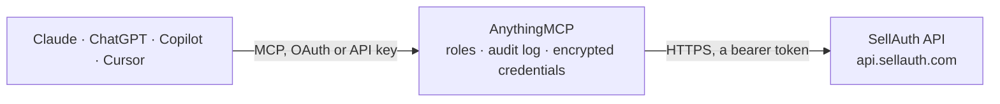

<!-- Generated by scripts/export-github-catalog.mjs in the anythingmcp-website repository. Do not edit by hand. -->

# SellAuth MCP connector

SellAuth digital goods storefront, read-only: revenue and profit analytics, top products and customers, invoices (orders), products and variants, customers, feedback, support tickets and coupons. The AnythingMCP connector gives Claude, ChatGPT, Microsoft Copilot, Cursor and Gemini 13 MCP tools for SellAuth, all read-only.

**Category:** [E-commerce](../e-commerce.md) · **Tools:** 13 · **Setup guide:** [anythingmcp.com](https://anythingmcp.com/guides/sellauth-to-mcp) · [Deutsch](https://anythingmcp.com/de/guides/sellauth-to-mcp) · [Italiano](https://anythingmcp.com/it/guides/sellauth-to-mcp) · [Español](https://anythingmcp.com/es/guides/sellauth-to-mcp) · [日本語](https://anythingmcp.com/ja/guides/sellauth-to-mcp) · [Русский](https://anythingmcp.com/ru/guides/sellauth-to-mcp) · [中文](https://anythingmcp.com/zh/guides/sellauth-to-mcp)

## Start without code

No installation and no terminal: AnythingMCP Cloud runs the SellAuth connector for you, operated by helpcode.ai in Frankfurt, Germany.

1. **Click the button above** and create an account or sign in. The SellAuth connector opens, ready to install.
2. **Paste the API key or token from your SellAuth account.** Every click is in the [step-by-step guide](https://anythingmcp.com/guides/sellauth-to-mcp).
3. **Click Install.** AnythingMCP shows the address of your MCP server.
4. **Add that address to your assistant:** [Claude](https://anythingmcp.com/guides/connect-sellauth-to-claude) · [ChatGPT](https://anythingmcp.com/guides/connect-sellauth-to-chatgpt) · [Microsoft Copilot](https://anythingmcp.com/guides/connect-sellauth-to-copilot) · [Cursor](https://anythingmcp.com/guides/connect-sellauth-to-cursor) · [Gemini CLI](https://anythingmcp.com/guides/connect-sellauth-to-gemini) · [Meta Muse](https://anythingmcp.com/guides/connect-sellauth-to-muse).
5. **Ask your first question**, for example: *Show me invoice INV-2026-117: status, total, amount paid, customer e-mail and date.*

Prefer help with the setup? [Talk to us](https://anythingmcp.com/contact).

## How it works

- **The AI client** speaks MCP (Streamable HTTP) to AnythingMCP and only sees tool names, descriptions and results. It never gets the SellAuth credentials.
- **AnythingMCP** checks the client's role, builds the call from the tool definition, adds the credentials (a bearer token), calls SellAuth, logs the call and returns the result.
- **SellAuth** sees an ordinary API client with the rights of the account the credentials belong to.

## Tools

| Tool | What it does | Access |
|---|---|---|
| [`sellauth_list_shops`](#sellauth_list_shops) | List the shops the API key can reach with id, name, subdomain, URL, currency and totals (customers, completed invoices, products sold, average rating). | read |
| [`sellauth_get_analytics`](#sellauth_get_analytics) | Get the shop's headline figures with the change against the previous period: revenue, orders, customers, cost of goods, profit and cost coverage (USD). | read |
| [`sellauth_get_revenue_graph`](#sellauth_get_revenue_graph) | Get the revenue, orders and profit series over time for the shop dashboard chart (dateData with matching revenueData, ordersData and profitData). | read |
| [`sellauth_get_top_products`](#sellauth_get_top_products) | Get the 10 best-selling products and variants with revenue, profit and number of orders (USD). | read |
| [`sellauth_get_top_customers`](#sellauth_get_top_customers) | Get the 10 customers who spent the most: e-mail, Discord name, total spent (USD), completed orders and last purchase. | read |
| [`sellauth_list_invoices`](#sellauth_list_invoices) | List invoices (orders), newest first by default: id, status, price, amount paid, gateway and payment method, customer e-mail, country, items and dates. | read |
| [`sellauth_get_invoice`](#sellauth_get_invoice) | Get one invoice in full: items with prices, fees, discounts and taxes, payments, coupon, customer, billing and shipping details, fulfilment and dispute status. | read |
| [`sellauth_list_products`](#sellauth_list_products) | List products with id, name, type, price, currency, stock count, units sold, visibility, group, category and variants (name, SKU, price, cost, stock). | read |
| [`sellauth_get_product`](#sellauth_get_product) | Get one product with its variants, description, instructions, prices, volume discounts and stock. | read |
| [`sellauth_list_customers`](#sellauth_list_customers) | List the shop's customers with id, e-mail, Discord name, store balance, completed orders, total spent (USD) and last purchase. | read |
| [`sellauth_list_feedbacks`](#sellauth_list_feedbacks) | List customer feedback (reviews) with rating, message, reply, dispute and invoice. | read |
| [`sellauth_list_tickets`](#sellauth_list_tickets) | List support tickets with subject, status, customer, related invoice, last message and dates. | read |
| [`sellauth_list_coupons`](#sellauth_list_coupons) | List coupons with code, discount and type, uses and limits, validity dates, revenue attributed and amount saved. | read |

## Tool reference

Every parameter as the AI client sees it in `tools/list`. Source: [`packages/backend/src/adapters/intl/sellauth.json`](../../../packages/backend/src/adapters/intl/sellauth.json).

### `sellauth_list_shops`

List the shops the API key can reach with id, name, subdomain, URL, currency and totals (customers, completed invoices, products sold, average rating). The id is SELLAUTH_SHOP_ID. Use it to check the connection.

**Access:** read · **Call:** `GET /shops`

No parameters.

### `sellauth_get_analytics`

Get the shop's headline figures with the change against the previous period: revenue, orders, customers, cost of goods, profit and cost coverage (USD).

**Access:** read · **Call:** `GET /shops/{{SELLAUTH_SHOP_ID}}/analytics`

No parameters.

### `sellauth_get_revenue_graph`

Get the revenue, orders and profit series over time for the shop dashboard chart (dateData with matching revenueData, ordersData and profitData).

**Access:** read · **Call:** `GET /shops/{{SELLAUTH_SHOP_ID}}/analytics/graph`

No parameters.

### `sellauth_get_top_products`

Get the 10 best-selling products and variants with revenue, profit and number of orders (USD).

**Access:** read · **Call:** `GET /shops/{{SELLAUTH_SHOP_ID}}/analytics/top-products`

No parameters.

### `sellauth_get_top_customers`

Get the 10 customers who spent the most: e-mail, Discord name, total spent (USD), completed orders and last purchase.

**Access:** read · **Call:** `GET /shops/{{SELLAUTH_SHOP_ID}}/analytics/top-customers`

No parameters.

### `sellauth_list_invoices`

List invoices (orders), newest first by default: id, status, price, amount paid, gateway and payment method, customer e-mail, country, items and dates. Filter by status, e-mail, creation date range; sort by id, price, paid amount or dates. Delivered product keys are never returned.

**Access:** read · **Call:** `GET /shops/{{SELLAUTH_SHOP_ID}}/invoices`

| Parameter | Type | Required | Description |
|---|---|---|---|
| `statuses` | string[] | no | Only these statuses, e.g. ["completed"]; others are pending, expired, cancelled, refunded, partial. |
| `email` | string | no | Customer e-mail. |
| `created_at_start` | string | no | Created on or after, YYYY-MM-DD or ISO 8601. |
| `created_at_end` | string | no | Created on or before, YYYY-MM-DD or ISO 8601. |
| `orderColumn` | `id` \| `price_usd` \| `paid_usd` \| `created_at` \| `completed_at` | no | Sort column. |
| `orderDirection` | `desc` \| `asc` | no | Sort direction. |
| `page` | integer | no | Page, starting at 1. |
| `perPage` | integer | no | Rows per page, 1 to 100. |

### `sellauth_get_invoice`

Get one invoice in full: items with prices, fees, discounts and taxes, payments, coupon, customer, billing and shipping details, fulfilment and dispute status. Delivered product keys and payment proofs are left out.

**Access:** read · **Call:** `GET /shops/{{SELLAUTH_SHOP_ID}}/invoices/{invoice_id}`

| Parameter | Type | Required | Description |
|---|---|---|---|
| `invoice_id` | string | yes | Invoice id (number) or unique id. |

### `sellauth_list_products`

List products with id, name, type, price, currency, stock count, units sold, visibility, group, category and variants (name, SKU, price, cost, stock). The product keys or files being sold are never returned.

**Access:** read · **Call:** `GET /shops/{{SELLAUTH_SHOP_ID}}/products`

| Parameter | Type | Required | Description |
|---|---|---|---|
| `page` | integer | no | Page, starting at 1. |
| `perPage` | integer | no | Rows per page, 1 to 100. |

### `sellauth_get_product`

Get one product with its variants, description, instructions, prices, volume discounts and stock. The product keys or files being sold are never returned.

**Access:** read · **Call:** `GET /shops/{{SELLAUTH_SHOP_ID}}/products/{product_id}`

| Parameter | Type | Required | Description |
|---|---|---|---|
| `product_id` | integer | yes | Product id. |

### `sellauth_list_customers`

List the shop's customers with id, e-mail, Discord name, store balance, completed orders, total spent (USD) and last purchase.

**Access:** read · **Call:** `GET /shops/{{SELLAUTH_SHOP_ID}}/customers`

| Parameter | Type | Required | Description |
|---|---|---|---|
| `page` | integer | no | Page, starting at 1. |
| `perPage` | integer | no | Rows per page, 1 to 100. |

### `sellauth_list_feedbacks`

List customer feedback (reviews) with rating, message, reply, dispute and invoice.

**Access:** read · **Call:** `GET /shops/{{SELLAUTH_SHOP_ID}}/feedbacks`

| Parameter | Type | Required | Description |
|---|---|---|---|
| `page` | integer | no | Page, starting at 1. |
| `perPage` | integer | no | Rows per page, 1 to 100. |

### `sellauth_list_tickets`

List support tickets with subject, status, customer, related invoice, last message and dates.

**Access:** read · **Call:** `GET /shops/{{SELLAUTH_SHOP_ID}}/tickets`

| Parameter | Type | Required | Description |
|---|---|---|---|
| `page` | integer | no | Page, starting at 1. |
| `perPage` | integer | no | Rows per page, 1 to 100. |

### `sellauth_list_coupons`

List coupons with code, discount and type, uses and limits, validity dates, revenue attributed and amount saved.

**Access:** read · **Call:** `GET /shops/{{SELLAUTH_SHOP_ID}}/coupons`

| Parameter | Type | Required | Description |
|---|---|---|---|
| `page` | integer | no | Page, starting at 1. |
| `perPage` | integer | no | Rows per page, 1 to 100. |

## Run it yourself

AnythingMCP is open source (AGPL-3.0). [Run it with Docker](../../../README.md#run-it-yourself), open **Connectors → Store**, pick **SellAuth** and enter `SELLAUTH_API_KEY`, `SELLAUTH_SHOP_ID`, then add your MCP server URL to the AI client.

[← E-commerce connectors](../e-commerce.md) · [All categories](../README.md)
