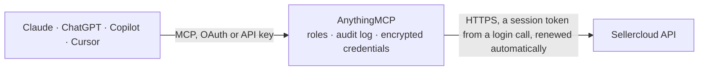

<!-- Generated by scripts/export-github-catalog.mjs in the anythingmcp-website repository. Do not edit by hand. -->

# Sellercloud MCP connector

Sellercloud multichannel e-commerce operations: sales orders with notes and packages, saved order views, product catalog and prices, inventory per warehouse, customers, companies, purchase orders, … The AnythingMCP connector gives Claude, ChatGPT, Microsoft Copilot, Cursor and Gemini 30 MCP tools for Sellercloud, all read-only.

**Category:** [E-commerce](../e-commerce.md) · **Tools:** 30 · **Setup guide:** [anythingmcp.com](https://anythingmcp.com/guides/sellercloud-to-mcp) · [Deutsch](https://anythingmcp.com/de/guides/sellercloud-to-mcp) · [Italiano](https://anythingmcp.com/it/guides/sellercloud-to-mcp) · [Español](https://anythingmcp.com/es/guides/sellercloud-to-mcp) · [日本語](https://anythingmcp.com/ja/guides/sellercloud-to-mcp) · [Русский](https://anythingmcp.com/ru/guides/sellercloud-to-mcp) · [中文](https://anythingmcp.com/zh/guides/sellercloud-to-mcp)

## Start without code

No installation and no terminal: AnythingMCP Cloud runs the Sellercloud connector for you, operated by helpcode.ai in Frankfurt, Germany.

1. **Click the button above** and create an account or sign in. The Sellercloud connector opens, ready to install.
2. **Paste the API key or token from your Sellercloud account.** Every click is in the [step-by-step guide](https://anythingmcp.com/guides/sellercloud-to-mcp).
3. **Click Install.** AnythingMCP shows the address of your MCP server.
4. **Add that address to your assistant:** [Claude](https://anythingmcp.com/guides/connect-sellercloud-to-claude) · [ChatGPT](https://anythingmcp.com/guides/connect-sellercloud-to-chatgpt) · [Microsoft Copilot](https://anythingmcp.com/guides/connect-sellercloud-to-copilot) · [Cursor](https://anythingmcp.com/guides/connect-sellercloud-to-cursor) · [Gemini CLI](https://anythingmcp.com/guides/connect-sellercloud-to-gemini) · [Meta Muse](https://anythingmcp.com/guides/connect-sellercloud-to-muse).
5. **Ask your first question**, for example: *Show me order 10245 details — I need order total, payment status and tracking number for reconciliation.*

Prefer help with the setup? [Talk to us](https://anythingmcp.com/contact).

## How it works

- **The AI client** speaks MCP (Streamable HTTP) to AnythingMCP and only sees tool names, descriptions and results. It never gets the Sellercloud credentials.
- **AnythingMCP** checks the client's role, builds the call from the tool definition, adds the credentials (a session token from a login call, renewed automatically), calls Sellercloud, logs the call and returns the result.
- **Sellercloud** sees an ordinary API client with the rights of the account the credentials belong to.

## Tools

| Tool | What it does | Access |
|---|---|---|
| [`sellercloud_list_orders`](#sellercloud_list_orders) | Search sales orders with filters: status, payment and shipping status, company, channel, SKU, customer, warehouse, channel order id, tracking number,… | read |
| [`sellercloud_get_order`](#sellercloud_get_order) | Get one sales order by Sellercloud order id: details, statuses, items with quantities and prices, totals, shipping details and packages, shipping and… | read |
| [`sellercloud_get_order_notes`](#sellercloud_get_order_notes) | Get the notes of one sales order: note text, category, author, date and whether the note is pinned. | read |
| [`sellercloud_list_order_packages`](#sellercloud_list_order_packages) | List the shipped packages of one sales order: tracking number and link, weight and dimensions, shipping cost, estimated and actual delivery date, delivery… | read |
| [`sellercloud_list_order_views`](#sellercloud_list_order_views) | List the saved order views (filters saved in the Sellercloud Manage Orders page) with id and name, to use with sellercloud_list_orders_by_view. | read |
| [`sellercloud_list_orders_by_view`](#sellercloud_list_orders_by_view) | List the sales orders that match a saved order view, exactly as the view filters them in Sellercloud. | read |
| [`sellercloud_list_products`](#sellercloud_list_products) | Search the product catalog by SKU, UPC, keyword, company, vendor, vendor SKU, brand, warehouse, physical quantity, active status, kit or shadow type,… | read |
| [`sellercloud_get_product_prices`](#sellercloud_get_product_prices) | Get the prices of one product by SKU: site price, stop-loss price and the price set for each sales channel. | read |
| [`sellercloud_list_inventory`](#sellercloud_list_inventory) | Search inventory by SKU, EAN, UPC, keyword, company, vendor, brand, warehouse, physical quantity or update date. | read |
| [`sellercloud_get_inventory`](#sellercloud_get_inventory) | Get the full inventory record of one product by SKU: general data, identifiers (UPC, EAN, ASIN), sales metrics, inventory quantities, pricing, kit… | read |
| [`sellercloud_get_inventory_by_warehouse`](#sellercloud_get_inventory_by_warehouse) | Get the stock of one product per warehouse: physical and available quantity in each warehouse, or in one warehouse only when warehouse_id is given. | read |
| [`sellercloud_list_customers`](#sellercloud_list_customers) | Search customers by e-mail, name, business name, phone, city, ZIP code, type, channel, company, keyword or creation and change dates. | read |
| [`sellercloud_get_customer`](#sellercloud_get_customer) | Get one customer by Sellercloud customer id: general and personal data, addresses, order and wholesale options, customer groups and custom columns. | read |
| [`sellercloud_list_companies`](#sellercloud_list_companies) | List the companies (business units or stores) of the Sellercloud account with id, name, default and disabled flags and enabled channels. | read |
| [`sellercloud_list_purchase_orders`](#sellercloud_list_purchase_orders) | Search purchase orders by id, company, status, receiving warehouse, shipping and receiving status, keyword or created, received and updated dates. | read |
| [`sellercloud_get_purchase_order`](#sellercloud_get_purchase_order) | Get one purchase order by id: purchase details, vendor and invoice, items, totals, statuses, related items and custom columns. | read |
| [`sellercloud_get_purchase_order_items`](#sellercloud_get_purchase_order_items) | Get the line items of one purchase order: product, vendor SKU, quantities ordered and received, unit cost and line totals. | read |
| [`sellercloud_list_vendors`](#sellercloud_list_vendors) | List vendors (suppliers) with id, name, e-mail and whether default; filter by vendor ids, names, e-mail or active status. | read |
| [`sellercloud_get_vendor`](#sellercloud_get_vendor) | Get one vendor by id: name, alias, account number, e-mail and CC address, website, and whether active and default. | read |
| [`sellercloud_list_vendor_products`](#sellercloud_list_vendor_products) | List the products a vendor supplies: Sellercloud SKU, vendor SKU, product name, vendor price, price and quantity per case, quantity and availability. | read |
| [`sellercloud_list_rmas`](#sellercloud_list_rmas) | Search returns (RMAs) by RMA or order id, company, product, status, channel, channel order or RMA id, tracking number, or created, received, closed and… | read |
| [`sellercloud_get_rma`](#sellercloud_get_rma) | Get one return (RMA) by id: customer, company, original order and total, status and approval, replacement order, tracking number, credit memo, items and… | read |
| [`sellercloud_get_rma_items`](#sellercloud_get_rma_items) | Get the items of one return (RMA): SKU, quantities ordered, returned and received, return reason, resolution, refund amount, problem description, approval… | read |
| [`sellercloud_list_warehouses`](#sellercloud_list_warehouses) | List warehouses with id, name, type (normal, FBA, dropship, WFS and others), address, whether default and sellable; filter by ids, name, type, default or… | read |
| [`sellercloud_list_warehouse_transfers`](#sellercloud_list_warehouse_transfers) | List warehouse inventory transfers (WITR) between warehouses with status, company, source, interim and destination warehouse; filter by ids, status,… | read |
| [`sellercloud_list_picklists`](#sellercloud_list_picklists) | List picklists with id, title, warehouse, status and generation date; filter by ids, title, product, order, warehouse, status or generation date. | read |
| [`sellercloud_list_queued_jobs`](#sellercloud_list_queued_jobs) | List queued jobs (imports, exports, bulk updates) with type, status, priority, submitter and dates; filter by job id, status, company or submission date. | read |
| [`sellercloud_get_queued_job`](#sellercloud_get_queued_job) | Get one queued job by id: type, status and submitter, phase and record progress, succeeded and failed counts, input and output file. | read |
| [`sellercloud_list_brands`](#sellercloud_list_brands) | List the brands defined in Sellercloud with id and name, to resolve brand ids in products or to filter products and inventory by brand. | read |
| [`sellercloud_list_manufacturers`](#sellercloud_list_manufacturers) | List the manufacturers defined for one company with id and name, to resolve manufacturer ids in product data. | read |

## Tool reference

Every parameter as the AI client sees it in `tools/list`. Source: [`packages/backend/src/adapters/intl/sellercloud.json`](../../../packages/backend/src/adapters/intl/sellercloud.json).

### `sellercloud_list_orders`

Search sales orders with filters: status, payment and shipping status, company, channel, SKU, customer, warehouse, channel order id, tracking number, keyword, creation or update dates. Returns Items (status, dates, customer, totals, carrier, tracking and order lines) and TotalResults, up to 50 per page. Each row is cut to the fields an agent needs (Sellercloud returns about 70 per order and 200 per line, addresses and payments included); call sellercloud_get_order for every field of one record.

**Access:** read · **Call:** `GET /api/Orders`

| Parameter | Type | Required | Description |
|---|---|---|---|
| `order_ids` | integer[] | no | Sellercloud order ids to fetch. |
| `order_status` | `-1` \| `1` \| `2` \| `3` \| `100` \| `200` \| `300` \| `999`[] | no | Order status codes: 1 ShoppingCart, 2 InProcess, 3 Completed, 100 ProblemOrder, 200 OnHold, 300 Quote, 999 Void, -1 Cancelled. |
| `payment_status` | `10` \| `11` \| `20` \| `30` \| `40` \| `50` \| `60` \| `61` \| `70` \| `71` \| `80` \| `81` \| `99` \| `711` \| `713`[] | no | Payment status codes: 10 NoPayment, 11 NoPayment or partial, 20 Authorized, 30 Charged, 40 Uncleared, 50 PartialRefund, 60 FullRefund, 61 Partial or full refund, 70 PartiallyPaid, 71 Charged or partial refund, 99 PaymentError, 711 Charged or partially paid, 713 Charged or authorized. |
| `shipping_status` | `0` \| `1` \| `2` \| `3` \| `4` | no | Shipping status: 0 Unknown, 1 Unshipped, 2 PartiallyShipped, 3 FullyShipped, 4 ReadyForPickup. |
| `company_ids` | integer[] | no | Company ids (from sellercloud_list_companies). |
| `channels` | integer[] | no | Channel (order source) ids, e.g. 0 Local_Store, 1 eBay, 4 Amazon, 6 Website, 20 FBA, 21 Wholesale, 24 Etsy, 42 Walmart. Full list: https://developer.sellercloud.com/dev-article/channels/ |
| `channel_order_ids` | string[] | no | Order ids as the channel knows them (e.g. Amazon order numbers). |
| `customer_ids` | integer[] | no | Sellercloud customer ids (from sellercloud_list_customers). |
| `warehouse_ids` | integer[] | no | Warehouse ids the order items ship from. |
| `sku` | string | no | Only orders that contain this product id (SKU). |
| `tracking_number` | string | no | Only the order with this package tracking number. |
| `keyword` | string | no | Global search term, as in the Sellercloud search box (order id, customer name, e-mail and more). |
| `created_from` | string | no | Created on or after. Date and time in the format MM/DD/YYYY HH:MM, e.g. 10/01/2026 00:00. |
| `created_to` | string | no | Created on or before. Date and time in the format MM/DD/YYYY HH:MM, e.g. 10/01/2026 00:00. |
| `updated_from` | string | no | Last updated on or after. Date and time in the format MM/DD/YYYY HH:MM, e.g. 10/01/2026 00:00. |
| `updated_to` | string | no | Last updated on or before. Date and time in the format MM/DD/YYYY HH:MM, e.g. 10/01/2026 00:00. |
| `created_range` | `1` \| `2` \| `3` \| `4` \| `5` \| `6` \| `7` \| `8` \| `9` \| `10` \| `11` \| `12` \| `17` \| `18` \| `19` \| `20` \| `21` \| `22` \| `23` \| `24` \| `25` \| `26` \| `27` \| `28` \| `29` \| `30` \| `31` \| `32` \| `33` \| `34` \| `35` \| `36` \| `37` \| `38` \| `101` \| `180` | no | Order date range. Preset range instead of from/to dates: 1 Today, 20 Yesterday, 2 This week, 3 Last week, 10 Last 7 days, 4 Last 31 days, 32 This month, 22 Last month, 28 Month to date, 21 Last 90 days, 7 This calendar year, 23 Last 12 months, 9 All dates. |
| `order_by` | `0` \| `1` \| `2` \| `3` \| `4` | no | Sort field: 0 OrderID, 1 OrderDate, 2 OrderStatus, 3 ShipDate, 4 ShippingStatus. |
| `ascending` | boolean | no | true for ascending order, false for newest or highest first. |
| `page_number` | integer | no | Page to return, starting at 1 (default 1). |
| `page_size` | integer | no | Results per page, 1 to 50 (Sellercloud default 10, maximum 50). |

### `sellercloud_get_order`

Get one sales order by Sellercloud order id: details, statuses, items with quantities and prices, totals, shipping details and packages, shipping and billing address, payments, profit and loss, related orders and custom columns.

**Access:** read · **Call:** `GET /api/Orders/{order_id}`

| Parameter | Type | Required | Description |
|---|---|---|---|
| `order_id` | integer | yes | Sellercloud order id. |

### `sellercloud_get_order_notes`

Get the notes of one sales order: note text, category, author, date and whether the note is pinned.

**Access:** read · **Call:** `GET /api/Orders/Notes`

| Parameter | Type | Required | Description |
|---|---|---|---|
| `order_id` | integer | yes | Sellercloud order id. |

### `sellercloud_list_order_packages`

List the shipped packages of one sales order: tracking number and link, weight and dimensions, shipping cost, estimated and actual delivery date, delivery status and the items in each package.

**Access:** read · **Call:** `GET /api/Orders/Packages`

| Parameter | Type | Required | Description |
|---|---|---|---|
| `order_id` | integer | yes | Sellercloud order id. |
| `page_number` | integer | no | Page to return, starting at 1. |
| `page_size` | integer | no | Results per page, 1 to 50. |

### `sellercloud_list_order_views`

List the saved order views (filters saved in the Sellercloud Manage Orders page) with id and name, to use with sellercloud_list_orders_by_view.

**Access:** read · **Call:** `GET /api/Orders/Views`

No parameters.

### `sellercloud_list_orders_by_view`

List the sales orders that match a saved order view, exactly as the view filters them in Sellercloud. Returns Items and TotalResults, up to 50 per page.

**Access:** read · **Call:** `GET /api/Orders/GetAllByView`

| Parameter | Type | Required | Description |
|---|---|---|---|
| `view_id` | integer | yes | Saved view id from sellercloud_list_order_views. |
| `page_number` | integer | no | Page to return, starting at 1. |
| `page_size` | integer | no | Results per page, 1 to 50. |

### `sellercloud_list_products`

Search the product catalog by SKU, UPC, keyword, company, vendor, vendor SKU, brand, warehouse, physical quantity, active status, kit or shadow type, creation or update date. Returns product data with names, identifiers, prices, average cost, quantities and units sold, up to 50 per page. Each row is cut to the fields an agent needs (Sellercloud returns about 200 per product).

**Access:** read · **Call:** `GET /api/Catalog`

| Parameter | Type | Required | Description |
|---|---|---|---|
| `sku` | string | no | Product id (SKU); several separated by commas. |
| `upc` | string | no | UPC barcode. |
| `keyword` | string | no | Global search term, as in the Sellercloud catalog search box. |
| `company_ids` | integer[] | no | Company ids the products belong to. |
| `vendor_ids` | integer[] | no | Vendor ids the products are linked to. |
| `vendor_skus` | string[] | no | Vendor SKUs (the vendor's own part numbers). |
| `brand_ids` | integer[] | no | Brand ids (from sellercloud_list_brands). |
| `warehouse_ids` | integer[] | no | Warehouse ids that hold the products. |
| `active_status` | `-1` \| `0` \| `1` | no | 1 active only, 0 inactive only, -1 all. |
| `physical_qty_from` | integer | no | Minimum physical quantity on hand. |
| `physical_qty_to` | integer | no | Maximum physical quantity on hand. |
| `kits` | `0` \| `1` \| `2` \| `3` \| `4` | no | Kit filter: 0 not a kit parent or component, 1 kit parent, 2 kit component, 3 not a kit parent, 4 not a kit component. |
| `shadows` | `0` \| `1` \| `2` \| `3` | no | Shadow filter: 0 non-shadows only, 1 shadows only, 2 shadow parents, 3 not a shadow or shadow parent. |
| `created_from` | string | no | Created on or after. Date and time in the format MM/DD/YYYY HH:MM, e.g. 10/01/2026 00:00. |
| `created_to` | string | no | Created on or before. Date and time in the format MM/DD/YYYY HH:MM, e.g. 10/01/2026 00:00. |
| `updated_from` | string | no | Last updated on or after. Date and time in the format MM/DD/YYYY HH:MM, e.g. 10/01/2026 00:00. |
| `updated_to` | string | no | Last updated on or before. Date and time in the format MM/DD/YYYY HH:MM, e.g. 10/01/2026 00:00. |
| `page_number` | integer | no | Page to return, starting at 1 (default 1). |
| `page_size` | integer | no | Results per page, 1 to 50 (Sellercloud default 10, maximum 50). |

### `sellercloud_get_product_prices`

Get the prices of one product by SKU: site price, stop-loss price and the price set for each sales channel.

**Access:** read · **Call:** `GET /api/Catalog/Prices`

| Parameter | Type | Required | Description |
|---|---|---|---|
| `product_id` | string | yes | Product id (SKU), exactly as in Sellercloud. |

### `sellercloud_list_inventory`

Search inventory by SKU, EAN, UPC, keyword, company, vendor, brand, warehouse, physical quantity or update date. Returns per product the physical, reserved and aggregate quantities, per-warehouse stock, average cost and units sold in the last 15 to 365 days, up to 50 per page. Each row is cut to the fields an agent needs (Sellercloud returns 70 to 200 per row); call sellercloud_get_inventory for every field of one record.

**Access:** read · **Call:** `GET /api/Inventory`

| Parameter | Type | Required | Description |
|---|---|---|---|
| `sku` | string | no | Product id (SKU); several separated by commas. |
| `ean` | string | no | EAN barcode; several separated by commas. |
| `upc` | string | no | UPC barcode. |
| `keyword` | string | no | Global search term, as in the Sellercloud inventory search box. |
| `company_ids` | integer[] | no | Company ids the products belong to. |
| `vendor_ids` | integer[] | no | Vendor ids the products are linked to. |
| `brand_ids` | integer[] | no | Brand ids (from sellercloud_list_brands). |
| `warehouse_ids` | integer[] | no | Warehouse ids (from sellercloud_list_warehouses). |
| `physical_qty_from` | integer | no | Minimum physical quantity on hand, e.g. 1 to skip products out of stock. |
| `physical_qty_to` | integer | no | Maximum physical quantity on hand, e.g. 0 for products out of stock. |
| `updated_from` | string | no | Last updated on or after. Date and time in the format MM/DD/YYYY HH:MM, e.g. 10/01/2026 00:00. |
| `updated_to` | string | no | Last updated on or before. Date and time in the format MM/DD/YYYY HH:MM, e.g. 10/01/2026 00:00. |
| `page_number` | integer | no | Page to return, starting at 1 (default 1). |
| `page_size` | integer | no | Results per page, 1 to 50 (Sellercloud default 10, maximum 50). |

### `sellercloud_get_inventory`

Get the full inventory record of one product by SKU: general data, identifiers (UPC, EAN, ASIN), sales metrics, inventory quantities, pricing, kit components, images and custom columns.

**Access:** read · **Call:** `GET /api/Inventory/Details`

| Parameter | Type | Required | Description |
|---|---|---|---|
| `product_id` | string | yes | Product id (SKU), exactly as in Sellercloud. |

### `sellercloud_get_inventory_by_warehouse`

Get the stock of one product per warehouse: physical and available quantity in each warehouse, or in one warehouse only when warehouse_id is given.

**Access:** read · **Call:** `GET /api/Inventory/Warehouses`

| Parameter | Type | Required | Description |
|---|---|---|---|
| `product_id` | string | yes | Product id (SKU), exactly as in Sellercloud. |
| `warehouse_id` | integer | no | Only this warehouse (id from sellercloud_list_warehouses). |

### `sellercloud_list_customers`

Search customers by e-mail, name, business name, phone, city, ZIP code, type, channel, company, keyword or creation and change dates. Returns customer records, up to 50 per page.

**Access:** read · **Call:** `GET /api/Customers`

| Parameter | Type | Required | Description |
|---|---|---|---|
| `customer_ids` | string[] | no | Sellercloud customer ids. |
| `email` | string | no | Customer e-mail address. |
| `first_name` | string | no | Customer first name. |
| `last_name` | string | no | Customer last name. |
| `business_name` | string | no | Business (corporate) name of the customer. |
| `phone` | string | no | Customer phone number. |
| `city` | string | no | Customer city. |
| `zip_code` | string | no | Customer ZIP or postal code. |
| `customer_type` | `0` \| `1` | no | 0 Retail, 1 Wholesale. |
| `channel` | integer | no | Channel the customer came from, e.g. 0 Local_Store, 1 eBay, 4 Amazon, 6 Website, 42 Walmart. |
| `company_ids` | string[] | no | Company ids the customers belong to. |
| `keyword` | string | no | Global search term, as in the Sellercloud customer search box. |
| `created_from` | string | no | Created on or after. Date and time in the format MM/DD/YYYY HH:MM, e.g. 10/01/2026 00:00. |
| `created_to` | string | no | Created on or before. Date and time in the format MM/DD/YYYY HH:MM, e.g. 10/01/2026 00:00. |
| `modified_from` | string | no | Modified on or after. Date and time in the format MM/DD/YYYY HH:MM, e.g. 10/01/2026 00:00. |
| `modified_to` | string | no | Modified on or before. Date and time in the format MM/DD/YYYY HH:MM, e.g. 10/01/2026 00:00. |
| `page_number` | integer | no | Page to return, starting at 1 (default 1). |
| `page_size` | integer | no | Results per page, 1 to 50 (Sellercloud default 10, maximum 50). |

### `sellercloud_get_customer`

Get one customer by Sellercloud customer id: general and personal data, addresses, order and wholesale options, customer groups and custom columns.

**Access:** read · **Call:** `GET /api/Customers/{customer_id}`

| Parameter | Type | Required | Description |
|---|---|---|---|
| `customer_id` | integer | yes | Sellercloud customer id. |

### `sellercloud_list_companies`

List the companies (business units or stores) of the Sellercloud account with id, name, default and disabled flags and enabled channels. Company ids filter most other tools.

**Access:** read · **Call:** `GET /api/Companies`

| Parameter | Type | Required | Description |
|---|---|---|---|
| `company_ids` | integer[] | no | Company ids to fetch. |
| `keyword` | string | no | Search term for the company name. |
| `page_number` | integer | no | Page to return, starting at 1 (default 1). |
| `page_size` | integer | no | Results per page, 1 to 50 (Sellercloud default 10, maximum 50). |

### `sellercloud_list_purchase_orders`

Search purchase orders by id, company, status, receiving warehouse, shipping and receiving status, keyword or created, received and updated dates. Returns PO headers with vendor, totals and statuses, up to 50 per page.

**Access:** read · **Call:** `GET /api/PurchaseOrders`

| Parameter | Type | Required | Description |
|---|---|---|---|
| `po_ids` | integer[] | no | Purchase order ids. |
| `company_ids` | integer[] | no | Company ids the purchase orders belong to. |
| `statuses` | `0` \| `1` \| `2` \| `3` \| `4` \| `5`[] | no | PO status: 0 Saved, 1 Ordered, 2 Pending, 3 Received, 4 Cancelled, 5 Completed. |
| `shipping_statuses` | `0` \| `1` \| `2`[] | no | Vendor shipping status: 0 None, 1 PartiallyShipped, 2 FullyShipped. |
| `received_statuses` | `0` \| `1` \| `2`[] | no | Receiving status: 0 None, 1 PartiallyReceived, 2 FullyReceived. |
| `warehouse_ids` | integer[] | no | Receiving warehouse ids. |
| `keyword` | string | no | Global search term, as in the Sellercloud purchase order search box. |
| `created_from` | string | no | Created on or after. Date and time in the format MM/DD/YYYY HH:MM, e.g. 10/01/2026 00:00. |
| `created_to` | string | no | Created on or before. Date and time in the format MM/DD/YYYY HH:MM, e.g. 10/01/2026 00:00. |
| `received_from` | string | no | Received on or after. Date and time in the format MM/DD/YYYY HH:MM, e.g. 10/01/2026 00:00. |
| `received_to` | string | no | Received on or before. Date and time in the format MM/DD/YYYY HH:MM, e.g. 10/01/2026 00:00. |
| `updated_from` | string | no | Updated on or after. Date and time in the format MM/DD/YYYY HH:MM, e.g. 10/01/2026 00:00. |
| `updated_to` | string | no | Updated on or before. Date and time in the format MM/DD/YYYY HH:MM, e.g. 10/01/2026 00:00. |
| `page_number` | integer | no | Page to return, starting at 1 (default 1). |
| `page_size` | integer | no | Results per page, 1 to 50 (Sellercloud default 10, maximum 50). |

### `sellercloud_get_purchase_order`

Get one purchase order by id: purchase details, vendor and invoice, items, totals, statuses, related items and custom columns.

**Access:** read · **Call:** `GET /api/PurchaseOrders/{po_id}`

| Parameter | Type | Required | Description |
|---|---|---|---|
| `po_id` | integer | yes | Purchase order id. |

### `sellercloud_get_purchase_order_items`

Get the line items of one purchase order: product, vendor SKU, quantities ordered and received, unit cost and line totals.

**Access:** read · **Call:** `GET /api/PurchaseOrders/{po_id}/Items`

| Parameter | Type | Required | Description |
|---|---|---|---|
| `po_id` | integer | yes | Purchase order id. |

### `sellercloud_list_vendors`

List vendors (suppliers) with id, name, e-mail and whether default; filter by vendor ids, names, e-mail or active status. Up to 50 per page.

**Access:** read · **Call:** `GET /api/Vendors`

| Parameter | Type | Required | Description |
|---|---|---|---|
| `vendor_ids` | integer[] | no | Vendor ids to fetch. |
| `names` | string[] | no | Vendor names. |
| `email` | string | no | Vendor e-mail address. |
| `active_status` | integer | no | 1 active vendors only, 0 inactive only. |
| `page_number` | integer | no | Page to return, starting at 1 (default 1). |
| `page_size` | integer | no | Results per page, 1 to 50 (Sellercloud default 10, maximum 50). |

### `sellercloud_get_vendor`

Get one vendor by id: name, alias, account number, e-mail and CC address, website, and whether active and default.

**Access:** read · **Call:** `GET /api/Vendors/{vendor_id}`

| Parameter | Type | Required | Description |
|---|---|---|---|
| `vendor_id` | integer | yes | Vendor id from sellercloud_list_vendors. |

### `sellercloud_list_vendor_products`

List the products a vendor supplies: Sellercloud SKU, vendor SKU, product name, vendor price, price and quantity per case, quantity and availability. Up to 50 per page.

**Access:** read · **Call:** `GET /api/Vendors/{vendor_id}/products`

| Parameter | Type | Required | Description |
|---|---|---|---|
| `vendor_id` | integer | yes | Vendor id from sellercloud_list_vendors. |
| `sku` | string | no | Only this Sellercloud product id (SKU). |
| `vendor_sku` | string | no | Only this vendor SKU. |
| `page_number` | integer | no | Page to return, starting at 1 (default 1). |
| `page_size` | integer | no | Results per page, 1 to 50 (Sellercloud default 10, maximum 50). |

### `sellercloud_list_rmas`

Search returns (RMAs) by RMA or order id, company, product, status, channel, channel order or RMA id, tracking number, or created, received, closed and updated dates. Up to 50 per page.

**Access:** read · **Call:** `GET /api/Rma`

| Parameter | Type | Required | Description |
|---|---|---|---|
| `rma_ids` | integer[] | no | RMA ids. |
| `order_ids` | integer[] | no | Sellercloud order ids the returns belong to. |
| `company_ids` | integer[] | no | Company ids the returns belong to. |
| `product_ids` | string[] | no | Product ids (SKUs) in the returns. |
| `statuses` | `0` \| `1` \| `2` \| `3`[] | no | RMA status: 0 Open, 1 On_Hold, 2 Processing, 3 Closed. |
| `channels` | integer[] | no | Channel ids of the original orders, e.g. 1 eBay, 4 Amazon, 6 Website, 42 Walmart. |
| `channel_order_ids` | string[] | no | Order ids as the channel knows them. |
| `channel_rma_id` | string | no | Return id as the channel knows it. |
| `tracking_number` | string | no | Return shipment tracking number. |
| `created_from` | string | no | RMA created on or after. Date and time in the format MM/DD/YYYY HH:MM, e.g. 10/01/2026 00:00. |
| `created_to` | string | no | RMA created on or before. Date and time in the format MM/DD/YYYY HH:MM, e.g. 10/01/2026 00:00. |
| `received_from` | string | no | Items received on or after. Date and time in the format MM/DD/YYYY HH:MM, e.g. 10/01/2026 00:00. |
| `received_to` | string | no | Items received on or before. Date and time in the format MM/DD/YYYY HH:MM, e.g. 10/01/2026 00:00. |
| `closed_from` | string | no | Closed on or after. Date and time in the format MM/DD/YYYY HH:MM, e.g. 10/01/2026 00:00. |
| `closed_to` | string | no | Closed on or before. Date and time in the format MM/DD/YYYY HH:MM, e.g. 10/01/2026 00:00. |
| `updated_from` | string | no | Last updated on or after. Date and time in the format MM/DD/YYYY HH:MM, e.g. 10/01/2026 00:00. |
| `updated_to` | string | no | Last updated on or before. Date and time in the format MM/DD/YYYY HH:MM, e.g. 10/01/2026 00:00. |
| `page_number` | integer | no | Page to return, starting at 1 (default 1). |
| `page_size` | integer | no | Results per page, 1 to 50 (Sellercloud default 10, maximum 50). |

### `sellercloud_get_rma`

Get one return (RMA) by id: customer, company, original order and total, status and approval, replacement order, tracking number, credit memo, items and change history.

**Access:** read · **Call:** `GET /api/Rma/{rma_id}`

| Parameter | Type | Required | Description |
|---|---|---|---|
| `rma_id` | integer | yes | RMA id. |

### `sellercloud_get_rma_items`

Get the items of one return (RMA): SKU, quantities ordered, returned and received, return reason, resolution, refund amount, problem description, approval status and serial numbers.

**Access:** read · **Call:** `GET /api/Rma/{rma_id}/Items`

| Parameter | Type | Required | Description |
|---|---|---|---|
| `rma_id` | integer | yes | RMA id. |

### `sellercloud_list_warehouses`

List warehouses with id, name, type (normal, FBA, dropship, WFS and others), address, whether default and sellable; filter by ids, name, type, default or sellable. Up to 50 per page.

**Access:** read · **Call:** `GET /api/Warehouses`

| Parameter | Type | Required | Description |
|---|---|---|---|
| `warehouse_ids` | integer[] | no | Warehouse ids to fetch. |
| `name` | string | no | Warehouse name. |
| `warehouse_type` | `0` \| `1` \| `2` \| `3` \| `4` \| `5` \| `6` \| `7` \| `8` | no | 0 Normal, 1 FBA, 2 Un_Tested, 3 Interim, 4 DropShip, 5 NewEgg, 6 Cdiscount, 7 WFS, 8 AWD. |
| `is_default` | `0` \| `1` \| `2` | no | 0 all, 1 default warehouse only, 2 non-default only. |
| `is_sellable` | `0` \| `1` \| `2` | no | 0 all, 1 sellable warehouses only, 2 non-sellable only. |
| `page_number` | integer | no | Page to return, starting at 1 (default 1). |
| `page_size` | integer | no | Results per page, 1 to 50 (Sellercloud default 10, maximum 50). |

### `sellercloud_list_warehouse_transfers`

List warehouse inventory transfers (WITR) between warehouses with status, company, source, interim and destination warehouse; filter by ids, status, warehouses or company. Up to 50 per page.

**Access:** read · **Call:** `GET /api/WarehouseInventoryTransfers`

| Parameter | Type | Required | Description |
|---|---|---|---|
| `transfer_ids` | integer[] | no | Transfer ids. |
| `statuses` | `0` \| `1` \| `2` \| `3` \| `10` \| `15` \| `20` \| `88` \| `99`[] | no | Transfer status: 0 Pending, 1 Requested, 2 Shipped, 3 Received, 10 PartiallyPicked, 15 FullyPicked, 20 PartiallyReceived, 88 Rejected, 99 Cancelled. |
| `from_warehouse_id` | integer | no | Source warehouse id. |
| `to_warehouse_id` | integer | no | Destination warehouse id. |
| `company_ids` | integer[] | no | Company ids. |
| `page_number` | integer | no | Page to return, starting at 1 (default 1). |
| `page_size` | integer | no | Results per page, 1 to 50 (Sellercloud default 10, maximum 50). |

### `sellercloud_list_picklists`

List picklists with id, title, warehouse, status and generation date; filter by ids, title, product, order, warehouse, status or generation date. Up to 50 per page.

**Access:** read · **Call:** `GET /api/Picklists`

| Parameter | Type | Required | Description |
|---|---|---|---|
| `picklist_ids` | integer[] | no | Picklist ids. |
| `titles` | string[] | no | Picklist titles. |
| `sku` | string | no | Only picklists that contain this product id (SKU). |
| `order_id` | string | no | Only picklists that contain this Sellercloud order id. |
| `warehouse_ids` | integer[] | no | Warehouse ids. |
| `status` | `-1` \| `0` \| `1` | no | 0 Open, 1 Closed, -1 All. |
| `generated_from` | string | no | Generated on or after. Date and time in the format MM/DD/YYYY HH:MM, e.g. 10/01/2026 00:00. |
| `generated_to` | string | no | Generated on or before. Date and time in the format MM/DD/YYYY HH:MM, e.g. 10/01/2026 00:00. |
| `page_number` | integer | no | Page to return, starting at 1 (default 1). |
| `page_size` | integer | no | Results per page, 1 to 50 (Sellercloud default 10, maximum 50). |

### `sellercloud_list_queued_jobs`

List queued jobs (imports, exports, bulk updates) with type, status, priority, submitter and dates; filter by job id, status, company or submission date. Up to 50 per page.

**Access:** read · **Call:** `GET /api/QueuedJobs`

| Parameter | Type | Required | Description |
|---|---|---|---|
| `job_id` | integer | no | Queued job id. |
| `statuses` | `0` \| `1` \| `3` \| `4` \| `5` \| `6` \| `7` \| `8` \| `9` \| `10`[] | no | Job status: 0 Submitted, 1 Processing, 3 Completed, 4 Failed, 5 PartialSuccess, 6 OnHold, 7 Cancelled, 8 Cancelled (service restarted), 9 Aborted (too much time), 10 Cancelled while running. |
| `company_ids` | integer[] | no | Company ids. |
| `submitted_from` | string | no | Submitted on or after. Date and time in the format MM/DD/YYYY HH:MM, e.g. 10/01/2026 00:00. |
| `submitted_to` | string | no | Submitted on or before. Date and time in the format MM/DD/YYYY HH:MM, e.g. 10/01/2026 00:00. |
| `page_number` | integer | no | Page to return, starting at 1 (default 1). |
| `page_size` | integer | no | Results per page, 1 to 50 (Sellercloud default 10, maximum 50). |

### `sellercloud_get_queued_job`

Get one queued job by id: type, status and submitter, phase and record progress, succeeded and failed counts, input and output file. Use it to check whether an import or export has finished.

**Access:** read · **Call:** `GET /api/QueuedJobs/{job_id}`

| Parameter | Type | Required | Description |
|---|---|---|---|
| `job_id` | integer | yes | Queued job id. |

### `sellercloud_list_brands`

List the brands defined in Sellercloud with id and name, to resolve brand ids in products or to filter products and inventory by brand.

**Access:** read · **Call:** `GET /api/Settings/Brands`

No parameters.

### `sellercloud_list_manufacturers`

List the manufacturers defined for one company with id and name, to resolve manufacturer ids in product data.

**Access:** read · **Call:** `GET /api/Settings/Manufacturers`

| Parameter | Type | Required | Description |
|---|---|---|---|
| `company_id` | integer | yes | Company id from sellercloud_list_companies. |

## Run it yourself

AnythingMCP is open source (AGPL-3.0). [Run it with Docker](../../../README.md#run-it-yourself), open **Connectors → Store**, pick **Sellercloud** and enter `SELLERCLOUD_API_URL`, `SELLERCLOUD_USERNAME`, `SELLERCLOUD_PASSWORD`, then add your MCP server URL to the AI client.

[← E-commerce connectors](../e-commerce.md) · [All categories](../README.md)
