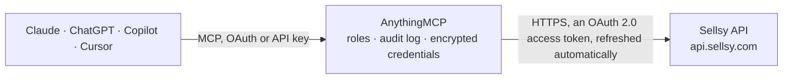

<!-- Generated by scripts/export-github-catalog.mjs in the anythingmcp-website repository. Do not edit by hand. -->

# Sellsy MCP connector

Sellsy, the French CRM and invoicing suite: companies, individuals and contacts, opportunities and pipelines, estimates, orders, invoices, credit notes, payments, catalogue items, tasks, comments and … The AnythingMCP connector gives Claude, ChatGPT, Microsoft Copilot, Cursor and Gemini 93 MCP tools for Sellsy: 70 read and 23 can change data.

**Category:** [CRM](../crm.md) · **Tools:** 93 · **Setup guide:** [anythingmcp.com](https://anythingmcp.com/guides/sellsy-to-mcp) · [Deutsch](https://anythingmcp.com/de/guides/sellsy-to-mcp) · [Italiano](https://anythingmcp.com/it/guides/sellsy-to-mcp) · [Español](https://anythingmcp.com/es/guides/sellsy-to-mcp) · [日本語](https://anythingmcp.com/ja/guides/sellsy-to-mcp) · [Русский](https://anythingmcp.com/ru/guides/sellsy-to-mcp) · [中文](https://anythingmcp.com/zh/guides/sellsy-to-mcp)

## Start without code

No installation and no terminal: AnythingMCP Cloud runs the Sellsy connector for you, operated by helpcode.ai in Frankfurt, Germany.

1. **Click the button above** and create an account or sign in. The Sellsy connector opens, ready to install.
2. **Sign in with your Sellsy account** when AnythingMCP asks. The first time, an admin creates a small app in the Sellsy developer console. Every click is in the [step-by-step guide](https://anythingmcp.com/guides/sellsy-to-mcp).
3. **Click Install.** AnythingMCP shows the address of your MCP server.
4. **Add that address to your assistant:** [Claude](https://anythingmcp.com/guides/connect-sellsy-to-claude) · [ChatGPT](https://anythingmcp.com/guides/connect-sellsy-to-chatgpt) · [Microsoft Copilot](https://anythingmcp.com/guides/connect-sellsy-to-copilot) · [Cursor](https://anythingmcp.com/guides/connect-sellsy-to-cursor) · [Gemini CLI](https://anythingmcp.com/guides/connect-sellsy-to-gemini) · [Meta Muse](https://anythingmcp.com/guides/connect-sellsy-to-muse).
5. **Ask your first question**, for example: *What’s the status and outstanding amount for invoice INV-2026-0145 dated 10/09/2026?*

Prefer help with the setup? [Talk to us](https://anythingmcp.com/contact).

## How it works

- **The AI client** speaks MCP (Streamable HTTP) to AnythingMCP and only sees tool names, descriptions and results. It never gets the Sellsy credentials.
- **AnythingMCP** checks the client's role, builds the call from the tool definition, adds the credentials (an OAuth 2.0 access token, refreshed automatically), calls Sellsy, logs the call and returns the result.
- **Sellsy** sees an ordinary API client with the rights of the account the credentials belong to.

## Tools

| Tool | What it does | Access |
|---|---|---|
| [`sellsy_list_companies`](#sellsy_list_companies) | List client companies with their name, SIRET, VAT number, address and owner. | read |
| [`sellsy_search_companies`](#sellsy_search_companies) | Search companies with Sellsy's filter object (a POST that only reads). | read |
| [`sellsy_get_company`](#sellsy_get_company) | Read one client company in full: addresses, contacts, tax identifiers, rating and the notes recorded against it. | read |
| [`sellsy_list_contacts`](#sellsy_list_contacts) | List individual contacts with their name, e-mail, phone, position and the company they belong to. | read |
| [`sellsy_list_invoices`](#sellsy_list_invoices) | List invoices with their number, date, due date, client, net and gross totals and payment status: the receivables view. | read |
| [`sellsy_search_invoices`](#sellsy_search_invoices) | Search invoices with Sellsy's filter object: by status, date range, client or amount. | read |
| [`sellsy_get_invoice`](#sellsy_get_invoice) | Read one invoice in full: every row with its quantity, unit price, discount and VAT, the totals and the related parties. | read |
| [`sellsy_list_estimates`](#sellsy_list_estimates) | List estimates (devis) with their number, date, client, total and acceptance status: what is out with prospects and not yet won. | read |
| [`sellsy_list_opportunities`](#sellsy_list_opportunities) | List CRM opportunities with their name, client, amount, funnel step and expected close date: the pipeline view. | read |
| [`sellsy_list_items`](#sellsy_list_items) | List catalogue items with their reference, name, unit price, VAT rate and stock tracking flag. | read |
| [`sellsy_get_contact`](#sellsy_get_contact) | Read one contact (person) in full: name, email and phone numbers, position, note, addresses, owner, archive state and custom fields. | read |
| [`sellsy_list_contact_companies`](#sellsy_list_contact_companies) | List the companies a contact is linked to. | read |
| [`sellsy_edit_contact`](#sellsy_edit_contact) | Change fields of a contact. | write |
| [`sellsy_edit_company`](#sellsy_edit_company) | Change fields of a company. | write |
| [`sellsy_create_company`](#sellsy_create_company) | Create a company (a client, prospect or supplier). | write |
| [`sellsy_list_company_contacts`](#sellsy_list_company_contacts) | List the contacts (people) linked to a company, with name, e-mail, phones, position and their roles at the company. | read |
| [`sellsy_link_contact_to_company`](#sellsy_link_contact_to_company) | Link an existing contact to a company, optionally with roles (e.g. ["main", "invoicing", "dunning"]). | write |
| [`sellsy_list_company_addresses`](#sellsy_list_company_addresses) | List the addresses of a company (invoicing, delivery and others) with their ids, for use as invoicing_address_id or delivery_address_id on documents. | read |
| [`sellsy_create_company_address`](#sellsy_create_company_address) | Add an address to a company. | write |
| [`sellsy_get_company_custom_fields`](#sellsy_get_company_custom_fields) | Read the custom field values of a company: field id, name, type and value. | read |
| [`sellsy_update_company_custom_fields`](#sellsy_update_company_custom_fields) | Set custom field values on a company. | write |
| [`sellsy_list_company_files`](#sellsy_list_company_files) | List the directories and files attached to a company (contracts, scans, exports), with file ids for sellsy_get_file. | read |
| [`sellsy_list_individuals`](#sellsy_list_individuals) | List individuals (private persons who are clients, prospects or suppliers in their own right, unlike contacts who belong to a company) with name, e-mail,… | read |
| [`sellsy_search_individuals`](#sellsy_search_individuals) | Search individual with Sellsy's filter object (a POST that only reads). | read |
| [`sellsy_get_individual`](#sellsy_get_individual) | Read one individual in full: name, contact details, type, addresses, owner and notes. | read |
| [`sellsy_create_individual`](#sellsy_create_individual) | Create an individual (a private person as client, prospect or supplier). | write |
| [`sellsy_edit_individual`](#sellsy_edit_individual) | Change fields of an individual. | write |
| [`sellsy_search_contacts`](#sellsy_search_contacts) | Search contact with Sellsy's filter object (a POST that only reads). | read |
| [`sellsy_create_contact`](#sellsy_create_contact) | Create a contact (a person, usually working at a company). | write |
| [`sellsy_get_opportunity`](#sellsy_get_opportunity) | Read one opportunity: name, status, pipeline and step, amount, probability, due date, source, related company or individual, contacts, assigned staff and note. | read |
| [`sellsy_search_opportunities`](#sellsy_search_opportunities) | Search opportunity with Sellsy's filter object (a POST that only reads). | read |
| [`sellsy_create_opportunity`](#sellsy_create_opportunity) | Create an opportunity in a pipeline step for a company or individual. | write |
| [`sellsy_update_opportunity`](#sellsy_update_opportunity) | Partly update an opportunity, e.g. mark it won or lost, change its amount or due date. | write |
| [`sellsy_move_opportunity_step`](#sellsy_move_opportunity_step) | Move an opportunity to another step of its pipeline (the kanban move), optionally placing it before another opportunity. | write |
| [`sellsy_list_opportunity_pipelines`](#sellsy_list_opportunity_pipelines) | List the opportunity pipelines (sales funnels) with their ids and names. | read |
| [`sellsy_list_pipeline_steps`](#sellsy_list_pipeline_steps) | List the steps of one pipeline in order, with id, name, rank and default probability. | read |
| [`sellsy_list_opportunity_sources`](#sellsy_list_opportunity_sources) | List the opportunity sources (where leads come from: website, trade fair, referral...) with their ids. | read |
| [`sellsy_list_opportunity_categories`](#sellsy_list_opportunity_categories) | List the categories that group opportunity sources; embed sources returns the sources of each category. | read |
| [`sellsy_get_estimate`](#sellsy_get_estimate) | Read one estimate (devis) in full: number, date, expiry date, status, related parties, rows with quantity, price and VAT, totals and the PDF link. | read |
| [`sellsy_search_estimates`](#sellsy_search_estimates) | Search estimate with Sellsy's filter object (a POST that only reads). | read |
| [`sellsy_create_estimate`](#sellsy_create_estimate) | Create an estimate (devis) as a draft. | write |
| [`sellsy_update_estimate_status`](#sellsy_update_estimate_status) | Change the status of an estimate, e.g. to accepted when the client signed or refused when they declined. | write |
| [`sellsy_create_invoice`](#sellsy_create_invoice) | Create an invoice as a draft (it gets its final number when validated with sellsy_validate_invoice). | write |
| [`sellsy_validate_invoice`](#sellsy_validate_invoice) | Validate a draft invoice: it gets its definitive number, can no longer be edited and is due. | write |
| [`sellsy_list_invoice_payments`](#sellsy_list_invoice_payments) | List the payments recorded on one invoice: amount, date, payment method and status. | read |
| [`sellsy_list_invoice_credit_notes`](#sellsy_list_invoice_credit_notes) | List the credit notes linked to one invoice (refunds and corrections), with number and amounts. | read |
| [`sellsy_list_invoice_files`](#sellsy_list_invoice_files) | List the directories and files attached to one invoice, with file ids for sellsy_get_file. | read |
| [`sellsy_list_credit_notes`](#sellsy_list_credit_notes) | List credit notes (avoirs) with number, date, client, amounts and status (draft, stored, partialspend, spent, cancelled). | read |
| [`sellsy_search_credit_notes`](#sellsy_search_credit_notes) | Search credit note with Sellsy's filter object (a POST that only reads). | read |
| [`sellsy_get_credit_note`](#sellsy_get_credit_note) | Read one credit note in full: rows, totals, status, related parties and the invoices it refers to. | read |
| [`sellsy_list_orders`](#sellsy_list_orders) | List sales orders (bons de commande) with number, date, client, amount, status and delivery status (order_status: none, wait, picking, sent, partialsent). | read |
| [`sellsy_search_orders`](#sellsy_search_orders) | Search order with Sellsy's filter object (a POST that only reads). | read |
| [`sellsy_get_order`](#sellsy_get_order) | Read one sales order in full: rows, totals, status, delivery status and related parties. | read |
| [`sellsy_list_deliveries`](#sellsy_list_deliveries) | List delivery notes (bons de livraison) with number, date, client and delivery status. | read |
| [`sellsy_list_payments`](#sellsy_list_payments) | List payments received or made, with amount, currency, paid date, payment method, status and the documents they settle. | read |
| [`sellsy_search_payments`](#sellsy_search_payments) | Search payment with Sellsy's filter object (a POST that only reads). | read |
| [`sellsy_get_payment`](#sellsy_get_payment) | Read one payment: amount, date, method, status, number and the documents it is allocated to. | read |
| [`sellsy_list_payment_methods`](#sellsy_list_payment_methods) | List the payment methods of the account (transfer, card, cheque, direct debit...) with their ids for payment_method_ids on documents. | read |
| [`sellsy_get_item`](#sellsy_get_item) | Read one catalogue item: type, reference, name, description, reference price, purchase price, VAT, unit and accounting codes. | read |
| [`sellsy_search_items`](#sellsy_search_items) | Search item with Sellsy's filter object (a POST that only reads). | read |
| [`sellsy_create_item`](#sellsy_create_item) | Create a catalogue item (product or service). | write |
| [`sellsy_edit_item`](#sellsy_edit_item) | Change fields of a catalogue item. | write |
| [`sellsy_get_item_prices`](#sellsy_get_item_prices) | Read the prices of an item per rate category (price lists), with amounts with and without tax. | read |
| [`sellsy_list_taxes`](#sellsy_list_taxes) | List the VAT rates (taxes) of the account with id, rate and label, for tax_id on items and document rows. | read |
| [`sellsy_list_units`](#sellsy_list_units) | List the units of measure (piece, hour, day, kg...) with their ids, for unit_id on items and rows. | read |
| [`sellsy_list_currencies`](#sellsy_list_currencies) | List the currencies available on the account, with code and symbol. | read |
| [`sellsy_list_payment_terms`](#sellsy_list_payment_terms) | List the payment terms of the account (on order, 30 days, end of month...) with their ids, for payment_terms on invoices and estimates. | read |
| [`sellsy_list_rate_categories`](#sellsy_list_rate_categories) | List the rate categories (price lists such as retail or wholesale) with their ids. | read |
| [`sellsy_list_custom_fields`](#sellsy_list_custom_fields) | List the custom field definitions of the account: id, name, code, type, options and which objects they apply to. | read |
| [`sellsy_list_tasks`](#sellsy_list_tasks) | List tasks (to-dos) with title, due date, status (todo or done), label, priority, assignees and the record they belong to. | read |
| [`sellsy_search_tasks`](#sellsy_search_tasks) | Search task with Sellsy's filter object (a POST that only reads). | read |
| [`sellsy_get_task`](#sellsy_get_task) | Read one task: title, description, due date, status, label, priority, reminders, assignees and the related record. | read |
| [`sellsy_create_task`](#sellsy_create_task) | Create a task (to-do) on a record, e.g. a follow-up call on a company. | write |
| [`sellsy_update_task`](#sellsy_update_task) | Update a task, e.g. set status done, move the due date or reassign it. | write |
| [`sellsy_list_task_labels`](#sellsy_list_task_labels) | List the task labels (types such as call, e-mail, meeting) with their ids, for label_id when creating tasks. | read |
| [`sellsy_list_comments`](#sellsy_list_comments) | List comments (notes left on companies, contacts, opportunities and documents) with text, author, date and related record. | read |
| [`sellsy_search_comments`](#sellsy_search_comments) | Search comment with Sellsy's filter object (a POST that only reads). | read |
| [`sellsy_create_comment`](#sellsy_create_comment) | Add a comment (note) to a record, e.g. a summary of a call on a company or opportunity. | write |
| [`sellsy_list_calendar_events`](#sellsy_list_calendar_events) | List calendar events (meetings, appointments) with title, start and end, label, participants and related record. | read |
| [`sellsy_search_calendar_events`](#sellsy_search_calendar_events) | Search calendar event with Sellsy's filter object (a POST that only reads). | read |
| [`sellsy_get_calendar_event`](#sellsy_get_calendar_event) | Read one calendar event: title, description, start and end, all-day flag, label, participants and related record. | read |
| [`sellsy_create_calendar_event`](#sellsy_create_calendar_event) | Create a calendar event (meeting or appointment), optionally linked to a record and with participants. | write |
| [`sellsy_update_calendar_event`](#sellsy_update_calendar_event) | Update a calendar event, e.g. move it or change its title. | write |
| [`sellsy_list_calendar_event_labels`](#sellsy_list_calendar_event_labels) | List the calendar event labels (meeting, call, demo...) with their ids, for label_id when creating events. | read |
| [`sellsy_list_crm_activity`](#sellsy_list_crm_activity) | Read the CRM activity feed: e-mails, calls, meetings, comments and other events logged on records, with date, author and label. | read |
| [`sellsy_list_staffs`](#sellsy_list_staffs) | List the staff members (users of the Sellsy account) with id, name, e-mail and status. | read |
| [`sellsy_get_staff`](#sellsy_get_staff) | Read one staff member. | read |
| [`sellsy_list_teams`](#sellsy_list_teams) | List the teams of the Sellsy account (groups of staff members) with their ids and members. | read |
| [`sellsy_get_file`](#sellsy_get_file) | Read one file attached in Sellsy: name, size, type, the record it belongs to and its download link. | read |
| [`sellsy_list_subscriptions`](#sellsy_list_subscriptions) | List subscriptions (recurring invoicing plans) with client, frequency, amounts and next invoice date. | read |
| [`sellsy_get_subscription`](#sellsy_get_subscription) | Read one subscription (recurring invoicing plan); embed payment_installments adds its installments. | read |
| [`sellsy_search`](#sellsy_search) | Search the whole account by text, like the search bar: companies, individuals, contacts, opportunities, items, documents and staff. | read |
| [`sellsy_get_quotas`](#sellsy_get_quotas) | Read the API quotas of the account: requests allowed and used in the current windows. | read |

## Tool reference

Every parameter as the AI client sees it in `tools/list`. Source: [`packages/backend/src/adapters/fr/sellsy.json`](../../../packages/backend/src/adapters/fr/sellsy.json).

### `sellsy_list_companies`

List client companies with their name, SIRET, VAT number, address and owner. The quickest call for checking the OAuth client works.

**Access:** read · **Call:** `GET /companies`

| Parameter | Type | Required | Description |
|---|---|---|---|
| `limit` | integer | no | Rows per page, 1-100 (default 25). |
| `offset` | string | no | `pagination.offset` from the previous response (an opaque seek token). A plain page number (0, 1, 2…) also works, up to the first 100,000 results. |
| `order` | `name` \| `id` \| `created_at` \| `updated_at` | no | Sort field. |
| `direction` | `asc` \| `desc` | no | Sort direction. |
| `embed` | string[] | no | Related objects to return inline. Allowed values only: invoicing_address, delivery_address, e_invoicing, main_contact, dunning_contact, invoicing_contact, opportunities, estimates, invoices, orders, deliveries, acl, smart_tags, owner, or cf.<customFieldId>. Any other value is a 400. |

### `sellsy_search_companies`

Search companies with Sellsy's filter object (a POST that only reads). Only the documented filter keys are accepted; an unknown key or a bare date is a 400.

**Access:** read · **Call:** `POST /companies/search`

| Parameter | Type | Required | Description |
|---|---|---|---|
| `filters` | object | yes | Sellsy company filters. ONLY these keys are accepted, anything else is a 400: name (string, exact match), email (string, exact), type (array of prospect\|client\|supplier), is_archived (boolean), id (array of integer company ids; the key is `id`, not `ids`), contacts (array of integer contact ids), siret (string), vat (string), reference (array of strings), country_code (string), postal_code (array of strings), number_of_employees ({"min": n, "max": n}), favourite_filter (integer), created ({"start", "end"}), updated_at ({"start", "end"}; the key is `updated_at`, not `updated`). Dates must be full ISO 8601 date-times, e.g. {"created": {"start": "2026-01-01T00:00:00+00:00"}}; a bare date is rejected. Pass {} for no filter. |
| `limit` | integer | no | Rows per page, 1-100 (default 25). |
| `offset` | string | no | `pagination.offset` from the previous response (an opaque seek token). A plain page number (0, 1, 2…) also works, up to the first 100,000 results. |
| `order` | `name` \| `id` \| `created_at` \| `updated_at` | no | Sort field. |
| `direction` | `asc` \| `desc` | no | Sort direction. |

### `sellsy_get_company`

Read one client company in full: addresses, contacts, tax identifiers, rating and the notes recorded against it.

**Access:** read · **Call:** `GET /companies/{companyId}`

| Parameter | Type | Required | Description |
|---|---|---|---|
| `companyId` | number | yes | Numeric Sellsy company id. |
| `embed` | string[] | no | Related objects to return inline. Allowed values only: invoicing_address, delivery_address, e_invoicing, main_contact, dunning_contact, invoicing_contact, opportunities, estimates, invoices, orders, deliveries, acl, smart_tags, owner, or cf.<customFieldId>. Any other value (e.g. `contacts`) is a 400. |

### `sellsy_list_contacts`

List individual contacts with their name, e-mail, phone, position and the company they belong to.

**Access:** read · **Call:** `GET /contacts`

| Parameter | Type | Required | Description |
|---|---|---|---|
| `limit` | integer | no | Rows per page, 1-100 (default 25). |
| `offset` | string | no | `pagination.offset` from the previous response (an opaque seek token). A plain page number (0, 1, 2…) also works, up to the first 100,000 results. |
| `order` | `id` \| `name` \| `created_at` | no | Sort field. |
| `direction` | `asc` \| `desc` | no | Sort direction. |

### `sellsy_list_invoices`

List invoices with their number, date, due date, client, net and gross totals and payment status: the receivables view.

**Access:** read · **Call:** `GET /invoices`

| Parameter | Type | Required | Description |
|---|---|---|---|
| `limit` | integer | no | Rows per page, 1-100 (default 25). |
| `offset` | string | no | `pagination.offset` from the previous response (an opaque seek token). A plain page number (0, 1, 2…) also works, up to the first 100,000 results. |
| `order` | `id` \| `number` \| `created` \| `date` \| `amount` \| `due_date` | no | Sort field. |
| `direction` | `asc` \| `desc` | no | Sort direction. |
| `embed` | string[] | no | Related objects to return inline. Allowed values only: acl, owner, related, contact, individual, company, fiscal_year, currency, smart_tags, deposits, invoicing_address, delivery_address, issuer_address, payment_method_ids, or cf.<customFieldId>. |

### `sellsy_search_invoices`

Search invoices with Sellsy's filter object: by status, date range, client or amount. A POST that only reads.

**Access:** read · **Call:** `POST /invoices/search`

| Parameter | Type | Required | Description |
|---|---|---|---|
| `filters` | object | yes | Sellsy invoice filters. Allowed keys: date ({"start", "end"} as plain dates YYYY-MM-DD, the invoice date), created / updated ({"start", "end"} as full ISO 8601 date-times, e.g. 2026-01-01T00:00:00+00:00; a bare date is rejected), status (array of draft\|due\|payinprogress\|paid\|late\|cancelled), related_objects (array of {"type": company\|individual\|opportunity, "id": n}), contacts, owners, assigned_staff_ids (arrays of integer ids), number (string), currency (string), credit_note_id (integer), is_deposit (boolean), is_progress_invoice (boolean), lifecycle_status (array of integer), favourite_filter (integer). Example: {"status": ["late"], "date": {"start": "2026-01-01"}}. Pass {} for no filter. |
| `limit` | integer | no | Rows per page, 1-100 (default 25). |
| `offset` | string | no | `pagination.offset` from the previous response (an opaque seek token). A plain page number (0, 1, 2…) also works, up to the first 100,000 results. |
| `order` | `id` \| `number` \| `created` \| `date` \| `amount` \| `due_date` | no | Sort field. |
| `direction` | `asc` \| `desc` | no | Sort direction. |

### `sellsy_get_invoice`

Read one invoice in full: every row with its quantity, unit price, discount and VAT, the totals and the related parties. Payments are not part of this response.

**Access:** read · **Call:** `GET /invoices/{invoiceId}`

| Parameter | Type | Required | Description |
|---|---|---|---|
| `invoiceId` | number | yes | Numeric Sellsy invoice id. |
| `embed` | string[] | no | Related objects to return inline. Allowed values only: acl, payment_terms, owner, related, contact, individual, company, fiscal_year, currency, automatic_dunning, smart_tags, discount_incl_taxes, deposits, invoicing_address, delivery_address, issuer_address, payment_method_ids, settings, file, or cf.<customFieldId>. Rows are returned without an embed. |

### `sellsy_list_estimates`

List estimates (devis) with their number, date, client, total and acceptance status: what is out with prospects and not yet won.

**Access:** read · **Call:** `GET /estimates`

| Parameter | Type | Required | Description |
|---|---|---|---|
| `limit` | integer | no | Rows per page, 1-100 (default 25). |
| `offset` | string | no | `pagination.offset` from the previous response (an opaque seek token). A plain page number (0, 1, 2…) also works, up to the first 100,000 results. |
| `order` | `id` \| `numero` \| `created` \| `date` \| `expiry_date` \| `number` \| `amount` | no | Sort field. |
| `direction` | `asc` \| `desc` | no | Sort direction. |

### `sellsy_list_opportunities`

List CRM opportunities with their name, client, amount, funnel step and expected close date: the pipeline view.

**Access:** read · **Call:** `GET /opportunities`

| Parameter | Type | Required | Description |
|---|---|---|---|
| `limit` | integer | no | Rows per page, 1-100 (default 25). |
| `offset` | string | no | `pagination.offset` from the previous response (an opaque seek token). A plain page number (0, 1, 2…) also works, up to the first 100,000 results. |
| `order` | `id` \| `created` \| `step_rank` \| `due_date` \| `amount` | no | Sort field. |
| `direction` | `asc` \| `desc` | no | Sort direction. |

### `sellsy_list_items`

List catalogue items with their reference, name, unit price, VAT rate and stock tracking flag.

**Access:** read · **Call:** `GET /items`

| Parameter | Type | Required | Description |
|---|---|---|---|
| `limit` | integer | no | Rows per page, 1-100 (default 25). |
| `offset` | string | no | `pagination.offset` from the previous response (an opaque seek token). A plain page number (0, 1, 2…) also works, up to the first 100,000 results. |
| `order` | `id` \| `created_at` | no | Sort field. |
| `direction` | `asc` \| `desc` | no | Sort direction. |

### `sellsy_get_contact`

Read one contact (person) in full: name, email and phone numbers, position, note, addresses, owner, archive state and custom fields. Read it before sellsy_edit_contact.

**Access:** read · **Call:** `GET /contacts/{contactId}`

| Parameter | Type | Required | Description |
|---|---|---|---|
| `contactId` | number | yes | Numeric Sellsy contact id. |

### `sellsy_list_contact_companies`

List the companies a contact is linked to. Check this before merging, archiving or moving a contact, since one person can belong to several companies.

**Access:** read · **Call:** `GET /contacts/{contactId}/companies`

| Parameter | Type | Required | Description |
|---|---|---|---|
| `contactId` | number | yes | Numeric Sellsy contact id. |

### `sellsy_edit_contact`

Change fields of a contact. Send only the fields that change, e.g. {"email": "...", "mobile_number": "...", "position": "...", "note": "...", "is_archived": false}; the others stay as they are. Field names are those returned by sellsy_get_contact. Writes to the live CRM: confirm the change with the user first.

**Access:** write · **Call:** `PUT /contacts/{contactId}`

| Parameter | Type | Required | Description |
|---|---|---|---|
| `contactId` | number | yes | Numeric Sellsy contact id. |
| `fields` | object | yes | The fields to change, as a JSON object. |

### `sellsy_edit_company`

Change fields of a company. Send only the fields that change, e.g. {"name": "..."} or {"is_archived": true} to archive it (false restores it); the others stay as they are. Field names are those returned by sellsy_get_company. Writes to the live CRM: confirm the change with the user first, one company at a time.

**Access:** write · **Call:** `PUT /companies/{companyId}`

| Parameter | Type | Required | Description |
|---|---|---|---|
| `companyId` | number | yes | Numeric Sellsy company id. |
| `fields` | object | yes | The fields to change, as a JSON object. |

### `sellsy_create_company`

Create a company (a client, prospect or supplier). Returns the new company with its id. Writes to the live CRM: confirm with the user first.

**Access:** write · **Call:** `POST /companies`

| Parameter | Type | Required | Description |
|---|---|---|---|
| `type` | `prospect` \| `client` \| `supplier` | yes | Kind of company. |
| `name` | string | yes | Company name. |
| `email` | string | no | Main e-mail address. |
| `phone_number` | string | no | Phone number. |
| `website` | string | no | Website URL. |
| `reference` | string | no | Your own reference (client code). |
| `note` | string | no | Free note on the company. |
| `owner_id` | integer | no | Staff id of the owner (sellsy_list_staffs). |
| `legal_france` | object | no | French legal identifiers, e.g. {"siret": "...", "siren": "...", "vat": "FR...", "ape_naf_code": "...", "company_type": "SAS"}. |

### `sellsy_list_company_contacts`

List the contacts (people) linked to a company, with name, e-mail, phones, position and their roles at the company.

**Access:** read · **Call:** `GET /companies/{companyId}/contacts`

| Parameter | Type | Required | Description |
|---|---|---|---|
| `companyId` | number | yes | Numeric Sellsy company id. |
| `limit` | integer | no | Rows per page, 1-100 (default 25). |
| `offset` | string | no | `pagination.offset` from the previous response (an opaque seek token). A plain page number (0, 1, 2...) also works, up to the first 100,000 results. |
| `direction` | `asc` \| `desc` | no | Sort direction. |
| `embed` | string[] | no | Related objects to return inline. Allowed values only: invoicing_address, delivery_address, opportunities, estimates, invoices, orders, deliveries, proposals, proposals_ids, acl, smart_tags, owner, company, or cf.<customFieldId>. Any other value is a 400. |

### `sellsy_link_contact_to_company`

Link an existing contact to a company, optionally with roles (e.g. ["main", "invoicing", "dunning"]). Writes to the live CRM: confirm with the user first.

**Access:** write · **Call:** `POST /companies/{companyId}/contacts/{contactId}`

| Parameter | Type | Required | Description |
|---|---|---|---|
| `companyId` | number | yes | Numeric Sellsy company id. |
| `contactId` | number | yes | Numeric Sellsy contact id. |
| `roles` | string[] | no | Roles of the contact at the company: main, dunning, invoicing, or a custom role id. |

### `sellsy_list_company_addresses`

List the addresses of a company (invoicing, delivery and others) with their ids, for use as invoicing_address_id or delivery_address_id on documents.

**Access:** read · **Call:** `GET /companies/{companyId}/addresses`

| Parameter | Type | Required | Description |
|---|---|---|---|
| `companyId` | number | yes | Numeric Sellsy company id. |

### `sellsy_create_company_address`

Add an address to a company. The first address becomes the invoicing and delivery address unless set otherwise. Writes to the live CRM: confirm with the user first.

**Access:** write · **Call:** `POST /companies/{companyId}/addresses`

| Parameter | Type | Required | Description |
|---|---|---|---|
| `companyId` | number | yes | Numeric Sellsy company id. |
| `name` | string | yes | Label of the address, e.g. "Head office". |
| `address_line_1` | string | yes | Street and number. |
| `address_line_2` | string | no | Second address line. |
| `postal_code` | string | yes | Postal code. |
| `city` | string | yes | City. |
| `country_code` | string | yes | ISO 3166-1 alpha-2 country code, e.g. FR. |
| `is_invoicing_address` | boolean | no | Use as invoicing address. |
| `is_delivery_address` | boolean | no | Use as delivery address. |

### `sellsy_get_company_custom_fields`

Read the custom field values of a company: field id, name, type and value. Field definitions are in sellsy_list_custom_fields.

**Access:** read · **Call:** `GET /companies/{companyId}/custom-fields`

| Parameter | Type | Required | Description |
|---|---|---|---|
| `companyId` | number | yes | Numeric Sellsy company id. |
| `limit` | integer | no | Rows per page, 1-100 (default 25). |
| `offset` | string | no | `pagination.offset` from the previous response (an opaque seek token). A plain page number (0, 1, 2...) also works, up to the first 100,000 results. |

### `sellsy_update_company_custom_fields`

Set custom field values on a company. Only the listed fields change. Writes to the live CRM: confirm with the user first.

**Access:** write · **Call:** `PUT /companies/{companyId}/custom-fields`

| Parameter | Type | Required | Description |
|---|---|---|---|
| `companyId` | number | yes | Numeric Sellsy company id. |
| `values` | object[] | yes | The values to set, e.g. [{"id": 1542, "value": "Gold"}]; id is the custom field id from sellsy_list_custom_fields. |

### `sellsy_list_company_files`

List the directories and files attached to a company (contracts, scans, exports), with file ids for sellsy_get_file.

**Access:** read · **Call:** `GET /companies/{companyId}/files`

| Parameter | Type | Required | Description |
|---|---|---|---|
| `companyId` | number | yes | Numeric Sellsy company id. |

### `sellsy_list_individuals`

List individuals (private persons who are clients, prospects or suppliers in their own right, unlike contacts who belong to a company) with name, e-mail, phones and type.

**Access:** read · **Call:** `GET /individuals`

| Parameter | Type | Required | Description |
|---|---|---|---|
| `limit` | integer | no | Rows per page, 1-100 (default 25). |
| `offset` | string | no | `pagination.offset` from the previous response (an opaque seek token). A plain page number (0, 1, 2...) also works, up to the first 100,000 results. |
| `order` | `name` \| `id` \| `created_at` \| `updated_at` | no | Sort field. |
| `direction` | `asc` \| `desc` | no | Sort direction. |
| `embed` | string[] | no | Related objects to return inline. Allowed values only: invoicing_address, delivery_address, main_contact, dunning_contact, invoicing_contact, opportunities, estimates, invoices, orders, deliveries, proposals, proposals_ids, acl, smart_tags, owner, or cf.<customFieldId>. Any other value is a 400. |

### `sellsy_search_individuals`

Search individual with Sellsy's filter object (a POST that only reads). Only the documented filter keys are accepted; an unknown key or a bare date where a date-time is expected is a 400.

**Access:** read · **Call:** `POST /individuals/search`

| Parameter | Type | Required | Description |
|---|---|---|---|
| `filters` | object | yes | Sellsy individual filters. Allowed keys: name (string), email (string), type (array of prospect\|client\|supplier), is_archived (boolean), id (array of integer ids), country_code (string), postal_code (array of strings), reference (array of strings), favourite_filter (integer), created ({"start", "end"}), updated_at ({"start", "end"}). Dates must be full ISO 8601 date-times, e.g. {"created": {"start": "2026-01-01T00:00:00+00:00"}}; a bare date is rejected. Pass {} for no filter. |
| `limit` | integer | no | Rows per page, 1-100 (default 25). |
| `offset` | string | no | `pagination.offset` from the previous response (an opaque seek token). A plain page number (0, 1, 2...) also works, up to the first 100,000 results. |
| `order` | `name` \| `id` \| `created_at` \| `updated_at` | no | Sort field. |
| `direction` | `asc` \| `desc` | no | Sort direction. |

### `sellsy_get_individual`

Read one individual in full: name, contact details, type, addresses, owner and notes.

**Access:** read · **Call:** `GET /individuals/{individualId}`

| Parameter | Type | Required | Description |
|---|---|---|---|
| `individualId` | number | yes | Numeric Sellsy individual id. |
| `embed` | string[] | no | Related objects to return inline. Allowed values only: invoicing_address, delivery_address, main_contact, dunning_contact, invoicing_contact, opportunities, estimates, invoices, orders, deliveries, proposals, proposals_ids, acl, smart_tags, owner, or cf.<customFieldId>. Any other value is a 400. |

### `sellsy_create_individual`

Create an individual (a private person as client, prospect or supplier). Writes to the live CRM: confirm with the user first.

**Access:** write · **Call:** `POST /individuals`

| Parameter | Type | Required | Description |
|---|---|---|---|
| `type` | `prospect` \| `client` \| `supplier` | yes | Kind of individual. |
| `last_name` | string | yes | Last name. |
| `first_name` | string | no | First name. |
| `civility` | `mr` \| `mrs` \| `ms` | no | Civility. |
| `email` | string | no | E-mail address. |
| `phone_number` | string | no | Phone number. |
| `mobile_number` | string | no | Mobile number. |
| `reference` | string | no | Your own reference. |
| `note` | string | no | Free note. |
| `owner_id` | integer | no | Staff id of the owner. |

### `sellsy_edit_individual`

Change fields of an individual. Send only the fields that change, e.g. {"email": "...", "type": "client"}; field names are those of sellsy_get_individual. Writes to the live CRM: confirm with the user first.

**Access:** write · **Call:** `PUT /individuals/{individualId}`

| Parameter | Type | Required | Description |
|---|---|---|---|
| `individualId` | number | yes | Numeric Sellsy individual id. |
| `fields` | object | yes | The fields to change, as a JSON object. |

### `sellsy_search_contacts`

Search contact with Sellsy's filter object (a POST that only reads). Only the documented filter keys are accepted; an unknown key or a bare date where a date-time is expected is a 400.

**Access:** read · **Call:** `POST /contacts/search`

| Parameter | Type | Required | Description |
|---|---|---|---|
| `filters` | object | yes | Sellsy contact filters. Allowed keys: last_name (string), email (string), phone_number (string), mobile_number (string), companies (array of company ids), individuals (array of individual ids), id (array of integer ids), is_linked (boolean), country_code (string), postal_code (array of strings), favourite_filter (integer), created / updated / birth_date ({"start", "end"}). Dates must be full ISO 8601 date-times, e.g. {"created": {"start": "2026-01-01T00:00:00+00:00"}}; a bare date is rejected. Pass {} for no filter. |
| `limit` | integer | no | Rows per page, 1-100 (default 25). |
| `offset` | string | no | `pagination.offset` from the previous response (an opaque seek token). A plain page number (0, 1, 2...) also works, up to the first 100,000 results. |
| `order` | `id` \| `name` \| `created_at` | no | Sort field. |
| `direction` | `asc` \| `desc` | no | Sort direction. |

### `sellsy_create_contact`

Create a contact (a person, usually working at a company). Link it to a company afterwards with sellsy_link_contact_to_company. Writes to the live CRM: confirm with the user first.

**Access:** write · **Call:** `POST /contacts`

| Parameter | Type | Required | Description |
|---|---|---|---|
| `last_name` | string | yes | Last name. |
| `first_name` | string | no | First name. |
| `civility` | `mr` \| `mrs` \| `ms` | no | Civility. |
| `email` | string | no | E-mail address. |
| `phone_number` | string | no | Phone number. |
| `mobile_number` | string | no | Mobile number. |
| `position` | string | no | Job title. |
| `note` | string | no | Free note. |
| `owner_id` | integer | no | Staff id of the owner. |

### `sellsy_get_opportunity`

Read one opportunity: name, status, pipeline and step, amount, probability, due date, source, related company or individual, contacts, assigned staff and note.

**Access:** read · **Call:** `GET /opportunities/{opportunityId}`

| Parameter | Type | Required | Description |
|---|---|---|---|
| `opportunityId` | number | yes | Numeric Sellsy opportunity id. |
| `embed` | string[] | no | Related objects to return inline. Allowed values only: estimates, individual, invoices, orders, deliveries, proformas, creditnotes, estimates_ids, invoices_ids, orders_ids, deliveries_ids, proformas_ids, creditnotes_ids, proposals, proposals_ids, assigned_staffs, company, contacts, acl, currency, smart_tags, or cf.<customFieldId>. Any other value is a 400. |

### `sellsy_search_opportunities`

Search opportunity with Sellsy's filter object (a POST that only reads). Only the documented filter keys are accepted; an unknown key or a bare date where a date-time is expected is a 400.

**Access:** read · **Call:** `POST /opportunities/search`

| Parameter | Type | Required | Description |
|---|---|---|---|
| `filters` | object | yes | Sellsy opportunity filters. Allowed keys: name (string), number (string), statuses (array of open\|won\|lost\|cancelled\|closed\|late), pipeline (array of pipeline ids), step (array of step ids), amount ({"min", "max"}), related_objects (array of {"type": company\|individual, "id": n}), assigned_staffs, owners (arrays of staff ids), favourite_filter (integer), created / updated_status / due_date ({"start", "end"}). Dates must be full ISO 8601 date-times, e.g. {"created": {"start": "2026-01-01T00:00:00+00:00"}}; a bare date is rejected. Pass {} for no filter. |
| `limit` | integer | no | Rows per page, 1-100 (default 25). |
| `offset` | string | no | `pagination.offset` from the previous response (an opaque seek token). A plain page number (0, 1, 2...) also works, up to the first 100,000 results. |
| `order` | `id` \| `created` \| `step_rank` \| `due_date` \| `amount` | no | Sort field. |
| `direction` | `asc` \| `desc` | no | Sort direction. |

### `sellsy_create_opportunity`

Create an opportunity in a pipeline step for a company or individual. Get pipeline and step ids from sellsy_list_opportunity_pipelines and sellsy_list_pipeline_steps. Writes to the live CRM: confirm with the user first.

**Access:** write · **Call:** `POST /opportunities`

| Parameter | Type | Required | Description |
|---|---|---|---|
| `name` | string | yes | Opportunity name. |
| `pipeline` | integer | yes | Pipeline id. |
| `step` | integer | yes | Step id within that pipeline. |
| `related` | object[] | yes | Exactly one company or individual, plus optional contacts: [{"type": "company", "id": 123}] or [{"type": "individual", "id": 45}]. |
| `amount` | string | no | Potential amount in the account default currency, e.g. "12000.00". |
| `probability` | integer | no | Probability of winning, 0-100. |
| `due_date` | string | no | Expected closing date, YYYY-MM-DD. |
| `source` | integer | no | Source id from sellsy_list_opportunity_sources. |
| `note` | string | no | Free note. |
| `owner_id` | integer | no | Staff id of the owner (default: the API user). |
| `assigned_staff_ids` | integer[] | no | Staff ids assigned to the opportunity. |
| `contact_ids` | integer[] | no | Contact ids responsible on the client side. |

### `sellsy_update_opportunity`

Partly update an opportunity, e.g. mark it won or lost, change its amount or due date. List every field you send in only; Sellsy ignores the others. Writes to the live CRM: confirm with the user first.

**Access:** write · **Call:** `PATCH /opportunities/{opportunityId}`

| Parameter | Type | Required | Description |
|---|---|---|---|
| `opportunityId` | number | yes | Numeric Sellsy opportunity id. |
| `only` | `name` \| `owner_id` \| `status` \| `pipeline` \| `step` \| `amount` \| `probability` \| `origin` \| `due_date` \| `note`[] | yes | Names of the fields to update, e.g. ["status", "amount"]. |
| `name` | string | no | New name. |
| `owner_id` | integer | no | Staff id of the new owner. |
| `status` | `open` \| `won` \| `lost` \| `cancelled` \| `closed` \| `late` | no | New status. |
| `pipeline` | integer | no | New pipeline id. |
| `step` | integer | no | New step id. |
| `amount` | number | no | New potential amount. |
| `probability` | number | no | New probability, 0-100. |
| `origin` | string | no | Origin of the opportunity. |
| `due_date` | string | no | New expected closing date, YYYY-MM-DD. |
| `note` | string | no | New note. |

### `sellsy_move_opportunity_step`

Move an opportunity to another step of its pipeline (the kanban move), optionally placing it before another opportunity. Writes to the live CRM: confirm with the user first.

**Access:** write · **Call:** `PATCH /opportunities/{opportunityId}/step-rank`

| Parameter | Type | Required | Description |
|---|---|---|---|
| `opportunityId` | number | yes | Numeric Sellsy opportunity id. |
| `step` | integer | yes | Target step id from sellsy_list_pipeline_steps. |
| `before_sibling` | integer | no | Id of the opportunity to place it before; leave out to put it last. |

### `sellsy_list_opportunity_pipelines`

List the opportunity pipelines (sales funnels) with their ids and names.

**Access:** read · **Call:** `GET /opportunities/pipelines`

| Parameter | Type | Required | Description |
|---|---|---|---|
| `limit` | integer | no | Rows per page, 1-100 (default 25). |
| `offset` | string | no | `pagination.offset` from the previous response (an opaque seek token). A plain page number (0, 1, 2...) also works, up to the first 100,000 results. |
| `order` | `id` \| `rank` | no | Sort field. |
| `direction` | `asc` \| `desc` | no | Sort direction. |

### `sellsy_list_pipeline_steps`

List the steps of one pipeline in order, with id, name, rank and default probability. embed opportunities_number adds how many opportunities sit in each step.

**Access:** read · **Call:** `GET /opportunities/pipelines/{pipelineId}/steps`

| Parameter | Type | Required | Description |
|---|---|---|---|
| `pipelineId` | number | yes | Numeric Sellsy pipeline id. |
| `limit` | integer | no | Rows per page, 1-100 (default 25). |
| `offset` | string | no | `pagination.offset` from the previous response (an opaque seek token). A plain page number (0, 1, 2...) also works, up to the first 100,000 results. |
| `order` | `id` \| `rank` \| `probability` | no | Sort field. |
| `direction` | `asc` \| `desc` | no | Sort direction. |
| `embed` | string[] | no | Related objects to return inline. Allowed values only: opportunities_number. Any other value is a 400. |

### `sellsy_list_opportunity_sources`

List the opportunity sources (where leads come from: website, trade fair, referral...) with their ids.

**Access:** read · **Call:** `GET /opportunities/sources`

| Parameter | Type | Required | Description |
|---|---|---|---|
| `limit` | integer | no | Rows per page, 1-100 (default 25). |
| `offset` | string | no | `pagination.offset` from the previous response (an opaque seek token). A plain page number (0, 1, 2...) also works, up to the first 100,000 results. |
| `order` | `id` \| `rank` | no | Sort field. |
| `direction` | `asc` \| `desc` | no | Sort direction. |

### `sellsy_list_opportunity_categories`

List the categories that group opportunity sources; embed sources returns the sources of each category.

**Access:** read · **Call:** `GET /opportunities/categories`

| Parameter | Type | Required | Description |
|---|---|---|---|
| `direction` | `asc` \| `desc` | no | Sort direction. |
| `embed` | string[] | no | Related objects to return inline. Allowed values only: sources. Any other value is a 400. |

### `sellsy_get_estimate`

Read one estimate (devis) in full: number, date, expiry date, status, related parties, rows with quantity, price and VAT, totals and the PDF link.

**Access:** read · **Call:** `GET /estimates/{estimateId}`

| Parameter | Type | Required | Description |
|---|---|---|---|
| `estimateId` | number | yes | Numeric Sellsy estimate id. |
| `embed` | string[] | no | Related objects to return inline. Allowed values only: company, individual, contact, invoicing_address, delivery_address, issuer_address, currency, acl, payment_method_ids, fiscal_year, smart_tags, payment_terms, settings, rate_category, proposals, proposals_ids, or cf.<customFieldId>. Any other value is a 400. |

### `sellsy_search_estimates`

Search estimate with Sellsy's filter object (a POST that only reads). Only the documented filter keys are accepted; an unknown key or a bare date where a date-time is expected is a 400.

**Access:** read · **Call:** `POST /estimates/search`

| Parameter | Type | Required | Description |
|---|---|---|---|
| `filters` | object | yes | Sellsy estimate filters. Allowed keys: status (array of draft\|sent\|read\|accepted\|refused\|expired\|advanced\|partialinvoiced\|invoiced\|cancelled), date ({"start", "end"} as plain dates YYYY-MM-DD), created / updated ({"start", "end"} as full date-times), related_objects (array of {"type": company\|individual\|opportunity, "id": n}), contacts, owners, assigned_staff_ids (arrays of ids), number (string), currency (string), favourite_filter (integer). Pass {} for no filter. |
| `limit` | integer | no | Rows per page, 1-100 (default 25). |
| `offset` | string | no | `pagination.offset` from the previous response (an opaque seek token). A plain page number (0, 1, 2...) also works, up to the first 100,000 results. |
| `order` | `id` \| `number` \| `created` \| `date` \| `expiry_date` \| `amount` | no | Sort field. |
| `direction` | `asc` \| `desc` | no | Sort direction. |

### `sellsy_create_estimate`

Create an estimate (devis) as a draft. Send the document as an object; the totals are computed by Sellsy. Writes to the live CRM: confirm with the user first.

**Access:** write · **Call:** `POST /estimates`

| Parameter | Type | Required | Description |
|---|---|---|---|
| `document` | object | yes | The estimate. Required: related, e.g. [{"type": "company", "id": 123}] (a company, individual or opportunity; add {"type": "contact", "id": n} for the contact). Common fields: date and expiry_date (YYYY-MM-DD), subject, currency (e.g. EUR), note, assigned_staff_id, contact_id, invoicing_address_id, payment_terms ({"id": n}), rows: an array of rows, each {"type": "single", "reference": "...", "description": "...", "unit_amount": "100.00", "quantity": "2", "tax_id": n, "unit_id": n} for a free line, {"type": "catalog", "related": {"type": "product"\|"service", "id": itemId}, "quantity": "1"} for a catalogue item, or {"type": "comment", "text": "..."}, {"type": "title", "text": "..."}, {"type": "sub-total"}, {"type": "break-line"}, {"type": "break-page"}. |

### `sellsy_update_estimate_status`

Change the status of an estimate, e.g. to accepted when the client signed or refused when they declined. Writes to the live CRM: confirm with the user first.

**Access:** write · **Call:** `PUT /estimates/{estimateId}/status`

| Parameter | Type | Required | Description |
|---|---|---|---|
| `estimateId` | number | yes | Numeric Sellsy estimate id. |
| `status` | `draft` \| `sent` \| `read` \| `accepted` \| `refused` \| `expired` \| `advanced` \| `partialinvoiced` \| `invoiced` \| `cancelled` | yes | New status. |

### `sellsy_create_invoice`

Create an invoice as a draft (it gets its final number when validated with sellsy_validate_invoice). Send the document as an object; the totals are computed by Sellsy. Writes to the live CRM: confirm with the user first.

**Access:** write · **Call:** `POST /invoices`

| Parameter | Type | Required | Description |
|---|---|---|---|
| `document` | object | yes | The invoice. Required: related, e.g. [{"type": "company", "id": 123}] (one client company or individual, optionally a contact and opportunities). Common fields: date (YYYY-MM-DD), subject, currency (e.g. EUR), payment_terms ({"id": n} from sellsy_list_payment_terms), note, order_reference, assigned_staff_id, invoicing_address_id, payment_method_ids, rows: an array of rows, each {"type": "single", "reference": "...", "description": "...", "unit_amount": "100.00", "quantity": "2", "tax_id": n, "unit_id": n} for a free line, {"type": "catalog", "related": {"type": "product"\|"service", "id": itemId}, "quantity": "1"} for a catalogue item, or {"type": "comment", "text": "..."}, {"type": "title", "text": "..."}, {"type": "sub-total"}, {"type": "break-line"}, {"type": "break-page"}. |

### `sellsy_validate_invoice`

Validate a draft invoice: it gets its definitive number, can no longer be edited and is due. Under French e-invoicing rules this may also send it. Irreversible: confirm with the user first.

**Access:** write · **Call:** `POST /invoices/{invoiceId}/validate`

| Parameter | Type | Required | Description |
|---|---|---|---|
| `invoiceId` | number | yes | Numeric Sellsy invoice id. |
| `date` | string | no | Invoice date to set, YYYY-MM-DD (depending on the conformity settings it may not be in the future). |
| `einvoicing_flow` | `einvoicing` \| `ereporting` | no | E-invoicing flow; leave out for the recommended one. |

### `sellsy_list_invoice_payments`

List the payments recorded on one invoice: amount, date, payment method and status. Use it to see what is still open on an invoice.

**Access:** read · **Call:** `GET /invoices/{invoiceId}/payments`

| Parameter | Type | Required | Description |
|---|---|---|---|
| `invoiceId` | number | yes | Numeric Sellsy invoice id. |
| `order` | `paid_at` \| `id` | no | Sort field. |
| `direction` | `asc` \| `desc` | no | Sort direction. |

### `sellsy_list_invoice_credit_notes`

List the credit notes linked to one invoice (refunds and corrections), with number and amounts.

**Access:** read · **Call:** `GET /invoices/{invoiceId}/credit-notes`

| Parameter | Type | Required | Description |
|---|---|---|---|
| `invoiceId` | number | yes | Numeric Sellsy invoice id. |
| `limit` | integer | no | Rows per page, 1-100 (default 25). |
| `offset` | string | no | `pagination.offset` from the previous response (an opaque seek token). A plain page number (0, 1, 2...) also works, up to the first 100,000 results. |
| `direction` | `asc` \| `desc` | no | Sort direction. |

### `sellsy_list_invoice_files`

List the directories and files attached to one invoice, with file ids for sellsy_get_file.

**Access:** read · **Call:** `GET /invoices/{invoiceId}/files`

| Parameter | Type | Required | Description |
|---|---|---|---|
| `invoiceId` | number | yes | Numeric Sellsy invoice id. |

### `sellsy_list_credit_notes`

List credit notes (avoirs) with number, date, client, amounts and status (draft, stored, partialspend, spent, cancelled).

**Access:** read · **Call:** `GET /credit-notes`

| Parameter | Type | Required | Description |
|---|---|---|---|
| `limit` | integer | no | Rows per page, 1-100 (default 25). |
| `offset` | string | no | `pagination.offset` from the previous response (an opaque seek token). A plain page number (0, 1, 2...) also works, up to the first 100,000 results. |
| `order` | `id` \| `number` \| `created` \| `date` \| `amount` | no | Sort field. |
| `direction` | `asc` \| `desc` | no | Sort direction. |
| `embed` | string[] | no | Related objects to return inline. Allowed values only: fiscal_year, related, contact, company, individual, currency, owner, acl, smart_tags, invoicing_address, delivery_address, issuer_address, payment_method_ids, rate_category, proposals, proposals_ids, or cf.<customFieldId>. Any other value is a 400. |

### `sellsy_search_credit_notes`

Search credit note with Sellsy's filter object (a POST that only reads). Only the documented filter keys are accepted; an unknown key or a bare date where a date-time is expected is a 400.

**Access:** read · **Call:** `POST /credit-notes/search`

| Parameter | Type | Required | Description |
|---|---|---|---|
| `filters` | object | yes | Sellsy credit note filters. Allowed keys: status (array of draft\|stored\|partialspend\|spent\|cancelled), related_objects (array of {"type": company\|individual, "id": n}), updated ({"start", "end"} as full ISO 8601 date-times), is_deposit (boolean), lifecycle_status (array of integer codes), favourite_filter (integer). Pass {} for no filter. |
| `limit` | integer | no | Rows per page, 1-100 (default 25). |
| `offset` | string | no | `pagination.offset` from the previous response (an opaque seek token). A plain page number (0, 1, 2...) also works, up to the first 100,000 results. |
| `order` | `id` \| `number` \| `created` \| `date` \| `amount` | no | Sort field. |
| `direction` | `asc` \| `desc` | no | Sort direction. |

### `sellsy_get_credit_note`

Read one credit note in full: rows, totals, status, related parties and the invoices it refers to.

**Access:** read · **Call:** `GET /credit-notes/{creditNoteId}`

| Parameter | Type | Required | Description |
|---|---|---|---|
| `creditNoteId` | number | yes | Numeric Sellsy credit note id. |
| `embed` | string[] | no | Related objects to return inline. Allowed values only: fiscal_year, related, contact, company, individual, currency, owner, acl, smart_tags, invoicing_address, delivery_address, issuer_address, payment_method_ids, rate_category, proposals, proposals_ids, or cf.<customFieldId>. Any other value is a 400. |

### `sellsy_list_orders`

List sales orders (bons de commande) with number, date, client, amount, status and delivery status (order_status: none, wait, picking, sent, partialsent).

**Access:** read · **Call:** `GET /orders`

| Parameter | Type | Required | Description |
|---|---|---|---|
| `limit` | integer | no | Rows per page, 1-100 (default 25). |
| `offset` | string | no | `pagination.offset` from the previous response (an opaque seek token). A plain page number (0, 1, 2...) also works, up to the first 100,000 results. |
| `order` | `id` \| `number` \| `created` \| `date` \| `amount` \| `due_date` \| `order_status` | no | Sort field. |
| `direction` | `asc` \| `desc` | no | Sort direction. |
| `embed` | string[] | no | Related objects to return inline. Allowed values only: acl, related, contact, individual, company, fiscal_year, currency, smart_tags, owner, payment_terms, invoicing_address, delivery_address, issuer_address, settings, assigned_staff, payment_method_ids, rate_category, proposals, proposals_ids, or cf.<customFieldId>. Any other value is a 400. |

### `sellsy_search_orders`

Search order with Sellsy's filter object (a POST that only reads). Only the documented filter keys are accepted; an unknown key or a bare date where a date-time is expected is a 400.

**Access:** read · **Call:** `POST /orders/search`

| Parameter | Type | Required | Description |
|---|---|---|---|
| `filters` | object | yes | Sellsy order filters. Allowed keys: status (array of draft\|sent\|read\|accepted\|expired\|advanced\|invoiced\|partialinvoiced\|cancelled), order_status (array of none\|wait\|picking\|sent\|partialsent), related_objects (array of {"type": company\|individual, "id": n}), updated ({"start", "end"} as full ISO 8601 date-times), favourite_filter (integer). Pass {} for no filter. |
| `limit` | integer | no | Rows per page, 1-100 (default 25). |
| `offset` | string | no | `pagination.offset` from the previous response (an opaque seek token). A plain page number (0, 1, 2...) also works, up to the first 100,000 results. |
| `order` | `id` \| `number` \| `created` \| `date` \| `amount` \| `due_date` \| `order_status` | no | Sort field. |
| `direction` | `asc` \| `desc` | no | Sort direction. |

### `sellsy_get_order`

Read one sales order in full: rows, totals, status, delivery status and related parties.

**Access:** read · **Call:** `GET /orders/{orderId}`

| Parameter | Type | Required | Description |
|---|---|---|---|
| `orderId` | number | yes | Numeric Sellsy order id. |
| `embed` | string[] | no | Related objects to return inline. Allowed values only: acl, related, contact, individual, company, fiscal_year, currency, smart_tags, owner, payment_terms, invoicing_address, delivery_address, issuer_address, settings, assigned_staff, payment_method_ids, rate_category, proposals, proposals_ids, or cf.<customFieldId>. Any other value is a 400. |

### `sellsy_list_deliveries`

List delivery notes (bons de livraison) with number, date, client and delivery status.

**Access:** read · **Call:** `GET /deliveries`

| Parameter | Type | Required | Description |
|---|---|---|---|
| `limit` | integer | no | Rows per page, 1-100 (default 25). |
| `offset` | string | no | `pagination.offset` from the previous response (an opaque seek token). A plain page number (0, 1, 2...) also works, up to the first 100,000 results. |
| `order` | `id` \| `number` \| `created` \| `date` \| `amount` \| `delivery_status` | no | Sort field. |
| `direction` | `asc` \| `desc` | no | Sort direction. |

### `sellsy_list_payments`

List payments received or made, with amount, currency, paid date, payment method, status and the documents they settle.

**Access:** read · **Call:** `GET /payments`

| Parameter | Type | Required | Description |
|---|---|---|---|
| `limit` | integer | no | Rows per page, 1-100 (default 25). |
| `offset` | string | no | `pagination.offset` from the previous response (an opaque seek token). A plain page number (0, 1, 2...) also works, up to the first 100,000 results. |
| `order` | `id` \| `paid_date` | no | Sort field. |
| `direction` | `asc` \| `desc` | no | Sort direction. |
| `embed` | string[] | no | Related objects to return inline. Allowed values only: acl, company, individual. Any other value is a 400. |

### `sellsy_search_payments`

Search payment with Sellsy's filter object (a POST that only reads). Only the documented filter keys are accepted; an unknown key or a bare date where a date-time is expected is a 400.

**Access:** read · **Call:** `POST /payments/search`

| Parameter | Type | Required | Description |
|---|---|---|---|
| `filters` | object | yes | Sellsy payment filters. Allowed keys: status (array of pending\|confirmed\|rejected\|failed\|refund), related_objects (array of {"type": company\|individual, "id": n}). Pass {} for no filter. |
| `limit` | integer | no | Rows per page, 1-100 (default 25). |
| `offset` | string | no | `pagination.offset` from the previous response (an opaque seek token). A plain page number (0, 1, 2...) also works, up to the first 100,000 results. |
| `order` | `id` \| `paid_date` | no | Sort field. |
| `direction` | `asc` \| `desc` | no | Sort direction. |

### `sellsy_get_payment`

Read one payment: amount, date, method, status, number and the documents it is allocated to.

**Access:** read · **Call:** `GET /payments/{paymentId}`

| Parameter | Type | Required | Description |
|---|---|---|---|
| `paymentId` | number | yes | Numeric Sellsy payment id. |
| `embed` | string[] | no | Related objects to return inline. Allowed values only: acl, company, individual. Any other value is a 400. |

### `sellsy_list_payment_methods`

List the payment methods of the account (transfer, card, cheque, direct debit...) with their ids for payment_method_ids on documents.

**Access:** read · **Call:** `GET /payments/methods`

| Parameter | Type | Required | Description |
|---|---|---|---|
| `limit` | integer | no | Rows per page, 1-100 (default 25). |
| `offset` | string | no | `pagination.offset` from the previous response (an opaque seek token). A plain page number (0, 1, 2...) also works, up to the first 100,000 results. |
| `order` | `id` \| `rank` | no | Sort field. |
| `direction` | `asc` \| `desc` | no | Sort direction. |

### `sellsy_get_item`

Read one catalogue item: type, reference, name, description, reference price, purchase price, VAT, unit and accounting codes.

**Access:** read · **Call:** `GET /items/{itemId}`

| Parameter | Type | Required | Description |
|---|---|---|---|
| `itemId` | number | yes | Numeric Sellsy item id. |
| `embed` | string[] | no | Related objects to return inline. Allowed values only: proposals, proposals_ids, or cf.<customFieldId>. Any other value is a 400. |

### `sellsy_search_items`

Search item with Sellsy's filter object (a POST that only reads). Only the documented filter keys are accepted; an unknown key or a bare date where a date-time is expected is a 400.

**Access:** read · **Call:** `POST /items/search`

| Parameter | Type | Required | Description |
|---|---|---|---|
| `filters` | object | yes | Sellsy item filters. Allowed keys: type (array of product\|service\|shipping\|packaging), name (string), reference (string), is_archived (boolean), favourite_filter (integer). Pass {} for no filter. |
| `limit` | integer | no | Rows per page, 1-100 (default 25). |
| `offset` | string | no | `pagination.offset` from the previous response (an opaque seek token). A plain page number (0, 1, 2...) also works, up to the first 100,000 results. |
| `order` | `id` \| `created_at` | no | Sort field. |
| `direction` | `asc` \| `desc` | no | Sort direction. |

### `sellsy_create_item`

Create a catalogue item (product or service). Prices are strings, excluding tax unless is_reference_price_taxes_free is false. Writes to the live CRM: confirm with the user first.

**Access:** write · **Call:** `POST /items`

| Parameter | Type | Required | Description |
|---|---|---|---|
| `type` | `product` \| `service` | yes | Kind of item. |
| `reference` | string | yes | Unique item reference (SKU). |
| `name` | string | no | Item name. |
| `description` | string | no | Description printed on documents. |
| `reference_price` | string | no | Selling price, e.g. "49.90". |
| `is_reference_price_taxes_free` | boolean | no | true when reference_price excludes tax. |
| `purchase_amount` | string | no | Purchase price excluding tax. |
| `tax_id` | integer | no | Tax id from sellsy_list_taxes. |
| `unit_id` | integer | no | Unit id from sellsy_list_units. |

### `sellsy_edit_item`

Change fields of a catalogue item. Send only the fields that change, e.g. {"reference_price": "52.00"} or {"is_archived": true}; field names are those of sellsy_get_item. Writes to the live CRM: confirm with the user first.

**Access:** write · **Call:** `PUT /items/{itemId}`

| Parameter | Type | Required | Description |
|---|---|---|---|
| `itemId` | number | yes | Numeric Sellsy item id. |
| `fields` | object | yes | The fields to change, as a JSON object. |

### `sellsy_get_item_prices`

Read the prices of an item per rate category (price lists), with amounts with and without tax.

**Access:** read · **Call:** `GET /items/{itemId}/prices`

| Parameter | Type | Required | Description |
|---|---|---|---|
| `itemId` | number | yes | Numeric Sellsy item id. |
| `limit` | integer | no | Rows per page, 1-100 (default 25). |
| `offset` | string | no | `pagination.offset` from the previous response (an opaque seek token). A plain page number (0, 1, 2...) also works, up to the first 100,000 results. |

### `sellsy_list_taxes`

List the VAT rates (taxes) of the account with id, rate and label, for tax_id on items and document rows.

**Access:** read · **Call:** `GET /taxes`

| Parameter | Type | Required | Description |
|---|---|---|---|
| `limit` | integer | no | Rows per page, 1-100 (default 25). |
| `offset` | string | no | `pagination.offset` from the previous response (an opaque seek token). A plain page number (0, 1, 2...) also works, up to the first 100,000 results. |
| `order` | `id` \| `rank` | no | Sort field. |
| `direction` | `asc` \| `desc` | no | Sort direction. |
| `include_ecotax` | boolean | no | Also return eco taxes. |

### `sellsy_list_units`

List the units of measure (piece, hour, day, kg...) with their ids, for unit_id on items and rows.

**Access:** read · **Call:** `GET /units`

| Parameter | Type | Required | Description |
|---|---|---|---|
| `limit` | integer | no | Rows per page, 1-100 (default 25). |
| `offset` | string | no | `pagination.offset` from the previous response (an opaque seek token). A plain page number (0, 1, 2...) also works, up to the first 100,000 results. |
| `order` | `id` \| `rank` | no | Sort field. |
| `direction` | `asc` \| `desc` | no | Sort direction. |

### `sellsy_list_currencies`

List the currencies available on the account, with code and symbol.

**Access:** read · **Call:** `GET /currencies`

| Parameter | Type | Required | Description |
|---|---|---|---|
| `limit` | integer | no | Rows per page, 1-100 (default 25). |
| `offset` | string | no | `pagination.offset` from the previous response (an opaque seek token). A plain page number (0, 1, 2...) also works, up to the first 100,000 results. |
| `direction` | `asc` \| `desc` | no | Sort direction. |

### `sellsy_list_payment_terms`

List the payment terms of the account (on order, 30 days, end of month...) with their ids, for payment_terms on invoices and estimates.

**Access:** read · **Call:** `GET /payment-terms`

| Parameter | Type | Required | Description |
|---|---|---|---|
| `limit` | integer | no | Rows per page, 1-100 (default 25). |
| `offset` | string | no | `pagination.offset` from the previous response (an opaque seek token). A plain page number (0, 1, 2...) also works, up to the first 100,000 results. |
| `order` | `id` \| `rank` | no | Sort field. |

### `sellsy_list_rate_categories`

List the rate categories (price lists such as retail or wholesale) with their ids.

**Access:** read · **Call:** `GET /rate-categories`

| Parameter | Type | Required | Description |
|---|---|---|---|
| `limit` | integer | no | Rows per page, 1-100 (default 25). |
| `offset` | string | no | `pagination.offset` from the previous response (an opaque seek token). A plain page number (0, 1, 2...) also works, up to the first 100,000 results. |
| `order` | `id` | no | Sort field. |
| `direction` | `asc` \| `desc` | no | Sort direction. |

### `sellsy_list_custom_fields`

List the custom field definitions of the account: id, name, code, type, options and which objects they apply to. The id is what cf.<id> embeds and custom field updates expect.

**Access:** read · **Call:** `GET /custom-fields`

| Parameter | Type | Required | Description |
|---|---|---|---|
| `limit` | integer | no | Rows per page, 1-100 (default 25). |
| `offset` | string | no | `pagination.offset` from the previous response (an opaque seek token). A plain page number (0, 1, 2...) also works, up to the first 100,000 results. |
| `order` | `id` | no | Sort field. |
| `direction` | `asc` \| `desc` | no | Sort direction. |

### `sellsy_list_tasks`

List tasks (to-dos) with title, due date, status (todo or done), label, priority, assignees and the record they belong to.

**Access:** read · **Call:** `GET /tasks`

| Parameter | Type | Required | Description |
|---|---|---|---|
| `limit` | integer | no | Rows per page, 1-100 (default 25). |
| `offset` | string | no | `pagination.offset` from the previous response (an opaque seek token). A plain page number (0, 1, 2...) also works, up to the first 100,000 results. |
| `embed` | string[] | no | Related objects to return inline. Allowed values only: owner, assigned_staffs, related, company, individual, contact, acl. Any other value is a 400. |

### `sellsy_search_tasks`

Search task with Sellsy's filter object (a POST that only reads). For example every open task due this week. Only the documented filter keys are accepted; an unknown key or a bare date where a date-time is expected is a 400.

**Access:** read · **Call:** `POST /tasks/search`

| Parameter | Type | Required | Description |
|---|---|---|---|
| `filters` | object | yes | Sellsy task filters. Allowed keys: statuses (array of todo\|done), due_date / created ({"start", "end"}), owners, assigned_staffs (arrays of staff ids), labels (array of label ids), related_objects (array of {"type", "id"}), companies, individuals, contacts (arrays of ids), priority ({"min", "max"}). Dates must be full ISO 8601 date-times, e.g. {"created": {"start": "2026-01-01T00:00:00+00:00"}}; a bare date is rejected. Pass {} for no filter. |
| `limit` | integer | no | Rows per page, 1-100 (default 25). |
| `offset` | string | no | `pagination.offset` from the previous response (an opaque seek token). A plain page number (0, 1, 2...) also works, up to the first 100,000 results. |
| `order` | `id` \| `due_date` | no | Sort field. |
| `direction` | `asc` \| `desc` | no | Sort direction. |

### `sellsy_get_task`

Read one task: title, description, due date, status, label, priority, reminders, assignees and the related record.

**Access:** read · **Call:** `GET /tasks/{taskId}`

| Parameter | Type | Required | Description |
|---|---|---|---|
| `taskId` | number | yes | Numeric Sellsy task id. |
| `embed` | string[] | no | Related objects to return inline. Allowed values only: owner, assigned_staffs, related, company, individual, contact, acl. Any other value is a 400. |

### `sellsy_create_task`

Create a task (to-do) on a record, e.g. a follow-up call on a company. Needs a label from sellsy_list_task_labels. Writes to the live CRM: confirm with the user first.

**Access:** write · **Call:** `POST /tasks`

| Parameter | Type | Required | Description |
|---|---|---|---|
| `title` | string | no | Task title. |
| `due_date` | string | yes | Due date and time, ISO 8601, e.g. 2026-11-05T10:00:00+01:00. |
| `label_id` | integer | yes | Task label id from sellsy_list_task_labels. |
| `related` | object[] | yes | The record this is attached to, at most one: [{"type": "company", "id": 123}]. type is one of opportunity, company, individual, contact, estimate, invoice, creditnote, order, delivery, model, purchase-invoice, purchase-creditnote, purchase-order, purchase-delivery, item. |
| `description` | string | no | Details of the task. |
| `assigned_staff_ids` | integer[] | no | Staff ids the task is assigned to. |
| `priority` | integer | no | Priority level. |
| `is_private` | boolean | no | Visible only to the owner and assignees. |

### `sellsy_update_task`

Update a task, e.g. set status done, move the due date or reassign it. Send only the fields that change. Writes to the live CRM: confirm with the user first.

**Access:** write · **Call:** `PUT /tasks/{taskId}`

| Parameter | Type | Required | Description |
|---|---|---|---|
| `taskId` | number | yes | Numeric Sellsy task id. |
| `status` | `todo` \| `done` | no | New status. |
| `title` | string | no | New title. |
| `description` | string | no | New description. |
| `due_date` | string | no | New due date and time, ISO 8601. |
| `label_id` | integer | no | New label id. |
| `assigned_staff_ids` | integer[] | no | New list of assignees (replaces the old one). |
| `priority` | integer | no | New priority level. |

### `sellsy_list_task_labels`

List the task labels (types such as call, e-mail, meeting) with their ids, for label_id when creating tasks.

**Access:** read · **Call:** `GET /tasks/labels`

| Parameter | Type | Required | Description |
|---|---|---|---|
| `limit` | integer | no | Rows per page, 1-100 (default 25). |
| `offset` | string | no | `pagination.offset` from the previous response (an opaque seek token). A plain page number (0, 1, 2...) also works, up to the first 100,000 results. |
| `order` | `rank` \| `id` | no | Sort field. |
| `direction` | `asc` \| `desc` | no | Sort direction. |

### `sellsy_list_comments`

List comments (notes left on companies, contacts, opportunities and documents) with text, author, date and related record.

**Access:** read · **Call:** `GET /comments`

| Parameter | Type | Required | Description |
|---|---|---|---|
| `limit` | integer | no | Rows per page, 1-100 (default 25). |
| `offset` | string | no | `pagination.offset` from the previous response (an opaque seek token). A plain page number (0, 1, 2...) also works, up to the first 100,000 results. |
| `order` | `id` \| `updated` \| `created` | no | Sort field. |
| `direction` | `asc` \| `desc` | no | Sort direction. |
| `embed` | string[] | no | Related objects to return inline. Allowed values only: owner, related, company, individual, contact, acl. Any other value is a 400. |

### `sellsy_search_comments`

Search comment with Sellsy's filter object (a POST that only reads). For example every note on one company. Only the documented filter keys are accepted; an unknown key or a bare date where a date-time is expected is a 400.

**Access:** read · **Call:** `POST /comments/search`

| Parameter | Type | Required | Description |
|---|---|---|---|
| `filters` | object | yes | Sellsy comment filters. Allowed keys: related_objects (array of {"type", "id"}), companies, individuals, contacts, owners (arrays of ids), parent_id (integer), created / updated ({"start", "end"}). Dates must be full ISO 8601 date-times, e.g. {"created": {"start": "2026-01-01T00:00:00+00:00"}}; a bare date is rejected. Pass {} for no filter. |
| `limit` | integer | no | Rows per page, 1-100 (default 25). |
| `offset` | string | no | `pagination.offset` from the previous response (an opaque seek token). A plain page number (0, 1, 2...) also works, up to the first 100,000 results. |
| `order` | `id` \| `updated` \| `created` | no | Sort field. |
| `direction` | `asc` \| `desc` | no | Sort direction. |

### `sellsy_create_comment`

Add a comment (note) to a record, e.g. a summary of a call on a company or opportunity. Writes to the live CRM: confirm with the user first.

**Access:** write · **Call:** `POST /comments`

| Parameter | Type | Required | Description |
|---|---|---|---|
| `description` | string | yes | Text of the comment (HTML allowed). |
| `related` | object[] | no | The record this is attached to, at most one: [{"type": "company", "id": 123}]. type is one of opportunity, company, individual, contact, estimate, invoice, creditnote, order, delivery, model, purchase-invoice, purchase-creditnote, purchase-order, purchase-delivery, item. |
| `parent_id` | integer | no | Id of the comment this replies to. |
| `mentioned_staff_ids` | integer[] | no | Staff ids to mention (they are notified). |

### `sellsy_list_calendar_events`

List calendar events (meetings, appointments) with title, start and end, label, participants and related record.

**Access:** read · **Call:** `GET /calendar-events`

| Parameter | Type | Required | Description |
|---|---|---|---|
| `limit` | integer | no | Rows per page, 1-100 (default 25). |
| `offset` | string | no | `pagination.offset` from the previous response (an opaque seek token). A plain page number (0, 1, 2...) also works, up to the first 100,000 results. |
| `embed` | string[] | no | Related objects to return inline. Allowed values only: company, contact, individual, owner, related, participants, acl. Any other value is a 400. |

### `sellsy_search_calendar_events`

Search calendar event with Sellsy's filter object (a POST that only reads). For example the meetings of next week. Only the documented filter keys are accepted; an unknown key or a bare date where a date-time is expected is a 400.

**Access:** read · **Call:** `POST /calendar-events/search`

| Parameter | Type | Required | Description |
|---|---|---|---|
| `filters` | object | yes | Sellsy calendar event filters. Allowed keys: due_date ({"start", "end"}), owners (array of staff ids), labels (array of label ids), related_objects (array of {"type", "id"}), companies, individuals, contacts (arrays of ids), participants (array of objects), priority ({"min", "max"}), provider_ids (array of strings). Dates must be full ISO 8601 date-times, e.g. {"created": {"start": "2026-01-01T00:00:00+00:00"}}; a bare date is rejected. Pass {} for no filter. |
| `limit` | integer | no | Rows per page, 1-100 (default 25). |
| `offset` | string | no | `pagination.offset` from the previous response (an opaque seek token). A plain page number (0, 1, 2...) also works, up to the first 100,000 results. |
| `order` | `id` \| `due_date` | no | Sort field. |
| `direction` | `asc` \| `desc` | no | Sort direction. |

### `sellsy_get_calendar_event`

Read one calendar event: title, description, start and end, all-day flag, label, participants and related record.

**Access:** read · **Call:** `GET /calendar-events/{eventId}`

| Parameter | Type | Required | Description |
|---|---|---|---|
| `eventId` | number | yes | Numeric Sellsy calendar event id. |
| `embed` | string[] | no | Related objects to return inline. Allowed values only: company, contact, individual, owner, related, participants, acl. Any other value is a 400. |

### `sellsy_create_calendar_event`

Create a calendar event (meeting or appointment), optionally linked to a record and with participants. Writes to the live CRM: confirm with the user first.

**Access:** write · **Call:** `POST /calendar-events`

| Parameter | Type | Required | Description |
|---|---|---|---|
| `title` | string | yes | Event title. |
| `datetime_start` | string | yes | Start, ISO 8601 date-time, e.g. 2026-11-05T10:00:00+01:00. |
| `datetime_end` | string | yes | End, ISO 8601 date-time. |
| `label_id` | integer | yes | Event label id from sellsy_list_calendar_event_labels. |
| `description` | string | no | Details of the event. |
| `all_day` | boolean | no | All-day event. |
| `is_private` | boolean | no | Private event. |
| `related` | object[] | no | The record this is attached to, at most one: [{"type": "company", "id": 123}]. type is one of opportunity, company, individual, contact, estimate, invoice, creditnote, order, delivery, model, purchase-invoice, purchase-creditnote, purchase-order, purchase-delivery, item. |
| `participants` | object[] | no | Participants, e.g. [{"type": "staff", "id": 12}, {"type": "contact", "id": 34}]. |

### `sellsy_update_calendar_event`

Update a calendar event, e.g. move it or change its title. Send only the fields that change. Writes to the live CRM: confirm with the user first.

**Access:** write · **Call:** `PUT /calendar-events/{eventId}`

| Parameter | Type | Required | Description |
|---|---|---|---|
| `eventId` | number | yes | Numeric Sellsy calendar event id. |
| `title` | string | no | New title. |
| `datetime_start` | string | no | New start, ISO 8601 date-time. |
| `datetime_end` | string | no | New end, ISO 8601 date-time. |
| `description` | string | no | New description. |
| `label_id` | integer | no | New label id. |
| `all_day` | boolean | no | All-day event. |

### `sellsy_list_calendar_event_labels`

List the calendar event labels (meeting, call, demo...) with their ids, for label_id when creating events.

**Access:** read · **Call:** `GET /calendar-events/labels`

| Parameter | Type | Required | Description |
|---|---|---|---|
| `limit` | integer | no | Rows per page, 1-100 (default 25). |
| `offset` | string | no | `pagination.offset` from the previous response (an opaque seek token). A plain page number (0, 1, 2...) also works, up to the first 100,000 results. |
| `order` | `rank` \| `id` | no | Sort field. |
| `direction` | `asc` \| `desc` | no | Sort direction. |

### `sellsy_list_crm_activity`

Read the CRM activity feed: e-mails, calls, meetings, comments and other events logged on records, with date, author and label. Useful for "what happened with this account lately".

**Access:** read · **Call:** `GET /activities/crm`

| Parameter | Type | Required | Description |
|---|---|---|---|
| `limit` | integer | no | Rows per page, 1-100 (default 25). |
| `offset` | string | no | `pagination.offset` from the previous response (an opaque seek token). A plain page number (0, 1, 2...) also works, up to the first 100,000 results. |
| `order` | `date` \| `due_date` \| `event` \| `author` \| `more.label` | no | Sort field. |
| `direction` | `asc` \| `desc` | no | Sort direction. |

### `sellsy_list_staffs`

List the staff members (users of the Sellsy account) with id, name, e-mail and status. Staff ids are what owner_id and assigned_staff_ids expect.

**Access:** read · **Call:** `GET /staffs`

| Parameter | Type | Required | Description |
|---|---|---|---|
| `limit` | integer | no | Rows per page, 1-100 (default 25). |
| `offset` | string | no | `pagination.offset` from the previous response (an opaque seek token). A plain page number (0, 1, 2...) also works, up to the first 100,000 results. |
| `order` | `id` \| `name` | no | Sort field. |
| `embed` | string[] | no | Related objects to return inline. Allowed values only: preferences, acl, licenses, preferences_calendar. Any other value is a 400. |

### `sellsy_get_staff`

Read one staff member. Pass "me" as staffId for the user the API application acts as.

**Access:** read · **Call:** `GET /staffs/{staffId}`

| Parameter | Type | Required | Description |
|---|---|---|---|
| `staffId` | string | yes | Numeric staff id, or "me". |

### `sellsy_list_teams`

List the teams of the Sellsy account (groups of staff members) with their ids and members.

**Access:** read · **Call:** `GET /teams`

| Parameter | Type | Required | Description |
|---|---|---|---|
| `limit` | integer | no | Rows per page, 1-100 (default 25). |
| `offset` | string | no | `pagination.offset` from the previous response (an opaque seek token). A plain page number (0, 1, 2...) also works, up to the first 100,000 results. |

### `sellsy_get_file`

Read one file attached in Sellsy: name, size, type, the record it belongs to and its download link.

**Access:** read · **Call:** `GET /files/{fileId}`

| Parameter | Type | Required | Description |
|---|---|---|---|
| `fileId` | number | yes | Numeric Sellsy file id. |

### `sellsy_list_subscriptions`

List subscriptions (recurring invoicing plans) with client, frequency, amounts and next invoice date. Sellsy marks this route as open beta.

**Access:** read · **Call:** `GET /subscriptions`

No parameters.

### `sellsy_get_subscription`

Read one subscription (recurring invoicing plan); embed payment_installments adds its installments.

**Access:** read · **Call:** `GET /subscriptions/{subscriptionId}`

| Parameter | Type | Required | Description |
|---|---|---|---|
| `subscriptionId` | number | yes | Numeric Sellsy subscription id. |
| `embed` | string[] | no | Related objects to return inline. Allowed values only: payment_installments. Any other value is a 400. |

### `sellsy_search`

Search the whole account by text, like the search bar: companies, individuals, contacts, opportunities, items, documents and staff. Narrow it with type. Use it first when the user names a client or a document number.

**Access:** read · **Call:** `GET /search`

| Parameter | Type | Required | Description |
|---|---|---|---|
| `q` | string | yes | Search text (name, e-mail, document number...). |
| `type` | string[] | no | Object types to search: company, company.client, company.prospect, company.supplier, individual, contact, opportunity, item, item.product, item.service, document, document.estimate, document.invoice, document.order, document.delivery, document.creditnote, staff (and the other types of the Sellsy docs). |
| `limit` | integer | no | Results per type (only used together with type). |
| `archived` | boolean | no | Include (true) or exclude (false) archived records. |

### `sellsy_get_quotas`

Read the API quotas of the account: requests allowed and used in the current windows. Check it before long paging runs.

**Access:** read · **Call:** `GET /quotas`

No parameters.

## Run it yourself

AnythingMCP is open source (AGPL-3.0). [Run it with Docker](../../../README.md#run-it-yourself), open **Connectors → Store**, pick **Sellsy** and enter `SELLSY_CLIENT_ID`, `SELLSY_CLIENT_SECRET`, then add your MCP server URL to the AI client.

[← CRM connectors](../crm.md) · [All categories](../README.md)
