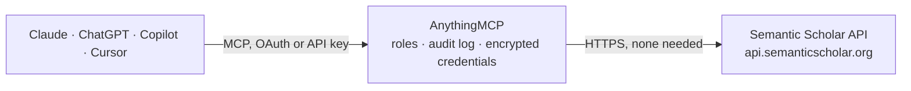

<!-- Generated by scripts/export-github-catalog.mjs in the anythingmcp-website repository. Do not edit by hand. -->

# Semantic Scholar MCP connector

Search and read scholarly literature in Semantic Scholar: more than 200 million papers with abstracts and AI summaries, authors with h-index, citations and references with their citing sentences, … The AnythingMCP connector gives Claude, ChatGPT, Microsoft Copilot, Cursor and Gemini 18 MCP tools for Semantic Scholar, all read-only.

**Category:** [Public Data](../data.md) · **Tools:** 18 · **Setup guide:** [anythingmcp.com](https://anythingmcp.com/guides/semantic-scholar-to-mcp) · [Deutsch](https://anythingmcp.com/de/guides/semantic-scholar-to-mcp) · [Italiano](https://anythingmcp.com/it/guides/semantic-scholar-to-mcp) · [Español](https://anythingmcp.com/es/guides/semantic-scholar-to-mcp) · [日本語](https://anythingmcp.com/ja/guides/semantic-scholar-to-mcp) · [Русский](https://anythingmcp.com/ru/guides/semantic-scholar-to-mcp) · [中文](https://anythingmcp.com/zh/guides/semantic-scholar-to-mcp)

## Start without code

No installation and no terminal: AnythingMCP Cloud runs the Semantic Scholar connector for you, operated by helpcode.ai in Frankfurt, Germany.

1. **Click the button above** and create an account or sign in. The Semantic Scholar connector opens, ready to install.
2. **Nothing to enter:** this connector needs no credentials. Every click is in the [step-by-step guide](https://anythingmcp.com/guides/semantic-scholar-to-mcp).
3. **Click Install.** AnythingMCP shows the address of your MCP server.
4. **Add that address to your assistant:** [Claude](https://anythingmcp.com/guides/connect-semantic-scholar-to-claude) · [ChatGPT](https://anythingmcp.com/guides/connect-semantic-scholar-to-chatgpt) · [Microsoft Copilot](https://anythingmcp.com/guides/connect-semantic-scholar-to-copilot) · [Cursor](https://anythingmcp.com/guides/connect-semantic-scholar-to-cursor) · [Gemini CLI](https://anythingmcp.com/guides/connect-semantic-scholar-to-gemini) · [Meta Muse](https://anythingmcp.com/guides/connect-semantic-scholar-to-muse).
5. **Ask your first question**, for example: *Give citation counts and open-access PDF for DOI:10.1038/s41586-020-2649-2*

Prefer help with the setup? [Talk to us](https://anythingmcp.com/contact).

## How it works

- **The AI client** speaks MCP (Streamable HTTP) to AnythingMCP and only sees tool names, descriptions and results. It never gets the Semantic Scholar credentials.
- **AnythingMCP** checks the client's role, builds the call from the tool definition, adds the credentials (none needed), calls Semantic Scholar, logs the call and returns the result.
- **Semantic Scholar** sees an ordinary API client with the rights of the account the credentials belong to.

## Tools

| Tool | What it does | Access |
|---|---|---|
| [`semantic_scholar_search_papers`](#semantic_scholar_search_papers) | Search Semantic Scholar papers by relevance with plain words (no query syntax), optionally filtered by year or date, venue, field of study, publication… | read |
| [`semantic_scholar_bulk_search_papers`](#semantic_scholar_bulk_search_papers) | Bulk search of Semantic Scholar papers with boolean syntax over titles and abstracts, sorted by paperId, publication date or citation count instead of… | read |
| [`semantic_scholar_match_paper_title`](#semantic_scholar_match_paper_title) | Find the single Semantic Scholar paper whose title best matches a given title, with its matchScore. | read |
| [`semantic_scholar_autocomplete_papers`](#semantic_scholar_autocomplete_papers) | Suggest Semantic Scholar papers for a partial title as you type: id, title and a short authors-and-year hint for each match. | read |
| [`semantic_scholar_get_paper`](#semantic_scholar_get_paper) | Get one paper from Semantic Scholar by its Semantic Scholar id, DOI, arXiv, PubMed, PMC, MAG, ACL or corpus id or URL: title, abstract, AI summary (tldr),… | read |
| [`semantic_scholar_get_papers_batch`](#semantic_scholar_get_papers_batch) | Get up to 500 Semantic Scholar papers in one call by their ids (any supported id form), in the order given; unknown ids come back as null. | read |
| [`semantic_scholar_get_paper_authors`](#semantic_scholar_get_paper_authors) | List the authors of a Semantic Scholar paper with their ids and, on request, affiliations, h-index and paper counts. | read |
| [`semantic_scholar_get_paper_citations`](#semantic_scholar_get_paper_citations) | List the papers that cite a given paper (citingPaper), with the citing sentences, citation intents and whether the citation is influential. | read |
| [`semantic_scholar_get_paper_references`](#semantic_scholar_get_paper_references) | List the papers a given paper cites (citedPaper), with the citing sentences, citation intents and whether the reference is influential. | read |
| [`semantic_scholar_search_authors`](#semantic_scholar_search_authors) | Search Semantic Scholar authors by name: author id, name, affiliations, paper count, citation count and h-index. | read |
| [`semantic_scholar_get_author`](#semantic_scholar_get_author) | Get one Semantic Scholar author profile: name, affiliations, homepage, external ids, paper count, citation count and h-index. | read |
| [`semantic_scholar_get_authors_batch`](#semantic_scholar_get_authors_batch) | Get up to 1,000 Semantic Scholar authors in one call by their ids, in the order given. | read |
| [`semantic_scholar_get_author_papers`](#semantic_scholar_get_author_papers) | List the papers of a Semantic Scholar author, optionally limited to a publication date range, with title, year, venue and citation counts. | read |
| [`semantic_scholar_recommend_for_paper`](#semantic_scholar_recommend_for_paper) | Recommend papers similar to one paper (Semantic Scholar Recommendations API), from recent papers or from all computer science papers. | read |
| [`semantic_scholar_recommend_papers`](#semantic_scholar_recommend_papers) | Recommend papers from a list of papers the reader liked (positive examples) and, optionally, papers to steer away from (negative examples). | read |
| [`semantic_scholar_search_snippets`](#semantic_scholar_search_snippets) | Search the full text of papers for passages of about 500 words (title, abstract and body, without captions and bibliography) that best match a query. | read |
| [`semantic_scholar_list_dataset_releases`](#semantic_scholar_list_dataset_releases) | List the release dates of the Semantic Scholar Academic Graph bulk datasets (e.g. 2026-10-27), oldest first. | read |
| [`semantic_scholar_get_dataset_release`](#semantic_scholar_get_dataset_release) | List the bulk datasets in one Semantic Scholar release (papers, abstracts, authors, citations, embeddings, s2orc and others) with a short description of each. | read |

## Tool reference

Every parameter as the AI client sees it in `tools/list`. Source: [`packages/backend/src/adapters/intl/semantic-scholar.json`](../../../packages/backend/src/adapters/intl/semantic-scholar.json).

### `semantic_scholar_search_papers`

Search Semantic Scholar papers by relevance with plain words (no query syntax), optionally filtered by year or date, venue, field of study, publication type, open access PDF and minimum citations. Returns total, offset, next and up to 100 papers per call; at most 1,000 results can be paged.

**Access:** read · **Call:** `GET /graph/v1/paper/search`

| Parameter | Type | Required | Description |
|---|---|---|---|
| `query` | string | yes | Plain-text search words. Hyphenated terms find nothing: write them with a space. |
| `fields` | string | no | Comma-separated fields to return. Paper fields: paperId, corpusId, externalIds, url, title, abstract, venue, publicationVenue, year, referenceCount, citationCount, influentialCitationCount, isOpenAccess, openAccessPdf, fieldsOfStudy, s2FieldsOfStudy, publicationTypes, publicationDate, journal, citationStyles, authors (authorId and name; authors.affiliations etc. for more), tldr (an AI summary). |
| `publicationTypes` | string | no | Comma-separated publication types, any of: Review, JournalArticle, CaseReport, ClinicalTrial, Conference, Dataset, Editorial, LettersAndComments, MetaAnalysis, News, Study, Book, BookSection. |
| `openAccessPdf` | boolean | no | true keeps only papers with a free public PDF. |
| `minCitationCount` | integer | no | Only papers with at least this many citations. |
| `publicationDateOrYear` | string | no | Publication date range start:end with YYYY, YYYY-MM or YYYY-MM-DD, open ends allowed: 2019-03-05, 2019-03, 2016-03-05:2020-06-06, 1981-08-25:, :2015-01. |
| `year` | string | no | Publication year or range: 2019, 2016-2020, 2010- (2010 or later), -2015 (2015 or earlier). |
| `venue` | string | no | Comma-separated venues (full names or ISO4 abbreviations), e.g. Nature,Radiology,N. Engl. J. Med. |
| `fieldsOfStudy` | string | no | Comma-separated fields of study: Computer Science, Medicine, Chemistry, Biology, Materials Science, Physics, Geology, Psychology, Art, History, Geography, Sociology, Business, Political Science, Economics, Philosophy, Mathematics, Engineering, Environmental Science, Agricultural and Food Sciences, Education, Law, Linguistics. |
| `offset` | integer | no | Position of the first result, for paging (the previous answer gives the next offset in "next"). |
| `limit` | integer | no | Number of papers, 1 to 100. |

### `semantic_scholar_bulk_search_papers`

Bulk search of Semantic Scholar papers with boolean syntax over titles and abstracts, sorted by paperId, publication date or citation count instead of relevance. Returns up to 1,000 papers per call and a continuation token; nested data such as citations is not available here.

**Access:** read · **Call:** `GET /graph/v1/paper/search/bulk`

| Parameter | Type | Required | Description |
|---|---|---|---|
| `query` | string | yes | Boolean query on title and abstract: + AND, \| OR, - NOT, "phrase", prefix*, ( ) precedence, word~N fuzzy, "phrase"~N proximity. Example: "large language model" + (evaluation \| benchmark) -survey. |
| `token` | string | no | Continuation token from the previous answer, to get the next batch of the same query. |
| `fields` | string | no | Comma-separated fields to return. Paper fields: paperId, corpusId, externalIds, url, title, abstract, venue, publicationVenue, year, referenceCount, citationCount, influentialCitationCount, isOpenAccess, openAccessPdf, fieldsOfStudy, s2FieldsOfStudy, publicationTypes, publicationDate, journal, citationStyles, authors (authorId and name; authors.affiliations etc. for more), tldr (an AI summary). |
| `sort` | string | no | field:order with field paperId, publicationDate or citationCount and order asc or desc, e.g. citationCount:desc (most cited first). Default paperId:asc. |
| `publicationTypes` | string | no | Comma-separated publication types, any of: Review, JournalArticle, CaseReport, ClinicalTrial, Conference, Dataset, Editorial, LettersAndComments, MetaAnalysis, News, Study, Book, BookSection. |
| `openAccessPdf` | boolean | no | true keeps only papers with a free public PDF. |
| `minCitationCount` | integer | no | Only papers with at least this many citations. |
| `publicationDateOrYear` | string | no | Publication date range start:end with YYYY, YYYY-MM or YYYY-MM-DD, open ends allowed: 2019-03-05, 2019-03, 2016-03-05:2020-06-06, 1981-08-25:, :2015-01. |
| `year` | string | no | Publication year or range: 2019, 2016-2020, 2010- (2010 or later), -2015 (2015 or earlier). |
| `venue` | string | no | Comma-separated venues (full names or ISO4 abbreviations), e.g. Nature,Radiology,N. Engl. J. Med. |
| `fieldsOfStudy` | string | no | Comma-separated fields of study: Computer Science, Medicine, Chemistry, Biology, Materials Science, Physics, Geology, Psychology, Art, History, Geography, Sociology, Business, Political Science, Economics, Philosophy, Mathematics, Engineering, Environmental Science, Agricultural and Food Sciences, Education, Law, Linguistics. |

### `semantic_scholar_match_paper_title`

Find the single Semantic Scholar paper whose title best matches a given title, with its matchScore. Use it to resolve a citation or a title to a paperId. Answers 404 "Title match not found" when nothing is close.

**Access:** read · **Call:** `GET /graph/v1/paper/search/match`

| Parameter | Type | Required | Description |
|---|---|---|---|
| `query` | string | yes | The paper title, as complete as possible. |
| `fields` | string | no | Comma-separated fields to return. Paper fields: paperId, corpusId, externalIds, url, title, abstract, venue, publicationVenue, year, referenceCount, citationCount, influentialCitationCount, isOpenAccess, openAccessPdf, fieldsOfStudy, s2FieldsOfStudy, publicationTypes, publicationDate, journal, citationStyles, authors (authorId and name; authors.affiliations etc. for more), tldr (an AI summary). |
| `year` | string | no | Publication year or range: 2019, 2016-2020, 2010- (2010 or later), -2015 (2015 or earlier). |
| `venue` | string | no | Comma-separated venues (full names or ISO4 abbreviations), e.g. Nature,Radiology,N. Engl. J. Med. |
| `publicationDateOrYear` | string | no | Publication date range start:end with YYYY, YYYY-MM or YYYY-MM-DD, open ends allowed: 2019-03-05, 2019-03, 2016-03-05:2020-06-06, 1981-08-25:, :2015-01. |

### `semantic_scholar_autocomplete_papers`

Suggest Semantic Scholar papers for a partial title as you type: id, title and a short authors-and-year hint for each match.

**Access:** read · **Call:** `GET /graph/v1/paper/autocomplete`

| Parameter | Type | Required | Description |
|---|---|---|---|
| `query` | string | yes | Partial title text; only the first 100 characters are used. |

### `semantic_scholar_get_paper`

Get one paper from Semantic Scholar by its Semantic Scholar id, DOI, arXiv, PubMed, PMC, MAG, ACL or corpus id or URL: title, abstract, AI summary (tldr), authors, venue, year, citation and reference counts, open access PDF and external ids.

**Access:** read · **Call:** `GET /graph/v1/paper/{paper_id}`

| Parameter | Type | Required | Description |
|---|---|---|---|
| `paper_id` | string | yes | Paper id in any supported form: the 40-character Semantic Scholar id, CorpusId:215416146, DOI:10.18653/v1/N18-3011, ARXIV:2106.15928, PMID:19872477, PMCID:2323736, MAG:112218234, ACL:W12-3903 or URL:https://arxiv.org/abs/2106.15928. |
| `fields` | string | no | Comma-separated fields to return. Paper fields: paperId, corpusId, externalIds, url, title, abstract, venue, publicationVenue, year, referenceCount, citationCount, influentialCitationCount, isOpenAccess, openAccessPdf, fieldsOfStudy, s2FieldsOfStudy, publicationTypes, publicationDate, journal, citationStyles, authors (authorId and name; authors.affiliations etc. for more), tldr (an AI summary). |

### `semantic_scholar_get_papers_batch`

Get up to 500 Semantic Scholar papers in one call by their ids (any supported id form), in the order given; unknown ids come back as null. A read sent as POST.

**Access:** read · **Call:** `POST /graph/v1/paper/batch`

| Parameter | Type | Required | Description |
|---|---|---|---|
| `ids` | string[] | yes | Paper ids, e.g. ["649def34f8be52c8b66281af98ae884c09aef38b", "ARXIV:2106.15928", "DOI:10.18653/v1/N18-3011"]. |
| `fields` | string | no | Comma-separated fields to return. Paper fields: paperId, corpusId, externalIds, url, title, abstract, venue, publicationVenue, year, referenceCount, citationCount, influentialCitationCount, isOpenAccess, openAccessPdf, fieldsOfStudy, s2FieldsOfStudy, publicationTypes, publicationDate, journal, citationStyles, authors (authorId and name; authors.affiliations etc. for more), tldr (an AI summary). |

### `semantic_scholar_get_paper_authors`

List the authors of a Semantic Scholar paper with their ids and, on request, affiliations, h-index and paper counts.

**Access:** read · **Call:** `GET /graph/v1/paper/{paper_id}/authors`

| Parameter | Type | Required | Description |
|---|---|---|---|
| `paper_id` | string | yes | Paper id in any supported form: the 40-character Semantic Scholar id, CorpusId:215416146, DOI:10.18653/v1/N18-3011, ARXIV:2106.15928, PMID:19872477, PMCID:2323736, MAG:112218234, ACL:W12-3903 or URL:https://arxiv.org/abs/2106.15928. |
| `fields` | string | no | Comma-separated author fields: authorId, externalIds, url, name, affiliations, homepage, paperCount, citationCount, hIndex, papers (papers.title, papers.year for subfields). |
| `offset` | integer | no | Position of the first result, for paging (the previous answer gives the next offset in "next"). |
| `limit` | integer | no | Number of authors, 1 to 1000. |

### `semantic_scholar_get_paper_citations`

List the papers that cite a given paper (citingPaper), with the citing sentences, citation intents and whether the citation is influential.

**Access:** read · **Call:** `GET /graph/v1/paper/{paper_id}/citations`

| Parameter | Type | Required | Description |
|---|---|---|---|
| `paper_id` | string | yes | Paper id in any supported form: the 40-character Semantic Scholar id, CorpusId:215416146, DOI:10.18653/v1/N18-3011, ARXIV:2106.15928, PMID:19872477, PMCID:2323736, MAG:112218234, ACL:W12-3903 or URL:https://arxiv.org/abs/2106.15928. |
| `fields` | string | no | Comma-separated fields: contexts (the citing sentences), intents (background, methodology, result), isInfluential, plus fields of the other paper such as title, year, authors, venue, citationCount, externalIds, openAccessPdf. |
| `publicationDateOrYear` | string | no | Publication date range start:end with YYYY, YYYY-MM or YYYY-MM-DD, open ends allowed: 2019-03-05, 2019-03, 2016-03-05:2020-06-06, 1981-08-25:, :2015-01. |
| `offset` | integer | no | Position of the first result, for paging (the previous answer gives the next offset in "next"). |
| `limit` | integer | no | Number of citations, 1 to 1000. |

### `semantic_scholar_get_paper_references`

List the papers a given paper cites (citedPaper), with the citing sentences, citation intents and whether the reference is influential.

**Access:** read · **Call:** `GET /graph/v1/paper/{paper_id}/references`

| Parameter | Type | Required | Description |
|---|---|---|---|
| `paper_id` | string | yes | Paper id in any supported form: the 40-character Semantic Scholar id, CorpusId:215416146, DOI:10.18653/v1/N18-3011, ARXIV:2106.15928, PMID:19872477, PMCID:2323736, MAG:112218234, ACL:W12-3903 or URL:https://arxiv.org/abs/2106.15928. |
| `fields` | string | no | Comma-separated fields: contexts (the citing sentences), intents (background, methodology, result), isInfluential, plus fields of the other paper such as title, year, authors, venue, citationCount, externalIds, openAccessPdf. |
| `offset` | integer | no | Position of the first result, for paging (the previous answer gives the next offset in "next"). |
| `limit` | integer | no | Number of references, 1 to 1000. |

### `semantic_scholar_search_authors`

Search Semantic Scholar authors by name: author id, name, affiliations, paper count, citation count and h-index. Several profiles can share a name; compare affiliations and paper counts before choosing.

**Access:** read · **Call:** `GET /graph/v1/author/search`

| Parameter | Type | Required | Description |
|---|---|---|---|
| `query` | string | yes | Author name in plain text, e.g. Oren Etzioni. Hyphenated names find nothing: write them with a space. |
| `fields` | string | no | Comma-separated author fields: authorId, externalIds (ORCID, DBLP), url, name, affiliations, homepage, paperCount, citationCount, hIndex, papers (and papers.title, papers.year). |
| `offset` | integer | no | Position of the first result, for paging (the previous answer gives the next offset in "next"). |
| `limit` | integer | no | Number of authors, 1 to 1000. |

### `semantic_scholar_get_author`

Get one Semantic Scholar author profile: name, affiliations, homepage, external ids, paper count, citation count and h-index.

**Access:** read · **Call:** `GET /graph/v1/author/{author_id}`

| Parameter | Type | Required | Description |
|---|---|---|---|
| `author_id` | string | yes | Semantic Scholar author id, a number such as 1741101. Find it with semantic_scholar_search_authors or in the authors of a paper. |
| `fields` | string | no | Comma-separated author fields: authorId, externalIds (ORCID, DBLP), url, name, affiliations, homepage, paperCount, citationCount, hIndex, papers (and papers.title, papers.year). |

### `semantic_scholar_get_authors_batch`

Get up to 1,000 Semantic Scholar authors in one call by their ids, in the order given. A read sent as POST.

**Access:** read · **Call:** `POST /graph/v1/author/batch`

| Parameter | Type | Required | Description |
|---|---|---|---|
| `ids` | string[] | yes | Author ids, e.g. ["1741101", "1780531"]. |
| `fields` | string | no | Comma-separated author fields: authorId, externalIds (ORCID, DBLP), url, name, affiliations, homepage, paperCount, citationCount, hIndex, papers (and papers.title, papers.year). |

### `semantic_scholar_get_author_papers`

List the papers of a Semantic Scholar author, optionally limited to a publication date range, with title, year, venue and citation counts.

**Access:** read · **Call:** `GET /graph/v1/author/{author_id}/papers`

| Parameter | Type | Required | Description |
|---|---|---|---|
| `author_id` | string | yes | Semantic Scholar author id, a number such as 1741101. Find it with semantic_scholar_search_authors or in the authors of a paper. |
| `fields` | string | no | Comma-separated fields to return. Paper fields: paperId, corpusId, externalIds, url, title, abstract, venue, publicationVenue, year, referenceCount, citationCount, influentialCitationCount, isOpenAccess, openAccessPdf, fieldsOfStudy, s2FieldsOfStudy, publicationTypes, publicationDate, journal, citationStyles, authors (authorId and name; authors.affiliations etc. for more), tldr (an AI summary). |
| `publicationDateOrYear` | string | no | Publication date range start:end with YYYY, YYYY-MM or YYYY-MM-DD, open ends allowed: 2019-03-05, 2019-03, 2016-03-05:2020-06-06, 1981-08-25:, :2015-01. |
| `offset` | integer | no | Position of the first result, for paging (the previous answer gives the next offset in "next"). |
| `limit` | integer | no | Number of papers, 1 to 1000. |

### `semantic_scholar_recommend_for_paper`

Recommend papers similar to one paper (Semantic Scholar Recommendations API), from recent papers or from all computer science papers.

**Access:** read · **Call:** `GET /recommendations/v1/papers/forpaper/{paper_id}`

| Parameter | Type | Required | Description |
|---|---|---|---|
| `paper_id` | string | yes | Paper id in any supported form: the 40-character Semantic Scholar id, CorpusId:215416146, DOI:10.18653/v1/N18-3011, ARXIV:2106.15928, PMID:19872477, PMCID:2323736, MAG:112218234, ACL:W12-3903 or URL:https://arxiv.org/abs/2106.15928. |
| `from` | `recent` \| `all-cs` | no | Pool to recommend from: recent (default, papers of the last months) or all-cs (all computer science papers). |
| `fields` | string | no | Comma-separated fields to return. Paper fields: paperId, corpusId, externalIds, url, title, abstract, venue, publicationVenue, year, referenceCount, citationCount, influentialCitationCount, isOpenAccess, openAccessPdf, fieldsOfStudy, s2FieldsOfStudy, publicationTypes, publicationDate, journal, citationStyles, authors (authorId and name; authors.affiliations etc. for more), tldr (an AI summary). |
| `limit` | integer | no | Number of recommendations, 1 to 500. |

### `semantic_scholar_recommend_papers`

Recommend papers from a list of papers the reader liked (positive examples) and, optionally, papers to steer away from (negative examples). A read sent as POST.

**Access:** read · **Call:** `POST /recommendations/v1/papers/`

| Parameter | Type | Required | Description |
|---|---|---|---|
| `positivePaperIds` | string[] | yes | Ids of example papers to find more like, e.g. ["649def34f8be52c8b66281af98ae884c09aef38b"]. Same id forms as semantic_scholar_get_paper. |
| `negativePaperIds` | string[] | no | Ids of papers whose topics should be avoided, e.g. ["ARXIV:1805.02262"]. |
| `fields` | string | no | Comma-separated fields to return. Paper fields: paperId, corpusId, externalIds, url, title, abstract, venue, publicationVenue, year, referenceCount, citationCount, influentialCitationCount, isOpenAccess, openAccessPdf, fieldsOfStudy, s2FieldsOfStudy, publicationTypes, publicationDate, journal, citationStyles, authors (authorId and name; authors.affiliations etc. for more), tldr (an AI summary). |
| `limit` | integer | no | Number of recommendations, 1 to 500. |

### `semantic_scholar_search_snippets`

Search the full text of papers for passages of about 500 words (title, abstract and body, without captions and bibliography) that best match a query. Returns each snippet with its section, score and the paper it comes from. Use it to find where a claim or method is discussed.

**Access:** read · **Call:** `GET /graph/v1/snippet/search`

| Parameter | Type | Required | Description |
|---|---|---|---|
| `query` | string | yes | Plain-text query, e.g. a claim or a sentence to find evidence for. |
| `fields` | string | no | Comma-separated snippet fields, e.g. snippet.text,snippet.section,snippet.snippetKind. Leave empty for the default set (text, kind, section, offsets, annotations); paper and score are always returned. |
| `paperIds` | string | no | Comma-separated paper ids to search in only (about 100 at most). |
| `authors` | string | no | Comma-separated author names; fuzzy match, combined with AND (all must be authors), at most 10. |
| `minCitationCount` | integer | no | Only papers with at least this many citations. |
| `insertedBefore` | string | no | Only papers added to the index before this date: YYYY-MM-DD, YYYY-MM or YYYY. |
| `publicationDateOrYear` | string | no | Publication date range start:end with YYYY, YYYY-MM or YYYY-MM-DD, open ends allowed: 2019-03-05, 2019-03, 2016-03-05:2020-06-06, 1981-08-25:, :2015-01. |
| `year` | string | no | Publication year or range: 2019, 2016-2020, 2010- (2010 or later), -2015 (2015 or earlier). |
| `venue` | string | no | Comma-separated venues (full names or ISO4 abbreviations), e.g. Nature,Radiology,N. Engl. J. Med. |
| `fieldsOfStudy` | string | no | Comma-separated fields of study: Computer Science, Medicine, Chemistry, Biology, Materials Science, Physics, Geology, Psychology, Art, History, Geography, Sociology, Business, Political Science, Economics, Philosophy, Mathematics, Engineering, Environmental Science, Agricultural and Food Sciences, Education, Law, Linguistics. |
| `limit` | integer | no | Number of snippets, 1 to 1000. |

### `semantic_scholar_list_dataset_releases`

List the release dates of the Semantic Scholar Academic Graph bulk datasets (e.g. 2026-10-27), oldest first. No parameters.

**Access:** read · **Call:** `GET /datasets/v1/release/`

No parameters.

### `semantic_scholar_get_dataset_release`

List the bulk datasets in one Semantic Scholar release (papers, abstracts, authors, citations, embeddings, s2orc and others) with a short description of each. Downloading the files needs an API key and is not part of this connector.

**Access:** read · **Call:** `GET /datasets/v1/release/{release_id}`

| Parameter | Type | Required | Description |
|---|---|---|---|
| `release_id` | string | yes | Release date from semantic_scholar_list_dataset_releases, e.g. 2026-10-27, or latest. |

## Run it yourself

AnythingMCP is open source (AGPL-3.0). [Run it with Docker](../../../README.md#run-it-yourself), open **Connectors → Store**, pick **Semantic Scholar**, then add your MCP server URL to the AI client.

[← Public Data connectors](../data.md) · [All categories](../README.md)
