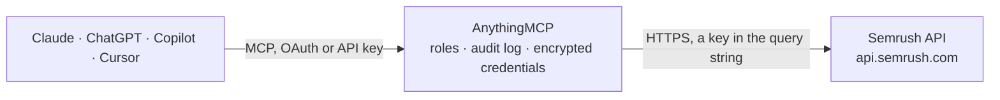

<!-- Generated by scripts/export-github-catalog.mjs in the anythingmcp-website repository. Do not edit by hand. -->

# Semrush MCP connector

Give your AI Semrush SEO data: domain overview and history, organic and paid keywords, competitors, keyword gap, keyword volume, difficulty and ideas, URL rankings and backlinks, with the API unit cost of every report. The AnythingMCP connector gives Claude, ChatGPT, Microsoft Copilot, Cursor and Gemini 21 MCP tools for Semrush, all read-only.

**Category:** [Analytics](../analytics.md) · **Tools:** 21 · **Setup guide:** [anythingmcp.com](https://anythingmcp.com/guides/semrush-to-mcp) · [Deutsch](https://anythingmcp.com/de/guides/semrush-to-mcp) · [Italiano](https://anythingmcp.com/it/guides/semrush-to-mcp) · [Español](https://anythingmcp.com/es/guides/semrush-to-mcp) · [日本語](https://anythingmcp.com/ja/guides/semrush-to-mcp) · [Русский](https://anythingmcp.com/ru/guides/semrush-to-mcp) · [中文](https://anythingmcp.com/zh/guides/semrush-to-mcp)

## Start without code

No installation and no terminal: AnythingMCP Cloud runs the Semrush connector for you, operated by helpcode.ai in Frankfurt, Germany.

1. **Click the button above** and create an account or sign in. The Semrush connector opens, ready to install.
2. **Paste the API key or token from your Semrush account.** Every click is in the [step-by-step guide](https://anythingmcp.com/guides/semrush-to-mcp).
3. **Click Install.** AnythingMCP shows the address of your MCP server.
4. **Add that address to your assistant:** [Claude](https://anythingmcp.com/guides/connect-semrush-to-claude) · [ChatGPT](https://anythingmcp.com/guides/connect-semrush-to-chatgpt) · [Microsoft Copilot](https://anythingmcp.com/guides/connect-semrush-to-copilot) · [Cursor](https://anythingmcp.com/guides/connect-semrush-to-cursor) · [Gemini CLI](https://anythingmcp.com/guides/connect-semrush-to-gemini) · [Meta Muse](https://anythingmcp.com/guides/connect-semrush-to-muse).
5. **Ask your first question**, for example: *What's the current Semrush overview for greenfield-gardens.de in the Germany database?*

Prefer help with the setup? [Talk to us](https://anythingmcp.com/contact).

## How it works

- **The AI client** speaks MCP (Streamable HTTP) to AnythingMCP and only sees tool names, descriptions and results. It never gets the Semrush credentials.
- **AnythingMCP** checks the client's role, builds the call from the tool definition, adds the credentials (a key in the query string), calls Semrush, logs the call and returns the result.
- **Semrush** sees an ordinary API client with the rights of the account the credentials belong to.

## Tools

| Tool | What it does | Access |
|---|---|---|
| [`semrush_get_api_units`](#semrush_get_api_units) | Show how many Semrush API units this key has left. | read |
| [`semrush_domain_overview`](#semrush_domain_overview) | Domain overview in one Semrush database: Semrush rank, organic keywords, organic traffic and traffic cost, paid keywords, paid traffic and cost. | read |
| [`semrush_domain_overview_all_databases`](#semrush_domain_overview_all_databases) | The same overview for every Semrush regional database at once (one line per country). | read |
| [`semrush_domain_history`](#semrush_domain_history) | Monthly history of a domain's organic and paid metrics in one database (rank, keywords, traffic, cost, date), newest first. | read |
| [`semrush_domain_organic_keywords`](#semrush_domain_organic_keywords) | Keywords a domain ranks for in Google's top 100 (Organic Research): position, previous position, volume, CPC, URL, traffic share, intent. | read |
| [`semrush_domain_paid_keywords`](#semrush_domain_paid_keywords) | Keywords a domain buys Google Ads for (Advertising Research): ad position, volume, CPC, visible URL, traffic share. | read |
| [`semrush_domain_organic_competitors`](#semrush_domain_organic_competitors) | Organic search competitors of a domain: competitor relevance, common keywords, their organic keywords, traffic and cost. | read |
| [`semrush_domain_organic_pages`](#semrush_domain_organic_pages) | A domain's pages that rank in Google's top 100, with the number of ranking keywords and traffic per page. | read |
| [`semrush_keyword_gap`](#semrush_keyword_gap) | Compare the keywords of up to five domains (Keyword Gap): shared, all, unique, missing or untapped keywords with each domain's position. | read |
| [`semrush_keyword_overview`](#semrush_keyword_overview) | Volume, CPC, competition, number of results, trend, intent and difficulty of one keyword in one database. | read |
| [`semrush_keyword_overview_all_databases`](#semrush_keyword_overview_all_databases) | Volume, CPC and competition of one keyword in every regional database at once (one line per country), to compare markets. | read |
| [`semrush_batch_keyword_overview`](#semrush_batch_keyword_overview) | Overview of up to 100 keywords in one database in a single call: volume, CPC, competition, results, trend, intent, difficulty. | read |
| [`semrush_keyword_organic_results`](#semrush_keyword_organic_results) | The organic Google results (SERP) Semrush recorded for a keyword: position, domain, URL and SERP features. | read |
| [`semrush_related_keywords`](#semrush_related_keywords) | Related keywords, synonyms and variations of a keyword with volume, CPC, competition, difficulty, intent and relevance. | read |
| [`semrush_broad_match_keywords`](#semrush_broad_match_keywords) | Broad-match keyword ideas that contain the given keyword, with volume, CPC, competition, difficulty and intent. | read |
| [`semrush_keyword_questions`](#semrush_keyword_questions) | Question keywords (how, what, why...) that contain the given keyword, with volume, CPC, competition and difficulty. | read |
| [`semrush_keyword_difficulty`](#semrush_keyword_difficulty) | Keyword Difficulty (0 to 100) of up to 100 keywords: how hard it is to reach Google's top 10. | read |
| [`semrush_url_organic_keywords`](#semrush_url_organic_keywords) | Keywords one URL ranks for in Google's top 100: position, volume, CPC, traffic share, intent. | read |
| [`semrush_backlinks_overview`](#semrush_backlinks_overview) | Backlink summary of a domain or URL: Authority Score, total backlinks, referring domains, URLs and IPs, follow and nofollow links, text and image links. | read |
| [`semrush_backlinks`](#semrush_backlinks) | Backlinks of a domain or URL: Authority Score of the linking page, source title and URL, target URL, anchor, nofollow, first and last seen (Unix time). | read |
| [`semrush_referring_domains`](#semrush_referring_domains) | Domains that link to a domain or URL: Authority Score, number of backlinks, IP, country, first and last seen (Unix time). | read |

## Tool reference

Every parameter as the AI client sees it in `tools/list`. Source: [`packages/backend/src/adapters/intl/semrush.json`](../../../packages/backend/src/adapters/intl/semrush.json).

### `semrush_get_api_units`

Show how many Semrush API units this key has left. Free: the call itself costs no units. Check it before a large report, because a report that runs out of units returns only the lines that were paid for. Semrush also answers 0 for a key it does not know, so if a report then fails with ERROR 120 or 122, the key is wrong.

**Access:** read · **Call:** `GET https://www.semrush.com/users/countapiunits.html`

No parameters.

### `semrush_domain_overview`

Domain overview in one Semrush database: Semrush rank, organic keywords, organic traffic and traffic cost, paid keywords, paid traffic and cost. Costs 10 API units (one line); 50 with display_date. Returns semicolon-separated CSV with a header line.

**Access:** read · **Call:** `GET /`

| Parameter | Type | Required | Description |
|---|---|---|---|
| `domain` | string | yes | Domain to analyse, without protocol, e.g. example.com. |
| `database` | string | yes | Regional database (two-letter code): us, uk, de, fr, it, es, ca, au, br, in, nl, pl, se, ch, at, jp and more; mobile-us, mobile-de etc. for mobile results. Keyword reports accept desktop codes only. |
| `export_columns` | string | no | Comma-separated column codes. Default Dn,Rk,Or,Ot,Oc,Ad,At,Ac. Available: Dn, Rk, Or, Xn, Ot, Oc, Ad, At, Ac, FKn, FPn, Sr, Srb, St, Stb, Sc. |
| `display_date` | string | no | Past month as YYYYMM15, e.g. 20260815 for August 2026. Leave out for the latest data. Historical lines cost 50 API units each. |

### `semrush_domain_overview_all_databases`

The same overview for every Semrush regional database at once (one line per country). Costs 10 API units per line, about 140 lines when unlimited, so keep display_limit small and sort by organic traffic. Returns semicolon-separated CSV.

**Access:** read · **Call:** `GET /`

| Parameter | Type | Required | Description |
|---|---|---|---|
| `domain` | string | yes | Domain to analyse, without protocol, e.g. example.com. |
| `display_limit` | integer | no | Lines to return (default 10). Each line costs 10 API units, so keep it small. Never 0: Semrush then returns 10,000 lines. |
| `display_sort` | `ot_desc` \| `or_desc` \| `oc_desc` \| `rk_asc` \| `ad_desc` \| `at_desc` | no | Sort column and direction. |
| `export_columns` | string | no | Comma-separated column codes. Default Db,Dn,Rk,Or,Ot,Oc,Ad,At,Ac. Available: Db, Dt, Dn, Rk, Or, Ot, Oc, Ad, At, Ac, Sh, Sv, FKn, FPn. |
| `display_date` | string | no | Past month as YYYYMM15, e.g. 20260815 for August 2026. Leave out for the latest data. Historical lines cost 50 API units each. |

### `semrush_domain_history`

Monthly history of a domain's organic and paid metrics in one database (rank, keywords, traffic, cost, date), newest first. Costs 10 API units per line (one line per month). Returns semicolon-separated CSV.

**Access:** read · **Call:** `GET /`

| Parameter | Type | Required | Description |
|---|---|---|---|
| `domain` | string | yes | Domain to analyse, without protocol, e.g. example.com. |
| `database` | string | yes | Regional database (two-letter code): us, uk, de, fr, it, es, ca, au, br, in, nl, pl, se, ch, at, jp and more; mobile-us, mobile-de etc. for mobile results. Keyword reports accept desktop codes only. |
| `display_limit` | integer | no | Months to return (default 10). Each month costs 10 API units. |
| `display_sort` | `dt_desc` \| `dt_asc` | no | Sort column and direction. |
| `export_columns` | string | no | Comma-separated column codes. Default Dt,Rk,Or,Ot,Oc,Ad,At,Ac. Available: Rk, Or, Xn, Ot, Oc, Ad, At, Ac, Dt, FKn, FPn, Sr, Srb, St, Stb, Sc. |

### `semrush_domain_organic_keywords`

Keywords a domain ranks for in Google's top 100 (Organic Research): position, previous position, volume, CPC, URL, traffic share, intent. Costs 10 API units per line (50 with display_date). display_positions lists new, lost, rising or falling keywords. Returns semicolon-separated CSV.

**Access:** read · **Call:** `GET /`

| Parameter | Type | Required | Description |
|---|---|---|---|
| `domain` | string | yes | Domain to analyse, without protocol, e.g. example.com. |
| `database` | string | yes | Regional database (two-letter code): us, uk, de, fr, it, es, ca, au, br, in, nl, pl, se, ch, at, jp and more; mobile-us, mobile-de etc. for mobile results. Keyword reports accept desktop codes only. |
| `display_limit` | integer | no | Lines to return (default 10). Each line costs 10 API units, so keep it small. Never 0: Semrush then returns 10,000 lines. |
| `display_offset` | integer | no | Lines to skip, for paging. Semrush counts display_limit from the start, so for lines 11 to 20 send display_offset 10 and display_limit 20 (you pay for the 10 returned lines). |
| `display_sort` | `tr_desc` \| `tr_asc` \| `tg_desc` \| `po_asc` \| `po_desc` \| `nq_desc` \| `nq_asc` \| `cp_desc` \| `kd_desc` \| `kd_asc` \| `tc_desc` \| `co_desc` | no | Sort column and direction. |
| `display_filter` | string | no | Semrush filter, unencoded: <sign>\|<column>\|<operation>\|<value>, several joined with \|. sign + includes, - excludes; operations Eq, Gt, Lt for numbers and Bw, Ew, Eq, Co, Wm for text. Filter columns: Ph, Po, Pp, Pd, Nq, Cp, Co, Nr, Ur, Tr, Tg, Tc, Fp, Fk, In. Example: +\|Nq\|Gt\|1000\|+\|Po\|Lt\|11 (volume over 1000, positions 1 to 10). |
| `display_positions` | `new` \| `lost` \| `rise` \| `fall` | no | Only keywords that are new, lost, rising or falling in the top 100 compared with the previous month. |
| `display_positions_type` | `organic` \| `all` \| `serp_features` | no | organic (default) for classic results only, all to include SERP feature positions, serp_features for SERP features only. |
| `export_columns` | string | no | Comma-separated column codes. Default Ph,Po,Pp,Nq,Cp,Ur,Tr,Kd,In. Available: Ph, Po, Pp, Pd, Nq, Cp, Ur, Tr, Tg, Tc, Co, Nr, Td, Kd, Fp, Fk, Ts, In, Pt. |
| `display_date` | string | no | Past month as YYYYMM15, e.g. 20260815 for August 2026. Leave out for the latest data. Historical lines cost 50 API units each. |

### `semrush_domain_paid_keywords`

Keywords a domain buys Google Ads for (Advertising Research): ad position, volume, CPC, visible URL, traffic share. Costs 20 API units per line (100 with display_date). Returns semicolon-separated CSV.

**Access:** read · **Call:** `GET /`

| Parameter | Type | Required | Description |
|---|---|---|---|
| `domain` | string | yes | Domain to analyse, without protocol, e.g. example.com. |
| `database` | string | yes | Regional database (two-letter code): us, uk, de, fr, it, es, ca, au, br, in, nl, pl, se, ch, at, jp and more; mobile-us, mobile-de etc. for mobile results. Keyword reports accept desktop codes only. |
| `display_limit` | integer | no | Lines to return (default 10). Each line costs 20 API units, so keep it small. Never 0: Semrush then returns 10,000 lines. |
| `display_offset` | integer | no | Lines to skip, for paging. Semrush counts display_limit from the start, so for lines 11 to 20 send display_offset 10 and display_limit 20 (you pay for the 10 returned lines). |
| `display_sort` | `tr_desc` \| `tr_asc` \| `tg_desc` \| `po_asc` \| `po_desc` \| `nq_desc` \| `nq_asc` \| `tc_desc` | no | Sort column and direction. |
| `display_filter` | string | no | Semrush filter, unencoded: <sign>\|<column>\|<operation>\|<value>, several joined with \|. sign + includes, - excludes; operations Eq, Gt, Lt for numbers and Bw, Ew, Eq, Co, Wm for text. Filter columns: Ph, Po, Pp, Pd, Nq, Cp, Co, Nr, Ur, Tr, Tg, Tc, Un. Example: +\|Nq\|Gt\|1000\|+\|Po\|Lt\|11 (volume over 1000, positions 1 to 10). |
| `export_columns` | string | no | Comma-separated column codes. Default Ph,Po,Nq,Cp,Vu,Ur,Tr,Tt,Ds. Available: Ph, Po, Pp, Pd, Ab, Nq, Cp, Tg, Tr, Tc, Co, Nr, Td, Tt, Ds, Vu, Ur, Ts, Un. |
| `display_date` | string | no | Past month as YYYYMM15, e.g. 20260815 for August 2026. Leave out for the latest data. Historical lines cost 100 API units each. |

### `semrush_domain_organic_competitors`

Organic search competitors of a domain: competitor relevance, common keywords, their organic keywords, traffic and cost. Costs 40 API units per line (200 with display_date). Returns semicolon-separated CSV.

**Access:** read · **Call:** `GET /`

| Parameter | Type | Required | Description |
|---|---|---|---|
| `domain` | string | yes | Domain to analyse, without protocol, e.g. example.com. |
| `database` | string | yes | Regional database (two-letter code): us, uk, de, fr, it, es, ca, au, br, in, nl, pl, se, ch, at, jp and more; mobile-us, mobile-de etc. for mobile results. Keyword reports accept desktop codes only. |
| `display_limit` | integer | no | Lines to return (default 10). Each line costs 40 API units, so keep it small. Never 0: Semrush then returns 10,000 lines. |
| `display_offset` | integer | no | Lines to skip, for paging. Semrush counts display_limit from the start, so for lines 11 to 20 send display_offset 10 and display_limit 20 (you pay for the 10 returned lines). |
| `display_sort` | `cr_desc` \| `cr_asc` \| `np_desc` \| `np_asc` | no | Sort column and direction. |
| `export_columns` | string | no | Comma-separated column codes. Default Dn,Cr,Np,Or,Ot,Oc,Ad. Available: Dn, Cr, Np, Or, Ot, Oc, Ad, Sr, St, Sc. |
| `display_date` | string | no | Past month as YYYYMM15, e.g. 20260815 for August 2026. Leave out for the latest data. Historical lines cost 200 API units each. |

### `semrush_domain_organic_pages`

A domain's pages that rank in Google's top 100, with the number of ranking keywords and traffic per page. Costs 10 API units per line (50 with display_date). Returns semicolon-separated CSV.

**Access:** read · **Call:** `GET /`

| Parameter | Type | Required | Description |
|---|---|---|---|
| `domain` | string | yes | Domain to analyse, without protocol, e.g. example.com. |
| `database` | string | yes | Regional database (two-letter code): us, uk, de, fr, it, es, ca, au, br, in, nl, pl, se, ch, at, jp and more; mobile-us, mobile-de etc. for mobile results. Keyword reports accept desktop codes only. |
| `display_limit` | integer | no | Lines to return (default 10). Each line costs 10 API units, so keep it small. Never 0: Semrush then returns 10,000 lines. |
| `display_offset` | integer | no | Lines to skip, for paging. Semrush counts display_limit from the start, so for lines 11 to 20 send display_offset 10 and display_limit 20 (you pay for the 10 returned lines). |
| `display_sort` | `tr_desc` \| `tr_asc` \| `tg_desc` \| `pc_desc` \| `pc_asc` | no | Sort column and direction. |
| `display_filter` | string | no | Semrush filter, unencoded: <sign>\|<column>\|<operation>\|<value>, several joined with \|. sign + includes, - excludes; operations Eq, Gt, Lt for numbers and Bw, Ew, Eq, Co, Wm for text. Filter columns: Ur, Pc, Tg, Tr, Sr, St. Example: +\|Pc\|Gt\|100\|+\|Ur\|Co\|blog (pages ranking for over 100 keywords whose URL contains blog). |
| `export_columns` | string | no | Comma-separated column codes. Default Ur,Pc,Tg,Tr. Available: Ur, Pc, Tg, Tr, Ipu, Ip0, Ip1, Ip2, Ip3, Itu, It0, It1, It2, It3, Sr, St. |
| `display_date` | string | no | Past month as YYYYMM15, e.g. 20260815 for August 2026. Leave out for the latest data. Historical lines cost 50 API units each. |

### `semrush_keyword_gap`

Compare the keywords of up to five domains (Keyword Gap): shared, all, unique, missing or untapped keywords with each domain's position. Costs 80 API units per line (400 with display_date). Returns semicolon-separated CSV.

**Access:** read · **Call:** `GET /`

| Parameter | Type | Required | Description |
|---|---|---|---|
| `domains` | string | yes | Domains with an operator each, unencoded: <sign>\|<type>\|<domain> joined with \|. type or = organic, ad = paid. Shared: *\|or\|a.com\|*\|or\|b.com. All: *\|or\|a.com\|+\|or\|b.com. Unique to a.com: *\|or\|a.com\|-\|or\|b.com. Missing in a.com: *\|or\|b.com\|*\|or\|c.com\|-\|or\|a.com. Untapped for a.com: *\|or\|b.com\|+\|or\|c.com\|-\|or\|a.com. |
| `database` | string | yes | Regional database (two-letter code): us, uk, de, fr, it, es, ca, au, br, in, nl, pl, se, ch, at, jp and more; mobile-us, mobile-de etc. for mobile results. Keyword reports accept desktop codes only. |
| `display_limit` | integer | no | Lines to return (default 10). Each line costs 80 API units, so keep it small. Never 0: Semrush then returns 10,000 lines. |
| `display_offset` | integer | no | Lines to skip, for paging. Semrush counts display_limit from the start, so for lines 11 to 20 send display_offset 10 and display_limit 20 (you pay for the 10 returned lines). |
| `display_sort` | `nq_desc` \| `nq_asc` \| `p0_asc` \| `p0_desc` \| `p1_asc` \| `p1_desc` \| `cp_desc` \| `co_desc` \| `nr_desc` | no | Sort column and direction. |
| `display_filter` | string | no | Semrush filter, unencoded: <sign>\|<column>\|<operation>\|<value>, several joined with \|. sign + includes, - excludes; operations Eq, Gt, Lt for numbers and Bw, Ew, Eq, Co, Wm for text. Filter columns: Ph, P0 to P4, Nq, Cp, Co, Nr, Kd. Example: +\|Nq\|Gt\|1000\|+\|Kd\|Lt\|50 (volume over 1000, difficulty under 50). |
| `export_columns` | string | no | Comma-separated column codes. P0 to P4 are the positions of the 1st to 5th domain in domains: ask for one per compared domain, e.g. Ph,P0,P1,P2,Nq,Cp,Kd for three domains. Default Ph,P0,P1,Nq,Cp,Kd (two domains). Available: Ph, P0, P1, P2, P3, P4, Nr, Cp, Nq, Kd, Co, Td. |
| `display_date` | string | no | Past month as YYYYMM15, e.g. 20260815 for August 2026. Leave out for the latest data. Historical lines cost 400 API units each. |

### `semrush_keyword_overview`

Volume, CPC, competition, number of results, trend, intent and difficulty of one keyword in one database. Costs 10 API units (one line; 50 with display_date). Returns semicolon-separated CSV.

**Access:** read · **Call:** `GET /`

| Parameter | Type | Required | Description |
|---|---|---|---|
| `phrase` | string | yes | The keyword, e.g. running shoes. |
| `database` | string | yes | Regional database (two-letter code): us, uk, de, fr, it, es, ca, au, br, in, nl, pl, se, ch, at, jp and more; mobile-us, mobile-de etc. for mobile results. Keyword reports accept desktop codes only. |
| `export_columns` | string | no | Comma-separated column codes. Default Ph,Nq,Cp,Co,Nr,Td,In,Kd. Available: Ph, Nq, Cp, Co, Nr, Td, In, Kd. |
| `display_date` | string | no | Past month as YYYYMM15, e.g. 20260815 for August 2026. Leave out for the latest data. Historical lines cost 50 API units each. |

### `semrush_keyword_overview_all_databases`

Volume, CPC and competition of one keyword in every regional database at once (one line per country), to compare markets. Costs 10 API units per line and cannot be limited: about 140 lines (up to 1,400 units) without a database. Prefer semrush_keyword_overview for one country. Returns semicolon-separated CSV.

**Access:** read · **Call:** `GET /`

| Parameter | Type | Required | Description |
|---|---|---|---|
| `phrase` | string | yes | The keyword, e.g. running shoes. |
| `database` | string | no | Optional: one regional database code to limit the report to that country (one line). |
| `export_columns` | string | no | Comma-separated column codes. Default Db,Ph,Nq,Cp,Co. Available: Dt, Db, Ph, Nq, Cp, Co, Nr, In, Kd. |

### `semrush_batch_keyword_overview`

Overview of up to 100 keywords in one database in a single call: volume, CPC, competition, results, trend, intent, difficulty. Costs 10 API units per keyword (50 with display_date). Returns semicolon-separated CSV.

**Access:** read · **Call:** `GET /`

| Parameter | Type | Required | Description |
|---|---|---|---|
| `phrase` | string | yes | Up to 100 keywords separated by semicolons, e.g. seo;seo tools;keyword research. |
| `database` | string | yes | Regional database (two-letter code): us, uk, de, fr, it, es, ca, au, br, in, nl, pl, se, ch, at, jp and more; mobile-us, mobile-de etc. for mobile results. Keyword reports accept desktop codes only. |
| `export_columns` | string | no | Comma-separated column codes. Default Ph,Nq,Cp,Co,Nr,In,Kd. Available: Ph, Nq, Cp, Co, Nr, Td, In, Kd. |
| `display_date` | string | no | Past month as YYYYMM15, e.g. 20260815 for August 2026. Leave out for the latest data. Historical lines cost 50 API units each. |

### `semrush_keyword_organic_results`

The organic Google results (SERP) Semrush recorded for a keyword: position, domain, URL and SERP features. Costs 10 API units per line (50 with display_date). Returns semicolon-separated CSV.

**Access:** read · **Call:** `GET /`

| Parameter | Type | Required | Description |
|---|---|---|---|
| `phrase` | string | yes | The keyword, e.g. running shoes. |
| `database` | string | yes | Regional database (two-letter code): us, uk, de, fr, it, es, ca, au, br, in, nl, pl, se, ch, at, jp and more; mobile-us, mobile-de etc. for mobile results. Keyword reports accept desktop codes only. |
| `display_limit` | integer | no | Lines to return (default 10). Each line costs 10 API units, so keep it small. Never 0: Semrush then returns 10,000 lines. |
| `display_offset` | integer | no | Lines to skip, for paging. Semrush counts display_limit from the start, so for lines 11 to 20 send display_offset 10 and display_limit 20 (you pay for the 10 returned lines). |
| `positions_type` | `organic` \| `all` | no | organic (default) for classic results only; all also counts SERP features as positions. |
| `export_columns` | string | no | Comma-separated column codes. Default Po,Dn,Ur,Fp. Available: Po, Pt, Dn, Ur, Fk, Fp, Fl. |
| `display_date` | string | no | Past month as YYYYMM15, e.g. 20260815 for August 2026. Leave out for the latest data. Historical lines cost 50 API units each. |

### `semrush_related_keywords`

Related keywords, synonyms and variations of a keyword with volume, CPC, competition, difficulty, intent and relevance. Costs 40 API units per line. Returns semicolon-separated CSV.

**Access:** read · **Call:** `GET /`

| Parameter | Type | Required | Description |
|---|---|---|---|
| `phrase` | string | yes | The keyword, e.g. running shoes. |
| `database` | string | yes | Regional database (two-letter code): us, uk, de, fr, it, es, ca, au, br, in, nl, pl, se, ch, at, jp and more; mobile-us, mobile-de etc. for mobile results. Keyword reports accept desktop codes only. |
| `display_limit` | integer | no | Lines to return (default 10). Each line costs 40 API units, so keep it small. Never 0: Semrush then returns 10,000 lines. |
| `display_offset` | integer | no | Lines to skip, for paging. Semrush counts display_limit from the start, so for lines 11 to 20 send display_offset 10 and display_limit 20 (you pay for the 10 returned lines). |
| `display_sort` | `nq_desc` \| `nq_asc` \| `rr_desc` \| `kd_asc` \| `kd_desc` \| `cp_desc` \| `co_asc` \| `co_desc` \| `nr_desc` | no | Sort column and direction. |
| `display_filter` | string | no | Semrush filter, unencoded: <sign>\|<column>\|<operation>\|<value>, several joined with \|. sign + includes, - excludes; operations Eq, Gt, Lt for numbers and Bw, Ew, Eq, Co, Wm for text. Filter columns: Ph, Nq, Cp, Co, Nr, Kd, Fk, Wc (word count). Example: +\|Nq\|Gt\|1000\|+\|Kd\|Lt\|50 (volume over 1000, difficulty under 50). |
| `export_columns` | string | no | Comma-separated column codes. Default Ph,Nq,Cp,Co,Kd,In,Rr. Available: Ph, Nq, Cp, Co, Nr, Td, Rr, Fk, In, Kd. |

### `semrush_broad_match_keywords`

Broad-match keyword ideas that contain the given keyword, with volume, CPC, competition, difficulty and intent. Costs 20 API units per line. Returns semicolon-separated CSV.

**Access:** read · **Call:** `GET /`

| Parameter | Type | Required | Description |
|---|---|---|---|
| `phrase` | string | yes | The keyword, e.g. running shoes. |
| `database` | string | yes | Regional database (two-letter code): us, uk, de, fr, it, es, ca, au, br, in, nl, pl, se, ch, at, jp and more; mobile-us, mobile-de etc. for mobile results. Keyword reports accept desktop codes only. |
| `display_limit` | integer | no | Lines to return (default 10). Each line costs 20 API units, so keep it small. Never 0: Semrush then returns 10,000 lines. |
| `display_offset` | integer | no | Lines to skip, for paging. Semrush counts display_limit from the start, so for lines 11 to 20 send display_offset 10 and display_limit 20 (you pay for the 10 returned lines). |
| `display_sort` | `nq_desc` \| `nq_asc` \| `kd_asc` \| `kd_desc` \| `cp_desc` \| `co_asc` \| `co_desc` \| `nr_desc` | no | Sort column and direction. |
| `display_filter` | string | no | Semrush filter, unencoded: <sign>\|<column>\|<operation>\|<value>, several joined with \|. sign + includes, - excludes; operations Eq, Gt, Lt for numbers and Bw, Ew, Eq, Co, Wm for text. Filter columns: Ph, Nq, Cp, Co, Nr, Kd, Fk, Wc (word count). Example: +\|Nq\|Gt\|1000\|+\|Kd\|Lt\|50 (volume over 1000, difficulty under 50). |
| `export_columns` | string | no | Comma-separated column codes. Default Ph,Nq,Cp,Co,Kd,In. Available: Ph, Nq, Cp, Co, Nr, Td, Fk, In, Kd. |

### `semrush_keyword_questions`

Question keywords (how, what, why...) that contain the given keyword, with volume, CPC, competition and difficulty. Costs 40 API units per line. Returns semicolon-separated CSV.

**Access:** read · **Call:** `GET /`

| Parameter | Type | Required | Description |
|---|---|---|---|
| `phrase` | string | yes | The keyword, e.g. running shoes. |
| `database` | string | yes | Regional database (two-letter code): us, uk, de, fr, it, es, ca, au, br, in, nl, pl, se, ch, at, jp and more; mobile-us, mobile-de etc. for mobile results. Keyword reports accept desktop codes only. |
| `display_limit` | integer | no | Lines to return (default 10). Each line costs 40 API units, so keep it small. Never 0: Semrush then returns 10,000 lines. |
| `display_offset` | integer | no | Lines to skip, for paging. Semrush counts display_limit from the start, so for lines 11 to 20 send display_offset 10 and display_limit 20 (you pay for the 10 returned lines). |
| `display_sort` | `nq_desc` \| `nq_asc` \| `kd_asc` \| `kd_desc` \| `cp_desc` \| `co_asc` \| `co_desc` \| `nr_desc` | no | Sort column and direction. |
| `display_filter` | string | no | Semrush filter, unencoded: <sign>\|<column>\|<operation>\|<value>, several joined with \|. sign + includes, - excludes; operations Eq, Gt, Lt for numbers and Bw, Ew, Eq, Co, Wm for text. Filter columns: Ph, Nq, Cp, Co, Nr, Kd. Example: +\|Nq\|Gt\|1000\|+\|Kd\|Lt\|50 (volume over 1000, difficulty under 50). |
| `export_columns` | string | no | Comma-separated column codes. Default Ph,Nq,Cp,Co,Kd,In. Available: Ph, Nq, Cp, Co, Nr, Td, In, Kd. |

### `semrush_keyword_difficulty`

Keyword Difficulty (0 to 100) of up to 100 keywords: how hard it is to reach Google's top 10. Costs 50 API units per keyword. Returns semicolon-separated CSV.

**Access:** read · **Call:** `GET /`

| Parameter | Type | Required | Description |
|---|---|---|---|
| `phrase` | string | yes | One keyword, or up to 100 separated by semicolons, e.g. ebay;seo. |
| `database` | string | yes | Regional database (two-letter code): us, uk, de, fr, it, es, ca, au, br, in, nl, pl, se, ch, at, jp and more; mobile-us, mobile-de etc. for mobile results. Keyword reports accept desktop codes only. |
| `export_columns` | string | no | Comma-separated column codes. Default Ph,Kd. Available: Ph, Kd. |

### `semrush_url_organic_keywords`

Keywords one URL ranks for in Google's top 100: position, volume, CPC, traffic share, intent. Costs 10 API units per line (50 with display_date). Returns semicolon-separated CSV.

**Access:** read · **Call:** `GET /`

| Parameter | Type | Required | Description |
|---|---|---|---|
| `url` | string | yes | Full URL of the page, with protocol, e.g. https://www.example.com/blog/post/. |
| `database` | string | yes | Regional database (two-letter code): us, uk, de, fr, it, es, ca, au, br, in, nl, pl, se, ch, at, jp and more; mobile-us, mobile-de etc. for mobile results. Keyword reports accept desktop codes only. |
| `display_limit` | integer | no | Lines to return (default 10). Each line costs 10 API units, so keep it small. Never 0: Semrush then returns 10,000 lines. |
| `display_offset` | integer | no | Lines to skip, for paging. Semrush counts display_limit from the start, so for lines 11 to 20 send display_offset 10 and display_limit 20 (you pay for the 10 returned lines). |
| `display_sort` | `tr_desc` \| `tr_asc` \| `tg_desc` \| `po_asc` \| `po_desc` \| `nq_desc` \| `nq_asc` \| `tc_desc` | no | Sort column and direction. |
| `display_filter` | string | no | Semrush filter, unencoded: <sign>\|<column>\|<operation>\|<value>, several joined with \|. sign + includes, - excludes; operations Eq, Gt, Lt for numbers and Bw, Ew, Eq, Co, Wm for text. Filter columns: Ph, Po, Pp, Pd, Nq, Cp, Co, Nr, Ur, Tr, Tg, Tc, Fp, Fk, In. Example: +\|Nq\|Gt\|1000\|+\|Po\|Lt\|11 (volume over 1000, positions 1 to 10). |
| `export_columns` | string | no | Comma-separated column codes. Default Ph,Po,Nq,Cp,Kd,Tr,In. Available: Ph, Po, Pp, Nq, Cp, Co, Kd, Tr, Tg, Tc, Nr, Td, Fp, Fk, Ts, In, Pt. |
| `display_date` | string | no | Past month as YYYYMM15, e.g. 20260815 for August 2026. Leave out for the latest data. Historical lines cost 50 API units each. |

### `semrush_backlinks_overview`

Backlink summary of a domain or URL: Authority Score, total backlinks, referring domains, URLs and IPs, follow and nofollow links, text and image links. Costs 40 API units per request. Returns semicolon-separated CSV.

**Access:** read · **Call:** `GET /analytics/v1/`

| Parameter | Type | Required | Description |
|---|---|---|---|
| `target` | string | yes | Root domain (example.com), subdomain (www.example.com) or URL (https://www.example.com/page) to analyse. |
| `target_type` | `root_domain` \| `domain` \| `url` | no | What target is: root_domain (default) for the whole domain, domain for one subdomain, url for one page. |
| `export_columns` | string | no | Comma-separated column codes. Default ascore,total,domains_num,urls_num,ips_num,follows_num,nofollows_num,texts_num,images_num. Available: ascore, total, domains_num, urls_num, ips_num, ipclassc_num, follows_num, nofollows_num, sponsored_num, ugc_num, texts_num, images_num, forms_num, frames_num. |

### `semrush_backlinks`

Backlinks of a domain or URL: Authority Score of the linking page, source title and URL, target URL, anchor, nofollow, first and last seen (Unix time). Costs 40 API units per line. Returns semicolon-separated CSV.

**Access:** read · **Call:** `GET /analytics/v1/`

| Parameter | Type | Required | Description |
|---|---|---|---|
| `target` | string | yes | Root domain (example.com), subdomain (www.example.com) or URL (https://www.example.com/page) to analyse. |
| `target_type` | `root_domain` \| `domain` \| `url` | no | What target is: root_domain (default) for the whole domain, domain for one subdomain, url for one page. |
| `display_limit` | integer | no | Lines to return (default 10). Each line costs 40 API units, so keep it small. Never 0: Semrush then returns 10,000 lines. |
| `display_offset` | integer | no | Lines to skip, for paging. Semrush counts display_limit from the start, so for lines 11 to 20 send display_offset 10 and display_limit 20 (you pay for the 10 returned lines). |
| `display_sort` | `page_ascore_desc` \| `page_ascore_asc` \| `first_seen_desc` \| `first_seen_asc` \| `last_seen_desc` \| `last_seen_asc` | no | Sort column and direction. |
| `display_filter` | string | no | Backlink filter, unencoded, e.g. +\|type\|\|follow (followed links only), +\|type\|\|newlink, +\|type\|\|lostlink. Fields: type, zone, ip, refdomain, anchor, newlink, lostlink, urlanchor, redirects. |
| `export_columns` | string | no | Comma-separated column codes. Default page_ascore,source_title,source_url,target_url,anchor,nofollow,first_seen,last_seen. Available: page_ascore, response_code, source_size, external_num, internal_num, redirect_url, source_url, source_title, image_url, target_url, target_title, anchor, image_alt, last_seen, first_seen, nofollow, form, frame, image, sitewide, newlink, lostlink. |

### `semrush_referring_domains`

Domains that link to a domain or URL: Authority Score, number of backlinks, IP, country, first and last seen (Unix time). Costs 40 API units per line. Returns semicolon-separated CSV.

**Access:** read · **Call:** `GET /analytics/v1/`

| Parameter | Type | Required | Description |
|---|---|---|---|
| `target` | string | yes | Root domain (example.com), subdomain (www.example.com) or URL (https://www.example.com/page) to analyse. |
| `target_type` | `root_domain` \| `domain` \| `url` | no | What target is: root_domain (default) for the whole domain, domain for one subdomain, url for one page. |
| `display_limit` | integer | no | Lines to return (default 10). Each line costs 40 API units, so keep it small. Never 0: Semrush then returns 10,000 lines. |
| `display_offset` | integer | no | Lines to skip, for paging. Semrush counts display_limit from the start, so for lines 11 to 20 send display_offset 10 and display_limit 20 (you pay for the 10 returned lines). |
| `display_sort` | `backlinks_num_desc` \| `backlinks_num_asc` \| `domain_ascore_desc` \| `domain_ascore_asc` \| `first_seen_desc` \| `first_seen_asc` \| `last_seen_desc` \| `last_seen_asc` | no | Sort column and direction. |
| `display_filter` | string | no | Referring-domain filter, unencoded, e.g. +\|newdomain\|\| or +\|country\|\|de. Fields: zone, country, ip, newdomain, lostdomain, category. |
| `export_columns` | string | no | Comma-separated column codes. Default domain_ascore,domain,backlinks_num,country,first_seen,last_seen. Available: domain_ascore, domain, backlinks_num, domain_trust_score, ip, country, first_seen, last_seen. |

## Run it yourself

AnythingMCP is open source (AGPL-3.0). [Run it with Docker](../../../README.md#run-it-yourself), open **Connectors → Store**, pick **Semrush** and enter `SEMRUSH_API_KEY`, then add your MCP server URL to the AI client.

[← Analytics connectors](../analytics.md) · [All categories](../README.md)
