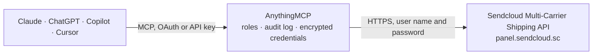

<!-- Generated by scripts/export-github-catalog.mjs in the anythingmcp-website repository. Do not edit by hand. -->

# Sendcloud Multi-Carrier Shipping MCP connector

Create parcels, print labels, track shipments, and manage returns across major EU carriers (DHL, DPD, UPS, PostNL, Hermes, Colissimo, Bpost and 40+ more) through Sendcloud — the largest multi-carrier … The AnythingMCP connector gives Claude, ChatGPT, Microsoft Copilot, Cursor and Gemini 5 MCP tools for Sendcloud Multi-Carrier Shipping: 4 read and 1 can change data.

**Category:** [Logistics](../logistics.md) · **Tools:** 5 · **Setup guide:** [anythingmcp.com](https://anythingmcp.com/guides/sendcloud-to-mcp) · [Deutsch](https://anythingmcp.com/de/guides/sendcloud-to-mcp) · [Italiano](https://anythingmcp.com/it/guides/sendcloud-to-mcp) · [Español](https://anythingmcp.com/es/guides/sendcloud-to-mcp) · [日本語](https://anythingmcp.com/ja/guides/sendcloud-to-mcp) · [Русский](https://anythingmcp.com/ru/guides/sendcloud-to-mcp) · [中文](https://anythingmcp.com/zh/guides/sendcloud-to-mcp)

## Start without code

No installation and no terminal: AnythingMCP Cloud runs the Sendcloud Multi-Carrier Shipping connector for you, operated by helpcode.ai in Frankfurt, Germany.

1. **Click the button above** and create an account or sign in. The Sendcloud Multi-Carrier Shipping connector opens, ready to install.
2. **Paste the API key or token from your Sendcloud Multi-Carrier Shipping account.** Every click is in the [step-by-step guide](https://anythingmcp.com/guides/sendcloud-to-mcp).
3. **Click Install.** AnythingMCP shows the address of your MCP server.
4. **Add that address to your assistant:** [Claude](https://anythingmcp.com/guides/connect-sendcloud-to-claude) · [ChatGPT](https://anythingmcp.com/guides/connect-sendcloud-to-chatgpt) · [Microsoft Copilot](https://anythingmcp.com/guides/connect-sendcloud-to-copilot) · [Cursor](https://anythingmcp.com/guides/connect-sendcloud-to-cursor) · [Gemini CLI](https://anythingmcp.com/guides/connect-sendcloud-to-gemini) · [Meta Muse](https://anythingmcp.com/guides/connect-sendcloud-to-muse).
5. **Ask your first question**, for example: *Where is order SH-2026-1187 parcel for customer Bakkerij De Graaf BV?*

Prefer help with the setup? [Talk to us](https://anythingmcp.com/contact).

## How it works

- **The AI client** speaks MCP (Streamable HTTP) to AnythingMCP and only sees tool names, descriptions and results. It never gets the Sendcloud Multi-Carrier Shipping credentials.
- **AnythingMCP** checks the client's role, builds the call from the tool definition, adds the credentials (user name and password), calls Sendcloud Multi-Carrier Shipping, logs the call and returns the result.
- **Sendcloud Multi-Carrier Shipping** sees an ordinary API client with the rights of the account the credentials belong to.

## Tools

| Tool | What it does | Access |
|---|---|---|
| [`sendcloud_list_shipping_methods`](#sendcloud_list_shipping_methods) | List shipping methods (carrier, service, weight bracket, price) for a destination country. | read |
| [`sendcloud_create_parcel`](#sendcloud_create_parcel) | Create a parcel and optionally generate a shipping label. | write |
| [`sendcloud_get_parcel`](#sendcloud_get_parcel) | Retrieve a parcel by its Sendcloud id. | read |
| [`sendcloud_list_parcels`](#sendcloud_list_parcels) | List recent parcels, filterable by order number, tracking number, or creation date. | read |
| [`sendcloud_get_parcel_status`](#sendcloud_get_parcel_status) | Get the current status and event timeline of a parcel — includes scan-point locations, timestamps, and status codes from the underlying carrier. | read |

## Tool reference

Every parameter as the AI client sees it in `tools/list`. Source: [`packages/backend/src/adapters/de/sendcloud.json`](../../../packages/backend/src/adapters/de/sendcloud.json).

### `sendcloud_list_shipping_methods`

List shipping methods (carrier, service, weight bracket, price) for a destination country. ALWAYS pass `to_country` — without it, the Sendcloud API returns every method for every country worldwide (10+ seconds, thousands of rows, no caching). If the user hasn't specified a destination yet, ask them or default to their account's primary destination before calling.

**Access:** read · **Call:** `GET /shipping_methods`

| Parameter | Type | Required | Description |
|---|---|---|---|
| `to_country` | string | yes | REQUIRED in practice. Destination country ISO 3166-1 alpha-2 code (e.g. 'DE', 'FR', 'NL'). Omitting this returns the global catalog and times out for most accounts — always pass a value. |
| `from_country` | string | no | Origin country ISO 3166-1 alpha-2 code (defaults to the account's warehouse country). |
| `is_return` | boolean | no | If true, return only return-shipment methods. |

### `sendcloud_create_parcel`

Create a parcel and optionally generate a shipping label. Returns parcel id, tracking_number, tracking_url, label URL, and price.

**Access:** write · **Call:** `POST /parcels`

| Parameter | Type | Required | Description |
|---|---|---|---|
| `parcel` | object | yes | Parcel object: { name, company_name?, address, address_2?, house_number, city, postal_code, country (ISO-2), email?, telephone?, weight (kg), length?, width?, height? (cm), order_number?, shipment: { id: shipping_method_id } }. |
| `request_label` | boolean | no | If true, generate a real label and bill. If false (default), creates an 'announced' parcel without a label. |

### `sendcloud_get_parcel`

Retrieve a parcel by its Sendcloud id. Returns full parcel data including tracking number, current status, label URL, and tracking events.

**Access:** read · **Call:** `GET /parcels/{id}`

| Parameter | Type | Required | Description |
|---|---|---|---|
| `id` | string | yes | The Sendcloud parcel id. |

### `sendcloud_list_parcels`

List recent parcels, filterable by order number, tracking number, or creation date.

**Access:** read · **Call:** `GET /parcels`

| Parameter | Type | Required | Description |
|---|---|---|---|
| `order_number` | string | no | Filter by your shop order number. |
| `tracking_number` | string | no | Filter by the carrier's tracking number. |
| `created_at__gte` | string | no | Created at or after this ISO 8601 datetime (e.g. '2026-04-01T00:00:00Z'). |
| `created_at__lte` | string | no | Created at or before this ISO 8601 datetime. |
| `page` | number | no | Page number, 1-based. |

### `sendcloud_get_parcel_status`

Get the current status and event timeline of a parcel — includes scan-point locations, timestamps, and status codes from the underlying carrier.

**Access:** read · **Call:** `GET /parcels/{id}/status`

| Parameter | Type | Required | Description |
|---|---|---|---|
| `id` | string | yes | The Sendcloud parcel id. |

## Run it yourself

AnythingMCP is open source (AGPL-3.0). [Run it with Docker](../../../README.md#run-it-yourself), open **Connectors → Store**, pick **Sendcloud Multi-Carrier Shipping** and enter `SENDCLOUD_PUBLIC_KEY`, `SENDCLOUD_SECRET_KEY`, then add your MCP server URL to the AI client.

[← Logistics connectors](../logistics.md) · [All categories](../README.md)
