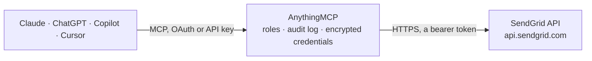

<!-- Generated by scripts/export-github-catalog.mjs in the anythingmcp-website repository. Do not edit by hand. -->

# SendGrid MCP connector

Send transactional and marketing emails via SendGrid's v3 API from any AI agent. 14 tools covering send, templates, stats, suppressions, contacts and marketing lists. The AnythingMCP connector gives Claude, ChatGPT, Microsoft Copilot, Cursor and Gemini 14 MCP tools for SendGrid: 11 read and 3 can change data.

**Category:** [Email](../email.md) · **Tools:** 14 · **Setup guide:** [anythingmcp.com](https://anythingmcp.com/guides/sendgrid-to-mcp) · [Deutsch](https://anythingmcp.com/de/guides/sendgrid-to-mcp) · [Italiano](https://anythingmcp.com/it/guides/sendgrid-to-mcp) · [Español](https://anythingmcp.com/es/guides/sendgrid-to-mcp) · [日本語](https://anythingmcp.com/ja/guides/sendgrid-to-mcp) · [Русский](https://anythingmcp.com/ru/guides/sendgrid-to-mcp) · [中文](https://anythingmcp.com/zh/guides/sendgrid-to-mcp)

## Start without code

No installation and no terminal: AnythingMCP Cloud runs the SendGrid connector for you, operated by helpcode.ai in Frankfurt, Germany.

1. **Click the button above** and create an account or sign in. The SendGrid connector opens, ready to install.
2. **Paste the API key or token from your SendGrid account.** Every click is in the [step-by-step guide](https://anythingmcp.com/guides/sendgrid-to-mcp).
3. **Click Install.** AnythingMCP shows the address of your MCP server.
4. **Add that address to your assistant:** [Claude](https://anythingmcp.com/guides/connect-sendgrid-to-claude) · [ChatGPT](https://anythingmcp.com/guides/connect-sendgrid-to-chatgpt) · [Microsoft Copilot](https://anythingmcp.com/guides/connect-sendgrid-to-copilot) · [Cursor](https://anythingmcp.com/guides/connect-sendgrid-to-cursor) · [Gemini CLI](https://anythingmcp.com/guides/connect-sendgrid-to-gemini) · [Meta Muse](https://anythingmcp.com/guides/connect-sendgrid-to-muse).
5. **Ask your first question**, for example: *Why did transactional mail to donna.mikkola@norctek.fi for invoice INV-2026-114 bounce on 2026-07-21?*

Prefer help with the setup? [Talk to us](https://anythingmcp.com/contact).

## How it works

- **The AI client** speaks MCP (Streamable HTTP) to AnythingMCP and only sees tool names, descriptions and results. It never gets the SendGrid credentials.
- **AnythingMCP** checks the client's role, builds the call from the tool definition, adds the credentials (a bearer token), calls SendGrid, logs the call and returns the result.
- **SendGrid** sees an ordinary API client with the rights of the account the credentials belong to.

## Tools

| Tool | What it does | Access |
|---|---|---|
| [`sendgrid_send_mail`](#sendgrid_send_mail) | Send a transactional or batch email via the v3 Mail Send endpoint. | write |
| [`sendgrid_list_templates`](#sendgrid_list_templates) | List transactional templates (legacy or dynamic) on the account. | read |
| [`sendgrid_get_template`](#sendgrid_get_template) | Fetch a single template by id, including all its versions. | read |
| [`sendgrid_get_stats`](#sendgrid_get_stats) | Get aggregated email statistics across a date range: requests, delivered, opens, unique_opens, clicks, unique_clicks, bounces, spam_reports, unsubscribes. | read |
| [`sendgrid_list_bounces`](#sendgrid_list_bounces) | List bounced email addresses. | read |
| [`sendgrid_get_bounce`](#sendgrid_get_bounce) | Get the bounce details for a specific email address (reason code, timestamp, status). | read |
| [`sendgrid_list_invalid_emails`](#sendgrid_list_invalid_emails) | List addresses SendGrid rejected as malformed at submission time (not bounces — these never made it out). | read |
| [`sendgrid_list_spam_reports`](#sendgrid_list_spam_reports) | List recipients who reported your emails as spam. | read |
| [`sendgrid_list_marketing_contacts`](#sendgrid_list_marketing_contacts) | List marketing contacts (NOT transactional recipients — these live in the Marketing Campaigns product). | read |
| [`sendgrid_upsert_marketing_contacts`](#sendgrid_upsert_marketing_contacts) | Add or update up to 30,000 marketing contacts in one PUT call. | write |
| [`sendgrid_get_marketing_import_job_status`](#sendgrid_get_marketing_import_job_status) | Check the status of a contacts-upsert job returned by sendgrid_upsert_marketing_contacts. | read |
| [`sendgrid_list_marketing_lists`](#sendgrid_list_marketing_lists) | List all Marketing Campaigns contact lists. | read |
| [`sendgrid_create_marketing_list`](#sendgrid_create_marketing_list) | Create a new Marketing Campaigns contact list. | write |
| [`sendgrid_search_marketing_contacts`](#sendgrid_search_marketing_contacts) | Search marketing contacts using SendGrid Query Language (similar to SQL WHERE). | read |

## Tool reference

Every parameter as the AI client sees it in `tools/list`. Source: [`packages/backend/src/adapters/intl/sendgrid.json`](../../../packages/backend/src/adapters/intl/sendgrid.json).

### `sendgrid_send_mail`

Send a transactional or batch email via the v3 Mail Send endpoint. Required at minimum: `personalizations[0].to[0].email`, `from.email`, `subject`, `content[0]`. Use the `template_id` + `dynamic_template_data` path for templated sends and skip subject/content. Returns 202 Accepted with X-Message-Id header on success.

**Access:** write · **Call:** `POST /v3/mail/send`

| Parameter | Type | Required | Description |
|---|---|---|---|
| `personalizations` | any[] | yes | Array of recipient batches (1-1000). Each is {to:[{email,name?}], cc?, bcc?, subject?, headers?, substitutions?, dynamic_template_data?, custom_args?, send_at?}. For a single recipient, use one personalization with one `to`. |
| `from` | object | yes | Sender: {email, name?}. `email` MUST match a SendGrid-authenticated sender. Required. |
| `subject` | string | no | Default subject (per-personalization subject overrides this). Required unless every personalization has its own subject OR you're using a dynamic template that sets subject. |
| `content` | any[] | no | Array of MIME parts: [{type:'text/plain', value:'...'}, {type:'text/html', value:'...'}]. text/plain MUST come before text/html. Required unless using template_id. |
| `reply_to` | object | no | {email, name?}. Reply-To header. |
| `template_id` | string | no | If set, use this Dynamic Template — usually 'd-XXXXXXXX'. Omit subject and content in this case (the template provides them). Pass per-personalization data via `dynamic_template_data`. |
| `categories` | any[] | no | Up to 10 string categories for stats grouping (alphanumeric + underscore, max 255 chars each). |
| `custom_args` | object | no | Arbitrary key/value attached to event webhook payloads. Up to 10KB total. |
| `send_at` | integer | no | Unix timestamp to schedule the send (up to 72 hours in the future). Omit to send immediately. |
| `asm` | object | no | Unsubscribe group: {group_id, groups_to_display?}. Required for compliant marketing email if you've defined groups. |
| `tracking_settings` | object | no | Override tracking: {click_tracking:{enable,enable_text}, open_tracking:{enable,substitution_tag}, subscription_tracking:{enable,text,html,substitution_tag}, ganalytics:{enable, utm_source, utm_medium, utm_campaign, utm_term, utm_content}}. |
| `mail_settings` | object | no | Message-level settings: {bypass_list_management:{enable}, sandbox_mode:{enable}, footer:{enable,text,html}}. sandbox_mode=true validates without sending (use for tests). |
| `attachments` | any[] | no | Array of {content (base64), type, filename, disposition?, content_id?}. Max 30MB total. |
| `headers` | object | no | Additional message-level headers, e.g. {'X-Internal-Ref': 'abc'}. Cannot override reserved headers. |

### `sendgrid_list_templates`

List transactional templates (legacy or dynamic) on the account. Returns each template's id, name, generation (legacy|dynamic), and versions[].

**Access:** read · **Call:** `GET /v3/templates`

| Parameter | Type | Required | Description |
|---|---|---|---|
| `generations` | string | no | Filter: 'legacy', 'dynamic', or 'legacy,dynamic'. Default returns dynamic only. |
| `page_size` | integer | no | Max per page (default 200, max 200). |
| `page_token` | string | no | Pagination cursor from previous response's _metadata.next. |

### `sendgrid_get_template`

Fetch a single template by id, including all its versions. Useful to inspect dynamic template variables before composing a sendgrid_send_mail with `template_id`.

**Access:** read · **Call:** `GET /v3/templates/{templateId}`

| Parameter | Type | Required | Description |
|---|---|---|---|
| `templateId` | string | yes | Template ID (e.g. 'd-1234abcd5678efgh9012ijkl3456mnop'). |

### `sendgrid_get_stats`

Get aggregated email statistics across a date range: requests, delivered, opens, unique_opens, clicks, unique_clicks, bounces, spam_reports, unsubscribes. Aggregated daily by default.

**Access:** read · **Call:** `GET /v3/stats`

| Parameter | Type | Required | Description |
|---|---|---|---|
| `start_date` | string | yes | Start date YYYY-MM-DD. Required. |
| `end_date` | string | no | End date YYYY-MM-DD. Default today. |
| `aggregated_by` | string | no | day, week, or month. |
| `categories` | string | no | Comma-separated category filter — only stats for emails tagged with these categories. |

### `sendgrid_list_bounces`

List bounced email addresses. Hard bounces (5xx) and soft bounces (4xx) are both reported. Recipients on this list will NOT receive transactional mail until removed via the SendGrid UI (removal is intentionally outside MCP scope to prevent automation from re-sending to bad addresses).

**Access:** read · **Call:** `GET /v3/suppression/bounces`

| Parameter | Type | Required | Description |
|---|---|---|---|
| `start_time` | integer | no | Unix timestamp — only bounces after this time. |
| `end_time` | integer | no | Unix timestamp — only bounces before this time. |
| `limit` | integer | no | Max per page (default 500, max 500). |
| `offset` | integer | no | Pagination offset. |

### `sendgrid_get_bounce`

Get the bounce details for a specific email address (reason code, timestamp, status).

**Access:** read · **Call:** `GET /v3/suppression/bounces/{email}`

| Parameter | Type | Required | Description |
|---|---|---|---|
| `email` | string | yes | Email address to look up. |

### `sendgrid_list_invalid_emails`

List addresses SendGrid rejected as malformed at submission time (not bounces — these never made it out). Use to clean up your contact source.

**Access:** read · **Call:** `GET /v3/suppression/invalid_emails`

| Parameter | Type | Required | Description |
|---|---|---|---|
| `start_time` | integer | no | Unix timestamp filter. |
| `end_time` | integer | no | Unix timestamp filter. |
| `limit` | integer | no | Max per page. |
| `offset` | integer | no | Pagination offset. |

### `sendgrid_list_spam_reports`

List recipients who reported your emails as spam. These addresses are auto-suppressed.

**Access:** read · **Call:** `GET /v3/suppression/spam_reports`

| Parameter | Type | Required | Description |
|---|---|---|---|
| `start_time` | integer | no | Unix timestamp filter. |
| `end_time` | integer | no | Unix timestamp filter. |
| `limit` | integer | no | Max per page. |
| `offset` | integer | no | Pagination offset. |

### `sendgrid_list_marketing_contacts`

List marketing contacts (NOT transactional recipients — these live in the Marketing Campaigns product). Returns id, email, first_name, last_name, list_ids[], custom_fields.

**Access:** read · **Call:** `GET /v3/marketing/contacts`

| Parameter | Type | Required | Description |
|---|---|---|---|
| `page_size` | integer | no | Max per page (default 50, max 1000). |
| `page_token` | string | no | Pagination cursor. |

### `sendgrid_upsert_marketing_contacts`

Add or update up to 30,000 marketing contacts in one PUT call. SendGrid runs an async job — returns a job_id; use sendgrid_get_marketing_import_job_status to track. `list_ids` adds the contacts to those lists.

**Access:** write · **Call:** `PUT /v3/marketing/contacts`

| Parameter | Type | Required | Description |
|---|---|---|---|
| `list_ids` | any[] | no | Array of list UUIDs to add the contacts to. Optional — omit to upsert without list assignment. |
| `contacts` | any[] | yes | Array of contact objects (max 30000). Each: {email (required), first_name?, last_name?, address_line_1?, address_line_2?, city?, state_province_region?, postal_code?, country?, alternate_emails?, phone_number?, custom_fields?}. |

### `sendgrid_get_marketing_import_job_status`

Check the status of a contacts-upsert job returned by sendgrid_upsert_marketing_contacts. Returns status (pending, completed, errored, failed) and counts of upserted/errored rows.

**Access:** read · **Call:** `GET /v3/marketing/contacts/imports/{jobId}`

| Parameter | Type | Required | Description |
|---|---|---|---|
| `jobId` | string | yes | Job UUID from a prior upsert response. |

### `sendgrid_list_marketing_lists`

List all Marketing Campaigns contact lists. Returns id (UUID), name, contact_count, _metadata.

**Access:** read · **Call:** `GET /v3/marketing/lists`

| Parameter | Type | Required | Description |
|---|---|---|---|
| `page_size` | integer | no | Max per page (default 100, max 1000). |
| `page_token` | string | no | Pagination cursor. |

### `sendgrid_create_marketing_list`

Create a new Marketing Campaigns contact list. Returns the new list's id (UUID) — use it in sendgrid_upsert_marketing_contacts to add contacts.

**Access:** write · **Call:** `POST /v3/marketing/lists`

| Parameter | Type | Required | Description |
|---|---|---|---|
| `name` | string | yes | List name (≤100 chars, unique within account). |

### `sendgrid_search_marketing_contacts`

Search marketing contacts using SendGrid Query Language (similar to SQL WHERE). Returns matching contacts with full details. Example query: "email LIKE '%@acme.com' AND CONTAINS(list_ids, 'list-uuid-here')".

**Access:** read · **Call:** `POST /v3/marketing/contacts/search`

| Parameter | Type | Required | Description |
|---|---|---|---|
| `query` | string | yes | SGQL query string. See https://docs.sendgrid.com/api-reference/contacts/search-contacts for grammar. |

## Run it yourself

AnythingMCP is open source (AGPL-3.0). [Run it with Docker](../../../README.md#run-it-yourself), open **Connectors → Store**, pick **SendGrid** and enter `SENDGRID_API_KEY`, then add your MCP server URL to the AI client.

[← Email connectors](../email.md) · [All categories](../README.md)
