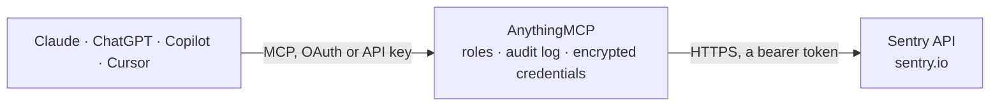

<!-- Generated by scripts/export-github-catalog.mjs in the anythingmcp-website repository. Do not edit by hand. -->

# Sentry MCP connector

Inspect Sentry projects, issues, and error events. The AnythingMCP connector gives Claude, ChatGPT, Microsoft Copilot, Cursor and Gemini 4 MCP tools for Sentry, all read-only.

**Category:** [Monitoring](../monitoring.md) · **Tools:** 4 · **Setup guide:** [anythingmcp.com](https://anythingmcp.com/guides/sentry-to-mcp) · [Deutsch](https://anythingmcp.com/de/guides/sentry-to-mcp) · [Italiano](https://anythingmcp.com/it/guides/sentry-to-mcp) · [Español](https://anythingmcp.com/es/guides/sentry-to-mcp) · [日本語](https://anythingmcp.com/ja/guides/sentry-to-mcp) · [Русский](https://anythingmcp.com/ru/guides/sentry-to-mcp) · [中文](https://anythingmcp.com/zh/guides/sentry-to-mcp)

## Start without code

No installation and no terminal: AnythingMCP Cloud runs the Sentry connector for you, operated by helpcode.ai in Frankfurt, Germany.

1. **Click the button above** and create an account or sign in. The Sentry connector opens, ready to install.
2. **Paste the API key or token from your Sentry account.** Every click is in the [step-by-step guide](https://anythingmcp.com/guides/sentry-to-mcp).
3. **Click Install.** AnythingMCP shows the address of your MCP server.
4. **Add that address to your assistant:** [Claude](https://anythingmcp.com/guides/connect-sentry-to-claude) · [ChatGPT](https://anythingmcp.com/guides/connect-sentry-to-chatgpt) · [Microsoft Copilot](https://anythingmcp.com/guides/connect-sentry-to-copilot) · [Cursor](https://anythingmcp.com/guides/connect-sentry-to-cursor) · [Gemini CLI](https://anythingmcp.com/guides/connect-sentry-to-gemini) · [Meta Muse](https://anythingmcp.com/guides/connect-sentry-to-muse).
5. **Ask your first question**, for example: *In project web-frontend, what is the issue ID and status for short ID BF-482?*

Prefer help with the setup? [Talk to us](https://anythingmcp.com/contact).

## How it works

- **The AI client** speaks MCP (Streamable HTTP) to AnythingMCP and only sees tool names, descriptions and results. It never gets the Sentry credentials.
- **AnythingMCP** checks the client's role, builds the call from the tool definition, adds the credentials (a bearer token), calls Sentry, logs the call and returns the result.
- **Sentry** sees an ordinary API client with the rights of the account the credentials belong to.

## Tools

| Tool | What it does | Access |
|---|---|---|
| [`sentry_list_projects`](#sentry_list_projects) | List one page of projects in a Sentry organization. | read |
| [`sentry_list_issues`](#sentry_list_issues) | List one page of issues in a Sentry organization. | read |
| [`sentry_get_issue`](#sentry_get_issue) | Retrieve details for a Sentry issue, including status, occurrence statistics, and a summary of the latest event. | read |
| [`sentry_list_issue_events`](#sentry_list_issue_events) | List one page of error events belonging to a Sentry issue. | read |

## Tool reference

Every parameter as the AI client sees it in `tools/list`. Source: [`packages/backend/src/adapters/intl/sentry.json`](../../../packages/backend/src/adapters/intl/sentry.json).

### `sentry_list_projects`

List one page of projects in a Sentry organization. Returns project IDs, slugs, names, and platforms. Optionally filter by project name or slug.

**Access:** read · **Call:** `GET /organizations/{{SENTRY_ORG}}/projects/`

| Parameter | Type | Required | Description |
|---|---|---|---|
| `query` | string | no | Filter projects by name or slug, for example 'backend'. |
| `per_page` | integer | no | Number of projects per page. Sentry defaults to 100; maximum 100. |
| `cursor` | string | no | Pagination cursor. Omit for the first page, then pass `_pagination.nextCursor` from the previous response and repeat until `_pagination` is absent, which means you are on the last page. Do not invent a cursor value. |

### `sentry_list_issues`

List one page of issues in a Sentry organization. Returns issue IDs, titles, statuses, and occurrence counts. Use an issue ID with sentry_get_issue to investigate further.

**Access:** read · **Call:** `GET /organizations/{{SENTRY_ORG}}/issues/`

| Parameter | Type | Required | Description |
|---|---|---|---|
| `project` | string | no | Filter to one project ID or slug from sentry_list_projects. Omit for all accessible projects. |
| `query` | string | no | Sentry issue search, for example 'is:unresolved'. Omit to use Sentry's default unresolved-issue filter. |
| `statsPeriod` | string | no | Relative time range, for example '24h' or '14d'. |
| `limit` | integer | no | Maximum number of issues to return, up to 100. |
| `cursor` | string | no | Pagination cursor. Omit for the first page, then pass `_pagination.nextCursor` from the previous response and repeat until `_pagination` is absent, which means you are on the last page. Do not invent a cursor value. |

### `sentry_get_issue`

Retrieve details for a Sentry issue, including status, occurrence statistics, and a summary of the latest event.

**Access:** read · **Call:** `GET /organizations/{{SENTRY_ORG}}/issues/{issue_id}/`

| Parameter | Type | Required | Description |
|---|---|---|---|
| `issue_id` | string | yes | Issue ID from the 'id' field returned by sentry_list_issues, for example '123456'. Use the ID, not the shortId such as 'BACKEND-42'. |

### `sentry_list_issue_events`

List one page of error events belonging to a Sentry issue. Set full to true to include full event bodies and stack traces.

**Access:** read · **Call:** `GET /organizations/{{SENTRY_ORG}}/issues/{issue_id}/events/`

| Parameter | Type | Required | Description |
|---|---|---|---|
| `issue_id` | string | yes | Issue ID from sentry_list_issues, for example '123456'. |
| `statsPeriod` | string | no | Relative time range, for example '24h' or '14d'. |
| `full` | boolean | no | Include full event bodies and stack traces. When true, Sentry caps the page size at 10. |
| `per_page` | integer | no | Events per page. Default and maximum 100, capped at 10 when full is true. |
| `cursor` | string | no | Pagination cursor. Omit for the first page, then pass `_pagination.nextCursor` from the previous response and repeat until `_pagination` is absent, which means you are on the last page. Do not invent a cursor value. |

## Run it yourself

AnythingMCP is open source (AGPL-3.0). [Run it with Docker](../../../README.md#run-it-yourself), open **Connectors → Store**, pick **Sentry** and enter `SENTRY_AUTH_TOKEN`, `SENTRY_ORG`, then add your MCP server URL to the AI client.

[← Monitoring connectors](../monitoring.md) · [All categories](../README.md)
