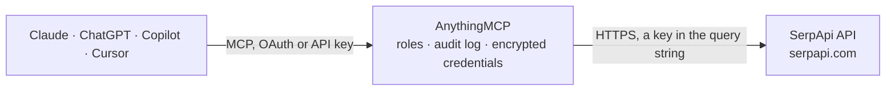

<!-- Generated by scripts/export-github-catalog.mjs in the anythingmcp-website repository. Do not edit by hand. -->

# SerpApi MCP connector

Give your AI live search engine results with SerpApi: Google web search, News, Images, Maps, Shopping, Scholar and Trends, plus YouTube and Bing, as clean structured results, and check your plan's remaining searches. The AnythingMCP connector gives Claude, ChatGPT, Microsoft Copilot, Cursor and Gemini 11 MCP tools for SerpApi, all read-only.

**Category:** [Public Data](../data.md) · **Tools:** 11 · **Setup guide:** [anythingmcp.com](https://anythingmcp.com/guides/serpapi-to-mcp) · [Deutsch](https://anythingmcp.com/de/guides/serpapi-to-mcp) · [Italiano](https://anythingmcp.com/it/guides/serpapi-to-mcp) · [Español](https://anythingmcp.com/es/guides/serpapi-to-mcp) · [日本語](https://anythingmcp.com/ja/guides/serpapi-to-mcp) · [Русский](https://anythingmcp.com/ru/guides/serpapi-to-mcp) · [中文](https://anythingmcp.com/zh/guides/serpapi-to-mcp)

## Start without code

No installation and no terminal: AnythingMCP Cloud runs the SerpApi connector for you, operated by helpcode.ai in Frankfurt, Germany.

1. **Click the button above** and create an account or sign in. The SerpApi connector opens, ready to install.
2. **Paste the API key or token from your SerpApi account.** Every click is in the [step-by-step guide](https://anythingmcp.com/guides/serpapi-to-mcp).
3. **Click Install.** AnythingMCP shows the address of your MCP server.
4. **Add that address to your assistant:** [Claude](https://anythingmcp.com/guides/connect-serpapi-to-claude) · [ChatGPT](https://anythingmcp.com/guides/connect-serpapi-to-chatgpt) · [Microsoft Copilot](https://anythingmcp.com/guides/connect-serpapi-to-copilot) · [Cursor](https://anythingmcp.com/guides/connect-serpapi-to-cursor) · [Gemini CLI](https://anythingmcp.com/guides/connect-serpapi-to-gemini) · [Meta Muse](https://anythingmcp.com/guides/connect-serpapi-to-muse).
5. **Ask your first question**, for example: *How many SerpApi searches remain this month on our company key? I need the exact remaining count.*

Prefer help with the setup? [Talk to us](https://anythingmcp.com/contact).

## How it works

- **The AI client** speaks MCP (Streamable HTTP) to AnythingMCP and only sees tool names, descriptions and results. It never gets the SerpApi credentials.
- **AnythingMCP** checks the client's role, builds the call from the tool definition, adds the credentials (a key in the query string), calls SerpApi, logs the call and returns the result.
- **SerpApi** sees an ordinary API client with the rights of the account the credentials belong to.

## Tools

| Tool | What it does | Access |
|---|---|---|
| [`serpapi_google_search`](#serpapi_google_search) | Search Google through SerpApi and get the organic results plus the answer box, knowledge graph, AI overview, People also ask questions, top stories and… | read |
| [`serpapi_google_news`](#serpapi_google_news) | Search Google News through SerpApi, or open a news topic, publisher, section or full-coverage story by its token. | read |
| [`serpapi_google_images`](#serpapi_google_images) | Search Google Images through SerpApi and get up to 20 images with title, source page, full-size URL, size and thumbnail. | read |
| [`serpapi_google_maps`](#serpapi_google_maps) | Search Google Maps through SerpApi for places and businesses: name, place_id, rating and review count, type, address, phone, website, opening state and… | read |
| [`serpapi_google_shopping`](#serpapi_google_shopping) | Search Google Shopping through SerpApi and get up to 20 offers with title, seller, price, previous price, rating, review count and product link. | read |
| [`serpapi_google_scholar`](#serpapi_google_scholar) | Search Google Scholar through SerpApi for papers, with authors, publication, snippet, PDF links and citation counts; also lists the papers citing one… | read |
| [`serpapi_google_trends`](#serpapi_google_trends) | Get Google Trends data through SerpApi: interest over time for up to 5 comma-separated terms, interest by region, or related topics and queries for one term. | read |
| [`serpapi_youtube_search`](#serpapi_youtube_search) | Search YouTube through SerpApi and get videos with title, link, video id, channel, publish date, views, length and description. | read |
| [`serpapi_bing_search`](#serpapi_bing_search) | Search Bing through SerpApi and get the organic results plus the answer box, knowledge graph and related questions when Bing shows them. | read |
| [`serpapi_get_account`](#serpapi_get_account) | Show the SerpApi plan of this API key: plan name, searches per month, searches used this month and left, extra credits, and the hourly rate limit. | read |
| [`serpapi_search_locations`](#serpapi_search_locations) | Find the exact location names SerpApi accepts in the location parameter of the search tools, e.g. Munich, Bavaria, Germany, with country code, type and reach. | read |

## Tool reference

Every parameter as the AI client sees it in `tools/list`. Source: [`packages/backend/src/adapters/intl/serpapi.json`](../../../packages/backend/src/adapters/intl/serpapi.json).

### `serpapi_google_search`

Search Google through SerpApi and get the organic results plus the answer box, knowledge graph, AI overview, People also ask questions, top stories and local results when Google shows them. Spends 1 SerpApi search from the user's plan (cached repeats within an hour and failed searches are free). Page with start (10 per page). Read-only.

**Access:** read · **Call:** `GET /search.json`

| Parameter | Type | Required | Description |
|---|---|---|---|
| `q` | string | yes | The search query. Google operators work, e.g. site:, intitle:, filetype:, "exact phrase". |
| `location` | string | no | Where the search originates, as a place name, ideally at city level, e.g. Munich, Bavaria, Germany. serpapi_search_locations finds the exact names. |
| `gl` | string | no | Two-letter country code of the Google country to search from, e.g. us, de, it. |
| `hl` | string | no | Interface language code, e.g. en, de, it, or en-gb. |
| `google_domain` | string | no | Google domain to use, e.g. google.de. Default google.com. |
| `lr` | string | no | Limit to pages in these languages, e.g. lang_de or lang_fr\|lang_it. |
| `tbs` | string | no | Advanced filters in Google's tbs syntax, e.g. qdr:w for the past week or qdr:m for the past month. |
| `safe` | `active` \| `off` | no | active filters adult content, off does not. |
| `start` | integer | no | Result offset for paging: 0 is the first page, 10 the second, 20 the third. |

### `serpapi_google_news`

Search Google News through SerpApi, or open a news topic, publisher, section or full-coverage story by its token. Spends 1 SerpApi search from the user's plan (cached repeats within an hour and failed searches are free). Returns up to 20 articles (title, link, source, date, snippet, related stories) and the topic tokens of the menu. Read-only.

**Access:** read · **Call:** `GET /search.json`

| Parameter | Type | Required | Description |
|---|---|---|---|
| `q` | string | no | The news query. Google News operators work, e.g. site:reuters.com or when:7d. Leave out when using a token. |
| `gl` | string | no | Two-letter country code of the Google News edition, e.g. us, de, it. Default us. |
| `hl` | string | no | Interface language code, e.g. en, de, it, or en-gb. |
| `topic_token` | string | no | Token of a news topic (World, Business, Technology...), from menu_links of an earlier answer. Combines with section_token. |
| `publication_token` | string | no | Token of one publisher's page. Combines with section_token. |
| `section_token` | string | no | Token of a sub-section of a topic or publisher. |
| `story_token` | string | no | Token of a story, for its full coverage. Combines with so. |
| `kgmid` | string | no | Knowledge Graph id of an entity or place, e.g. /m/0vzm. Used alone. |
| `so` | `0` \| `1` | no | Sort order: 0 relevance (default), 1 date. Only with story_token or section_token. |

### `serpapi_google_images`

Search Google Images through SerpApi and get up to 20 images with title, source page, full-size URL, size and thumbnail. Spends 1 SerpApi search from the user's plan (cached repeats within an hour and failed searches are free). Page with ijn (0 is the first page). Read-only.

**Access:** read · **Call:** `GET /search.json`

| Parameter | Type | Required | Description |
|---|---|---|---|
| `q` | string | yes | What to find pictures of. Operators such as site: work. |
| `location` | string | no | Where the search originates, as a place name, ideally at city level, e.g. Munich, Bavaria, Germany. serpapi_search_locations finds the exact names. |
| `gl` | string | no | Two-letter country code of the Google country to search from, e.g. us, de, it. |
| `hl` | string | no | Interface language code, e.g. en, de, it, or en-gb. |
| `imgsz` | `l` \| `m` \| `i` \| `qsvga` \| `vga` \| `svga` \| `xga` \| `2mp` \| `4mp` \| `6mp` \| `8mp` \| `10mp` \| `12mp` \| `15mp` \| `20mp` \| `40mp` \| `70mp` | no | Size: l large, m medium, i icon, or a minimum such as vga, xga, 2mp, 4mp, 8mp. |
| `image_type` | `face` \| `photo` \| `clipart` \| `lineart` \| `animated` | no | Kind of image. |
| `image_color` | `bw` \| `trans` \| `red` \| `orange` \| `yellow` \| `green` \| `teal` \| `blue` \| `purple` \| `pink` \| `white` \| `gray` \| `black` \| `brown` | no | Colour: bw (black and white), trans (transparent) or a colour name. |
| `licenses` | `f` \| `fc` \| `fm` \| `fmc` \| `cl` \| `ol` | no | Usage rights: f free to use or share, fc also commercially, fm free to modify, fmc also commercially, cl Creative Commons, ol commercial and other licenses. |
| `period_unit` | `s` \| `n` \| `h` \| `d` \| `w` \| `m` \| `y` | no | Only recent images: s second, n minute, h hour, d day, w week, m month, y year (with period_value). |
| `period_value` | integer | no | How many period_unit back, e.g. 3 with d for the past 3 days. Default 1. |
| `safe` | `active` \| `off` | no | active filters adult content, off does not. |
| `ijn` | integer | no | Page number, from 0. |

### `serpapi_google_maps`

Search Google Maps through SerpApi for places and businesses: name, place_id, rating and review count, type, address, phone, website, opening state and hours, and coordinates. Spends 1 SerpApi search from the user's plan (cached repeats within an hour and failed searches are free). Up to 20 places per page; page with start (0, 20, 40). Read-only.

**Access:** read · **Call:** `GET /search.json`

| Parameter | Type | Required | Description |
|---|---|---|---|
| `q` | string | yes | What to look for, e.g. coffee or dentist, optionally with a place: pizza in Bologna. |
| `ll` | string | no | Map centre and zoom as @latitude,longitude,zoomz, e.g. @48.1374,11.5755,14z. Without it Google picks the area from q. |
| `hl` | string | no | Interface language code, e.g. en, de, it, or en-gb. |
| `gl` | string | no | Two-letter country code of the Google country to search from, e.g. us, de, it. |
| `start` | integer | no | Result offset: 0 is the first page, 20 the second, 40 the third. |
| `min_rating` | `2.0` \| `2.5` \| `3.0` \| `3.5` \| `4.0` \| `4.5` | no | Prefer places rated at least this much. |
| `open_state` | `now` \| `24h` | no | now for places open now, 24h for places open 24 hours. |

### `serpapi_google_shopping`

Search Google Shopping through SerpApi and get up to 20 offers with title, seller, price, previous price, rating, review count and product link. Spends 1 SerpApi search from the user's plan (cached repeats within an hour and failed searches are free). Read-only.

**Access:** read · **Call:** `GET /search.json`

| Parameter | Type | Required | Description |
|---|---|---|---|
| `q` | string | yes | The product to look for. |
| `location` | string | no | Where the search originates, as a place name, ideally at city level, e.g. Munich, Bavaria, Germany. serpapi_search_locations finds the exact names. |
| `gl` | string | no | Two-letter country code of the Google country to search from, e.g. us, de, it. |
| `hl` | string | no | Interface language code, e.g. en, de, it, or en-gb. |
| `min_price` | number | no | Lowest price, in the currency of the country. |
| `max_price` | number | no | Highest price, in the currency of the country. |
| `sort_by` | `1` \| `2` | no | 1 price low to high, 2 price high to low. Default relevance. |
| `free_shipping` | boolean | no | Only offers with free shipping. |
| `on_sale` | boolean | no | Only offers on sale. |

### `serpapi_google_scholar`

Search Google Scholar through SerpApi for papers, with authors, publication, snippet, PDF links and citation counts; also lists the papers citing one (cites) or all versions of one (cluster). Spends 1 SerpApi search from the user's plan (cached repeats within an hour and failed searches are free). Read-only.

**Access:** read · **Call:** `GET /search.json`

| Parameter | Type | Required | Description |
|---|---|---|---|
| `q` | string | no | The query. author: and source: work. Optional with cites; not allowed with cluster. |
| `cites` | string | no | cites_id of a paper (from an earlier answer) to list the papers that cite it; with q, searches within them. |
| `cluster` | string | no | cluster_id of a paper to list all its versions. Use alone, without q or cites. |
| `as_ylo` | integer | no | Only papers from this year on. |
| `as_yhi` | integer | no | Only papers up to this year. |
| `scisbd` | `1` \| `2` | no | Only papers added in the past year, newest first: 1 abstracts only, 2 everything. Leave out to sort by relevance. |
| `as_sdt` | string | no | 0 excludes patents (default), 7 includes them, 4 searches US case law. |
| `hl` | string | no | Interface language code, e.g. en, de, it, or en-gb. |
| `lr` | string | no | Limit to these languages, e.g. lang_de or lang_fr\|lang_it. |
| `num` | integer | no | Results per page, 1 to 20. Default 10. |
| `start` | integer | no | Result offset for paging: 0, 10, 20... |

### `serpapi_google_trends`

Get Google Trends data through SerpApi: interest over time for up to 5 comma-separated terms, interest by region, or related topics and queries for one term. Values are relative (100 is the peak), not search counts. Spends 1 SerpApi search from the user's plan (cached repeats within an hour and failed searches are free). Read-only.

**Access:** read · **Call:** `GET /search.json`

| Parameter | Type | Required | Description |
|---|---|---|---|
| `q` | string | yes | Search term, or up to 5 terms separated by commas for TIMESERIES and GEO_MAP, e.g. coffee,tea. |
| `data_type` | `TIMESERIES` \| `GEO_MAP` \| `GEO_MAP_0` \| `RELATED_TOPICS` \| `RELATED_QUERIES` | no | TIMESERIES interest over time (default); GEO_MAP regions compared for several terms; GEO_MAP_0 interest by region for one term; RELATED_TOPICS and RELATED_QUERIES for one term. |
| `date` | string | no | Period: now 1-H, now 4-H, now 1-d, now 7-d, today 1-m, today 3-m, today 12-m (default), today 5-y, all, or a range yyyy-mm-dd yyyy-mm-dd. |
| `geo` | string | no | Country or region code, e.g. DE or US-CA. Worldwide when left out. |
| `region` | `COUNTRY` \| `REGION` \| `DMA` \| `CITY` | no | With GEO_MAP or GEO_MAP_0: break down by COUNTRY, REGION (subregion), DMA (metro) or CITY. |
| `cat` | string | no | Google Trends category id, e.g. 7 Finance or 71 Food & Drink. Default 0, all categories. |
| `gprop` | `images` \| `news` \| `froogle` \| `youtube` | no | Which Google property: images, news, froogle (Shopping) or youtube. Web search when left out. |
| `tz` | string | no | Time zone offset in minutes, e.g. -60 for Central Europe in winter, 420 for Pacific daylight time (the default). |
| `hl` | string | no | Interface language code, e.g. en, de, it, or en-gb. |

### `serpapi_youtube_search`

Search YouTube through SerpApi and get videos with title, link, video id, channel, publish date, views, length and description. Spends 1 SerpApi search from the user's plan (cached repeats within an hour and failed searches are free). For the next page pass next_page_token back as sp. Read-only.

**Access:** read · **Call:** `GET /search.json`

| Parameter | Type | Required | Description |
|---|---|---|---|
| `search_query` | string | yes | What to search for on YouTube. |
| `gl` | string | no | Two-letter country code of the Google country to search from, e.g. us, de, it. |
| `hl` | string | no | Interface language code, e.g. en, de, it, or en-gb. |
| `sp` | string | no | next_page_token from an earlier answer to get the next page, or a YouTube filter token, e.g. CAI%3D for sorting by upload date. |

### `serpapi_bing_search`

Search Bing through SerpApi and get the organic results plus the answer box, knowledge graph and related questions when Bing shows them. Spends 1 SerpApi search from the user's plan (cached repeats within an hour and failed searches are free). Page with first (1, 11, 21...). Read-only.

**Access:** read · **Call:** `GET /search.json`

| Parameter | Type | Required | Description |
|---|---|---|---|
| `q` | string | yes | The search query. Bing operators work, e.g. site:, filetype:, NOT, OR. |
| `location` | string | no | Where the search originates, as a place name, ideally at city level, e.g. Munich, Bavaria, Germany. serpapi_search_locations finds the exact names. |
| `mkt` | string | no | Market as language-country, e.g. de-DE, en-US, it-IT. |
| `cc` | string | no | Two-letter country code to search from, e.g. DE. |
| `safeSearch` | `strict` \| `moderate` \| `off` | no | Adult content filter: strict, moderate (default) or off. |
| `first` | integer | no | Offset of the first organic result, from 1; 11 is roughly the second page. |

### `serpapi_get_account`

Show the SerpApi plan of this API key: plan name, searches per month, searches used this month and left, extra credits, and the hourly rate limit. Free: it is not counted as a search.

**Access:** read · **Call:** `GET /account.json`

No parameters.

### `serpapi_search_locations`

Find the exact location names SerpApi accepts in the location parameter of the search tools, e.g. Munich, Bavaria, Germany, with country code, type and reach. Free: it is not counted as a search.

**Access:** read · **Call:** `GET /locations.json`

| Parameter | Type | Required | Description |
|---|---|---|---|
| `q` | string | yes | Part of a place name, e.g. Munich. |
| `limit` | integer | no | How many matches to return. Default 5. |

## Run it yourself

AnythingMCP is open source (AGPL-3.0). [Run it with Docker](../../../README.md#run-it-yourself), open **Connectors → Store**, pick **SerpApi** and enter `SERPAPI_API_KEY`, then add your MCP server URL to the AI client.

[← Public Data connectors](../data.md) · [All categories](../README.md)
