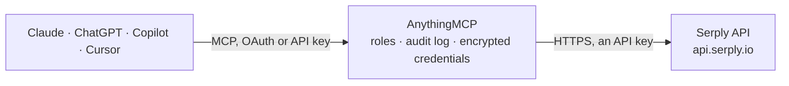

<!-- Generated by scripts/export-github-catalog.mjs in the anythingmcp-website repository. Do not edit by hand. -->

# Serply MCP connector

Google web, news and Scholar search from any AI agent via the Serply API. 3 tools, API-key auth. The AnythingMCP connector gives Claude, ChatGPT, Microsoft Copilot, Cursor and Gemini 3 MCP tools for Serply, all read-only.

**Category:** [Public Data](../data.md) · **Tools:** 3 · **Setup guide:** [anythingmcp.com](https://anythingmcp.com/guides/serply-to-mcp) · [Deutsch](https://anythingmcp.com/de/guides/serply-to-mcp) · [Italiano](https://anythingmcp.com/it/guides/serply-to-mcp) · [Español](https://anythingmcp.com/es/guides/serply-to-mcp) · [日本語](https://anythingmcp.com/ja/guides/serply-to-mcp) · [Русский](https://anythingmcp.com/ru/guides/serply-to-mcp) · [中文](https://anythingmcp.com/zh/guides/serply-to-mcp)

## Start without code

No installation and no terminal: AnythingMCP Cloud runs the Serply connector for you, operated by helpcode.ai in Frankfurt, Germany.

1. **Click the button above** and create an account or sign in. The Serply connector opens, ready to install.
2. **Paste the API key or token from your Serply account.** Every click is in the [step-by-step guide](https://anythingmcp.com/guides/serply-to-mcp).
3. **Click Install.** AnythingMCP shows the address of your MCP server.
4. **Add that address to your assistant:** [Claude](https://anythingmcp.com/guides/connect-serply-to-claude) · [ChatGPT](https://anythingmcp.com/guides/connect-serply-to-chatgpt) · [Microsoft Copilot](https://anythingmcp.com/guides/connect-serply-to-copilot) · [Cursor](https://anythingmcp.com/guides/connect-serply-to-cursor) · [Gemini CLI](https://anythingmcp.com/guides/connect-serply-to-gemini) · [Meta Muse](https://anythingmcp.com/guides/connect-serply-to-muse).
5. **Ask your first question**, for example: *Did Nordic Solar AS file a dispute for invoice INV-2026-0342 on our support portal this month?*

Prefer help with the setup? [Talk to us](https://anythingmcp.com/contact).

## How it works

- **The AI client** speaks MCP (Streamable HTTP) to AnythingMCP and only sees tool names, descriptions and results. It never gets the Serply credentials.
- **AnythingMCP** checks the client's role, builds the call from the tool definition, adds the credentials (an API key), calls Serply, logs the call and returns the result.
- **Serply** sees an ordinary API client with the rights of the account the credentials belong to.

## Tools

| Tool | What it does | Access |
|---|---|---|
| [`serply_search`](#serply_search) | Google web search via Serply. | read |
| [`serply_news`](#serply_news) | Google News search via Serply. | read |
| [`serply_scholar`](#serply_scholar) | Google Scholar search via Serply. | read |

## Tool reference

Every parameter as the AI client sees it in `tools/list`. Source: [`packages/backend/src/adapters/intl/serply.json`](../../../packages/backend/src/adapters/intl/serply.json).

### `serply_search`

Google web search via Serply. Use when the agent needs current information, documentation, or facts not in its training data. Organic hits are in results[] (title, link, description). Supports Google operators in q: site:, -site:, filetype:, inurl:, intitle:.

**Access:** read · **Call:** `GET /v1/search`

| Parameter | Type | Required | Description |
|---|---|---|---|
| `q` | string | yes | Search query. Supports site:, -site:, filetype:, inurl:, intitle:"..." and quoted phrases. |
| `num` | integer | no | Max results, 1-10. Serply caps a request at 10. |
| `gl` | string | no | Two-letter country code to localise results (e.g. 'us', 'gb', 'de'). |
| `tbs` | string | no | Recency filter: 'qdr:h' (hour), 'qdr:d' (day), 'qdr:w' (week), 'qdr:m' (month), 'qdr:y' (year). |

### `serply_news`

Google News search via Serply. Calls the same GET /v1/search endpoint as serply_search with Google's news vertical, so hits come back in the same results[] shape with direct publisher links. Use when the user wants news coverage of a topic, company or event rather than general web results.

**Access:** read · **Call:** `GET /v1/search`

| Parameter | Type | Required | Description |
|---|---|---|---|
| `q` | string | yes | News search query. Supports the same operators as serply_search. |
| `num` | integer | no | Max results, 1-10. |
| `gl` | string | no | Two-letter country code to localise results (e.g. 'us', 'gb', 'de'). |
| `tbs` | string | no | Recency filter: 'qdr:h' (hour), 'qdr:d' (day), 'qdr:w' (week), 'qdr:m' (month), 'qdr:y' (year). |

### `serply_scholar`

Google Scholar search via Serply. Returns academic papers in articles[] (title, link, author, description). Use when the user asks for papers, citations or research on a topic rather than general web pages.

**Access:** read · **Call:** `GET /v1/scholar`

| Parameter | Type | Required | Description |
|---|---|---|---|
| `q` | string | yes | Scholar query, e.g. a topic, a paper title in quotes, or author:"name". |
| `num` | integer | no | Max results, 1-10. |

## Run it yourself

AnythingMCP is open source (AGPL-3.0). [Run it with Docker](../../../README.md#run-it-yourself), open **Connectors → Store**, pick **Serply** and enter `SERPLY_API_KEY`, then add your MCP server URL to the AI client.

[← Public Data connectors](../data.md) · [All categories](../README.md)
