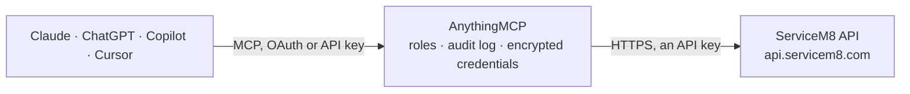

<!-- Generated by scripts/export-github-catalog.mjs in the anythingmcp-website repository. Do not edit by hand. -->

# ServiceM8 MCP connector

ServiceM8 job management for trades and field service: jobs and statuses, clients and contacts, the schedule (job activities and allocations), staff, price list materials, job line items and … The AnythingMCP connector gives Claude, ChatGPT, Microsoft Copilot, Cursor and Gemini 36 MCP tools for ServiceM8: 24 read and 12 can change data.

**Category:** [Field Service](../field-service.md) · **Tools:** 36 · **Setup guide:** [anythingmcp.com](https://anythingmcp.com/guides/servicem8-to-mcp) · [Deutsch](https://anythingmcp.com/de/guides/servicem8-to-mcp) · [Italiano](https://anythingmcp.com/it/guides/servicem8-to-mcp) · [Español](https://anythingmcp.com/es/guides/servicem8-to-mcp) · [日本語](https://anythingmcp.com/ja/guides/servicem8-to-mcp) · [Русский](https://anythingmcp.com/ru/guides/servicem8-to-mcp) · [中文](https://anythingmcp.com/zh/guides/servicem8-to-mcp)

## Start without code

No installation and no terminal: AnythingMCP Cloud runs the ServiceM8 connector for you, operated by helpcode.ai in Frankfurt, Germany.

1. **Click the button above** and create an account or sign in. The ServiceM8 connector opens, ready to install.
2. **Paste the API key or token from your ServiceM8 account.** Every click is in the [step-by-step guide](https://anythingmcp.com/guides/servicem8-to-mcp).
3. **Click Install.** AnythingMCP shows the address of your MCP server.
4. **Add that address to your assistant:** [Claude](https://anythingmcp.com/guides/connect-servicem8-to-claude) · [ChatGPT](https://anythingmcp.com/guides/connect-servicem8-to-chatgpt) · [Microsoft Copilot](https://anythingmcp.com/guides/connect-servicem8-to-copilot) · [Cursor](https://anythingmcp.com/guides/connect-servicem8-to-cursor) · [Gemini CLI](https://anythingmcp.com/guides/connect-servicem8-to-gemini) · [Meta Muse](https://anythingmcp.com/guides/connect-servicem8-to-muse).
5. **Ask your first question**, for example: *Show billing address and payment terms for client Riverton Plumbing Pty Ltd in our account*

Prefer help with the setup? [Talk to us](https://anythingmcp.com/contact).

## How it works

- **The AI client** speaks MCP (Streamable HTTP) to AnythingMCP and only sees tool names, descriptions and results. It never gets the ServiceM8 credentials.
- **AnythingMCP** checks the client's role, builds the call from the tool definition, adds the credentials (an API key), calls ServiceM8, logs the call and returns the result.
- **ServiceM8** sees an ordinary API client with the rights of the account the credentials belong to.

## Tools

| Tool | What it does | Access |
|---|---|---|
| [`servicem8_get_account`](#servicem8_get_account) | The connected ServiceM8 account (vendor): name, business number, email, currency, time zone, opening hours, default job status and whether amounts are shown… | read |
| [`servicem8_list_jobs`](#servicem8_list_jobs) | List jobs: uuid, job number (generated_job_id), status (Quote, Work Order, Unsuccessful, Completed), client (company_uuid), address, description, work done,… | read |
| [`servicem8_get_job`](#servicem8_get_job) | One job by UUID with status, client, addresses, description, work done, totals, dates and badges. | read |
| [`servicem8_list_clients`](#servicem8_list_clients) | List clients (ServiceM8 calls them companies): uuid, name, address parts, billing address, ABN or business number, website, payment terms, tax rate, parent… | read |
| [`servicem8_get_client`](#servicem8_get_client) | One client (company) by UUID with address, billing address, payment terms and tax rate. | read |
| [`servicem8_list_client_contacts`](#servicem8_list_client_contacts) | Contacts of clients: uuid, company_uuid, first and last name, phone, mobile, email, type (BILLING, JOB, ...), primary flag. | read |
| [`servicem8_list_job_contacts`](#servicem8_list_job_contacts) | Contacts on jobs (site contact, billing contact): uuid, job_uuid, first and last name, phone, mobile, email, type. | read |
| [`servicem8_list_job_activities`](#servicem8_list_job_activities) | Job activities, the schedule: uuid, job_uuid, staff_uuid, start_date, end_date, activity_was_scheduled (1 = a booking, 0 = time recorded on site),… | read |
| [`servicem8_list_job_allocations`](#servicem8_list_job_allocations) | Job allocations (flexible bookings: a job given to a staff member for a day or allocation window, without a fixed time): uuid, job_uuid, staff_uuid,… | read |
| [`servicem8_list_staff`](#servicem8_list_staff) | Staff members: uuid, first and last name, email, mobile, job title, color, last known position and time, status message, hidden from schedule, active. | read |
| [`servicem8_get_staff_member`](#servicem8_get_staff_member) | One staff member by UUID: name, contact details, job title, last known GPS position and status message. | read |
| [`servicem8_list_materials`](#servicem8_list_materials) | Materials and services of the price list: uuid, name, item number, description, price, cost, price includes taxes, tax rate, stock quantity, barcode, active. | read |
| [`servicem8_list_job_materials`](#servicem8_list_job_materials) | Line items on jobs (what is quoted or invoiced): uuid, job_uuid, material_uuid, name, quantity, unit price ex tax, displayed amount, cost, tax rate, sort order. | read |
| [`servicem8_list_job_payments`](#servicem8_list_job_payments) | Payments recorded on jobs: uuid, job_uuid, amount, method, timestamp, note, who recorded it, attachment. | read |
| [`servicem8_list_notes`](#servicem8_list_notes) | Notes on jobs and clients: uuid, related_object (job or company), related_object_uuid, note text, action required, created time. | read |
| [`servicem8_list_attachments`](#servicem8_list_attachments) | Attachment metadata (photos, PDFs, signatures) of jobs and clients: uuid, related_object, related_object_uuid, attachment_name, file_type, source, tags,… | read |
| [`servicem8_get_attachment`](#servicem8_get_attachment) | Metadata of one attachment by UUID: name, file type, related record, tags, size of photos. | read |
| [`servicem8_list_forms`](#servicem8_list_forms) | Forms (checklists, safety and inspection forms) set up in the account: uuid, name, template, active. | read |
| [`servicem8_list_form_responses`](#servicem8_list_form_responses) | Completed form responses: uuid, form_uuid, staff_uuid, regarding_object and its uuid (usually a job), field_data (JSON with the answers), timestamp,… | read |
| [`servicem8_get_form_response`](#servicem8_get_form_response) | One completed form response by UUID with its answers in field_data (JSON). | read |
| [`servicem8_list_categories`](#servicem8_list_categories) | Job categories (types of work): uuid, name, colour, active. | read |
| [`servicem8_list_job_queues`](#servicem8_list_job_queues) | Job queues (holding areas for jobs waiting for parts, quotes to follow up, ...): uuid, name, requires assignment, default timeframe, active. | read |
| [`servicem8_list_job_templates`](#servicem8_list_job_templates) | Job templates: uuid, name and the job details and materials they prefill. | read |
| [`servicem8_list_tax_rates`](#servicem8_list_tax_rates) | Tax rates: uuid, name, rate, active. | read |
| [`servicem8_create_job`](#servicem8_create_job) | Create a job. | write |
| [`servicem8_update_job`](#servicem8_update_job) | Change fields of a job; only the fields you pass change. | write |
| [`servicem8_create_job_from_template`](#servicem8_create_job_from_template) | Create a job from a job template (from servicem8_list_job_templates) with its prefilled description and materials. | write |
| [`servicem8_create_client`](#servicem8_create_client) | Create a client (company or individual). | write |
| [`servicem8_update_client`](#servicem8_update_client) | Change fields of a client; only the fields you pass change. | write |
| [`servicem8_create_client_contact`](#servicem8_create_client_contact) | Add a contact person (name, phone, mobile, email, type) to a client. | write |
| [`servicem8_schedule_job_activity`](#servicem8_schedule_job_activity) | Book a staff member on a job at a fixed time (a scheduled job activity on the dispatch board). | write |
| [`servicem8_update_job_activity`](#servicem8_update_job_activity) | Move a booking to another time or staff member; only the fields you pass change. | write |
| [`servicem8_remove_job_activity`](#servicem8_remove_job_activity) | Remove a booking from the schedule. | write |
| [`servicem8_add_job_material`](#servicem8_add_job_material) | Add a line item to a job (quote or invoice): from the price list with material_uuid, or free text with name and price. | write |
| [`servicem8_record_job_payment`](#servicem8_record_job_payment) | Record a payment received for a job (cash, card, bank transfer). | write |
| [`servicem8_add_note`](#servicem8_add_note) | Add a note to a job or a client. | write |

## Tool reference

Every parameter as the AI client sees it in `tools/list`. Source: [`packages/backend/src/adapters/intl/servicem8.json`](../../../packages/backend/src/adapters/intl/servicem8.json).

### `servicem8_get_account`

The connected ServiceM8 account (vendor): name, business number, email, currency, time zone, opening hours, default job status and whether amounts are shown tax-inclusive.

**Access:** read · **Call:** `GET /vendor.json`

No parameters.

### `servicem8_list_jobs`

List jobs: uuid, job number (generated_job_id), status (Quote, Work Order, Unsuccessful, Completed), client (company_uuid), address, description, work done, category, queue, total invoice amount, quote, work order, completion and invoice dates, payment received flag, active, last edit. Filter to keep the list small.

**Access:** read · **Call:** `GET /job.json`

| Parameter | Type | Required | Description |
|---|---|---|---|
| `filter` | string | no | OData-style filter: field eq\|ne\|gt\|lt value, joined with and (at most 10 conditions, no or). Strings in single quotes. Example: status eq 'Work Order' and active eq 1, or company_uuid eq '<uuid>', or edit_date gt '2026-10-01 00:00:00'. |
| `cursor` | string | no | Paging cursor: -1 for the first page of up to 1,000 records, then the value of the x-next-cursor header (_headers) from the previous page. Leave empty to get every record at once on small lists. |

### `servicem8_get_job`

One job by UUID with status, client, addresses, description, work done, totals, dates and badges.

**Access:** read · **Call:** `GET /job/{uuid}.json`

| Parameter | Type | Required | Description |
|---|---|---|---|
| `uuid` | string | yes | Job UUID. |

### `servicem8_list_clients`

List clients (ServiceM8 calls them companies): uuid, name, address parts, billing address, ABN or business number, website, payment terms, tax rate, parent company (for sites), active, last edit.

**Access:** read · **Call:** `GET /company.json`

| Parameter | Type | Required | Description |
|---|---|---|---|
| `filter` | string | no | OData-style filter: field eq\|ne\|gt\|lt value, joined with and (at most 10 conditions, no or). Strings in single quotes. Example: name eq 'Smith Plumbing', or active eq 1, or edit_date gt '2026-10-01 00:00:00'. |
| `cursor` | string | no | Paging cursor: -1 for the first page of up to 1,000 records, then the value of the x-next-cursor header (_headers) from the previous page. Leave empty to get every record at once on small lists. |

### `servicem8_get_client`

One client (company) by UUID with address, billing address, payment terms and tax rate.

**Access:** read · **Call:** `GET /company/{uuid}.json`

| Parameter | Type | Required | Description |
|---|---|---|---|
| `uuid` | string | yes | Client (company) UUID. |

### `servicem8_list_client_contacts`

Contacts of clients: uuid, company_uuid, first and last name, phone, mobile, email, type (BILLING, JOB, ...), primary flag.

**Access:** read · **Call:** `GET /companycontact.json`

| Parameter | Type | Required | Description |
|---|---|---|---|
| `filter` | string | no | OData-style filter: field eq\|ne\|gt\|lt value, joined with and (at most 10 conditions, no or). Strings in single quotes. Example: company_uuid eq '<uuid>'. |
| `cursor` | string | no | Paging cursor: -1 for the first page of up to 1,000 records, then the value of the x-next-cursor header (_headers) from the previous page. Leave empty to get every record at once on small lists. |

### `servicem8_list_job_contacts`

Contacts on jobs (site contact, billing contact): uuid, job_uuid, first and last name, phone, mobile, email, type.

**Access:** read · **Call:** `GET /jobcontact.json`

| Parameter | Type | Required | Description |
|---|---|---|---|
| `filter` | string | no | OData-style filter: field eq\|ne\|gt\|lt value, joined with and (at most 10 conditions, no or). Strings in single quotes. Example: job_uuid eq '<uuid>'. |
| `cursor` | string | no | Paging cursor: -1 for the first page of up to 1,000 records, then the value of the x-next-cursor header (_headers) from the previous page. Leave empty to get every record at once on small lists. |

### `servicem8_list_job_activities`

Job activities, the schedule: uuid, job_uuid, staff_uuid, start_date, end_date, activity_was_scheduled (1 = a booking, 0 = time recorded on site), activity_was_recorded, travel time, active. Filter by job, staff or start date to read a calendar.

**Access:** read · **Call:** `GET /jobactivity.json`

| Parameter | Type | Required | Description |
|---|---|---|---|
| `filter` | string | no | OData-style filter: field eq\|ne\|gt\|lt value, joined with and (at most 10 conditions, no or). Strings in single quotes. Example: staff_uuid eq '<uuid>' and start_date gt '2026-11-02 00:00:00' and start_date lt '2026-11-09 00:00:00' and activity_was_scheduled eq 1. |
| `cursor` | string | no | Paging cursor: -1 for the first page of up to 1,000 records, then the value of the x-next-cursor header (_headers) from the previous page. Leave empty to get every record at once on small lists. |

### `servicem8_list_job_allocations`

Job allocations (flexible bookings: a job given to a staff member for a day or allocation window, without a fixed time): uuid, job_uuid, staff_uuid, allocation_date, allocation window, expiry, acceptance status, completion.

**Access:** read · **Call:** `GET /joballocation.json`

| Parameter | Type | Required | Description |
|---|---|---|---|
| `filter` | string | no | OData-style filter: field eq\|ne\|gt\|lt value, joined with and (at most 10 conditions, no or). Strings in single quotes. Example: staff_uuid eq '<uuid>' and allocation_date gt '2026-11-01'. |
| `cursor` | string | no | Paging cursor: -1 for the first page of up to 1,000 records, then the value of the x-next-cursor header (_headers) from the previous page. Leave empty to get every record at once on small lists. |

### `servicem8_list_staff`

Staff members: uuid, first and last name, email, mobile, job title, color, last known position and time, status message, hidden from schedule, active.

**Access:** read · **Call:** `GET /staff.json`

| Parameter | Type | Required | Description |
|---|---|---|---|
| `filter` | string | no | OData-style filter: field eq\|ne\|gt\|lt value, joined with and (at most 10 conditions, no or). Strings in single quotes. Example: active eq 1. |
| `cursor` | string | no | Paging cursor: -1 for the first page of up to 1,000 records, then the value of the x-next-cursor header (_headers) from the previous page. Leave empty to get every record at once on small lists. |

### `servicem8_get_staff_member`

One staff member by UUID: name, contact details, job title, last known GPS position and status message.

**Access:** read · **Call:** `GET /staff/{uuid}.json`

| Parameter | Type | Required | Description |
|---|---|---|---|
| `uuid` | string | yes | Staff member UUID. |

### `servicem8_list_materials`

Materials and services of the price list: uuid, name, item number, description, price, cost, price includes taxes, tax rate, stock quantity, barcode, active.

**Access:** read · **Call:** `GET /material.json`

| Parameter | Type | Required | Description |
|---|---|---|---|
| `filter` | string | no | OData-style filter: field eq\|ne\|gt\|lt value, joined with and (at most 10 conditions, no or). Strings in single quotes. Example: name eq 'Labour - Standard' or item_number eq 'PL-001'. |
| `cursor` | string | no | Paging cursor: -1 for the first page of up to 1,000 records, then the value of the x-next-cursor header (_headers) from the previous page. Leave empty to get every record at once on small lists. |

### `servicem8_list_job_materials`

Line items on jobs (what is quoted or invoiced): uuid, job_uuid, material_uuid, name, quantity, unit price ex tax, displayed amount, cost, tax rate, sort order.

**Access:** read · **Call:** `GET /jobmaterial.json`

| Parameter | Type | Required | Description |
|---|---|---|---|
| `filter` | string | no | OData-style filter: field eq\|ne\|gt\|lt value, joined with and (at most 10 conditions, no or). Strings in single quotes. Example: job_uuid eq '<uuid>'. |
| `cursor` | string | no | Paging cursor: -1 for the first page of up to 1,000 records, then the value of the x-next-cursor header (_headers) from the previous page. Leave empty to get every record at once on small lists. |

### `servicem8_list_job_payments`

Payments recorded on jobs: uuid, job_uuid, amount, method, timestamp, note, who recorded it, attachment.

**Access:** read · **Call:** `GET /jobpayment.json`

| Parameter | Type | Required | Description |
|---|---|---|---|
| `filter` | string | no | OData-style filter: field eq\|ne\|gt\|lt value, joined with and (at most 10 conditions, no or). Strings in single quotes. Example: job_uuid eq '<uuid>' or timestamp gt '2026-10-01 00:00:00'. |
| `cursor` | string | no | Paging cursor: -1 for the first page of up to 1,000 records, then the value of the x-next-cursor header (_headers) from the previous page. Leave empty to get every record at once on small lists. |

### `servicem8_list_notes`

Notes on jobs and clients: uuid, related_object (job or company), related_object_uuid, note text, action required, created time.

**Access:** read · **Call:** `GET /note.json`

| Parameter | Type | Required | Description |
|---|---|---|---|
| `filter` | string | no | OData-style filter: field eq\|ne\|gt\|lt value, joined with and (at most 10 conditions, no or). Strings in single quotes. Example: related_object_uuid eq '<job uuid>'. |
| `cursor` | string | no | Paging cursor: -1 for the first page of up to 1,000 records, then the value of the x-next-cursor header (_headers) from the previous page. Leave empty to get every record at once on small lists. |

### `servicem8_list_attachments`

Attachment metadata (photos, PDFs, signatures) of jobs and clients: uuid, related_object, related_object_uuid, attachment_name, file_type, source, tags, created by and when. File contents are not returned.

**Access:** read · **Call:** `GET /attachment.json`

| Parameter | Type | Required | Description |
|---|---|---|---|
| `filter` | string | no | OData-style filter: field eq\|ne\|gt\|lt value, joined with and (at most 10 conditions, no or). Strings in single quotes. Example: related_object_uuid eq '<job uuid>' and active eq 1. |
| `cursor` | string | no | Paging cursor: -1 for the first page of up to 1,000 records, then the value of the x-next-cursor header (_headers) from the previous page. Leave empty to get every record at once on small lists. |

### `servicem8_get_attachment`

Metadata of one attachment by UUID: name, file type, related record, tags, size of photos.

**Access:** read · **Call:** `GET /dboattachment/{uuid}.json`

| Parameter | Type | Required | Description |
|---|---|---|---|
| `uuid` | string | yes | Attachment UUID. |

### `servicem8_list_forms`

Forms (checklists, safety and inspection forms) set up in the account: uuid, name, template, active.

**Access:** read · **Call:** `GET /form.json`

| Parameter | Type | Required | Description |
|---|---|---|---|
| `filter` | string | no | OData-style filter: field eq\|ne\|gt\|lt value, joined with and (at most 10 conditions, no or). Strings in single quotes. Example: active eq 1. |
| `cursor` | string | no | Paging cursor: -1 for the first page of up to 1,000 records, then the value of the x-next-cursor header (_headers) from the previous page. Leave empty to get every record at once on small lists. |

### `servicem8_list_form_responses`

Completed form responses: uuid, form_uuid, staff_uuid, regarding_object and its uuid (usually a job), field_data (JSON with the answers), timestamp, document attachment, asset.

**Access:** read · **Call:** `GET /formresponse.json`

| Parameter | Type | Required | Description |
|---|---|---|---|
| `filter` | string | no | OData-style filter: field eq\|ne\|gt\|lt value, joined with and (at most 10 conditions, no or). Strings in single quotes. Example: regarding_object_uuid eq '<job uuid>'. |
| `cursor` | string | no | Paging cursor: -1 for the first page of up to 1,000 records, then the value of the x-next-cursor header (_headers) from the previous page. Leave empty to get every record at once on small lists. |

### `servicem8_get_form_response`

One completed form response by UUID with its answers in field_data (JSON).

**Access:** read · **Call:** `GET /formresponse/{uuid}.json`

| Parameter | Type | Required | Description |
|---|---|---|---|
| `uuid` | string | yes | Form response UUID. |

### `servicem8_list_categories`

Job categories (types of work): uuid, name, colour, active. Use category_uuid when creating jobs.

**Access:** read · **Call:** `GET /category.json`

| Parameter | Type | Required | Description |
|---|---|---|---|
| `filter` | string | no | OData-style filter: field eq\|ne\|gt\|lt value, joined with and (at most 10 conditions, no or). Strings in single quotes. Example: active eq 1. |
| `cursor` | string | no | Paging cursor: -1 for the first page of up to 1,000 records, then the value of the x-next-cursor header (_headers) from the previous page. Leave empty to get every record at once on small lists. |

### `servicem8_list_job_queues`

Job queues (holding areas for jobs waiting for parts, quotes to follow up, ...): uuid, name, requires assignment, default timeframe, active.

**Access:** read · **Call:** `GET /queue.json`

| Parameter | Type | Required | Description |
|---|---|---|---|
| `filter` | string | no | OData-style filter: field eq\|ne\|gt\|lt value, joined with and (at most 10 conditions, no or). Strings in single quotes. Example: active eq 1. |
| `cursor` | string | no | Paging cursor: -1 for the first page of up to 1,000 records, then the value of the x-next-cursor header (_headers) from the previous page. Leave empty to get every record at once on small lists. |

### `servicem8_list_job_templates`

Job templates: uuid, name and the job details and materials they prefill. Use with servicem8_create_job_from_template.

**Access:** read · **Call:** `GET /jobtemplate.json`

| Parameter | Type | Required | Description |
|---|---|---|---|
| `filter` | string | no | OData-style filter: field eq\|ne\|gt\|lt value, joined with and (at most 10 conditions, no or). Strings in single quotes. Example: active eq 1. |
| `cursor` | string | no | Paging cursor: -1 for the first page of up to 1,000 records, then the value of the x-next-cursor header (_headers) from the previous page. Leave empty to get every record at once on small lists. |

### `servicem8_list_tax_rates`

Tax rates: uuid, name, rate, active. Job materials and clients refer to them by tax_rate_uuid.

**Access:** read · **Call:** `GET /taxrate.json`

| Parameter | Type | Required | Description |
|---|---|---|---|
| `filter` | string | no | OData-style filter: field eq\|ne\|gt\|lt value, joined with and (at most 10 conditions, no or). Strings in single quotes. Example: active eq 1. |
| `cursor` | string | no | Paging cursor: -1 for the first page of up to 1,000 records, then the value of the x-next-cursor header (_headers) from the previous page. Leave empty to get every record at once on small lists. |

### `servicem8_create_job`

Create a job. Answers {errorCode, message}; the new job's UUID is in the x-record-uuid header (_headers). Add line items with servicem8_add_job_material and book it with servicem8_schedule_job_activity.

**Access:** write · **Call:** `POST /job.json`

| Parameter | Type | Required | Description |
|---|---|---|---|
| `status` | `Quote` \| `Work Order` \| `Unsuccessful` \| `Completed` | yes | Job status. |
| `company_uuid` | string | no | Client (company) UUID. |
| `job_address` | string | no | Address where the work is done (one line, used for geocoding). |
| `billing_address` | string | no | Billing address, if different. |
| `job_description` | string | no | What needs doing. |
| `category_uuid` | string | no | Job category UUID. |
| `purchase_order_number` | string | no | Client purchase order number. |
| `date` | string | no | Job date, YYYY-MM-DD. |
| `queue_uuid` | string | no | Job queue to put the job in UUID. |

### `servicem8_update_job`

Change fields of a job; only the fields you pass change. Use status to move it (for example Quote to Work Order, or Completed). active 0 archives the job, 1 restores it.

**Access:** write · **Call:** `POST /job/{uuid}.json`

| Parameter | Type | Required | Description |
|---|---|---|---|
| `uuid` | string | yes | Job UUID. |
| `status` | `Quote` \| `Work Order` \| `Unsuccessful` \| `Completed` | no | New status. |
| `company_uuid` | string | no | Client (company) UUID. |
| `job_address` | string | no | Job address. |
| `billing_address` | string | no | Billing address. |
| `job_description` | string | no | Description. |
| `work_done_description` | string | no | Work done (shown on the invoice). |
| `category_uuid` | string | no | Category UUID. |
| `purchase_order_number` | string | no | Purchase order number. |
| `queue_uuid` | string | no | Job queue UUID. |
| `active` | `0` \| `1` | no | 1 active, 0 archived. |

### `servicem8_create_job_from_template`

Create a job from a job template (from servicem8_list_job_templates) with its prefilled description and materials. Pass company_uuid or company_name (an unknown name creates a new client).

**Access:** write · **Call:** `POST /jobtemplate/{uuid}/job.json`

| Parameter | Type | Required | Description |
|---|---|---|---|
| `uuid` | string | yes | Job template UUID. |
| `company_uuid` | string | no | Client (company); not together with company_name UUID. |
| `company_name` | string | no | Client name; used when company_uuid is not given. |
| `job_address` | string | no | Job address. |
| `job_description` | string | no | Job description (replaces the template's). |

### `servicem8_create_client`

Create a client (company or individual). The new UUID is in the x-record-uuid header. Add people with servicem8_create_client_contact.

**Access:** write · **Call:** `POST /company.json`

| Parameter | Type | Required | Description |
|---|---|---|---|
| `name` | string | yes | Client name (company or person). |
| `address` | string | no | Full address in one text. |
| `address_street` | string | no | Street. |
| `address_city` | string | no | City. |
| `address_state` | string | no | State. |
| `address_postcode` | string | no | Postcode. |
| `address_country` | string | no | Country. |
| `billing_address` | string | no | Billing address. |
| `website` | string | no | Website. |
| `abn_number` | string | no | ABN or business number. |
| `payment_terms` | string | no | Payment terms text. |
| `parent_company_uuid` | string | no | Head office, when this client is a site of another client UUID. |

### `servicem8_update_client`

Change fields of a client; only the fields you pass change. active 0 archives the client, 1 restores it.

**Access:** write · **Call:** `POST /company/{uuid}.json`

| Parameter | Type | Required | Description |
|---|---|---|---|
| `uuid` | string | yes | Client (company) UUID. |
| `name` | string | no | Name. |
| `address` | string | no | Full address. |
| `billing_address` | string | no | Billing address. |
| `website` | string | no | Website. |
| `payment_terms` | string | no | Payment terms. |
| `active` | `0` \| `1` | no | 1 active, 0 archived. |

### `servicem8_create_client_contact`

Add a contact person (name, phone, mobile, email, type) to a client.

**Access:** write · **Call:** `POST /companycontact.json`

| Parameter | Type | Required | Description |
|---|---|---|---|
| `company_uuid` | string | yes | Client (company) UUID. |
| `first` | string | no | First name. |
| `last` | string | no | Last name. |
| `phone` | string | no | Phone. |
| `mobile` | string | no | Mobile (used for SMS). |
| `email` | string | no | Email. |
| `type` | string | no | Contact type, e.g. BILLING or JOB. |
| `is_primary_contact` | `0` \| `1` | no | 1 for the primary contact. |

### `servicem8_schedule_job_activity`

Book a staff member on a job at a fixed time (a scheduled job activity on the dispatch board). Times are YYYY-MM-DD HH:MM:SS in the account's time zone.

**Access:** write · **Call:** `POST /jobactivity.json`

| Parameter | Type | Required | Description |
|---|---|---|---|
| `job_uuid` | string | yes | Job UUID. |
| `staff_uuid` | string | yes | Staff member UUID. |
| `start_date` | string | yes | Start, YYYY-MM-DD HH:MM:SS. |
| `end_date` | string | yes | End, YYYY-MM-DD HH:MM:SS. |
| `activity_was_scheduled` | `1` | no | 1 for a booking (default). |

### `servicem8_update_job_activity`

Move a booking to another time or staff member; only the fields you pass change. active 1 restores a removed booking.

**Access:** write · **Call:** `POST /jobactivity/{uuid}.json`

| Parameter | Type | Required | Description |
|---|---|---|---|
| `uuid` | string | yes | Job activity UUID. |
| `staff_uuid` | string | no | Staff member UUID. |
| `start_date` | string | no | New start, YYYY-MM-DD HH:MM:SS. |
| `end_date` | string | no | New end, YYYY-MM-DD HH:MM:SS. |
| `active` | `0` \| `1` | no | 1 active, 0 removed. |

### `servicem8_remove_job_activity`

Remove a booking from the schedule. ServiceM8 only sets active to 0: the booking can be restored with servicem8_update_job_activity (active 1).

**Access:** write · **Call:** `DELETE /jobactivity/{uuid}.json`

| Parameter | Type | Required | Description |
|---|---|---|---|
| `uuid` | string | yes | Job activity UUID. |

### `servicem8_add_job_material`

Add a line item to a job (quote or invoice): from the price list with material_uuid, or free text with name and price.

**Access:** write · **Call:** `POST /jobmaterial.json`

| Parameter | Type | Required | Description |
|---|---|---|---|
| `job_uuid` | string | yes | Job UUID. |
| `material_uuid` | string | no | Price list item, from servicem8_list_materials UUID. |
| `name` | string | no | Line item name (shown on the invoice). |
| `quantity` | string | yes | Quantity, e.g. 2 or 1.5. |
| `price` | string | no | Unit price excluding tax. |
| `cost` | string | no | Unit cost excluding tax. |
| `tax_rate_uuid` | string | no | Tax rate UUID. |

### `servicem8_record_job_payment`

Record a payment received for a job (cash, card, bank transfer). It only records it in ServiceM8; no money is charged or moved.

**Access:** write · **Call:** `POST /jobpayment.json`

| Parameter | Type | Required | Description |
|---|---|---|---|
| `job_uuid` | string | yes | Job UUID. |
| `amount` | string | yes | Amount in the account currency, e.g. 150.00. |
| `method` | string | no | Payment method, e.g. Cash, Credit Card, Bank Transfer. |
| `timestamp` | string | no | When it was paid, YYYY-MM-DD HH:MM:SS. |
| `note` | string | no | Reference or note. |
| `actioned_by_uuid` | string | no | Staff member who recorded it UUID. |

### `servicem8_add_note`

Add a note to a job or a client. The note shows in the job diary or client history.

**Access:** write · **Call:** `POST /note.json`

| Parameter | Type | Required | Description |
|---|---|---|---|
| `related_object` | `job` \| `company` | yes | What the note belongs to. |
| `related_object_uuid` | string | yes | Job or client UUID. |
| `note` | string | yes | Note text. |

## Run it yourself

AnythingMCP is open source (AGPL-3.0). [Run it with Docker](../../../README.md#run-it-yourself), open **Connectors → Store**, pick **ServiceM8** and enter `SERVICEM8_API_KEY`, then add your MCP server URL to the AI client.

[← Field Service connectors](../field-service.md) · [All categories](../README.md)
