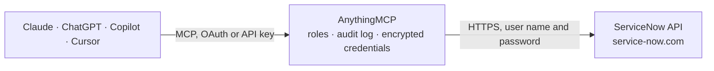

<!-- Generated by scripts/export-github-catalog.mjs in the anythingmcp-website repository. Do not edit by hand. -->

# ServiceNow MCP connector

Work in ServiceNow ITSM from your AI: find, open, update, resolve and close incidents, handle change requests and problems, follow service catalog requests and order items, search the knowledge base, … The AnythingMCP connector gives Claude, ChatGPT, Microsoft Copilot, Cursor and Gemini 36 MCP tools for ServiceNow: 24 read and 12 can change data.

**Category:** [IT Service Management](../itsm.md) · **Tools:** 36 · **Setup guide:** [anythingmcp.com](https://anythingmcp.com/guides/servicenow-to-mcp) · [Deutsch](https://anythingmcp.com/de/guides/servicenow-to-mcp) · [Italiano](https://anythingmcp.com/it/guides/servicenow-to-mcp) · [Español](https://anythingmcp.com/es/guides/servicenow-to-mcp) · [日本語](https://anythingmcp.com/ja/guides/servicenow-to-mcp) · [Русский](https://anythingmcp.com/ru/guides/servicenow-to-mcp) · [中文](https://anythingmcp.com/zh/guides/servicenow-to-mcp)

## Start without code

No installation and no terminal: AnythingMCP Cloud runs the ServiceNow connector for you, operated by helpcode.ai in Frankfurt, Germany.

1. **Click the button above** and create an account or sign in. The ServiceNow connector opens, ready to install.
2. **Paste the API key or token from your ServiceNow account.** Every click is in the [step-by-step guide](https://anythingmcp.com/guides/servicenow-to-mcp).
3. **Click Install.** AnythingMCP shows the address of your MCP server.
4. **Add that address to your assistant:** [Claude](https://anythingmcp.com/guides/connect-servicenow-to-claude) · [ChatGPT](https://anythingmcp.com/guides/connect-servicenow-to-chatgpt) · [Microsoft Copilot](https://anythingmcp.com/guides/connect-servicenow-to-copilot) · [Cursor](https://anythingmcp.com/guides/connect-servicenow-to-cursor) · [Gemini CLI](https://anythingmcp.com/guides/connect-servicenow-to-gemini) · [Meta Muse](https://anythingmcp.com/guides/connect-servicenow-to-muse).
5. **Ask your first question**, for example: *Show full details for incident INC0010456*

Prefer help with the setup? [Talk to us](https://anythingmcp.com/contact).

## How it works

- **The AI client** speaks MCP (Streamable HTTP) to AnythingMCP and only sees tool names, descriptions and results. It never gets the ServiceNow credentials.
- **AnythingMCP** checks the client's role, builds the call from the tool definition, adds the credentials (user name and password), calls ServiceNow, logs the call and returns the result.
- **ServiceNow** sees an ordinary API client with the rights of the account the credentials belong to.

## Tools

| Tool | What it does | Access |
|---|---|---|
| [`servicenow_list_incidents`](#servicenow_list_incidents) | List incidents from the incident table, newest first by default. | read |
| [`servicenow_get_incident`](#servicenow_get_incident) | Read one incident by its number (INC0010023) with all its fields, including sys_id, which the update tools need. | read |
| [`servicenow_create_incident`](#servicenow_create_incident) | Open a new incident. | write |
| [`servicenow_update_incident`](#servicenow_update_incident) | Change fields of an incident by sys_id (from servicenow_get_incident): reassign, change state, impact or urgency, put on hold (state 3 needs hold_reason: 1… | write |
| [`servicenow_add_note`](#servicenow_add_note) | Add a work note (internal, fulfillers only) or an additional comment (visible to the caller or requester, and usually e-mailed to them) to an incident or… | write |
| [`servicenow_resolve_incident`](#servicenow_resolve_incident) | Resolve an incident: sets state 6 (Resolved) with the resolution code (close_code) and resolution notes (close_notes), which ServiceNow requires for this state. | write |
| [`servicenow_close_incident`](#servicenow_close_incident) | Close an incident: sets state 7 (Closed) with the resolution code (close_code) and resolution notes (close_notes), which ServiceNow requires for this state. | write |
| [`servicenow_list_change_requests`](#servicenow_list_change_requests) | List change requests from the change_request table, newest first by default. | read |
| [`servicenow_get_change_request`](#servicenow_get_change_request) | Read one change request by its number (CHG0030001) with all its fields, including sys_id, which the update tools need. | read |
| [`servicenow_create_change_request`](#servicenow_create_change_request) | Create a change request (type normal or emergency) in state New. | write |
| [`servicenow_update_change_request`](#servicenow_update_change_request) | Change fields of a change request by sys_id: plans, planned window, assignment, risk, or the state (-5 New, -4 Assess, -3 Authorize, -2 Scheduled, -1… | write |
| [`servicenow_list_problems`](#servicenow_list_problems) | List problems from the problem table, newest first by default. | read |
| [`servicenow_get_problem`](#servicenow_get_problem) | Read one problem by its number (PRB0040001) with all its fields, including sys_id, which the update tools need. | read |
| [`servicenow_create_problem`](#servicenow_create_problem) | Open a problem record for the root cause behind one or more incidents. | write |
| [`servicenow_update_problem`](#servicenow_update_problem) | Change fields of a problem by sys_id: assignment, root cause (cause_notes), fix (fix_notes), workaround, known_error, or the state (101 New, 102 Assess, 103… | write |
| [`servicenow_list_requests`](#servicenow_list_requests) | List service catalog requests (REQ numbers) from the sc_request table, newest first by default. | read |
| [`servicenow_list_requested_items`](#servicenow_list_requested_items) | List requested items (RITM numbers, one per ordered catalog item) from the sc_req_item table, newest first by default. | read |
| [`servicenow_get_requested_item`](#servicenow_get_requested_item) | Read one requested item by its number (RITM0010001) with all its fields, including sys_id, which the update tools need. | read |
| [`servicenow_get_requested_item_variables`](#servicenow_get_requested_item_variables) | Read the variables (the questions of the catalog form and the requester's answers) of one requested item by its sys_id. | read |
| [`servicenow_search_catalog_items`](#servicenow_search_catalog_items) | Search the service catalog for items the integration user may order ("laptop", "VPN access", "new hire"). | read |
| [`servicenow_get_catalog_item`](#servicenow_get_catalog_item) | Read one catalog item by sys_id with its order form: variables (name, label, type, mandatory, choices), price and description. | read |
| [`servicenow_order_catalog_item`](#servicenow_order_catalog_item) | Order a catalog item right away (Order Now): creates a request (REQ) with a requested item (RITM) and starts its approvals and fulfilment, which may cost… | write |
| [`servicenow_search_knowledge`](#servicenow_search_knowledge) | Search knowledge articles by keywords with ServiceNow's text index (the same search as the knowledge portal, on title and body). | read |
| [`servicenow_get_knowledge_article`](#servicenow_get_knowledge_article) | Read one knowledge article by its number (KB0010001): title, body (text, HTML), knowledge base, category, author, state and validity. | read |
| [`servicenow_find_users`](#servicenow_find_users) | Find active users by part of their name, e-mail or user ID. | read |
| [`servicenow_find_groups`](#servicenow_find_groups) | Find active groups (assignment groups, approval groups) by part of their name. | read |
| [`servicenow_list_group_members`](#servicenow_list_group_members) | List the members of a group by the group's sys_id (from servicenow_find_groups): user sys_id, name, user ID and e-mail. | read |
| [`servicenow_find_configuration_items`](#servicenow_find_configuration_items) | Find configuration items (servers, applications, network gear, services) in the CMDB by part of their name, IP address, FQDN or serial number. | read |
| [`servicenow_get_configuration_item`](#servicenow_get_configuration_item) | Read one configuration item with the CMDB Instance API: all its attributes plus its outbound and inbound relationships (Runs on, Depends on, Hosted on...),… | read |
| [`servicenow_query_table`](#servicenow_query_table) | Query any table the integration user may read with the Table API: sysparm_query (encoded query), sysparm_fields, sysparm_limit, sysparm_offset and… | read |
| [`servicenow_get_record`](#servicenow_get_record) | Read one record of any table by sys_id, with all fields or the ones given. | read |
| [`servicenow_count_records`](#servicenow_count_records) | Count records with the Aggregate API instead of fetching them, optionally grouped by a field: open incidents per assignment group, changes per state, RITMs… | read |
| [`servicenow_list_choices`](#servicenow_list_choices) | List the allowed values of a choice field on this instance (sys_choice): state, close_code, category, subcategory, hold_reason, impact, risk and so on. | read |
| [`servicenow_update_record`](#servicenow_update_record) | Change fields of any record by table and sys_id with a PATCH (only the fields given change), e.g. close a catalog task (sc_task state 3) or update a change… | write |
| [`servicenow_delete_record`](#servicenow_delete_record) | Delete a record of any table by sys_id. | write |
| [`servicenow_list_attachments`](#servicenow_list_attachments) | List the files attached to a record (any table): file_name, content_type, size_bytes, sys_id, created on and by, and download_link. | read |

## Tool reference

Every parameter as the AI client sees it in `tools/list`. Source: [`packages/backend/src/adapters/intl/servicenow.json`](../../../packages/backend/src/adapters/intl/servicenow.json).

### `servicenow_list_incidents`

List incidents from the incident table, newest first by default. Filter with an encoded query (sysparm_query), e.g. active=true^assignment_group.name=Service Desk^priority<=2. Returns up to limit records with the fields given; _headers.x-total-count is the total number of matches, page with offset. State codes: 1 New, 2 In Progress, 3 On Hold, 6 Resolved, 7 Closed, 8 Canceled; priority 1 Critical to 5 Planning. Read-only.

**Access:** read · **Call:** `GET /now/table/incident`

| Parameter | Type | Required | Description |
|---|---|---|---|
| `query` | string | no | Encoded query. Default: active=true^ORDERBYDESCsys_updated_on. Combine conditions with ^ (AND) and ^OR, sort with ^ORDERBY<field> or ^ORDERBYDESC<field>. |
| `fields` | string | no | Comma-separated fields to return; dot-walking works (caller_id.email). Default: the usual list columns. |
| `limit` | integer | no | Records per page, up to 1000. Default 20. |
| `offset` | integer | no | Records to skip, for the next page. |
| `display_value` | `true` \| `false` \| `all` | no | true (default): labels and names ("In Progress", "Service Desk"); false: stored values (state 2, sys_ids); all: both. |

### `servicenow_get_incident`

Read one incident by its number (INC0010023) with all its fields, including sys_id, which the update tools need. Returns result as a list with zero or one record. Read-only.

**Access:** read · **Call:** `GET /now/table/incident`

| Parameter | Type | Required | Description |
|---|---|---|---|
| `number` | string | yes | The record number, e.g. INC0010023. |
| `fields` | string | no | Comma-separated fields to return. Leave out for all fields. |
| `display_value` | `true` \| `false` \| `all` | no | true (default): labels and names ("In Progress", "Service Desk"); false: stored values (state 2, sys_ids); all: both. |

### `servicenow_create_incident`

Open a new incident. short_description is required; impact and urgency (1 High, 2 Medium, 3 Low) set the priority. Reference fields (caller_id, assignment_group, assigned_to, cmdb_ci) take sys_ids, or names with input_display_value true. Returns the new number and sys_id. Changes data in ServiceNow: show the user what will be sent and get a yes from the user first.

**Access:** write · **Call:** `POST /now/table/incident`

| Parameter | Type | Required | Description |
|---|---|---|---|
| `short_description` | string | yes | One-line summary. |
| `description` | string | no | Full description. |
| `caller_id` | string | no | The affected user (sys_user sys_id, or name with input_display_value). |
| `category` | string | no | Category value, e.g. inquiry, software, hardware, network, database. |
| `subcategory` | string | no | Subcategory value, depends on category. |
| `impact` | `1` \| `2` \| `3` | no | 1 High, 2 Medium, 3 Low. |
| `urgency` | `1` \| `2` \| `3` | no | 1 High, 2 Medium, 3 Low. |
| `assignment_group` | string | no | Group sys_id (or name with input_display_value). |
| `assigned_to` | string | no | User sys_id (or name with input_display_value); must be a member of assignment_group. |
| `cmdb_ci` | string | no | Affected configuration item sys_id (or name with input_display_value). |
| `contact_type` | string | no | Channel, e.g. email, phone, self-service, walk-in. |
| `additional_fields` | object | no | Any other fields of the record as {"field_name": value}, e.g. {"u_custom_field": "x", "business_service": "<sys_id>"}. |
| `input_display_value` | boolean | no | true: reference fields take names instead of sys_ids (assignment_group "Service Desk", caller_id "Abel Tuter") and choice fields take their labels. Default false: sys_ids and stored values. |
| `return_fields` | string | no | Fields to return from the saved record. |

### `servicenow_update_incident`

Change fields of an incident by sys_id (from servicenow_get_incident): reassign, change state, impact or urgency, put on hold (state 3 needs hold_reason: 1 Awaiting Caller, 3 Awaiting Problem, 4 Awaiting Vendor, 5 Awaiting Change). To resolve or close use servicenow_resolve_incident or servicenow_close_incident, which send the fields ServiceNow requires. Changes data in ServiceNow: show the user what will be sent and get a yes from the user first.

**Access:** write · **Call:** `PATCH /now/table/incident/{sys_id}`

| Parameter | Type | Required | Description |
|---|---|---|---|
| `sys_id` | string | yes | The incident's sys_id (32 hex characters). |
| `state` | `1` \| `2` \| `3` \| `8` | no | 1 New, 2 In Progress, 3 On Hold, 8 Canceled. |
| `hold_reason` | string | no | With state 3: 1 Awaiting Caller, 3 Awaiting Problem, 4 Awaiting Vendor, 5 Awaiting Change. |
| `short_description` | string | no | New summary. |
| `description` | string | no | New description (replaces the old one). |
| `impact` | `1` \| `2` \| `3` | no | 1 High, 2 Medium, 3 Low. |
| `urgency` | `1` \| `2` \| `3` | no | 1 High, 2 Medium, 3 Low. |
| `category` | string | no | Category value. |
| `subcategory` | string | no | Subcategory value. |
| `assignment_group` | string | no | Group sys_id (or name with input_display_value). |
| `assigned_to` | string | no | User sys_id (or name with input_display_value). |
| `work_notes` | string | no | Internal work note to add with the change (visible to fulfillers only). |
| `comments` | string | no | Additional comment to add (visible to the caller). |
| `additional_fields` | object | no | Any other fields of the record as {"field_name": value}, e.g. {"u_custom_field": "x", "business_service": "<sys_id>"}. |
| `input_display_value` | boolean | no | true: reference fields take names instead of sys_ids (assignment_group "Service Desk", caller_id "Abel Tuter") and choice fields take their labels. Default false: sys_ids and stored values. |
| `return_fields` | string | no | Fields to return from the saved record. |

### `servicenow_add_note`

Add a work note (internal, fulfillers only) or an additional comment (visible to the caller or requester, and usually e-mailed to them) to an incident or any other task record: change_request, problem, sc_req_item, sc_task, incident_task, change_task. The journal keeps every entry; nothing is overwritten. Changes data in ServiceNow: show the user what will be sent and get a yes from the user first.

**Access:** write · **Call:** `PATCH /now/table/{table}/{sys_id}`

| Parameter | Type | Required | Description |
|---|---|---|---|
| `table` | string | no | Table of the record. Default incident. |
| `sys_id` | string | yes | The record's sys_id. |
| `work_notes` | string | no | Internal work note. |
| `comments` | string | no | Customer-visible comment. |

### `servicenow_resolve_incident`

Resolve an incident: sets state 6 (Resolved) with the resolution code (close_code) and resolution notes (close_notes), which ServiceNow requires for this state. The caller is notified and can reopen it; ServiceNow closes resolved incidents automatically after a few days (7 by default). Changes data in ServiceNow: show the user what will be sent and get a yes from the user first.

**Access:** write · **Call:** `PATCH /now/table/incident/{sys_id}`

| Parameter | Type | Required | Description |
|---|---|---|---|
| `sys_id` | string | yes | The incident's sys_id. |
| `close_code` | string | yes | Resolution code, exactly as the instance defines it. Recent releases: Solution provided, Workaround provided, Resolved by caller, Resolved by change, Resolved by problem, Resolved by request, Known error, Duplicate, User error, No resolution provided. Older instances: Solved (Permanently), Solved (Work Around), Solved Remotely (Permanently), Solved Remotely (Work Around), Not Solved (Not Reproducible), Not Solved (Too Costly), Closed/Resolved by Caller. If unsure, read them with servicenow_list_choices (table incident, field close_code). |
| `close_notes` | string | yes | Resolution notes: what was done, as the caller should read it. |
| `work_notes` | string | no | Optional internal work note added with the change. |
| `return_fields` | string | no | Fields to return. |

### `servicenow_close_incident`

Close an incident: sets state 7 (Closed) with the resolution code (close_code) and resolution notes (close_notes), which ServiceNow requires for this state. Closed incidents are read-only and cannot be reopened; many instances only let the caller or the auto-close job close, so prefer servicenow_resolve_incident unless the user asks to close. Changes data in ServiceNow: show the user what will be sent and get a yes from the user first.

**Access:** write · **Call:** `PATCH /now/table/incident/{sys_id}`

| Parameter | Type | Required | Description |
|---|---|---|---|
| `sys_id` | string | yes | The incident's sys_id. |
| `close_code` | string | yes | Resolution code, exactly as the instance defines it. Recent releases: Solution provided, Workaround provided, Resolved by caller, Resolved by change, Resolved by problem, Resolved by request, Known error, Duplicate, User error, No resolution provided. Older instances: Solved (Permanently), Solved (Work Around), Solved Remotely (Permanently), Solved Remotely (Work Around), Not Solved (Not Reproducible), Not Solved (Too Costly), Closed/Resolved by Caller. If unsure, read them with servicenow_list_choices (table incident, field close_code). |
| `close_notes` | string | yes | Resolution notes: what was done, as the caller should read it. |
| `work_notes` | string | no | Optional internal work note added with the change. |
| `return_fields` | string | no | Fields to return. |

### `servicenow_list_change_requests`

List change requests from the change_request table, newest first by default. Filter with an encoded query (sysparm_query), e.g. active=true^assignment_group.name=Service Desk^priority<=2. Returns up to limit records with the fields given; _headers.x-total-count is the total number of matches, page with offset. State codes: -5 New, -4 Assess, -3 Authorize, -2 Scheduled, -1 Implement, 0 Review, 3 Closed, 4 Canceled; type normal, standard or emergency. Read-only.

**Access:** read · **Call:** `GET /now/table/change_request`

| Parameter | Type | Required | Description |
|---|---|---|---|
| `query` | string | no | Encoded query. Default: active=true^ORDERBYDESCsys_updated_on. Combine conditions with ^ (AND) and ^OR, sort with ^ORDERBY<field> or ^ORDERBYDESC<field>. |
| `fields` | string | no | Comma-separated fields to return; dot-walking works (caller_id.email). Default: the usual list columns. |
| `limit` | integer | no | Records per page, up to 1000. Default 20. |
| `offset` | integer | no | Records to skip, for the next page. |
| `display_value` | `true` \| `false` \| `all` | no | true (default): labels and names ("In Progress", "Service Desk"); false: stored values (state 2, sys_ids); all: both. |

### `servicenow_get_change_request`

Read one change request by its number (CHG0030001) with all its fields, including sys_id, which the update tools need. Includes the plans (implementation_plan, backout_plan, test_plan), the planned window (start_date, end_date) and approval. Returns result as a list with zero or one record. Read-only.

**Access:** read · **Call:** `GET /now/table/change_request`

| Parameter | Type | Required | Description |
|---|---|---|---|
| `number` | string | yes | The record number, e.g. CHG0030001. |
| `fields` | string | no | Comma-separated fields to return. Leave out for all fields. |
| `display_value` | `true` \| `false` \| `all` | no | true (default): labels and names ("In Progress", "Service Desk"); false: stored values (state 2, sys_ids); all: both. |

### `servicenow_create_change_request`

Create a change request (type normal or emergency) in state New. Standard changes come from a template in the Standard Change Catalog and are better ordered there. The change then follows the instance's change workflow (assessment, approvals); this tool does not approve anything. Changes data in ServiceNow: show the user what will be sent and get a yes from the user first.

**Access:** write · **Call:** `POST /now/table/change_request`

| Parameter | Type | Required | Description |
|---|---|---|---|
| `type` | `normal` \| `emergency` | no | Change type. Default normal. |
| `short_description` | string | yes | One-line summary. |
| `description` | string | no | Full description. |
| `category` | string | no | Category value, e.g. Hardware, Software, Network. |
| `cmdb_ci` | string | no | Configuration item sys_id (or name with input_display_value). |
| `assignment_group` | string | no | Group sys_id (or name with input_display_value). |
| `assigned_to` | string | no | User sys_id (or name with input_display_value). |
| `risk` | string | no | 2 High, 3 Moderate, 4 Low (the instance's own values may differ). |
| `impact` | `1` \| `2` \| `3` | no | 1 High, 2 Medium, 3 Low. |
| `start_date` | string | no | Planned start, yyyy-MM-dd HH:mm:ss in the integration user's time zone. |
| `end_date` | string | no | Planned end, same format. |
| `justification` | string | no | Why the change is needed. |
| `implementation_plan` | string | no | How it will be done. |
| `backout_plan` | string | no | How to roll it back. |
| `test_plan` | string | no | How it will be verified. |
| `additional_fields` | object | no | Any other fields of the record as {"field_name": value}, e.g. {"u_custom_field": "x", "business_service": "<sys_id>"}. |
| `input_display_value` | boolean | no | true: reference fields take names instead of sys_ids (assignment_group "Service Desk", caller_id "Abel Tuter") and choice fields take their labels. Default false: sys_ids and stored values. |
| `return_fields` | string | no | Fields to return from the saved record. |

### `servicenow_update_change_request`

Change fields of a change request by sys_id: plans, planned window, assignment, risk, or the state (-5 New, -4 Assess, -3 Authorize, -2 Scheduled, -1 Implement, 0 Review, 3 Closed, 4 Canceled). State moves usually need the approvals and fields the instance's change model asks for; closing needs close_code (successful, successful_issues, unsuccessful) and close_notes. Changes data in ServiceNow: show the user what will be sent and get a yes from the user first.

**Access:** write · **Call:** `PATCH /now/table/change_request/{sys_id}`

| Parameter | Type | Required | Description |
|---|---|---|---|
| `sys_id` | string | yes | The change request's sys_id. |
| `state` | string | no | -5 New, -4 Assess, -3 Authorize, -2 Scheduled, -1 Implement, 0 Review, 3 Closed, 4 Canceled. |
| `close_code` | string | no | With state 3: successful, successful_issues or unsuccessful. |
| `close_notes` | string | no | With state 3: close notes. |
| `work_notes` | string | no | Internal work note to add. |
| `short_description` | string | no | One-line summary. |
| `description` | string | no | Full description. |
| `category` | string | no | Category value, e.g. Hardware, Software, Network. |
| `cmdb_ci` | string | no | Configuration item sys_id (or name with input_display_value). |
| `assignment_group` | string | no | Group sys_id (or name with input_display_value). |
| `assigned_to` | string | no | User sys_id (or name with input_display_value). |
| `risk` | string | no | 2 High, 3 Moderate, 4 Low (the instance's own values may differ). |
| `impact` | `1` \| `2` \| `3` | no | 1 High, 2 Medium, 3 Low. |
| `start_date` | string | no | Planned start, yyyy-MM-dd HH:mm:ss in the integration user's time zone. |
| `end_date` | string | no | Planned end, same format. |
| `justification` | string | no | Why the change is needed. |
| `implementation_plan` | string | no | How it will be done. |
| `backout_plan` | string | no | How to roll it back. |
| `test_plan` | string | no | How it will be verified. |
| `additional_fields` | object | no | Any other fields of the record as {"field_name": value}, e.g. {"u_custom_field": "x", "business_service": "<sys_id>"}. |
| `input_display_value` | boolean | no | true: reference fields take names instead of sys_ids (assignment_group "Service Desk", caller_id "Abel Tuter") and choice fields take their labels. Default false: sys_ids and stored values. |
| `return_fields` | string | no | Fields to return from the saved record. |

### `servicenow_list_problems`

List problems from the problem table, newest first by default. Filter with an encoded query (sysparm_query), e.g. active=true^assignment_group.name=Service Desk^priority<=2. Returns up to limit records with the fields given; _headers.x-total-count is the total number of matches, page with offset. State codes: 101 New, 102 Assess, 103 Root Cause Analysis, 104 Fix in Progress, 106 Resolved, 107 Closed. Read-only.

**Access:** read · **Call:** `GET /now/table/problem`

| Parameter | Type | Required | Description |
|---|---|---|---|
| `query` | string | no | Encoded query. Default: active=true^ORDERBYDESCsys_updated_on. Combine conditions with ^ (AND) and ^OR, sort with ^ORDERBY<field> or ^ORDERBYDESC<field>. |
| `fields` | string | no | Comma-separated fields to return; dot-walking works (caller_id.email). Default: the usual list columns. |
| `limit` | integer | no | Records per page, up to 1000. Default 20. |
| `offset` | integer | no | Records to skip, for the next page. |
| `display_value` | `true` \| `false` \| `all` | no | true (default): labels and names ("In Progress", "Service Desk"); false: stored values (state 2, sys_ids); all: both. |

### `servicenow_get_problem`

Read one problem by its number (PRB0040001) with all its fields, including sys_id, which the update tools need. Includes cause_notes, fix_notes, workaround and known_error. Returns result as a list with zero or one record. Read-only.

**Access:** read · **Call:** `GET /now/table/problem`

| Parameter | Type | Required | Description |
|---|---|---|---|
| `number` | string | yes | The record number, e.g. PRB0040001. |
| `fields` | string | no | Comma-separated fields to return. Leave out for all fields. |
| `display_value` | `true` \| `false` \| `all` | no | true (default): labels and names ("In Progress", "Service Desk"); false: stored values (state 2, sys_ids); all: both. |

### `servicenow_create_problem`

Open a problem record for the root cause behind one or more incidents. Link incidents afterwards by setting their problem_id with servicenow_update_incident (additional_fields). Changes data in ServiceNow: show the user what will be sent and get a yes from the user first.

**Access:** write · **Call:** `POST /now/table/problem`

| Parameter | Type | Required | Description |
|---|---|---|---|
| `short_description` | string | yes | One-line summary. |
| `description` | string | no | Full description. |
| `category` | string | no | Category value. |
| `impact` | `1` \| `2` \| `3` | no | 1 High, 2 Medium, 3 Low. |
| `urgency` | `1` \| `2` \| `3` | no | 1 High, 2 Medium, 3 Low. |
| `cmdb_ci` | string | no | Configuration item sys_id (or name with input_display_value). |
| `assignment_group` | string | no | Group sys_id (or name with input_display_value). |
| `assigned_to` | string | no | User sys_id (or name with input_display_value). |
| `workaround` | string | no | Known workaround. |
| `additional_fields` | object | no | Any other fields of the record as {"field_name": value}, e.g. {"u_custom_field": "x", "business_service": "<sys_id>"}. |
| `input_display_value` | boolean | no | true: reference fields take names instead of sys_ids (assignment_group "Service Desk", caller_id "Abel Tuter") and choice fields take their labels. Default false: sys_ids and stored values. |
| `return_fields` | string | no | Fields to return from the saved record. |

### `servicenow_update_problem`

Change fields of a problem by sys_id: assignment, root cause (cause_notes), fix (fix_notes), workaround, known_error, or the state (101 New, 102 Assess, 103 Root Cause Analysis, 104 Fix in Progress, 106 Resolved, 107 Closed). Resolving needs resolution_code (fix_applied, risk_accepted, duplicate, canceled) and the notes the instance asks for. Changes data in ServiceNow: show the user what will be sent and get a yes from the user first.

**Access:** write · **Call:** `PATCH /now/table/problem/{sys_id}`

| Parameter | Type | Required | Description |
|---|---|---|---|
| `sys_id` | string | yes | The problem's sys_id. |
| `state` | string | no | 101 New, 102 Assess, 103 Root Cause Analysis, 104 Fix in Progress, 106 Resolved, 107 Closed. |
| `resolution_code` | string | no | With state 106 or 107: fix_applied, risk_accepted, duplicate or canceled. |
| `cause_notes` | string | no | Root cause. |
| `fix_notes` | string | no | The fix. |
| `known_error` | boolean | no | true to mark the problem as a known error. |
| `work_notes` | string | no | Internal work note to add. |
| `short_description` | string | no | One-line summary. |
| `description` | string | no | Full description. |
| `category` | string | no | Category value. |
| `impact` | `1` \| `2` \| `3` | no | 1 High, 2 Medium, 3 Low. |
| `urgency` | `1` \| `2` \| `3` | no | 1 High, 2 Medium, 3 Low. |
| `cmdb_ci` | string | no | Configuration item sys_id (or name with input_display_value). |
| `assignment_group` | string | no | Group sys_id (or name with input_display_value). |
| `assigned_to` | string | no | User sys_id (or name with input_display_value). |
| `workaround` | string | no | Known workaround. |
| `additional_fields` | object | no | Any other fields of the record as {"field_name": value}, e.g. {"u_custom_field": "x", "business_service": "<sys_id>"}. |
| `input_display_value` | boolean | no | true: reference fields take names instead of sys_ids (assignment_group "Service Desk", caller_id "Abel Tuter") and choice fields take their labels. Default false: sys_ids and stored values. |
| `return_fields` | string | no | Fields to return from the saved record. |

### `servicenow_list_requests`

List service catalog requests (REQ numbers) from the sc_request table, newest first by default. Filter with an encoded query (sysparm_query), e.g. active=true^assignment_group.name=Service Desk^priority<=2. Returns up to limit records with the fields given; _headers.x-total-count is the total number of matches, page with offset. request_state: requested, in_process, closed_complete, closed_incomplete, closed_cancelled, closed_rejected. The items of a request are its RITMs: servicenow_list_requested_items with query request.number=REQ0010001. Read-only.

**Access:** read · **Call:** `GET /now/table/sc_request`

| Parameter | Type | Required | Description |
|---|---|---|---|
| `query` | string | no | Encoded query. Default: active=true^ORDERBYDESCsys_updated_on. Combine conditions with ^ (AND) and ^OR, sort with ^ORDERBY<field> or ^ORDERBYDESC<field>. |
| `fields` | string | no | Comma-separated fields to return; dot-walking works (caller_id.email). Default: the usual list columns. |
| `limit` | integer | no | Records per page, up to 1000. Default 20. |
| `offset` | integer | no | Records to skip, for the next page. |
| `display_value` | `true` \| `false` \| `all` | no | true (default): labels and names ("In Progress", "Service Desk"); false: stored values (state 2, sys_ids); all: both. |

### `servicenow_list_requested_items`

List requested items (RITM numbers, one per ordered catalog item) from the sc_req_item table, newest first by default. Filter with an encoded query (sysparm_query), e.g. active=true^assignment_group.name=Service Desk^priority<=2. Returns up to limit records with the fields given; _headers.x-total-count is the total number of matches, page with offset. State codes: -5 Pending, 1 Open, 2 Work in Progress, 3 Closed Complete, 4 Closed Incomplete, 7 Closed Skipped; stage shows the fulfilment step. Read-only.

**Access:** read · **Call:** `GET /now/table/sc_req_item`

| Parameter | Type | Required | Description |
|---|---|---|---|
| `query` | string | no | Encoded query. Default: active=true^ORDERBYDESCsys_updated_on. Combine conditions with ^ (AND) and ^OR, sort with ^ORDERBY<field> or ^ORDERBYDESC<field>. |
| `fields` | string | no | Comma-separated fields to return; dot-walking works (caller_id.email). Default: the usual list columns. |
| `limit` | integer | no | Records per page, up to 1000. Default 20. |
| `offset` | integer | no | Records to skip, for the next page. |
| `display_value` | `true` \| `false` \| `all` | no | true (default): labels and names ("In Progress", "Service Desk"); false: stored values (state 2, sys_ids); all: both. |

### `servicenow_get_requested_item`

Read one requested item by its number (RITM0010001) with all its fields, including sys_id, which the update tools need. The answers to the item's form are not fields of the record: read them with servicenow_get_requested_item_variables. Returns result as a list with zero or one record. Read-only.

**Access:** read · **Call:** `GET /now/table/sc_req_item`

| Parameter | Type | Required | Description |
|---|---|---|---|
| `number` | string | yes | The record number, e.g. RITM0010001. |
| `fields` | string | no | Comma-separated fields to return. Leave out for all fields. |
| `display_value` | `true` \| `false` \| `all` | no | true (default): labels and names ("In Progress", "Service Desk"); false: stored values (state 2, sys_ids); all: both. |

### `servicenow_get_requested_item_variables`

Read the variables (the questions of the catalog form and the requester's answers) of one requested item by its sys_id. Returns one row per variable with its name, question and value. Read-only.

**Access:** read · **Call:** `GET /now/table/sc_item_option_mtom`

| Parameter | Type | Required | Description |
|---|---|---|---|
| `ritm_sys_id` | string | yes | The requested item's sys_id (from servicenow_get_requested_item). |
| `limit` | integer | no | Variables to return. Default 100. |

### `servicenow_search_catalog_items`

Search the service catalog for items the integration user may order ("laptop", "VPN access", "new hire"). Returns sys_id, name, short_description, category and price per item; use the sys_id with servicenow_get_catalog_item to see its form. Read-only.

**Access:** read · **Call:** `GET /sn_sc/servicecatalog/items`

| Parameter | Type | Required | Description |
|---|---|---|---|
| `text` | string | no | Words to search for in the item names and descriptions. |
| `category` | string | no | Only items in this category (sys_id). |
| `catalog` | string | no | Only items in this catalog (sys_id). |
| `limit` | integer | no | Items to return. Default 20. |
| `offset` | integer | no | Items to skip, for the next page. |

### `servicenow_get_catalog_item`

Read one catalog item by sys_id with its order form: variables (name, label, type, mandatory, choices), price and description. Use the variable names as keys when ordering with servicenow_order_catalog_item. Read-only.

**Access:** read · **Call:** `GET /sn_sc/servicecatalog/items/{sys_id}`

| Parameter | Type | Required | Description |
|---|---|---|---|
| `sys_id` | string | yes | The catalog item's sys_id. |

### `servicenow_order_catalog_item`

Order a catalog item right away (Order Now): creates a request (REQ) with a requested item (RITM) and starts its approvals and fulfilment, which may cost money or grant access. Fill every mandatory variable of the item's form (servicenow_get_catalog_item). Returns the request number and sys_id. Changes data in ServiceNow: show the user what will be sent and get a yes from the user first.

**Access:** write · **Call:** `POST /sn_sc/servicecatalog/items/{sys_id}/order_now`

| Parameter | Type | Required | Description |
|---|---|---|---|
| `sys_id` | string | yes | The catalog item's sys_id. |
| `variables` | object | no | Answers to the item's form as {"variable_name": "value"}; references take sys_ids, choices their values. |
| `quantity` | integer | no | How many. Default 1. |
| `requested_for` | string | no | sys_id of the user the item is for. Leave out to order for the integration user; ordering for someone else needs that right on the instance. |

### `servicenow_search_knowledge`

Search knowledge articles by keywords with ServiceNow's text index (the same search as the knowledge portal, on title and body). Returns number, title (short_description), knowledge base, category and views; read an article with servicenow_get_knowledge_article. Only published articles by default. The integration user sees only articles its user criteria allow. If nothing comes back on an instance without a text index, use servicenow_query_table on kb_knowledge with short_descriptionLIKE<word>. Read-only.

**Access:** read · **Call:** `GET /now/table/kb_knowledge`

| Parameter | Type | Required | Description |
|---|---|---|---|
| `query` | string | yes | Keywords, e.g. reset VPN password. |
| `workflow_state` | `published` \| `draft` \| `review` \| `retired` | no | Article state. Default published. |
| `fields` | string | no | Fields to return. |
| `limit` | integer | no | Articles to return. Default 10. |
| `offset` | integer | no | Articles to skip, for the next page. |

### `servicenow_get_knowledge_article`

Read one knowledge article by its number (KB0010001): title, body (text, HTML), knowledge base, category, author, state and validity. Read-only.

**Access:** read · **Call:** `GET /now/table/kb_knowledge`

| Parameter | Type | Required | Description |
|---|---|---|---|
| `number` | string | yes | Article number, e.g. KB0010001. |
| `fields` | string | no | Fields to return. |

### `servicenow_find_users`

Find active users by part of their name, e-mail or user ID. Returns sys_id (for caller_id, assigned_to, requested_for), name, e-mail, title, department and manager. Read-only.

**Access:** read · **Call:** `GET /now/table/sys_user`

| Parameter | Type | Required | Description |
|---|---|---|---|
| `search` | string | yes | Part of the name, e-mail or user ID, e.g. tuter or abel.tuter@example.com. |
| `fields` | string | no | Fields to return. |
| `limit` | integer | no | Users to return. Default 20. |

### `servicenow_find_groups`

Find active groups (assignment groups, approval groups) by part of their name. Returns sys_id (for assignment_group), name, description, manager and e-mail. Read-only.

**Access:** read · **Call:** `GET /now/table/sys_user_group`

| Parameter | Type | Required | Description |
|---|---|---|---|
| `search` | string | yes | Part of the group name, e.g. service desk or network. |
| `limit` | integer | no | Groups to return. Default 20. |

### `servicenow_list_group_members`

List the members of a group by the group's sys_id (from servicenow_find_groups): user sys_id, name, user ID and e-mail. Use it to pick an assigned_to that belongs to the assignment group. Read-only.

**Access:** read · **Call:** `GET /now/table/sys_user_grmember`

| Parameter | Type | Required | Description |
|---|---|---|---|
| `group_sys_id` | string | yes | The group's sys_id. |
| `limit` | integer | no | Members to return. Default 100. |

### `servicenow_find_configuration_items`

Find configuration items (servers, applications, network gear, services) in the CMDB by part of their name, IP address, FQDN or serial number. ci_class narrows the search to one class (cmdb_ci_server, cmdb_ci_win_server, cmdb_ci_linux_server, cmdb_ci_appl, cmdb_ci_service, cmdb_ci_netgear, cmdb_ci_computer...); the default cmdb_ci searches all. Returns sys_id, name, class and status, each field as value (stored) and display_value (label): pass sys_class_name.value as ci_class to servicenow_get_configuration_item. Read-only.

**Access:** read · **Call:** `GET /now/table/{ci_class}`

| Parameter | Type | Required | Description |
|---|---|---|---|
| `search` | string | yes | Part of the name, IP address, FQDN or serial number. |
| `ci_class` | string | no | CMDB class (table). Default cmdb_ci. |
| `fields` | string | no | Fields to return. |
| `limit` | integer | no | Items to return. Default 20. |

### `servicenow_get_configuration_item`

Read one configuration item with the CMDB Instance API: all its attributes plus its outbound and inbound relationships (Runs on, Depends on, Hosted on...), to see what a server hosts or what an application depends on. Needs the class (the stored value of sys_class_name, e.g. cmdb_ci_linux_server, not its label) and sys_id from servicenow_find_configuration_items. Read-only.

**Access:** read · **Call:** `GET /now/cmdb/instance/{ci_class}/{sys_id}`

| Parameter | Type | Required | Description |
|---|---|---|---|
| `ci_class` | string | yes | The item's class, e.g. cmdb_ci_linux_server (sys_class_name stored value). |
| `sys_id` | string | yes | The item's sys_id. |

### `servicenow_query_table`

Query any table the integration user may read with the Table API: sysparm_query (encoded query), sysparm_fields, sysparm_limit, sysparm_offset and sysparm_display_value. For tables without a dedicated tool: sc_task, incident_task, change_task, task_sla, sysapproval_approver, cmn_location, core_company, cmdb_rel_ci, sys_journal_field, kb_knowledge and custom u_ tables. Copy an encoded query from a list in the UI (right-click the filter breadcrumb, Copy query). _headers.x-total-count is the number of matches. Read-only.

**Access:** read · **Call:** `GET /now/table/{table}`

| Parameter | Type | Required | Description |
|---|---|---|---|
| `table` | string | yes | Table name, e.g. sc_task. |
| `query` | string | no | Encoded query, e.g. active=true^assigned_toISEMPTY^ORDERBYDESCsys_created_on. Leave out for all records. |
| `fields` | string | no | Comma-separated fields; dot-walking works. Leave out for all fields (large). |
| `limit` | integer | no | Records per page, up to 1000. Default 20. |
| `offset` | integer | no | Records to skip, for the next page. |
| `display_value` | `true` \| `false` \| `all` | no | true (default): labels and names ("In Progress", "Service Desk"); false: stored values (state 2, sys_ids); all: both. |

### `servicenow_get_record`

Read one record of any table by sys_id, with all fields or the ones given. Read-only.

**Access:** read · **Call:** `GET /now/table/{table}/{sys_id}`

| Parameter | Type | Required | Description |
|---|---|---|---|
| `table` | string | yes | Table name, e.g. sc_task. |
| `sys_id` | string | yes | The record's sys_id. |
| `fields` | string | no | Comma-separated fields. Leave out for all fields. |
| `display_value` | `true` \| `false` \| `all` | no | true (default): labels and names ("In Progress", "Service Desk"); false: stored values (state 2, sys_ids); all: both. |

### `servicenow_count_records`

Count records with the Aggregate API instead of fetching them, optionally grouped by a field: open incidents per assignment group, changes per state, RITMs per catalog item. Returns result.stats.count, or one row per group with groupby_fields. Read-only.

**Access:** read · **Call:** `GET /now/stats/{table}`

| Parameter | Type | Required | Description |
|---|---|---|---|
| `table` | string | yes | Table name, e.g. incident. |
| `query` | string | no | Encoded query, e.g. active=true^priority=1. |
| `group_by` | string | no | Field(s) to group by, comma-separated, e.g. assignment_group. |
| `display_value` | `true` \| `false` \| `all` | no | true (default): labels and names ("In Progress", "Service Desk"); false: stored values (state 2, sys_ids); all: both. |

### `servicenow_list_choices`

List the allowed values of a choice field on this instance (sys_choice): state, close_code, category, subcategory, hold_reason, impact, risk and so on. Each row has value (what to send), label and, for dependent fields like subcategory, dependent_value. Use it before writing a state or code you are not sure of; instances customise these. If a field returns nothing, try table task (fields inherited from it). Read-only.

**Access:** read · **Call:** `GET /now/table/sys_choice`

| Parameter | Type | Required | Description |
|---|---|---|---|
| `table` | string | yes | Table, e.g. incident. |
| `field` | string | yes | Field (element), e.g. close_code. |
| `language` | string | no | Label language. Default en. |

### `servicenow_update_record`

Change fields of any record by table and sys_id with a PATCH (only the fields given change), e.g. close a catalog task (sc_task state 3) or update a change task. Business rules, workflows and notifications run as for a change in the UI. For incidents, changes and problems prefer their own tools. Changes data in ServiceNow: show the user what will be sent and get a yes from the user first.

**Access:** write · **Call:** `PATCH /now/table/{table}/{sys_id}`

| Parameter | Type | Required | Description |
|---|---|---|---|
| `table` | string | yes | Table name, e.g. sc_task. |
| `sys_id` | string | yes | The record's sys_id. |
| `fields` | object | yes | The fields to set as {"field_name": value}, e.g. {"state": "3", "work_notes": "Done"}. |
| `input_display_value` | boolean | no | true: reference fields take names instead of sys_ids (assignment_group "Service Desk", caller_id "Abel Tuter") and choice fields take their labels. Default false: sys_ids and stored values. |

### `servicenow_delete_record`

Delete a record of any table by sys_id. Permanent: ServiceNow keeps deleted records only in the admin's Deleted Records list, and deleting a task does not close it in any process. Prefer cancelling or closing. Installed switched off; turn it on per tool only if the integration user really must delete. Changes data in ServiceNow: show the user what will be sent and get a yes from the user first.

**Access:** write · **Call:** `DELETE /now/table/{table}/{sys_id}`

| Parameter | Type | Required | Description |
|---|---|---|---|
| `table` | string | yes | Table name. |
| `sys_id` | string | yes | The record's sys_id. |

### `servicenow_list_attachments`

List the files attached to a record (any table): file_name, content_type, size_bytes, sys_id, created on and by, and download_link. The download link needs the same ServiceNow credentials, so it does not open for the user without a login. Read-only.

**Access:** read · **Call:** `GET /now/attachment`

| Parameter | Type | Required | Description |
|---|---|---|---|
| `table` | string | yes | Table of the record, e.g. incident. |
| `sys_id` | string | yes | The record's sys_id. |
| `limit` | integer | no | Attachments to return. Default 50. |

## Run it yourself

AnythingMCP is open source (AGPL-3.0). [Run it with Docker](../../../README.md#run-it-yourself), open **Connectors → Store**, pick **ServiceNow** and enter `SERVICENOW_INSTANCE`, `SERVICENOW_USERNAME`, `SERVICENOW_PASSWORD`, then add your MCP server URL to the AI client.

[← IT Service Management connectors](../itsm.md) · [All categories](../README.md)
