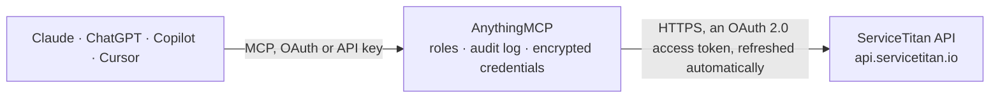

<!-- Generated by scripts/export-github-catalog.mjs in the anythingmcp-website repository. Do not edit by hand. -->

# ServiceTitan MCP connector

ServiceTitan field service management for HVAC, plumbing, electrical and other trades: customers and locations, leads, jobs and appointments, dispatch, capacity and technician shifts, technicians and … The AnythingMCP connector gives Claude, ChatGPT, Microsoft Copilot, Cursor and Gemini 57 MCP tools for ServiceTitan: 44 read and 13 can change data.

**Category:** [Field Service](../field-service.md) · **Tools:** 57 · **Setup guide:** [anythingmcp.com](https://anythingmcp.com/guides/servicetitan-to-mcp) · [Deutsch](https://anythingmcp.com/de/guides/servicetitan-to-mcp) · [Italiano](https://anythingmcp.com/it/guides/servicetitan-to-mcp) · [Español](https://anythingmcp.com/es/guides/servicetitan-to-mcp) · [日本語](https://anythingmcp.com/ja/guides/servicetitan-to-mcp) · [Русский](https://anythingmcp.com/ru/guides/servicetitan-to-mcp) · [中文](https://anythingmcp.com/zh/guides/servicetitan-to-mcp)

## Start without code

No installation and no terminal: AnythingMCP Cloud runs the ServiceTitan connector for you, operated by helpcode.ai in Frankfurt, Germany.

1. **Click the button above** and create an account or sign in. The ServiceTitan connector opens, ready to install.
2. **Sign in with your ServiceTitan account** when AnythingMCP asks. The first time, an admin creates a small app in the ServiceTitan developer console. Every click is in the [step-by-step guide](https://anythingmcp.com/guides/servicetitan-to-mcp).
3. **Click Install.** AnythingMCP shows the address of your MCP server.
4. **Add that address to your assistant:** [Claude](https://anythingmcp.com/guides/connect-servicetitan-to-claude) · [ChatGPT](https://anythingmcp.com/guides/connect-servicetitan-to-chatgpt) · [Microsoft Copilot](https://anythingmcp.com/guides/connect-servicetitan-to-copilot) · [Cursor](https://anythingmcp.com/guides/connect-servicetitan-to-cursor) · [Gemini CLI](https://anythingmcp.com/guides/connect-servicetitan-to-gemini) · [Meta Muse](https://anythingmcp.com/guides/connect-servicetitan-to-muse).
5. **Ask your first question**, for example: *Show invoice INV-2026-117 for ClearView Properties Ltd., I need date, due date, total and outstanding balance.*

Prefer help with the setup? [Talk to us](https://anythingmcp.com/contact).

## How it works

- **The AI client** speaks MCP (Streamable HTTP) to AnythingMCP and only sees tool names, descriptions and results. It never gets the ServiceTitan credentials.
- **AnythingMCP** checks the client's role, builds the call from the tool definition, adds the credentials (an OAuth 2.0 access token, refreshed automatically), calls ServiceTitan, logs the call and returns the result.
- **ServiceTitan** sees an ordinary API client with the rights of the account the credentials belong to.

## Tools

| Tool | What it does | Access |
|---|---|---|
| [`servicetitan_list_customers`](#servicetitan_list_customers) | List or search customers (bill-to accounts): id, name, type (Residential or Commercial), active, balance, bill-to address, doNotMail/doNotService flags, tag… | read |
| [`servicetitan_get_customer`](#servicetitan_get_customer) | One customer by id: name, type, address, balance, flags, custom fields, tag ids, merged-into id. | read |
| [`servicetitan_list_customer_contacts`](#servicetitan_list_customer_contacts) | Phone numbers and email addresses saved on a customer (type, value, memo). | read |
| [`servicetitan_list_customer_notes`](#servicetitan_list_customer_notes) | Notes on a customer, newest last: text, pinned flag, author id, created time. | read |
| [`servicetitan_create_customer`](#servicetitan_create_customer) | Create a customer together with at least one service location. | write |
| [`servicetitan_update_customer`](#servicetitan_update_customer) | Change fields of a customer; only the fields you pass change. | write |
| [`servicetitan_add_customer_note`](#servicetitan_add_customer_note) | Add a note to a customer, optionally pinned and copied to its active locations. | write |
| [`servicetitan_list_locations`](#servicetitan_list_locations) | List or search service locations (where the work happens): id, customerId, name, address with coordinates, zone id, tax zone, active, tag ids. | read |
| [`servicetitan_get_location`](#servicetitan_get_location) | One service location by id: customer id, name, address, coordinates, zone, tax zone, custom fields. | read |
| [`servicetitan_list_location_contacts`](#servicetitan_list_location_contacts) | Phone numbers and email addresses saved on a service location (type, value, memo). | read |
| [`servicetitan_create_location`](#servicetitan_create_location) | Add a service location (address where work is done) to an existing customer. | write |
| [`servicetitan_list_leads`](#servicetitan_list_leads) | List leads (follow-ups for calls and forms that did not book a job yet): id, status (Open, Dismissed, Converted), customer and location ids, job type,… | read |
| [`servicetitan_list_campaigns`](#servicetitan_list_campaigns) | Marketing campaigns (call sources such as Google Ads or a yard sign): id, name, category, active. | read |
| [`servicetitan_list_jobs`](#servicetitan_list_jobs) | List jobs: id, job number, customer and location ids, business unit, job type, priority, campaign, jobStatus, summary, first appointment id, invoice id,… | read |
| [`servicetitan_get_job`](#servicetitan_get_job) | One job by id with status, customer, location, job type, business unit, campaign, summary, invoice id, tags and custom fields. | read |
| [`servicetitan_create_job`](#servicetitan_create_job) | Book a job with its first appointment(s) for a customer location. | write |
| [`servicetitan_update_job`](#servicetitan_update_job) | Change fields of a job; only the fields you pass change. | write |
| [`servicetitan_cancel_job`](#servicetitan_cancel_job) | Cancel a job with a reason from servicetitan_list_job_cancel_reasons and a memo. | write |
| [`servicetitan_list_job_cancel_reasons`](#servicetitan_list_job_cancel_reasons) | Job cancel reasons configured in the account: id, name, active. | read |
| [`servicetitan_list_job_notes`](#servicetitan_list_job_notes) | Notes on a job: text, pinned flag, author id and created time, oldest first. | read |
| [`servicetitan_add_job_note`](#servicetitan_add_job_note) | Add a note to a job (visible to the office and technicians), optionally pinned to the top. | write |
| [`servicetitan_get_job_history`](#servicetitan_get_job_history) | Status history of a job: each change with the event type, employee and time. | read |
| [`servicetitan_list_job_types`](#servicetitan_list_job_types) | Job types (e.g. AC repair, drain cleaning): id, name, duration in seconds, priority, business unit ids, skills, active. | read |
| [`servicetitan_list_appointments`](#servicetitan_list_appointments) | List job appointments (the scheduled visits): id, job id, appointment number, start and end, arrival window, status, special instructions, customer and… | read |
| [`servicetitan_get_appointment`](#servicetitan_get_appointment) | One job appointment by id: job id, number, start and end, arrival window, status, special instructions. | read |
| [`servicetitan_add_appointment`](#servicetitan_add_appointment) | Add another appointment (visit) to an existing job, optionally with technicians. | write |
| [`servicetitan_reschedule_appointment`](#servicetitan_reschedule_appointment) | Move an appointment to a new start and end (and arrival window). | write |
| [`servicetitan_list_projects`](#servicetitan_list_projects) | Projects (multi-job work such as installs or construction): id, number, name, status, customer and location ids, job ids, start, target completion and… | read |
| [`servicetitan_list_appointment_assignments`](#servicetitan_list_appointment_assignments) | Which technicians are assigned to which appointments: assignment id, technician id and name, appointment id, job id, assigned time, status. | read |
| [`servicetitan_assign_technicians`](#servicetitan_assign_technicians) | Assign one or more technicians to a job appointment (dispatch). | write |
| [`servicetitan_unassign_technicians`](#servicetitan_unassign_technicians) | Take one or more technicians off a job appointment (the appointment itself stays). | write |
| [`servicetitan_get_capacity`](#servicetitan_get_capacity) | Bookable capacity per time slot: for each slot the start and end, total and open hours, whether it is available and which technicians are free. | read |
| [`servicetitan_list_technician_shifts`](#servicetitan_list_technician_shifts) | Technician shifts and time off: id, technician id, shift type (Normal, OnCall, TimeOff), start, end, title, note. | read |
| [`servicetitan_list_teams`](#servicetitan_list_teams) | Dispatch teams that group technicians on the dispatch board: id, name, active. | read |
| [`servicetitan_list_zones`](#servicetitan_list_zones) | Dispatch zones (service areas by ZIP or city): id, name, ZIPs, cities, technician and business unit ids. | read |
| [`servicetitan_list_technicians`](#servicetitan_list_technicians) | Technicians: id, user id, name, email, phone, business unit, team, zone ids, role, login name, active. | read |
| [`servicetitan_get_technician`](#servicetitan_get_technician) | One technician by id: name, contact details, business unit, team, zones, role and active flag. | read |
| [`servicetitan_list_employees`](#servicetitan_list_employees) | Office employees (dispatchers, CSRs, managers): id, user id, name, email, phone, role, business unit, active. | read |
| [`servicetitan_list_business_units`](#servicetitan_list_business_units) | Business units (trades or departments such as HVAC Service, Plumbing Install): id, name, official name, email, phone, address, currency, active. | read |
| [`servicetitan_list_tag_types`](#servicetitan_list_tag_types) | Tag types used on customers, locations and jobs: id, name, color, active. | read |
| [`servicetitan_list_invoices`](#servicetitan_list_invoices) | List invoices: id, reference number, invoice date, due date, subtotal, sales tax, total, balance, customer and location with addresses, job, business unit,… | read |
| [`servicetitan_list_payments`](#servicetitan_list_payments) | Customer payments: id, type, reference number, amount (total), paid date, customer, memo, and the invoices each payment was applied to. | read |
| [`servicetitan_list_payment_types`](#servicetitan_list_payment_types) | Payment types (cash, check, credit card, financing): id, name, active. | read |
| [`servicetitan_list_estimates`](#servicetitan_list_estimates) | List estimates (quotes with options shown to the customer): id, name, job id and number, customer, location, project, status { value, name } (Open, Sold,… | read |
| [`servicetitan_get_estimate`](#servicetitan_get_estimate) | One estimate by id with its line items (sku, description, quantity, unit rate, total). | read |
| [`servicetitan_list_estimate_items`](#servicetitan_list_estimate_items) | Line items of estimates: id, estimate id, sku (id, name, type), description, quantity, unit rate, total, membership type. | read |
| [`servicetitan_sell_estimate`](#servicetitan_sell_estimate) | Mark an estimate as sold by a technician or employee. | write |
| [`servicetitan_list_pricebook_services`](#servicetitan_list_pricebook_services) | Services (tasks sold to customers) in the pricebook: id, code, display name, description, price, member price, add-on price, hours, taxable, warranty,… | read |
| [`servicetitan_list_pricebook_materials`](#servicetitan_list_pricebook_materials) | Materials (parts) in the pricebook: id, code, display name, description, cost, price, member price, unit of measure, inventory flag, primary vendor, categories. | read |
| [`servicetitan_list_pricebook_equipment`](#servicetitan_list_pricebook_equipment) | Equipment (installable units) in the pricebook: id, code, display name, manufacturer, model, price, cost, warranties, primary vendor, categories. | read |
| [`servicetitan_list_pricebook_categories`](#servicetitan_list_pricebook_categories) | Pricebook categories: id, name, type (Services or Materials), parent, sub-categories, active. | read |
| [`servicetitan_list_memberships`](#servicetitan_list_memberships) | Customer memberships (maintenance plans): id, customer id, membership type, status (Active, Suspended, Expired, Canceled, Deleted), from and to dates,… | read |
| [`servicetitan_get_membership`](#servicetitan_get_membership) | One customer membership by id: type, status, dates, billing frequency, location and sold by. | read |
| [`servicetitan_list_membership_types`](#servicetitan_list_membership_types) | Membership types offered: id, name, duration and billing options, discounts, recurring services, active. | read |
| [`servicetitan_list_recurring_service_events`](#servicetitan_list_recurring_service_events) | Recurring service events (the planned maintenance visits of memberships): id, location, membership, recurring service, date, follow-up status, job id once… | read |
| [`servicetitan_list_calls`](#servicetitan_list_calls) | Phone calls tracked by ServiceTitan: id, direction, from and to numbers, duration, call type and reason, campaign, agent, customer, location, job booked… | read |
| [`servicetitan_get_call`](#servicetitan_get_call) | One call by id with its details (lead call, customer, location, campaign, agent, recording available). | read |

## Tool reference

Every parameter as the AI client sees it in `tools/list`. Source: [`packages/backend/src/adapters/intl/servicetitan.json`](../../../packages/backend/src/adapters/intl/servicetitan.json).

### `servicetitan_list_customers`

List or search customers (bill-to accounts): id, name, type (Residential or Commercial), active, balance, bill-to address, doNotMail/doNotService flags, tag ids, created and modified times. Filter by name, phone, address parts, ids or change date. Answers { page, pageSize, hasMore, data }.

**Access:** read · **Call:** `GET /crm/v2/tenant/{{SERVICETITAN_TENANT_ID}}/customers`

| Parameter | Type | Required | Description |
|---|---|---|---|
| `name` | string | no | Customer name to look for. |
| `phone` | string | no | Phone number of one of the customer's contacts. |
| `street` | string | no | Street of the bill-to address. |
| `city` | string | no | City. |
| `state` | string | no | State or province. |
| `zip` | string | no | ZIP or postal code. |
| `ids` | string | no | Comma-separated ids to fetch (at most 50). |
| `active` | `True` \| `False` \| `Any` | no | True (default): active only, False: inactive only, Any: both. |
| `created_on_or_after` | string | no | Only records created at or after this UTC time, ISO 8601 (2026-10-01T00:00:00Z). |
| `modified_on_or_after` | string | no | Only records changed at or after this UTC time, ISO 8601. Use it to pick up changes since a last sync. |
| `sort` | string | no | Sort field with + (ascending) or - (descending): +Id, -ModifiedOn, -CreatedOn. |
| `page` | integer | no | Page number, starting at 1. |
| `page_size` | integer | no | Records per page (50 by default). Keep it at a few hundred or less. |
| `include_total` | boolean | no | Also return totalCount (slower on big lists). |

### `servicetitan_get_customer`

One customer by id: name, type, address, balance, flags, custom fields, tag ids, merged-into id.

**Access:** read · **Call:** `GET /crm/v2/tenant/{{SERVICETITAN_TENANT_ID}}/customers/{id}`

| Parameter | Type | Required | Description |
|---|---|---|---|
| `id` | integer | yes | Customer id. |

### `servicetitan_list_customer_contacts`

Phone numbers and email addresses saved on a customer (type, value, memo).

**Access:** read · **Call:** `GET /crm/v2/tenant/{{SERVICETITAN_TENANT_ID}}/customers/{id}/contacts`

| Parameter | Type | Required | Description |
|---|---|---|---|
| `id` | integer | yes | Customer id. |
| `page` | integer | no | Page number, starting at 1. |
| `page_size` | integer | no | Records per page (50 by default). Keep it at a few hundred or less. |
| `include_total` | boolean | no | Also return totalCount (slower on big lists). |

### `servicetitan_list_customer_notes`

Notes on a customer, newest last: text, pinned flag, author id, created time.

**Access:** read · **Call:** `GET /crm/v2/tenant/{{SERVICETITAN_TENANT_ID}}/customers/{id}/notes`

| Parameter | Type | Required | Description |
|---|---|---|---|
| `id` | integer | yes | Customer id. |
| `page` | integer | no | Page number, starting at 1. |
| `page_size` | integer | no | Records per page (50 by default). Keep it at a few hundred or less. |
| `include_total` | boolean | no | Also return totalCount (slower on big lists). |

### `servicetitan_create_customer`

Create a customer together with at least one service location. The bill-to address and every location need street, city, state, zip and country. Returns the new customer with its id; read the location ids with servicetitan_list_locations (customer_id).

**Access:** write · **Call:** `POST /crm/v2/tenant/{{SERVICETITAN_TENANT_ID}}/customers`

| Parameter | Type | Required | Description |
|---|---|---|---|
| `name` | string | yes | Customer name (person or company). |
| `type` | `Residential` \| `Commercial` | no | Residential (default) or Commercial. |
| `address` | object | yes | Address: street, unit (optional), city, state, zip, country (all text; country e.g. USA, Canada). |
| `locations` | object[] | yes | Service locations: each { name, address { street, unit, city, state, zip, country }, contacts (optional) }. At least one. |
| `contacts` | object[] | no | Contact methods: each { type: Phone, MobilePhone, Email or Fax, value, memo (optional, e.g. office) }. |
| `do_not_mail` | boolean | no | Flag the customer as do not mail. |
| `do_not_service` | boolean | no | Flag the customer as do not service. |
| `tag_type_ids` | integer[] | no | Tag type ids from servicetitan_list_tag_types. |

### `servicetitan_update_customer`

Change fields of a customer; only the fields you pass change. tag_type_ids replaces the whole tag list. Setting active false deactivates the customer (it can be reactivated).

**Access:** write · **Call:** `PATCH /crm/v2/tenant/{{SERVICETITAN_TENANT_ID}}/customers/{id}`

| Parameter | Type | Required | Description |
|---|---|---|---|
| `id` | integer | yes | Customer id. |
| `name` | string | no | New name. |
| `type` | `Residential` \| `Commercial` | no | Residential or Commercial. |
| `address` | object | no | Address: street, unit (optional), city, state, zip, country (all text; country e.g. USA, Canada). |
| `active` | boolean | no | Active or inactive. |
| `do_not_mail` | boolean | no | Do not mail flag. |
| `do_not_service` | boolean | no | Do not service flag. |
| `tag_type_ids` | integer[] | no | Full list of tag type ids. |

### `servicetitan_add_customer_note`

Add a note to a customer, optionally pinned and copied to its active locations.

**Access:** write · **Call:** `POST /crm/v2/tenant/{{SERVICETITAN_TENANT_ID}}/customers/{id}/notes`

| Parameter | Type | Required | Description |
|---|---|---|---|
| `id` | integer | yes | Customer id. |
| `text` | string | yes | Note text. |
| `pin_to_top` | boolean | no | Pin the note. |
| `add_to_locations` | boolean | no | Also add it to the customer's active locations. |

### `servicetitan_list_locations`

List or search service locations (where the work happens): id, customerId, name, address with coordinates, zone id, tax zone, active, tag ids. Filter by customer, name, address parts, ids or change date.

**Access:** read · **Call:** `GET /crm/v2/tenant/{{SERVICETITAN_TENANT_ID}}/locations`

| Parameter | Type | Required | Description |
|---|---|---|---|
| `customer_id` | integer | no | Only locations of this customer. |
| `name` | string | no | Location name. |
| `street` | string | no | Street. |
| `city` | string | no | City. |
| `state` | string | no | State or province. |
| `zip` | string | no | ZIP or postal code. |
| `ids` | string | no | Comma-separated ids to fetch (at most 50). |
| `active` | `True` \| `False` \| `Any` | no | True (default): active only, False: inactive only, Any: both. |
| `created_on_or_after` | string | no | Only records created at or after this UTC time, ISO 8601 (2026-10-01T00:00:00Z). |
| `modified_on_or_after` | string | no | Only records changed at or after this UTC time, ISO 8601. Use it to pick up changes since a last sync. |
| `sort` | string | no | Sort field with + (ascending) or - (descending): +Id, -ModifiedOn, -CreatedOn. |
| `page` | integer | no | Page number, starting at 1. |
| `page_size` | integer | no | Records per page (50 by default). Keep it at a few hundred or less. |
| `include_total` | boolean | no | Also return totalCount (slower on big lists). |

### `servicetitan_get_location`

One service location by id: customer id, name, address, coordinates, zone, tax zone, custom fields.

**Access:** read · **Call:** `GET /crm/v2/tenant/{{SERVICETITAN_TENANT_ID}}/locations/{id}`

| Parameter | Type | Required | Description |
|---|---|---|---|
| `id` | integer | yes | Location id. |

### `servicetitan_list_location_contacts`

Phone numbers and email addresses saved on a service location (type, value, memo).

**Access:** read · **Call:** `GET /crm/v2/tenant/{{SERVICETITAN_TENANT_ID}}/locations/{id}/contacts`

| Parameter | Type | Required | Description |
|---|---|---|---|
| `id` | integer | yes | Location id. |
| `page` | integer | no | Page number, starting at 1. |
| `page_size` | integer | no | Records per page (50 by default). Keep it at a few hundred or less. |
| `include_total` | boolean | no | Also return totalCount (slower on big lists). |

### `servicetitan_create_location`

Add a service location (address where work is done) to an existing customer.

**Access:** write · **Call:** `POST /crm/v2/tenant/{{SERVICETITAN_TENANT_ID}}/locations`

| Parameter | Type | Required | Description |
|---|---|---|---|
| `customer_id` | integer | yes | Customer the location belongs to. |
| `name` | string | yes | Location name, e.g. the street address or Main office. |
| `address` | object | yes | Address: street, unit (optional), city, state, zip, country (all text; country e.g. USA, Canada). |
| `contacts` | object[] | no | Contact methods: each { type: Phone, MobilePhone, Email or Fax, value, memo (optional, e.g. office) }. |

### `servicetitan_list_leads`

List leads (follow-ups for calls and forms that did not book a job yet): id, status (Open, Dismissed, Converted), customer and location ids, job type, campaign, priority, summary, follow-up date.

**Access:** read · **Call:** `GET /crm/v2/tenant/{{SERVICETITAN_TENANT_ID}}/leads`

| Parameter | Type | Required | Description |
|---|---|---|---|
| `status` | `Open` \| `Dismissed` \| `Converted` | no | Lead status. |
| `customer_id` | integer | no | Only leads of this customer. |
| `ids` | string | no | Comma-separated ids to fetch (at most 50). |
| `created_on_or_after` | string | no | Only records created at or after this UTC time, ISO 8601 (2026-10-01T00:00:00Z). |
| `modified_on_or_after` | string | no | Only records changed at or after this UTC time, ISO 8601. Use it to pick up changes since a last sync. |
| `sort` | string | no | Sort field with + (ascending) or - (descending): +Id, -ModifiedOn, -CreatedOn. |
| `page` | integer | no | Page number, starting at 1. |
| `page_size` | integer | no | Records per page (50 by default). Keep it at a few hundred or less. |
| `include_total` | boolean | no | Also return totalCount (slower on big lists). |

### `servicetitan_list_campaigns`

Marketing campaigns (call sources such as Google Ads or a yard sign): id, name, category, active. Creating a job needs a campaign id.

**Access:** read · **Call:** `GET /marketing/v2/tenant/{{SERVICETITAN_TENANT_ID}}/campaigns`

| Parameter | Type | Required | Description |
|---|---|---|---|
| `name` | string | no | Name contains this text. |
| `ids` | string | no | Comma-separated ids to fetch (at most 50). |
| `active` | `True` \| `False` \| `Any` | no | True (default): active only, False: inactive only, Any: both. |
| `page` | integer | no | Page number, starting at 1. |
| `page_size` | integer | no | Records per page (50 by default). Keep it at a few hundred or less. |
| `include_total` | boolean | no | Also return totalCount (slower on big lists). |

### `servicetitan_list_jobs`

List jobs: id, job number, customer and location ids, business unit, job type, priority, campaign, jobStatus, summary, first appointment id, invoice id, total, created, modified and completed times. Filter by status, customer, location, technician, job type, business unit, appointment or completion dates.

**Access:** read · **Call:** `GET /jpm/v2/tenant/{{SERVICETITAN_TENANT_ID}}/jobs`

| Parameter | Type | Required | Description |
|---|---|---|---|
| `job_status` | `Scheduled` \| `Dispatched` \| `InProgress` \| `Hold` \| `Completed` \| `Canceled` | no | Job status. |
| `number` | string | no | Job number. |
| `customer_id` | integer | no | Only jobs of this customer. |
| `location_id` | integer | no | Only jobs at this location. |
| `technician_id` | integer | no | Only jobs with an appointment assigned to this technician. |
| `job_type_id` | integer | no | Only this job type. |
| `business_unit_id` | integer | no | Only this business unit. |
| `project_id` | integer | no | Only jobs of this project. |
| `priority` | `Low` \| `Normal` \| `High` \| `Urgent` | no | Priority. |
| `appointment_starts_on_or_after` | string | no | Jobs with any appointment starting at or after this UTC time, ISO 8601. |
| `appointment_starts_before` | string | no | Jobs with any appointment starting before this UTC time, ISO 8601. |
| `completed_on_or_after` | string | no | Jobs completed at or after this UTC time. |
| `completed_before` | string | no | Jobs completed before this UTC time. |
| `ids` | string | no | Comma-separated ids to fetch (at most 50). |
| `created_on_or_after` | string | no | Only records created at or after this UTC time, ISO 8601 (2026-10-01T00:00:00Z). |
| `modified_on_or_after` | string | no | Only records changed at or after this UTC time, ISO 8601. Use it to pick up changes since a last sync. |
| `sort` | string | no | Sort field with + (ascending) or - (descending): +Id, -ModifiedOn, -CreatedOn. |
| `page` | integer | no | Page number, starting at 1. |
| `page_size` | integer | no | Records per page (50 by default). Keep it at a few hundred or less. |
| `include_total` | boolean | no | Also return totalCount (slower on big lists). |

### `servicetitan_get_job`

One job by id with status, customer, location, job type, business unit, campaign, summary, invoice id, tags and custom fields.

**Access:** read · **Call:** `GET /jpm/v2/tenant/{{SERVICETITAN_TENANT_ID}}/jobs/{id}`

| Parameter | Type | Required | Description |
|---|---|---|---|
| `id` | integer | yes | Job id. |

### `servicetitan_create_job`

Book a job with its first appointment(s) for a customer location. Needs ids from servicetitan_list_business_units, servicetitan_list_job_types and servicetitan_list_campaigns. Check free slots first with servicetitan_get_capacity.

**Access:** write · **Call:** `POST /jpm/v2/tenant/{{SERVICETITAN_TENANT_ID}}/jobs`

| Parameter | Type | Required | Description |
|---|---|---|---|
| `customer_id` | integer | yes | Customer id. |
| `location_id` | integer | yes | Location id (must belong to the customer). |
| `business_unit_id` | integer | yes | Business unit id. |
| `job_type_id` | integer | yes | Job type id. |
| `priority` | `Low` \| `Normal` \| `High` \| `Urgent` | yes | Priority. |
| `campaign_id` | integer | yes | Campaign id (how the customer found you). |
| `appointments` | object[] | yes | Appointments: each { start, end, arrivalWindowStart, arrivalWindowEnd, technicianIds }, times in UTC ISO 8601. At least one. |
| `summary` | string | no | Job summary: what the customer needs (HTML allowed). |
| `customer_po` | string | no | Customer purchase order number. |
| `tag_type_ids` | integer[] | no | Tag type ids. |

### `servicetitan_update_job`

Change fields of a job; only the fields you pass change. tag_type_ids replaces the whole tag list.

**Access:** write · **Call:** `PATCH /jpm/v2/tenant/{{SERVICETITAN_TENANT_ID}}/jobs/{id}`

| Parameter | Type | Required | Description |
|---|---|---|---|
| `id` | integer | yes | Job id. |
| `summary` | string | no | New summary. |
| `priority` | `Low` \| `Normal` \| `High` \| `Urgent` | no | Priority. |
| `job_type_id` | integer | no | Job type id. |
| `business_unit_id` | integer | no | Business unit id. |
| `campaign_id` | integer | no | Campaign id. |
| `customer_po` | string | no | Customer PO. |
| `tag_type_ids` | integer[] | no | Full list of tag type ids. |

### `servicetitan_cancel_job`

Cancel a job with a reason from servicetitan_list_job_cancel_reasons and a memo. Its appointments are cancelled too. ServiceTitan can remove a cancellation later in the app.

**Access:** write · **Call:** `PUT /jpm/v2/tenant/{{SERVICETITAN_TENANT_ID}}/jobs/{id}/cancel`

| Parameter | Type | Required | Description |
|---|---|---|---|
| `id` | integer | yes | Job id. |
| `reason_id` | integer | yes | Cancel reason id. |
| `memo` | string | yes | Why the job is cancelled. |

### `servicetitan_list_job_cancel_reasons`

Job cancel reasons configured in the account: id, name, active. Needed by servicetitan_cancel_job.

**Access:** read · **Call:** `GET /jpm/v2/tenant/{{SERVICETITAN_TENANT_ID}}/job-cancel-reasons`

| Parameter | Type | Required | Description |
|---|---|---|---|
| `active` | `True` \| `False` \| `Any` | no | True (default): active only, False: inactive only, Any: both. |
| `page` | integer | no | Page number, starting at 1. |
| `page_size` | integer | no | Records per page (50 by default). Keep it at a few hundred or less. |
| `include_total` | boolean | no | Also return totalCount (slower on big lists). |

### `servicetitan_list_job_notes`

Notes on a job: text, pinned flag, author id and created time, oldest first.

**Access:** read · **Call:** `GET /jpm/v2/tenant/{{SERVICETITAN_TENANT_ID}}/jobs/{id}/notes`

| Parameter | Type | Required | Description |
|---|---|---|---|
| `id` | integer | yes | Job id. |
| `page` | integer | no | Page number, starting at 1. |
| `page_size` | integer | no | Records per page (50 by default). Keep it at a few hundred or less. |
| `include_total` | boolean | no | Also return totalCount (slower on big lists). |

### `servicetitan_add_job_note`

Add a note to a job (visible to the office and technicians), optionally pinned to the top.

**Access:** write · **Call:** `POST /jpm/v2/tenant/{{SERVICETITAN_TENANT_ID}}/jobs/{id}/notes`

| Parameter | Type | Required | Description |
|---|---|---|---|
| `id` | integer | yes | Job id. |
| `text` | string | yes | Note text. |
| `pin_to_top` | boolean | no | Pin the note. |

### `servicetitan_get_job_history`

Status history of a job: each change with the event type, employee and time.

**Access:** read · **Call:** `GET /jpm/v2/tenant/{{SERVICETITAN_TENANT_ID}}/jobs/{id}/history`

| Parameter | Type | Required | Description |
|---|---|---|---|
| `id` | integer | yes | Job id. |

### `servicetitan_list_job_types`

Job types (e.g. AC repair, drain cleaning): id, name, duration in seconds, priority, business unit ids, skills, active.

**Access:** read · **Call:** `GET /jpm/v2/tenant/{{SERVICETITAN_TENANT_ID}}/job-types`

| Parameter | Type | Required | Description |
|---|---|---|---|
| `name` | string | no | Name of the job type. |
| `ids` | string | no | Comma-separated ids to fetch (at most 50). |
| `active` | `True` \| `False` \| `Any` | no | True (default): active only, False: inactive only, Any: both. |
| `page` | integer | no | Page number, starting at 1. |
| `page_size` | integer | no | Records per page (50 by default). Keep it at a few hundred or less. |
| `include_total` | boolean | no | Also return totalCount (slower on big lists). |

### `servicetitan_list_appointments`

List job appointments (the scheduled visits): id, job id, appointment number, start and end, arrival window, status, special instructions, customer and location ids, unused flag. Filter by job, technician, customer, status or start time.

**Access:** read · **Call:** `GET /jpm/v2/tenant/{{SERVICETITAN_TENANT_ID}}/appointments`

| Parameter | Type | Required | Description |
|---|---|---|---|
| `job_id` | integer | no | Appointments of this job. |
| `technician_id` | integer | no | Appointments assigned to this technician. |
| `customer_id` | integer | no | Appointments of this customer. |
| `project_id` | integer | no | Appointments of jobs in this project. |
| `status` | `Scheduled` \| `Dispatched` \| `Working` \| `Hold` \| `Done` \| `Canceled` | no | Appointment status. |
| `starts_on_or_after` | string | no | Starting at or after this UTC time, ISO 8601. |
| `starts_before` | string | no | Starting before this UTC time, ISO 8601. |
| `ids` | string | no | Comma-separated ids to fetch (at most 50). |
| `active` | `True` \| `False` \| `Any` | no | True (default): active only, False: inactive only, Any: both. |
| `created_on_or_after` | string | no | Only records created at or after this UTC time, ISO 8601 (2026-10-01T00:00:00Z). |
| `modified_on_or_after` | string | no | Only records changed at or after this UTC time, ISO 8601. Use it to pick up changes since a last sync. |
| `sort` | string | no | Sort field with + (ascending) or - (descending): +Id, -ModifiedOn, -CreatedOn. |
| `page` | integer | no | Page number, starting at 1. |
| `page_size` | integer | no | Records per page (50 by default). Keep it at a few hundred or less. |
| `include_total` | boolean | no | Also return totalCount (slower on big lists). |

### `servicetitan_get_appointment`

One job appointment by id: job id, number, start and end, arrival window, status, special instructions.

**Access:** read · **Call:** `GET /jpm/v2/tenant/{{SERVICETITAN_TENANT_ID}}/appointments/{id}`

| Parameter | Type | Required | Description |
|---|---|---|---|
| `id` | integer | yes | Appointment id. |

### `servicetitan_add_appointment`

Add another appointment (visit) to an existing job, optionally with technicians.

**Access:** write · **Call:** `POST /jpm/v2/tenant/{{SERVICETITAN_TENANT_ID}}/appointments`

| Parameter | Type | Required | Description |
|---|---|---|---|
| `job_id` | integer | yes | Job id. |
| `start` | string | yes | Start, UTC ISO 8601. |
| `end` | string | yes | End, UTC ISO 8601. |
| `arrival_window_start` | string | no | Arrival window start, UTC, if the account uses arrival windows. |
| `arrival_window_end` | string | no | Arrival window end, UTC. |
| `technician_ids` | integer[] | no | Technician ids to assign. |
| `special_instructions` | string | no | Special instructions for the technician. |

### `servicetitan_reschedule_appointment`

Move an appointment to a new start and end (and arrival window). Assigned technicians stay assigned.

**Access:** write · **Call:** `PATCH /jpm/v2/tenant/{{SERVICETITAN_TENANT_ID}}/appointments/{id}/reschedule`

| Parameter | Type | Required | Description |
|---|---|---|---|
| `id` | integer | yes | Appointment id. |
| `start` | string | yes | New start, UTC ISO 8601. |
| `end` | string | yes | New end, UTC ISO 8601. |
| `arrival_window_start` | string | no | New arrival window start, UTC. |
| `arrival_window_end` | string | no | New arrival window end, UTC. |

### `servicetitan_list_projects`

Projects (multi-job work such as installs or construction): id, number, name, status, customer and location ids, job ids, start, target completion and actual completion dates.

**Access:** read · **Call:** `GET /jpm/v2/tenant/{{SERVICETITAN_TENANT_ID}}/projects`

| Parameter | Type | Required | Description |
|---|---|---|---|
| `customer_id` | integer | no | Projects of this customer. |
| `location_id` | integer | no | Projects at this location. |
| `job_id` | integer | no | The project that contains this job. |
| `status` | string | no | Project status name(s), comma-separated. |
| `ids` | string | no | Comma-separated ids to fetch (at most 50). |
| `created_on_or_after` | string | no | Only records created at or after this UTC time, ISO 8601 (2026-10-01T00:00:00Z). |
| `modified_on_or_after` | string | no | Only records changed at or after this UTC time, ISO 8601. Use it to pick up changes since a last sync. |
| `sort` | string | no | Sort field with + (ascending) or - (descending): +Id, -ModifiedOn, -CreatedOn. |
| `page` | integer | no | Page number, starting at 1. |
| `page_size` | integer | no | Records per page (50 by default). Keep it at a few hundred or less. |
| `include_total` | boolean | no | Also return totalCount (slower on big lists). |

### `servicetitan_list_appointment_assignments`

Which technicians are assigned to which appointments: assignment id, technician id and name, appointment id, job id, assigned time, status.

**Access:** read · **Call:** `GET /dispatch/v2/tenant/{{SERVICETITAN_TENANT_ID}}/appointment-assignments`

| Parameter | Type | Required | Description |
|---|---|---|---|
| `appointment_ids` | string | no | Comma-separated appointment ids. |
| `job_id` | integer | no | Assignments of this job. |
| `technician_ids` | string | no | Comma-separated technician ids. |
| `appointment_starts_on_or_after` | string | no | Appointments starting at or after this UTC time. |
| `appointment_starts_before` | string | no | Appointments starting before this UTC time. |
| `active` | `True` \| `False` \| `Any` | no | True (default): active only, False: inactive only, Any: both. |
| `page` | integer | no | Page number, starting at 1. |
| `page_size` | integer | no | Records per page (50 by default). Keep it at a few hundred or less. |
| `include_total` | boolean | no | Also return totalCount (slower on big lists). |

### `servicetitan_assign_technicians`

Assign one or more technicians to a job appointment (dispatch).

**Access:** write · **Call:** `POST /dispatch/v2/tenant/{{SERVICETITAN_TENANT_ID}}/appointment-assignments/assign-technicians`

| Parameter | Type | Required | Description |
|---|---|---|---|
| `appointment_id` | integer | yes | Job appointment id. |
| `technician_ids` | integer[] | yes | Technician ids. |

### `servicetitan_unassign_technicians`

Take one or more technicians off a job appointment (the appointment itself stays).

**Access:** write · **Call:** `POST /dispatch/v2/tenant/{{SERVICETITAN_TENANT_ID}}/appointment-assignments/unassign-technicians`

| Parameter | Type | Required | Description |
|---|---|---|---|
| `appointment_id` | integer | yes | Job appointment id. |
| `technician_ids` | integer[] | yes | Technician ids. |

### `servicetitan_get_capacity`

Bookable capacity per time slot: for each slot the start and end, total and open hours, whether it is available and which technicians are free. Read-only even though it is a POST. Needs the tn.dis.capacity:w scope.

**Access:** read · **Call:** `POST /dispatch/v2/tenant/{{SERVICETITAN_TENANT_ID}}/capacity`

| Parameter | Type | Required | Description |
|---|---|---|---|
| `starts_on_or_after` | string | yes | Window start, ISO 8601. |
| `ends_on_or_before` | string | yes | Window end, ISO 8601. |
| `business_unit_ids` | integer[] | no | Business units to calculate for. |
| `job_type_id` | integer | no | Job type whose duration is used. |
| `skill_based_availability` | boolean | no | Match technician skills to the job type. |

### `servicetitan_list_technician_shifts`

Technician shifts and time off: id, technician id, shift type (Normal, OnCall, TimeOff), start, end, title, note.

**Access:** read · **Call:** `GET /dispatch/v2/tenant/{{SERVICETITAN_TENANT_ID}}/technician-shifts`

| Parameter | Type | Required | Description |
|---|---|---|---|
| `technician_id` | integer | no | Shifts of this technician. |
| `starts_on_or_after` | string | no | Shifts starting at or after this time, ISO 8601. |
| `ends_on_or_before` | string | no | Shifts ending at or before this time, ISO 8601. |
| `shift_type` | `Normal` \| `OnCall` \| `TimeOff` | no | Shift type. |
| `active` | `True` \| `False` \| `Any` | no | True (default): active only, False: inactive only, Any: both. |
| `page` | integer | no | Page number, starting at 1. |
| `page_size` | integer | no | Records per page (50 by default). Keep it at a few hundred or less. |
| `include_total` | boolean | no | Also return totalCount (slower on big lists). |

### `servicetitan_list_teams`

Dispatch teams that group technicians on the dispatch board: id, name, active.

**Access:** read · **Call:** `GET /dispatch/v2/tenant/{{SERVICETITAN_TENANT_ID}}/teams`

| Parameter | Type | Required | Description |
|---|---|---|---|
| `include_inactive` | boolean | no | Include inactive teams. |
| `page` | integer | no | Page number, starting at 1. |
| `page_size` | integer | no | Records per page (50 by default). Keep it at a few hundred or less. |
| `include_total` | boolean | no | Also return totalCount (slower on big lists). |

### `servicetitan_list_zones`

Dispatch zones (service areas by ZIP or city): id, name, ZIPs, cities, technician and business unit ids.

**Access:** read · **Call:** `GET /dispatch/v2/tenant/{{SERVICETITAN_TENANT_ID}}/zones`

| Parameter | Type | Required | Description |
|---|---|---|---|
| `active` | `True` \| `False` \| `Any` | no | True (default): active only, False: inactive only, Any: both. |
| `page` | integer | no | Page number, starting at 1. |
| `page_size` | integer | no | Records per page (50 by default). Keep it at a few hundred or less. |
| `include_total` | boolean | no | Also return totalCount (slower on big lists). |

### `servicetitan_list_technicians`

Technicians: id, user id, name, email, phone, business unit, team, zone ids, role, login name, active.

**Access:** read · **Call:** `GET /settings/v2/tenant/{{SERVICETITAN_TENANT_ID}}/technicians`

| Parameter | Type | Required | Description |
|---|---|---|---|
| `name` | string | no | Name contains this text. |
| `ids` | string | no | Comma-separated ids to fetch (at most 50). |
| `active` | `True` \| `False` \| `Any` | no | True (default): active only, False: inactive only, Any: both. |
| `page` | integer | no | Page number, starting at 1. |
| `page_size` | integer | no | Records per page (50 by default). Keep it at a few hundred or less. |
| `include_total` | boolean | no | Also return totalCount (slower on big lists). |

### `servicetitan_get_technician`

One technician by id: name, contact details, business unit, team, zones, role and active flag.

**Access:** read · **Call:** `GET /settings/v2/tenant/{{SERVICETITAN_TENANT_ID}}/technicians/{id}`

| Parameter | Type | Required | Description |
|---|---|---|---|
| `id` | integer | yes | Technician id. |

### `servicetitan_list_employees`

Office employees (dispatchers, CSRs, managers): id, user id, name, email, phone, role, business unit, active.

**Access:** read · **Call:** `GET /settings/v2/tenant/{{SERVICETITAN_TENANT_ID}}/employees`

| Parameter | Type | Required | Description |
|---|---|---|---|
| `name` | string | no | Name contains this text. |
| `email` | string | no | Exact email address. |
| `ids` | string | no | Comma-separated ids to fetch (at most 50). |
| `active` | `True` \| `False` \| `Any` | no | True (default): active only, False: inactive only, Any: both. |
| `page` | integer | no | Page number, starting at 1. |
| `page_size` | integer | no | Records per page (50 by default). Keep it at a few hundred or less. |
| `include_total` | boolean | no | Also return totalCount (slower on big lists). |

### `servicetitan_list_business_units`

Business units (trades or departments such as HVAC Service, Plumbing Install): id, name, official name, email, phone, address, currency, active. Needed to book jobs.

**Access:** read · **Call:** `GET /settings/v2/tenant/{{SERVICETITAN_TENANT_ID}}/business-units`

| Parameter | Type | Required | Description |
|---|---|---|---|
| `name` | string | no | Name contains this text. |
| `ids` | string | no | Comma-separated ids to fetch (at most 50). |
| `active` | `True` \| `False` \| `Any` | no | True (default): active only, False: inactive only, Any: both. |
| `page` | integer | no | Page number, starting at 1. |
| `page_size` | integer | no | Records per page (50 by default). Keep it at a few hundred or less. |
| `include_total` | boolean | no | Also return totalCount (slower on big lists). |

### `servicetitan_list_tag_types`

Tag types used on customers, locations and jobs: id, name, color, active.

**Access:** read · **Call:** `GET /settings/v2/tenant/{{SERVICETITAN_TENANT_ID}}/tag-types`

| Parameter | Type | Required | Description |
|---|---|---|---|
| `active` | `True` \| `False` \| `Any` | no | True (default): active only, False: inactive only, Any: both. |
| `page` | integer | no | Page number, starting at 1. |
| `page_size` | integer | no | Records per page (50 by default). Keep it at a few hundred or less. |
| `include_total` | boolean | no | Also return totalCount (slower on big lists). |

### `servicetitan_list_invoices`

List invoices: id, reference number, invoice date, due date, subtotal, sales tax, total, balance, customer and location with addresses, job, business unit, review and sent status, line items (sku, description, quantity, price, total). Amounts are decimal strings. Filter by customer, job, ids, date, balance or status. There is no single-invoice route: pass ids.

**Access:** read · **Call:** `GET /accounting/v2/tenant/{{SERVICETITAN_TENANT_ID}}/invoices`

| Parameter | Type | Required | Description |
|---|---|---|---|
| `ids` | string | no | Comma-separated invoice ids. |
| `customer_id` | integer | no | Invoices of this customer. |
| `job_id` | integer | no | Invoices of this job. |
| `job_number` | string | no | Invoices of this job number. |
| `number` | string | no | Invoice reference number. |
| `business_unit_id` | integer | no | Invoices of this business unit. |
| `invoiced_on_or_after` | string | no | Invoice date on or after (ISO 8601). |
| `invoiced_on_before` | string | no | Invoice date before (ISO 8601). |
| `due_date_on_or_after` | string | no | Due date on or after. |
| `due_date_before` | string | no | Due date before. |
| `total_greater` | number | no | Total at least this amount. |
| `total_less` | number | no | Total at most this amount. |
| `statuses` | `Pending` \| `Posted` \| `Exported`[] | no | Transaction statuses. |
| `modified_on_or_after` | string | no | Changed at or after this UTC time. |
| `page` | integer | no | Page number, starting at 1. |
| `page_size` | integer | no | Records per page (50 by default). Keep it at a few hundred or less. |
| `include_total` | boolean | no | Also return totalCount (slower on big lists). |

### `servicetitan_list_payments`

Customer payments: id, type, reference number, amount (total), paid date, customer, memo, and the invoices each payment was applied to. Filter by customer, invoice, paid date or batch.

**Access:** read · **Call:** `GET /accounting/v2/tenant/{{SERVICETITAN_TENANT_ID}}/payments`

| Parameter | Type | Required | Description |
|---|---|---|---|
| `customer_id` | integer | no | Payments of this customer. |
| `applied_to_invoice_ids` | string | no | Comma-separated invoice ids the payments were applied to. |
| `paid_on_after` | string | no | Paid on or after this date (ISO 8601). |
| `paid_on_before` | string | no | Paid before this date. |
| `ids` | string | no | Comma-separated ids to fetch (at most 50). |
| `modified_on_or_after` | string | no | Changed at or after this UTC time. |
| `page` | integer | no | Page number, starting at 1. |
| `page_size` | integer | no | Records per page (50 by default). Keep it at a few hundred or less. |
| `include_total` | boolean | no | Also return totalCount (slower on big lists). |

### `servicetitan_list_payment_types`

Payment types (cash, check, credit card, financing): id, name, active.

**Access:** read · **Call:** `GET /accounting/v2/tenant/{{SERVICETITAN_TENANT_ID}}/payment-types`

| Parameter | Type | Required | Description |
|---|---|---|---|
| `active` | `True` \| `False` \| `Any` | no | True (default): active only, False: inactive only, Any: both. |
| `page` | integer | no | Page number, starting at 1. |
| `page_size` | integer | no | Records per page (50 by default). Keep it at a few hundred or less. |
| `include_total` | boolean | no | Also return totalCount (slower on big lists). |

### `servicetitan_list_estimates`

List estimates (quotes with options shown to the customer): id, name, job id and number, customer, location, project, status { value, name } (Open, Sold, Dismissed), summary, subtotal, tax, sold on and by, items. Filter by job, project, location, status, sold date or total.

**Access:** read · **Call:** `GET /sales/v2/tenant/{{SERVICETITAN_TENANT_ID}}/estimates`

| Parameter | Type | Required | Description |
|---|---|---|---|
| `job_id` | integer | no | Estimates of this job. |
| `job_number` | string | no | Estimates of this job number. |
| `project_id` | integer | no | Estimates of this project. |
| `location_id` | integer | no | Estimates at this location. |
| `status` | `Open` \| `Sold` \| `Dismissed` | no | Status. |
| `sold_after` | string | no | Sold after this time (ISO 8601). |
| `sold_before` | string | no | Sold before this time. |
| `total_greater` | number | no | Total above this amount. |
| `total_less` | number | no | Total below this amount. |
| `ids` | string | no | Comma-separated ids to fetch (at most 50). |
| `active` | `True` \| `False` \| `Any` | no | True (default): active only, False: inactive only, Any: both. |
| `created_on_or_after` | string | no | Only records created at or after this UTC time, ISO 8601 (2026-10-01T00:00:00Z). |
| `modified_on_or_after` | string | no | Only records changed at or after this UTC time, ISO 8601. Use it to pick up changes since a last sync. |
| `page` | integer | no | Page number, starting at 1. |
| `page_size` | integer | no | Records per page (50 by default). Keep it at a few hundred or less. |
| `include_total` | boolean | no | Also return totalCount (slower on big lists). |

### `servicetitan_get_estimate`

One estimate by id with its line items (sku, description, quantity, unit rate, total).

**Access:** read · **Call:** `GET /sales/v2/tenant/{{SERVICETITAN_TENANT_ID}}/estimates/{id}`

| Parameter | Type | Required | Description |
|---|---|---|---|
| `id` | integer | yes | Estimate id. |

### `servicetitan_list_estimate_items`

Line items of estimates: id, estimate id, sku (id, name, type), description, quantity, unit rate, total, membership type.

**Access:** read · **Call:** `GET /sales/v2/tenant/{{SERVICETITAN_TENANT_ID}}/estimates/items`

| Parameter | Type | Required | Description |
|---|---|---|---|
| `estimate_id` | integer | no | Items of this estimate. |
| `ids` | string | no | Comma-separated ids to fetch (at most 50). |
| `active` | `True` \| `False` \| `Any` | no | True (default): active only, False: inactive only, Any: both. |
| `page` | integer | no | Page number, starting at 1. |
| `page_size` | integer | no | Records per page (50 by default). Keep it at a few hundred or less. |
| `include_total` | boolean | no | Also return totalCount (slower on big lists). |

### `servicetitan_sell_estimate`

Mark an estimate as sold by a technician or employee. ServiceTitan can unsell it again.

**Access:** write · **Call:** `PUT /sales/v2/tenant/{{SERVICETITAN_TENANT_ID}}/estimates/{id}/sell`

| Parameter | Type | Required | Description |
|---|---|---|---|
| `id` | integer | yes | Estimate id. |
| `sold_by` | integer | yes | Id of the technician or employee who sold it. |

### `servicetitan_list_pricebook_services`

Services (tasks sold to customers) in the pricebook: id, code, display name, description, price, member price, add-on price, hours, taxable, warranty, categories, linked materials and equipment. Search by text, filter by category or ids.

**Access:** read · **Call:** `GET /pricebook/v2/tenant/{{SERVICETITAN_TENANT_ID}}/services`

| Parameter | Type | Required | Description |
|---|---|---|---|
| `search_text` | string | no | Text to match in display name, code or description (case-insensitive, partial). |
| `category_ids` | string | no | Comma-separated category ids (sub-categories included). |
| `ids` | string | no | Comma-separated ids to fetch (at most 50). |
| `active` | `True` \| `False` \| `Any` | no | True (default): active only, False: inactive only, Any: both. |
| `modified_on_or_after` | string | no | Changed at or after this UTC time. |
| `sort` | string | no | Sort field with + (ascending) or - (descending): +Id, -ModifiedOn, -CreatedOn. |
| `page` | integer | no | Page number, starting at 1. |
| `page_size` | integer | no | Records per page (50 by default). Keep it at a few hundred or less. |
| `include_total` | boolean | no | Also return totalCount (slower on big lists). |

### `servicetitan_list_pricebook_materials`

Materials (parts) in the pricebook: id, code, display name, description, cost, price, member price, unit of measure, inventory flag, primary vendor, categories. Search by text, filter by category or ids.

**Access:** read · **Call:** `GET /pricebook/v2/tenant/{{SERVICETITAN_TENANT_ID}}/materials`

| Parameter | Type | Required | Description |
|---|---|---|---|
| `search_text` | string | no | Text to match in display name, code or description (case-insensitive, partial). |
| `category_ids` | string | no | Comma-separated category ids (sub-categories included). |
| `ids` | string | no | Comma-separated ids to fetch (at most 50). |
| `active` | `True` \| `False` \| `Any` | no | True (default): active only, False: inactive only, Any: both. |
| `modified_on_or_after` | string | no | Changed at or after this UTC time. |
| `sort` | string | no | Sort field with + (ascending) or - (descending): +Id, -ModifiedOn, -CreatedOn. |
| `page` | integer | no | Page number, starting at 1. |
| `page_size` | integer | no | Records per page (50 by default). Keep it at a few hundred or less. |
| `include_total` | boolean | no | Also return totalCount (slower on big lists). |

### `servicetitan_list_pricebook_equipment`

Equipment (installable units) in the pricebook: id, code, display name, manufacturer, model, price, cost, warranties, primary vendor, categories. Search by text, filter by category or ids.

**Access:** read · **Call:** `GET /pricebook/v2/tenant/{{SERVICETITAN_TENANT_ID}}/equipment`

| Parameter | Type | Required | Description |
|---|---|---|---|
| `search_text` | string | no | Text to match in display name, code or description (case-insensitive, partial). |
| `category_ids` | string | no | Comma-separated category ids (sub-categories included). |
| `ids` | string | no | Comma-separated ids to fetch (at most 50). |
| `active` | `True` \| `False` \| `Any` | no | True (default): active only, False: inactive only, Any: both. |
| `modified_on_or_after` | string | no | Changed at or after this UTC time. |
| `sort` | string | no | Sort field with + (ascending) or - (descending): +Id, -ModifiedOn, -CreatedOn. |
| `page` | integer | no | Page number, starting at 1. |
| `page_size` | integer | no | Records per page (50 by default). Keep it at a few hundred or less. |
| `include_total` | boolean | no | Also return totalCount (slower on big lists). |

### `servicetitan_list_pricebook_categories`

Pricebook categories: id, name, type (Services or Materials), parent, sub-categories, active.

**Access:** read · **Call:** `GET /pricebook/v2/tenant/{{SERVICETITAN_TENANT_ID}}/categories`

| Parameter | Type | Required | Description |
|---|---|---|---|
| `category_type` | `Services` \| `Materials` | no | Category type. |
| `active` | `True` \| `False` \| `Any` | no | True (default): active only, False: inactive only, Any: both. |
| `page` | integer | no | Page number, starting at 1. |
| `page_size` | integer | no | Records per page (50 by default). Keep it at a few hundred or less. |
| `include_total` | boolean | no | Also return totalCount (slower on big lists). |

### `servicetitan_list_memberships`

Customer memberships (maintenance plans): id, customer id, membership type, status (Active, Suspended, Expired, Canceled, Deleted), from and to dates, billing frequency, location, sold by.

**Access:** read · **Call:** `GET /memberships/v2/tenant/{{SERVICETITAN_TENANT_ID}}/memberships`

| Parameter | Type | Required | Description |
|---|---|---|---|
| `customer_ids` | string | no | Comma-separated customer ids. |
| `status` | `Active` \| `Suspended` \| `Expired` \| `Canceled` \| `Deleted` | no | Membership status. |
| `ids` | string | no | Comma-separated ids to fetch (at most 50). |
| `active` | `True` \| `False` \| `Any` | no | True (default): active only, False: inactive only, Any: both. |
| `created_on_or_after` | string | no | Only records created at or after this UTC time, ISO 8601 (2026-10-01T00:00:00Z). |
| `modified_on_or_after` | string | no | Only records changed at or after this UTC time, ISO 8601. Use it to pick up changes since a last sync. |
| `page` | integer | no | Page number, starting at 1. |
| `page_size` | integer | no | Records per page (50 by default). Keep it at a few hundred or less. |
| `include_total` | boolean | no | Also return totalCount (slower on big lists). |

### `servicetitan_get_membership`

One customer membership by id: type, status, dates, billing frequency, location and sold by.

**Access:** read · **Call:** `GET /memberships/v2/tenant/{{SERVICETITAN_TENANT_ID}}/memberships/{id}`

| Parameter | Type | Required | Description |
|---|---|---|---|
| `id` | integer | yes | Customer membership id. |

### `servicetitan_list_membership_types`

Membership types offered: id, name, duration and billing options, discounts, recurring services, active.

**Access:** read · **Call:** `GET /memberships/v2/tenant/{{SERVICETITAN_TENANT_ID}}/membership-types`

| Parameter | Type | Required | Description |
|---|---|---|---|
| `include_duration_billing` | boolean | no | Include duration and billing options. |
| `include_recurring_services` | boolean | no | Include recurring service types. |
| `ids` | string | no | Comma-separated ids to fetch (at most 50). |
| `active` | `True` \| `False` \| `Any` | no | True (default): active only, False: inactive only, Any: both. |
| `page` | integer | no | Page number, starting at 1. |
| `page_size` | integer | no | Records per page (50 by default). Keep it at a few hundred or less. |
| `include_total` | boolean | no | Also return totalCount (slower on big lists). |

### `servicetitan_list_recurring_service_events`

Recurring service events (the planned maintenance visits of memberships): id, location, membership, recurring service, date, follow-up status, job id once booked.

**Access:** read · **Call:** `GET /memberships/v2/tenant/{{SERVICETITAN_TENANT_ID}}/recurring-service-events`

| Parameter | Type | Required | Description |
|---|---|---|---|
| `location_id` | integer | no | Events at this location. |
| `job_id` | integer | no | The event booked as this job. |
| `status` | `NotAttempted` \| `Unreachable` \| `Contacted` \| `Won` \| `Dismissed` | no | Follow-up status. |
| `ids` | string | no | Comma-separated ids to fetch (at most 50). |
| `created_on_or_after` | string | no | Only records created at or after this UTC time, ISO 8601 (2026-10-01T00:00:00Z). |
| `modified_on_or_after` | string | no | Only records changed at or after this UTC time, ISO 8601. Use it to pick up changes since a last sync. |
| `page` | integer | no | Page number, starting at 1. |
| `page_size` | integer | no | Records per page (50 by default). Keep it at a few hundred or less. |
| `include_total` | boolean | no | Also return totalCount (slower on big lists). |

### `servicetitan_list_calls`

Phone calls tracked by ServiceTitan: id, direction, from and to numbers, duration, call type and reason, campaign, agent, customer, location, job booked from the call, created time. Filter by creation time, caller number, number called, campaign, agent or minimum duration.

**Access:** read · **Call:** `GET /telecom/v3/tenant/{{SERVICETITAN_TENANT_ID}}/calls`

| Parameter | Type | Required | Description |
|---|---|---|---|
| `caller_phone_number` | string | no | Caller's phone number. |
| `phone_number_called` | string | no | Number that was called (tracking number). |
| `campaign_id` | integer | no | Calls of this campaign. |
| `agent_id` | integer | no | Calls handled by this agent. |
| `min_duration` | integer | no | Minimum duration in seconds. |
| `ids` | string | no | Comma-separated ids to fetch (at most 50). |
| `active` | `True` \| `False` \| `Any` | no | True (default): active only, False: inactive only, Any: both. |
| `created_on_or_after` | string | no | Only records created at or after this UTC time, ISO 8601 (2026-10-01T00:00:00Z). |
| `modified_on_or_after` | string | no | Only records changed at or after this UTC time, ISO 8601. Use it to pick up changes since a last sync. |
| `sort` | string | no | Sort field: Id, CreatedOn or ModifiedOn, prefixed with - for descending. |
| `page` | integer | no | Page number, starting at 1. |
| `page_size` | integer | no | Records per page (50 by default). Keep it at a few hundred or less. |
| `include_total` | boolean | no | Also return totalCount (slower on big lists). |

### `servicetitan_get_call`

One call by id with its details (lead call, customer, location, campaign, agent, recording available).

**Access:** read · **Call:** `GET /telecom/v2/tenant/{{SERVICETITAN_TENANT_ID}}/calls/{id}`

| Parameter | Type | Required | Description |
|---|---|---|---|
| `id` | integer | yes | Call id. |

## Run it yourself

AnythingMCP is open source (AGPL-3.0). [Run it with Docker](../../../README.md#run-it-yourself), open **Connectors → Store**, pick **ServiceTitan** and enter `SERVICETITAN_CLIENT_ID`, `SERVICETITAN_CLIENT_SECRET`, `SERVICETITAN_APP_KEY`, `SERVICETITAN_TENANT_ID`, then add your MCP server URL to the AI client.

[← Field Service connectors](../field-service.md) · [All categories](../README.md)
