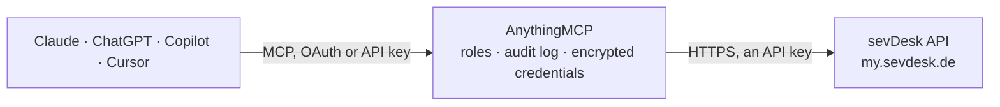

<!-- Generated by scripts/export-github-catalog.mjs in the anythingmcp-website repository. Do not edit by hand. -->

# sevDesk MCP connector

sevDesk cloud bookkeeping for German SMBs and freelancers: contacts, invoices, vouchers (Belege), orders, parts and bank accounts. The AnythingMCP connector gives Claude, ChatGPT, Microsoft Copilot, Cursor and Gemini 11 MCP tools for sevDesk: 10 read and 1 can change data.

**Category:** [Accounting](../accounting.md) · **Tools:** 11 · **Setup guide:** [anythingmcp.com](https://anythingmcp.com/guides/sevdesk-to-mcp) · [Deutsch](https://anythingmcp.com/de/guides/sevdesk-to-mcp) · [Italiano](https://anythingmcp.com/it/guides/sevdesk-to-mcp) · [Español](https://anythingmcp.com/es/guides/sevdesk-to-mcp) · [日本語](https://anythingmcp.com/ja/guides/sevdesk-to-mcp) · [Русский](https://anythingmcp.com/ru/guides/sevdesk-to-mcp) · [中文](https://anythingmcp.com/zh/guides/sevdesk-to-mcp)

## Start without code

No installation and no terminal: AnythingMCP Cloud runs the sevDesk connector for you, operated by helpcode.ai in Frankfurt, Germany.

1. **Click the button above** and create an account or sign in. The sevDesk connector opens, ready to install.
2. **Paste the API key or token from your sevDesk account.** Every click is in the [step-by-step guide](https://anythingmcp.com/guides/sevdesk-to-mcp).
3. **Click Install.** AnythingMCP shows the address of your MCP server.
4. **Add that address to your assistant:** [Claude](https://anythingmcp.com/guides/connect-sevdesk-to-claude) · [ChatGPT](https://anythingmcp.com/guides/connect-sevdesk-to-chatgpt) · [Microsoft Copilot](https://anythingmcp.com/guides/connect-sevdesk-to-copilot) · [Cursor](https://anythingmcp.com/guides/connect-sevdesk-to-cursor) · [Gemini CLI](https://anythingmcp.com/guides/connect-sevdesk-to-gemini) · [Meta Muse](https://anythingmcp.com/guides/connect-sevdesk-to-muse).
5. **Ask your first question**, for example: *Show me contact details for customer number KND-2026-058 (we need payment terms and VAT ID).*

Prefer help with the setup? [Talk to us](https://anythingmcp.com/contact).

## How it works

- **The AI client** speaks MCP (Streamable HTTP) to AnythingMCP and only sees tool names, descriptions and results. It never gets the sevDesk credentials.
- **AnythingMCP** checks the client's role, builds the call from the tool definition, adds the credentials (an API key), calls sevDesk, logs the call and returns the result.
- **sevDesk** sees an ordinary API client with the rights of the account the credentials belong to.

## Tools

| Tool | What it does | Access |
|---|---|---|
| [`sevdesk_list_users`](#sevdesk_list_users) | List the sevDesk users in this client, with their names and e-mail addresses. | read |
| [`sevdesk_list_contacts`](#sevdesk_list_contacts) | List contacts (customers, suppliers, partners). | read |
| [`sevdesk_get_contact`](#sevdesk_get_contact) | Read one contact by its numeric sevDesk id, with its category, customer number, tax settings and default payment terms. | read |
| [`sevdesk_list_invoices`](#sevdesk_list_invoices) | List outgoing invoices, newest first. | read |
| [`sevdesk_get_invoice_positions`](#sevdesk_get_invoice_positions) | Read the line items (Positionen) of one invoice: article, quantity, unit price, tax rate and the resulting net and gross sums. | read |
| [`sevdesk_list_vouchers`](#sevdesk_list_vouchers) | List vouchers (Belege) — incoming supplier invoices and receipts. | read |
| [`sevdesk_list_orders`](#sevdesk_list_orders) | List orders and quotations (Aufträge und Angebote). | read |
| [`sevdesk_list_parts`](#sevdesk_list_parts) | List parts (Artikel) from the sevDesk product catalogue with their price, stock level, unit and tax rate. | read |
| [`sevdesk_list_check_accounts`](#sevdesk_list_check_accounts) | List the bank and cash accounts (Kassen und Bankkonten) configured in sevDesk, with their current balance and import type. | read |
| [`sevdesk_list_transactions`](#sevdesk_list_transactions) | List bank transactions on one check account, so unpaid invoices can be matched against money that actually arrived. | read |
| [`sevdesk_create_contact`](#sevdesk_create_contact) | Create a new contact (organisation or person). | write |

## Tool reference

Every parameter as the AI client sees it in `tools/list`. Source: [`packages/backend/src/adapters/de/sevdesk.json`](../../../packages/backend/src/adapters/de/sevdesk.json).

### `sevdesk_list_users`

List the sevDesk users in this client, with their names and e-mail addresses. Fast call with no parameters — use it to confirm the API key is accepted.

**Access:** read · **Call:** `GET /SevUser`

No parameters.

### `sevdesk_list_contacts`

List contacts (customers, suppliers, partners). Narrow by customer number or by depth, and page through larger result sets.

**Access:** read · **Call:** `GET /Contact`

| Parameter | Type | Required | Description |
|---|---|---|---|
| `limit` | number | no | Maximum rows to return (default 100). |
| `offset` | number | no | Rows to skip, for paging. |
| `depth` | `0` \| `1` | no | `1` also returns the persons (contact persons and private customers); `0` (default) returns organisations only. |
| `customerNumber` | string | no | Exact customer number (Kundennummer) to look up. |
| `embed` | string | no | Comma-separated related objects to expand inline, e.g. addresses,communicationWays. |

### `sevdesk_get_contact`

Read one contact by its numeric sevDesk id, with its category, customer number, tax settings and default payment terms.

**Access:** read · **Call:** `GET /Contact/{id}`

| Parameter | Type | Required | Description |
|---|---|---|---|
| `id` | number | yes | Numeric contact id. |
| `embed` | string | no | Comma-separated related objects to expand, e.g. category,parent. |

### `sevdesk_list_invoices`

List outgoing invoices, newest first. Filter by status to answer 'what is unpaid' — status 200 is open, 1000 is paid, 100 is draft.

**Access:** read · **Call:** `GET /Invoice`

| Parameter | Type | Required | Description |
|---|---|---|---|
| `limit` | number | no | Maximum rows to return (default 100). |
| `offset` | number | no | Rows to skip, for paging. |
| `status` | number | no | Invoice status: 100 draft, 200 open/due, 750 partially paid, 1000 paid, 50 deactivated recurring invoice. |
| `startDate` | number | no | Earliest invoice date as a Unix timestamp in seconds. |
| `endDate` | number | no | Latest invoice date as a Unix timestamp in seconds. |
| `embed` | string | no | Comma-separated related objects to expand, e.g. contact,contactPerson. |

### `sevdesk_get_invoice_positions`

Read the line items (Positionen) of one invoice: article, quantity, unit price, tax rate and the resulting net and gross sums.

**Access:** read · **Call:** `GET /InvoicePos`

| Parameter | Type | Required | Description |
|---|---|---|---|
| `invoiceId` | number | yes | Numeric invoice id. |
| `limit` | number | no | Maximum line items to return. |

### `sevdesk_list_vouchers`

List vouchers (Belege) — incoming supplier invoices and receipts. This is the bookkeeping side of sevDesk, separate from outgoing invoices.

**Access:** read · **Call:** `GET /Voucher`

| Parameter | Type | Required | Description |
|---|---|---|---|
| `limit` | number | no | Maximum rows to return (default 100). |
| `offset` | number | no | Rows to skip, for paging. |
| `status` | number | no | Voucher status: 50 draft, 100 unpaid/due, 150 transferred, 750 partially paid, 1000 paid. |
| `creditDebit` | string | no | `C` for credit (income) or `D` for debit (expense). |
| `startDate` | number | no | Earliest voucher date as a Unix timestamp in seconds. |
| `endDate` | number | no | Latest voucher date as a Unix timestamp in seconds. |
| `embed` | string | no | Comma-separated related objects to expand, e.g. supplier,document. |

### `sevdesk_list_orders`

List orders and quotations (Aufträge und Angebote). The `orderType` field distinguishes AN (Angebot), AB (Auftragsbestätigung) and LI (Lieferschein).

**Access:** read · **Call:** `GET /Order`

| Parameter | Type | Required | Description |
|---|---|---|---|
| `limit` | number | no | Maximum rows to return (default 100). |
| `offset` | number | no | Rows to skip, for paging. |
| `status` | number | no | Order status: 100 draft, 200 delivered, 300 rejected/cancelled, 500 accepted, 750 partially calculated, 1000 calculated. |
| `embed` | string | no | Comma-separated related objects to expand, e.g. contact. |

### `sevdesk_list_parts`

List parts (Artikel) from the sevDesk product catalogue with their price, stock level, unit and tax rate.

**Access:** read · **Call:** `GET /Part`

| Parameter | Type | Required | Description |
|---|---|---|---|
| `limit` | number | no | Maximum rows to return (default 100). |
| `offset` | number | no | Rows to skip, for paging. |
| `partNumber` | string | no | Exact article number to look up. |

### `sevdesk_list_check_accounts`

List the bank and cash accounts (Kassen und Bankkonten) configured in sevDesk, with their current balance and import type.

**Access:** read · **Call:** `GET /CheckAccount`

| Parameter | Type | Required | Description |
|---|---|---|---|
| `limit` | number | no | Maximum rows to return. |

### `sevdesk_list_transactions`

List bank transactions on one check account, so unpaid invoices can be matched against money that actually arrived.

**Access:** read · **Call:** `GET /CheckAccountTransaction`

| Parameter | Type | Required | Description |
|---|---|---|---|
| `checkAccountId` | number | yes | Numeric id of the check account, from sevdesk_list_check_accounts. |
| `limit` | number | no | Maximum rows to return (default 100). |
| `offset` | number | no | Rows to skip, for paging. |
| `isBooked` | boolean | no | true for booked transactions only, false for transactions not yet booked (still to be matched). |

### `sevdesk_create_contact`

Create a new contact (organisation or person). Writes to the live client — search with sevdesk_list_contacts first so a duplicate customer number is not created. Category ids: 3 customer, 2 supplier, 4 partner, 28 prospect.

**Access:** write · **Call:** `POST /Contact`

| Parameter | Type | Required | Description |
|---|---|---|---|
| `name` | string | no | Organisation name. Setting it makes the contact an organisation; for a private person leave it empty and use surename and familyname instead. |
| `categoryId` | number | yes | Contact category id: 3 = customer, 2 = supplier, 4 = partner, 28 = prospect customer. Required by sevDesk. |
| `customerNumber` | string | no | Customer number. Left blank, sevDesk assigns the next free one. |
| `surename` | string | no | Given name, for a private person. |
| `familyname` | string | no | Family name, for a private person. |
| `vatNumber` | string | no | VAT identification number (USt-IdNr.). |
| `description` | string | no | Free-text note stored on the contact. |

## Run it yourself

AnythingMCP is open source (AGPL-3.0). [Run it with Docker](../../../README.md#run-it-yourself), open **Connectors → Store**, pick **sevDesk** and enter `SEVDESK_API_KEY`, then add your MCP server URL to the AI client.

[← Accounting connectors](../accounting.md) · [All categories](../README.md)
