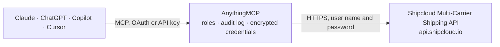

<!-- Generated by scripts/export-github-catalog.mjs in the anythingmcp-website repository. Do not edit by hand. -->

# Shipcloud Multi-Carrier Shipping MCP connector

Create shipments, generate labels, and track parcels across all major German and European carriers (DHL, DPD, GLS, Hermes, UPS, FedEx, TNT) through Shipcloud — the leading multi-carrier shipping aggregator for DE. The AnythingMCP connector gives Claude, ChatGPT, Microsoft Copilot, Cursor and Gemini 6 MCP tools for Shipcloud Multi-Carrier Shipping: 4 read and 2 can change data.

**Category:** [Logistics](../logistics.md) · **Tools:** 6 · **Setup guide:** [anythingmcp.com](https://anythingmcp.com/guides/shipcloud-to-mcp) · [Deutsch](https://anythingmcp.com/de/guides/shipcloud-to-mcp) · [Italiano](https://anythingmcp.com/it/guides/shipcloud-to-mcp) · [Español](https://anythingmcp.com/es/guides/shipcloud-to-mcp) · [日本語](https://anythingmcp.com/ja/guides/shipcloud-to-mcp) · [Русский](https://anythingmcp.com/ru/guides/shipcloud-to-mcp) · [中文](https://anythingmcp.com/zh/guides/shipcloud-to-mcp)

## Start without code

No installation and no terminal: AnythingMCP Cloud runs the Shipcloud Multi-Carrier Shipping connector for you, operated by helpcode.ai in Frankfurt, Germany.

1. **Click the button above** and create an account or sign in. The Shipcloud Multi-Carrier Shipping connector opens, ready to install.
2. **Paste the API key or token from your Shipcloud Multi-Carrier Shipping account.** Every click is in the [step-by-step guide](https://anythingmcp.com/guides/shipcloud-to-mcp).
3. **Click Install.** AnythingMCP shows the address of your MCP server.
4. **Add that address to your assistant:** [Claude](https://anythingmcp.com/guides/connect-shipcloud-to-claude) · [ChatGPT](https://anythingmcp.com/guides/connect-shipcloud-to-chatgpt) · [Microsoft Copilot](https://anythingmcp.com/guides/connect-shipcloud-to-copilot) · [Cursor](https://anythingmcp.com/guides/connect-shipcloud-to-cursor) · [Gemini CLI](https://anythingmcp.com/guides/connect-shipcloud-to-gemini) · [Meta Muse](https://anythingmcp.com/guides/connect-shipcloud-to-muse).
5. **Ask your first question**, for example: *Where's parcel with tracking DE20261015BG3 for customer KITA Sonnenschein?*

Prefer help with the setup? [Talk to us](https://anythingmcp.com/contact).

## How it works

- **The AI client** speaks MCP (Streamable HTTP) to AnythingMCP and only sees tool names, descriptions and results. It never gets the Shipcloud Multi-Carrier Shipping credentials.
- **AnythingMCP** checks the client's role, builds the call from the tool definition, adds the credentials (user name and password), calls Shipcloud Multi-Carrier Shipping, logs the call and returns the result.
- **Shipcloud Multi-Carrier Shipping** sees an ordinary API client with the rights of the account the credentials belong to.

## Tools

| Tool | What it does | Access |
|---|---|---|
| [`shipcloud_list_carriers`](#shipcloud_list_carriers) | List all carriers supported by the Shipcloud account with their names, IDs, service products (e.g. dhl:standard, dpd:classic), and feature flags… | read |
| [`shipcloud_create_shipment`](#shipcloud_create_shipment) | Create a shipment and generate a shipping label. | write |
| [`shipcloud_get_shipment`](#shipcloud_get_shipment) | Retrieve a shipment created via Shipcloud by its id. | read |
| [`shipcloud_list_shipments`](#shipcloud_list_shipments) | List recent shipments created via this account, filterable by carrier, date range, or customer reference. | read |
| [`shipcloud_create_tracker`](#shipcloud_create_tracker) | Create a tracking object for an external parcel (not shipped via this Shipcloud account). | write |
| [`shipcloud_get_tracker`](#shipcloud_get_tracker) | Retrieve the current state and event history of a tracking object. | read |

## Tool reference

Every parameter as the AI client sees it in `tools/list`. Source: [`packages/backend/src/adapters/de/shipcloud.json`](../../../packages/backend/src/adapters/de/shipcloud.json).

### `shipcloud_list_carriers`

List all carriers supported by the Shipcloud account with their names, IDs, service products (e.g. dhl:standard, dpd:classic), and feature flags (label_printer, tracking, etc.).

**Access:** read · **Call:** `GET /carriers`

No parameters.

### `shipcloud_create_shipment`

Create a shipment and generate a shipping label. Returns the shipcloud shipment id, carrier tracking number, label PDF URL, tracking URL, and price. Set create_shipping_label=false for a quote without billing.

**Access:** write · **Call:** `POST /shipments`

| Parameter | Type | Required | Description |
|---|---|---|---|
| `carrier` | string | yes | Carrier id (e.g. 'dhl', 'dpd', 'gls', 'hermes', 'ups'). |
| `service` | string | no | Service product (e.g. 'standard', 'returns', 'one_day'). |
| `to` | object | yes | Recipient address: { company?, first_name, last_name, street, street_no, zip_code, city, country (ISO 2-letter) }. |
| `from` | object | no | Sender address — same shape as 'to'. Optional if a default is configured in the Shipcloud account. |
| `package` | object | yes | Package dimensions: { weight (kg), length?, width?, height? (all in cm), type? ('parcel'\|'letter'\|'bulk') }. |
| `reference_number` | string | no | Optional customer reference to identify the shipment. |
| `create_shipping_label` | boolean | no | If true (default), generate a real label and bill. If false, returns a quote only. |
| `additional_services` | any[] | no | Optional extras: saturday_delivery, cash_on_delivery, advance_notice, delivery_date etc. |

### `shipcloud_get_shipment`

Retrieve a shipment created via Shipcloud by its id. Returns all fields including tracking events, label URL, and carrier tracking number.

**Access:** read · **Call:** `GET /shipments/{id}`

| Parameter | Type | Required | Description |
|---|---|---|---|
| `id` | string | yes | The shipcloud shipment id. |

### `shipcloud_list_shipments`

List recent shipments created via this account, filterable by carrier, date range, or customer reference.

**Access:** read · **Call:** `GET /shipments`

| Parameter | Type | Required | Description |
|---|---|---|---|
| `carrier` | string | no | Filter by carrier id. |
| `reference_number` | string | no | Filter by customer reference. |
| `service` | string | no | Filter by service product. |
| `carrier_tracking_no` | string | no | Filter by the carrier's tracking number. |
| `page` | number | no | Page number, 1-based. |
| `per_page` | number | no | Results per page (default 20, max 100). |

### `shipcloud_create_tracker`

Create a tracking object for an external parcel (not shipped via this Shipcloud account). Provide the carrier and carrier_tracking_no; Shipcloud will poll the carrier for status updates.

**Access:** write · **Call:** `POST /tracking_objects`

| Parameter | Type | Required | Description |
|---|---|---|---|
| `carrier` | string | yes | Carrier id (e.g. 'dhl', 'dpd'). |
| `carrier_tracking_no` | string | yes | The tracking number issued by the carrier. |

### `shipcloud_get_tracker`

Retrieve the current state and event history of a tracking object.

**Access:** read · **Call:** `GET /tracking_objects/{id}`

| Parameter | Type | Required | Description |
|---|---|---|---|
| `id` | string | yes | The Shipcloud tracking object id. |

## Run it yourself

AnythingMCP is open source (AGPL-3.0). [Run it with Docker](../../../README.md#run-it-yourself), open **Connectors → Store**, pick **Shipcloud Multi-Carrier Shipping** and enter `SHIPCLOUD_API_KEY`, then add your MCP server URL to the AI client.

[← Logistics connectors](../logistics.md) · [All categories](../README.md)
