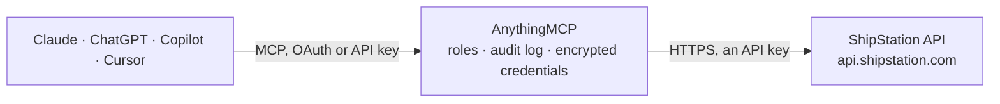

<!-- Generated by scripts/export-github-catalog.mjs in the anythingmcp-website repository. Do not edit by hand. -->

# ShipStation MCP connector

ShipStation multi-carrier shipping: orders (shipments in API v2), labels, carriers and their services, rate quotes, tracking, warehouses, products, inventory, fulfillments, batches, manifests and pickups. The AnythingMCP connector gives Claude, ChatGPT, Microsoft Copilot, Cursor and Gemini 28 MCP tools for ShipStation: 25 read and 3 can change data.

**Category:** [Logistics](../logistics.md) · **Tools:** 28 · **Setup guide:** [anythingmcp.com](https://anythingmcp.com/guides/shipstation-to-mcp) · [Deutsch](https://anythingmcp.com/de/guides/shipstation-to-mcp) · [Italiano](https://anythingmcp.com/it/guides/shipstation-to-mcp) · [Español](https://anythingmcp.com/es/guides/shipstation-to-mcp) · [日本語](https://anythingmcp.com/ja/guides/shipstation-to-mcp) · [Русский](https://anythingmcp.com/ru/guides/shipstation-to-mcp) · [中文](https://anythingmcp.com/zh/guides/shipstation-to-mcp)

## Start without code

No installation and no terminal: AnythingMCP Cloud runs the ShipStation connector for you, operated by helpcode.ai in Frankfurt, Germany.

1. **Click the button above** and create an account or sign in. The ShipStation connector opens, ready to install.
2. **Paste the API key or token from your ShipStation account.** Every click is in the [step-by-step guide](https://anythingmcp.com/guides/shipstation-to-mcp).
3. **Click Install.** AnythingMCP shows the address of your MCP server.
4. **Add that address to your assistant:** [Claude](https://anythingmcp.com/guides/connect-shipstation-to-claude) · [ChatGPT](https://anythingmcp.com/guides/connect-shipstation-to-chatgpt) · [Microsoft Copilot](https://anythingmcp.com/guides/connect-shipstation-to-copilot) · [Cursor](https://anythingmcp.com/guides/connect-shipstation-to-cursor) · [Gemini CLI](https://anythingmcp.com/guides/connect-shipstation-to-gemini) · [Meta Muse](https://anythingmcp.com/guides/connect-shipstation-to-muse).
5. **Ask your first question**, for example: *Show full shipment details for our order reference VC-INV-2026-178 (external order key).*

Prefer help with the setup? [Talk to us](https://anythingmcp.com/contact).

## How it works

- **The AI client** speaks MCP (Streamable HTTP) to AnythingMCP and only sees tool names, descriptions and results. It never gets the ShipStation credentials.
- **AnythingMCP** checks the client's role, builds the call from the tool definition, adds the credentials (an API key), calls ShipStation, logs the call and returns the result.
- **ShipStation** sees an ordinary API client with the rights of the account the credentials belong to.

## Tools

| Tool | What it does | Access |
|---|---|---|
| [`shipstation_list_carriers`](#shipstation_list_carriers) | List the carrier accounts connected to ShipStation with their carrier_id (se-...), carrier code, nickname, balance and, by default, their services and… | read |
| [`shipstation_get_carrier`](#shipstation_get_carrier) | Get one connected carrier account by carrier_id: carrier code, account number, nickname, funding balance, services, packages and options. | read |
| [`shipstation_list_carrier_services`](#shipstation_list_carrier_services) | List the shipping services of one carrier (service_code such as usps_priority_mail or ups_ground, domestic or international, multi-package support). | read |
| [`shipstation_list_carrier_packages`](#shipstation_list_carrier_packages) | List the package types one carrier accepts (package_code such as package, flat_rate_envelope, with dimensions where fixed). | read |
| [`shipstation_list_shipments`](#shipstation_list_shipments) | List shipments, which are the orders of the ShipStation web app: recipient, items, status, store_id, order number and dates. | read |
| [`shipstation_get_shipment`](#shipstation_get_shipment) | Get one shipment (an order in the web app) by shipment_id: addresses, packages, weight, items, carrier and service, amounts paid, notes, tags and status. | read |
| [`shipstation_get_shipment_by_external_id`](#shipstation_get_shipment_by_external_id) | Get a shipment by its external_shipment_id, the key your own system or the sales channel gave the order (the v1 orderKey). | read |
| [`shipstation_get_shipment_rates`](#shipstation_get_shipment_rates) | Get the rates already calculated for a shipment, with carrier, service, price, delivery days and rate_id. | read |
| [`shipstation_calculate_rates`](#shipstation_calculate_rates) | Quote shipping rates for an existing shipment across the given carriers. | read |
| [`shipstation_estimate_rates`](#shipstation_estimate_rates) | Estimate shipping prices from origin, destination, weight and optional dimensions, without a shipment. | read |
| [`shipstation_list_labels`](#shipstation_list_labels) | List purchased labels (the shipments of the web app) with tracking number, carrier, service, cost, status and download links. | read |
| [`shipstation_get_label`](#shipstation_get_label) | Get one label by label_id: tracking number, carrier, service, ship date, cost, status, voided flag and the label file as a URL or inline data. | read |
| [`shipstation_track_label`](#shipstation_track_label) | Get tracking for a label: current status, estimated delivery, carrier status description and the list of scan events. | read |
| [`shipstation_get_tracking`](#shipstation_get_tracking) | Get tracking by carrier code and tracking number, also for packages not labelled in ShipStation: status, estimated delivery and scan events. | read |
| [`shipstation_create_label_from_shipment`](#shipstation_create_label_from_shipment) | Buy a shipping label for an existing shipment, using the carrier and service set on it. | write |
| [`shipstation_create_label_from_rate`](#shipstation_create_label_from_rate) | Buy a shipping label from a rate_id returned by shipstation_calculate_rates. | write |
| [`shipstation_void_label`](#shipstation_void_label) | Void a label that has not been used, so the carrier refunds the postage where it allows it. | write |
| [`shipstation_list_warehouses`](#shipstation_list_warehouses) | List the ship-from locations (warehouses) with warehouse_id, name, origin address, return address and the default flag. | read |
| [`shipstation_get_warehouse`](#shipstation_get_warehouse) | Get one ship-from warehouse by warehouse_id with its origin and return addresses and whether it is the default. | read |
| [`shipstation_list_products`](#shipstation_list_products) | List the products in ShipStation's product catalog with SKU, name, price, weight, dimensions, customs data and active flag. | read |
| [`shipstation_list_inventory`](#shipstation_list_inventory) | List stock levels per SKU from ShipStation inventory: on hand, allocated and available, optionally per inventory warehouse or location. | read |
| [`shipstation_list_fulfillments`](#shipstation_list_fulfillments) | List fulfillments, the shipping confirmations sent back to stores and marketplaces, with tracking number, carrier, ship date and notification status. | read |
| [`shipstation_list_batches`](#shipstation_list_batches) | List label batches with batch number, status, label count, errors and download links for the combined labels. | read |
| [`shipstation_list_manifests`](#shipstation_list_manifests) | List end-of-day manifests (carrier scan forms) with carrier, warehouse, ship date, label ids and the form download link. | read |
| [`shipstation_list_pickups`](#shipstation_list_pickups) | List scheduled carrier pickups with pickup window, confirmation number, carrier, warehouse and the labels included. | read |
| [`shipstation_list_tags`](#shipstation_list_tags) | List the tags defined in the ShipStation account with their names and colours. | read |
| [`shipstation_list_users`](#shipstation_list_users) | List the users of the ShipStation account with their user id, name and status. | read |
| [`shipstation_validate_address`](#shipstation_validate_address) | Check a postal address against carrier data. | read |

## Tool reference

Every parameter as the AI client sees it in `tools/list`. Source: [`packages/backend/src/adapters/intl/shipstation.json`](../../../packages/backend/src/adapters/intl/shipstation.json).

### `shipstation_list_carriers`

List the carrier accounts connected to ShipStation with their carrier_id (se-...), carrier code, nickname, balance and, by default, their services and package types. Call it first: carrier ids are needed for rates and labels.

**Access:** read · **Call:** `GET /carriers`

| Parameter | Type | Required | Description |
|---|---|---|---|
| `include_extended_details` | boolean | no | When true (the default), each carrier also lists its services and package types. Set false for a shorter answer. |
| `page` | integer | no | Page number, starting at 1. |
| `page_size` | integer | no | Carriers per page. |

### `shipstation_get_carrier`

Get one connected carrier account by carrier_id: carrier code, account number, nickname, funding balance, services, packages and options. Use it to check a carrier's balance or what it supports.

**Access:** read · **Call:** `GET /carriers/{carrier_id}`

| Parameter | Type | Required | Description |
|---|---|---|---|
| `carrier_id` | string | yes | Carrier id from shipstation_list_carriers, e.g. se-123456. |

### `shipstation_list_carrier_services`

List the shipping services of one carrier (service_code such as usps_priority_mail or ups_ground, domestic or international, multi-package support). Use the service_code when quoting rates or buying labels.

**Access:** read · **Call:** `GET /carriers/{carrier_id}/services`

| Parameter | Type | Required | Description |
|---|---|---|---|
| `carrier_id` | string | yes | Carrier id from shipstation_list_carriers, e.g. se-123456. |

### `shipstation_list_carrier_packages`

List the package types one carrier accepts (package_code such as package, flat_rate_envelope, with dimensions where fixed). Use the package_code to restrict a rate quote to a package type.

**Access:** read · **Call:** `GET /carriers/{carrier_id}/packages`

| Parameter | Type | Required | Description |
|---|---|---|---|
| `carrier_id` | string | yes | Carrier id from shipstation_list_carriers, e.g. se-123456. |

### `shipstation_list_shipments`

List shipments, which are the orders of the ShipStation web app: recipient, items, status, store_id, order number and dates. Filter by status, store, order number, recipient, item keyword, tag or date range. Use pending for orders still to ship.

**Access:** read · **Call:** `GET /shipments`

| Parameter | Type | Required | Description |
|---|---|---|---|
| `shipment_status` | `pending` \| `processing` \| `label_purchased` \| `cancelled` | no | pending (awaiting payment, awaiting shipment or on hold), processing (label being created), label_purchased (shipped) or cancelled. |
| `store_id` | string | no | Only shipments from this store (order source). The store_id is on every shipment. |
| `shipment_number` | string | no | Order number as shown in ShipStation or the sales channel. |
| `external_shipment_id` | string | no | Your own key for the order (the v1 orderKey). |
| `sales_order_id` | string | no | Only shipments created from this sales order. |
| `ship_to_name` | string | no | Recipient name. |
| `item_keyword` | string | no | Match items by SKU, description or options. |
| `tag` | string | no | Only shipments carrying this tag name. |
| `batch_id` | string | no | Only shipments in this batch. |
| `created_at_start` | string | no | Created on or after this time, ISO 8601, e.g. 2026-10-01T00:00:00Z. |
| `created_at_end` | string | no | Created on or before this time, ISO 8601. |
| `modified_at_start` | string | no | Modified on or after this time, ISO 8601. |
| `modified_at_end` | string | no | Modified on or before this time, ISO 8601. |
| `payment_date_start` | string | no | Paid on or after this time, ISO 8601. |
| `payment_date_end` | string | no | Paid on or before this time, ISO 8601. |
| `sort_by` | `modified_at` \| `created_at` | no | Field to sort by. |
| `sort_dir` | `asc` \| `desc` | no | Sort direction. |
| `page` | integer | no | Page number, starting at 1. |
| `page_size` | integer | no | Shipments per page. |

### `shipstation_get_shipment`

Get one shipment (an order in the web app) by shipment_id: addresses, packages, weight, items, carrier and service, amounts paid, notes, tags and status. Use it for the full detail behind a list row.

**Access:** read · **Call:** `GET /shipments/{shipment_id}`

| Parameter | Type | Required | Description |
|---|---|---|---|
| `shipment_id` | string | yes | Shipment id, e.g. se-12345678. A v1 orderId becomes se-<orderId>. |

### `shipstation_get_shipment_by_external_id`

Get a shipment by its external_shipment_id, the key your own system or the sales channel gave the order (the v1 orderKey). Use it when you know the order reference but not the se- id.

**Access:** read · **Call:** `GET /shipments/external_shipment_id/{external_shipment_id}`

| Parameter | Type | Required | Description |
|---|---|---|---|
| `external_shipment_id` | string | yes | External shipment id (order key) as stored on the shipment. |

### `shipstation_get_shipment_rates`

Get the rates already calculated for a shipment, with carrier, service, price, delivery days and rate_id. Use it to read earlier quotes; call shipstation_calculate_rates to quote again.

**Access:** read · **Call:** `GET /shipments/{shipment_id}/rates`

| Parameter | Type | Required | Description |
|---|---|---|---|
| `shipment_id` | string | yes | Shipment id, e.g. se-12345678. |
| `created_at_start` | string | no | Only rates calculated on or after this time, ISO 8601. |

### `shipstation_calculate_rates`

Quote shipping rates for an existing shipment across the given carriers. Returns each rate with rate_id, carrier, service_code, amount, delivery days and errors. Nothing is bought; use a rate_id later to buy the label.

**Access:** read · **Call:** `POST /rates`

| Parameter | Type | Required | Description |
|---|---|---|---|
| `shipment_id` | string | yes | Shipment id to rate, e.g. se-12345678. |
| `carrier_ids` | string[] | yes | Carrier ids to ask, from shipstation_list_carriers. |
| `service_codes` | string[] | no | Only these service codes, e.g. usps_priority_mail. |
| `package_types` | string[] | no | Only these package codes, e.g. package. |

### `shipstation_estimate_rates`

Estimate shipping prices from origin, destination, weight and optional dimensions, without a shipment. Returns rates per carrier and service with amounts and delivery days. Use it for quick price comparisons.

**Access:** read · **Call:** `POST /rates/estimate`

| Parameter | Type | Required | Description |
|---|---|---|---|
| `carrier_ids` | string[] | yes | Carrier ids to ask, from shipstation_list_carriers. |
| `from_country_code` | string | yes | Origin country, two-letter ISO code, e.g. US. |
| `from_postal_code` | string | yes | Origin postal code. |
| `from_city_locality` | string | yes | Origin city. |
| `from_state_province` | string | yes | Origin state or province code, e.g. TX. |
| `to_country_code` | string | yes | Destination country, two-letter ISO code. |
| `to_postal_code` | string | yes | Destination postal code. |
| `to_city_locality` | string | yes | Destination city. |
| `to_state_province` | string | yes | Destination state or province code. |
| `weight_value` | number | yes | Package weight, greater than 0. |
| `weight_unit` | `pound` \| `ounce` \| `gram` \| `kilogram` | yes | Unit of weight_value. |
| `dimensions` | object | no | Optional package size: {"unit": "inch" or "centimeter", "length": n, "width": n, "height": n}. |
| `ship_date` | string | yes | Planned ship date, ISO 8601, e.g. 2026-10-07T00:00:00Z. |
| `address_residential_indicator` | `unknown` \| `yes` \| `no` | no | Whether the destination is residential. |

### `shipstation_list_labels`

List purchased labels (the shipments of the web app) with tracking number, carrier, service, cost, status and download links. Filter by status, carrier, tracking number, shipment, warehouse or date range.

**Access:** read · **Call:** `GET /labels`

| Parameter | Type | Required | Description |
|---|---|---|---|
| `label_status` | `processing` \| `completed` \| `error` \| `voided` | no | Only labels in this status. |
| `carrier_id` | string | no | Only labels of this carrier account. |
| `service_code` | string | no | Only labels of this service, e.g. ups_ground. |
| `tracking_number` | string | no | Find the label with this tracking number. |
| `shipment_id` | string | no | Only labels of this shipment. |
| `external_shipment_id` | string | no | Only labels of the shipment with this external id. |
| `batch_id` | string | no | Only labels of this batch. |
| `rate_id` | string | no | Only the label bought with this rate. |
| `warehouse_id` | string | no | Only labels shipped from this warehouse. |
| `created_at_start` | string | no | Created on or after this time, ISO 8601. |
| `created_at_end` | string | no | Created on or before this time, ISO 8601. |
| `sort_by` | `modified_at` \| `created_at` \| `voided_at` | no | Field to sort by. |
| `sort_dir` | `asc` \| `desc` | no | Sort direction. |
| `page` | integer | no | Page number, starting at 1. |
| `page_size` | integer | no | Labels per page. |

### `shipstation_get_label`

Get one label by label_id: tracking number, carrier, service, ship date, cost, status, voided flag and the label file as a URL or inline data. Use it to reprint or check a label.

**Access:** read · **Call:** `GET /labels/{label_id}`

| Parameter | Type | Required | Description |
|---|---|---|---|
| `label_id` | string | yes | Label id, e.g. se-87654321. A v1 shipmentId becomes se-<shipmentId>. |
| `label_download_type` | `url` \| `inline` | no | url (default) returns download links; inline returns the file as base64. |

### `shipstation_track_label`

Get tracking for a label: current status, estimated delivery, carrier status description and the list of scan events. Use it to answer where a package is when you have the label_id.

**Access:** read · **Call:** `GET /labels/{label_id}/track`

| Parameter | Type | Required | Description |
|---|---|---|---|
| `label_id` | string | yes | Label id, e.g. se-87654321. |

### `shipstation_get_tracking`

Get tracking by carrier code and tracking number, also for packages not labelled in ShipStation: status, estimated delivery and scan events. Use shipstation_track_label when you have the label_id.

**Access:** read · **Call:** `GET /tracking`

| Parameter | Type | Required | Description |
|---|---|---|---|
| `carrier_code` | string | yes | Carrier code, e.g. fedex, ups, stamps_com, dhl_express. |
| `tracking_number` | string | yes | The carrier's tracking number. |

### `shipstation_create_label_from_shipment`

Buy a shipping label for an existing shipment, using the carrier and service set on it. Charges postage to the carrier account and marks the order shipped. Returns label_id, tracking number, cost and download links.

**Access:** write · **Call:** `POST /labels/shipment/{shipment_id}`

| Parameter | Type | Required | Description |
|---|---|---|---|
| `shipment_id` | string | yes | Shipment id with carrier_id and service_code set, e.g. se-12345678. |
| `label_format` | `pdf` \| `png` \| `zpl` | no | File format. pdf works with every carrier. |
| `label_layout` | `4x6` \| `letter` | no | Label size. letter only with pdf. |
| `label_download_type` | `url` \| `inline` | no | url returns download links; inline returns base64 data. |
| `validate_address` | `no_validation` \| `validate_only` \| `validate_and_clean` | no | Whether to validate the recipient address first. |

### `shipstation_create_label_from_rate`

Buy a shipping label from a rate_id returned by shipstation_calculate_rates. Charges postage to the carrier account. Returns label_id, tracking number, cost and download links.

**Access:** write · **Call:** `POST /labels/rates/{rate_id}`

| Parameter | Type | Required | Description |
|---|---|---|---|
| `rate_id` | string | yes | Rate id from a rate quote, e.g. se-1234567. |
| `label_format` | `pdf` \| `png` \| `zpl` | no | File format. pdf works with every carrier. |
| `label_layout` | `4x6` \| `letter` | no | Label size. letter only with pdf. |
| `label_download_type` | `url` \| `inline` | no | url returns download links; inline returns base64 data. |
| `validate_address` | `no_validation` \| `validate_only` \| `validate_and_clean` | no | Whether to validate the recipient address first. |

### `shipstation_void_label`

Void a label that has not been used, so the carrier refunds the postage where it allows it. Returns whether the void was approved and the carrier's message. The label cannot be used afterwards.

**Access:** write · **Call:** `PUT /labels/{label_id}/void`

| Parameter | Type | Required | Description |
|---|---|---|---|
| `label_id` | string | yes | Label id to void, e.g. se-87654321. |

### `shipstation_list_warehouses`

List the ship-from locations (warehouses) with warehouse_id, name, origin address, return address and the default flag. Use the warehouse_id for rates, labels, pickups and manifests.

**Access:** read · **Call:** `GET /warehouses`

No parameters.

### `shipstation_get_warehouse`

Get one ship-from warehouse by warehouse_id with its origin and return addresses and whether it is the default. Use it to check the sender address used on labels.

**Access:** read · **Call:** `GET /warehouses/{warehouse_id}`

| Parameter | Type | Required | Description |
|---|---|---|---|
| `warehouse_id` | string | yes | Warehouse id from shipstation_list_warehouses, e.g. se-123. |

### `shipstation_list_products`

List the products in ShipStation's product catalog with SKU, name, price, weight, dimensions, customs data and active flag. Filter by SKU, name or active status.

**Access:** read · **Call:** `GET /products`

| Parameter | Type | Required | Description |
|---|---|---|---|
| `sku` | string | no | Only the product with this SKU. |
| `name` | string | no | Filter by product name. |
| `active` | boolean | no | true for active products only, false for inactive ones. |
| `page` | integer | no | Page number, starting at 1. |
| `page_size` | integer | no | Products per page. |

### `shipstation_list_inventory`

List stock levels per SKU from ShipStation inventory: on hand, allocated and available, optionally per inventory warehouse or location. Use it to check stock before shipping.

**Access:** read · **Call:** `GET /inventory`

| Parameter | Type | Required | Description |
|---|---|---|---|
| `sku` | string | no | Only this SKU. |
| `inventory_warehouse_id` | string | no | Only this inventory warehouse (not the same id as a ship-from warehouse). |
| `inventory_location_id` | string | no | Only this inventory location. |
| `group_by` | `warehouse` \| `location` | no | Sum counts per warehouse or per location. |
| `page_size` | integer | no | Rows per page. |

### `shipstation_list_fulfillments`

List fulfillments, the shipping confirmations sent back to stores and marketplaces, with tracking number, carrier, ship date and notification status. Filter by store, order number, tracking number or dates.

**Access:** read · **Call:** `GET /fulfillments`

| Parameter | Type | Required | Description |
|---|---|---|---|
| `order_source_id` | string | no | Only fulfillments of this store (the store_id on shipments). |
| `shipment_number` | string | no | Order number. |
| `shipment_id` | string | no | Only fulfillments of this shipment. |
| `fulfillment_id` | string | no | One fulfillment by id. |
| `tracking_number` | string | no | Tracking number. |
| `ship_to_name` | string | no | Recipient name. |
| `ship_to_country_code` | string | no | Recipient country, two-letter ISO code. |
| `batch_id` | string | no | Only fulfillments of this batch. |
| `fulfillment_provider_code` | string | no | Only fulfillments of this fulfillment provider. |
| `ship_date_start` | string | no | Shipped on or after this date, ISO 8601. |
| `ship_date_end` | string | no | Shipped on or before this date, ISO 8601. |
| `create_date_start` | string | no | Created on or after this date, ISO 8601. |
| `create_date_end` | string | no | Created on or before this date, ISO 8601. |
| `sort_by` | `created_at` \| `modified_at` \| `shipped_at` | no | Field to sort by. |
| `sort_dir` | `asc` \| `desc` | no | Sort direction. |
| `page` | integer | no | Page number, starting at 1. |
| `page_size` | integer | no | Fulfillments per page. |

### `shipstation_list_batches`

List label batches with batch number, status, label count, errors and download links for the combined labels. Use it to follow bulk label runs.

**Access:** read · **Call:** `GET /batches`

| Parameter | Type | Required | Description |
|---|---|---|---|
| `status` | `open` \| `queued` \| `processing` \| `completed` \| `completed_with_errors` \| `archived` \| `notifying` \| `invalid` | no | Only batches in this status. |
| `batch_number` | string | no | Find a batch by its number. |
| `sort_by` | `ship_date` \| `processed_at` \| `created_at` | no | Field to sort by. |
| `sort_dir` | `asc` \| `desc` | no | Sort direction. |
| `page` | integer | no | Page number, starting at 1. |
| `page_size` | integer | no | Batches per page. |

### `shipstation_list_manifests`

List end-of-day manifests (carrier scan forms) with carrier, warehouse, ship date, label ids and the form download link. Filter by carrier, warehouse or date.

**Access:** read · **Call:** `GET /manifests`

| Parameter | Type | Required | Description |
|---|---|---|---|
| `carrier_id` | string | no | Only manifests of this carrier account. |
| `warehouse_id` | string | no | Only manifests of this warehouse. |
| `ship_date_start` | string | no | Ship date on or after, ISO 8601. |
| `ship_date_end` | string | no | Ship date on or before, ISO 8601. |
| `created_at_start` | string | no | Created on or after, ISO 8601. |
| `created_at_end` | string | no | Created on or before, ISO 8601. |
| `page` | integer | no | Page number, starting at 1. |
| `page_size` | integer | no | Manifests per page. |

### `shipstation_list_pickups`

List scheduled carrier pickups with pickup window, confirmation number, carrier, warehouse and the labels included. Filter by carrier, warehouse or creation date.

**Access:** read · **Call:** `GET /pickups`

| Parameter | Type | Required | Description |
|---|---|---|---|
| `carrier_id` | string | no | Only pickups of this carrier account. |
| `warehouse_id` | string | no | Only pickups at this warehouse. |
| `created_at_start` | string | no | Created on or after, ISO 8601. |
| `created_at_end` | string | no | Created on or before, ISO 8601. |
| `page` | integer | no | Page number, starting at 1. |
| `page_size` | integer | no | Pickups per page. |

### `shipstation_list_tags`

List the tags defined in the ShipStation account with their names and colours. Use a tag name to filter shipstation_list_shipments.

**Access:** read · **Call:** `GET /tags`

No parameters.

### `shipstation_list_users`

List the users of the ShipStation account with their user id, name and status. Use it to see who shipments are assigned to.

**Access:** read · **Call:** `GET /users`

| Parameter | Type | Required | Description |
|---|---|---|---|
| `status` | `active` \| `inactive` \| `locked_out` \| `email_lock` | no | Only users in this status. |
| `page` | integer | no | Page number, starting at 1. |
| `page_size` | integer | no | Users per page. |

### `shipstation_validate_address`

Check a postal address against carrier data. Returns the status (verified, unverified, warning, error), the corrected address and messages. Nothing is stored; use it before buying a label.

**Access:** read · **Call:** `POST /addresses/validate`

| Parameter | Type | Required | Description |
|---|---|---|---|
| `name` | string | no | Contact name. |
| `company_name` | string | no | Company, for business addresses. |
| `address_line1` | string | yes | First street line. |
| `address_line2` | string | no | Second street line. |
| `city_locality` | string | yes | City. |
| `state_province` | string | yes | State or province code. |
| `postal_code` | string | no | Postal code. |
| `country_code` | string | yes | Two-letter ISO country code, e.g. US. |

## Run it yourself

AnythingMCP is open source (AGPL-3.0). [Run it with Docker](../../../README.md#run-it-yourself), open **Connectors → Store**, pick **ShipStation** and enter `SHIPSTATION_API_KEY`, then add your MCP server URL to the AI client.

[← Logistics connectors](../logistics.md) · [All categories](../README.md)
