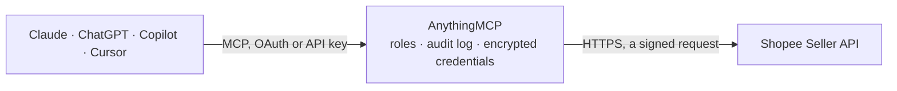

<!-- Generated by scripts/export-github-catalog.mjs in the anythingmcp-website repository. Do not edit by hand. -->

# Shopee Seller MCP connector

Let your AI work with your Shopee shop: listings and variations, orders, shipping and tracking, returns, order income, discounts and Ads figures, with stock and price updates available on request. The AnythingMCP connector gives Claude, ChatGPT, Microsoft Copilot, Cursor and Gemini 22 MCP tools for Shopee Seller: 20 read and 2 can change data.

**Category:** [E-commerce](../e-commerce.md) · **Tools:** 22 · **Setup guide:** [anythingmcp.com](https://anythingmcp.com/guides/shopee-to-mcp) · [Deutsch](https://anythingmcp.com/de/guides/shopee-to-mcp) · [Italiano](https://anythingmcp.com/it/guides/shopee-to-mcp) · [Español](https://anythingmcp.com/es/guides/shopee-to-mcp) · [日本語](https://anythingmcp.com/ja/guides/shopee-to-mcp) · [Русский](https://anythingmcp.com/ru/guides/shopee-to-mcp) · [中文](https://anythingmcp.com/zh/guides/shopee-to-mcp)

## Start without code

No installation and no terminal: AnythingMCP Cloud runs the Shopee Seller connector for you, operated by helpcode.ai in Frankfurt, Germany.

1. **Click the button above** and create an account or sign in. The Shopee Seller connector opens, ready to install.
2. **Paste the API key or token from your Shopee Seller account.** Every click is in the [step-by-step guide](https://anythingmcp.com/guides/shopee-to-mcp).
3. **Click Install.** AnythingMCP shows the address of your MCP server.
4. **Add that address to your assistant:** [Claude](https://anythingmcp.com/guides/connect-shopee-to-claude) · [ChatGPT](https://anythingmcp.com/guides/connect-shopee-to-chatgpt) · [Microsoft Copilot](https://anythingmcp.com/guides/connect-shopee-to-copilot) · [Cursor](https://anythingmcp.com/guides/connect-shopee-to-cursor) · [Gemini CLI](https://anythingmcp.com/guides/connect-shopee-to-gemini) · [Meta Muse](https://anythingmcp.com/guides/connect-shopee-to-muse).
5. **Ask your first question**, for example: *Where is order O2026-1187 and what's the tracking number/customer carrier?*

Prefer help with the setup? [Talk to us](https://anythingmcp.com/contact).

## How it works

- **The AI client** speaks MCP (Streamable HTTP) to AnythingMCP and only sees tool names, descriptions and results. It never gets the Shopee Seller credentials.
- **AnythingMCP** checks the client's role, builds the call from the tool definition, adds the credentials (a signed request), calls Shopee Seller, logs the call and returns the result.
- **Shopee Seller** sees an ordinary API client with the rights of the account the credentials belong to.

## Tools

| Tool | What it does | Access |
|---|---|---|
| [`shopee_get_shop_info`](#shopee_get_shop_info) | Read the authorized shop: shop_name, region, status (NORMAL, BANNED, FROZEN), whether it is cross-border (is_cb), auth_time and expire_time of the… | read |
| [`shopee_get_shop_profile`](#shopee_get_shop_profile) | Read the shop's public profile: name, logo, description and invoice issuer. | read |
| [`shopee_list_items`](#shopee_list_items) | List the shop's listings (item ids with status and update_time), 100 per page at most. | read |
| [`shopee_search_items`](#shopee_search_items) | Search the shop's listings by name or SKU (an SKU match wins over a name match), or find listings missing attributes. | read |
| [`shopee_get_items`](#shopee_get_items) | Read up to 50 listings by item id: name, SKU, category, status, price info, stock info (when the listing has no variations), images, weight and dimensions,… | read |
| [`shopee_get_items_extra_info`](#shopee_get_items_extra_info) | Read performance figures for up to 50 listings: sales, views, likes, rating_star and comment_count. | read |
| [`shopee_get_item_models`](#shopee_get_item_models) | Read the variations (models) of one listing: tier_variation (the option names, e.g. colour and size) and each model with model_id, model_sku, price_info and… | read |
| [`shopee_update_stock`](#shopee_update_stock) | Set the seller stock of a listing or of its models (up to 50 entries). | write |
| [`shopee_update_price`](#shopee_update_price) | Set the original price of a listing or of its models (up to 50 entries), in the shop's currency. | write |
| [`shopee_list_orders`](#shopee_list_orders) | List orders created (or updated) in a time window of at most 15 days, newest first, up to 100 per page. | read |
| [`shopee_get_order_details`](#shopee_get_order_details) | Read up to 50 orders: status, buyer, items, amounts, payment method, shipping carrier, packages, recipient address and cancellation details. | read |
| [`shopee_list_orders_to_ship`](#shopee_list_orders_to_ship) | List the orders waiting to be shipped (status READY_TO_SHIP with a shipping document to arrange), up to 100 per page. | read |
| [`shopee_get_shipping_parameter`](#shopee_get_shipping_parameter) | Read how an order can be handed over: info_needed per method, the pickup addresses and time slots, and the drop-off branches. | read |
| [`shopee_get_tracking_number`](#shopee_get_tracking_number) | Read the tracking number of a shipped order (available once the shipment is arranged), optionally with first and last mile numbers. | read |
| [`shopee_get_tracking_info`](#shopee_get_tracking_info) | Read the logistics status and the tracking history (time, description) of an order or one of its packages. | read |
| [`shopee_list_logistics_channels`](#shopee_list_logistics_channels) | List the shop's logistics channels: id, name, whether each is enabled, fee type, size and weight limits. | read |
| [`shopee_list_returns`](#shopee_list_returns) | List return and refund requests, newest first, up to 100 per page, optionally within a creation or update window of at most 15 days. | read |
| [`shopee_get_return`](#shopee_get_return) | Read one return request: reason, buyer text and images, items, refund amount, status, due dates and the linked order_sn. | read |
| [`shopee_get_order_income`](#shopee_get_order_income) | Read what an order earns the seller (escrow detail): buyer payment, Shopee commission and service fees, shipping fee and rebates, vouchers, and the final… | read |
| [`shopee_list_discounts`](#shopee_list_discounts) | List the shop's discount promotions by status, with discount_id, name, start and end time. | read |
| [`shopee_get_ads_balance`](#shopee_get_ads_balance) | Read the shop's current Shopee Ads credit balance. | read |
| [`shopee_get_ads_daily_performance`](#shopee_get_ads_daily_performance) | Read the daily performance of all the shop's CPC ads: impressions, clicks, CTR, expense, orders, GMV and ROAS (direct and broad). | read |

## Tool reference

Every parameter as the AI client sees it in `tools/list`. Source: [`packages/backend/src/adapters/intl/shopee.json`](../../../packages/backend/src/adapters/intl/shopee.json).

### `shopee_get_shop_info`

Read the authorized shop: shop_name, region, status (NORMAL, BANNED, FROZEN), whether it is cross-border (is_cb), auth_time and expire_time of the authorization (Unix seconds). No parameters; the lightest call, and the check that the partner key, the host and the shop authorization line up.

**Access:** read · **Call:** `GET /api/v2/shop/get_shop_info`

No parameters.

### `shopee_get_shop_profile`

Read the shop's public profile: name, logo, description and invoice issuer.

**Access:** read · **Call:** `GET /api/v2/shop/get_profile`

No parameters.

### `shopee_list_items`

List the shop's listings (item ids with status and update_time), 100 per page at most. Page with offset: pass next_offset from the answer while has_next_page is true. Then read details with shopee_get_items and variations with shopee_get_item_models.

**Access:** read · **Call:** `GET /api/v2/product/get_item_list`

| Parameter | Type | Required | Description |
|---|---|---|---|
| `offset` | integer | yes | Where to start, 0 for the first page; then next_offset from the previous answer. |
| `page_size` | integer | yes | Items per page, 1 to 100. |
| `item_status` | `NORMAL` \| `BANNED` \| `UNLIST` \| `REVIEWING` \| `SELLER_DELETE` \| `SHOPEE_DELETE`[] | yes | Listing statuses to include; several are allowed. NORMAL is live, UNLIST is hidden by the seller. |
| `update_time_from` | integer | no | Only items updated at or after this time. Unix time in seconds. |
| `update_time_to` | integer | no | Only items updated at or before this time. Unix time in seconds. |

### `shopee_search_items`

Search the shop's listings by name or SKU (an SKU match wins over a name match), or find listings missing attributes. Returns item ids; read them with shopee_get_items. Page with offset (a string) from next_offset.

**Access:** read · **Call:** `GET /api/v2/product/search_item`

| Parameter | Type | Required | Description |
|---|---|---|---|
| `item_name` | string | no | Words in the listing name. |
| `item_sku` | string | no | Parent SKU of the listing. |
| `item_status` | `NORMAL` \| `BANNED` \| `UNLIST` \| `REVIEWING` \| `SELLER_DELETE` \| `SHOPEE_DELETE`[] | no | Listing statuses to include. |
| `attribute_status` | `1` \| `2` | no | 1: listings missing required attributes, 2: listings missing optional attributes. |
| `page_size` | integer | yes | Results per page, 1 to 100. |
| `offset` | string | no | Leave out for the first page; then next_offset from the previous answer. |

### `shopee_get_items`

Read up to 50 listings by item id: name, SKU, category, status, price info, stock info (when the listing has no variations), images, weight and dimensions, logistics, and has_model. For a listing with variations, prices and stock are per model: use shopee_get_item_models.

**Access:** read · **Call:** `GET /api/v2/product/get_item_base_info`

| Parameter | Type | Required | Description |
|---|---|---|---|
| `item_id_list` | integer[] | yes | Item ids, 1 to 50, from shopee_list_items or shopee_search_items. |
| `need_tax_info` | boolean | no | Also return tax_info. |
| `need_complaint_policy` | boolean | no | Also return complaint_policy (PL only). |

### `shopee_get_items_extra_info`

Read performance figures for up to 50 listings: sales, views, likes, rating_star and comment_count.

**Access:** read · **Call:** `GET /api/v2/product/get_item_extra_info`

| Parameter | Type | Required | Description |
|---|---|---|---|
| `item_id_list` | integer[] | yes | Item ids, 1 to 50. |

### `shopee_get_item_models`

Read the variations (models) of one listing: tier_variation (the option names, e.g. colour and size) and each model with model_id, model_sku, price_info and stock_info_v2 (seller and Shopee stock). The model_id values are what shopee_update_stock and shopee_update_price take.

**Access:** read · **Call:** `GET /api/v2/product/get_model_list`

| Parameter | Type | Required | Description |
|---|---|---|---|
| `item_id` | integer | yes | Item id of a listing with has_model true. |

### `shopee_update_stock`

Set the seller stock of a listing or of its models (up to 50 entries). Overwrites the current figure; it cannot be lower than stock already reserved by orders. Installed switched off. Confirm with the user first, showing item, model and new stock.

**Access:** write · **Call:** `POST /api/v2/product/update_stock`

| Parameter | Type | Required | Description |
|---|---|---|---|
| `item_id` | integer | yes | Item id. |
| `stock_list` | object[] | yes | One entry per model; model_id 0 for a listing without variations. |

### `shopee_update_price`

Set the original price of a listing or of its models (up to 50 entries), in the shop's currency. SG, MY, BR, MX, PL, ES and AR take two decimals, other markets whole numbers. Running promotions keep their own price. Installed switched off. Confirm with the user first, showing item, model, old and new price.

**Access:** write · **Call:** `POST /api/v2/product/update_price`

| Parameter | Type | Required | Description |
|---|---|---|---|
| `item_id` | integer | yes | Item id. |
| `price_list` | object[] | yes | One entry per model; model_id 0 for a listing without variations. |

### `shopee_list_orders`

List orders created (or updated) in a time window of at most 15 days, newest first, up to 100 per page. Returns order_sn and order_status; read the orders with shopee_get_order_details. Page with cursor: pass next_cursor while more is true. For longer periods, call once per 15-day window.

**Access:** read · **Call:** `GET /api/v2/order/get_order_list`

| Parameter | Type | Required | Description |
|---|---|---|---|
| `time_range_field` | `create_time` \| `update_time` | yes | Which time the window applies to. |
| `time_from` | integer | yes | Start of the window. Unix time in seconds. |
| `time_to` | integer | yes | End of the window, at most 15 days after time_from. Unix time in seconds. |
| `order_status` | `UNPAID` \| `READY_TO_SHIP` \| `PROCESSED` \| `SHIPPED` \| `COMPLETED` \| `IN_CANCEL` \| `CANCELLED` \| `INVOICE_PENDING` | no | Only orders in this status (one value). |
| `page_size` | integer | yes | Orders per page, 1 to 100. |
| `cursor` | string | no | Leave out for the first page; then next_cursor from the previous answer. |
| `response_optional_fields` | string | no | Extra fields per order; order_status is the only one. |

### `shopee_get_order_details`

Read up to 50 orders: status, buyer, items, amounts, payment method, shipping carrier, packages, recipient address and cancellation details. The default response_optional_fields ask for all of these; Shopee returns only the base fields otherwise.

**Access:** read · **Call:** `GET /api/v2/order/get_order_detail`

| Parameter | Type | Required | Description |
|---|---|---|---|
| `order_sn_list` | string | yes | Order numbers separated by commas, 1 to 50, e.g. 201214JASXYXY6,201214JAJXU6G7. |
| `response_optional_fields` | string | no | Comma-separated extra fields to return (Shopee names, e.g. item_list,total_amount,package_list). |

### `shopee_list_orders_to_ship`

List the orders waiting to be shipped (status READY_TO_SHIP with a shipping document to arrange), up to 100 per page. Page with cursor while more is true.

**Access:** read · **Call:** `GET /api/v2/order/get_shipment_list`

| Parameter | Type | Required | Description |
|---|---|---|---|
| `page_size` | integer | yes | Orders per page, 1 to 100. |
| `cursor` | string | no | Leave out for the first page; then next_cursor from the previous answer. |

### `shopee_get_shipping_parameter`

Read how an order can be handed over: info_needed per method, the pickup addresses and time slots, and the drop-off branches. Read only; arranging the shipment is not offered by this connector.

**Access:** read · **Call:** `GET /api/v2/logistics/get_shipping_parameter`

| Parameter | Type | Required | Description |
|---|---|---|---|
| `order_sn` | string | yes | Order number (order_sn), e.g. 201214JASXYXY6, as returned by shopee_list_orders. |
| `package_number` | string | no | Package number, for an order split into several parcels (package_list in shopee_get_order_details). Leave it out for a single-parcel order. |

### `shopee_get_tracking_number`

Read the tracking number of a shipped order (available once the shipment is arranged), optionally with first and last mile numbers.

**Access:** read · **Call:** `GET /api/v2/logistics/get_tracking_number`

| Parameter | Type | Required | Description |
|---|---|---|---|
| `order_sn` | string | yes | Order number (order_sn), e.g. 201214JASXYXY6, as returned by shopee_list_orders. |
| `package_number` | string | no | Package number, for an order split into several parcels (package_list in shopee_get_order_details). Leave it out for a single-parcel order. |
| `response_optional_fields` | string | no | Comma-separated extras: plp_number, first_mile_tracking_number, last_mile_tracking_number. |

### `shopee_get_tracking_info`

Read the logistics status and the tracking history (time, description) of an order or one of its packages.

**Access:** read · **Call:** `GET /api/v2/logistics/get_tracking_info`

| Parameter | Type | Required | Description |
|---|---|---|---|
| `order_sn` | string | yes | Order number (order_sn), e.g. 201214JASXYXY6, as returned by shopee_list_orders. |
| `package_number` | string | no | Package number, for an order split into several parcels (package_list in shopee_get_order_details). Leave it out for a single-parcel order. |

### `shopee_list_logistics_channels`

List the shop's logistics channels: id, name, whether each is enabled, fee type, size and weight limits.

**Access:** read · **Call:** `GET /api/v2/logistics/get_channel_list`

No parameters.

### `shopee_list_returns`

List return and refund requests, newest first, up to 100 per page, optionally within a creation or update window of at most 15 days. Page with page_no while more is true. Read one with shopee_get_return.

**Access:** read · **Call:** `GET /api/v2/returns/get_return_list`

| Parameter | Type | Required | Description |
|---|---|---|---|
| `page_no` | integer | yes | Page number, starting at 1 as in Shopee's own samples. |
| `page_size` | integer | yes | Returns per page, up to 100. |
| `create_time_from` | integer | no | Only returns created at or after this time. Unix time in seconds. |
| `create_time_to` | integer | no | Only returns created at or before this time, at most 15 days after create_time_from. Unix time in seconds. |
| `update_time_from` | integer | no | Only returns updated at or after this time. Unix time in seconds. |
| `update_time_to` | integer | no | Only returns updated at or before this time, at most 15 days after update_time_from. Unix time in seconds. |
| `status` | `REQUESTED` \| `ACCEPTED` \| `CANCELLED` \| `JUDGING` \| `CLOSED` \| `PROCESSING` \| `SELLER_DISPUTE` | no | Only returns in this status. |
| `seller_proof_status` | `NOT_NEEDED` \| `PENDING` \| `UPLOADED` \| `OVERDUE` | no | Only returns whose seller proof is in this state. |

### `shopee_get_return`

Read one return request: reason, buyer text and images, items, refund amount, status, due dates and the linked order_sn.

**Access:** read · **Call:** `GET /api/v2/returns/get_return_detail`

| Parameter | Type | Required | Description |
|---|---|---|---|
| `return_sn` | string | yes | Return number (return_sn) from shopee_list_returns. |

### `shopee_get_order_income`

Read what an order earns the seller (escrow detail): buyer payment, Shopee commission and service fees, shipping fee and rebates, vouchers, and the final escrow amount. Read only; final once the order is completed.

**Access:** read · **Call:** `GET /api/v2/payment/get_escrow_detail`

| Parameter | Type | Required | Description |
|---|---|---|---|
| `order_sn` | string | yes | Order number (order_sn), e.g. 201214JASXYXY6, as returned by shopee_list_orders. |

### `shopee_list_discounts`

List the shop's discount promotions by status, with discount_id, name, start and end time. Page with page_no (from 1) while more is true.

**Access:** read · **Call:** `GET /api/v2/discount/get_discount_list`

| Parameter | Type | Required | Description |
|---|---|---|---|
| `discount_status` | `upcoming` \| `ongoing` \| `expired` \| `all` | yes | Which promotions to list. |
| `page_no` | integer | yes | Page number, from 1. |
| `page_size` | integer | yes | Promotions per page, up to 100. |

### `shopee_get_ads_balance`

Read the shop's current Shopee Ads credit balance. Needs the Ads permission on the app.

**Access:** read · **Call:** `GET /api/v2/ads/get_total_balance`

No parameters.

### `shopee_get_ads_daily_performance`

Read the daily performance of all the shop's CPC ads: impressions, clicks, CTR, expense, orders, GMV and ROAS (direct and broad). At most one month per call, within the last 6 months, and start must differ from end. Needs the Ads permission on the app.

**Access:** read · **Call:** `GET /api/v2/ads/get_all_cpc_ads_daily_performance`

| Parameter | Type | Required | Description |
|---|---|---|---|
| `start_date` | string | yes | First day, DD-MM-YYYY (e.g. 01-10-2026). |
| `end_date` | string | yes | Last day, DD-MM-YYYY, after start_date and at most one month later. |

## Run it yourself

AnythingMCP is open source (AGPL-3.0). [Run it with Docker](../../../README.md#run-it-yourself), open **Connectors → Store**, pick **Shopee Seller** and enter `SHOPEE_HOST`, `SHOPEE_PARTNER_ID`, `SHOPEE_PARTNER_KEY`, then add your MCP server URL to the AI client.

[← E-commerce connectors](../e-commerce.md) · [All categories](../README.md)
