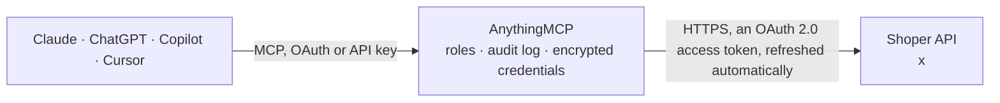

<!-- Generated by scripts/export-github-catalog.mjs in the anythingmcp-website repository. Do not edit by hand. -->

# Shoper MCP connector

Shoper online shops (Poland): orders with line items and parcels, products and stock per variant, categories, registered customers, order statuses, shipping and payment methods. The AnythingMCP connector gives Claude, ChatGPT, Microsoft Copilot, Cursor and Gemini 17 MCP tools for Shoper: 15 read and 2 can change data.

**Category:** [E-commerce](../e-commerce.md) · **Tools:** 17 · **Setup guide:** [anythingmcp.com](https://anythingmcp.com/guides/shoper-to-mcp) · [Deutsch](https://anythingmcp.com/de/guides/shoper-to-mcp) · [Italiano](https://anythingmcp.com/it/guides/shoper-to-mcp) · [Español](https://anythingmcp.com/es/guides/shoper-to-mcp) · [日本語](https://anythingmcp.com/ja/guides/shoper-to-mcp) · [Русский](https://anythingmcp.com/ru/guides/shoper-to-mcp) · [中文](https://anythingmcp.com/zh/guides/shoper-to-mcp)

## Start without code

No installation and no terminal: AnythingMCP Cloud runs the Shoper connector for you, operated by helpcode.ai in Frankfurt, Germany.

1. **Click the button above** and create an account or sign in. The Shoper connector opens, ready to install.
2. **Sign in with your Shoper account** when AnythingMCP asks. The first time, an admin creates a small app in the Shoper developer console. Every click is in the [step-by-step guide](https://anythingmcp.com/guides/shoper-to-mcp).
3. **Click Install.** AnythingMCP shows the address of your MCP server.
4. **Add that address to your assistant:** [Claude](https://anythingmcp.com/guides/connect-shoper-to-claude) · [ChatGPT](https://anythingmcp.com/guides/connect-shoper-to-chatgpt) · [Microsoft Copilot](https://anythingmcp.com/guides/connect-shoper-to-copilot) · [Cursor](https://anythingmcp.com/guides/connect-shoper-to-cursor) · [Gemini CLI](https://anythingmcp.com/guides/connect-shoper-to-gemini) · [Meta Muse](https://anythingmcp.com/guides/connect-shoper-to-muse).
5. **Ask your first question**, for example: *Show order 2026-214 for ewa.kowalska@example.pl — I need date, status, paid amount and shipping method.*

Prefer help with the setup? [Talk to us](https://anythingmcp.com/contact).

## How it works

- **The AI client** speaks MCP (Streamable HTTP) to AnythingMCP and only sees tool names, descriptions and results. It never gets the Shoper credentials.
- **AnythingMCP** checks the client's role, builds the call from the tool definition, adds the credentials (an OAuth 2.0 access token, refreshed automatically), calls Shoper, logs the call and returns the result.
- **Shoper** sees an ordinary API client with the rights of the account the credentials belong to.

## Tools

| Tool | What it does | Access |
|---|---|---|
| [`shoper_list_orders`](#shoper_list_orders) | List orders of the shop (pass order -date for newest first): order id, date, status_id, customer (user_id, e-mail, billing and delivery address), sum, paid… | read |
| [`shoper_get_order`](#shoper_get_order) | Get one order with all its fields: status, customer, billing and delivery address, sums, payment and shipping, pickup point, notes, additional fields and tags. | read |
| [`shoper_list_order_products`](#shoper_list_order_products) | List order line items: order_id, product_id, stock_id, name, code, option (variant), quantity, unit, price, discount, tax rate and value, weight. | read |
| [`shoper_list_products`](#shoper_list_products) | List products of the catalogue: product_id, code, EAN, category, producer, translations (name, description, active, SEO per language such as pl_PL), main… | read |
| [`shoper_get_product`](#shoper_get_product) | Get one product with translations, categories, stock (price, quantity, availability), options, attributes, related products, dimensions and tax. | read |
| [`shoper_list_product_stocks`](#shoper_list_product_stocks) | List product stocks, i.e. the sellable variants of products: stock_id, product_id, code, EAN, stock quantity, warehouse quantities, price, special and… | read |
| [`shoper_get_product_stock`](#shoper_get_product_stock) | Get one product stock (variant) with its quantity, warehouse quantities, prices, availability and options. | read |
| [`shoper_list_categories`](#shoper_list_categories) | List product categories: category_id, order, root flag and translations (name, description, active, SEO per language). | read |
| [`shoper_get_category_tree`](#shoper_get_category_tree) | Get the whole category tree as nested nodes (id and children). | read |
| [`shoper_list_customers`](#shoper_list_customers) | List registered customers (Shoper users): user_id, login, e-mail, first and last name, customer group, discount, newsletter consent, active flag,… | read |
| [`shoper_get_customer`](#shoper_get_customer) | Get one registered customer by user_id (e.g. the user_id of an order). | read |
| [`shoper_list_statuses`](#shoper_list_statuses) | List the order statuses of the shop: status_id, type (1 new, 2 opened, 3 closed, 4 not completed), translations (names per language), color, default flag… | read |
| [`shoper_list_shippings`](#shoper_list_shippings) | List shipping methods: shipping_id, name, translations, cost, free shipping threshold, weight and order value limits, zone, allowed payments and active flag. | read |
| [`shoper_list_payments`](#shoper_list_payments) | List payment methods: payment_id, name, translations, currencies and amount limits. | read |
| [`shoper_list_parcels`](#shoper_list_parcels) | List parcels (shipments) of orders: parcel_id, order_id, shipping_id, shipping_code (tracking number), sent flag and send date, weight, cash on delivery,… | read |
| [`shoper_update_order_status`](#shoper_update_order_status) | Move an order to another status (status_id from shoper_list_statuses). | write |
| [`shoper_update_product_stock`](#shoper_update_product_stock) | Set the quantity of one product stock (variant). | write |

## Tool reference

Every parameter as the AI client sees it in `tools/list`. Source: [`packages/backend/src/adapters/intl/shoper.json`](../../../packages/backend/src/adapters/intl/shoper.json).

### `shoper_list_orders`

List orders of the shop (pass order -date for newest first): order id, date, status_id, customer (user_id, e-mail, billing and delivery address), sum, paid amount and is_paid, shipping and payment method, shipping cost, notes, origin, tags and parcel count. Filter by status, date, payment state, customer and more.

**Access:** read · **Call:** `GET /orders`

| Parameter | Type | Required | Description |
|---|---|---|---|
| `filters` | object | no | Conditions on order fields, ANDed. A value alone means equal; an object sets operators (=, !=, >, >=, <, <=, LIKE, NOT LIKE, IN, NOT IN). Examples: {"status_id": 2}, {"date": {">=": "2026-10-01 00:00:00", "<": "2026-11-01 00:00:00"}}, {"is_paid": 0}, {"email": "anna@example.com"}, {"status_id": {"in": [2, 3]}}. |
| `order` | string | no | Sort field with direction, e.g. -date (newest first), +date, -sum, -order_id. |
| `page` | integer | no | Page number, 1-based (default 1). The answer says how many pages there are. |
| `limit` | integer | no | Items per page, 1 to 50 (default 50). |

### `shoper_get_order`

Get one order with all its fields: status, customer, billing and delivery address, sums, payment and shipping, pickup point, notes, additional fields and tags. Its line items come from shoper_list_order_products.

**Access:** read · **Call:** `GET /orders/{order_id}`

| Parameter | Type | Required | Description |
|---|---|---|---|
| `order_id` | integer | yes | Order id (order_id from shoper_list_orders). |

### `shoper_list_order_products`

List order line items: order_id, product_id, stock_id, name, code, option (variant), quantity, unit, price, discount, tax rate and value, weight. Pass {"order_id": 123} in filters for the items of one order, or a product_id to see what was sold of a product.

**Access:** read · **Call:** `GET /order-products`

| Parameter | Type | Required | Description |
|---|---|---|---|
| `filters` | object | no | Conditions on line item fields, ANDed, e.g. {"order_id": 123}, {"order_id": {"in": [123, 124]}}, {"product_id": 55}, {"code": {"LIKE": "ABC%"}}. |
| `order` | string | no | Sort field with direction, e.g. -order_id or +name. |
| `page` | integer | no | Page number, 1-based (default 1). The answer says how many pages there are. |
| `limit` | integer | no | Items per page, 1 to 50 (default 50). |

### `shoper_list_products`

List products of the catalogue: product_id, code, EAN, category, producer, translations (name, description, active, SEO per language such as pl_PL), main stock with price and quantity, tags, collections, dates. Filter by any product field, e.g. category or code.

**Access:** read · **Call:** `GET /products`

| Parameter | Type | Required | Description |
|---|---|---|---|
| `filters` | object | no | Conditions on product fields, ANDed. Examples: {"code": "SKU-1"}, {"category_id": 5}, {"category_tree_id": {"in": [5, 12]}}, {"translations.pl_PL.name": {"LIKE": "%koszulka%"}}, {"translations.pl_PL.active": 1}, {"edit_date": {">=": "2026-10-01 00:00:00"}}. |
| `order` | string | no | Sort field with direction, e.g. -add_date, -edit_date, +code. |
| `page` | integer | no | Page number, 1-based (default 1). The answer says how many pages there are. |
| `limit` | integer | no | Items per page, 1 to 50 (default 50). |

### `shoper_get_product`

Get one product with translations, categories, stock (price, quantity, availability), options, attributes, related products, dimensions and tax.

**Access:** read · **Call:** `GET /products/{product_id}`

| Parameter | Type | Required | Description |
|---|---|---|---|
| `product_id` | integer | yes | Product id (product_id from shoper_list_products). |

### `shoper_list_product_stocks`

List product stocks, i.e. the sellable variants of products: stock_id, product_id, code, EAN, stock quantity, warehouse quantities, price, special and wholesale price, buying price, availability, weight, active and default flags. Filter by product_id or code to find the stock of one product.

**Access:** read · **Call:** `GET /product-stocks`

| Parameter | Type | Required | Description |
|---|---|---|---|
| `filters` | object | no | Conditions on stock fields, ANDed, e.g. {"product_id": 55}, {"code": "SKU-1-RED"}, {"stock": {"<=": 5}} for low stock, {"active": 1}. |
| `order` | string | no | Sort field with direction, e.g. +stock (lowest first) or +code. |
| `page` | integer | no | Page number, 1-based (default 1). The answer says how many pages there are. |
| `limit` | integer | no | Items per page, 1 to 50 (default 50). |

### `shoper_get_product_stock`

Get one product stock (variant) with its quantity, warehouse quantities, prices, availability and options.

**Access:** read · **Call:** `GET /product-stocks/{stock_id}`

| Parameter | Type | Required | Description |
|---|---|---|---|
| `stock_id` | integer | yes | Stock id (stock_id from shoper_list_product_stocks or an order line item). |

### `shoper_list_categories`

List product categories: category_id, order, root flag and translations (name, description, active, SEO per language). For the parent and child structure use shoper_get_category_tree.

**Access:** read · **Call:** `GET /categories`

| Parameter | Type | Required | Description |
|---|---|---|---|
| `filters` | object | no | Conditions on category fields, ANDed, e.g. {"root": 1} or {"translations.pl_PL.name": {"LIKE": "Buty%"}}. |
| `order` | string | no | Sort field with direction, e.g. +order. |
| `page` | integer | no | Page number, 1-based (default 1). The answer says how many pages there are. |
| `limit` | integer | no | Items per page, 1 to 50 (default 50). |

### `shoper_get_category_tree`

Get the whole category tree as nested nodes (id and children). Combine with shoper_list_categories for the names. The answer is not paginated.

**Access:** read · **Call:** `GET /categories-tree`

No parameters.

### `shoper_list_customers`

List registered customers (Shoper users): user_id, login, e-mail, first and last name, customer group, discount, newsletter consent, active flag, registration date, last visit, loyalty points, tags and additional fields. Filter by e-mail, name, group or activity.

**Access:** read · **Call:** `GET /users`

| Parameter | Type | Required | Description |
|---|---|---|---|
| `filters` | object | no | Conditions on customer fields, ANDed, e.g. {"email": "anna@example.com"}, {"lastname": {"LIKE": "Kowal%"}}, {"group_id": 2}, {"newsletter": 1}, {"date_add": {">=": "2026-01-01 00:00:00"}}. |
| `order` | string | no | Sort field with direction, e.g. -date_add or +lastname. |
| `page` | integer | no | Page number, 1-based (default 1). The answer says how many pages there are. |
| `limit` | integer | no | Items per page, 1 to 50 (default 50). |

### `shoper_get_customer`

Get one registered customer by user_id (e.g. the user_id of an order).

**Access:** read · **Call:** `GET /users/{user_id}`

| Parameter | Type | Required | Description |
|---|---|---|---|
| `user_id` | integer | yes | Customer id (user_id). |

### `shoper_list_statuses`

List the order statuses of the shop: status_id, type (1 new, 2 opened, 3 closed, 4 not completed), translations (names per language), color, default flag and email_change (1 means the customer gets an e-mail when an order moves to this status).

**Access:** read · **Call:** `GET /statuses`

| Parameter | Type | Required | Description |
|---|---|---|---|
| `filters` | object | no | Conditions on status fields, e.g. {"type": 3} or {"active": 1}. |
| `order` | string | no | Sort field with direction, e.g. +order. |
| `page` | integer | no | Page number, 1-based (default 1). The answer says how many pages there are. |
| `limit` | integer | no | Items per page, 1 to 50 (default 50). |

### `shoper_list_shippings`

List shipping methods: shipping_id, name, translations, cost, free shipping threshold, weight and order value limits, zone, allowed payments and active flag.

**Access:** read · **Call:** `GET /shippings`

| Parameter | Type | Required | Description |
|---|---|---|---|
| `filters` | object | no | Conditions on shipping fields, e.g. {"active": 1}. |
| `order` | string | no | Sort field with direction, e.g. +order. |
| `page` | integer | no | Page number, 1-based (default 1). The answer says how many pages there are. |
| `limit` | integer | no | Items per page, 1 to 50 (default 50). |

### `shoper_list_payments`

List payment methods: payment_id, name, translations, currencies and amount limits. Use it to name the payment_id of an order.

**Access:** read · **Call:** `GET /payments`

| Parameter | Type | Required | Description |
|---|---|---|---|
| `filters` | object | no | Conditions on payment fields. |
| `order` | string | no | Sort field with direction, e.g. +order. |
| `page` | integer | no | Page number, 1-based (default 1). The answer says how many pages there are. |
| `limit` | integer | no | Items per page, 1 to 50 (default 50). |

### `shoper_list_parcels`

List parcels (shipments) of orders: parcel_id, order_id, shipping_id, shipping_code (tracking number), sent flag and send date, weight, cash on delivery, insurance, products and addresses. Pass {"order_id": 123} in filters for the parcels of one order.

**Access:** read · **Call:** `GET /parcels`

| Parameter | Type | Required | Description |
|---|---|---|---|
| `filters` | object | no | Conditions on parcel fields, e.g. {"order_id": 123}, {"sent": 0}, {"send_date": {">=": "2026-10-01"}}. |
| `order` | string | no | Sort field with direction, e.g. -parcel_id. |
| `page` | integer | no | Page number, 1-based (default 1). The answer says how many pages there are. |
| `limit` | integer | no | Items per page, 1 to 50 (default 50). |

### `shoper_update_order_status`

Move an order to another status (status_id from shoper_list_statuses). If that status has email_change 1, Shoper e-mails the customer at once, so this tool is installed switched off. Show the user the order, the current and the new status and wait for a yes.

**Access:** write · **Call:** `PUT /orders/{order_id}`

| Parameter | Type | Required | Description |
|---|---|---|---|
| `order_id` | integer | yes | Order id. |
| `status_id` | integer | yes | New status id from shoper_list_statuses. |

### `shoper_update_product_stock`

Set the quantity of one product stock (variant). With the warehouses feature enabled, stock is read-only and the quantities go per warehouse in warehouses instead. It overwrites the current value and changes what customers can order at once: confirm the stock id, current and new quantity with the user first.

**Access:** write · **Call:** `PUT /product-stocks/{stock_id}`

| Parameter | Type | Required | Description |
|---|---|---|---|
| `stock_id` | integer | yes | Stock id from shoper_list_product_stocks. |
| `stock` | number | no | New quantity. Leave out when the shop uses warehouses. |
| `warehouses` | object | no | New quantity per warehouse, keyed by warehouse id, e.g. {"1": 10, "2": 4}. Only for shops with the warehouses feature. |

## Run it yourself

AnythingMCP is open source (AGPL-3.0). [Run it with Docker](../../../README.md#run-it-yourself), open **Connectors → Store**, pick **Shoper** and enter `SHOPER_SHOP_HOST`, `SHOPER_API_LOGIN`, `SHOPER_API_PASSWORD`, then add your MCP server URL to the AI client.

[← E-commerce connectors](../e-commerce.md) · [All categories](../README.md)
