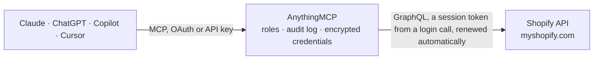

<!-- Generated by scripts/export-github-catalog.mjs in the anythingmcp-website repository. Do not edit by hand. -->

# Shopify MCP connector

Connect your Shopify store: search products, orders and customers, check stock per location, change variant prices, adjust inventory and mark orders as shipped with tracking. The AnythingMCP connector gives Claude, ChatGPT, Microsoft Copilot, Cursor and Gemini 12 MCP tools for Shopify: 9 read and 3 can change data.

**Category:** [E-commerce](../e-commerce.md) · **Tools:** 12 · **Setup guide:** [anythingmcp.com](https://anythingmcp.com/guides/shopify-to-mcp) · [Deutsch](https://anythingmcp.com/de/guides/shopify-to-mcp) · [Italiano](https://anythingmcp.com/it/guides/shopify-to-mcp) · [Español](https://anythingmcp.com/es/guides/shopify-to-mcp) · [日本語](https://anythingmcp.com/ja/guides/shopify-to-mcp) · [Русский](https://anythingmcp.com/ru/guides/shopify-to-mcp) · [中文](https://anythingmcp.com/zh/guides/shopify-to-mcp)

## Start without code

No installation and no terminal: AnythingMCP Cloud runs the Shopify connector for you, operated by helpcode.ai in Frankfurt, Germany.

1. **Click the button above** and create an account or sign in. The Shopify connector opens, ready to install.
2. **Paste the API key or token from your Shopify account.** Every click is in the [step-by-step guide](https://anythingmcp.com/guides/shopify-to-mcp).
3. **Click Install.** AnythingMCP shows the address of your MCP server.
4. **Add that address to your assistant:** [Claude](https://anythingmcp.com/guides/connect-shopify-to-claude) · [ChatGPT](https://anythingmcp.com/guides/connect-shopify-to-chatgpt) · [Microsoft Copilot](https://anythingmcp.com/guides/connect-shopify-to-copilot) · [Cursor](https://anythingmcp.com/guides/connect-shopify-to-cursor) · [Gemini CLI](https://anythingmcp.com/guides/connect-shopify-to-gemini) · [Meta Muse](https://anythingmcp.com/guides/connect-shopify-to-muse).
5. **Ask your first question**, for example: *What is order #B-2026-1143: status, payment, subtotal, shipping, tax and customer email?*

Prefer help with the setup? [Talk to us](https://anythingmcp.com/contact).

## How it works

- **The AI client** speaks MCP (Streamable HTTP) to AnythingMCP and only sees tool names, descriptions and results. It never gets the Shopify credentials.
- **AnythingMCP** checks the client's role, builds the call from the tool definition, adds the credentials (a session token from a login call, renewed automatically), calls Shopify, logs the call and returns the result.
- **Shopify** sees an ordinary API client with the rights of the account the credentials belong to.

## Tools

| Tool | What it does | Access |
|---|---|---|
| [`shopify_get_shop`](#shopify_get_shop) | Get the store the connector is linked to: name, owner and contact email, myshopify and primary domain, store currency and enabled presentment currencies,… | read |
| [`shopify_search_products`](#shopify_search_products) | Search the store's products with Shopify search syntax (for example `title:*hoodie* status:active`, `sku:ABC-1`, `vendor:Acme`, `tag:sale`,… | read |
| [`shopify_get_product`](#shopify_get_product) | Get one product with its description, options, SEO title, online store URL and its variants: variant id, title, SKU, price, compare-at price, inventory… | read |
| [`shopify_list_inventory_levels`](#shopify_list_inventory_levels) | List the stock of one variant at every location that stocks it: available, on hand, committed, incoming and reserved quantities per location, with the… | read |
| [`shopify_list_locations`](#shopify_list_locations) | List the store's locations (warehouses, shops, fulfilment centres) with id, name, address, whether each is active, fulfils online orders and ships inventory. | read |
| [`shopify_search_orders`](#shopify_search_orders) | Search orders with Shopify search syntax (for example `financial_status:paid fulfillment_status:unfulfilled`, `created_at:>=2026-10-01`, `name:#1001`,… | read |
| [`shopify_get_order`](#shopify_get_order) | Get one order: status, totals (subtotal, shipping, tax, discounts, refunded), customer, shipping and billing address, shipping lines, line items with SKU,… | read |
| [`shopify_search_customers`](#shopify_search_customers) | Search customers with Shopify search syntax (for example `email:anna@example.com`, `phone:+4930123456`, `country:Germany`, `tag:vip`, `orders_count:>5`,… | read |
| [`shopify_get_customer`](#shopify_get_customer) | Get one customer: email (with marketing consent) and phone, state, tags, note, tax exemption, locale, number of orders and amount spent, default address, up… | read |
| [`shopify_update_variant_price`](#shopify_update_variant_price) | Change the price, and optionally the compare-at price, of one product variant. | write |
| [`shopify_adjust_inventory`](#shopify_adjust_inventory) | Add to or subtract from the stock of one inventory item at one location by a delta (for example +10 after a delivery, -2 for damaged goods). | write |
| [`shopify_create_fulfillment`](#shopify_create_fulfillment) | Mark the items of a fulfillment order as shipped, optionally with a carrier, tracking number and tracking URL, and optionally email the customer. | write |

## Tool reference

Every parameter as the AI client sees it in `tools/list`. Source: [`packages/backend/src/adapters/intl/shopify.json`](../../../packages/backend/src/adapters/intl/shopify.json).

### `shopify_get_shop`

Get the store the connector is linked to: name, owner and contact email, myshopify and primary domain, store currency and enabled presentment currencies, time zone, weight unit, whether prices include tax, and the Shopify plan.

**Access:** read · **Call:** `query query Shop { shop { id name email contactEmail shopOwnerName myshopifyDomain primaryDomain { url host } currencyCode enabledPresentmentCurrencies ianaTimezone timezoneAbbreviation weightUnit taxesIncluded createdAt plan { publicDisplayName partnerDevelopment shopifyPlus } } }`

No parameters.

### `shopify_search_products`

Search the store's products with Shopify search syntax (for example `title:*hoodie* status:active`, `sku:ABC-1`, `vendor:Acme`, `tag:sale`, `product_type:Shoes`, `inventory_total:<5`). Returns id, title, handle, status, vendor, product type, tags, total inventory, variant count and price range, a page at a time.

**Access:** read · **Call:** `query query SearchProducts($query: String, $first: Int = 50, $after: String, $sortKey: ProductSortKeys, $reverse: Boolean = false) { products(query: $query, first: $first, after: $after, sortKey: $sortKey, reverse: $reverse) { pageInfo { hasNextPage endCursor } nodes { id title handle status vendor productType tags totalInventory tracksInventory createdAt updatedAt variantsCount { count } priceRangeV2 { minVariantPrice { amount currencyCode } maxVariantPrice { amount currencyCode } } } } }`

| Parameter | Type | Required | Description |
|---|---|---|---|
| `query` | string | no | Shopify search query. Omit to list all products. Fields include title, handle, sku, barcode, vendor, product_type, tag, status (active, draft, archived), created_at, updated_at, inventory_total. |
| `first` | integer | no | Number of products to return, 1 to 250 (default 50). |
| `after` | string | no | Cursor from pageInfo.endCursor of the previous page, to fetch the next page. |
| `sort_key` | `TITLE` \| `CREATED_AT` \| `UPDATED_AT` \| `INVENTORY_TOTAL` \| `PRODUCT_TYPE` \| `VENDOR` \| `PUBLISHED_AT` \| `ID` \| `RELEVANCE` | no | Sort field (default ID). RELEVANCE only applies with a query. |
| `reverse` | boolean | no | Reverse the sort order, e.g. newest first with CREATED_AT. |

### `shopify_get_product`

Get one product with its description, options, SEO title, online store URL and its variants: variant id, title, SKU, price, compare-at price, inventory quantity, availability, selected options and inventory item id (needed to read or adjust stock).

**Access:** read · **Call:** `query query GetProduct($id: ID!, $first: Int = 100, $after: String) { product(id: $id) { id title handle status vendor productType tags description totalInventory tracksInventory createdAt updatedAt publishedAt onlineStoreUrl seo { title description } options { id name position values } variants(first: $first, after: $after) { pageInfo { hasNextPage endCursor } nodes { id title sku price compareAtPrice inventoryQuantity availableForSale position taxable inventoryPolicy selectedOptions { name value } inventoryItem { id tracked } } } } }`

| Parameter | Type | Required | Description |
|---|---|---|---|
| `product_id` | string | yes | Product GID, e.g. gid://shopify/Product/1234567890, from shopify_search_products. |
| `variants_first` | integer | no | Number of variants to return, 1 to 250 (default 100). |
| `variants_after` | string | no | Cursor from variants.pageInfo.endCursor, for products with more variants than one page. |

### `shopify_list_inventory_levels`

List the stock of one variant at every location that stocks it: available, on hand, committed, incoming and reserved quantities per location, with the inventory item id and location ids that shopify_adjust_inventory needs.

**Access:** read · **Call:** `query query InventoryLevels($id: ID!, $first: Int = 50, $after: String) { productVariant(id: $id) { id title sku product { id title } inventoryItem { id tracked inventoryLevels(first: $first, after: $after) { pageInfo { hasNextPage endCursor } nodes { id updatedAt location { id name } quantities(names: ["available", "on_hand", "committed", "incoming", "reserved"]) { name quantity } } } } } }`

| Parameter | Type | Required | Description |
|---|---|---|---|
| `variant_id` | string | yes | Variant GID, e.g. gid://shopify/ProductVariant/1234567890, from shopify_get_product. |
| `first` | integer | no | Number of locations to return, 1 to 250 (default 50). |
| `after` | string | no | Cursor from pageInfo.endCursor of the previous page, to fetch the next page. |

### `shopify_list_locations`

List the store's locations (warehouses, shops, fulfilment centres) with id, name, address, whether each is active, fulfils online orders and ships inventory.

**Access:** read · **Call:** `query query Locations($first: Int = 50, $after: String, $includeInactive: Boolean = false) { locations(first: $first, after: $after, includeInactive: $includeInactive) { pageInfo { hasNextPage endCursor } nodes { id name isActive fulfillsOnlineOrders shipsInventory hasActiveInventory address { address1 address2 city province provinceCode zip country countryCode phone } } } }`

| Parameter | Type | Required | Description |
|---|---|---|---|
| `first` | integer | no | Number of locations to return, 1 to 250 (default 50). |
| `after` | string | no | Cursor from pageInfo.endCursor of the previous page, to fetch the next page. |
| `include_inactive` | boolean | no | Also return deactivated locations (default false). |

### `shopify_search_orders`

Search orders with Shopify search syntax (for example `financial_status:paid fulfillment_status:unfulfilled`, `created_at:>=2026-10-01`, `name:#1001`, `email:anna@example.com`, `tag:wholesale`, `sku:ABC-1`). Returns order number, dates, financial and fulfilment status, total, customer and tags, a page at a time.

**Access:** read · **Call:** `query query SearchOrders($query: String, $first: Int = 50, $after: String, $sortKey: OrderSortKeys, $reverse: Boolean = false) { orders(query: $query, first: $first, after: $after, sortKey: $sortKey, reverse: $reverse) { pageInfo { hasNextPage endCursor } nodes { id name createdAt processedAt cancelledAt closed test email displayFinancialStatus displayFulfillmentStatus currencyCode currentTotalPriceSet { shopMoney { amount currencyCode } } customer { id displayName } tags } } }`

| Parameter | Type | Required | Description |
|---|---|---|---|
| `query` | string | no | Shopify search query. Fields include name, email, financial_status, fulfillment_status, status (open, closed, cancelled), created_at, processed_at, updated_at, tag, sku, customer_id, test. Omit to list all orders. |
| `first` | integer | no | Number of orders to return, 1 to 250 (default 50). |
| `after` | string | no | Cursor from pageInfo.endCursor of the previous page, to fetch the next page. |
| `sort_key` | `PROCESSED_AT` \| `CREATED_AT` \| `UPDATED_AT` \| `ORDER_NUMBER` \| `TOTAL_PRICE` \| `CURRENT_TOTAL_PRICE` \| `CUSTOMER_NAME` \| `FINANCIAL_STATUS` \| `FULFILLMENT_STATUS` \| `ID` \| `RELEVANCE` | no | Sort field (default PROCESSED_AT). |
| `reverse` | boolean | no | Reverse the sort order. With a date sort key, true returns the newest orders first. |

### `shopify_get_order`

Get one order: status, totals (subtotal, shipping, tax, discounts, refunded), customer, shipping and billing address, shipping lines, line items with SKU, quantities and prices, fulfillment orders with their line items and assigned location, and fulfillments with tracking.

**Access:** read · **Call:** `query query GetOrder($id: ID!, $first: Int = 50, $after: String) { order(id: $id) { id name createdAt processedAt updatedAt cancelledAt cancelReason closed confirmed test email phone note tags sourceName paymentGatewayNames statusPageUrl displayFinancialStatus displayFulfillmentStatus currencyCode subtotalPriceSet { shopMoney { amount currencyCode } } totalShippingPriceSet { shopMoney { amount currencyCode } } totalTaxSet { shopMoney { amount currencyCode } } totalDiscountsSet { shopMoney { amount currencyCode } } totalPriceSet { shopMoney { amount currencyCode } } currentTotalPriceSet { shopMoney { amount currencyCode } } totalRefundedSet { shopMoney { amount currencyCode } } customer { id displayName defaultEmailAddress { emailAddress } } shippingAddress { name company address1 address2 city province provinceCode zip country countryCodeV2 phone } billingAddress { name company address1 address2 city province provinceCode zip country countryCodeV2 phone } shippingLines(first: 5) { nodes { title code originalPriceSet { shopMoney { amount currencyCode } } } } lineItems(first: $first, after: $after) { pageInfo { hasNextPage endCursor } nodes { id name sku vendor quantity currentQuantity unfulfilledQuantity requiresShipping variant { id } product { id } originalUnitPriceSet { shopMoney { amount currencyCode } } discountedTotalSet { shopMoney { amount currencyCode } } } } fulfillmentOrders(first: 5) { nodes { id status requestStatus fulfillAt assignedLocation { name location { id } } deliveryMethod { methodType } supportedActions { action } lineItems(first: 20) { nodes { id sku productTitle variantTitle totalQuantity remainingQuantity lineItem { id } } } } } fulfillments(first: 10) { id name status displayStatus createdAt trackingInfo { company number url } } } }`

| Parameter | Type | Required | Description |
|---|---|---|---|
| `order_id` | string | yes | Order GID, e.g. gid://shopify/Order/1234567890, from shopify_search_orders (search `name:#1001` to find it by order number). |
| `line_items_first` | integer | no | Number of line items to return, 1 to 250 (default 50). |
| `line_items_after` | string | no | Cursor from lineItems.pageInfo.endCursor, for orders with more line items than one page. |

### `shopify_search_customers`

Search customers with Shopify search syntax (for example `email:anna@example.com`, `phone:+4930123456`, `country:Germany`, `tag:vip`, `orders_count:>5`, `amount_spent:>=500`, or plain text matching name and email). Returns name, email, phone, number of orders, amount spent, state, tags and default address city and country.

**Access:** read · **Call:** `query query SearchCustomers($query: String, $first: Int = 50, $after: String, $sortKey: CustomerSortKeys, $reverse: Boolean = false) { customers(query: $query, first: $first, after: $after, sortKey: $sortKey, reverse: $reverse) { pageInfo { hasNextPage endCursor } nodes { id displayName firstName lastName defaultEmailAddress { emailAddress } defaultPhoneNumber { phoneNumber } numberOfOrders amountSpent { amount currencyCode } state tags createdAt updatedAt defaultAddress { city provinceCode countryCodeV2 } } } }`

| Parameter | Type | Required | Description |
|---|---|---|---|
| `query` | string | no | Shopify search query. Omit to list all customers. |
| `first` | integer | no | Number of customers to return, 1 to 250 (default 50). |
| `after` | string | no | Cursor from pageInfo.endCursor of the previous page, to fetch the next page. |
| `sort_key` | `CREATED_AT` \| `UPDATED_AT` \| `NAME` \| `LOCATION` \| `ID` \| `RELEVANCE` | no | Sort field (default ID). |
| `reverse` | boolean | no | Reverse the sort order. |

### `shopify_get_customer`

Get one customer: email (with marketing consent) and phone, state, tags, note, tax exemption, locale, number of orders and amount spent, default address, up to 10 saved addresses and the 10 most recent orders with status and total.

**Access:** read · **Call:** `query query GetCustomer($id: ID!) { customer(id: $id) { id displayName firstName lastName defaultEmailAddress { emailAddress marketingState } defaultPhoneNumber { phoneNumber } verifiedEmail state tags note taxExempt locale numberOfOrders amountSpent { amount currencyCode } createdAt updatedAt defaultAddress { name company address1 address2 city province provinceCode zip country countryCodeV2 phone } addressesV2(first: 10) { nodes { name company address1 address2 city province provinceCode zip country countryCodeV2 phone } } lastOrder { id name } orders(first: 10, sortKey: CREATED_AT, reverse: true) { nodes { id name createdAt displayFinancialStatus displayFulfillmentStatus currentTotalPriceSet { shopMoney { amount currencyCode } } } } } }`

| Parameter | Type | Required | Description |
|---|---|---|---|
| `customer_id` | string | yes | Customer GID, e.g. gid://shopify/Customer/1234567890, from shopify_search_customers or an order. |

### `shopify_update_variant_price`

Change the price, and optionally the compare-at price, of one product variant. Returns the updated variant, or userErrors explaining why Shopify refused the change.

**Access:** write · **Call:** `mutation mutation UpdateVariantPrice($productId: ID!, $variantId: ID!, $price: Money!, $compareAtPrice: Money) { productVariantsBulkUpdate(productId: $productId, variants: [{ id: $variantId, price: $price, compareAtPrice: $compareAtPrice }]) { productVariants { id title sku price compareAtPrice } userErrors { field message code } } }`

| Parameter | Type | Required | Description |
|---|---|---|---|
| `product_id` | string | yes | GID of the product the variant belongs to, e.g. gid://shopify/Product/1234567890. |
| `variant_id` | string | yes | Variant GID, e.g. gid://shopify/ProductVariant/1234567890, from shopify_get_product. |
| `price` | string | yes | New price in the store currency as a decimal string, e.g. "29.90". |
| `compare_at_price` | string | no | Optional compare-at (original) price shown struck through, e.g. "39.90". Leave out to keep the current one. |

### `shopify_adjust_inventory`

Add to or subtract from the stock of one inventory item at one location by a delta (for example +10 after a delivery, -2 for damaged goods). Optionally only applies when the current quantity still equals change_from_quantity. Returns the adjustment, or userErrors.

**Access:** write · **Call:** `mutation mutation AdjustInventory($inventoryItemId: ID!, $locationId: ID!, $delta: Int!, $name: String! = "available", $reason: String! = "correction", $changeFromQuantity: Int = null, $referenceDocumentUri: String, $idempotencyKey: String!) { inventoryAdjustQuantities(input: { name: $name, reason: $reason, referenceDocumentUri: $referenceDocumentUri, changes: [{ inventoryItemId: $inventoryItemId, locationId: $locationId, delta: $delta, changeFromQuantity: $changeFromQuantity }] }) @idempotent(key: $idempotencyKey) { inventoryAdjustmentGroup { createdAt reason referenceDocumentUri changes { name delta quantityAfterChange location { id name } } } userErrors { field message code } } }`

| Parameter | Type | Required | Description |
|---|---|---|---|
| `inventory_item_id` | string | yes | Inventory item GID, e.g. gid://shopify/InventoryItem/1234567890, from shopify_get_product or shopify_list_inventory_levels. |
| `location_id` | string | yes | Location GID, e.g. gid://shopify/Location/1234567890, from shopify_list_locations or shopify_list_inventory_levels. |
| `delta` | integer | yes | Quantity to add (positive) or remove (negative). |
| `quantity_name` | `available` \| `damaged` \| `quality_control` \| `reserved` \| `safety_stock` | no | Which quantity to change (default available). |
| `reason` | `correction` \| `cycle_count_available` \| `damaged` \| `movement_created` \| `movement_updated` \| `movement_received` \| `movement_canceled` \| `other` \| `promotion` \| `quality_control` \| `received` \| `reservation_created` \| `reservation_deleted` \| `reservation_updated` \| `restock` \| `shrinkage` | no | Reason recorded in the inventory history (default correction). |
| `change_from_quantity` | integer | no | Optional. The quantity you expect the item to have now; Shopify refuses the change with CHANGE_FROM_QUANTITY_STALE if it differs. Leave out to apply the delta unconditionally. |
| `reference_document_uri` | string | no | Optional URI recorded with the change, e.g. gid://myapp/PurchaseOrder/42 or a URL to the delivery note. |
| `idempotency_key` | string | yes | A new unique string for each adjustment, for example a UUID. Sending the same key again does not apply the change a second time. |

### `shopify_create_fulfillment`

Mark the items of a fulfillment order as shipped, optionally with a carrier, tracking number and tracking URL, and optionally email the customer. Without line_items every remaining item of the fulfillment order is fulfilled. Returns the fulfillment, or userErrors.

**Access:** write · **Call:** `mutation mutation CreateFulfillment($fulfillmentOrderId: ID!, $lineItems: [FulfillmentOrderLineItemInput!], $company: String, $number: String, $url: URL, $notifyCustomer: Boolean = false, $message: String) { fulfillmentCreate(fulfillment: { lineItemsByFulfillmentOrder: [{ fulfillmentOrderId: $fulfillmentOrderId, fulfillmentOrderLineItems: $lineItems }], trackingInfo: { company: $company, number: $number, url: $url }, notifyCustomer: $notifyCustomer }, message: $message) { fulfillment { id name status displayStatus createdAt trackingInfo { company number url } } userErrors { field message } } }`

| Parameter | Type | Required | Description |
|---|---|---|---|
| `fulfillment_order_id` | string | yes | Fulfillment order GID, e.g. gid://shopify/FulfillmentOrder/1234567890, from fulfillmentOrders in shopify_get_order. It must be open or in progress. |
| `line_items` | object[] | no | Optional. Fulfill only these fulfillment order line items (ids from the fulfillment order's lineItems, not the order's line items). Leave out to fulfill everything still open. |
| `tracking_company` | string | no | Carrier name, e.g. DHL Express, UPS, USPS, FedEx. With a carrier Shopify knows, it builds the tracking link itself; the name must match Shopify's spelling. |
| `tracking_number` | string | no | Tracking number. |
| `tracking_url` | string | no | Tracking URL (needs tracking_number). Only needed for carriers Shopify does not know. |
| `notify_customer` | boolean | no | Send the shipping confirmation email to the customer (default false). |
| `message` | string | no | Optional note stored with the fulfillment. |

## Run it yourself

AnythingMCP is open source (AGPL-3.0). [Run it with Docker](../../../README.md#run-it-yourself), open **Connectors → Store**, pick **Shopify** and enter `SHOPIFY_STORE`, `SHOPIFY_CLIENT_ID`, `SHOPIFY_CLIENT_SECRET`, then add your MCP server URL to the AI client.

[← E-commerce connectors](../e-commerce.md) · [All categories](../README.md)
