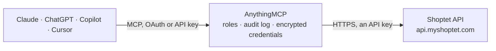

<!-- Generated by scripts/export-github-catalog.mjs in the anythingmcp-website repository. Do not edit by hand. -->

# Shoptet MCP connector

Shoptet e-shop (Czech Republic, Slovakia, Hungary), read-only: orders with history and notes, products and variants with prices and stock, categories, brands, stock levels and movements, customers, … The AnythingMCP connector gives Claude, ChatGPT, Microsoft Copilot, Cursor and Gemini 23 MCP tools for Shoptet, all read-only.

**Category:** [E-commerce](../e-commerce.md) · **Tools:** 23 · **Setup guide:** [anythingmcp.com](https://anythingmcp.com/guides/shoptet-to-mcp) · [Deutsch](https://anythingmcp.com/de/guides/shoptet-to-mcp) · [Italiano](https://anythingmcp.com/it/guides/shoptet-to-mcp) · [Español](https://anythingmcp.com/es/guides/shoptet-to-mcp) · [日本語](https://anythingmcp.com/ja/guides/shoptet-to-mcp) · [Русский](https://anythingmcp.com/ru/guides/shoptet-to-mcp) · [中文](https://anythingmcp.com/zh/guides/shoptet-to-mcp)

## Start without code

No installation and no terminal: AnythingMCP Cloud runs the Shoptet connector for you, operated by helpcode.ai in Frankfurt, Germany.

1. **Click the button above** and create an account or sign in. The Shoptet connector opens, ready to install.
2. **Paste the API key or token from your Shoptet account.** Every click is in the [step-by-step guide](https://anythingmcp.com/guides/shoptet-to-mcp).
3. **Click Install.** AnythingMCP shows the address of your MCP server.
4. **Add that address to your assistant:** [Claude](https://anythingmcp.com/guides/connect-shoptet-to-claude) · [ChatGPT](https://anythingmcp.com/guides/connect-shoptet-to-chatgpt) · [Microsoft Copilot](https://anythingmcp.com/guides/connect-shoptet-to-copilot) · [Cursor](https://anythingmcp.com/guides/connect-shoptet-to-cursor) · [Gemini CLI](https://anythingmcp.com/guides/connect-shoptet-to-gemini) · [Meta Muse](https://anythingmcp.com/guides/connect-shoptet-to-muse).
5. **Ask your first question**, for example: *What's the status, paid flag and tracking note for order 2026-1482?*

Prefer help with the setup? [Talk to us](https://anythingmcp.com/contact).

## How it works

- **The AI client** speaks MCP (Streamable HTTP) to AnythingMCP and only sees tool names, descriptions and results. It never gets the Shoptet credentials.
- **AnythingMCP** checks the client's role, builds the call from the tool definition, adds the credentials (an API key), calls Shoptet, logs the call and returns the result.
- **Shoptet** sees an ordinary API client with the rights of the account the credentials belong to.

## Tools

| Tool | What it does | Access |
|---|---|---|
| [`shoptet_get_eshop`](#shoptet_get_eshop) | Get the e-shop's own settings: name, URL, contact and billing details, VAT payer, time zone, default price list, currencies and languages. | read |
| [`shoptet_list_orders`](#shoptet_list_orders) | List orders, newest first, at most 50 per page: code, creation and change time, customer name, e-mail and phone, status, paid flag, total price with and… | read |
| [`shoptet_get_order`](#shoptet_get_order) | Get one order by its code (order number): billing and delivery address, items with code, name, amount, unit price and VAT, prices, status, payment and… | read |
| [`shoptet_get_order_history`](#shoptet_get_order_history) | Get the history of an order: every status change, e-mail sent, remark and system event with time, text and the user who did it. | read |
| [`shoptet_list_order_statuses`](#shoptet_list_order_statuses) | List the order statuses of the shop (they differ from shop to shop): id, name, whether it is a system status, whether it marks the order paid, colour, and… | read |
| [`shoptet_list_order_sources`](#shoptet_list_order_sources) | List the order sources of the shop (e-shop, cash desk, marketplaces, imports) with id and name. | read |
| [`shoptet_list_products`](#shoptet_list_products) | List products, 1 to 100 per page: guid, name, type, visibility, default category, brand, supplier, URL and rating. | read |
| [`shoptet_get_product`](#shoptet_get_product) | Get one product by guid with its variants: code, EAN, price, VAT rate, stock amount, availability, weight and parameters per variant, descriptions,… | read |
| [`shoptet_get_product_by_code`](#shoptet_get_product_by_code) | Get a product by the code of the product or of one of its variants (the SKU shown in the admin and on orders), with the same details and include options as… | read |
| [`shoptet_list_categories`](#shoptet_list_categories) | List the product categories: guid, name, parent guid, visibility and URL. | read |
| [`shoptet_list_brands`](#shoptet_list_brands) | List the brands (manufacturers) of the shop: guid, code, name, web and whether they show in the brand list. | read |
| [`shoptet_list_stocks`](#shoptet_list_stocks) | List the stocks (warehouses) of the shop with id, title and whether they are a pickup point, plus the default stock id. | read |
| [`shoptet_list_stock_supplies`](#shoptet_list_stock_supplies) | List the stock levels in one stock: product guid, code, amount in stock, claimed amount (reserved by orders) and storage location. | read |
| [`shoptet_list_stock_movements`](#shoptet_list_stock_movements) | List stock movements in one stock, oldest first: product code, amount after the change, the change, time and who or what changed it (an order, an import, a… | read |
| [`shoptet_list_customers`](#shoptet_list_customers) | List registered customers: guid, billing name and company, creation and change time and admin link. | read |
| [`shoptet_get_customer`](#shoptet_get_customer) | Get one registered customer: billing and delivery addresses, company id and VAT id, customer group, price ratio, remark and account e-mails. | read |
| [`shoptet_list_customer_groups`](#shoptet_list_customer_groups) | List the customer groups (e.g. retail, wholesale, VIP) with id, name, default price list and maximum discount. | read |
| [`shoptet_list_invoices`](#shoptet_list_invoices) | List invoices: code, order code, issue, due and tax dates, billing name and company, variable symbol, paid flag and price. | read |
| [`shoptet_get_invoice`](#shoptet_get_invoice) | Get one invoice by its code: items, prices and VAT breakdown, billing and delivery address, payment method, due date, paid flag and symbols. | read |
| [`shoptet_list_credit_notes`](#shoptet_list_credit_notes) | List credit notes (opravné daňové doklady): code, invoice and order code, date, billing name, reason and price. | read |
| [`shoptet_list_proforma_invoices`](#shoptet_list_proforma_invoices) | List proforma invoices (advance invoices): code, order code, date, billing name, paid flag and price. | read |
| [`shoptet_list_payment_methods`](#shoptet_list_payment_methods) | List the payment methods of the shop with guid, name, type, visibility and whether they are for wholesale or in-person payment. | read |
| [`shoptet_list_shipping_methods`](#shoptet_list_shipping_methods) | List the shipping methods of the shop with guid, name, carrier, tracking URL and visibility. | read |

## Tool reference

Every parameter as the AI client sees it in `tools/list`. Source: [`packages/backend/src/adapters/intl/shoptet.json`](../../../packages/backend/src/adapters/intl/shoptet.json).

### `shoptet_get_eshop`

Get the e-shop's own settings: name, URL, contact and billing details, VAT payer, time zone, default price list, currencies and languages. include adds order statuses, payment and shipping methods, additional order fields, countries or the cash desk. Use it to check the connection.

**Access:** read · **Call:** `GET /api/eshop`

| Parameter | Type | Required | Description |
|---|---|---|---|
| `include` | string | no | Comma-separated extras: orderStatuses, paymentMethods, shippingMethods, orderAdditionalFields, countries, cashDesk, imageCuts. |

### `shoptet_list_orders`

List orders, newest first, at most 50 per page: code, creation and change time, customer name, e-mail and phone, status, paid flag, total price with and without VAT, payment and shipping method, sales channel and admin link. Filter by status, time range, customer, product or payment and shipping method. data.paginator has totalCount and pageCount.

**Access:** read · **Call:** `GET /api/orders`

| Parameter | Type | Required | Description |
|---|---|---|---|
| `statusId` | integer | no | Order status id (from shoptet_list_order_statuses), e.g. -1 for new orders in a default shop. |
| `creationTimeFrom` | string | no | Created at or after. ISO 8601 with offset, e.g. 2026-10-20T00:00:00+0200. |
| `creationTimeTo` | string | no | Created at or before. ISO 8601 with offset, e.g. 2026-10-20T00:00:00+0200. |
| `changeTimeFrom` | string | no | Changed at or after. ISO 8601 with offset, e.g. 2026-10-20T00:00:00+0200. |
| `changeTimeTo` | string | no | Changed at or before. ISO 8601 with offset, e.g. 2026-10-20T00:00:00+0200. |
| `email` | string | no | Customer e-mail (exact, case-insensitive). |
| `phone` | string | no | Customer phone in international format, e.g. +420735314978. |
| `customerGuid` | string | no | Registered customer guid. |
| `productCode` | string | no | Only orders containing this product or variant code. |
| `paymentMethodGuid` | string | no | Payment method guid (shoptet_list_payment_methods). |
| `shippingGuid` | string | no | Shipping method guid (shoptet_list_shipping_methods). |
| `sourceId` | integer | no | Order source id (shoptet_list_order_sources), e.g. the e-shop, a marketplace or the cash desk. |
| `page` | integer | no | Page, starting at 1. |
| `itemsPerPage` | integer | no | Rows per page, at most 50. |

### `shoptet_get_order`

Get one order by its code (order number): billing and delivery address, items with code, name, amount, unit price and VAT, prices, status, payment and shipping method, paid flag, language and admin link. include adds notes (customer and shop remarks, tracking number), images, shipping details, stock location, surcharges, payment transactions or product flags.

**Access:** read · **Call:** `GET /api/orders/{code}`

| Parameter | Type | Required | Description |
|---|---|---|---|
| `code` | string | yes | Order code, e.g. 2023024742. |
| `include` | string | no | Comma-separated extras: notes, images, shippingDetails, stockLocation, surchargeParameters, paymentTransactions, productFlags. |

### `shoptet_get_order_history`

Get the history of an order: every status change, e-mail sent, remark and system event with time, text and the user who did it.

**Access:** read · **Call:** `GET /api/orders/{code}/history`

| Parameter | Type | Required | Description |
|---|---|---|---|
| `code` | string | yes | Order code. |
| `system` | boolean | no | true for system entries only, false for user entries only; omit for both. |

### `shoptet_list_order_statuses`

List the order statuses of the shop (they differ from shop to shop): id, name, whether it is a system status, whether it marks the order paid, colour, and the default status for new orders. The id is what statusId takes.

**Access:** read · **Call:** `GET /api/orders/statuses`

No parameters.

### `shoptet_list_order_sources`

List the order sources of the shop (e-shop, cash desk, marketplaces, imports) with id and name. The id is what sourceId takes in shoptet_list_orders.

**Access:** read · **Call:** `GET /api/orders/sources`

No parameters.

### `shoptet_list_products`

List products, 1 to 100 per page: guid, name, type, visibility, default category, brand, supplier, URL and rating. Filter by visibility, category, brand, flag, supplier or creation and change time; productCodes looks up specific codes. Read prices, variants and stock with shoptet_get_product.

**Access:** read · **Call:** `GET /api/products`

| Parameter | Type | Required | Description |
|---|---|---|---|
| `visibility` | `visible` \| `hidden` \| `blocked` \| `cashDeskOnly` \| `detailOnly` | no | Visibility. |
| `categoryGuid` | string | no | Only products in this category (any of its categories). |
| `defaultCategoryGuid` | string | no | Only products whose main category is this one. |
| `brandCode` | string | no | Brand code. |
| `flag` | string | no | Product flag code, e.g. action or new. |
| `supplierGuid` | string | no | Supplier guid. |
| `productCodes` | string | no | Comma-separated product codes, up to 50; overrides the other filters. |
| `creationTimeFrom` | string | no | Created at or after. ISO 8601 with offset, e.g. 2026-10-20T00:00:00+0200. |
| `changeTimeFrom` | string | no | Changed at or after. ISO 8601 with offset, e.g. 2026-10-20T00:00:00+0200. |
| `include` | string | no | images to add product images. |
| `page` | integer | no | Page, starting at 1. |
| `itemsPerPage` | integer | no | Rows per page, at most 100. |

### `shoptet_get_product`

Get one product by guid with its variants: code, EAN, price, VAT rate, stock amount, availability, weight and parameters per variant, descriptions, categories, brand and URL. include adds images, all categories, flags, descriptive parameters, per-stock amounts, per-price-list prices, related products and more.

**Access:** read · **Call:** `GET /api/products/{guid}`

| Parameter | Type | Required | Description |
|---|---|---|---|
| `guid` | string | yes | Product guid from shoptet_list_products. |
| `include` | string | no | Comma-separated extras: images, allCategories, flags, descriptiveParameters, variantParameters, perStockAmounts, perPricelistPrices, measureUnit, surchargeParameters, setItems, gifts, alternativeProducts, relatedProducts, warranty. |

### `shoptet_get_product_by_code`

Get a product by the code of the product or of one of its variants (the SKU shown in the admin and on orders), with the same details and include options as shoptet_get_product.

**Access:** read · **Call:** `GET /api/products/code/{code}`

| Parameter | Type | Required | Description |
|---|---|---|---|
| `code` | string | yes | Product or variant code, e.g. G70-2HN-S. |
| `include` | string | no | Comma-separated extras, as for shoptet_get_product. |

### `shoptet_list_categories`

List the product categories: guid, name, parent guid, visibility and URL. The guid is what categoryGuid takes.

**Access:** read · **Call:** `GET /api/categories`

| Parameter | Type | Required | Description |
|---|---|---|---|
| `page` | integer | no | Page, starting at 1. |
| `itemsPerPage` | integer | no | Rows per page, at most 1000. |

### `shoptet_list_brands`

List the brands (manufacturers) of the shop: guid, code, name, web and whether they show in the brand list. The code is what brandCode takes.

**Access:** read · **Call:** `GET /api/brands`

| Parameter | Type | Required | Description |
|---|---|---|---|
| `page` | integer | no | Page, starting at 1. |
| `itemsPerPage` | integer | no | Rows per page, at most 1000. |

### `shoptet_list_stocks`

List the stocks (warehouses) of the shop with id, title and whether they are a pickup point, plus the default stock id. The id is what stockId takes.

**Access:** read · **Call:** `GET /api/stocks`

No parameters.

### `shoptet_list_stock_supplies`

List the stock levels in one stock: product guid, code, amount in stock, claimed amount (reserved by orders) and storage location. Filter by product, code or claimed items only.

**Access:** read · **Call:** `GET /api/stocks/{stockId}/supplies`

| Parameter | Type | Required | Description |
|---|---|---|---|
| `stockId` | integer | yes | Stock id from shoptet_list_stocks. |
| `productGuid` | string | no | Only this product. |
| `code` | string | no | Only this product or variant code. |
| `onlyWithClaim` | boolean | no | true for items with a claimed (reserved) amount only. |
| `changedFrom` | string | no | Changed at or after, at most 30 days back. ISO 8601 with offset, e.g. 2026-10-20T00:00:00+0200. |
| `page` | integer | no | Page, starting at 1. |
| `itemsPerPage` | integer | no | Rows per page, at most 1000. |

### `shoptet_list_stock_movements`

List stock movements in one stock, oldest first: product code, amount after the change, the change, time and who or what changed it (an order, an import, a user).

**Access:** read · **Call:** `GET /api/stocks/{stockId}/movements`

| Parameter | Type | Required | Description |
|---|---|---|---|
| `stockId` | integer | yes | Stock id from shoptet_list_stocks. |
| `changeTimeFrom` | string | no | Movements at or after. ISO 8601 with offset, e.g. 2026-10-20T00:00:00+0200. |
| `orderCode` | string | no | Only movements caused by this order. |
| `lastId` | integer | no | Only movements after this movement id, to continue where the last call stopped. |
| `page` | integer | no | Page, starting at 1. |
| `itemsPerPage` | integer | no | Rows per page, at most 1000. |

### `shoptet_list_customers`

List registered customers: guid, billing name and company, creation and change time and admin link. Filter by e-mail, phone or time range. Read addresses and account details with shoptet_get_customer.

**Access:** read · **Call:** `GET /api/customers`

| Parameter | Type | Required | Description |
|---|---|---|---|
| `email` | string | no | Customer e-mail. |
| `phone` | string | no | Phone in international format. |
| `creationTimeFrom` | string | no | Registered at or after. ISO 8601 with offset, e.g. 2026-10-20T00:00:00+0200. |
| `changeTimeFrom` | string | no | Changed at or after. ISO 8601 with offset, e.g. 2026-10-20T00:00:00+0200. |
| `page` | integer | no | Page, starting at 1. |
| `itemsPerPage` | integer | no | Rows per page, at most 1000. |

### `shoptet_get_customer`

Get one registered customer: billing and delivery addresses, company id and VAT id, customer group, price ratio, remark and account e-mails.

**Access:** read · **Call:** `GET /api/customers/{guid}`

| Parameter | Type | Required | Description |
|---|---|---|---|
| `guid` | string | yes | Customer guid. |

### `shoptet_list_customer_groups`

List the customer groups (e.g. retail, wholesale, VIP) with id, name, default price list and maximum discount.

**Access:** read · **Call:** `GET /api/customers/groups`

No parameters.

### `shoptet_list_invoices`

List invoices: code, order code, issue, due and tax dates, billing name and company, variable symbol, paid flag and price. Filter by order, customer, variable symbol, validity or date range.

**Access:** read · **Call:** `GET /api/invoices`

| Parameter | Type | Required | Description |
|---|---|---|---|
| `orderCode` | string | no | Only invoices of this order. |
| `customerGuid` | string | no | Only invoices of this customer. |
| `varSymbol` | integer | no | Variable symbol. |
| `isValid` | boolean | no | false for cancelled invoices only, true for valid ones. |
| `creationTimeFrom` | string | no | Issued at or after. ISO 8601 with offset, e.g. 2026-10-20T00:00:00+0200. |
| `creationTimeTo` | string | no | Issued at or before. ISO 8601 with offset, e.g. 2026-10-20T00:00:00+0200. |
| `taxDateFrom` | string | no | Tax date on or after, YYYY-MM-DD. |
| `taxDateTo` | string | no | Tax date on or before, YYYY-MM-DD. |
| `page` | integer | no | Page, starting at 1. |
| `itemsPerPage` | integer | no | Rows per page, at most 1000. |

### `shoptet_get_invoice`

Get one invoice by its code: items, prices and VAT breakdown, billing and delivery address, payment method, due date, paid flag and symbols.

**Access:** read · **Call:** `GET /api/invoices/{code}`

| Parameter | Type | Required | Description |
|---|---|---|---|
| `code` | string | yes | Invoice code. |

### `shoptet_list_credit_notes`

List credit notes (opravné daňové doklady): code, invoice and order code, date, billing name, reason and price. At most 20 per page.

**Access:** read · **Call:** `GET /api/credit-notes`

| Parameter | Type | Required | Description |
|---|---|---|---|
| `invoiceCode` | string | no | Only credit notes of this invoice. |
| `varSymbol` | integer | no | Variable symbol. |
| `creationTimeFrom` | string | no | Issued at or after. ISO 8601 with offset, e.g. 2026-10-20T00:00:00+0200. |
| `page` | integer | no | Page, starting at 1. |
| `itemsPerPage` | integer | no | Rows per page, at most 20. |

### `shoptet_list_proforma_invoices`

List proforma invoices (advance invoices): code, order code, date, billing name, paid flag and price.

**Access:** read · **Call:** `GET /api/proforma-invoices`

| Parameter | Type | Required | Description |
|---|---|---|---|
| `orderCode` | string | no | Only proformas of this order. |
| `paid` | boolean | no | Paid or not. |
| `creationTimeFrom` | string | no | Issued at or after. ISO 8601 with offset, e.g. 2026-10-20T00:00:00+0200. |
| `page` | integer | no | Page, starting at 1. |
| `itemsPerPage` | integer | no | Rows per page, at most 100. |

### `shoptet_list_payment_methods`

List the payment methods of the shop with guid, name, type, visibility and whether they are for wholesale or in-person payment.

**Access:** read · **Call:** `GET /api/payment-methods`

No parameters.

### `shoptet_list_shipping_methods`

List the shipping methods of the shop with guid, name, carrier, tracking URL and visibility.

**Access:** read · **Call:** `GET /api/shipping-methods`

No parameters.

## Run it yourself

AnythingMCP is open source (AGPL-3.0). [Run it with Docker](../../../README.md#run-it-yourself), open **Connectors → Store**, pick **Shoptet** and enter `SHOPTET_API_TOKEN`, then add your MCP server URL to the AI client.

[← E-commerce connectors](../e-commerce.md) · [All categories](../README.md)
