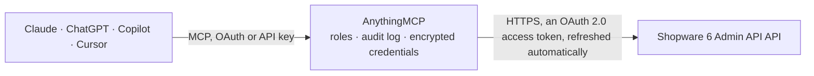

<!-- Generated by scripts/export-github-catalog.mjs in the anythingmcp-website repository. Do not edit by hand. -->

# Shopware 6 Admin API MCP connector

Shopware 6 Admin API for shop operators: search any entity with Shopware criteria, maintain products (texts, SEO fields, stock, prices, property options), categories, Shopping Experiences layouts … The AnythingMCP connector gives Claude, ChatGPT, Microsoft Copilot, Cursor and Gemini 30 MCP tools for Shopware 6 Admin API: 12 read and 18 can change data.

**Category:** [E-commerce](../e-commerce.md) · **Tools:** 30 · **Setup guide:** [anythingmcp.com](https://anythingmcp.com/guides/shopware-6-admin-to-mcp) · [Deutsch](https://anythingmcp.com/de/guides/shopware-6-admin-to-mcp) · [Italiano](https://anythingmcp.com/it/guides/shopware-6-admin-to-mcp) · [Español](https://anythingmcp.com/es/guides/shopware-6-admin-to-mcp) · [日本語](https://anythingmcp.com/ja/guides/shopware-6-admin-to-mcp) · [Русский](https://anythingmcp.com/ru/guides/shopware-6-admin-to-mcp) · [中文](https://anythingmcp.com/zh/guides/shopware-6-admin-to-mcp)

## Start without code

No installation and no terminal: AnythingMCP Cloud runs the Shopware 6 Admin API connector for you, operated by helpcode.ai in Frankfurt, Germany.

1. **Click the button above** and create an account or sign in. The Shopware 6 Admin API connector opens, ready to install.
2. **Sign in with your Shopware 6 Admin API account** when AnythingMCP asks. The first time, an admin creates a small app in the Shopware 6 Admin API developer console. Every click is in the [step-by-step guide](https://anythingmcp.com/guides/shopware-6-admin-to-mcp).
3. **Click Install.** AnythingMCP shows the address of your MCP server.
4. **Add that address to your assistant:** [Claude](https://anythingmcp.com/guides/connect-shopware-6-admin-to-claude) · [ChatGPT](https://anythingmcp.com/guides/connect-shopware-6-admin-to-chatgpt) · [Microsoft Copilot](https://anythingmcp.com/guides/connect-shopware-6-admin-to-copilot) · [Cursor](https://anythingmcp.com/guides/connect-shopware-6-admin-to-cursor) · [Gemini CLI](https://anythingmcp.com/guides/connect-shopware-6-admin-to-gemini) · [Meta Muse](https://anythingmcp.com/guides/connect-shopware-6-admin-to-muse).
5. **Ask your first question**, for example: *Show me order 2026-INV-0452 and its billing customer name and total amount.*

Prefer help with the setup? [Talk to us](https://anythingmcp.com/contact).

## How it works

- **The AI client** speaks MCP (Streamable HTTP) to AnythingMCP and only sees tool names, descriptions and results. It never gets the Shopware 6 Admin API credentials.
- **AnythingMCP** checks the client's role, builds the call from the tool definition, adds the credentials (an OAuth 2.0 access token, refreshed automatically), calls Shopware 6 Admin API, logs the call and returns the result.
- **Shopware 6 Admin API** sees an ordinary API client with the rights of the account the credentials belong to.

## Tools

| Tool | What it does | Access |
|---|---|---|
| [`shopware_6_admin_get_version`](#shopware_6_admin_get_version) | Read the Shopware version of the instance. | read |
| [`shopware_6_admin_search_products`](#shopware_6_admin_search_products) | Search products with Shopware criteria: free text, filters (productNumber, active, stock, manufacturerId, categories.id, properties.id, parentId for… | read |
| [`shopware_6_admin_get_product`](#shopware_6_admin_get_product) | Read one product by id with its own fields (name, productNumber, stock, price, active, description, SEO fields, customFields). | read |
| [`shopware_6_admin_update_product`](#shopware_6_admin_update_product) | Change fields of one product in the live shop: texts and SEO fields (written in the language of language_id), custom fields, active flag, stock, closeout,… | write |
| [`shopware_6_admin_add_product_property`](#shopware_6_admin_add_product_property) | Assign an existing property option (e.g. Color: Red) to a product. | write |
| [`shopware_6_admin_remove_product_property`](#shopware_6_admin_remove_product_property) | Unassign a property option from a product. | write |
| [`shopware_6_admin_create_property_option`](#shopware_6_admin_create_property_option) | Create a new option in a property group (e.g. a new color value). | write |
| [`shopware_6_admin_search_categories`](#shopware_6_admin_search_categories) | Search categories with Shopware criteria, e.g. filter parentId for the children of a category, or level / active. | read |
| [`shopware_6_admin_create_category`](#shopware_6_admin_create_category) | Create a category in the live catalog tree: a page, a folder (structure only) or a link. | write |
| [`shopware_6_admin_update_category`](#shopware_6_admin_update_category) | Change one category in the live shop: name, texts and SEO fields (in the language of language_id), active / visible, layout, or its place in the tree… | write |
| [`shopware_6_admin_search_cms_pages`](#shopware_6_admin_search_cms_pages) | Search Shopping Experiences layouts (CMS pages) with Shopware criteria, e.g. filter type landingpage / page / product_list / product_detail, or term on the… | read |
| [`shopware_6_admin_get_cms_page`](#shopware_6_admin_get_cms_page) | Read one layout (CMS page) with its sections, blocks and slots sorted by position, including each slot's id, type and config (texts, media ids). | read |
| [`shopware_6_admin_create_cms_page`](#shopware_6_admin_create_cms_page) | Create a layout (CMS page), optionally with its sections, blocks and slots nested in one call. | write |
| [`shopware_6_admin_update_cms_page`](#shopware_6_admin_update_cms_page) | Change a layout in the live shop: rename it, or update and add sections with their blocks and slots. | write |
| [`shopware_6_admin_create_cms_block`](#shopware_6_admin_create_cms_block) | Add a block (e.g. text, image, image-text, product-listing) with its slots to an existing section of a layout. | write |
| [`shopware_6_admin_update_cms_slot`](#shopware_6_admin_update_cms_slot) | Change the content of one slot in the live shop, e.g. the HTML of a text element or the media of an image element, in the language of language_id. | write |
| [`shopware_6_admin_search_media`](#shopware_6_admin_search_media) | Search the media library with Shopware criteria, e.g. filter mediaFolderId, fileName, mimeType, or term. | read |
| [`shopware_6_admin_create_media`](#shopware_6_admin_create_media) | Create an empty media entry (no file yet) in the media library, optionally in a folder. | write |
| [`shopware_6_admin_upload_media_from_url`](#shopware_6_admin_upload_media_from_url) | Have Shopware download a file from a public URL into a media entry (created with shopware_6_admin_create_media). | write |
| [`shopware_6_admin_update_media`](#shopware_6_admin_update_media) | Change the alt text, title, folder or custom fields of a media entry in the live shop (alt and title in the language of language_id). | write |
| [`shopware_6_admin_create_media_folder`](#shopware_6_admin_create_media_folder) | Create a folder in the media library. | write |
| [`shopware_6_admin_search_sales_channels`](#shopware_6_admin_search_sales_channels) | Search sales channels (storefronts, headless channels) with Shopware criteria: name, type, active, maintenance, navigation / footer / service category ids,… | read |
| [`shopware_6_admin_search_promotions`](#shopware_6_admin_search_promotions) | Search promotions with Shopware criteria, e.g. filter active or code; associations {"discounts":{},"salesChannels":{}} add the discount rules and channels. | read |
| [`shopware_6_admin_search_seo_urls`](#shopware_6_admin_search_seo_urls) | Search SEO URLs with Shopware criteria, e.g. filter foreignKey (a product or category id), routeName (frontend.detail.page, frontend.navigation.page),… | read |
| [`shopware_6_admin_search_entities`](#shopware_6_admin_search_entities) | Search any Admin API entity with Shopware criteria, e.g. order, customer, product-manufacturer, property-group, property-group-option, product-stream, rule,… | read |
| [`shopware_6_admin_get_entity`](#shopware_6_admin_get_entity) | Read one record of any Admin API entity by id, e.g. order, customer, category, cms-slot, media, promotion. | read |
| [`shopware_6_admin_create_entity`](#shopware_6_admin_create_entity) | Create one record of any Admin API entity, e.g. a cms-section, snippet, product-manufacturer or a product. | write |
| [`shopware_6_admin_update_entity`](#shopware_6_admin_update_entity) | Change fields of one record of any Admin API entity in the live shop (orders, customers, sales channels, settings included). | write |
| [`shopware_6_admin_delete_entity`](#shopware_6_admin_delete_entity) | Delete one record of any Admin API entity by id, e.g. a cms-block, a product or a media entry. | write |
| [`shopware_6_admin_sync`](#shopware_6_admin_sync) | Bulk write: upsert or delete many records of one or more entities in a single request through the Sync API. | write |

## Tool reference

Every parameter as the AI client sees it in `tools/list`. Source: [`packages/backend/src/adapters/de/shopware-6-admin.json`](../../../packages/backend/src/adapters/de/shopware-6-admin.json).

### `shopware_6_admin_get_version`

Read the Shopware version of the instance. Costs nothing and checks that the integration credentials work.

**Access:** read · **Call:** `GET /_info/version`

No parameters.

### `shopware_6_admin_search_products`

Search products with Shopware criteria: free text, filters (productNumber, active, stock, manufacturerId, categories.id, properties.id, parentId for variants), sort, associations and includes. Returns {total, data, aggregations}. Variants are products too (parentId set); add inheritance to see the values they inherit.

**Access:** read · **Call:** `POST /search/product`

| Parameter | Type | Required | Description |
|---|---|---|---|
| `term` | string | no | Free-text search, ranked by Shopware's search ranking. |
| `ids` | string[] | no | Only these ids (32 hex characters each). |
| `filter` | object[] | no | Shopware criteria filters, combined with AND, e.g. [{"type":"equals","field":"active","value":true}], [{"type":"contains","field":"name","value":"shirt"}], [{"type":"equalsAny","field":"productNumber","value":["SW1","SW2"]}], {"type":"range","field":"stock","parameters":{"lte":5}}, or {"type":"multi","operator":"or","queries":[...]}. |
| `sort` | object[] | no | Sort order, e.g. [{"field":"updatedAt","order":"DESC"}]. |
| `associations` | object | no | Related entities to load, each with optional nested criteria, e.g. {"properties":{"associations":{"group":{}}},"media":{},"categories":{}}. |
| `includes` | object | no | Return only these fields per entity type (keyed by apiAlias), e.g. {"product":["id","productNumber","name","stock","active"]}. Strongly recommended: full entities are large. |
| `aggregations` | object[] | no | Aggregations, e.g. [{"name":"by-active","type":"terms","field":"active"}] or [{"name":"avg-price","type":"avg","field":"price"}]. |
| `limit` | integer | no | Results per page (Shopware's default max is 500). |
| `page` | integer | no | Page number, 1-based. |
| `total_count_mode` | `0` \| `1` \| `2` | no | 0 no total, 1 exact total, 2 only whether a next page exists. |
| `language_id` | string | no | Language id (32 hex characters) for translated fields such as name and description, sent as the sw-language-id header. Leave out for the shop's system language. Find ids with shopware_6_admin_search_entities, entity language. |
| `inheritance` | `true` | no | Pass true to fill a variant's empty fields from its parent product (sw-inheritance header). Leave out otherwise: Shopware switches inheritance on whenever the header is present. |

### `shopware_6_admin_get_product`

Read one product by id with its own fields (name, productNumber, stock, price, active, description, SEO fields, customFields). For related data (properties, media, categories, variants) use shopware_6_admin_search_products with ids and associations.

**Access:** read · **Call:** `GET /product/{product_id}`

| Parameter | Type | Required | Description |
|---|---|---|---|
| `product_id` | string | yes | Product id, 32 hex characters. |
| `language_id` | string | no | Language id (32 hex characters) for translated fields such as name and description, sent as the sw-language-id header. Leave out for the shop's system language. Find ids with shopware_6_admin_search_entities, entity language. |
| `inheritance` | `true` | no | Pass true to fill a variant's empty fields from its parent product (sw-inheritance header). Leave out otherwise: Shopware switches inheritance on whenever the header is present. |

### `shopware_6_admin_update_product`

Change fields of one product in the live shop: texts and SEO fields (written in the language of language_id), custom fields, active flag, stock, closeout, EAN or price. Only the fields you pass change. customFields are merged key by key; price replaces the whole price list.

**Access:** write · **Call:** `PATCH /product/{product_id}`

| Parameter | Type | Required | Description |
|---|---|---|---|
| `product_id` | string | yes | Product id, 32 hex characters. |
| `name` | string | no | Product name. |
| `description` | string | no | Product description, HTML allowed. |
| `keywords` | string | no | Search keywords, comma separated. |
| `meta_title` | string | no | SEO meta title. |
| `meta_description` | string | no | SEO meta description. |
| `custom_fields` | object | no | Custom field values by technical name, e.g. {"my_field": "value"}. |
| `active` | boolean | no | Whether the product is active. |
| `stock` | integer | no | Stock quantity. |
| `is_closeout` | boolean | no | Closeout: not orderable when out of stock. |
| `ean` | string | no | EAN / GTIN. |
| `price` | object[] | no | Full price list, e.g. [{"currencyId":"<currency id>","gross":19.99,"net":16.8,"linked":true}]. Replaces the existing prices. |
| `fields` | object | no | Any further product fields in Shopware's camelCase names, merged into the request body; the named parameters above win on conflicts. |
| `language_id` | string | no | Language id (32 hex characters) whose translation this write changes, sent as the sw-language-id header. Leave out to write the system language. |

### `shopware_6_admin_add_product_property`

Assign an existing property option (e.g. Color: Red) to a product. The option keeps existing; this only links it. Find option ids with shopware_6_admin_search_entities, entity property-group-option.

**Access:** write · **Call:** `POST /product/{product_id}/properties`

| Parameter | Type | Required | Description |
|---|---|---|---|
| `product_id` | string | yes | Product id, 32 hex characters. |
| `option_id` | string | yes | Property option id, 32 hex characters. |

### `shopware_6_admin_remove_product_property`

Unassign a property option from a product. Only the link is removed; the option itself and its other products stay. Undo with shopware_6_admin_add_product_property.

**Access:** write · **Call:** `DELETE /product/{product_id}/properties/{option_id}`

| Parameter | Type | Required | Description |
|---|---|---|---|
| `product_id` | string | yes | Product id, 32 hex characters. |
| `option_id` | string | yes | Property option id, 32 hex characters. |

### `shopware_6_admin_create_property_option`

Create a new option in a property group (e.g. a new color value). Returns the new option with its id, ready for shopware_6_admin_add_product_property. Find group ids with shopware_6_admin_search_entities, entity property-group.

**Access:** write · **Call:** `POST /property-group-option`

| Parameter | Type | Required | Description |
|---|---|---|---|
| `group_id` | string | yes | Property group id, 32 hex characters. |
| `name` | string | yes | Option name in the system language. |
| `position` | integer | no | Sort position within the group. |
| `fields` | object | no | Any further property option (e.g. colorHexCode, mediaId) fields in Shopware's camelCase names, merged into the request body; the named parameters above win on conflicts. |

### `shopware_6_admin_search_categories`

Search categories with Shopware criteria, e.g. filter parentId for the children of a category, or level / active. Each category carries parentId, afterCategoryId (its left sibling), type, cmsPageId, active, visible and the breadcrumb.

**Access:** read · **Call:** `POST /search/category`

| Parameter | Type | Required | Description |
|---|---|---|---|
| `term` | string | no | Free-text search, ranked by Shopware's search ranking. |
| `ids` | string[] | no | Only these ids (32 hex characters each). |
| `filter` | object[] | no | Shopware criteria filters, combined with AND, e.g. [{"type":"equals","field":"active","value":true}], [{"type":"contains","field":"name","value":"shirt"}], [{"type":"equalsAny","field":"productNumber","value":["SW1","SW2"]}], {"type":"range","field":"stock","parameters":{"lte":5}}, or {"type":"multi","operator":"or","queries":[...]}. |
| `sort` | object[] | no | Sort order, e.g. [{"field":"updatedAt","order":"DESC"}]. |
| `associations` | object | no | Related entities to load, each with optional nested criteria, e.g. {"properties":{"associations":{"group":{}}},"media":{},"categories":{}}. |
| `includes` | object | no | Return only these fields per entity type (keyed by apiAlias), e.g. {"product":["id","productNumber","name","stock","active"]}. Strongly recommended: full entities are large. |
| `limit` | integer | no | Results per page (Shopware's default max is 500). |
| `page` | integer | no | Page number, 1-based. |
| `total_count_mode` | `0` \| `1` \| `2` | no | 0 no total, 1 exact total, 2 only whether a next page exists. |
| `language_id` | string | no | Language id (32 hex characters) for translated fields such as name and description, sent as the sw-language-id header. Leave out for the shop's system language. Find ids with shopware_6_admin_search_entities, entity language. |

### `shopware_6_admin_create_category`

Create a category in the live catalog tree: a page, a folder (structure only) or a link. Returns the new category with its id.

**Access:** write · **Call:** `POST /category`

| Parameter | Type | Required | Description |
|---|---|---|---|
| `name` | string | yes | Category name in the system language. |
| `parent_id` | string | no | Parent category id. Leave out only for a new root category. |
| `after_category_id` | string | no | Id of the sibling this category is placed after. Leave out to place it first. |
| `type` | `page` \| `folder` \| `link` | no | Category type, default page. |
| `active` | boolean | no | Whether the category is active. |
| `visible` | boolean | no | Whether it shows in the navigation. |
| `cms_page_id` | string | no | Layout (CMS page) id for a page category. |
| `link_type` | `external` \| `category` \| `product` \| `landing_page` | no | For a link category: what it points to. |
| `external_link` | string | no | Target URL for link_type external. |
| `internal_link` | string | no | Target id for link_type category, product or landing_page. |
| `link_new_tab` | boolean | no | Open the link in a new tab. |
| `fields` | object | no | Any further category fields in Shopware's camelCase names, merged into the request body; the named parameters above win on conflicts. |

### `shopware_6_admin_update_category`

Change one category in the live shop: name, texts and SEO fields (in the language of language_id), active / visible, layout, or its place in the tree (parent_id, after_category_id). Only the fields you pass change.

**Access:** write · **Call:** `PATCH /category/{category_id}`

| Parameter | Type | Required | Description |
|---|---|---|---|
| `category_id` | string | yes | Category id, 32 hex characters. |
| `name` | string | no | Category name. |
| `description` | string | no | Category description, HTML allowed. |
| `keywords` | string | no | SEO keywords. |
| `meta_title` | string | no | SEO meta title. |
| `meta_description` | string | no | SEO meta description. |
| `custom_fields` | object | no | Custom field values by technical name. |
| `active` | boolean | no | Whether the category is active. |
| `visible` | boolean | no | Whether it shows in the navigation. |
| `cms_page_id` | string | no | Layout (CMS page) id. |
| `parent_id` | string | no | New parent category id (moves the category). |
| `after_category_id` | string | no | Id of the sibling it is placed after. |
| `fields` | object | no | Any further category fields in Shopware's camelCase names, merged into the request body; the named parameters above win on conflicts. |
| `language_id` | string | no | Language id (32 hex characters) whose translation this write changes, sent as the sw-language-id header. Leave out to write the system language. |

### `shopware_6_admin_search_cms_pages`

Search Shopping Experiences layouts (CMS pages) with Shopware criteria, e.g. filter type landingpage / page / product_list / product_detail, or term on the name. For one layout with its sections, blocks and slots use shopware_6_admin_get_cms_page.

**Access:** read · **Call:** `POST /search/cms-page`

| Parameter | Type | Required | Description |
|---|---|---|---|
| `term` | string | no | Free-text search, ranked by Shopware's search ranking. |
| `ids` | string[] | no | Only these ids (32 hex characters each). |
| `filter` | object[] | no | Shopware criteria filters, combined with AND, e.g. [{"type":"equals","field":"active","value":true}], [{"type":"contains","field":"name","value":"shirt"}], [{"type":"equalsAny","field":"productNumber","value":["SW1","SW2"]}], {"type":"range","field":"stock","parameters":{"lte":5}}, or {"type":"multi","operator":"or","queries":[...]}. |
| `sort` | object[] | no | Sort order, e.g. [{"field":"updatedAt","order":"DESC"}]. |
| `associations` | object | no | Related entities to load, each with optional nested criteria, e.g. {"properties":{"associations":{"group":{}}},"media":{},"categories":{}}. |
| `includes` | object | no | Return only these fields per entity type (keyed by apiAlias), e.g. {"product":["id","productNumber","name","stock","active"]}. Strongly recommended: full entities are large. |
| `limit` | integer | no | Results per page (Shopware's default max is 500). |
| `page` | integer | no | Page number, 1-based. |
| `total_count_mode` | `0` \| `1` \| `2` | no | 0 no total, 1 exact total, 2 only whether a next page exists. |
| `language_id` | string | no | Language id (32 hex characters) for translated fields such as name and description, sent as the sw-language-id header. Leave out for the shop's system language. Find ids with shopware_6_admin_search_entities, entity language. |

### `shopware_6_admin_get_cms_page`

Read one layout (CMS page) with its sections, blocks and slots sorted by position, including each slot's id, type and config (texts, media ids). Use the slot ids with shopware_6_admin_update_cms_slot.

**Access:** read · **Call:** `POST /search/cms-page`

| Parameter | Type | Required | Description |
|---|---|---|---|
| `cms_page_id` | string | yes | CMS page id, 32 hex characters. |
| `language_id` | string | no | Language id (32 hex characters) for translated fields such as name and description, sent as the sw-language-id header. Leave out for the shop's system language. Find ids with shopware_6_admin_search_entities, entity language. |

### `shopware_6_admin_create_cms_page`

Create a layout (CMS page), optionally with its sections, blocks and slots nested in one call. Returns the new page with its id. Assign it to a category with shopware_6_admin_update_category (cms_page_id).

**Access:** write · **Call:** `POST /cms-page`

| Parameter | Type | Required | Description |
|---|---|---|---|
| `name` | string | yes | Layout name. |
| `type` | `page` \| `landingpage` \| `product_list` \| `product_detail` | yes | Layout type: page (shop page), landingpage, product_list (category listing) or product_detail. |
| `sections` | object[] | no | Nested sections, e.g. [{"type":"default","position":0,"sizingMode":"boxed","blocks":[{"type":"text","position":0,"sectionPosition":"main","slots":[{"type":"text","slot":"content","config":{"content":{"source":"static","value":"
Hello
"}}}]}]}]. |
| `fields` | object | no | Any further CMS page (e.g. cssClass, previewMediaId) fields in Shopware's camelCase names, merged into the request body; the named parameters above win on conflicts. |

### `shopware_6_admin_update_cms_page`

Change a layout in the live shop: rename it, or update and add sections with their blocks and slots. Sections, blocks and slots that carry an existing id are updated, those without an id are added; nothing is removed.

**Access:** write · **Call:** `PATCH /cms-page/{cms_page_id}`

| Parameter | Type | Required | Description |
|---|---|---|---|
| `cms_page_id` | string | yes | CMS page id, 32 hex characters. |
| `name` | string | no | Layout name. |
| `sections` | object[] | no | Sections to update (with id) or add (without id), with nested blocks and slots as in shopware_6_admin_create_cms_page. |
| `fields` | object | no | Any further CMS page fields in Shopware's camelCase names, merged into the request body; the named parameters above win on conflicts. |
| `language_id` | string | no | Language id (32 hex characters) whose translation this write changes, sent as the sw-language-id header. Leave out to write the system language. |

### `shopware_6_admin_create_cms_block`

Add a block (e.g. text, image, image-text, product-listing) with its slots to an existing section of a layout. Returns the new block with its id.

**Access:** write · **Call:** `POST /cms-block`

| Parameter | Type | Required | Description |
|---|---|---|---|
| `section_id` | string | yes | CMS section id, from shopware_6_admin_get_cms_page. |
| `type` | string | yes | Block type, e.g. text, image, image-text, text-two-column, product-listing. |
| `position` | integer | yes | Position within the section, 0-based. |
| `section_position` | `main` \| `sidebar` | no | Section area, default main. |
| `name` | string | no | Optional block name. |
| `slots` | object[] | no | Slots of the block, e.g. [{"type":"text","slot":"content","config":{"content":{"source":"static","value":"
Text
"}}}]. |
| `fields` | object | no | Any further CMS block (e.g. marginTop, backgroundColor, cssClass, visibility) fields in Shopware's camelCase names, merged into the request body; the named parameters above win on conflicts. |

### `shopware_6_admin_update_cms_slot`

Change the content of one slot in the live shop, e.g. the HTML of a text element or the media of an image element, in the language of language_id. config replaces the slot's config for that language, so send every config key the element needs.

**Access:** write · **Call:** `PATCH /cms-slot/{slot_id}`

| Parameter | Type | Required | Description |
|---|---|---|---|
| `slot_id` | string | yes | CMS slot id, from shopware_6_admin_get_cms_page. |
| `config` | object | no | Slot config, e.g. {"content":{"source":"static","value":"
New text
"},"verticalAlign":{"source":"static","value":null}} for a text slot or {"media":{"source":"static","value":"<mediaId>"}} for an image slot. |
| `fields` | object | no | Any further CMS slot (e.g. type, locked) fields in Shopware's camelCase names, merged into the request body; the named parameters above win on conflicts. |
| `language_id` | string | no | Language id (32 hex characters) whose translation this write changes, sent as the sw-language-id header. Leave out to write the system language. |

### `shopware_6_admin_search_media`

Search the media library with Shopware criteria, e.g. filter mediaFolderId, fileName, mimeType, or term. Each item carries url, fileName, fileExtension, alt, title and mediaFolderId.

**Access:** read · **Call:** `POST /search/media`

| Parameter | Type | Required | Description |
|---|---|---|---|
| `term` | string | no | Free-text search, ranked by Shopware's search ranking. |
| `ids` | string[] | no | Only these ids (32 hex characters each). |
| `filter` | object[] | no | Shopware criteria filters, combined with AND, e.g. [{"type":"equals","field":"active","value":true}], [{"type":"contains","field":"name","value":"shirt"}], [{"type":"equalsAny","field":"productNumber","value":["SW1","SW2"]}], {"type":"range","field":"stock","parameters":{"lte":5}}, or {"type":"multi","operator":"or","queries":[...]}. |
| `sort` | object[] | no | Sort order, e.g. [{"field":"updatedAt","order":"DESC"}]. |
| `associations` | object | no | Related entities to load, each with optional nested criteria, e.g. {"properties":{"associations":{"group":{}}},"media":{},"categories":{}}. |
| `includes` | object | no | Return only these fields per entity type (keyed by apiAlias), e.g. {"product":["id","productNumber","name","stock","active"]}. Strongly recommended: full entities are large. |
| `limit` | integer | no | Results per page (Shopware's default max is 500). |
| `page` | integer | no | Page number, 1-based. |
| `total_count_mode` | `0` \| `1` \| `2` | no | 0 no total, 1 exact total, 2 only whether a next page exists. |
| `language_id` | string | no | Language id (32 hex characters) for translated fields such as name and description, sent as the sw-language-id header. Leave out for the shop's system language. Find ids with shopware_6_admin_search_entities, entity language. |

### `shopware_6_admin_create_media`

Create an empty media entry (no file yet) in the media library, optionally in a folder. Returns its id; then load the file with shopware_6_admin_upload_media_from_url.

**Access:** write · **Call:** `POST /media`

| Parameter | Type | Required | Description |
|---|---|---|---|
| `media_folder_id` | string | no | Media folder id. Find folders with shopware_6_admin_search_entities, entity media-folder. |
| `alt` | string | no | Alt text. |
| `title` | string | no | Title. |
| `fields` | object | no | Any further media (e.g. private, customFields) fields in Shopware's camelCase names, merged into the request body; the named parameters above win on conflicts. |

### `shopware_6_admin_upload_media_from_url`

Have Shopware download a file from a public URL into a media entry (created with shopware_6_admin_create_media). If the entry already has a file, it is replaced. Answers 204 with no body on success.

**Access:** write · **Call:** `POST /_action/media/{media_id}/upload`

| Parameter | Type | Required | Description |
|---|---|---|---|
| `media_id` | string | yes | Media id, 32 hex characters. |
| `url` | string | yes | Public http(s) URL of the file. Shopware fetches it itself; private network addresses are refused. |
| `extension` | string | yes | File extension without the dot, e.g. jpg, png, webp, pdf. |
| `file_name` | string | no | File name without extension; must be unique in the media library. Defaults to the media id. |

### `shopware_6_admin_update_media`

Change the alt text, title, folder or custom fields of a media entry in the live shop (alt and title in the language of language_id).

**Access:** write · **Call:** `PATCH /media/{media_id}`

| Parameter | Type | Required | Description |
|---|---|---|---|
| `media_id` | string | yes | Media id, 32 hex characters. |
| `alt` | string | no | Alt text. |
| `title` | string | no | Title. |
| `media_folder_id` | string | no | Move to this media folder. |
| `custom_fields` | object | no | Custom field values by technical name. |
| `language_id` | string | no | Language id (32 hex characters) whose translation this write changes, sent as the sw-language-id header. Leave out to write the system language. |

### `shopware_6_admin_create_media_folder`

Create a folder in the media library. A folder needs a configuration: either inherit the parent's (use_parent_configuration true plus configuration_id = the parent's configurationId) or pass configuration {} for a new default one. Returns the new folder with its id.

**Access:** write · **Call:** `POST /media-folder`

| Parameter | Type | Required | Description |
|---|---|---|---|
| `name` | string | yes | Folder name. |
| `parent_id` | string | no | Parent folder id. Leave out for a top-level folder. |
| `use_parent_configuration` | boolean | no | Inherit thumbnail settings from the parent folder. |
| `configuration_id` | string | no | Existing media folder configuration id, e.g. the parent folder's configurationId. |
| `configuration` | object | no | New configuration, e.g. {} for defaults or {"createThumbnails":true,"keepAspectRatio":true}. |

### `shopware_6_admin_search_sales_channels`

Search sales channels (storefronts, headless channels) with Shopware criteria: name, type, active, maintenance, navigation / footer / service category ids, home layout; add associations {"domains":{}} for their URLs. The Store API access key is removed from the answer.

**Access:** read · **Call:** `POST /search/sales-channel`

| Parameter | Type | Required | Description |
|---|---|---|---|
| `term` | string | no | Free-text search, ranked by Shopware's search ranking. |
| `ids` | string[] | no | Only these ids (32 hex characters each). |
| `filter` | object[] | no | Shopware criteria filters, combined with AND, e.g. [{"type":"equals","field":"active","value":true}], [{"type":"contains","field":"name","value":"shirt"}], [{"type":"equalsAny","field":"productNumber","value":["SW1","SW2"]}], {"type":"range","field":"stock","parameters":{"lte":5}}, or {"type":"multi","operator":"or","queries":[...]}. |
| `sort` | object[] | no | Sort order, e.g. [{"field":"updatedAt","order":"DESC"}]. |
| `associations` | object | no | Related entities to load, each with optional nested criteria, e.g. {"properties":{"associations":{"group":{}}},"media":{},"categories":{}}. |
| `includes` | object | no | Return only these fields per entity type (keyed by apiAlias), e.g. {"product":["id","productNumber","name","stock","active"]}. Strongly recommended: full entities are large. |
| `limit` | integer | no | Results per page (Shopware's default max is 500). |
| `page` | integer | no | Page number, 1-based. |
| `total_count_mode` | `0` \| `1` \| `2` | no | 0 no total, 1 exact total, 2 only whether a next page exists. |
| `language_id` | string | no | Language id (32 hex characters) for translated fields such as name and description, sent as the sw-language-id header. Leave out for the shop's system language. Find ids with shopware_6_admin_search_entities, entity language. |

### `shopware_6_admin_search_promotions`

Search promotions with Shopware criteria, e.g. filter active or code; associations {"discounts":{},"salesChannels":{}} add the discount rules and channels. Each promotion carries name, code, useCodes, validFrom, validUntil and redemption limits.

**Access:** read · **Call:** `POST /search/promotion`

| Parameter | Type | Required | Description |
|---|---|---|---|
| `term` | string | no | Free-text search, ranked by Shopware's search ranking. |
| `ids` | string[] | no | Only these ids (32 hex characters each). |
| `filter` | object[] | no | Shopware criteria filters, combined with AND, e.g. [{"type":"equals","field":"active","value":true}], [{"type":"contains","field":"name","value":"shirt"}], [{"type":"equalsAny","field":"productNumber","value":["SW1","SW2"]}], {"type":"range","field":"stock","parameters":{"lte":5}}, or {"type":"multi","operator":"or","queries":[...]}. |
| `sort` | object[] | no | Sort order, e.g. [{"field":"updatedAt","order":"DESC"}]. |
| `associations` | object | no | Related entities to load, each with optional nested criteria, e.g. {"properties":{"associations":{"group":{}}},"media":{},"categories":{}}. |
| `includes` | object | no | Return only these fields per entity type (keyed by apiAlias), e.g. {"product":["id","productNumber","name","stock","active"]}. Strongly recommended: full entities are large. |
| `limit` | integer | no | Results per page (Shopware's default max is 500). |
| `page` | integer | no | Page number, 1-based. |
| `total_count_mode` | `0` \| `1` \| `2` | no | 0 no total, 1 exact total, 2 only whether a next page exists. |
| `language_id` | string | no | Language id (32 hex characters) for translated fields such as name and description, sent as the sw-language-id header. Leave out for the shop's system language. Find ids with shopware_6_admin_search_entities, entity language. |

### `shopware_6_admin_search_seo_urls`

Search SEO URLs with Shopware criteria, e.g. filter foreignKey (a product or category id), routeName (frontend.detail.page, frontend.navigation.page), salesChannelId, isCanonical, or seoPathInfo with contains.

**Access:** read · **Call:** `POST /search/seo-url`

| Parameter | Type | Required | Description |
|---|---|---|---|
| `term` | string | no | Free-text search, ranked by Shopware's search ranking. |
| `ids` | string[] | no | Only these ids (32 hex characters each). |
| `filter` | object[] | no | Shopware criteria filters, combined with AND, e.g. [{"type":"equals","field":"active","value":true}], [{"type":"contains","field":"name","value":"shirt"}], [{"type":"equalsAny","field":"productNumber","value":["SW1","SW2"]}], {"type":"range","field":"stock","parameters":{"lte":5}}, or {"type":"multi","operator":"or","queries":[...]}. |
| `sort` | object[] | no | Sort order, e.g. [{"field":"updatedAt","order":"DESC"}]. |
| `associations` | object | no | Related entities to load, each with optional nested criteria, e.g. {"properties":{"associations":{"group":{}}},"media":{},"categories":{}}. |
| `includes` | object | no | Return only these fields per entity type (keyed by apiAlias), e.g. {"product":["id","productNumber","name","stock","active"]}. Strongly recommended: full entities are large. |
| `limit` | integer | no | Results per page (Shopware's default max is 500). |
| `page` | integer | no | Page number, 1-based. |
| `total_count_mode` | `0` \| `1` \| `2` | no | 0 no total, 1 exact total, 2 only whether a next page exists. |
| `language_id` | string | no | Language id (32 hex characters) for translated fields such as name and description, sent as the sw-language-id header. Leave out for the shop's system language. Find ids with shopware_6_admin_search_entities, entity language. |

### `shopware_6_admin_search_entities`

Search any Admin API entity with Shopware criteria, e.g. order, customer, product-manufacturer, property-group, property-group-option, product-stream, rule, language, currency, tax, snippet, media-folder. Returns {total, data, aggregations}. Typed search tools exist for products, categories, layouts, media, sales channels, promotions and SEO URLs.

**Access:** read · **Call:** `POST /search/{entity}`

| Parameter | Type | Required | Description |
|---|---|---|---|
| `entity` | string | yes | Entity name in kebab case, e.g. order, customer, property-group-option, product-manufacturer, language. |
| `term` | string | no | Free-text search, ranked by Shopware's search ranking. |
| `ids` | string[] | no | Only these ids (32 hex characters each). |
| `filter` | object[] | no | Shopware criteria filters, combined with AND, e.g. [{"type":"equals","field":"active","value":true}], [{"type":"contains","field":"name","value":"shirt"}], [{"type":"equalsAny","field":"productNumber","value":["SW1","SW2"]}], {"type":"range","field":"stock","parameters":{"lte":5}}, or {"type":"multi","operator":"or","queries":[...]}. |
| `sort` | object[] | no | Sort order, e.g. [{"field":"updatedAt","order":"DESC"}]. |
| `associations` | object | no | Related entities to load, each with optional nested criteria, e.g. {"properties":{"associations":{"group":{}}},"media":{},"categories":{}}. |
| `includes` | object | no | Return only these fields per entity type (keyed by apiAlias), e.g. {"product":["id","productNumber","name","stock","active"]}. Strongly recommended: full entities are large. |
| `aggregations` | object[] | no | Aggregations, e.g. [{"name":"by-active","type":"terms","field":"active"}] or [{"name":"avg-price","type":"avg","field":"price"}]. |
| `limit` | integer | no | Results per page (Shopware's default max is 500). |
| `page` | integer | no | Page number, 1-based. |
| `total_count_mode` | `0` \| `1` \| `2` | no | 0 no total, 1 exact total, 2 only whether a next page exists. |
| `language_id` | string | no | Language id (32 hex characters) for translated fields such as name and description, sent as the sw-language-id header. Leave out for the shop's system language. Find ids with shopware_6_admin_search_entities, entity language. |

### `shopware_6_admin_get_entity`

Read one record of any Admin API entity by id, e.g. order, customer, category, cms-slot, media, promotion. Returns {data} with the record's own fields; for related data use shopware_6_admin_search_entities with ids and associations.

**Access:** read · **Call:** `GET /{entity}/{id}`

| Parameter | Type | Required | Description |
|---|---|---|---|
| `entity` | string | yes | Entity name in kebab case, e.g. order, category, property-group-option. |
| `id` | string | yes | Record id, 32 hex characters. |
| `language_id` | string | no | Language id (32 hex characters) for translated fields such as name and description, sent as the sw-language-id header. Leave out for the shop's system language. Find ids with shopware_6_admin_search_entities, entity language. |

### `shopware_6_admin_create_entity`

Create one record of any Admin API entity, e.g. a cms-section, snippet, product-manufacturer or a product. Writes to the live shop. Returns the new record. For many records at once use shopware_6_admin_sync.

**Access:** write · **Call:** `POST /{entity}`

| Parameter | Type | Required | Description |
|---|---|---|---|
| `entity` | string | yes | Entity name in kebab case, e.g. product-manufacturer, cms-section, snippet. |
| `data` | object | yes | The record in Shopware's camelCase field names, e.g. {"name":"ACME","link":"https://acme.example"} for a product-manufacturer. Associations can be nested. |

### `shopware_6_admin_update_entity`

Change fields of one record of any Admin API entity in the live shop (orders, customers, sales channels, settings included). Only the fields you pass change. Translated fields are written in the language of language_id.

**Access:** write · **Call:** `PATCH /{entity}/{id}`

| Parameter | Type | Required | Description |
|---|---|---|---|
| `entity` | string | yes | Entity name in kebab case, e.g. sales-channel, promotion, snippet. |
| `id` | string | yes | Record id, 32 hex characters. |
| `data` | object | yes | Fields to change, in Shopware's camelCase names. |
| `language_id` | string | no | Language id (32 hex characters) whose translation this write changes, sent as the sw-language-id header. Leave out to write the system language. |

### `shopware_6_admin_delete_entity`

Delete one record of any Admin API entity by id, e.g. a cms-block, a product or a media entry. Permanent; dependent records may be deleted with it (cascade).

**Access:** write · **Call:** `DELETE /{entity}/{id}`

| Parameter | Type | Required | Description |
|---|---|---|---|
| `entity` | string | yes | Entity name in kebab case. |
| `id` | string | yes | Record id, 32 hex characters. |

### `shopware_6_admin_sync`

Bulk write: upsert or delete many records of one or more entities in a single request through the Sync API. Upserts create records without id and overwrite those with an existing id; deletes are permanent.

**Access:** write · **Call:** `POST /_action/sync`

| Parameter | Type | Required | Description |
|---|---|---|---|
| `operations` | object[] | yes | List of operations, e.g. [{"action":"upsert","entity":"product","payload":[{"id":"<id>","stock":10},{"id":"<id2>","stock":0}]},{"action":"delete","entity":"product_property","payload":[{"productId":"<id>","optionId":"<optionId>"}]}]. Entity names use snake case here (product_property, product_category). |
| `fail_on_error` | boolean | no | false continues with the next operations after an error (fail-on-error header). Default true: the whole request is rolled back. |
| `indexing_behavior` | `use-queue-indexing` \| `disable-indexing` | no | indexing-behavior header: use-queue-indexing defers indexing to the message queue (faster for big batches); disable-indexing skips it (run indexing afterwards). Default: index synchronously. |

## Run it yourself

AnythingMCP is open source (AGPL-3.0). [Run it with Docker](../../../README.md#run-it-yourself), open **Connectors → Store**, pick **Shopware 6 Admin API** and enter `SHOPWARE_URL`, `SHOPWARE_ACCESS_KEY_ID`, `SHOPWARE_SECRET_ACCESS_KEY`, then add your MCP server URL to the AI client.

[← E-commerce connectors](../e-commerce.md) · [All categories](../README.md)
