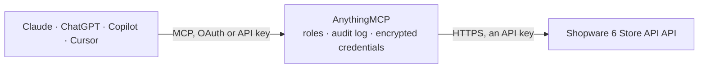

<!-- Generated by scripts/export-github-catalog.mjs in the anythingmcp-website repository. Do not edit by hand. -->

# Shopware 6 Store API MCP connector

Query a Shopware 6 storefront programmatically — product catalog, categories, cross-sells, landing pages, and search. The AnythingMCP connector gives Claude, ChatGPT, Microsoft Copilot, Cursor and Gemini 6 MCP tools for Shopware 6 Store API, all read-only.

**Category:** [E-commerce](../e-commerce.md) · **Tools:** 6 · **Setup guide:** [anythingmcp.com](https://anythingmcp.com/guides/shopware-6-to-mcp) · [Deutsch](https://anythingmcp.com/de/guides/shopware-6-to-mcp) · [Italiano](https://anythingmcp.com/it/guides/shopware-6-to-mcp) · [Español](https://anythingmcp.com/es/guides/shopware-6-to-mcp) · [日本語](https://anythingmcp.com/ja/guides/shopware-6-to-mcp) · [Русский](https://anythingmcp.com/ru/guides/shopware-6-to-mcp) · [中文](https://anythingmcp.com/zh/guides/shopware-6-to-mcp)

## Start without code

No installation and no terminal: AnythingMCP Cloud runs the Shopware 6 Store API connector for you, operated by helpcode.ai in Frankfurt, Germany.

1. **Click the button above** and create an account or sign in. The Shopware 6 Store API connector opens, ready to install.
2. **Paste the API key or token from your Shopware 6 Store API account.** Every click is in the [step-by-step guide](https://anythingmcp.com/guides/shopware-6-to-mcp).
3. **Click Install.** AnythingMCP shows the address of your MCP server.
4. **Add that address to your assistant:** [Claude](https://anythingmcp.com/guides/connect-shopware-6-to-claude) · [ChatGPT](https://anythingmcp.com/guides/connect-shopware-6-to-chatgpt) · [Microsoft Copilot](https://anythingmcp.com/guides/connect-shopware-6-to-copilot) · [Cursor](https://anythingmcp.com/guides/connect-shopware-6-to-cursor) · [Gemini CLI](https://anythingmcp.com/guides/connect-shopware-6-to-gemini) · [Meta Muse](https://anythingmcp.com/guides/connect-shopware-6-to-muse).
5. **Ask your first question**, for example: *What's current stock and price for product number MF-CHAIR-022 in our storefront?*

Prefer help with the setup? [Talk to us](https://anythingmcp.com/contact).

## How it works

- **The AI client** speaks MCP (Streamable HTTP) to AnythingMCP and only sees tool names, descriptions and results. It never gets the Shopware 6 Store API credentials.
- **AnythingMCP** checks the client's role, builds the call from the tool definition, adds the credentials (an API key), calls Shopware 6 Store API, logs the call and returns the result.
- **Shopware 6 Store API** sees an ordinary API client with the rights of the account the credentials belong to.

## Tools

| Tool | What it does | Access |
|---|---|---|
| [`shopware_search_products`](#shopware_search_products) | Search products in the sales channel. | read |
| [`shopware_get_product`](#shopware_get_product) | Retrieve a single product by id or product number, including description, pricing tiers, cross-sells, properties, media, and associations. | read |
| [`shopware_search_categories`](#shopware_search_categories) | List or search categories in the storefront category tree. | read |
| [`shopware_get_category`](#shopware_get_category) | Retrieve a category and optionally its products by category id. | read |
| [`shopware_search_suggest`](#shopware_search_suggest) | Shopware search suggest — returns product suggestions for as-you-type autocomplete. | read |
| [`shopware_get_cross_sells`](#shopware_get_cross_sells) | Retrieve the cross-sell product streams configured for a product (e.g. 'Related products', 'Customers also bought'). | read |

## Tool reference

Every parameter as the AI client sees it in `tools/list`. Source: [`packages/backend/src/adapters/de/shopware-6.json`](../../../packages/backend/src/adapters/de/shopware-6.json).

### `shopware_search_products`

Search products in the sales channel. Returns product id, name, product number, price, stock, manufacturer, and cover image. Supports Shopware criteria.

**Access:** read · **Call:** `POST /product`

| Parameter | Type | Required | Description |
|---|---|---|---|
| `search` | string | no | Free-text search term. |
| `limit` | number | no | Max results (default: 24, max: 100; Shopware refuses more with FRAMEWORK__QUERY_LIMIT_EXCEEDED). Use page for the next page. |
| `page` | number | no | Page number, 1-based. |
| `filter` | any[] | no | Array of filter objects per Shopware criteria (e.g. [{"type":"equals","field":"active","value":true}]). |
| `sort` | any[] | no | Sort order (e.g. [{"field":"name","order":"ASC"}]). |
| `associations` | object | no | Associations to load (e.g. {"manufacturer":{},"cover":{}}). |

### `shopware_get_product`

Retrieve a single product by id or product number, including description, pricing tiers, cross-sells, properties, media, and associations.

**Access:** read · **Call:** `POST /product/{productId}`

| Parameter | Type | Required | Description |
|---|---|---|---|
| `productId` | string | yes | The Shopware product UUID. |
| `associations` | object | no | Associations to load (e.g. {"media":{},"properties":{},"crossSellings":{}}). |

### `shopware_search_categories`

List or search categories in the storefront category tree.

**Access:** read · **Call:** `POST /category`

| Parameter | Type | Required | Description |
|---|---|---|---|
| `limit` | number | no | Max results. |
| `filter` | any[] | no | Shopware filter array. |

### `shopware_get_category`

Retrieve a category and optionally its products by category id. Used for category listing pages.

**Access:** read · **Call:** `POST /category/{categoryId}`

| Parameter | Type | Required | Description |
|---|---|---|---|
| `categoryId` | string | yes | Category UUID or slug. |
| `associations` | object | no | Associations to load. |

### `shopware_search_suggest`

Shopware search suggest — returns product suggestions for as-you-type autocomplete. Lightweight, optimised for low latency.

**Access:** read · **Call:** `POST /search-suggest`

| Parameter | Type | Required | Description |
|---|---|---|---|
| `search` | string | yes | Query term. |
| `limit` | number | no | Max suggestions (default: 10). |

### `shopware_get_cross_sells`

Retrieve the cross-sell product streams configured for a product (e.g. 'Related products', 'Customers also bought').

**Access:** read · **Call:** `POST /product/{productId}/cross-selling`

| Parameter | Type | Required | Description |
|---|---|---|---|
| `productId` | string | yes | The product UUID. |

## Run it yourself

AnythingMCP is open source (AGPL-3.0). [Run it with Docker](../../../README.md#run-it-yourself), open **Connectors → Store**, pick **Shopware 6 Store API** and enter `SHOPWARE_URL`, `SHOPWARE_ACCESS_KEY`, then add your MCP server URL to the AI client.

[← E-commerce connectors](../e-commerce.md) · [All categories](../README.md)
