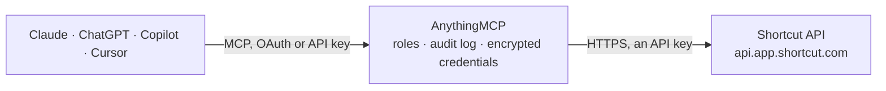

<!-- Generated by scripts/export-github-catalog.mjs in the anythingmcp-website repository. Do not edit by hand. -->

# Shortcut MCP connector

Let your AI work in Shortcut: search stories with Shortcut's search operators, read stories with tasks, comments and history, epics, iterations, objectives, teams, workflows and labels, and create, … The AnythingMCP connector gives Claude, ChatGPT, Microsoft Copilot, Cursor and Gemini 20 MCP tools for Shortcut: 16 read and 4 can change data.

**Category:** [Project Management](../project-management.md) · **Tools:** 20 · **Setup guide:** [anythingmcp.com](https://anythingmcp.com/guides/shortcut-to-mcp) · [Deutsch](https://anythingmcp.com/de/guides/shortcut-to-mcp) · [Italiano](https://anythingmcp.com/it/guides/shortcut-to-mcp) · [Español](https://anythingmcp.com/es/guides/shortcut-to-mcp) · [日本語](https://anythingmcp.com/ja/guides/shortcut-to-mcp) · [Русский](https://anythingmcp.com/ru/guides/shortcut-to-mcp) · [中文](https://anythingmcp.com/zh/guides/shortcut-to-mcp)

## Start without code

No installation and no terminal: AnythingMCP Cloud runs the Shortcut connector for you, operated by helpcode.ai in Frankfurt, Germany.

1. **Click the button above** and create an account or sign in. The Shortcut connector opens, ready to install.
2. **Paste the API key or token from your Shortcut account.** Every click is in the [step-by-step guide](https://anythingmcp.com/guides/shortcut-to-mcp).
3. **Click Install.** AnythingMCP shows the address of your MCP server.
4. **Add that address to your assistant:** [Claude](https://anythingmcp.com/guides/connect-shortcut-to-claude) · [ChatGPT](https://anythingmcp.com/guides/connect-shortcut-to-chatgpt) · [Microsoft Copilot](https://anythingmcp.com/guides/connect-shortcut-to-copilot) · [Cursor](https://anythingmcp.com/guides/connect-shortcut-to-cursor) · [Gemini CLI](https://anythingmcp.com/guides/connect-shortcut-to-gemini) · [Meta Muse](https://anythingmcp.com/guides/connect-shortcut-to-muse).
5. **Ask your first question**, for example: *Show the full story for Shortcut story id 1127 (customer report: Android push tokens failing).*

Prefer help with the setup? [Talk to us](https://anythingmcp.com/contact).

## How it works

- **The AI client** speaks MCP (Streamable HTTP) to AnythingMCP and only sees tool names, descriptions and results. It never gets the Shortcut credentials.
- **AnythingMCP** checks the client's role, builds the call from the tool definition, adds the credentials (an API key), calls Shortcut, logs the call and returns the result.
- **Shortcut** sees an ordinary API client with the rights of the account the credentials belong to.

## Tools

| Tool | What it does | Access |
|---|---|---|
| [`shortcut_get_current_member`](#shortcut_get_current_member) | Read who the API token belongs to: member id (UUID), name, mention name (for owner: searches), role, and the workspace with its name, URL slug, default… | read |
| [`shortcut_list_members`](#shortcut_list_members) | List the members of the workspace: id (UUID, used for owner_ids and requested_by_id), name, mention name, role and whether they are disabled. | read |
| [`shortcut_list_workflows`](#shortcut_list_workflows) | List the workflows of the workspace with their states: workflow id and name, default state, team, and each state's id, name, type (unstarted, started, done)… | read |
| [`shortcut_list_teams`](#shortcut_list_teams) | List the teams (called groups in the API): id (UUID, used as group_id), name, mention name, description, archived, workflow ids, member ids and story counts. | read |
| [`shortcut_list_projects`](#shortcut_list_projects) | List the projects of the workspace (an older way to group stories; many workspaces use teams instead): id, name, abbreviation, archived, team and workflow,… | read |
| [`shortcut_list_epics`](#shortcut_list_epics) | List epics page by page: id, name, state (to do, in progress, done), dates, owners, teams, objectives and story counts. | read |
| [`shortcut_search_epics`](#shortcut_search_epics) | Search epics with text and Shortcut search operators (see the connector instructions), e.g. 'checkout is:started'. | read |
| [`shortcut_get_epic`](#shortcut_get_epic) | Read one epic: name, description, state, dates, owners, teams, objectives, labels, health and story counts, plus its comments. | read |
| [`shortcut_list_epic_stories`](#shortcut_list_epic_stories) | List the stories of one epic with id, name, type, state, owners, estimate and dates. | read |
| [`shortcut_list_iterations`](#shortcut_list_iterations) | List all iterations (sprints): id, name, status (unstarted, started, done), start and end date, teams and point and story counts. | read |
| [`shortcut_list_iteration_stories`](#shortcut_list_iteration_stories) | List the stories of one iteration (sprint) with id, name, type, state, owners, estimate and dates. | read |
| [`shortcut_list_objectives`](#shortcut_list_objectives) | List objectives (the successor of milestones): id, name, state (to do, in progress, done), whether started or completed, categories and app link. | read |
| [`shortcut_list_labels`](#shortcut_list_labels) | List the labels of the workspace: id, name, color, description and archived. | read |
| [`shortcut_search_stories`](#shortcut_search_stories) | Search stories with text and Shortcut search operators (see the connector instructions), e.g. 'owner:jane is:started type:bug'. | read |
| [`shortcut_get_story`](#shortcut_get_story) | Read one story in full: name, description, type, state, epic, iteration, team, owners, requester, estimate, deadline, labels, tasks, comments, linked… | read |
| [`shortcut_get_story_history`](#shortcut_get_story_history) | Read the change history of one story: each change with time, who made it (member id and name) and the actions, e.g. state moves, owner, estimate or epic… | read |
| [`shortcut_create_story`](#shortcut_create_story) | Create a story. | write |
| [`shortcut_update_story`](#shortcut_update_story) | Change a story: name, description, type, workflow state (to move it), team, epic, iteration, owners, estimate, deadline, labels or archived. | write |
| [`shortcut_add_story_comment`](#shortcut_add_story_comment) | Add a comment to a story, as you. | write |
| [`shortcut_delete_story`](#shortcut_delete_story) | Delete a story permanently. | write |

## Tool reference

Every parameter as the AI client sees it in `tools/list`. Source: [`packages/backend/src/adapters/intl/shortcut.json`](../../../packages/backend/src/adapters/intl/shortcut.json).

### `shortcut_get_current_member`

Read who the API token belongs to: member id (UUID), name, mention name (for owner: searches), role, and the workspace with its name, URL slug, default workflow id and point scale. Use it first to check the connection.

**Access:** read · **Call:** `GET /member`

No parameters.

### `shortcut_list_members`

List the members of the workspace: id (UUID, used for owner_ids and requested_by_id), name, mention name, role and whether they are disabled. E-mail addresses are left out. Active members only unless disabled is true.

**Access:** read · **Call:** `GET /members`

| Parameter | Type | Required | Description |
|---|---|---|---|
| `disabled` | boolean | no | true lists only disabled members; default false lists active members. |

### `shortcut_list_workflows`

List the workflows of the workspace with their states: workflow id and name, default state, team, and each state's id, name, type (unstarted, started, done) and position. Use a state id as workflow_state_id to create or move a story.

**Access:** read · **Call:** `GET /workflows`

No parameters.

### `shortcut_list_teams`

List the teams (called groups in the API): id (UUID, used as group_id), name, mention name, description, archived, workflow ids, member ids and story counts. Active teams only unless archived is true.

**Access:** read · **Call:** `GET /groups`

| Parameter | Type | Required | Description |
|---|---|---|---|
| `archived` | boolean | no | true lists only archived teams; default false lists active ones. |

### `shortcut_list_projects`

List the projects of the workspace (an older way to group stories; many workspaces use teams instead): id, name, abbreviation, archived, team and workflow, and story counts.

**Access:** read · **Call:** `GET /projects`

No parameters.

### `shortcut_list_epics`

List epics page by page: id, name, state (to do, in progress, done), dates, owners, teams, objectives and story counts. Descriptions are left out unless includes_description is true. More: call again with page = next while next is a number; total is the number of epics.

**Access:** read · **Call:** `GET /epics/paginated`

| Parameter | Type | Required | Description |
|---|---|---|---|
| `page` | integer | no | Page number, starting at 1. |
| `page_size` | integer | no | Epics per page, 1 to 250. Default 25 here. |
| `includes_description` | boolean | no | Include each epic's description. Default false. |

### `shortcut_search_epics`

Search epics with text and Shortcut search operators (see the connector instructions), e.g. 'checkout is:started'. Returns up to page_size epics with id, name, state, dates and owners. More: pass the next token.

**Access:** read · **Call:** `GET /search/epics`

| Parameter | Type | Required | Description |
|---|---|---|---|
| `query` | string | yes | Words and operators, e.g. 'team:Mobile !is:done'. |
| `page_size` | integer | no | Results per page, 1 to 250. Default 25. |
| `next` | string | no | Token for the next page: the value after next= in the previous answer's next. |

### `shortcut_get_epic`

Read one epic: name, description, state, dates, owners, teams, objectives, labels, health and story counts, plus its comments.

**Access:** read · **Call:** `GET /epics/{epic_id}`

| Parameter | Type | Required | Description |
|---|---|---|---|
| `epic_id` | integer | yes | The epic's numeric id. |

### `shortcut_list_epic_stories`

List the stories of one epic with id, name, type, state, owners, estimate and dates. Descriptions are left out unless includes_description is true.

**Access:** read · **Call:** `GET /epics/{epic_id}/stories`

| Parameter | Type | Required | Description |
|---|---|---|---|
| `epic_id` | integer | yes | The epic's numeric id. |
| `includes_description` | boolean | no | Include each story's description. Default false. |

### `shortcut_list_iterations`

List all iterations (sprints): id, name, status (unstarted, started, done), start and end date, teams and point and story counts. Use the id with shortcut_list_iteration_stories.

**Access:** read · **Call:** `GET /iterations`

No parameters.

### `shortcut_list_iteration_stories`

List the stories of one iteration (sprint) with id, name, type, state, owners, estimate and dates. Descriptions are left out unless includes_description is true.

**Access:** read · **Call:** `GET /iterations/{iteration_id}/stories`

| Parameter | Type | Required | Description |
|---|---|---|---|
| `iteration_id` | integer | yes | The iteration's numeric id. |
| `includes_description` | boolean | no | Include each story's description. Default false. |

### `shortcut_list_objectives`

List objectives (the successor of milestones): id, name, state (to do, in progress, done), whether started or completed, categories and app link.

**Access:** read · **Call:** `GET /objectives`

No parameters.

### `shortcut_list_labels`

List the labels of the workspace: id, name, color, description and archived. Use a label name in create or update (labels: [{name}]) or in a label: search.

**Access:** read · **Call:** `GET /labels`

No parameters.

### `shortcut_search_stories`

Search stories with text and Shortcut search operators (see the connector instructions), e.g. 'owner:jane is:started type:bug'. Returns id, name, type, state, epic, iteration, team, owners, estimate, deadline and link. More: pass the next token; only the first 1000 matches can be paged.

**Access:** read · **Call:** `GET /search/stories`

| Parameter | Type | Required | Description |
|---|---|---|---|
| `query` | string | yes | Words and operators, e.g. 'label:customer !is:done updated:2026-10-01..*'. |
| `page_size` | integer | no | Results per page, 1 to 250. Default 25. |
| `next` | string | no | Token for the next page: the value after next= in the previous answer's next. |

### `shortcut_get_story`

Read one story in full: name, description, type, state, epic, iteration, team, owners, requester, estimate, deadline, labels, tasks, comments, linked stories and external links.

**Access:** read · **Call:** `GET /stories/{story_id}`

| Parameter | Type | Required | Description |
|---|---|---|---|
| `story_id` | integer | yes | The story's number, e.g. 123 (the number in the story URL, also shown as sc-123). |

### `shortcut_get_story_history`

Read the change history of one story: each change with time, who made it (member id and name) and the actions, e.g. state moves, owner, estimate or epic changes, with old and new values. Newest changes are at the end.

**Access:** read · **Call:** `GET /stories/{story_id}/history`

| Parameter | Type | Required | Description |
|---|---|---|---|
| `story_id` | integer | yes | The story's number, e.g. 123 (the number in the story URL, also shown as sc-123). |

### `shortcut_create_story`

Create a story. Pass a name and either workflow_state_id (from shortcut_list_workflows) or a project or team whose workflow is used. Show the user the story to be created (name, type, state, owners, epic) and confirm before calling.

**Access:** write · **Call:** `POST /stories`

| Parameter | Type | Required | Description |
|---|---|---|---|
| `name` | string | yes | Title of the story, at most 512 characters. |
| `description` | string | no | Description in Markdown, at most 100000 characters. |
| `story_type` | `feature` \| `bug` \| `chore` | no | feature (default), bug or chore. |
| `workflow_state_id` | integer | no | Workflow state the story starts in, from shortcut_list_workflows. |
| `group_id` | string | no | Team (UUID) from shortcut_list_teams. |
| `project_id` | integer | no | Project id, for workspaces that use projects. |
| `epic_id` | integer | no | Epic the story belongs to. |
| `iteration_id` | integer | no | Iteration (sprint) the story belongs to. |
| `owner_ids` | string[] | no | Member UUIDs of the owners, from shortcut_list_members. |
| `requested_by_id` | string | no | Member UUID of the requester. Default: you. |
| `estimate` | integer | no | Point estimate. |
| `deadline` | string | no | Due date, ISO 8601, e.g. 2026-11-01T00:00:00Z. |
| `labels` | object[] | no | Labels to attach, e.g. [{"name": "customer"}]. Unknown names create a new label. |
| `external_links` | string[] | no | Links to add, e.g. a support ticket URL. |

### `shortcut_update_story`

Change a story: name, description, type, workflow state (to move it), team, epic, iteration, owners, estimate, deadline, labels or archived. Only the fields you pass change; owner_ids and labels replace the whole list. Show the user the change and confirm before calling.

**Access:** write · **Call:** `PUT /stories/{story_id}`

| Parameter | Type | Required | Description |
|---|---|---|---|
| `story_id` | integer | yes | The story's number, e.g. 123 (the number in the story URL, also shown as sc-123). |
| `name` | string | no | New title. |
| `description` | string | no | New description in Markdown; replaces the old one. |
| `story_type` | `feature` \| `bug` \| `chore` | no | feature, bug or chore. |
| `workflow_state_id` | integer | no | Move the story to this workflow state. |
| `group_id` | string | no | Team (UUID). |
| `epic_id` | integer | no | Epic the story belongs to. |
| `iteration_id` | integer | no | Iteration (sprint) the story belongs to. |
| `owner_ids` | string[] | no | Member UUIDs of all owners (replaces the list). |
| `estimate` | integer | no | Point estimate. |
| `deadline` | string | no | Due date, ISO 8601. |
| `labels` | object[] | no | All labels of the story (replaces the list), e.g. [{"name": "customer"}]. |
| `archived` | boolean | no | true archives the story (reversible), false restores it. |

### `shortcut_add_story_comment`

Add a comment to a story, as you. Markdown and @mentions work; followers are notified. Show the user the comment text and confirm before calling.

**Access:** write · **Call:** `POST /stories/{story_id}/comments`

| Parameter | Type | Required | Description |
|---|---|---|---|
| `story_id` | integer | yes | The story's number, e.g. 123 (the number in the story URL, also shown as sc-123). |
| `text` | string | yes | Comment text in Markdown, at most 100000 characters. |
| `parent_id` | integer | no | Reply to this comment id instead of starting a new thread. |

### `shortcut_delete_story`

Delete a story permanently. It cannot be restored; archive it with shortcut_update_story instead when possible. Installed switched off. Only when the user explicitly asks; confirm the story id and name first.

**Access:** write · **Call:** `DELETE /stories/{story_id}`

| Parameter | Type | Required | Description |
|---|---|---|---|
| `story_id` | integer | yes | The story's number, e.g. 123 (the number in the story URL, also shown as sc-123). |

## Run it yourself

AnythingMCP is open source (AGPL-3.0). [Run it with Docker](../../../README.md#run-it-yourself), open **Connectors → Store**, pick **Shortcut** and enter `SHORTCUT_API_TOKEN`, then add your MCP server URL to the AI client.

[← Project Management connectors](../project-management.md) · [All categories](../README.md)
