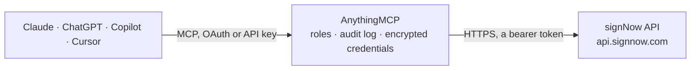

<!-- Generated by scripts/export-github-catalog.mjs in the anythingmcp-website repository. Do not edit by hand. -->

# signNow MCP connector

Let your AI work with signNow e-signatures: browse folders, documents and templates, check invite status and history, download signed PDFs, create documents from templates or files, prefill fields, … The AnythingMCP connector gives Claude, ChatGPT, Microsoft Copilot, Cursor and Gemini 37 MCP tools for signNow: 17 read and 20 can change data.

**Category:** [E-Signature](../e-signature.md) · **Tools:** 37 · **Setup guide:** [anythingmcp.com](https://anythingmcp.com/guides/signnow-to-mcp) · [Deutsch](https://anythingmcp.com/de/guides/signnow-to-mcp) · [Italiano](https://anythingmcp.com/it/guides/signnow-to-mcp) · [Español](https://anythingmcp.com/es/guides/signnow-to-mcp) · [日本語](https://anythingmcp.com/ja/guides/signnow-to-mcp) · [Русский](https://anythingmcp.com/ru/guides/signnow-to-mcp) · [中文](https://anythingmcp.com/zh/guides/signnow-to-mcp)

## Start without code

No installation and no terminal: AnythingMCP Cloud runs the signNow connector for you, operated by helpcode.ai in Frankfurt, Germany.

1. **Click the button above** and create an account or sign in. The signNow connector opens, ready to install.
2. **Paste the API key or token from your signNow account.** Every click is in the [step-by-step guide](https://anythingmcp.com/guides/signnow-to-mcp).
3. **Click Install.** AnythingMCP shows the address of your MCP server.
4. **Add that address to your assistant:** [Claude](https://anythingmcp.com/guides/connect-signnow-to-claude) · [ChatGPT](https://anythingmcp.com/guides/connect-signnow-to-chatgpt) · [Microsoft Copilot](https://anythingmcp.com/guides/connect-signnow-to-copilot) · [Cursor](https://anythingmcp.com/guides/connect-signnow-to-cursor) · [Gemini CLI](https://anythingmcp.com/guides/connect-signnow-to-gemini) · [Meta Muse](https://anythingmcp.com/guides/connect-signnow-to-muse).
5. **Ask your first question**, for example: *What is the signing status and signer email for invoice INV-2026-341 in Documents?*

Prefer help with the setup? [Talk to us](https://anythingmcp.com/contact).

## How it works

- **The AI client** speaks MCP (Streamable HTTP) to AnythingMCP and only sees tool names, descriptions and results. It never gets the signNow credentials.
- **AnythingMCP** checks the client's role, builds the call from the tool definition, adds the credentials (a bearer token), calls signNow, logs the call and returns the result.
- **signNow** sees an ordinary API client with the rights of the account the credentials belong to.

## Tools

| Tool | What it does | Access |
|---|---|---|
| [`signnow_get_user`](#signnow_get_user) | Who the API key belongs to: user id, name, email, active state, organization and team memberships, subscription and document counts. | read |
| [`signnow_list_folders`](#signnow_list_folders) | List the folder tree: the root folder with its system folders (Documents, Templates, Archive, Trash Bin) and your own folders, each with id, name and… | read |
| [`signnow_get_folder`](#signnow_get_folder) | List the documents, templates and document groups in one folder, with paging, sorting and filters: id, document_name, created and updated (Unix seconds),… | read |
| [`signnow_get_document`](#signnow_get_document) | Read one document or template: name, owner, page count, template flag, roles (unique_id, name, signing_order), fields with their role and values (texts,… | read |
| [`signnow_get_document_fields`](#signnow_get_document_fields) | List the fields of a document with their name, type, role and current value (the filled-in data once signed). | read |
| [`signnow_get_document_history`](#signnow_get_document_history) | Full history of a document: every event (viewed, signed, field added, invite sent, emailed, downloaded) with time, email, IP address and client app. | read |
| [`signnow_list_free_form_invites`](#signnow_list_free_form_invites) | List the free form invites of a document (signature requests without fields): id, recipient email, status (pending, fulfilled, cancelled) and created time. | read |
| [`signnow_get_routing_details`](#signnow_get_routing_details) | Read the routing details of a template: its signer roles in signing order with their default email, name and settings. | read |
| [`signnow_download_document`](#signnow_download_document) | Download a document as a PDF: type collapsed (default) flattens the fields and signatures into one PDF; with_history 1 appends the signing history. | read |
| [`signnow_get_download_link`](#signnow_get_download_link) | Create a temporary public link to download the document PDF (valid for a short time, no sign-in needed). | read |
| [`signnow_list_document_groups`](#signnow_list_document_groups) | List document groups (several documents signed together): id, group_name, documents, invite id and status, created and updated time. | read |
| [`signnow_get_document_group`](#signnow_get_document_group) | Read one document group: name, owner, its documents with their roles, the group invite id and status. | read |
| [`signnow_get_document_group_recipients`](#signnow_get_document_group_recipients) | List the recipients of a document group: name, email, signing order, which documents each one gets, and the cc list. | read |
| [`signnow_get_group_invite`](#signnow_get_group_invite) | Status of a document group invite: overall status (created, pending, fulfilled) and each step with its actions (email, role, action sign or view, document,… | read |
| [`signnow_list_template_groups`](#signnow_list_template_groups) | List document group templates (sets of templates sent together): id, template_group_name, templates with their roles, routing details, folder. | read |
| [`signnow_get_template_group`](#signnow_get_template_group) | Read one document group template: name, its templates with their roles, routing details (signing steps), owner and folder. | read |
| [`signnow_download_document_group`](#signnow_download_document_group) | Download all documents of a group: one merged PDF or a ZIP, optionally with the history. | read |
| [`signnow_upload_document_from_url`](#signnow_upload_document_from_url) | Create a document (or with make_template a template) from a file at a public URL (PDF, Word and other formats). | write |
| [`signnow_update_document`](#signnow_update_document) | Rename a document or set its fields. | write |
| [`signnow_create_template`](#signnow_create_template) | Make a template from a document (the document is kept). | write |
| [`signnow_create_document_from_template`](#signnow_create_document_from_template) | Create a new document from a template, ready to be sent with signnow_send_invite. | write |
| [`signnow_send_invite`](#signnow_send_invite) | Send a document with fields for signature (role-based invite): each role gets its own email with a signing link, in signing order. | write |
| [`signnow_send_free_form_invite`](#signnow_send_free_form_invite) | Send a document without fields for signature (free form invite): the signer places the signature anywhere. | write |
| [`signnow_cancel_invite`](#signnow_cancel_invite) | Cancel all pending role-based invites of a document: signing links stop working. | write |
| [`signnow_cancel_free_form_invite`](#signnow_cancel_free_form_invite) | Cancel one pending free form invite (id from signnow_list_free_form_invites). | write |
| [`signnow_resend_field_invite`](#signnow_resend_field_invite) | Send the invite email again (a reminder) to one pending signer of a role-based invite. | write |
| [`signnow_prefill_text_fields`](#signnow_prefill_text_fields) | Fill text fields of a document before sending it, by field name (names from signnow_get_document_fields). | write |
| [`signnow_create_signing_link`](#signnow_create_signing_link) | Create a signing link for a document with fields and one signer role, to open the signing page directly without email. | write |
| [`signnow_move_document`](#signnow_move_document) | Move a document to another folder (folder ids from signnow_list_folders). | write |
| [`signnow_delete_document`](#signnow_delete_document) | Delete a document or template. | write |
| [`signnow_create_folder`](#signnow_create_folder) | Create a folder inside another folder (the root folder id from signnow_list_folders for a top-level folder). | write |
| [`signnow_create_document_group`](#signnow_create_document_group) | Bundle several documents (with fields) into a document group, to send them in one invite. | write |
| [`signnow_create_group_from_template`](#signnow_create_group_from_template) | Create a document group from a document group template. | write |
| [`signnow_send_group_invite`](#signnow_send_group_invite) | Send a document group for signature in steps: each step lists the emails to notify and the actions (sign or view a document as a role). | write |
| [`signnow_resend_group_invite`](#signnow_resend_group_invite) | Send the invite email of a document group again to the signers of the current step, or to one email. | write |
| [`signnow_cancel_group_invite`](#signnow_cancel_group_invite) | Cancel the invite of a document group: signing stops for every step. | write |
| [`signnow_delete_document_group`](#signnow_delete_document_group) | Delete a document group (the documents themselves are kept). | write |

## Tool reference

Every parameter as the AI client sees it in `tools/list`. Source: [`packages/backend/src/adapters/intl/signnow.json`](../../../packages/backend/src/adapters/intl/signnow.json).

### `signnow_get_user`

Who the API key belongs to: user id, name, email, active state, organization and team memberships, subscription and document counts.

**Access:** read · **Call:** `GET /user`

No parameters.

### `signnow_list_folders`

List the folder tree: the root folder with its system folders (Documents, Templates, Archive, Trash Bin) and your own folders, each with id, name and document_count. Use a folder id with signnow_get_folder to list what is inside.

**Access:** read · **Call:** `GET /user/folder`

| Parameter | Type | Required | Description |
|---|---|---|---|
| `entity_type` | `document-all` \| `all` \| `document` \| `document-group` \| `dgt` \| `template` | no | Which entities the counts cover. |
| `with_team_documents` | boolean | no | true also shows the Team Documents folders. |

### `signnow_get_folder`

List the documents, templates and document groups in one folder, with paging, sorting and filters: id, document_name, created and updated (Unix seconds), owner, template flag, roles, field invites and their status. Filter documents by signing status or date.

**Access:** read · **Call:** `GET /folder/{folder_id}`

| Parameter | Type | Required | Description |
|---|---|---|---|
| `folder_id` | string | yes | Folder id, from signnow_list_folders. |
| `entity_type` | `document-all` \| `all` \| `document` \| `document-group` \| `dgt` \| `template` | no | What to list: document-all (default: documents and document groups), document, document-group, template, dgt (document group templates) or all. |
| `filters` | `signing-status` \| `documents-created` \| `documents-updated` | no | What filter_values applies to. |
| `filter_values` | string | no | For signing-status: signed, pending, waiting-for-me, waiting-for-others, unsent or expired. For the date filters: a Unix timestamp (documents since then). |
| `sortby` | `updated` \| `created` \| `document-name` | no | Sort by. |
| `order` | `asc` \| `desc` | no | desc (default) or asc. |
| `limit` | integer | no | Number of items, up to 100. |
| `offset` | integer | no | Skip this many items (paging). |
| `include_documents_subfolders` | `0` \| `1` | no | 1 also lists documents in subfolders. |
| `with_team_documents` | boolean | no | true includes team documents. |

### `signnow_get_document`

Read one document or template: name, owner, page count, template flag, roles (unique_id, name, signing_order), fields with their role and values (texts, checks, signatures), field_invites (id, email, role, status, created and updated) and requests (free form invites).

**Access:** read · **Call:** `GET /document/{document_id}`

| Parameter | Type | Required | Description |
|---|---|---|---|
| `document_id` | string | yes | Document id (40 hex characters), from signnow_get_folder. |

### `signnow_get_document_fields`

List the fields of a document with their name, type, role and current value (the filled-in data once signed).

**Access:** read · **Call:** `GET /v2/documents/{document_id}/fields`

| Parameter | Type | Required | Description |
|---|---|---|---|
| `document_id` | string | yes | Document id (40 hex characters), from signnow_get_folder. |

### `signnow_get_document_history`

Full history of a document: every event (viewed, signed, field added, invite sent, emailed, downloaded) with time, email, IP address and client app.

**Access:** read · **Call:** `GET /document/{document_id}/historyfull`

| Parameter | Type | Required | Description |
|---|---|---|---|
| `document_id` | string | yes | Document id (40 hex characters), from signnow_get_folder. |

### `signnow_list_free_form_invites`

List the free form invites of a document (signature requests without fields): id, recipient email, status (pending, fulfilled, cancelled) and created time.

**Access:** read · **Call:** `GET /v2/documents/{document_id}/free-form-invites`

| Parameter | Type | Required | Description |
|---|---|---|---|
| `document_id` | string | yes | Document id (40 hex characters), from signnow_get_folder. |
| `page` | integer | no | Page, from 1. |
| `per_page` | integer | no | Items per page, up to 100 (default 15). |

### `signnow_get_routing_details`

Read the routing details of a template: its signer roles in signing order with their default email, name and settings. Use the role names with signnow_send_invite after creating a document from the template.

**Access:** read · **Call:** `GET /document/{template_id}/template/routing/detail`

| Parameter | Type | Required | Description |
|---|---|---|---|
| `template_id` | string | yes | Template id (a document with template true). |

### `signnow_download_document`

Download a document as a PDF: type collapsed (default) flattens the fields and signatures into one PDF; with_history 1 appends the signing history.

**Access:** read · **Call:** `GET /document/{document_id}/download`

| Parameter | Type | Required | Description |
|---|---|---|---|
| `document_id` | string | yes | Document id (40 hex characters), from signnow_get_folder. |
| `type` | `collapsed` \| `zip` | no | collapsed (one flattened PDF) or zip. |
| `with_history` | `0` \| `1` | no | 1 appends the document history to the PDF. |

### `signnow_get_download_link`

Create a temporary public link to download the document PDF (valid for a short time, no sign-in needed). Nothing changes in the document.

**Access:** read · **Call:** `POST /document/{document_id}/download/link`

| Parameter | Type | Required | Description |
|---|---|---|---|
| `document_id` | string | yes | Document id (40 hex characters), from signnow_get_folder. |

### `signnow_list_document_groups`

List document groups (several documents signed together): id, group_name, documents, invite id and status, created and updated time.

**Access:** read · **Call:** `GET /user/documentgroups`

| Parameter | Type | Required | Description |
|---|---|---|---|
| `limit` | integer | no | Number of groups, up to 50. |
| `offset` | integer | no | Skip this many groups (paging). |

### `signnow_get_document_group`

Read one document group: name, owner, its documents with their roles, the group invite id and status.

**Access:** read · **Call:** `GET /documentgroup/{document_group_id}`

| Parameter | Type | Required | Description |
|---|---|---|---|
| `document_group_id` | string | yes | Document group id, from signnow_list_document_groups. |

### `signnow_get_document_group_recipients`

List the recipients of a document group: name, email, signing order, which documents each one gets, and the cc list.

**Access:** read · **Call:** `GET /v2/document-groups/{document_group_id}/recipients`

| Parameter | Type | Required | Description |
|---|---|---|---|
| `document_group_id` | string | yes | Document group id, from signnow_list_document_groups. |

### `signnow_get_group_invite`

Status of a document group invite: overall status (created, pending, fulfilled) and each step with its actions (email, role, action sign or view, document, status).

**Access:** read · **Call:** `GET /documentgroup/{document_group_id}/groupinvite/{invite_id}`

| Parameter | Type | Required | Description |
|---|---|---|---|
| `document_group_id` | string | yes | Document group id, from signnow_list_document_groups. |
| `invite_id` | string | yes | Group invite id, from signnow_get_document_group or the answer of signnow_send_group_invite. |

### `signnow_list_template_groups`

List document group templates (sets of templates sent together): id, template_group_name, templates with their roles, routing details, folder.

**Access:** read · **Call:** `GET /user/documentgroup/templates`

| Parameter | Type | Required | Description |
|---|---|---|---|
| `limit` | integer | no | Number of template groups, up to 50. |
| `offset` | integer | no | Skip this many (paging). |

### `signnow_get_template_group`

Read one document group template: name, its templates with their roles, routing details (signing steps), owner and folder.

**Access:** read · **Call:** `GET /documentgroup/template/{template_group_id}`

| Parameter | Type | Required | Description |
|---|---|---|---|
| `template_group_id` | string | yes | Document group template id, from signnow_list_template_groups. |

### `signnow_download_document_group`

Download all documents of a group: one merged PDF or a ZIP, optionally with the history. Nothing changes in the group.

**Access:** read · **Call:** `POST /documentgroup/{document_group_id}/downloadall`

| Parameter | Type | Required | Description |
|---|---|---|---|
| `document_group_id` | string | yes | Document group id, from signnow_list_document_groups. |
| `type` | `merged` \| `zip` | yes | merged (one PDF) or zip. |
| `with_history` | `no` \| `after_each_document` \| `after_merged_pdf` | yes | no (default), after_each_document or after_merged_pdf. |
| `document_order` | string[] | no | Document ids in the order to merge them. |

### `signnow_upload_document_from_url`

Create a document (or with make_template a template) from a file at a public URL (PDF, Word and other formats). With check_fields true, text tags in the file become fields. Returns the new document id.

**Access:** write · **Call:** `POST /v2/documents/url`

| Parameter | Type | Required | Description |
|---|---|---|---|
| `url` | string | yes | Public URL of the file. |
| `name` | string | no | Name for the document (default: from the URL). |
| `check_fields` | boolean | no | true turns text tags in the file into fields. |
| `make_template` | boolean | no | true stores it as a template instead of a document. |

### `signnow_update_document`

Rename a document or set its fields. Sending fields replaces all existing fields of the document, so include the ones to keep.

**Access:** write · **Call:** `PUT /document/{document_id}`

| Parameter | Type | Required | Description |
|---|---|---|---|
| `document_id` | string | yes | Document id (40 hex characters), from signnow_get_folder. |
| `document_name` | string | no | New name. |
| `fields` | object[] | no | Fields: [{"type": "signature", "role": "Signer 1", "page_number": 0, "x": 305, "y": 18, "width": 122, "height": 34, "required": true, "label"?, "name"?}]. Types: signature, initials, text, checkbox, dropdown, radiobutton, attachment, date. page_number starts at 0; x, y, width and height are in pixels from the top left. |

### `signnow_create_template`

Make a template from a document (the document is kept). Returns the template id.

**Access:** write · **Call:** `POST /template`

| Parameter | Type | Required | Description |
|---|---|---|---|
| `document_id` | string | yes | Document id (40 hex characters), from signnow_get_folder. |
| `document_name` | string | yes | Name of the new template. |

### `signnow_create_document_from_template`

Create a new document from a template, ready to be sent with signnow_send_invite. Returns the new document id.

**Access:** write · **Call:** `POST /template/{template_id}/copy`

| Parameter | Type | Required | Description |
|---|---|---|---|
| `template_id` | string | yes | Template id, from signnow_get_folder with entity_type template. |
| `document_name` | string | no | Name of the new document (default: the template name). |
| `folder_id` | string | no | Folder for the new document. |

### `signnow_send_invite`

Send a document with fields for signature (role-based invite): each role gets its own email with a signing link, in signing order.

**Access:** write · **Call:** `POST /document/{document_id}/invite`

| Parameter | Type | Required | Description |
|---|---|---|---|
| `document_id` | string | yes | Document id (40 hex characters), from signnow_get_folder. |
| `to` | object[] | yes | One entry per role: [{"email", "role": "Signer 1", "role_id"?, "order": 1, "subject"?, "message"?, "expiration_days"?, "reminder"?, "authentication_type"?, "password"?, "phone"?, "redirect_uri"?, "decline_by_signature"?, "reassign"?}]. Role names come from signnow_get_document (roles[].name). |
| `from` | string | yes | Sender email: must be the email of the signNow account the key belongs to. |
| `cc` | string[] | no | Email addresses that get a copy when the document is signed. |
| `subject` | string | no | Email subject for all signers. |
| `message` | string | no | Email message for all signers. |
| `cc_subject` | string | no | Email subject for the cc recipients. |
| `cc_message` | string | no | Email message for the cc recipients. |

### `signnow_send_free_form_invite`

Send a document without fields for signature (free form invite): the signer places the signature anywhere. One signer per call.

**Access:** write · **Call:** `POST /document/{document_id}/invite`

| Parameter | Type | Required | Description |
|---|---|---|---|
| `document_id` | string | yes | Document id (40 hex characters), from signnow_get_folder. |
| `to` | string | yes | Signer email. |
| `from` | string | yes | Sender email: must be the email of the signNow account the key belongs to. |
| `cc` | string[] | no | Email addresses that get a copy. |
| `subject` | string | no | Email subject. |
| `message` | string | no | Email message. |
| `language` | `en` \| `es` \| `fr` | no | Language of the signing session and emails. |
| `redirect_uri` | string | no | Address opened after signing. |

### `signnow_cancel_invite`

Cancel all pending role-based invites of a document: signing links stop working.

**Access:** write · **Call:** `PUT /document/{document_id}/fieldinvitecancel`

| Parameter | Type | Required | Description |
|---|---|---|---|
| `document_id` | string | yes | Document id (40 hex characters), from signnow_get_folder. |
| `reason` | string | no | Reason for the cancellation. |

### `signnow_cancel_free_form_invite`

Cancel one pending free form invite (id from signnow_list_free_form_invites).

**Access:** write · **Call:** `PUT /invite/{invite_id}/cancel`

| Parameter | Type | Required | Description |
|---|---|---|---|
| `invite_id` | string | yes | Free form invite id. |
| `reason` | string | no | Reason for the cancellation. |

### `signnow_resend_field_invite`

Send the invite email again (a reminder) to one pending signer of a role-based invite. The id is field_invites[].id from signnow_get_document.

**Access:** write · **Call:** `PUT /fieldinvite/{field_invite_id}/resend`

| Parameter | Type | Required | Description |
|---|---|---|---|
| `field_invite_id` | string | yes | Field invite id, from field_invites[].id of signnow_get_document. |

### `signnow_prefill_text_fields`

Fill text fields of a document before sending it, by field name (names from signnow_get_document_fields).

**Access:** write · **Call:** `PUT /v2/documents/{document_id}/prefill-texts`

| Parameter | Type | Required | Description |
|---|---|---|---|
| `document_id` | string | yes | Document id (40 hex characters), from signnow_get_folder. |
| `fields` | object[] | yes | [{"field_name": "Name", "prefilled_text": "Jane Doe"}] |

### `signnow_create_signing_link`

Create a signing link for a document with fields and one signer role, to open the signing page directly without email. Returns url (sign in to sign) and url_no_signup.

**Access:** write · **Call:** `POST /link`

| Parameter | Type | Required | Description |
|---|---|---|---|
| `document_id` | string | yes | Document id (40 hex characters), from signnow_get_folder. |
| `redirect_uri` | string | no | Address opened after signing. |

### `signnow_move_document`

Move a document to another folder (folder ids from signnow_list_folders).

**Access:** write · **Call:** `POST /document/{document_id}/move`

| Parameter | Type | Required | Description |
|---|---|---|---|
| `document_id` | string | yes | Document id (40 hex characters), from signnow_get_folder. |
| `folder_id` | string | yes | Target folder id. |

### `signnow_delete_document`

Delete a document or template. Pending invites of the document stop working.

**Access:** write · **Call:** `DELETE /document/{document_id}`

| Parameter | Type | Required | Description |
|---|---|---|---|
| `document_id` | string | yes | Document id (40 hex characters), from signnow_get_folder. |

### `signnow_create_folder`

Create a folder inside another folder (the root folder id from signnow_list_folders for a top-level folder).

**Access:** write · **Call:** `POST /user/folder`

| Parameter | Type | Required | Description |
|---|---|---|---|
| `name` | string | yes | Folder name. |
| `parent_id` | string | yes | Parent folder id. |

### `signnow_create_document_group`

Bundle several documents (with fields) into a document group, to send them in one invite. Returns the group id.

**Access:** write · **Call:** `POST /documentgroup`

| Parameter | Type | Required | Description |
|---|---|---|---|
| `document_ids` | string[] | yes | Ids of the documents to bundle. |
| `group_name` | string | yes | Name of the group. |

### `signnow_create_group_from_template`

Create a document group from a document group template. Returns the new group.

**Access:** write · **Call:** `POST /v2/document-group-templates/{template_group_id}/document-group`

| Parameter | Type | Required | Description |
|---|---|---|---|
| `template_group_id` | string | yes | Document group template id, from signnow_list_template_groups. |
| `group_name` | string | yes | Name of the new document group. |
| `folder_id` | string | no | Folder for the new group. |

### `signnow_send_group_invite`

Send a document group for signature in steps: each step lists the emails to notify and the actions (sign or view a document as a role). Returns the invite id.

**Access:** write · **Call:** `POST /documentgroup/{document_group_id}/groupinvite`

| Parameter | Type | Required | Description |
|---|---|---|---|
| `document_group_id` | string | yes | Document group id, from signnow_list_document_groups. |
| `invite_steps` | object[] | yes | [{"order": 1, "invite_emails": [{"email", "subject"?, "message"?, "expiration_days"?}], "invite_actions": [{"email", "role_name": "Signer 1", "action": "sign", "document_id"}]}]. action is sign, view or approve. |
| `completion_emails` | object[] | no | Who gets the completed documents: [{"email", "disable_document_attachment"?: 0 or 1}]. |
| `cc` | string[] | no | Email addresses that get a copy. |
| `sign_as_merged` | boolean | no | true (default) shows the group as one merged document to the signers. |

### `signnow_resend_group_invite`

Send the invite email of a document group again to the signers of the current step, or to one email.

**Access:** write · **Call:** `POST /documentgroup/{document_group_id}/groupinvite/{invite_id}/resendinvites`

| Parameter | Type | Required | Description |
|---|---|---|---|
| `document_group_id` | string | yes | Document group id, from signnow_list_document_groups. |
| `invite_id` | string | yes | Group invite id. |
| `email` | string | no | Only remind this email. |

### `signnow_cancel_group_invite`

Cancel the invite of a document group: signing stops for every step.

**Access:** write · **Call:** `POST /documentgroup/{document_group_id}/groupinvite/{invite_id}/cancelinvite`

| Parameter | Type | Required | Description |
|---|---|---|---|
| `document_group_id` | string | yes | Document group id, from signnow_list_document_groups. |
| `invite_id` | string | yes | Group invite id. |

### `signnow_delete_document_group`

Delete a document group (the documents themselves are kept). A group with a pending invite must be cancelled first.

**Access:** write · **Call:** `DELETE /documentgroup/{document_group_id}`

| Parameter | Type | Required | Description |
|---|---|---|---|
| `document_group_id` | string | yes | Document group id, from signnow_list_document_groups. |

## Run it yourself

AnythingMCP is open source (AGPL-3.0). [Run it with Docker](../../../README.md#run-it-yourself), open **Connectors → Store**, pick **signNow** and enter `SIGNNOW_API_KEY`, then add your MCP server URL to the AI client.

[← E-Signature connectors](../e-signature.md) · [All categories](../README.md)
